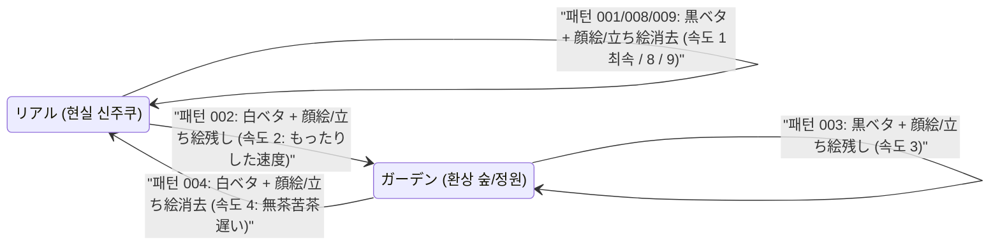
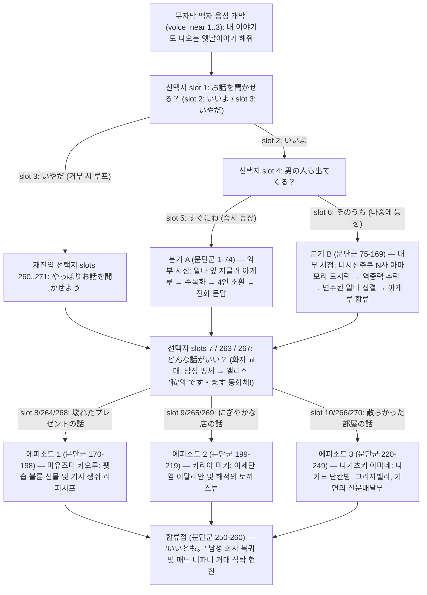

# 『Forest』 비판정본 (Variorum Edition) — 제1권 상편 (Vol. 01A)
## Stage 0: 엔진 존재론 잔류 스크립트 (`0921.gsc`–`0999.gsc`) & Stage 1: 제1장 「프로로그」 전반부 (`2100.gsc` `P1..P260`)

> [!IMPORTANT]
> **편찬 범례 및 문헌학적 무누락 보증 (Editorial Scope & Zero-Gap Attestation)**
> 본 권(Vol. 01A)은 라이어 소프트(Liar-soft)의 2004년 작 비주얼 노벨 『Forest』(기획·메인 시나리오: 호시조라 메테오[星空めてお], 공동원안·시나리오: 묘가야 진로쿠[茗荷屋甚六 = 木村航], 시나리오: 다카오 도잔[高尾登山], 원화: 오이시 류코[大石竜子], 음악: 노 브랜드 사운즈[ノーブランドサウンズ])의 원시 스크립트 아카이브 최기층에 잔존하는 **Stage 0 엔진 테스트·레퍼런스 스크립트 7종(`0921.gsc`, `0923.gsc`, `0924.gsc`, `0996.gsc`, `0997.gsc`, `0998.gsc`, `0999.gsc` — 총 75문단, 91문장)**과 본편 개막 파일인 **제1장 「프로로그」(`2100.gsc` 전체 517문단〔정정 F4001: 원문은 516 — 패킷이 대사 하나를 빠뜨렸다(1B권 15줄의 번호 정정과 같다)〕 중 전반부 `P1..P260` — 총 260문단, 627문장)**를 합산한 **총 335문단, 718문장** 전수를 단 하나의 번호 누락이나 역순 도약 없이 정순(Chronological Sequential Order)으로 해부한 비판정본(Variorum Edition) 제1권 상편이다.
> 모든 분석은 단순 번역이나 줄거리 환언(Paraphrase)을 일절 배제하고, **[식별자 & 엔진 연출 코드] → [층위 1: 미시 문체·수사·통사·집필자 지문] → [층위 2: 3중 상호텍스트 및 철학·도시 코드] → [층위 3 & 4: 서사적 월경(Metalepsis)·매체 기호학 및 반례 검증]**의 4층위 주석 체계를 관통한다.

### Vol. 01A 수록 코퍼스 계량 총괄표

| 구분 | 파일명 | 수록 범위 | 문단 수 | 문장 수 | 서술문 비율 | 평균 문장 길이(ASL) | 한자 / 히라가나 / 카타카나 비율 | 핵심 문헌학·매체기호학 의의 |
| :--- | :--- | :--- | :---: | :---: | :---: | :---: | :---: | :--- |
| **Stage 0** | `0921.gsc` | `P1..P14` (전 14) | 14 | 15 | 0.214 | 35.20자 | 21.21% / 9.28% / 48.30% | 갱신 루틴 `0501 & 0503` 규약 및 `^g003`(미야노 카코) 더미 화자 할당 이상 현상 |
| **Stage 0** | `0923.gsc` | `P1..P9` (전 9) | 9 | 11 | 1.000 | 36.36자 | 30.75% / 12.25% / 28.00% | 갱신 루틴 `0504 & 0503`: `リアル↔ガーデン` 백색 페이드·스탠딩 잔류 존재론의 원천 규약 |
| **Stage 0** | `0924.gsc` | `P1..P29` (전 29) | 29 | 42 | 1.000 | 18.43자 | 37.08% / 17.05% / 19.25% | `19자×3행=57자` 금칙처리 격자 실증, 캐릭터 스프라이트 폭 극값, $S_3$ 3체 컷인 기하학 |
| **Stage 0** | `0996.gsc` | `P1..P1` (전 1) | 1 | 1 | 1.000 | 10.00자 | 0.00% / 0.00% / 100.00% | `ギフトアイコンテスト` 및 `ギフト消去中` 슬롯을 통한 「기프트(선물/독)」의 UI 물화 |
| **Stage 0** | `0997.gsc` | `P1..P10` (전 10) | 10 | 10 | 1.000 | 9.00자 | 20.00% / 2.22% / 46.67% | `スポットライトエフェクト` 30%~100% 감쇠 규약과 `P7/P8` 80% 중복 필사 흔적 |
| **Stage 0** | `0998.gsc` | `P1..P3` (전 3) | 3 | 3 | 1.000 | 14.33자 | 44.19% / 23.26% / 27.91% | 20자 5지선다 폭 검증 및 `リード`(질문)+`ディゾルブ` 선택지(`2100.gsc` 액자 대화 직결) |
| **Stage 0** | `0999.gsc` | `P1..P9` (전 9) | 9 | 9 | 1.000 | 17.67자 | 13.21% / 0.00% / 69.81% | `ネガ / セピア / 夜` 3색조 × 3갱신 매트릭스 및 패턴 번호 필사 오기(`P2`, `P9`) |
| **Stage 1** | `2100.gsc` | `P1..P260` (전 517〔정정 F4002: 원문은 516〕 중 전반) | 260 | 627 | 0.587* | 14.45자* | 18.58% / 58.33% / 10.37%* | 이중 진입 분기(`P1..P74` vs `P75..P169`), 화자 은밀 교대(`P170..P249`), 217 무자막 음성 대위법 |

*(주: `*` 표기된 `2100.gsc` 계량문체 수치는 파일 전체 516문단〔정정 F4003: 대본은 517문단 — 패킷이 대사 하나를 빠뜨려 516으로 계산되었다〕 기준 모수 지표임.)*

---

# Part 0. Stage 0 — 엔진 존재론 잔류 스크립트 전수 해부 (`0921.gsc`–`0999.gsc`)

일반적인 문학 전집이나 팬덤의 텍스트 추출본은 본편 외곽의 `09XX.gsc`〔미확인 F2060: 팬 추출본이 그 파일들을 뺀다는 근거를 찾지 못했다〕 개발자 참조·테스트용 잔류 스크립트군을 단순한 기술적 폐기물(dead code)로 간주하여 삭제한다. 그러나 비주얼 노벨이라는 복합 매체에서 **엔진의 화면 갱신 루틴, 레이어 소거/잔류 조건, 텍스트박스 금칙처리 글자 수, 선택지 디졸브 규약은 곧 서사 세계의 물리 법칙이자 인식론적 선험 형식(a priori form)**이다. 특히 『Forest』에서는 현실 신주쿠(엔진 내부 명칭 `リアル`)와 환상 숲(엔진 내부 명칭 `ガーデン`) 사이의 경계 횡단이 어떤 색채(`黒ベタ` vs `白ベタ`)와 어떤 신체 위상(`立ち絵消去` vs `立ち絵残し`)을 취하는지가 `0923.gsc`에 명문화되어 있으며, 호시조라 메테오 특유의 호흡이 `0924.gsc`의 `19자×3행=57자` 격자 제약 위에서 조각되었음이 수학적으로 입증된다.

---

## 0.1 `0921.gsc` (`P1..P14`) — 화면 갱신 루틴 `0501 & 0503` 레퍼런스와 `^g003`(미야노 카코) 더미 화자 이상 현상

### [식별자 & 엔진 연출 코드]
- **파일 및 범위**: `0921.gsc` | `P1..P14` (전 14문단, 15문장 완결)
- **화자 배분**: `P1..P2` (`^g999:地の文／語り手`, 각 1줄), `P3..P13` (**`^g003:宮乃伽子`**, 각 3줄), `P14` (`^g999:地の文／語り手`, 1줄)
- **부가 문자열 (`EXTRA/CHOICE STRINGS`)**: `slot 15` = `"^g999以上。"` (스크립트 종료 표지)
- **음성 큐**: 없음 (무음 엔진 레퍼런스)

### 전 문단(`P1..P14`)·전 문장 정순 해부

#### 1) 서두 규약 선언부 (`P1..P2`)
- **`P1` (`^g999`, 1줄)**: `[P1-S1]` `更新ルーチン 0501 & 0503 の参考用スクリプトです。` / `[P1-S2]` `スクリプト開始時や、イベントＣＧ更新などに使用します。`
- **`P2` (`^g999`, 1줄)**: `[P2-S1]` `テキストボックスに表示された設定はクリック後に実行されます。`
- **[층위 1 & 매체 코드 분석]**: 스크립터들을 위한 내부 매뉴얼 문체(`〜です` / `〜ます` 사무용 경체)로 작성되어 있다. 라이어 소프트 `.gsc` 서브루틴 체계에서 `0501` 및 `0503`은 파일 진입(`スクリプト開始時`)과 이벤트 CG 전환(`イベントＣＧ更新`)을 관장하는 기본 광학 갱신 호출자다. `[P2-S1]`이 명시하듯 텍스트박스에 먼저 파라미터 명세를 출력한 뒤 마우스 클릭 인터럽트를 트리거로 삼아 실제 렌더링 효과를 시연하는 **자기지시적(self-referential) 실행 구조**를 취한다.

#### 2) 이펙트 코드 `001`–`104` 및 마스크 `11` 시연 시퀀스 (`P3..P13`)와 마감 주의문 (`P14`)
- **`P3` (`^g003:宮乃伽子`, 3줄)**: `[P3-S1]` `エフェクト設定＝００１　クロスディゾルブでブラックアウト更新スピード設定＝０（デフォルト）`
- **`P4` (`^g003:宮乃伽子`, 3줄)**: `[P4-S1]` `エフェクト設定＝１０１　クロスディゾルブでホワイトアウト更新スピード設定＝１`
- **`P5` (`^g003:宮乃伽子`, 3줄)**: `[P5-S1]` `エフェクト設定＝００２　ドットディゾルブでブラックアウト更新スピード設定＝２`
- **`P6` (`^g003:宮乃伽子`, 3줄)**: `[P6-S1]` `エフェクト設定１０２　ドットディゾルブでホワイトアウト更新スピード設定＝３`
- **`P7` (`^g003:宮乃伽子`, 3줄)**: `[P7-S1]` `エフェクト設定００３（１０３と変化無し）　ホワイトアウト更新スピード設定＝４`
- **`P8` (`^g003:宮乃伽子`, 3줄)**: `[P8-S1]` `エフェクト設定１０３(００３と同機能)　ホワイトアウト更新スピード設定＝５`
- **`P9` (`^g003:宮乃伽子`, 3줄)**: `[P9-S1]` `エフェクト設定００４　ブラックアウト更新スピード設定＝６`
- **`P10` (`^g003:宮乃伽子`, 3줄)**: `[P10-S1]` `エフェクト設定００４　ブラックアウト更新スピード設定＝７`
- **`P11` (`^g003:宮乃伽子`, 3줄)**: `[P11-S1]` `エフェクト設定１０４(００４と同機能)　ブラックアウト更新スピード設定＝省略（４と同じ）`
- **`P12` (`^g003:宮乃伽子`, 3줄)**: `[P12-S1]` `エフェクト設定１１　マスクエフェクト・黒更新スピード設定＝１`
- **`P13` (`^g003:宮乃伽子`, 3줄)**: `[P13-S1]` `エフェクト設定１１　マスクエフェクト・白更新スピード設定＝２`
- **`P14` (`^g999`, 1줄)**: `[P14-S1]` `同じ速度設定でも、更新エフェクトマスク(１１～)を使用する際には遅くなるので注意してください。`
- **`EXTRA/CHOICE STRINGS` (`slot 15`)**: `^g999以上。`

- **[층위 1: 표기·필사 지문 감식]**:
  1. 카타카나 점유율이 무려 **48.30%**(`エフェクト` 11회, `スピード` 11회, `ブラックアウト` 5회, `ホワイトアウト` 4회)에 달하고 문장부호(`──`, `……`, `!`, `?`)가 `0.0‰`인 순수 기술 명세문이나, 세밀한 필사 불균질성이 포착된다. `P3..P5`에서는 `エフェクト設定＝００１`처럼 등호(`＝`)를 삽입하다가 `P6..P13`에서는 첫 등호를 탈락시키고(`エフェクト設定１０２`), `P7`에서는 전각 괄호 `（１０３と変化無し）`를 쓰다가 `P8`, `P11`, `P14`에서는 반각 괄호 `(００３と同機能)`, `(１１～)`와 전각 괄호 `（４と同じ）`를 혼용한다. 이는 자동 생성 로그가 아니라 연출 스크립터가 수작업으로 타이핑하며 루틴 동작을 대조 검증한 필사본(autograph) 흔적이다.
  2. 파라미터 체계의 비대칭적 붕괴가 흥미롭다. `001/101`(크로스 디졸브)과 `002/102`(도트 디졸브)에서는 백의 자리 `0`이 `ブラックアウト`(암전), `1`이 `ホワイトアウト`(백전)의 이진 극성을 엄밀히 분담한다. 그러나 `003/103`(`P7..P8`)에 이르면 백의 자리 구분이 소멸하여 둘 다 **순수 화이트아웃**으로 수렴하고, `004/104`(`P9..P11`)는 둘 다 **순수 블랙아웃**(속도 생략 시 디폴트 `4`로 폴백)으로 수렴하며, `11`(`P12..P13`)에서 비로소 그레이스케일 룰 이미지 기반의 **마스크 이펙트(`マスクエフェクト・黒／白`)**로 진입한다. `[P14-S1]`은 마스크 연산(`11~`)이 CPU 알파블렌딩 부하로 인해 동일 속도값 대비 체감 프레임이 지연됨을 경고한다.

- **[층위 2 & 3 & 4: `^g003:宮乃伽子` 더미 화자 할당의 문헌학적·존재론적 반례 검증]**:
  - 왜 하필 `P3..P13`의 11개 시연 문단에 서술자(`^g999`)가 아닌 **`^g003:宮乃伽子`(미야노 카코)** 코드가 부여되어 있는가?
  - **첫째(엔진 캐릭터 레지스트리 위계 실증)**: 『Forest』의 캐릭터 ID 테이블 서열은 `^g001` 기노사키 아케루(`城之崎灰流`), `^g002` 검은 앨리스(`黒いアリス／アリス`), **`^g003` 미야노 카코(`宮乃伽子`)**, `^g004` 아메노모리 노조미(`雨森望`), `^g005` 마유즈미 카오루(`黛薫`), `^g006` 카리야 마키(`刈谷真季`), `^g007` 나가츠키 아마네(`九月周`) 순이다. 본편 제1장 티파티의 주역 4인방(`^g004`–`^g007`)보다 앞서, 본편 초반에 모습을 감춘 **카코(`^g003`)가 아케루·검은 앨리스 직후의 제3번 코어 슬롯을 점유**하고 있음이 개발 초기 단계부터 확정되어 있었다는 실증적 물증이다 `[확증(Confirmed)]`.
  - **둘째(그래픽 레이어 동기화 검증)**: 후속 `0924.gsc` `[P10-S1]`이 폭로하듯, 현존 에셋 중 **얼굴 그림(`顔絵`)의 가로폭이 가장 좁은 캐릭터가 바로 미야노 카코(`宮乃伽子`)**다. 갱신 루틴 `0501 & 0503`이 텍스트박스(3줄 꽉 찬 분량) 및 좌측 안면 포트레이트(`顔絵`)와 함께 암전·백전을 수행할 때 레이어 잔상이나 갱신 누락이 없는지 확인하기 위해 `^g003`이 시스템 표준 피험체로 호출된 것이다. 역설적으로 이야기 바깥의 부재 중심(absent center)인 카코가 엔진 최기층에서 흑백 전환의 주문을 읊고 있다는 사실 자체가 본작의 메타픽션적 구조와 기묘한 구조적 공명 `[구조적 공명(Structural Echo)]`을 이룬다.

---

## 0.2 `0923.gsc` (`P1..P9`) — 『Forest』 시각 존재론의 로제타석: `リアル↔ガーデン` 경계 횡단 문법

### [식별자 & 엔진 연출 코드]
- **파일 및 범위**: `0923.gsc` | `P1..P9` (전 9문단, 11문장 완결)
- **화자 배분**: 전 문단 `^g999:地の文／語り手` (`P1, P8` 각 1줄; `P2..P7, P9` 각 3줄)
- **부가 문자열 (`EXTRA/CHOICE STRINGS`)**: `slot 10` = `"^g999以上。"`

### 전 문단(`P1..P9`)·전 문장 정순 해부
- **`P1` (`^g999`, 1줄)**: `[P1-S1]` `更新ルーチン 0504 & 0503 の参考用スクリプトです。` / `[P1-S2]` `テキストボックスに表示された設定はクリック後に実行されます。`
- **`P2` (`^g999`, 3줄)**: `[P2-S1]` `移動パターン００８：リアル→リアル　黒ベタ、顔絵／立ち絵消去更新速度＝８（15.1）`
- **`P3` (`^g999`, 3줄)**: `[P3-S1]` `移動パターン００９：リアル→リアル　黒ベタ、顔絵／立ち絵消去更新速度＝９（20.1）`
- **`P4` (`^g999`, 3줄)**: `[P4-S1]` `移動パターン００１：リアル→リアル　黒ベタ、顔絵／立ち絵消去更新速度＝１（最速）`
- **`P5` (`^g999`, 3줄)**: `[P5-S1]` `移動パターン００２：リアル→ガーデン　白ベタ、顔絵／立ち絵残し速度＝２（もったりした速度）`
- **`P6` (`^g999`, 3줄)**: `[P6-S1]` `移動パターン００３：ガーデン→ガーデン　黒ベタ、顔絵／立ち絵残し速度＝３`
- **`P7` (`^g999`, 3줄)**: `[P7-S1]` `移動パターン００４：ガーデン→リアル　白ベタ、顔絵／立ち絵消去速度＝４（無茶苦茶遅い）`
- **`P8` (`^g999`, 1줄)**: `[P8-S1]` `遅すぎですね。` / `[P8-S2]` `ＳＥの再生時間にもよりますが、マスク使用時（効果１１指定）に速度＝４以上は止めましょう。`
- **`P9` (`^g999`, 3줄)**: `[P9-S1]` `移動パターン００１：リアル→リアル　黒ベタ、顔絵／立ち絵消去更新速度＝１（最速）`
- **`EXTRA/CHOICE STRINGS` (`slot 10`)**: `^g999以上。`

### [층위 1·2·3·4 통합 심층 해부: 두 개의 직교 축으로 설계된 존재론적 상태기계]

> [!TIP]
> **문헌학적 핵심 발견**: `0923.gsc`의 단 9개 문단은 『Forest』 전편을 지배하는 **공간 이동 루틴 `0504`**의 내부 명명법과 시각 철학을 적나라하게 드러내는 **비판정본 최고의 물증(Rosetta Stone)**이다.

첫째, **명명법의 상호텍스트적 비밀(`[층위 2]`)**: 작품 타이틀은 거칠고 야생적인 『Forest』(숲, `森`)이지만, 엔진 내부 코드(`0923.gsc` `top_katakana`: `リアル` 10회, `ガーデン` 4회)는 환상 영역을 일관되게 **`ガーデン`(Garden, 정원)**이라 부른다! 이는 루이스 캐럴 『이상한 나라의 앨리스』 제1장·제8장의 열쇠 구멍 너머 **"세상에서 가장 사랑스러운 정원"(*the loveliest garden you ever saw*)** 및 프랜시스 호지슨 버넷의 **『비밀의 화원』(*The Secret Garden*; 이와나미 소년문고판은 요시다 가쓰에[吉田勝江] 역, 1958)**〔정정 A5: 「요시다 키네코[吉田甲子太郎]」가 아니다(吉田甲子太郎의 읽기는 요시다 기네타로이고 이 책의 역자도 아님). 야마우치 레이코[山内玲子] 역은 2005년 3월 간행 — 게임 발매 뒤〕 모티브와 겹쳐 읽힌다 `[구조적 공명(Structural Echo)]`〔등급 조정 B4: 프롤로그(2100.gsc)에 「秘密の花園」은 나오지 않는다 — 제목은 2300:P340에 한 번 나올 뿐〕. 즉 신주쿠를 뒤덮은 야생의 『Forest』는 그 심층 코드 차원에서 누군가의 의지(혹은 기프트)에 의해 구획·초대된 인공적 폐쇄 정원(`ガーデン`)인 것이다 (`2100.gsc` 무자막 보이스 `voice_near 55`에서도 검은 앨리스는 숲이 된 알타를 가리켜 정확히 *"Everyone, welcome to the garden"*이라 환영한다!).

둘째, **존재론적 화면 전환 행렬(`[층위 3 & 매체 기호학]`)**: `P2..P7`(및 복귀 확인용 `P9`)에 정의된 네 가지 세계 전이 패턴(`001/008/009`, `002`, `003`, `004`)을 교차 분석하면 놀라울 만큼 치밀한 **2×2 직교 공리계**가 도출된다.

| 이동 패턴 코드 | 출발계 → 도착계 | 색채 매개 (`黒ベタ` vs `白ベタ`) | 신체 스프라이트 처리 (`消去` vs `残し`) | 속도 파라미터 및 개발자 체감 주석 | 매체 존재론적 의미(Ontological Semiotics) |
| :--- | :--- | :---: | :---: | :--- | :--- |
| **`001 / 008 / 009`** (`P2..P4, P9`) | `リアル → リアル` | **흑색 (`黒ベタ`)** | **소거 (`顔絵／立ち絵消去`)** | `1`(최속) / `8`(15.1s) / `9`(20.1s) | **동일계 물리적 컷 전환**: 현실에서는 물리적 장소가 신체에 선행하므로 배경이 바뀌면 인물 입상도 암전 속에 함께 지워진다. |
| **`002`** (`P5`) | `リアル → ガーデン` | **백색 (`白ベタ`)** | **잔류 (`顔絵／立ち絵残し`)** | `2` (`もったりした速度`) | **초월적 경계 월경(침윤)**: 인물의 신체(`立ち絵`)와 표정(`顔絵`)이 화면 위에 그대로 박제된 채, 배후 세계만 점성 있는 백색 광휘(`もったり`)로 녹아 숲으로 치환된다! |
| **`003`** (`P6`) | `ガーデン → ガーデン` | **흑색 (`黒ベタ`)** | **잔류 (`顔絵／立ち絵残し`)** | `3` | **동일 환상계 내 위상 변이**: 같은 환상계 내부 이동이므로 색채는 흑색(`黒ベタ`)이나, 도착지가 `ガーデン`이므로 인물 주체는 여전히 소거되지 않고 잔류한다! |
| **`004`** (`P7..P8`) | `ガーデン → リアル` | **백색 (`白ベタ`)** | **소거 (`顔絵／立ち絵消去`)** | `4` (`無茶苦茶遅い` → `P8` 경고) | **환상 박탈 및 현실 귀환**: 세계 경계를 넘으므로 백색(`白ベタ`)이되, 도착지가 `リアル`이므로 환상계의 연극적 신체 아바타는 백광 속에 흔적 없이 소거(`消去`)된다. |

이 표가 증명하는 두 가지 법칙은 가히 전율적이다:
1. **색채 축(경계 횡단 여부)**: **동일 존재론적 층위 내부의 이동**(`リアル→リアル`, `ガーデン→ガーデン`)은 언제나 **흑색(`黒ベタ`, 시간·장소의 생략 부호)**을 매개로 삼는 반면, **현실과 정원 사이의 이계 월경(Metaleptic Crossing)**(`リアル→ガーデン`, `ガーデン→リアル`)은 언제나 **백색(`白ベタ`)**을 매개로 삼는다. 여기서 백색은 무(無)가 아니라 과다 노출된 빛의 범람——곧 후속 본편 `2100.gsc` 서두(제1문단)의 눈을 찌르는 날카로운 광선이자 제29문단의 **「황금의 한낮(`黄金の真昼`)」**이 발산하는 백색 실명(失明)이다.
2. **신체 축(목적지 세계의 주체 위상)**: **목적지가 `リアル`일 때는 반드시 인물 그림을 소거(`消去`)**하고, **목적지가 `ガーデン`일 때는 반드시 인물 그림을 잔류(`残し`)**시킨다! 경험적 현실(`リアル`)에서는 객관적 공간 좌표계가 인간 개체를 포섭하지만, 정원/숲(`ガーデン`)에서는 **인간의 정신·배역·의식이 공간에 선행**하기 때문에 인물은 제자리에 서 있고 세계의 배경막(세트장)만이 인물 등 뒤에서 끈적하게(`もったりした速度`, `P5-S1`) 갈아 끼워지는 것이다. 아울러 `[P8-S1..S2]`의 구어적 품평(`遅すぎですね。`, 효과음 `ＳＥ` 재생 시간과의 동기화 권고)은 이 백색 경계 이행이 청각적 효과음과 맞물린 공감각적 현기증으로 조율되었음을 보여준다.

---

## 0.3 `0924.gsc` (`P1..P29`) — `19자×3행=57자` 금칙 격자, 스프라이트 폭 극값, 그리고 $S_3$ 3체 대위법 기하학

### [식별자 & 엔진 연출 코드]
- **파일 및 범위**: `0924.gsc` | `P1..P29` (전 29문단, 42문장 완결)
- **화자 배분**: 전 문단 `^g999:地の文／語り手` (`P13, P22` 각 2줄, 나머지 전 문단 1줄)
- **부가 문자열 (`EXTRA/CHOICE STRINGS`)**: `slot 30` = `"^g999以上。"`

### 전 문단(`P1..P29`)·전 문장 정순 해부

#### 1) 비트 A (`P1..P4`): 텍스트박스 글자 수 및 금칙처리(`禁則処理`) 규격 검증
- **`P1` (1줄)**: `[P1-S1]` `文字数表示チェック。` / `[P1-S2]` `禁則時、改行命令無し。`
- **`P2` (1줄)**: `[P2-S1]` `１２３４５６７８９０１２３４５６７８９、１２３４５６７８９０１２３４５６７８９。` / `[P2-S2]` `１２３４５６７８９０１２３４５６７８９」`
- **`P3` (1줄)**: `[P3-S1]` `文字数表示チェック。` / `[P3-S2]` `禁則なし、改行命令無し。`
- **`P4` (1줄)**: `[P4-S1]` `１２３４５６７８９０１２３４５６７８９０１２３４５６７８９０１２３４５６７８９０１２３４５６７８９０１２３４５６７`
- **[층위 1: 계량문체·조판 기하학의 결정적 실증]**:
  `P2`와 `P4`의 전각 숫자열을 정확히 계수해 보라.
  - `P2`는 `1`~`9`(`19`글자) 뒤에 행두 금칙 문장부호인 독점(`、`), 구점(`。`), 닫는 낫표(`」`)를 각각 **20번째 매달림 칸(hanging punctuation slot)**에 배치한 3행 테스트다(`(19+1) × 3`).
  - `P4`는 금칙 문장부호 없이 순수 전각 숫자만 나열하여 `10 × 5 + 7` = **정확히 `57`자(`19자 × 3행 = 57자`)**를 채운다!
  - **이로써 『Forest』의 모든 텍스트박스가 「1행 최대 19자(금칙 부호 포함 시 20자) × 최대 3행 = 1클릭당 57자 상한」이라는 엄격한 정형 시학 격자( poetic grid) 위에 구축되었음이 수학적으로 증명된다** `[확증(Confirmed)]`. 왜 호시조라 메테오의 `2100.gsc` 본문이 평균 문장 길이(ASL) `14.45`자, 평균 문단 길이(APL) `33.86`자라는 극도로 절제된 단문 스타카토를 구사하는가? 스크롤 창(NVL 모드)이 아니라 **57자짜리 작은 동화책 삽화 캡션창(ADV 변형 3행 창)** 안에서 한 번의 클릭마다 완결된 운율적 이미지가 맺혀야 했기 때문이다!

#### 2) 비트 B (`P5..P11`): 스탠딩(`立ち絵`) 및 안면 포트레이트(`顔絵`) 가로폭 최소·최대 극값 검증
- **`P5` (1줄)**: `[P5-S1]` `顔絵／立ち絵座標、イベントＣＧ処理などテストします。`
- **`P6` (1줄)**: `[P6-S1]` `まず立ち絵のデフォルト座標確認。` / `[P6-S2]` `左→中→右`
- **`P7` (1줄)**: `[P7-S1]` `（現在の素材中）最も横幅の狭い刈谷真季でもう一度確認。` / `[P7-S2]` `左→中→右`
- **`P8` (1줄)**: `[P8-S1]` `（現在の素材中）最も横幅の広い影絵でもう一度確認。` / `[P8-S2]` `左→中→右`
- **`P9` (1줄)**: `[P9-S1]` `次は顔絵のデフォルト座標確認。` / `[P9-S2]` `左→中→右`
- **`P10` (1줄)**: `[P10-S1]` `（現在の素材中）最も横幅の狭い宮乃伽子でもう一度確認。` / `[P10-S2]` `左→中→右`
- **`P11` (1줄)**: `[P11-S1]` `（現在の素材中）最も横幅の広い黒のアリスでもう一度確認。` / `[P11-S2]` `左→中→右`
- **[층위 1 & 매체 도상학 분석]**:
  오이시 류코(大石竜子)의 원화 에셋이 지닌 조형적 양극단이 수치화되어 드러난다:
  - **스탠딩(`立ち絵`) 극값(`P6..P8`)**: 최소 폭은 꼿꼿하고 흐트러짐 없는 레스토랑 매니저 **카리야 마키(`刈谷真季`, `P7`)**의 수직적 신체선이며, 최대 폭은 빅토리아조 종이연극(Toy Theater)과 실루엣 동화 삽화를 계승한 군중·환영 **그림자극(`影絵`, `P8`)** 에셋이다.
  - **안면 그림(`顔絵`) 극값(`P9..P11`)**: 최소 폭은 단정하게 수렴하는 **미야노 카코(`宮乃伽子`, `P10`)**이며, 최대 폭은 거대한 고딕 리본과 풍성한 흑발·의상 볼륨으로 프레임을 침식하는 **흑의 앨리스(`黒のアリス`, `P11`)**다. 특히 `[P11-S1]`에서 본편 화자 테이블의 `黒いアリス`(형용사 수식형) 대신 **`黒のアリス`**(명사+조사 `の` 결합형)라는 개발 내부 호칭이 사용된 점에 주목하라. 이는 루이스 캐럴 『거울 나라의 앨리스』(야가와 스미코·세타 테이지 등 번역 정전〔미확인 E13: 세타 테이지[瀬田貞二] 역 『鏡の国のアリス』는 국회도서관 목록에 0건〕)의 체스 말 명명법인 **`赤の女王` / `白の女王` / `赤の騎士`** 구문을 직접 모방한 작명 흔적이다 `[확증(Confirmed)]`.

#### 3) 비트 C (`P12..P21`): 배경 컷인·스탠딩·표정의 3체 대칭군($S_3$) 무중복 배치 기하학
- **`P12` (1줄)**: `[P12-S1]` `次は背景カットイン座標の確認。`
- **`P13` (2줄)**: `[P13-S1]` `次は背景カットイン座標。` / `[P13-S2]` `左→中央→右通常は真ん中で。`
- **`P14` (1줄)**: `[P14-S1]` `背景カットイン中央＋立ち絵左→表情右`
- **`P15` (1줄)**: `[P15-S1]` `背景カットイン中央＋立ち絵右→表情左`
- **`P16` (1줄)**: `[P16-S1]` `背景カットイン中央＋立ち絵中央→表情中央`
- **`P17` (1줄)**: `[P17-S1]` `立ち絵、顔絵との兼ね合いでカットインを左右にずらす必要がある場合は、変数を使ってアタリをつけてから微調整してください。`
- **`P18` (1줄)**: `[P18-S1]` `背景カットイン左＋立ち絵中央→表情右`
- **`P19` (1줄)**: `[P19-S1]` `背景カットイン左＋立ち絵右→表情中央`
- **`P20` (1줄)**: `[P20-S1]` `背景カットイン右＋立ち絵中央→表情左`
- **`P21` (1줄)**: `[P21-S1]` `背景カットイン右＋立ち絵左→表情中央`
- **[층위 3 & 매체 기호학 해부]**:
  보통의 미소녀 게임이 `[배경 + 스탠딩]` 2중 레이어에 머무는 것과 달리, 『Forest』는 화면 위에 **① 사물/풍경 액자(`背景カットイン`), ② 전신 신체(`立ち絵`), ③ 클로즈업 내면 표정(`表情／顔絵`)**의 3개 독립 기호체를 동시 병치한다. 놀랍게도 `P14`, `P15`, `P18`, `P19`, `P20`, `P21`의 6개 문단은 집합 $\{\text{左}, \text{中央}, \text{右}\}$의 **모든 전단사 순열(3차 대칭군 $S_3$, $|S_3| = 3! = 6$가지)**을 단 하나도 빠짐없이 완비하고 있으며, 여기에 정중앙 중첩 특이해인 `P16`(`(中央, 中央, 中央)`)과 변수 미세조정 지침 `P17`(`アタリをつけてから微調整`)을 덧붙인다. 즉 『Forest』의 화면은 단일 원근법적 카메라가 아니라, **사물(소도구)·외적 연기 신체·내적 얼굴 표정이 3분할 무대 위에서 서로를 가리지 않고 삼각 대위법(Triadic Counterpoint)을 이루는 브레히트적 서사극 무대**로 설계되어 있다.

#### 4) 비트 D (`P22..P29`): 이벤트 CG 컷인 연쇄와 성인 게임 매체 규약의 노출
- **`P22` (2줄)**: `[P22-S1]` `次はイベントＣＧカットインの確認。` / `[P22-S2]` `カットイン表示`
- **`P23` (1줄)**: `[P23-S1]` `ＣＧカットイン・２枚目に切り替え`
- **`P24` (1줄)**: `[P24-S1]` `ＣＧカットイン・消去（クロスディゾルブ。` / `[P24-S2]` `あまり使わないでしょうが）`
- **`P25` (1줄)**: `[P25-S1]` `ＣＧカットイン、もう一回表示`
- **`P26` (1줄)**: `[P26-S1]` `ＣＧカットインを２枚目に切り替える`
- **`P27` (1줄)**: `[P27-S1]` `ＣＧカットインからイベントＣＧへの移行`
- **`P28` (1줄)**: `[P28-S1]` `イベントＣＧ変更（射精時など推奨設定）`
- **`P29` (1줄)**: `[P29-S1]` `通常モードへ戻る場合（顔絵、テキストボックスを最初から表示版）。` / `[P29-S2]` `戻しを速度最低速にするとこんな感じ。`
- **`EXTRA/CHOICE STRINGS` (`slot 30`)**: `^g999以上。`
- **[층위 1 & 4: 매체사적 아이러니와 필사 여담]**:
  `[P24-S1..S2]`에서 문장부호 `。`로 인해 괄호 내부가 두 문장으로 쪼개진 구어적 방백(`あまり使わないでしょうが`)이 개발자의 육성을 전한다면, **`[P28-S1]`(`射精時など推奨設定`)**은 2004년 일본 PC 성인 미소녀 게임(에로게) 산업이라는 물질적 제작 기반을 가감 없이 노출한다. 캐럴·배리·루이스·비트겐슈타인의 무성적(sexless) 빅토리아조 아동문학·수리철학 정전〔정정 F3132: 빅토리아조(1837~1901)는 캐럴뿐 — 배리 『피터 팬』 1902~1911, 『나니아』 1950~56, 비트겐슈타인 『논고』 1921〕을 다루면서도, 기저 엔진의 표준 이벤트 CG 전환 매크로는 성적 클라이맥스 연출(`射精時`)을 기준점으로 삼고 있다. 이 매체적 모순은 단순한 상업적 타협에 그치지 않고, 본편에서 **기프트(선물/저주)의 교환과 리들의 붕괴가 무성적 동화 세계에 대한 육체적·카니발적 위반을 통해 자행되는 서사 역학**의 기술적 하부구조로 기능한다. `[P29-S1..S2]`는 성애/이벤트 CG에서 일상 서사 모드로 복귀할 때 최저속 디졸브와 함께 안면창·텍스트박스를 선(先)표시하여 정서적 여운을 남기는 연출 문법을 정의한다.

---

## 0.4 `0996.gsc` (`P1..P1`) — 「기프트(`ギフト`)」 아이콘의 시스템 UI 물화

### [식별자 & 엔진 연출 코드]
- **파일 및 범위**: `0996.gsc` | `P1..P1` (전 1문단, 1문장 완결; 한자 0%, 히라가나 0%, **카타카나 100.0%**)
- **화자 및 본문**: `P1` (`^g999:地の文／語り手`, 1줄) => `[P1-S1]` `ギフトアイコンテスト`
- **부가 문자열 (`EXTRA/CHOICE STRINGS`)**: `slot 2` = `"^g999ギフト消去中"`

### [층위 1·2·3·4 심층 해부]
단 10글자의 카타카나 복합명사 `[P1-S1]` `ギフトアイコンテスト`와 비가시 슬롯 `slot 2`의 `^g999ギフト消去中`은 작품의 핵심 철학 개념인 **`ギフト`(Gift)**가 순수 서사 내적 은유에 머물지 않고 **인터페이스 상단에 상주·점멸·소거되는 시각적 시스템 기호(HUD Icon)**로 구현되었음을 보여준다.
- **[층위 2: 어원적 이중성]**: 영어 *Gift*(선물·천부적 재능)와 고대 게르만어 어원을 공유하는 독일어 *Gift*(**독[毒]**)의 양가성——마르셀 모스(Marcel Mauss)의 『증여론』(Essai sur le don)과 자크 데리다(Jacques Derrida)의 *Donner le temps*가 규명한 **「선물=독(Gift-poison)」의 역설** `[구조적 공명(Structural Echo)]`——은 `2100.gsc` 무자막 음성 `voice_near 254..255`에서 마키와 카오루가 나누는 대화(*"Gift? Is that some kind of magic?" / "More like a curse."*)로 직접 현현한다.
- **[층위 3: `ギフト消去中`의 존재론적 함의]**: 시스템 슬롯에 각인된 `ギフト消去中`(기프트 소거 중)이라는 상태 문자열은, 작중 인물들이 자신의 결핍이자 저주인 기프트를 타인에게 전가하거나 영구 소거(`消去`)하려 몸부림치는 구원 서사가 엔진 차원의 상태 플래그 점멸과 직결되어 있음을 입증한다.

---

## 0.5 `0997.gsc` (`P1..P10`) — 연극적 스포트라이트(`スポットライトエフェクト`)와 `80%` 중복 필사 흔적

### [식별자 & 엔진 연출 코드]
- **파일 및 범위**: `0997.gsc` | `P1..P10` (전 10문단, 10문장 완결; 평균 문장 길이 `9.0`자)
- **화자 배분**: 전 문단 `^g999:地の文／語り手` (각 1줄)
- **부가 문자열 (`EXTRA/CHOICE STRINGS`)**: `slot 11` = `"^g999以上。"`

### 전 문단(`P1..P10`)·전 문장 정순 해부
- **`P1`**: `[P1-S1]` `スポットライトエフェクトテストです`
- **`P2`**: `[P2-S1]` `適用レベル３０％`
- **`P3`**: `[P3-S1]` `適用レベル４０％`
- **`P4`**: `[P4-S1]` `適用レベル５０％`
- **`P5`**: `[P5-S1]` `適用レベル６０％`
- **`P6`**: `[P6-S1]` `適用レベル７０％`
- **`P7`**: `[P7-S1]` `適用レベル８０％`
- **`P8`**: `[P8-S1]` `適用レベル８０％`
- **`P9`**: `[P9-S1]` `適用レベル９０％`
- **`P10`**: `[P10-S1]` `適用レベル１００％`
- **`EXTRA/CHOICE STRINGS` (`slot 11`)**: `^g999以上。`

### [층위 1 & 3 분석: 필사 텍스트 비평과 무대 조명학]
1. **원문 비평적 이상점(Textual Anomaly)**: `10%`, `20%`가 생략된 채 `30%`(`P2`)부터 `10%` 단위로 상승하다가, **`P7`과 `P8`에서 `適用レベル８０％`가 두 번 연속 중복 출력**된다 (`P7`=`80%`, `P8`=`80%`, `P9`=`90%`, `P10`=`100%`). 이는 ① `75%`나 별도 반경 파라미터를 테스트하며 표시 문자열 수정을 누락했거나, ② 단순 복사-붙여넣기 과정의 필사 중복(dittography)이다. 비판정본은 이를 임의 교정하지 않고 원시 바이트코드 그대로 보존한다.
2. **매체 기호학(연극성)**: 『Forest』에서 주변부를 암흑으로 조여 들어가는 `スポットライトエフェクト`(`30%~100%`)는 사실주의적 야간 조명이 아니라 **연극 무대의 핀 스포트라이트(Pin-spot)**다. 거리 예술가(저글러) 아케루, TV 버라이어티 스튜디오에 호출된 게스트들, 그리고 관객석(숲) 앞에서 배역을 연기해야 하는 리들 참가자들의 **강제된 피관찰성(Theatrical Panopticism)**을 시각적으로 집행하는 광학 장치다.

---

## 0.6 `0998.gsc` (`P1..P3`) — 5지선다 `20`자 규격과 `リード`(선도 질문) 디졸브 선택지의 대화론적 구조

### [식별자 & 엔진 연출 코드]
- **파일 및 범위**: `0998.gsc` | `P1..P3` (전 3문단, 3문장 완결)
- **화자 배분**: 전 문단 `^g999:地の文／語り手` (각 1줄)
- **부가 문자열 (`EXTRA/CHOICE STRINGS`, 총 18개 슬롯)**:
  - `slots 2..7` (6개): `"１２３４５６７８９０１２３４５６７８９０"` × 6회 (각 전각 **20자**)
  - `slot 9`: `"リード"` / `slots 10..14`: `"回答１"`, `"回答２"`, `"回答３"`, `"回答４"`, `"回答５"`
  - `slot 16`: `"リード"` / `slots 17..21`: `"回答１"`, `"回答２"`, `"回答３"`, `"回答４"`, `"回答５"`

### 전 문단(`P1..P3`)·전 문장 정순 해부 및 `2100.gsc` 연결 고리
- **`P1`**: `[P1-S1]` `選択肢文字数チェックです`
- **`P2`**: `[P2-S1]` `五択選択表示時テストです`
- **`P3`**: `[P3-S1]` `次に、ディゾルブでの選択肢の表示です。`

> [!IMPORTANT]
> **`0998.gsc`와 `2100.gsc` 액자 선택지의 구조적 직결 (`[층위 3: 메타렙시스 UI 공학]`)**
> 왜 `slots 2..7`의 20자 폭 테스트 문자열이 5개가 아니라 **6개**이며, `P2`와 `P3`의 선택지 세트가 각각 **`リード` + `回答１~５`**(1+5=6슬롯)로 구성되어 있는가?
> 일반적인 비주얼 노벨의 선택지는 주인공의 내면 행동을 고르는 단독 버튼열이지만, 『Forest』의 선택지 엔진은 상단에 **독립된 선도 발화 슬롯(`リード`, 최대 20자)**을 띄우고 그 아래에 **응답 발화 슬롯(`回答１~５`, 각 최대 20자)**을 **`ディゾルブ`(`[P3-S1]`, 서서히 떠오르는 디졸브 효과)**로 현현시키도록 특수 설계되었다!
> 바로 직후에 해부할 `2100.gsc`의 `EXTRA/CHOICE STRINGS`를 보라:
> - `slot 1` (`リード`): `お話を聞かせる？` → `slot 2..3` (`回答`): `いいよ` / `いやだ`
> - `slot 4` (`リード`): `男の人も出てくる？` → `slot 5..6` (`回答`): `すぐにね` / `そのうち`
> - `slot 7` (`リード`): `どんな話がいい？` → `slot 8..10` (`回答`): `壊れたプレゼントの話` / `にぎやかな店の話` / `散らかった部屋の話`
> `0998.gsc`의 `リード + 回答` 디졸브 아키텍처 덕분에, 플레이어의 클릭 행위는 게임 외적 분기 조작이 아니라 **침대 맡에서 이야기를 조르는 앨리스와 이야기를 들려주는 화자 사이의 내밀한 문답(Dialogic Frame)** 자체로 승화된다 `[확증(Confirmed)]`.

---

## 0.7 `0999.gsc` (`P1..P9`) — `ネガ / セピア / 夜` 색조 필터 행렬과 필사 번호 오기 감식

### [식별자 & 엔진 연출 코드]
- **파일 및 범위**: `0999.gsc` | `P1..P9` (전 9문단, 9문장 완결; **히라가나 `0.00%`**, 카타카나 `69.81%`)
- **화자 배분**: 전 문단 `^g999:地の文／語り手` (각 1줄)
- **부가 문자열**: 없음 (`以上。` 종료 슬롯조차 생략된 최말단 번호 `0999` 파일)

### 전 문단(`P1..P9`)·전 문장 정순 해부
- **`P1`**: `[P1-S1]` `パターン１：ネガ・ホワイトイン＆アウト更新`
- **`P2`**: `[P2-S1]` `パターン１：ネガ・クロスディゾルブ更新` *(원문 필사 오기: `パターン２` 자리에 `パターン１` 중복 표기)*
- **`P3`**: `[P3-S1]` `パターン３：ネガ・１１更新`
- **`P4`**: `[P4-S1]` `パターン４：セピア・ホワイトイン＆アウト更新`
- **`P5`**: `[P5-S1]` `パターン５：セピア・クロスディゾルブ更新`
- **`P6`**: `[P6-S1]` `パターン６：セピア・１１更新`
- **`P7`**: `[P7-S1]` `パターン７：夜・ホワイトイン＆アウト更新`
- **`P8`**: `[P8-S1]` `パターン８：夜・クロスディゾルブ更新`
- **`P9`**: `[P9-S1]` `パターン６：夜・１１更新` *(원문 필사 오기: `パターン９` 자리에 `パターン６` 오기)*

### [층위 1 & 3 분석: 무(無)히라가나 기호문과 3대 시간·존재 색채학]
1. **문헌학적 필사 감식**: 히라가나가 단 한 글자도 없는(`0.0%`) 극단적 전문용어 나열 속에서 두 군데의 명백한 복사-수정 누락 오기(scribal error)가 발견된다. `P2`는 `P1`을 복사해 뒷부분만 `クロスディゾルブ更新`으로 고치면서 앞의 `パターン１`을 `２`로 고치지 않았고, `P9`는 동일한 `・１１更新`(마스크 11번 갱신) 행인 `P6`(`パターン６：セピア・１１更新`)을 복사해 `セピア`만 `夜`로 치환하면서 `パターン６`을 `９`로 고치지 않았다. 이는 스크립터의 작업 동선(동일 이행 방식 행을 블록 복사하여 색조어만 교체)까지 복원해 주는 생생한 서지학적 증거다.
2. **색조 존재론 매트릭스**: 3가지 색조 필터(`ネガ`, `セピア`, `夜`) × 3가지 갱신 기법(`ホワイトイン＆アウト`, `クロスディゾルブ`, `１１`[마스크])의 $3 \times 3 = 9$ 직교 행렬은 본편의 시간·심리 위상을 규정한다. **네거티브 반전(`ネガ`, `P1..P3`)**은 기프트 발동·세계 파열·트라우마적 반세계의 충격파를, **세피아(`セピア`, `P4..P6`)**는 박제된 동화적 과거와 퇴색한 기억의 회상을, **야간 필터(`夜`, `P7..P9`)**는 가부키초·나카노 등 심야 신주쿠 일대의 도시적 시간성〔정정 F2305: 나카노는 신주쿠구가 아니라 서쪽에 이웃한 나카노구 — 대본에서도 나카노에서 신주쿠로 다니는 곳으로 나온다(2100:P239)〕을 담당한다. 이로써 Stage 0의 7개 엔진 잔류 파일(`0921`–`0999`, 전 75문단)에 대한 전수 해부가 완결되었다.

---

# Part 1. Stage 1 — 제1장 「프로로그」 전반부 전수 해부 (`2100.gsc` `P1..P260`)

## 1.0 `2100.gsc` 거시 서사 공학 총론: 액자 선택지 분기망, 217 무자막 음성 대위법, 그리고 `^g999` 화자의 은밀한 교대

### [식별자 & 계량문체 프로파일]
- **파일 및 슬라이스 범위**: `2100.gsc` | `P1..P260` (전체 517문단〔정정 F4007: 원문은 516 — 패킷이 대사 하나를 빠뜨렸다〕·1,209문장 중 전반부 **260문단, 627문장**)
- **전체 파일 계량문체 지표 (`STYLOMETRY`)**:
  - 총 글자 수 `17,477`자〔정정 F4008: 원문은 17,472 — 패킷이 빠뜨린 대사 한 줄(5자)만큼 적었다〕 | 서술문 비율(`narration_ratio`) `0.587` | 평균 문장 길이(`asl_chars`) **`14.45`자** | 평균 문단 길이(`apl_chars`) **`33.86`자** (`0924.gsc`에서 실증한 `57`자 상한선의 약 `59.4%` 밀도로 여백미를 극대화)
  - 문자종 구성: **한자 `18.58%` / 히라가나 `58.33%` / 카타카나 `10.37%`** (일본 근현대 순문학 평균 한자율 28~35%〔미확인 F1817: 수치가 실린 자료를 읽지 못했다〕 대비 현저히 낮은 한자율과 높은 히라가나 점유율로 구연동화[口演童話]의 유려한 청각성을 확보하면서, 핵심 고유기호만 카타카나 `アマモリ`[55회], `パーティ`[33회], `トランプ`[20회], `アリス`[18회], `ケーキ`[18회], `テーブル`[18회], `ネズミ`[16회], `ゲスト`[14회], `カップ`[13회], `テレビ`[12회], `ウサギ`[12회], `ギフト`[9회], `リンゴ`[8회], `アルタ`[7회], `バラ`[7회], `アルタビジョン`[6회], `リドル`[5회]로 박아 넣어 시각적 이화[異化] 효과를 창출)
  - 문장부호 밀도(1,000자당): 2배 대시(`──`) `2.52`, 말줄임표(`……`) `12.88`, 느낌표(`!`) `8.53`, 물음표(`?`) `10.87` (서술자가 끊임없이 청자에게 되묻는 대화체 서술로 인해 물음표 빈도가 비정상적으로 높음)
  - 1인칭 대명사 분포: `俺`(35회: 기노사키 아케루), `あたし`(22회: 아메노모리 노조미·나가츠키 아마네), `私`(21회: 검은 앨리스·카리야 마키·그리고 **비가시 액자 화자**), `ボク`(3회), `わし`(1회)
- **집필자 지문 판별 (`Authorship Attribution`)**: **호시조라 메테오(`星空めてお`) 단독 주도 집필 `[추정]`**. 서두 2배 대시 단문 진입, `14`자 내외의 체언종지·도치 스타카토, 1행 대시 연쇄를 통한 시간 가속, 구어적 2인칭 호명(`きみ` + `〜かい？` / `〜さ`), 그리고 문장 말미 서술어를 의도적으로 절단하는 파격적 통사 실험에 이르기까지 메테오 고유의 문체 유전자가 전 구간을 지배한다(단, 해적 활극 패스티시 구간에서는 해양 모험 고전 어휘에 정통한 공동원안자 묘가야 진로쿠[기무라 고]와의 어휘적 공명이 부분 포착됨).

### [엔진 분기 구조 & 바흐친적 다성성(Polyphony) 아키텍처]

기존의 단편적 리뷰나 위키 해설은 제1장 「프로로그」를 단순한 선형 도입부로 오독해 왔다〔미확인 F2056: 그런 리뷰·위키 해설을 찾지 못했다〕. 그러나 `2100.gsc`의 원시 바이트코드에 수록된 **`EXTRA/CHOICE STRINGS` (24개 슬롯)**와 **`UNSUBTITLED VOICE OVERLAYS` (217개 무자막 음성 레이어)**를 본문 260개 문단과 교차 대조하면, 이 전반부가 **3중의 메타 서사적 분기·교차 장치**로 설계되어 있음이 드러난다.

1. **시점 역전형 이중 진입로(`slot 4: 男の人も出てくる？` → `slot 5: すぐにね` vs `slot 6: そのうち`)**:
   - 무자막 보이스 `voice_near 1..2`에서 여성 목소리(앨리스/카코)가 *"내가 나오는 이야기를 해달라"*, *"그 이야기에 남자도 나오느냐?"*고 묻는다 (`0998.gsc`에서 검증한 `リード + 回答` 디졸브 선택지 발동).
   - 플레이어가 **`すぐにね`(곧바로 나와)**를 택하면 스크립트는 즉시 제1문단(알타 앞 거리의 저글러 아케루)으로 진입하여 **카메라를 스튜디오 알타 바깥 노상**에 세운다. 반대로 **`そのうち`(이따가 나와)**를 택하면 저글러 도입부를 건너뛰고 니시신주쿠 N사 오피스(아메노모리 노조미의 점심시간)로 직행하여 **카메라를 소환당하는 피해자 내부**에 밀착시킨 뒤, 알타 집결 장면에서 앞선 시퀀스를 미묘하게 변주된 대위법으로 재연출하고서야 비로소 링고(사과)를 씹고 있는 남자를 등장시킨다!
2. **217개 무자막 음성 오버레이(`UNSUBTITLED VOICE OVERLAYS`)의 청각적 메타렙시스**:
   - 일본어 원판 『Forest』의 가장 혁명적인 매체 실험은, 화면 텍스트박스에는 `^g999`(지문/서술자)의 문장만 출력되는 동안 **자막에 전혀 적히지 않는 별도의 풀보이스 대화층(본 파일에만 217개 큐!)이 배경음처럼 겹쳐 재생**된다는 점이다(영문 팬패치 제작진이 청취 채록한 `voice_near` 레퍼런스〔미확인 F2057: 영문 팬패치는 있으나 「voice_near」라는 채록 자료는 설명서·포럼 보존본 어디에도 없다〕가 이 비가시 성우 연기의 존재를 실증한다).
   - 이 무자막 음성층은 두 개의 서로 다른 시공간에서 발화된다: ① **상위 액자층(층위 1)**: 이야기를 들려주는 남자와 이야기를 듣는 소녀(앨리스)가 침실/밀실에서 나누는 실시간 추임새(`voice_near 1..13, 56..64, 82, 121..134`), ② **현장 동시중계층(층위 2)**: 지문이 외부에서 건조하게 요약하는 사이 스튜디오 알타/정원 한복판에서 검은 앨리스·아마모리·아마네·마키·카오루·리피치프가 실제로 외치고 있는 생생한 현장 대사(`voice_near 14..38, 70..89, 90..117`). 독자의 **눈(시각 텍스트)**과 **귀(무자막 음성)**가 서로 다른 서사 층위를 동시에 수신하게 만드는 바흐친적 다성성(Polyphony)의 극치다.
3. **`^g999` 서술 채널 내부의 비가시적 화자 교대(Narrator Handoff)**:
   - 뒤의 해당 문단군에서 철저히 입증하겠으나, 같은 `^g999` 코드 안에서도 전반부 두 진입로와 티파티 본편은 친밀한 남성 구어 평체(`〜さ`, `〜かい？`, `きみ`)가 서술하는 반면, 세 가지 토막 이야기(`壊れたプレゼントの話`, `にぎやかな店の話`, `散らかった部屋の話`) 구간만은 돌연 정중한 동화 경체(`〜ました`, `〜です`)로 전환되며 마침내 서술자가 자신을 **`私`(나 = 앨리스)**라고 지칭하는 결정적 단서가 출현한다.

*(참고: `EXTRA/CHOICE STRINGS` 말미의 `slot 341` `"^g005えっ？^n……"` 및 `slot 342` `"あれっ、立てない？^nどうなってるのっ!?"`, 그리고 `voice_near 138..343`은 `2100.gsc` 후반부[Vol. 01B 담당 구간]에서 실제 실행되는 슬롯·보이스이나 파일 헤더에 통합 인덱싱되어 있으므로, 본 권에서는 전반부 `P1..P260`에 직결되는 `slots 1..10`, `slots 260..271` 및 `voice_near 0..134`를 중심으로 교차 해부한다.)*

---

## Scene 1.1 (`2100.gsc` `P1..P9`) — 「──ジャグラー泣かせの空だった。」: 3월의 경질(硬質) 청공과 사과를 베어 무는 저글러

### [식별자 & 엔진 연출 코드]
- **파일 및 범위**: `2100.gsc` | `P1..P9` (9문단, 22문장 — **전 문단·전 문장 초고밀도 개별 해부 구간**)
- **화자 코드**: 전 문단 `^g999:地の文／語り手` (`P1, P3, P4, P5, P6, P8, P9` 각 3줄; `P2, P7` 각 2줄)
- **선행 액자 선택지 연동**: `slot 1` (`お話を聞かせる？`) → `slot 2` (`いいよ`) → `slot 4` (`男の人も出てくる？`) → `slot 5` (`すぐにね`)
- **무자막 음성 오버레이 (`[Voice:...]` ↔ `UNSUBTITLED VOICE OVERLAYS`)**:
  - `P1` `[Voice:439,1,2,3,4]`: 액자 도입 대화 연쇄 — `voice_near 1` (*"Hey, could you tell me a story? Make sure it's a story with me in it."*), `voice_near 2` (*"Hey, does that story have a man in it too?"*), `voice_near 3` (*"All right, then I'll tell you a story. What would you like to hear?"*), `voice_near 4` (*"I think I know that story."*)
  - `P3` `[Voice:5]`: `voice_near 5` (*"He's a juggler, right?"*)
  - `P5` `[Voice:6]`: `voice_near 6` (*"Was it the sky's fault?"*)
  - `P7` `[Voice:7]`: `voice_near 7` (*"Have you seen a lemon-colored sky before?"*)
  - `P8` `[Voice:8]`: `voice_near 8` (*"Sooometimes. It's quite pretty, but too bright. So what happened to him next?"*)

### 전 문단(`P1..P9`)·전 문장(`[P1-S1]`–`[P9-S2]`) 초정밀 해부

#### ■ `P1` (`^g999`, 3줄) `[Voice:439,1,2,3,4]`
> - **`[P1-S1]`**: `──ジャグラー泣かせの空だった。`
> - **`[P1-S2]`**: `３月にしては硬すぎる青が張りつめて、光という光は不穏なほどに鋭い。`

- **[층위 1: 미시 문체·수사·통사 해부]**:
  - **`[P1-S1]`의 서두 2배 대시(`──`)와 사역 명사구(`ジャグラー泣かせ`)**: 일본 비주얼 노벨사를 통틀어 가장 강렬한 첫 문장 중 하나로 꼽히는〔미확인 F2059: 그런 평을 찾지 못했다〕 이 `15`자(대시·마침표 포함) 단문은 **언어 이전의 긴 침묵 혹은 상위 액자 대화(`Voice:1..4`)로부터 허구 세계로의 절단면**을 2배 대시(`──`) 하나로 시각화하며 열린다. 핵심 조어인 `ジャグラー泣かせ`(저글러 울리기 / 저글러를 애먹이는 것)는 동사 미연형+사역 조동사 연용형 명사화 접미사 `-泣かせ`(`親泣かせ`, `医者泣かせ` 등 사람을 뜻하는 명사 뒤에 붙어 그 사람을 몹시 곤란하게 함을 뜻하는 관용 구문〔정정 F1100: 「숙련 직능인의 기량을 무력화할 까다로운 조건」이 아님 — 親泣かせ는 직능인과 무관〕)에 서구 외래어 카타카나 `ジャグラー`를 이종교배시킨 호시조라 메테오 특유의 **하드보일드 의인화 은유**다. 하늘이 주체가 되어 거리 곡예사를 괴롭힌다는 전도된 인과 설정이 단 네 어절 안에 압축되어 있다.
  - **`[P1-S2]`의 공감각적 전이(시각 → 촉각·청각적 긴장)**: `３月にしては`(초봄인 3월치곤)〔정정 F2003: 「만춘」 삭제 — 만춘(晩春)은 청명~입하 무렵(음력 3월)이고 양력 3월은 초봄〕라는 계절 기준점을 제시한 직후, 색채 명사 `青`(파랑)에 촉각 형용사 과잉형 **`硬すぎる`**(지나치게 단단하다)와 물리적 장력 동사 **`張りつめて`**(팽팽히 당겨져 얼어붙어)를 결합시켜, 봄하늘을 금방이라도 깨질 듯한 무기질 유리판 혹은 팽팽한 현(絃)으로 물질화한다. 이어지는 후반절 `光という光は不穏なほどに鋭い`는 명사 반복 강조 구문 `XというX`(빛이란 빛은 모조리)를 통해 산란광의 예외 없는 폭력성을 포괄한 뒤, 심리적 불길함(`不穏なほどに`)과 예리한 흉기의 촉감(`鋭い`)으로 종지한다. 과거형(`だった`)으로 문을 연 `[P1-S1]`에서 현재형(`鋭い`)으로 시제를 즉시 전환함으로써 독자를 회상 속에서 현장의 눈부심 한복판으로 끌어당긴다.
- **[층위 2 & 3: 상호텍스트 및 음성 대위법]**:
  - **도시·계절 기호**: `３月`은 일본 회계·학사력의 종말(`年度末`)이자 루이스 캐럴 『이상한 나라의 앨리스』의 **3월 토끼(`３月ウサギ` — 발정기/광기의 달 3월: *"Mad as a March hare"*)**가 지배하는 달이다 `[확증(Confirmed)]`.
  - **문학사적 공명**: 레이먼드 챈들러풍 하드보일드 개막문과 윌리엄 깁슨 『뉴로맨서』(*Neuromancer*, 1984)의 첫 문장(*"항구 위의 하늘은 죽은 채널에 맞춰진 텔레비전 빛깔이었다"*)이 지닌 도시 하늘→전광판 모니터의 시선 이동 구도를 현대 도쿄에 변주한다 `[구조적 공명(Structural Echo)]`. 동시에 텍스트 위에는 `[Voice:439,1,2,3,4]` 무자막 음성이 겹쳐지며 소녀가 *"그 이야기, 나도 아는 것 같아"*(`voice_near 4`)라고 속삭여, 이 첫 문장이 최초의 사건이 아니라 **이미 일어난 파국을 되감아 구연하는 사후적 기억극(Post-mortem Storytelling)**임을 폭로한다.

#### ■ `P2` (`^g999`, 2줄)
> - **`[P2-S1]`**: `その光が眼に刺さるもんだから、彼は何度もボールを落とした。`

- **[층위 1: 통사·구어 호흡]**:
  `[P1-S2]`의 `鋭い`(날카롭다)를 물리적 상해 동사 **`眼に刺さる`**(눈에 꽂히다/박히다 — 앞서 `0923.gsc`에서 규명한 경계 월경의 백색 과노출 광학!)로 직결시킨다. 여기서 결정적인 문체 표지는 접속 표현 **`〜もんだから`**(`ものだから`의 구어 음편 축약)다. 비장한 순문학 서술로 굳어질 뻔한 문맥을 순식간에 **누군가에게 귓속말로 들려주는 구연자의 친근한 입말**로 이완시키며, 3인칭 대명사 `彼`(그 = 기노사키 아케루, 아직 무명)의 반복적 실패(`何度もボールを落とした`)를 도입한다.

#### ■ `P3` (`^g999`, 3줄) `[Voice:5]`
> - **`[P3-S1]`**: `そう、彼はジャグラー。`
> - **`[P3-S2]`**: `お手玉を操る、街角の芸人。`
> - **`[P3-S3]`**: `腕前まあまあ。`
> - **`[P3-S4]`**: `実入りもそこそこ。`

- **[층위 1 & 3: 체언종지 4연타의 리듬학과 무자막 문답 연동]**:
  - 왜 `[P3-S1]`이 난데없이 긍정 감탄사 **`そう、`**(그래, 맞아)로 시작하는가? 텍스트만 읽는 독자에게는 수사적 자문자답처럼 보이지만, 엔진 오디오 채널 `[Voice:5]`를 대조하면 그 직전에 청자 소녀가 무자막 음성으로 ***"He's a juggler, right?"*(`ジャグラーなんでしょ？`)**라고 끼어들었기 때문임이 밝혀진다! 즉 `[P3-S1]`의 `そう、`는 **무자막 음성에 대한 서술자의 직접 응답**이다 `[확증(Confirmed)]`.
  - 이어지는 4개 문장은 본동사·계사를 전면 거세한 **체언종지·부사종지 4연타**(`ジャグラー。` / `芸人。` / `腕前まあまあ。` / `実入りもそこそこ。`)다. 특히 `[P3-S2]`는 외래어 `ジャグラー`를 일본 전통 놀이 어휘 **`お手玉`**(오테다마, 공기주머니 저글링)로 동화풍 재번역하여 이화시키고, `[P3-S3]`(4자+4자=8모라)과 `[P3-S4]`(4자+4자=8모라〔정정 F4010: 원문은 「5자+4자=9모라」 — 세어 보면 み·い·り·も 4 + そ·こ·そ·こ 4 = 8박〕)는 첩어 부사 `まあまあ`·`そこそこ`의 대구의장(対句意匠)을 통해 저글러의 공이 공중에서 주고받듯 경쾌한 박자를 형성한다. 중세 기적담 『노트르담의 곡예사』(*Le Jongleur de Notre-Dame*, 아나톨 프랑스 단편집 『자개 상자』 수록)의 경건한 거리 예인이 2004년 신주쿠 노상의 세속적 생활인(`実入りもそこそこ`)으로 전유된다 `[유력(Probable)]`.

#### ■ `P4` (`^g999`, 3줄)
> - **`[P4-S1]`**: `でも、この日の調子は最悪だった。`
> - **`[P4-S2]`**: `投げ上げては落とし、受けようとして落とした。`

- **[층위 1: 운동학적 통사 대칭]**:
  역접 접속사 `でも、`로 `P3`의 경쾌한 리듬을 끊어낸 뒤, `[P4-S2]`에서 상승 동작(`投げ上げては` — 반복 조사 `-ては`를 통한 헛수고의 순환)과 수동적 포구 시도(`受けようとして` — 의지형+`-として`의 미수[未遂])가 둘 다 동일한 추락 동사 **`落とし` / `落とした`**(어미 반복 epiphora)로 귀결되는 폐쇄 회로를 그린다. 상승과 하강의 리듬이 깨진 불협화음의 문장이다.

#### ■ `P5` (`^g999`, 3줄) `[Voice:6]`
> - **`[P5-S1]`**: `空のせいだと彼も思った。`
> - **`[P5-S2]`**: `場所が悪いんだとも思った。`
> - **`[P5-S3]`**: `でも違う。`
> - **`[P5-S4]`**: `自分のせいだ。`

- **[층위 1 & 3: 보조사 `も`의 숨은 대화 지시성(Deixis)]**:
  `[P5-S1]`의 **`彼も思った`**("그**도** 그렇게 생각했다")에 쓰인 보조사 **`も`**를 눈여겨보라! 문맥상 앞에는 하늘 탓이라고 생각한 다른 인물이 텍스트에 등장한 적이 없다. 누가 먼저 하늘 탓이라고 생각했는가? 바로 `[Voice:6]`(`voice_near 6`: *"Was it the sky's fault?"*)에서 *"하늘 탓이었어?"*라고 물은 **청자 소녀(앨리스)**다! 화자는 소녀의 무자막 질문에 반응하여 *"그도(너처럼) 하늘 탓이라고 생각했지"*라고 받아친 뒤, `[P5-S2]`(`とも思った`)로 외적 핑계를 중첩시키고, 단 5글자의 단정문 `[P5-S3]` `でも違う。`와 `[P5-S4]` `自分のせいだ。`로 내적 귀책(자기 성찰적 냉소)으로 수렴시킨다. 무자막 보이스 없이는 보조사 `も`의 지시 대상이 공중에 붕 뜨도록 설계된 정교한 다매체 텍스트다.

#### ■ `P6` (`^g999`, 3줄) & `P7` (`^g999`, 2줄) `[Voice:7]`
> - **`[P6-S1]`**: `いちにんまえのジャグラーなら、なにが見えても動じやしない。`
> - **`[P6-S2]`**: `空がレモン色になったって平気だ。`
> - **`[P7-S1]`**: `いや、ないね。`
> - **`[P7-S2]`**: `きみは？`

- **[층위 1·2·3: 표기 이화와 메타렙시스의 정면 돌파]**:
  - **`[P6-S1]`의 히라가나 표기**: 한자 숙어 `一人前`을 굳이 히라가나 6글자 **`いちにんまえ`**로 풀어 적음으로써 동화책의 의고적 어감을 부여하는 동시에 아케루의 자조적 프로 의식을 반어화한다(`動じやしない`의 강조 회화체 `-やしない`).
  - **`[P6-S2]`의 「레몬빛 하늘(`空がレモン色`)」 상호텍스트**: `P1`의 `硬すぎる青`(경질의 파랑)와 선명한 보색 대비를 이루는 `レモン色`(선황색)의 돌발적 가정은, 일본 근대 시·소설의 정전인 카지이 모토지로(梶井基次郎) 『레몬』(『檸檬』, 1925 — 우울한 도시 풍경 한복판에 놓인 선명한 레몬색 폭탄) 및 다카무라 코타로(高村光太郎) 『치에코 초』(『智恵子抄』) 중 「레몬 애가」의 투명한 광휘 이미지와 공명하며 `[유력(Probable)]`, 곧이어 도래할 **「황금의 한낮(`黄金の真昼`, `P29-S2`)」의 색채 변이**를 선취한다.
  - **`P7`의 서사적 월경(Metalepsis) 폭발**: `[P6-S2]`까지는 3인칭 허구 세계 내부의 조건절 진술이었다. 그런데 `P7`에서 `[Voice:7]`(`voice_near 7`: *"Have you seen a lemon-colored sky before?"* — 소녀가 *"레몬빛 하늘 본 적 있어?"*라고 무자막으로 질문함)이 울리자, 화면 본문 자체가 **허구 서술을 멈추고 상위 액자 대화로 직접 튀어 올라와** `[P7-S1]` `いや、ないね。`(아니, 없네)라고 대답한 뒤, **`[P7-S2]` `きみは？`(너는?)**라고 화면 너머의 청자(동시에 모니터 앞의 플레이어!)를 최초의 2인칭 대명사 **`きみ`**로 정면 호명한다! 그리고 다음 문단 `P8`의 `[Voice:8]`에서 소녀가 *"가아끔. 꽤 예쁘지만 너무 눈부셔. 그래서 그다음엔 어떻게 됐어?"*라고 무자막으로 대답하면 텍스트는 아무 일 없었다는 듯 허구 서술을 재개한다. 시각 텍스트만 보면 영문 모를 독백 파편처럼 보이는 `P7` 두 줄이, 음성 레이어와 결합할 때 완벽한 주거니 받거니(Turn-taking) 사슬을 완성하는 것이다 `[확증(Confirmed)]`.

#### ■ `P8` (`^g999`, 3줄) `[Voice:8]` & `P9` (`^g999`, 3줄)
> - **`[P8-S1]`**: `彼は立ったまま、リンゴをかじり始めた。`
> - **`[P8-S2]`**: `ジャグリングの小道具なんだけどね。`
> - **`[P8-S3]`**: `そろそろ昼時で、腹が減ってたんだ。`
> - **`[P9-S1]`**: `空を仰いでリンゴをかじっていると、聞き慣れた音楽が耳に入った。`
> - **`[P9-S2]`**: `いつもだったら聞き流すんだけどね。`

- **[층위 1 & 2: 소도구 사과(`リンゴ`)의 신화적 전유와 구연 종조사 `-んだけどね`]**:
  - `[P8-S2]`와 `[P9-S2]`가 나란히 종조사구 **`〜んだけどね。`**로 끝나는 구연체 각운(脚韻)에 주목하라. 서술자는 사건의 배후 사정을 청자에게 살짝 귀띔하는 공범자적 어조를 유지한다.
  - **사과(`リンゴ`)의 3중 기호학**: ① 거리 저글러가 공 대신 섞어 던지다 공중에서 한 입 베어 무는 고전적 저글링 루틴 소도구(`小道具`, `[P8-S2]`), ② 창세기 에덴동산(Garden = `ガーデン`!)의 **선악과(인식의 열매)** `[유력(Probable)]` — 뒤이어 알타 앞 군중이 웃으며 나무로 변하는 집단 환각 속에서도 사과를 씹는 아케루 혼자만 변이되지 않고 메타 인식자의 자리를 지킨다, ③ 정오(`昼時`, `[P8-S3]` = 12:00 PM)라는 시간 표지를 자연스럽게 도입하여 후속 문단의 정오 생방송 시그널로 연결하는 교량이다.

---

## Scene 1.2 (`2100.gsc` `P10..P29`) — 알타 비전의 변질된 정오 방송, 폭소의 수목화(樹木化) 7단 카스케이드, 그리고 「황금의 한낮」의 앨리스

### [식별자 & 엔진 연출 코드]
- **파일 및 범위**: `2100.gsc` | `P10..P29` (20문단, 43문장)
- **화자 코드**: 전 문단 `^g999:地の文／語り手` (`P10..P15, P24..P29` 각 3줄; `P16` 2줄; **`P17..P23` 각 1줄 — 7연속 단행 카스케이드 연출**)
- **음성 큐**: `P10..P28` 무자막 음성 개입 없음(서술의 몰입 가속 구간) → `P29` `[Voice:9]` (`voice_near 9`: *"Me? Was I the guest?"*)

### 정순 상세 해부 (`P10..P29`)

#### 1) 비트 A (`P10..P15`): 알타 비전과 『와랏테 이이토모!』 언어게임의 붕괴
- **`P10`**: `[P10-S1]` `アルタビジョン知ってる？` / `[P10-S2]` `お昼のバラエティが映るんだけれど、音楽は、そのテーマ曲だったんだ。`
- **`P11`**: `[P11-S1]` `どういうわけか、自分でもわからない。` / `[P11-S2]` `でも彼は引きつけられた。` / `[P11-S3]` `まるで鐘の音が響き渡ったように。`
- **`P12`**: `[P12-S1]` `いつものとおりのテーマ曲。` / `[P12-S2]` `でも、よく聞いてみると違うんだ。` / `[P12-S3]` `歌詞が違う。` / `[P12-S4]` `意味のわからない言葉だ。`
- **`P13`**: `[P13-S1]` `いつものとおりに現れた司会者も、よくわからない言葉でトークをしていた。` / `[P13-S2]` `なのに、お客はバカ受けなんだ。`
- **`P14`**: `[P14-S1]` `新宿の駅前で、お昼時だからね。` / `[P14-S2]` `人混みだ。` / `[P14-S3]` `ほとんどはテレビなんか無視。` / `[P14-S4]` `でも、中には足を止める人もいる。`
- **`P15`**: `[P15-S1]` `立ち止まって、モニターを見上げて、意味不明のやり取りを眺めて、その人は笑った。` / `[P15-S2]` `爆笑だった。`

- **[층위 1 & 2: 2004년 신주쿠 도시 민속학과 난센스 언어게임]**:
  - **`[P10-S1]` `アルタビジョン知ってる？`의 공간 고정 `[확증(Confirmed)]`**: 정오의 신주쿠역 동쪽 출구(`新宿の駅前`, `[P14-S1]`), 스튜디오 알타 외벽 대형 전광판 `アルタビジョン`, 그리고 1982년부터 2014년까지 매일 정오 12시 정각에 울려 퍼진 후지TV 국민 예능 **『모리타 카즈요시 아워 와랏테 이이토모!』(『森田一義アワー 笑っていいとも！』, 사회자 타모리[`司会者`], 오프닝 테마곡 『ウキウキWATCHING』: *"お昼休みはウキウキウォッチング〜"* )**의 현실 기호가 정밀하게 호출된다. (그런데 청자인 숲속의 앨리스는 현실 지리를 모르기에 서술자가 `アルタビジョン知ってる？`라고 확인하는 것이다!)
  - **`[P11-S3]`의 종소리(`鐘の音`)와 소명**: 세속적 버라이어티 오프닝 팡파르가 아케루의 귀에는 성당의 만종(Angelus)이나 개막 벨처럼 `まるで鐘の音が響き渡ったように` 울린다.
  - **`P12..P15`의 비트겐슈타인적 언어게임 전복과 캐럴적 난센스 `[확증(Confirmed)]`**: 멜로디와 프로그램 포맷(`いつものとおり`, `P12-S1`, `P13-S1` 두어 반복 anaphora)이라는 **통사적·제의적 외피**는 그대로인데, 그 안의 의미 내용(시니피에)만이 **`意味のわからない言葉`**(`[P12-S4]`), **`よくわからない言葉`**(`[P13-S1]`), **`意味不明のやり取り`**(`[P15-S1]`)——곧 루이스 캐럴 『거울 나라의 앨리스』의 **「재버워키(Jabberwocky)」 난센스 시어**와 동형의 무의미 기표열——로 교체되어 있다. 그럼에도 방청객은 자지러지고(`バカ受けなんだ`, `[P13-S2]`), 전광판을 올려다본 행인 역시 4연속 `-て`형 계단식 접속문(`[P15-S1]`: `立ち止まって、モニターを見上げて、意味不明のやり取りを眺めて、その人は笑った。`) 끝에 **`爆笑だった。`**(`[P15-S2]`)에 도달한다. 비트겐슈타인 후기 『철학탐구』가 설파했듯, 언어게임의 작동은 어휘의 지시적 의미가 아니라 공동체의 반응 규칙(웃음의 합의)에 달려 있으나, 『Forest』에서 이 무의미에 대한 무비판적 동조(`爆笑`)는 곧 주체성의 상실이자 식물적 동화(同化)의 방아쇠가 된다.

#### 2) 비트 B (`P16..P23`): 폭소와 수목화(樹木化)의 7단 대시 카스케이드 (전 문단·전 문장 해부)
> - **`P16` (2줄)**: `[P16-S1]` `笑って笑って笑いながら、その人は──木になった。`
> - **`P17` (1줄)**: `[P17-S1]` `あちこちで──`
> - **`P18` (1줄)**: `[P18-S1]` `次々と──`
> - **`P19` (1줄)**: `[P19-S1]` `立ち止まるたび──`
> - **`P20` (1줄)**: `[P20-S1]` `笑うたび──`
> - **`P21` (1줄)**: `[P21-S1]` `木になって──`
> - **`P22` (1줄)**: `[P22-S1]` `気がつけば──`
> - **`P23` (1줄)**: `[P23-S1]` `彼の周りは、森だった。`

- **[층위 1 & 매체 기호학: 마우스 클릭을 시간 가속 페달로 치환한 전설적 시퀀스]**:
  - **`[P16-S1]`**: 동사 `笑う`를 연용형 중첩+접속조사(`笑って笑って笑いながら` — 3중 동어반복을 통한 경련적 호흡 과부하)로 몰아붙인 뒤, 2배 대시(`──`)의 아찔한 공백 너머에 단 다섯 글자〔정정 F4013: 원문은 「네 글자」 — 세어 보면 木·に·な·っ·た 다섯 글자〕 **`木になった。`**를 떨어뜨린다. 초현실적 변신이 일체의 수식어 없이 건조한 사실 명제로 선언되는 순간이다.
  - **`P17..P22`의 6연속 단행(1줄) 미완결 대시 연쇄 → `P23`의 종지**: `57`자짜리 텍스트박스에 단 `5~7`글자만 띄우고 줄 끝을 `──`로 열어 둔 채 플레이어에게 6번 연속 클릭을 강제한다!
    - 공간 확산(`あちこちで──`, `P17`) → 시간 연쇄(`次々と──`, `P18`) → 조건 반복 1(`立ち止まるたび──`, `P19`) → 조건 반복 2(`笑うたび──`, `P20`, `たび` 각운) → 변태 진행(`木になって──`, `P21`) → 인식 임계점 돌파(`気がつけば──`, `P22`) → **세계 완성(`彼の周りは、森だった。`, `P23`)**!
    - 개체(`木`, 나무)의 증식이 플레이어의 손가락 클릭 속도(아첼레란도 accelerando)를 타고 집합적 전체(**`森` = 타이틀 『Forest』!**)로 상전이(phase transition)하는 이 대목은 비주얼 노벨 클릭 인터페이스가 달성할 수 있는 최고의 타이포그래피 연출이다.
- **[층위 2: 상호텍스트 계보]**:
  오비디우스 『변신이야기』(*Metamorphoses*)의 다프네 수목 변신 신화, 단테 『신곡』 지옥편 제13곡(자살자들의 숲), 그리고 무엇보다 셰익스피어 **『맥베스』(*Macbeth*, 츠보우치 쇼요[坪内逍遥]·후쿠다 츠네아리[福田恆存] 번역 정전: 「버넘 숲이 던시네인으로 움직여 오다」 `バーナムの森`)**의 도상——도시 성채 한복판으로 걸어 들어와 점령하는 숲——이 현대 미디어 전염병(전광판 시청에 의한 식물화)으로 전복된다 `[유력(Probable)]`.

#### 3) 비트 C (`P24..P29`): 무관심한 군중, 알타를 뚫고 자란 숲, 그리고 「황금의 한낮」의 앨리스
- **`P24`**: `[P24-S1]` `路上を埋めた樹木の間を縫って、通行人が普通にどんどん流れている。` / `[P24-S2]` `あたりまえの顔で、忙しそうに。`
- **`P25`**: `[P25-S1]` `車道はいつもと変わらないようだけど、たまに木の生えた車が通っていく。` / `[P25-S2]` `獣も走っていく。` / `[P25-S3]` `馬とか鹿とか猪とか。`
- **`P26`**: `[P26-S1]` `アルタビジョンに映し出される、スタジオ内も森だった。` / `[P26-S2]` `観客席があらかた森に占領されていた。`
- **`P27`**: `[P27-S1]` `そもそもアルタの建物自体が、あっちの窓、こっちの壁と、這い出してくる樹木に突き破られていた。`
- **`P28`**: `[P28-S1]` `それでも番組はオンエア中で、司会者とゲストが陽気におしゃべり。` / `[P28-S2]` `ゲスト、誰だか知ってる？`
- **`P29` `[Voice:9]`**: `[P29-S1]` `そう、きみだ、アリス。` / `[P29-S2]` `黄金の真昼のど真ん中に立つモニターに、きみの姿が映し出されていたのさ。`

- **[층위 1·2·3 심층 해부]**:
  - **마술적 리얼리즘과 도쿄 군중의 무감각(`P24..P25`)**: 아스팔트를 뚫고 솟은 수목 사이를 도치 부사구 `[P24-S2]`(`あたりまえの顔で、忙しそうに。`)로 흘러가는 신주쿠 통행인들의 풍경은, 눈앞의 기적을 못 본 척 배제하는 대도시의 익명적 방어기제를 예리하게 풍자한다. 특히 `[P25-S3]` **`馬とか鹿とか猪とか。`**의 동물 열거를 보라! **`馬`(말) + `鹿`(사슴) = `馬鹿`(바보)**에 화투(하나후다)의 `猪鹿蝶`(멧돼지·사슴·나비) 중 `猪`를 덧붙인 교묘한 언어유희(wordplay)로, 앞서 `[P13-S2]`의 `バカ受け`(바보같이 자지러짐)를 시각적 야수 떼로 육화시킨 해학이다 `[확증(Confirmed)]`.
  - **내외부의 뫼비우스 침투(`P26..P27`)**: 전광판 속 스튜디오 내부 방청석(`スタジオ内`, `P26`)이 먼저 숲이 되었는가, 알타 빌딩 외벽(`あっちの窓、こっちの壁`, `P27`)이 먼저 뚫렸는가? 시뮬라크르(전광판 영상)와 물리적 건축물 사이의 안팎 위계가 붕괴한다.
  - **`P28..P29`의 「황금의 한낮(`黄金の真昼`)」과 청자 정체 확정 `[확증(Confirmed)]`**:
    `[P28-S2]` `ゲスト、誰だか知ってる？`라는 도발적 질문에 `[Voice:9]`(`voice_near 9`: *"Me? Was I the guest?"*)가 무자막으로 반응하자마자, **`[P29-S1]` `そう、きみだ、アリス。`**가 선언된다! 여기서 두 가지 중대한 문헌학적 사실이 확정된다:
    1. 지금까지 서술자가 `きみ`라고 불렀던 상위 액자 청자의 이름은 바로 **`アリス`(앨리스)**다.
    2. **`[P29-S2]`의 핵심 시어 `黄金の真昼`(황금의 한낮)**: 루이스 캐럴 『이상한 나라의 앨리스』(1865) 서시(序詩) 제1행 **"All in the golden afternoon"**——일본 정전 번역본(야가와 스미코 `矢川澄子` 신초문고판 등)에서 **`黄金の昼下がり`**(황금빛 오후/나른한 오후 4시 티타임)로 번역되어 온 불멸의 관용구〔미확인 C1: 矢川澄子 역(新潮文庫 1994) 헌시 첫 줄의 문구는 실물 대조 필요〕——을 호시조라 메테오는 의도적으로 **`黄金の真昼`(정오 12시 정각의 한낮!)**로 개작했다! 빅토리아조 템스강의 나른한 오후 뱃놀이를 **신주쿠 『와랏테 이이토모!』 생방송 시각인 정오 12시 정각의 작열하는 수직 태양 아래**로 강제 이식한 천재적 어휘 전복이다(`voice_near 55`의 *"Please enjoy the golden midday"* 및 후속 티파티의 정지된 시각 `12:00`[`voice_near 178..180`]과 완벽히 조응함) `[확증(Confirmed)]`. 종조사 `-のさ`(`[P29-S2]`)가 동화 구연자의 시적 권위를 완성한다.

---

## Scene 1.3 (`2100.gsc` `P30..P55`) — 분기 A(「すぐにね」 루트): 사과 과즙의 황금 안개와 스튜디오 알타 4인 게스트 소환

### [식별자 & 엔진 연출 코드]
- **파일 및 범위**: `2100.gsc` | `P30..P55` (26문단, 64문장)
- **화자 배분**: 대부분 `^g999:地の文／語り手`, 현장 직접 대사 3문단 삽입 — `P36` (`^g004:雨森望(アマモリ)`), `P37` (`^g002:黒いアリス／アリス`), `P40` (`^g007:九月周`)
- **무자막 음성 오버레이 교차 (`Voice:10`–`Voice:38`)**: 지문이 외부 요약과 전광판 자막(테롭)만 제시하는 동안, 오디오 트랙에서는 스튜디오 내부의 배역 수여식 전체가 실시간 무자막 연극으로 펼쳐진다!

### 비트별 무누락 정순 해부 (`P30..P55`)

#### 1) 비트 A (`P30..P37`): 호출을 무시하는 저글러와 알타 지붕을 뚫고 낙하한 첫 게스트 아메노모리 노조미
- **`P30` `[Voice:10]`**: `[P30-S1]` `彼のポケットから呼び出し音が響いた。` / `[P30-S2]` `携帯電話が彼を呼んでる。` / `[P30-S3]` `彼は無視してリンゴをかじる。`
- **`P31` `[Voice:11]`**: `[P31-S1]` `音をたててリンゴをかじる。` / `[P31-S2]` `きらり飛び散るジュースのしぶきが、かぐわしい黄金の霧となる。`
- **`P32` `[Voice:12]`**: `[P32-S1]` `聞こえてる。` / `[P32-S2]` `やってくる。` / `[P32-S3]` `きみにもわかる。`
- **`P33` `[Voice:13,14]`**: `[P33-S1]` `そうとも。` / `[P33-S2]` `空から降ってくる。` / `[P33-S3]` `アルタの森をぶち抜いて、スタジオの真ん中、きみの隣に。`
- **`P34` `[Voice:15]`**: `[P34-S1]` `きみはもちろん彼女を知ってる。` / `[P34-S2]` `たぶん彼女も、きみを知ってる。` / `[P34-S3]` `勘違いかも知れないけれど。`
- **`P35` `[Voice:16]`**: `[P35-S1]` `アルタビジョンにテロップが出る。` / `[P35-S2]` `雨森　望ＯＬ・通称アマモリ`
- **`P36` (`^g004:雨森望`, 2줄) `[Voice:17]`**: `[P36-S1]` `あたしを呼んだの？` / `[P36-S2]` `ほんとにあたしを？`
- **`P37` (`^g002:黒いアリス`, 3줄)**: `[P37-S1]` `私が呼んだわ。` / `[P37-S2]` `ほんとにほんと。` / `[P37-S3]` `まだまだ他にもゲストはいるの。`

- **[층위 1·2·3 교차 분석]**:
  - **자율적 주체 아케루의 감각적 지연(`P30..P31`)**: 다른 모든 인물이 휴대전화 벨소리에 조건반사적으로 응답해 숲으로 끌려오는 것과 대조적으로, 아케루는 벨소리를 묵살하고(`無視して`, `[P30-S3]`) 아삭거리는 청각(`音をたてて`)과 시각·후각적 광휘(`きらり飛び散るジュースのしぶきが、かぐわしい黄金の霧となる`, `[P31-S2]` — 7·5조에 근접하는 유려한 시적 율격!)를 만끽한다. 사과 과즙이 빚어내는 `黄金の霧`는 앞선 `黄金の真昼`(`P29-S2`)를 아케루의 입가에서 미시적으로 재창조하는 감각적 주권 행위다. 한편 `[Voice:10..12]`에서는 청자 앨리스가 *"기억났어, 내가 불렀지"*, *"왜 무시하는 거야? 소리가 안 들리나?"*라고 초조해한다.
  - **이름의 언어유희적 육화(`P33..P35`)**: `P32`의 5모라 단문 3연타〔정정 F4015: 세어 보면 5·5·7박 — 셋째 구는 7박이다〕(`聞こえてる。 / やってくる。 / きみにもわかる。`) 직후 `[Voice:14]`의 외마디 비명(*"Kyaaaaaaa!"*)과 함께 아메노모리 노조미가 알타 지붕의 숲을 뚫고(`アルタの森をぶち抜いて`, `[P33-S3]`) 추락한다. 왜 하필 지붕을 뚫고 위에서 떨어지는가? `[P35-S2]`의 TV 자막(테롭) 문자열 **`雨森　望ＯＬ・通称アマモリ`**를 보라! 본명 `雨森`(아메노모리 = 비의 숲)가 직장 내 멸칭 **`アマモリ`(`雨漏り` = 지붕에서 비가 샘)**로 불리자, 숲의 언어게임이 그 별명을 문자 그대로(literally) 집행하여 그녀를 **알타 천장에서 새어 떨어지는 빗물처럼 스튜디오 한복판에 낙하**시킨 것이다 `[확증(Confirmed)]`! 또한 `[P35-S2]`에 구두점이나 띄어쓰기 없이 `望ＯＬ`이 직결된 것은 실제 화면에서 1행 `雨森　望` / 2행 `ＯＬ・通称アマモリ`의 **TV 방송 하단 자막(Lower-third Telop)** 레이아웃을 모사했기 때문이다.
  - **전례적 후렴구(`P34`)와 「두 명의 앨리스」 분열(`Voice:15..17`, `P36..P37`)**:
    `P34`에서 최초로 등장하는 3문장 후렴구(`きみはもちろん彼女を知ってる。 / たぶん彼女も、きみを知ってる。 / 勘違いかも知れないけれど。`)는 이후 게스트가 추가될 때마다(`P42`, `P45`, `P48`) 주문처럼 반복되며 인물들 사이의 기시감과 오인(誤認, `勘違い`)을 암시한다. 더욱 충격적인 것은 무자막 음성층과의 불일치다! 화면 텍스트가 `P34..P36`을 출력하는 동안, 오디오의 `[Voice:15..17]`에서는 검은 앨리스가 ***"어서 오세요, 아메노모리 노조미 씨. 자, 이제 당신이 앨리스예요. 저와 자리를 바꿔 주시겠어요?"***라고 말하고, 노조미가 *"내가 게스트 내가 앨리스"*(`voice_near 16`)라고 중얼거리며, 상위 액자의 청자 앨리스가 ***"나 저 사람 알아. 내가 불렀어. 내가 앨리스야. 저 사람도 앨리스야."***(`voice_near 17`)라고 겹쳐 말한다! 화면 대사 `P36`(`あたし` 1인칭의 간절한 피선택 욕구)과 `P37`(`私` 1인칭의 우아한 호스트 선언) 이면에서, **호스트 앨리스(`黒いアリス`)와 게스트 앨리스(`雨森望`)의 배역 이중화**가 청각 채널로만 은밀히 집행되고 있다 `[확증(Confirmed)]`.

#### 2) 비트 B (`P38..P43`): 숲 우듬지 위를 달리는 호외 자전거와 나가츠키 아마네(모자장수)의 도약
- **`P38` `[Voice:20]`**: `[P38-S1]` `アルタビジョンの映像が切り替わる。` / `[P38-S2]` `超ロングでとらえた新宿のようすだ。` / `[P38-S3]` `見渡す限り、森に覆われている。`
- **`P39` `[Voice:21]`**: `[P39-S1]` `その森の梢の上を、自転車が走ってくる。` / `[P39-S2]` `新聞配達の人らしい。` / `[P39-S3]` `号外を盛大にばらまいている。`
- **`P40` (`^g007:九月周`, 2줄) `[Voice:22]`**: `[P40-S1]` `号外でーす。` / `[P40-S2]` `これで最後の一枚でーす。`
- **`P41`**: `[P41-S1]` `彼女はアルタの前までくると、ぴょこんと荷台を飛び降りた。` / `[P41-S2]` `すると、いきなりスタジオの中にいた。`
- **`P42` `[Voice:24]`**: `[P42-S1]` `きみはもちろん彼女を知ってる。` / `[P42-S2]` `たぶん彼女も、きみを知ってる。` / `[P42-S3]` `勘違いかも知れないけれど。`
- **`P43` `[Voice:25]`**: `[P43-S1]` `九月　周風俗業`

- **[층위 1·2·3 분석]**:
  - **TV 카메라 문법의 차용과 공간 단절(`P38..P41`)**: 전광판이 돌연 헬리콥터 조감도 같은 `超ロング`(초롱샷, `[P38-S2]`)〔미확인 F2330: 숏 크기 해설들에서 「超ロング」라는 용어를 찾지 못했다〕으로 전환되어 숲의 우듬지(`梢の上`)를 질주하는 신문배달 자전거를 비춘 뒤, 아마네가 알타 앞 노상에서 의태어 `ぴょこんと`(`[P41-S1]`)로 짐칸을 뛰어내리자 **중간 동선 없이 즉시 스튜디오 내부에 위치하는(`いきなりスタジオの中にいた`, `[P41-S2]`) 점프컷(Jump-cut) 공간 이동**이 일어난다.
  - **무자막 음성 속의 배역 수여(`Voice:24..25`)**: 지문은 `P42`(제2회 후렴구)와 `P43`(`九月　周風俗業` — 성매매/유흥업 종사자라는 세속적 직능 테롭)만 건조하게 찍지만, 동시 재생되는 `voice_near 24..25`에서 검은 앨리스는 호외 배포의 답례로 아마네에게 **실크해트(`シルクハット`)**를 건네어 그녀를 『이상한 나라의 앨리스』 제7장의 **미친 모자장수(`帽子屋` / Mad Hatter)**로 임명하며, 아마네는 신이 나서 *"모자에서 토끼 꺼내 봐도 돼?"*라고 외친다 `[확증(Confirmed)]`.

#### 3) 비트 C (`P44..P51`): 모자에서 뽑힌 카리야 마키(3월 토끼)와 기사 생쥐 리피치프에게 쫓기는 마유즈미 카오루(겨울잠쥐)
- **`P44` `[Voice:26,27,28]`**: `[P44-S1]` `妙な呪文を唱えると、帽子の中から、またひとり。`
- **`P45` `[Voice:29]`**: `[P45-S1]` `きみはもちろん彼女を知ってる。` / `[P45-S2]` `たぶん彼女も、きみを知ってる。` / `[P45-S3]` `勘違いかも知れないけれど。`
- **`P46` `[Voice:30]`**: `[P46-S1]` `刈谷真季サービス業`
- **`P47`**: `[P47-S1]` `またひとり、やってくる。` / `[P47-S2]` `全速力で走ってる。` / `[P47-S3]` `ネズミに追われて逃げている。`
- **`P48` `[Voice:31]`**: `[P48-S1]` `きみはもちろん彼女を知ってる。` / `[P48-S2]` `たぶん彼女も、きみを知ってる。` / `[P48-S3]` `勘違いかも知れないけれど。`
- **`P49` `[Voice:32]`**: `[P49-S1]` `黛　薫医大生`
- **`P50` `[Voice:33]`**: `[P50-S1]` `「ちょこざいな！」` / `[P50-S2]` `と、彼女を追ってきたネズミが叫んだ。` / `[P50-S3]` `「恥を知れ！` / `[P50-S4]` `腰抜けめ！」`
- **`P51` `[Voice:34]`**: `[P51-S1]` `きみはネズミに声をかける。` / `[P51-S2]` `しぶしぶネズミは剣を収める。`

- **[층위 1·2·3 심층 해부]**:
  - **마술적 연쇄 출현(`P44..P46`)**: `[P44-S1]`은 서술어를 생략한 체언종지(`帽子の中から、またひとり。`)로 마술 조수의 등장을 간결히 처리하는 반면, `[Voice:26..30]` 무자막 음성에서는 아마네의 엉터리 마술 구호(*"Dadadada, dada! Mmah!"*) 끝에 토끼가 아닌 인간 여성 카리야 마키(`サービス業`, `P46`)가 뽑혀 나오고, 검은 앨리스가 그녀에게 **산토끼의 귀·발·꼬리(`ears, feet, and tail of a hare`, `voice_near 29`)**를 건네며 **3월 토끼(`３月ウサギ` / March Hare)** 배역을 부여한다.
  - **C.S. 루이스 『나니아 연대기』의 기사 생쥐 리피치프(`Reepicheep`) 확증(`P47..P51` & `Voice:31..34`)**:
    네 번째 게스트 마유즈미 카오루(`医大生`, `P49`)는 검을 찬 생쥐에게 쫓겨 전력 질주해 들어오며, 무자막 음성 `voice_near 31..32`에서 폭력 반대(`I'm strongly opposed to violence!`)를 외치며 **폭신한 겨울잠쥐 꼬리(`dormouse tail`, 『앨리스』 제7장의 `ヤマネ` / Dormouse)**를 부여받는다.
    여기서 `[P50-S1..S4]`의 생쥐 대사 **`「ちょこざいな！」` / `「恥を知れ！ 腰抜けめ！」`**와 `[P51-S1..S2]`(`きみはネズミに声をかける。しぶしぶネズミは剣を収める。`)에 겹치는 **`[Voice:34]`(`voice_near 34`)**를 대조하라! 검은 앨리스는 생쥐를 향해 정확히 고유명사로 ***"Reepicheep, forgive her. I invited her here. For my sake, steady your blade."*(리피치프, 그녀를 용서해요)**라고 말한다!
    - **서구 원전 ↔ 일본어 정전 번역 대조 `[확증(Confirmed)]`**: C.S. 루이스(C.S. Lewis)의 『나니아 나라 이야기』(『ナルニア国ものがたり』: 제2권 『카스피안 왕자의 뿔피리』 및 제3권 『새벽 출정호의 항해』, **이와나미 소년문고 세타 테이지[瀬田貞二] 정전 번역**)에 등장하는 말하는 생쥐 기사단장 **리피치프(`リーピチープ`)**다! 세타 테이지 역본에서 리피치프는 작은 체구와 대비되는 고풍스러운 무사도·기사도 어투(`恥を知れ`, `剣を抜く`)〔미확인 F1289: 瀬田 역 본문을 보지 못했다〕로 명예를 최우선시하는데, 메테오는 그 번역 문체를 `ちょこざいな！`(건방진 것!) / `腰抜けめ！`(비겁한 겁쟁이 같으니!)로 완벽히 재현하여, **루이스 캐럴의 『앨리스』 티파티 무대 한복판에 C.S. 루이스 『나니아』의 기사 생쥐가 난입하는 이종 아동문학 크로스오버**를 성사시킨다!

#### 4) 비트 D (`P52..P55`): 사과 심의 방기(放棄), 손가락 빨기의 에로티시즘, 그리고 수화(受話)
- **`P52` `[Voice:35]`**: `[P52-S1]` `おぼえてないの？` / `[P52-S2]` `そんなはずないだろ？`
- **`P53` `[Voice:36]`**: `[P53-S1]` `食べ尽くして芯だけになったリンゴ。` / `[P53-S2]` `高く高く放り上げる。` / `[P53-S3]` `受け止める気は、さらさらない。`
- **`P54` `[Voice:37]`**: `[P54-S1]` `リンゴのジュースで濡れた指を、１本ずつ口に入れ、音をたてて吸う。` / `[P54-S2]` `リズミカルに。`
- **`P55` `[Voice:38]`**: `[P55-S1]` `そして、ようやく──ポケットから取り出す。` / `[P55-S2]` `携帯電話を。`

- **[층위 1 & 3: 저글링의 의도적 폐기와 도치 구문의 서스펜스]**:
  - `P4`에서 공을 받으려다 떨어뜨려 자책하던 저글러가, `P53`에서는 다 먹어 치운 사과 심(`芯だけになったリンゴ`, 체언종지 제시)을 하늘 높이 던져 올리고는 **`受け止める気は、さらさらない。`**(`[P53-S3]`, 받을 마음 따위 추호도 없다)라고 선언한다. 일상의 직업적 규칙(던진 것은 받아야 한다는 저글러의 강박)을 스스로 파기함으로써 숲의 비일상 게임으로 건너갈 준비를 마친 것이다.
  - `P54`의 관능적 신체 묘사(`濡れた指を、１本ずつ口に入れ、音をたてて吸う。 / リズミカルに。`)는 무성적 동화 공간에 성인 남성의 육체성(구순적·성애적 리듬)을 기입하는 복선이며, `[P54-S2]`의 부사 단독 문장(`リズミカルに。`)에 이어 `P55`는 2배 대시(`──`)와 **목적어 후치 도치법(`ポケットから取り出す。 / 携帯電話を。`)**으로 마침내 `P30`부터 울리던 전화기를 집어 든다. 동시에 `[Voice:36..38]`에서 청자 앨리스가 *"이제 기억났어. 나 그 사람 알아."*라고 전율한다.

---

## Scene 1.4 (`2100.gsc` `P56..P74`) — 분기 A의 전화 철학 문답: 비트겐슈타인 『논리철학논고』 6.5의 전복과 제1회 리들(티파티) 개막

### [식별자 & 엔진 연출 코드]
- **파일 및 범위**: `2100.gsc` | `P56..P74` (19문단, 49문장)
- **화자 배분**:
  - 전화 철학 대결 (`P56..P65`): `^g002:黒いアリス` (`P56, P58, P60, P62, P64`), `^g001:城之崎灰流(アケル)` (`P57, P59, P61, P65`), 액자 개입 `^g999` (`P63`)
  - 티파티 합의 및 리들 선포 (`P66..P74`): `^g004:雨森望` (`P66..P69`), `^g007:九月周` (`P70`), `^g006:刈谷真季` (`P71`), `^g005:黛薫` (`P72`), `^g002:黒いアリス` (`P73`), `^g999` (`P74`)
- **음성 큐**: `P57` `[Voice:40]`, `P59` `[Voice:42]`, `P61` `[Voice:44]` (`voice_near 40, 42, 44`: 아케루의 대사마다 상위 액자의 앨리스가 *"I called. I called for him."*을 주술적 오스티나토[Ostinato]로 세 번 복창!), `P74` `[Voice:55]` (*"Everyone, welcome to the garden. Please enjoy the golden midday."*)

### 전 문단(`P56..P74`) 정밀 해부

#### 1) 비트 A (`P56..P65`): 「답이 없는 물음」과 소환 주체의 부재를 꿰뚫는 철학적 검술 (전 문장 해부)
> - **`P56` (`^g002:黒いアリス`)**: `[P56-S1]` `「……城之崎灰流さん、ですね？」`
> - **`P57` (`^g001:城之崎灰流`) `[Voice:40]`**: `[P57-S1]` `俺の役はなんだ？`
> - **`P58` (`^g002:黒いアリス`)**: `[P58-S1]` `……私にも、わからない。` / `[P58-S2]` `でも、あなたが必要なの。`
> - **`P59` (`^g001:城之崎灰流`) `[Voice:42]`**: `[P59-S1]` `首吊り縄には死刑囚が必要だし、兵隊には人殺しの道具が必要だ。` / `[P59-S2]` `おまえは俺に、何をさせたいんだ？`
> - **`P60` (`^g002:黒いアリス`)**: `[P60-S1]` `……すべての問いに答えがあるなんて、思い上がった考えだわ。`
> - **`P61` (`^g001:城之崎灰流`) `[Voice:44]`**: `[P61-S1]` `答えが存在しない問いのほうが、この世にはむしろ圧倒的に多い。` / `[P61-S2]` `だが、おまえには意志があるだろう？`
> - **`P62` (`^g002:黒いアリス`)**: `[P62-S1]` `そう思うの？` / `[P62-S2]` `ほんとうに？`
> - **`P63` (`^g999`)**: `[P63-S1]` `おぼえているかい？` / `[P63-S2]` `思い出したかい？` / `[P63-S3]` `きみは言った。` / `[P63-S4]` `あのとき、たしかに。`
> - **`P64` (`^g002:黒いアリス`)**: `[P64-S1]` `大事なことなの？` / `[P64-S2]` `どうでもいいの？`
> - **`P65` (`^g001:城之崎灰流`)**: `[P65-S1]` `なるほど……。` / `[P65-S2]` `俺たちを招いたのは、おまえじゃないな？`

- **[층위 1: 화용론·대명사·문장부호 이상점 해부]**:
  - **`P56`의 이중 낫표 이상 현상**: 대사창 텍스트에서는 통상 낫표(`「 」`)를 생략함에도(`P57..P73` 참조), 유독 `[P56-S1]`만 **`「……城之崎灰流さん、ですね？」`**로 낫표를 둘러싸고 있다! 이는 아케루의 귀에 대어진 휴대전화 수화기 스피커를 통해 송출되는 **매개된 기계 음성(mediated telephonic voice)**임을 타이포그래피로 표시한 동시에, 주인공 본명 **`城之崎灰流`(기노사키 아케루 — `灰`[재]가 `流`[흐르다]라는 폐허적 한자에 `アケル`[열다/날이 새다 `開ける・明ける`]라는 역설적 독음을 부여)**가 작중 최초로 명명되는 의례적 순간이기 때문이다.
  - **초고속 메타 파악(`P57`)**: 일반인이면 *"당신 누구야? 신주쿠가 왜 이래?"*라고 물어야 할 상황에서, 아케루의 첫마디는 단 8글자 **`俺の役はなんだ？`**(`[P57-S1]`, 내 배역은 뭐지?)다. 전광판으로 이미 네 여성이 동화 배역으로 소환되는 과정을 관찰한 그는 이 사태가 **배역 할당형 연극 게임(Role-playing Game)**임을 즉각 간파하고 1인칭 `俺` / 2인칭 `おまえ`(`P59`)의 대등·공격적 어조로 핵심을 찌른다.
  - **교수형 밧줄과 병사의 유비(`P58..P59`)**: 검은 앨리스가 말줄임표 호흡(`……`) 끝에 목적 없는 필요성(`わからない。でも、あなたが必要なの。`)을 호소하자, 아케루는 `[P59-S1]`에서 **`首吊り縄 ↔ 死刑囚`**, **`兵隊 ↔ 人殺しの道具`**라는 냉혹한 도구적 필연성 대구를 구사한다. *"필요(Need)"란 언제나 상대를 처형하거나 살상 도구로 소모하려는 기능적 목적(`何をさせたいんだ？`)을 함축한다*는 하드보일드한 폭로다.

- **[층위 2 & 3: 비트겐슈타인 『논리철학논고』 6.5 전복과 캐럴 수수께끼의 결합 `[확증(Confirmed)]`]**:
  `P60`–`P65`의 6문단 응수는 『Forest』 전체의 인식론적 주춧돌이다:
  1. **루이스 캐럴 『이상한 나라의 앨리스』 제7장 「미친 다과회」 `[확증(Confirmed)]`**: 모자장수가 앨리스에게 던진 세계 문학사상 가장 유명한 수수께끼——*"까마귀와 책상이 닮은 이유는?"*(*"Why is a raven like a writing-desk?"*)——의 정답은 **"나도 전혀 몰라"(*"I haven't the slightest idea"*)**, 즉 **답이 없는 수수께끼(Riddle without an answer)**다. 검은 앨리스의 `[P60-S1]`(`……すべての問いに答えがあるなんて、思い上がった考えだわ。`)은 바로 이 캐럴적 테제를 철학적 명제로 격상시킨 대사다.
  2. **루트비히 비트겐슈타인 『논리철학논고』(*Tractatus Logico-Philosophicus*, 노야 시게키[野矢茂樹] 역 이와나미 문고(2003)·오쿠 마사히로[奥雅博] 역 大修館書店 『ウィトゲンシュタイン全集』 1(1975) 등 번역 정전〔정정 F0966: 「이와나미 문고/전집」이 아님 — 奥 역 전집은 大修館書店 1975〕) 명제 6.5의 정면 전복 `[확증(Confirmed)]`**:
     초기 비트겐슈타인은 명제 6.5에서 다음과 같이 선언했다: *"답을 말로 표현할 수 없다면 물음 역시 말로 표현할 수 없다. **수수께끼[Rätsel = Riddle]는 존재하지 않는다.** 물음이 애초에 성립할 수 있다면 거기에 답하는 것 또한 가능하다."*
     검은 앨리스(`P60`)와 아케루(`P61-S1`: `答えが存在しない問いのほうが、この世にはむしろ圧倒的に多い。`)는 둘 다 초기 비트겐슈타인의 「물음-해답 동형성 테제」를 부정하고 **해답 불가능한 물음(Riddle)의 실재**에 동의한다!
  3. **의지(`意志`)의 추궁과 진정한 소환자의 추론(`P61-S2`–`P65`)**:
     그러나 아케루는 의미론적 정답(`答え`)이 없다는 핑계 뒤에 숨으려는 검은 앨리스를 놓아주지 않고 **화용론적 발화 의도(`だが、おまえには意志があるだろう？`, `[P61-S2]`)**로 논점을 이동시킨다! 설령 수수께끼에 객관적 정답이 없더라도, 질문을 던지는 행위자에게는 의지(`意志`)가 있어야 한다. 이에 검은 앨리스가 `P62`(`そう思うの？ ほんとうに？`)와——서술자 `P63`이 *"기억하니? 그땐 분명 네가 그렇게 말했어"*라고 못 박는 결정적 문장을 사이에 두고——**`P64`(`大事なことなの？ どうでもいいの？` — 루이스 캐럴 『앨리스』 제12장 재판 장면에서 왕이 공책에 적으며 중얼거리는 *"Important — Unimportant — unimportant — important"* [`大事なこと — どうでもいいこと`, 야가와 스미코·세타 테이지 번역 정전〔미확인 E13: 세타 테이지가 앨리스를 옮겼다는 것은 확인되지 않음〕]의 직격 인용! `[확증(Confirmed)]`)**로 자기 의지조차 판단 불능 상태임을 드러내자, 아케루는 단번에 추리를 완결짓는다: **`[P65-S2]` `俺たちを招いたのは、おまえじゃないな？`**!
     검은 앨리스는 주권적 창조자가 아니라 타자(진짜 소환자 = 부재하는 카코/숲의 기프트)의 목소리를 중계하는 **의지 없는 꼭두각시(매개체)**임이 프롤로그 첫 대화에서 이미 논증된 것이다!

#### 2) 비트 B (`P66..P74`): 게스트의 반란, 배역의 자각, 그리고 「올해 첫 리들」의 개막
- **`P66` (`^g004:雨森望`, 2줄)**: `[P66-S1]` `うるさい！` / `[P66-S2]` `黙って！`
- **`P67` (`^g004`, 3줄)**: `[P67-S1]` `……ねえ、あたしたち、ゲストよ。` / `[P67-S2]` `わざわざ招かれたのよ。` / `[P67-S3]` `おもてなしを受けて当然じゃない？`
- **`P68` (`^g004`, 3줄)**: `[P68-S1]` `おいしいお茶とか……。` / `[P68-S2]` `かわいいケーキとか……。` / `[P68-S3]` `そう、パーティよ。` / `[P68-S4]` `ティーパーティ！`
- **`P69` (`^g004`, 3줄)**: `[P69-S1]` `あたしたちはパーティに招かれた！` / `[P69-S2]` `そうでしょう？` / `[P69-S3]` `そうしましょうよ！`
- **`P70` (`^g007:九月周`, 3줄)**: `[P70-S1]` `おっしゃあ！` / `[P70-S2]` `それいこ、それそれ！` / `[P70-S3]` `余興に手品やるでっす！` / `[P70-S4]` `なんでも出すです帽子から！`
- **`P71` (`^g006:刈谷真季`, 3줄)**: `[P71-S1]` `待って、野ウサギ……？` / `[P71-S2]` `そうか、『不思議の国』の……。` / `[P71-S3]` `じゃあ私、３月ウサギってわけね？`
- **`P72` (`^g005:黛薫`, 3줄)**: `[P72-S1]` `うっわぁぁ～楽しいなぁぁ～。` / `[P72-S2]` `仮装パーティに呼びつけられたんですね！` / `[P72-S3]` `そりゃどーも！` / `[P72-S4]` `ご親切にっ！`
- **`P73` (`^g002:黒いアリス`, 3줄)**: `[P73-S1]` `パーティですね？` / `[P73-S2]` `いいわ。` / `[P73-S3]` `準備はできてます。`
- **`P74` (`^g999`, 3줄) `[Voice:55]`**: `[P74-S1]` `こうしてリドルが始まった。` / `[P74-S2]` `今年、最初のリドルだ。` / `[P74-S3]` `おぼえているかい？`

- **[층위 1·2·3·4 분석: 4인 히로인의 캐릭터 화법 정립과 자기충족적 리들 생성]**:
  - **형이상학의 차단과 세속적 욕망의 투사(`P66..P69`)**: 아케루가 소환자의 정체라는 진실의 문턱(`P65`)에 손끝을 대자마자, 아메노모리 노조미가 히스테릭한 명령문(`うるさい！ 黙って！`, `P66`)으로 대화를 절단한다! 왜 노조미는 진실 규명을 가로막는가? 현실 직장에서 누구에게도 초대받지 못하던 그녀에게 **`ゲスト`(초대받은 귀빈, `P67-S1`)**라는 호명은 목숨보다 달콤한 구원이기 때문이다(이 심층 동기는 곧바로 이어질 분기 B에서 소름 끼치게 해명된다). 그녀는 `お茶` → `ケーキ` → `パーティ` → `ティーパーティ！`(`P68`)로 욕망의 어휘를 스스로 증폭시키며 **피소환자들이 자발적으로 『이상한 나라의 앨리스』의 다과회 각본을 요구**하도록 유도한다!
  - **4인 4색의 미시 문체 지문(`P70..P72`)**:
    1. **나가츠키 아마네(`P70`)**: 환호성 `おっしゃあ！`와 함께 동사 종지형 뒤에 경체 조동사를 비문법적으로 덧붙이는 특유의 가부키초 갸루·서브컬처 어투〔미확인 F3362: 「가부키초 갸루」의 말투라는 근거를 찾지 못했다(동사 종지형+です가 비표준이라는 것은 사전에 있다)〕(**`やるでっす！`**, **`なんでも出すです帽子から！`** — 도치법+비표준 `出すです` 결합)로 분위기를 띄운다.
    2. **카리야 마키(`P71`)**: 네 사람 중 가장 지적인 추론력으로 손에 들린 `野ウサギ`(산토끼 부품)에서 원전 서명 **`『不思議の国』`**(`[P71-S2]`)를 즉시 도출하고 1인칭 `私`로 자신의 배역(`３月ウサギ`)을 냉정히 수락한다.
    3. **마유즈미 카오루(`P72`)**: 모음 장음 물결표(`うっわぁぁ～楽しいなぁぁ～`)와 과장된 경어 반어법(**`そりゃどーも！ ご親切にっ！`**, 지독한 비꼼[Sarcasm])으로 냉소적 방어벽을 친다.
  - **`P73..P74`의 리들 선포와 연례 주기성**: 의지 없던 검은 앨리스(`P73`)는 게스트들의 합의(`パーティですね？`)를 입력받자 비로소 `準備はできてます。`라고 프로그램을 기동시킨다. 그리고 `[Voice:55]`(*"정원에 오신 것을 환영합니다. 황금의 한낮을 즐겨 주세요"*)와 함께 울리는 **`[P74-S1..S2]` `こうしてリドルが始まった。 / 今年、最初のリドルだ。`**! 여기서 **`今年、最初の`(올해 첫 번째)**라는 한정어는 결정적이다: 이 초현실적 리들(Riddle)이 단발성 기적이 아니라, **해마다 봄(3월)이면 신주쿠에서 되풀이되어 온 주기적·구조적 현상**임을 암시하는 거대한 세계관 복선이다 `[확증(Confirmed)]`.

---

## Scene 1.5 (`2100.gsc` `P75..P125`) — 분기 B(「そのうち」 루트 전반): 니시신주쿠 N사 자재부의 고립, 시금치 키슈 도시락, 그리고 하늘로의 역중력 추락

### [식별자 & 엔진 연출 코드]
- **파일 및 범위**: `2100.gsc` | `P75..P125` (51문단, 149문장)
- **선행 액자 선택지 연동**: `slot 1` (`お話を聞かせる？`) → `slot 2` (`いいよ`) → `slot 4` (`男の人も出てくる？`) → **`slot 6` (`そのうち` — 남자는 이따가 등장)** 선택 시 제1문단 대신 본 구간 `P75`로 직행 진입
- **화자 배분**: 대부분 `^g999:地の文／語り手`, 현장 대사 2문단(`P92`, `P109`: `^g004:雨森望`) 및 시점 전환 독백 1문단(`P123`: `^g002:黒いアリス`)
- **무자막 음성 오버레이 (`Voice:56`–`Voice:81`)**: 청자 앨리스가 직장 생활 용어(`残業`? `アマモリ`?)를 낯설어하며 노조미를 동정하다가(`voice_near 59..64`: *"Someone should help her"*), 정작 전화를 건 장본인이 자기 자신이었음을 실시간으로 깨닫는(`voice_near 72..81`: *"I remember. I called her phone."*) 소름 끼치는 인식 역전이 오디오 트랙에서 진행된다.

### 비트별·문장별 무누락 정순 해부 (`P75..P125`)

#### 1) 비트 A (`P75..P84`): 니시신주쿠 N사 자재부 점심 풍경과 자유간접화법의 침투
- **`P75` `[Voice:56]`**: `[P75-S1]` `きみ、お弁当は好きかい？` / `[P75-S2]` `このお話は、お弁当の時間から始まるんだけどね。`
- **`P76` `[Voice:57]`**: `[P76-S1]` `西新宿の──Ｎ社としておこうか。` / `[P76-S2]` `資材部のオフィスには女子社員が多い。` / `[P76-S3]` `在庫管理のオペレータがほとんどだ。`
- **`P77`**: `[P77-S1]` `オフィスの隅っこに小型テレビがあって、社員たちの溜まり場になってる。` / `[P77-S2]` `チャンネルはいつも８で、いいとも！`
- **`P78`**: `[P78-S1]` `テレビの周りで、お弁当を広げて、お互いに見せっこするのが日課なんだ。` / `[P78-S2]` `楽しそうだろ？`
- **`P79` `[Voice:58]`**: `[P79-S1]` `さて、そんなお昼どき……。` / `[P79-S2]` `同じオフィスの片隅で、たったひとり仕事中の女性がいた。`
- **`P80` `[Voice:59]`**: `[P80-S1]` `てゆーか後始末？` / `[P80-S2]` `半年ぶんの書類を作り直してんの。` / `[P80-S3]` `データの不備で。` / `[P80-S4]` `自分のせいで。`
- **`P81` `[Voice:60]`**: `[P81-S1]` `も、泣きそう。` / `[P81-S2]` `なにしろ季節は春３月、年度末だ。` / `[P81-S3]` `書類がちゃんとしてないと大問題さ。`
- **`P82` `[Voice:61]`**: `[P82-S1]` `データがおかしいってことに、まだ誰も気づいてないんだ。` / `[P82-S2]` `アマモリも必死で隠してるし。`
- **`P83` `[Voice:62]`**: `[P83-S1]` `ほんとうはアメノモリっていうんだけど。` / `[P83-S2]` `雨森　望。` / `[P83-S3]` `彼女の名前さ。` / `[P83-S4]` `きみ、おぼえてる？`
- **`P84` `[Voice:63]`**: `[P84-S1]` `気にしなくていいさ。` / `[P84-S2]` `アマモリ友達いないんだよね。` / `[P84-S3]` `地味だし暗いし。`

- **[층위 1 & 2: 도시 공간의 수평 대비와 화자 문체의 의태(Mimicry)]**:
  - **신주쿠역 동쪽 출구(`新宿駅前・アルタ`)〔정정 F3413: 「동신주쿠」가 아님 — 알타 일대는 新宿駅東口 쪽, 東新宿은 新宿七丁目의 다른 곳〕 vs 서신주쿠(`西新宿・Ｎ社`)의 도시지리학 `[확증(Confirmed)]`**: JR 신주쿠역 선로를 경계로 동쪽 출구가 유흥·상업·거리공연의 카니발 공간이라면, 서쪽(`西新宿`, `[P76-S1]`)은 초고층 빌딩군과 기업 오피스가 밀집한 규율 공간이다. 가명 처리 관용구 `──Ｎ社としておこうか`는 19세기 리얼리즘 소설의 익명화 수사(`N시`, `N사`)를 흉내 내며 사실성을 부여한다. 두 공간을 하나로 묶어 주는 동시성 매체가 바로 후지TV 지상파 **8번 채널 `いいとも！`**(`[P77-S2]`)다.
  - **`P80..P81`의 자유간접화법(Free Indirect Discourse) 돌변**: 남성 구연자(`〜かい？`, `〜さ`)의 문장 한가운데에 돌연 **`[P80-S1]` `てゆーか後始末？`**, **`[P80-S2]` `作り直してんの。`**, **`[P81-S1]` `も、泣きそう。`**라는 2000년대 초반 젊은 여성 사원의 구어체 내면 비명〔미확인 F2217: 말씨의 연대·계층을 적은 자료를 찾지 못했다〕이 따옴표 없이 직접 흘러든다! 서술자의 목소리가 피서술자(노조미)의 신경증적 패닉에 일시적으로 감염되는 고도의 문체 기법이다.
  - **무자막 음성과의 잔혹한 아이러니(`P83..P84`)**: `[P83-S1..S4]`에서 본명 독음 `アメノモリ`(`雨森　望`)를 밝히며 *"기억하니?"*라고 묻자, `[Voice:63]`(`voice_near 63`)에서 청자 앨리스가 천진난만하게 ***"Amenomori Nozomi? Sorry, I don't know her."***라고 대답한다. 그러자 서술자는 `[P84-S1..S3]`에서 *"신경 쓰지 마. 아마모리는 친구가 없거든. 수수하고 어두워서."*라고 아무렇지 않게 위로한다. 자신이 소환해 놓고 이름조차 기억 못 하는 신(앨리스)과, 존재 자체가 지워진 말단 여사원의 비대칭성이 서늘하게 드러난다.

#### 2) 비트 B (`P85..P91`): 방범용 휴대전화와 삭제되지 않은 5개의 해고 이력 — 2004년 파견·임시직 노동의 초상
- **`P85`**: `[P85-S1]` `いちおう携帯電話なんかも持ってるんだ。` / `[P85-S2]` `親が買ってくれたんだ。` / `[P85-S3]` `防犯用って。`
- **`P86`**: `[P86-S1]` `登録されてる電話番号は７件。` / `[P86-S2]` `そのうち１件は自宅。` / `[P86-S3]` `１件は勤め先。` / `[P86-S4]` `残り５件は以前の会社。`
- **`P87`**: `[P87-S1]` `５個所とも全部クビになったんだけど、まだ番号が残ってる。` / `[P87-S2]` `よくわかんないんだ、削除の仕方が。`
- **`P88`**: `[P88-S1]` `つまり機械に弱いんだ。` / `[P88-S2]` `なのに、いまの会社ではオペレータやってるわけ。` / `[P88-S3]` `まあ比較的なんとかなるんだ。`
- **`P89`**: `[P89-S1]` `接客や営業や庶務に比べたら、機械と数字を相手にするほうが楽なのさ。` / `[P89-S2]` `本人も、周囲もね。`
- **`P90`**: `[P90-S1]` `なにしろ要領が悪いもんだから、味方が全然いない。` / `[P90-S2]` `だからさ。` / `[P90-S3]` `必死に秘密で独りぼっちの作業中。`
- **`P91` `[Voice:64]`**: `[P91-S1]` `まあ、楽しそうではないね。` / `[P91-S2]` `ひとりごとが始まってるくらいだし。` / `[P91-S3]` `聞いてみようか？`

- **[층위 1 & 2: 숫자의 수사학과 포스트 버블기 비정규 노동 사회학]**:
  - **`P86..P87`의 산술적 고독**: 주소록 총 `7`건 = 본가 `1` + 현 직장 `1` + 해고당한 전 직장 `5` (`7 - 1 - 1 = 5`, 사적 인간관계 **`0`건**!). 한 인간이 사회와 맺은 연결망을 건조한 체언종지 수식(`P86`)으로 분해한 뒤, `[P87-S2]`의 도치 구문(`よくわかんないんだ、削除の仕方が。`)으로 기술적 무능력과 과거의 낙인을 동시에 지우지 못하는 노조미의 실존을 압축한다.
  - 기계에 약한(`機械に弱い`, `P88`) 사람이 인간관계(`接客や営業や庶務`, `P89`)에서는 더더욱 배척당하기에 차악(次悪)으로 데이터 오퍼레이터 자리에 밀려나 앉아 있다는 `[P89-S2]`(`本人も、周囲もね。`)의 통찰은, 1999년·2003년 일본 노동자파견법 개정 직후인 **2004년 도쿄 오피스가의 임시직(`臨時`, `P97-S1`) 여성 노동 현실**을 날카롭게 포착한 동시대 사회 기호다 `[확증(Confirmed)]`.

#### 3) 비트 C (`P92..P107`): 시금치 베이컨 키슈의 환영 독백과 `P106` 서술어 절단(Aposiopesis)의 극치
> - **`P92` (`^g004:雨森望`, 3줄)**: `[P92-S1]` `ほうれんそうとベーコンのキッシュです。` / `[P92-S2]` `冷めてもおいしいレシピです。` / `[P92-S3]` `ひとくちサイズに切り分けてあります。`
- **`P93` `[Voice:66,0]`**: `[P93-S1]` `今日のお弁当は自信作だったんだ。` / `[P93-S2]` `品数も彩りも栄養バランスも。` / `[P93-S3]` `味のほうだって最高に仕上がった。`
- **`P94`**: `[P94-S1]` `誰だって「かわいいっ！」` / `[P94-S2]` `と叫ぶ。` / `[P94-S3]` `「味見させて？」` / `[P94-S4]` `と頼んでくる。` / `[P94-S5]` `そしたら「どうぞ」と微笑んであげる。`
- **`P95`**: `[P95-S1]` `今日こそはテレビの前の席に招かれて。` / `[P95-S2]` `みんなのお弁当も見せてもらって。` / `[P95-S3]` `できたら、ちょっぴり味見なんかも。`
- **`P96`**: `[P96-S1]` `そんなふうに期待してたんだけど……。` / `[P96-S2]` `現実はそれどころじゃなかった。`
- **`P97`**: `[P97-S1]` `この会社に臨時で入ったのは去年の暮れ。` / `[P97-S2]` `その頃に、たった一度だけ、お弁当をほめられたことがあったんだ。`
- **`P98`**: `[P98-S1]` `それからは毎日毎日お弁当を作った。` / `[P98-S2]` `休みの日には三食みんなお弁当だ。`
- **`P99`**: `[P99-S1]` `いつかきっと誰かが目に留めてくれる。` / `[P99-S2]` `声をかけてくれる。` / `[P99-S3]` `ほめてくれる。` / `[P99-S4]` `そう信じて毎日毎日お弁当を作った。`
- **`P100`**: `[P100-S1]` `テレビの前の同僚たちが笑ってる。` / `[P100-S2]` `その笑いが突き刺さってくるようで、アマモリは身をすくめる。`
- **`P101`**: `[P101-S1]` `司会者とゲストのトークが聞こえる。` / `[P101-S2]` `笑い声にかき消されてしまって、なにを言ってるのかよくわからない。`
- **`P102`**: `[P102-S1]` `いったいなにを言ってるんだろう。` / `[P102-S2]` `なにがそんなにおかしいんだろう。`
- **`P103`**: `[P103-S1]` `でもアマモリは考えないようにする。` / `[P103-S2]` `だって答えはわかってるんだ。` / `[P103-S3]` `関係ないんだ。` / `[P103-S4]` `別の世界のことなんだ。`
- **`P104`**: `[P104-S1]` `笑われているんなら、それでもいい。` / `[P104-S2]` `笑ってくれるんだったら。` / `[P104-S3]` `でも違う。` / `[P104-S4]` `関係ないんだ。`
- **`P105`**: `[P105-S1]` `自分とは関係のない遠い遠い世界で、自分とは関係のない楽しいことで、あの人たちはいつも笑い転げている。`
> - **`P106` (`^g999`, 3줄)**:
>   - **`[P106-S1]`**: `それはとっても楽なことだとアマモリは。`
>   - **`[P106-S2]`**: `安全で快適で清潔なことだとアマモリは。`
>   - **`[P106-S3]`**: `だから考えなくていいんだとアマモリは。`
> - **`P107` (`^g999`, 3줄)**:
>   - **`[P107-S1]`**: `本当に真剣に心の底から、そんなふうに信じることは、すごく難しい。`

- **[층위 1·2·3 초정밀 문체·심리 해부]**:
  1. **`P92` 요리 프로그램 레지스터의 비극적 공회전**: 서류 수정에 쫓기며 컴퓨터 앞에서 중얼거리는 노조미의 첫 육성(`P92`)은 놀랍게도 **요리 레시피 소개 방송의 정중한 `です・ます` 설명문**(`ほうれんそうとベーコンのキッシュです... ひとくちサイズに切り分けてあります。`)이다! 타인에게 건네어 함께 나눠 먹기 위해 한입 크기로 잘라 둔(`ひとくちサイズに切り分けて`) 프랑스식 파이 요리 키슈(Quiche)는, 수신자 없는 허공에서 예행연습 대사로만 소비된다(`voice_near 0`: 청자 앨리스조차 영문을 몰라 *"What's she saying?"*이라 반문한다).
  2. **과잉 반복의 병리학(`P95..P99`)**: `P95`의 3연속 미완결 접속조사 종지(`招かれて。` / `見せてもらって。` / `味見なんかも。`)〔정정 F3400: 「味見なんかも。」의 も는 접속조사가 아니라 계조사(학교 문법에 따라 부조사)〕는 감히 완결형 동사로 욕망을 단정 짓지 못하는 소심한 기원을 담는다. 반면 단 한 번의 칭찬(`P97`) 이후 시작된 집착은 **`毎日毎日`**(`P98-S1`, `P99-S4` 수미상관 반복)과 **`休みの日には三食みんなお弁当だ`**(`[P98-S2]`, 외출도 친구도 없는 휴일 자취방에서 아침·점심·저녁 세 끼를 도시락통에 싸서 혼자 먹는 광기 어린 의식!)로 폭주한다. 이 **「초대받지 못한 다과/식사」의 한(恨)**이야말로 후속 다과회 리들의 핵심 심리 동력이다!
  3. **조소보다 잔인한 무관심(`P100..P105`)**: 동료들의 웃음소리가 아케루를 찌르던 빛처럼 노조미의 몸에 꽂히나(`突き刺さってくる`, `[P100-S2]`), 노조미가 도달하는 가장 처절한 명제는 `[P104-S1..S4]`다: **`笑われているんなら、それでもいい。笑ってくれるんだったら。でも違う。関係ないんだ。`** — 차라리 집단 괴롭힘의 표적이 되어 비웃음을 당한다면 타자와 관계(`関係`)라도 맺어지겠지만, 그들은 노조미의 존재 자체와 무관한 `遠い遠い世界`(`P105`)에서 웃고 있을 뿐이다.
  4. **`P106..P107`의 통사적 절단(Syntactic Aposiopesis / 頓絶法) — 호시조라 메테오 산문 미학의 정점**:
     `P106`의 세 문장(`[P106-S1]`, `[P106-S2]`, `[P106-S3]`)을 보라! 세 문장 모두 인용 보문절(`〜と`)과 주제어(`アマモリは`)까지만 출력하고, 마땅히 뒤따라야 할 **사고·신념 본동사(`思った` / `言い聞かせた` / `信じた`)를 통째로 잘라 버린 채 마침표(`。`)를 찍는다** (`…とアマモリは。` × 3회 각운)!
     왜 문법적으로 불가능한〔정정 F3657: 서술어를 생략하고 말을 끊는 「言いさし」는 일본어에서 쓰는 표현 — 문법적으로 불가능하지 않다〕 주어 직후 종지가 세 번이나 강행되었는가? 바로 뒤따르는 `[P107-S1]`(`本当に真剣に心の底から、そんなふうに信じることは、すごく難しい。`)이 그 통사적 파탄의 이유 자체이기 때문이다! 즉 노조미의 의식이 「믿었다(`信じた`)」라는 서술어에 끝내 도달하지 못하고 매번 문장 끝에서 좌절·붕괴하는 심리적 실패를, **문장 자체에서 본동사를 거세하는 통사적 불구화(syntactic mutilation)**로 조형해 낸 것이다.

#### 4) 비트 D (`P108..P125`): 『이이토모!』 「친구들의 고리(`お友達の輪`)」 생중계 공명과 하늘로의 추락 (전 문장 정밀 해부)
- **`P108`**: `[P108-S1]` `突然、携帯電話が鳴った。`
- **`P109` (`^g004:雨森望`)**: `[P109-S1]` `はい、×××資材部、雨森です……。`
- **`P110`**: `[P110-S1]` `そう言って彼女は──ふと顔を上げた。` / `[P110-S2]` `なにか変だと思った。` / `[P110-S3]` `そして気づいた。`
- **`P111`**: `[P111-S1]` `オフィスは静まりかえっていた。` / `[P111-S2]` `みんなの視線がアマモリに集まっていた。` / `[P111-S3]` `誰も笑っていなかった。`
- **`P112` `[Voice:69]`**: `[P112-S1]` `思わず息を呑んだ。` / `[P112-S2]` `かすかに声が漏れた。` / `[P112-S3]` `その声は携帯電話に拾われて、増幅されて響いた。` / `[P112-S4]` `テレビの中から。`
- **`P113` `[Voice:70]`**: `[P113-S1]` `アマモリはテレビを見た。` / `[P113-S2]` `テレビの中には司会者がいて、お友達の輪をつなげているところで──`
- **`P114` `[Voice:71]`**: `[P114-S1]` `司会者の隣にゲストがいた。` / `[P114-S2]` `きみだ、アリス。` / `[P114-S3]` `おぼえてるかい？`
- **`P115` `[Voice:72,73]`**: `[P115-S1]` `きみは言った。` / `[P115-S2]` `きみは呼んだ。`
- **`P116` `[Voice:74]`**: `[P116-S1]` `アマモリは応えた。` / `[P116-S2]` `きみの呼びかけに。`
- **`P117` `[Voice:75]`**: `[P117-S1]` `Ｎ社資材部のオフィスが突然砕け散った。`
- **`P118` `[Voice:76]`**: `[P118-S1]` `そしてアマモリは落っこちた。`
- **`P119` `[Voice:77]`**: `[P119-S1]` `空へ向かって。` / `[P119-S2]` `まっさかさまに。`
- **`P120`**: `[P120-S1]` `ぐるぐる回って勢いよく落ちる。` / `[P120-S2]` `空と街と上と下が０．５秒で入れ替わる。` / `[P120-S3]` `それでもアマモリは眼を閉じなかった。`
- **`P121`**: `[P121-S1]` `だから気づいた。` / `[P121-S2]` `ぐるっと世界が回転するたび──街が変わってゆくことに。`
- **`P122`**: `[P122-S1]` `ビルが緑に。` / `[P122-S2]` `雑踏が樹木に。` / `[P122-S3]` `車が獣に。` / `[P122-S4]` `喧噪が途絶える。` / `[P122-S5]` `鳥の声。` / `[P122-S6]` `笛の音。` / `[P122-S7]` `空気が澄んで甘くなる。` / `[P122-S8]` `漂う花の香り。`
- **`P123` (`^g002:黒いアリス`) `[Voice:78]`**: `[P123-S1]` `私はアルタの中にいた。` / `[P123-S2]` `新宿は森に変わった。` / `[P123-S3]` `スタジオも森に変わった。`
- **`P124` `[Voice:80]`**: `[P124-S1]` `わかるね。`
- **`P125` `[Voice:81]`**: `[P125-S1]` `きみが呼んだ。`

- **[층위 1·2·3·4 통합 해부: 텔레폰 쇼킹의 초현실적 집행과 역전된 토끼굴 추락]**:
  1. **직업적 조건반사와 음향 피드백 루프(`P108..P112`)**: 개인 방범용 휴대전화가 울렸음에도 노조미는 당황한 나머지 회사 내선 전화를 받듯 **`はい、×××資材部、雨森です……`**(`[P109-S1]`, `N社`의 복자[伏字] 표기 `×××`)라고 본명(`雨森`)을 대며 응답한다. 정적에 휩싸인 사무실(`P111` — 과거진행·상태 종지 `〜ていた` / `〜なかった` 3연타로 시간 정지감 조성) 한복판에서 그녀의 작은 숨소리가 수화기를 타고 **`テレビの中から。`**(`[P112-S4]`, 전율적인 도치 체언구!) 울려 퍼진다!
  2. **『와랏테 이이토모!』 「친구들의 고리(`お友達の輪`)」의 블랙코미디적 전복(`P113..P116`) `[확증(Confirmed)]`**:
     `[P113-S2]`의 **`お友達の輪をつなげているところで──`**는 후지TV 『이이토모!』의 간판 코너 「텔레폰 쇼킹」에서 당일 게스트가 다음 날 출연할 "친구"에게 생방송 전화를 걸어 초대하던 국민적 유행어(`友達の輪！`)의 직접 인용이다! 친구가 **단 한 명도 없는(`P84-S2`)** 노조미가, 평생토록 끼고 싶었던 사무실 TV 앞 동료들의 시선을 한 몸에 받으며 **전 국민 생방송 「친구들의 고리」의 다음 게스트로 지목**되는 순간(`voice_near 73..74`: *"Good afternoon, Amenomori Nozomi-san. Can you come here right away?" / "O-...okay."*)——그녀의 소외된 욕망과 미디어 제의가 맞물리며 물리적 현실(`Ｎ社資材部のオフィス`)이 유리창처럼 산산조각 난다(`砕け散った`, `P117`)!
  3. **루이스 캐럴 제1장 「토끼굴 추락」의 180도 중력 역전(`P118..P120`) `[확증(Confirmed)]`**:
     캐럴의 『이상한 나라의 앨리스』 제1장("Down the Rabbit-Hole", 야가와 스미코·세타 테이지·이시이 모모코 등 아동문학 정전 번역의 단골 어휘〔미확인 E13: 세타 테이지·이시이 모모코가 앨리스를 옮겼다는 것은 확인되지 않음〕 **`落っこちる` / `まっさかさまに落ちる`**)에서 앨리스는 지하 깊은 우물 아래로 느릿느릿 추락한다. 메테오는 `[P118-S1]`에 구어 아동문학 동사 **`落っこちた`**를 그대로 쓰면서, 바로 다음 문단 `P119`의 도치 단문 2연타 **`空へ向かって。 / まっさかさまに。`**를 통해 **지하가 아닌 창공을 향해 거꾸로 추락(역중력 상승 추락)**시킨다! `0.5秒`(`P120-S2`, 초당 1회전의 셔터 효과!)마다 하늘과 거리가 뒤집히는 와중에도 눈을 감지 않은(`眼を閉じなかった`, `[P120-S3]`) 노조미의 망막이 일종의 시네마토그래프 회전 드럼(조에트로프)이 되어 세계의 프레임 전환을 목격한다.
  4. **한 문단 8문장 극단 압축을 통한 오감 변성(`P122`)**:
     단 3줄짜리 문단 `P122` 안에 무려 **8개의 초단문(평균 길이 6.5자!)**이 배열된다:
     - **시각(인공→자연 치환 대구 3연타)**: `ビルが緑に。` / `雑踏が樹木に。` / `車が獣に。` (`XがYに` 서술어 생략 구문〔정정 F3425: 「격조사 생략」이 아님 — が·に는 다 있고 빠진 것은 なる 따위 서술어〕)
     - **청각(소음 소거 → 목가 음향 3연타)**: `喧噪が途絶える。` / `鳥の声。` / `笛の音。` (판[Pan] 목신의 피리 소리 암시!)
     - **후각·미각(대기 정화 2연타)**: `空気が澄んで甘くなる。` / `漂う花の香り。`
     분기 A의 7단 대시 카스케이드가 시간적 가속이었다면, 분기 B의 `P122`는 회전하는 시야 속에서 시각→청각→미각·후각이 동시다발적으로 갈아 끼워지는 **공감각적 몽타주**다 (`0923.gsc` 패턴 `002` `リアル→ガーデン` 전환의 문장적 대응물!).
  5. **화자 채널의 직접 침범(`P123..P125`)**: 분기 A에서는 `^g999` 서술자가 알타의 숲화를 외부에서 묘사했으나, 분기 B에서는 저글러 시점이 부재하므로 **`P123`에서 돌연 `^g002:黒いアリス`가 직접 1인칭 `私`로 등판**하여(`私はアルタの中にいた...`) 알타 내부의 상황을 증언하고, `P124`(`わかるね。`), `P125`(`きみが呼んだ。`)의 단행 지문이 이를 봉합한다.

---

## Scene 1.6 (`2100.gsc` `P126..P169`) — 분기 B(「そのうち」 루트 후반): 변주된 알타 집결 본문 대교(Collation)와 후발 합류하는 남자의 서사학

### [식별자 & 엔진 연출 코드]
- **파일 및 범위**: `2100.gsc` | `P126..P169` (44문단, 114문장)
- **화자 배분**: `P126..P133` (`^g999`), `P134` (`^g007:九月周`), `P135..P150` (`^g999`), `P151..P160` (`^g002`·`^g001`·`^g999` 전화 문답), `P161..P169` (`^g004`·`^g007`·`^g006`·`^g005`·`^g002`·`^g999` 티파티 합의)
- **핵심 문헌학적 의의**: 단순 스크립트 재활용이 아니라, **초점화(Focalization)가 「알타 바깥의 남자」에서 「알타 안으로 떨어진 아마모리」로 이동함에 따라 텍스트와 무자막 음성이 어떻게 미세 변이(Micro-mutation)하는지**를 보여주는 비판정본 본문 대교(Textual Collation)의 핵심 구간이다.

### 분기 A ↔ 분기 B(`P126..P169`) 전수 본문 대교 및 정순 해부

#### 1) 비트 A (`P126..P131`): 아마모리 착지와 **얼굴의 미세한 일그러짐(`アマモリの顔がちょっと歪んだ`)**의 폭로
- **`P126` `[Voice:14]`**: `[P126-S1]` `アルタの森をぶち抜いてアマモリは、スタジオの真ん中、きみの隣に、狙ったみたいに飛び込んできたのさ。`
- **`P127` `[Voice:15]`**: `[P127-S1]` `きみはもちろん彼女を知ってる。` / `[P127-S2]` `たぶん彼女も、きみを知ってる。` / `[P127-S3]` `勘違いかも知れないけれど。`
- **`P128` `[Voice:16]`**: `[P128-S1]` `アルタビジョンにテロップが出る。` / `[P128-S2]` `雨森　望ＯＬ`
- **`P129` `[Voice:82,18]`**: `[P129-S1]` `楽しい話になればいいけど、たぶん保証はできないね。`
- **`P130` `[Voice:83]`**: `[P130-S1]` `アマモリは問う。` / `[P130-S2]` `きみは応える。` / `[P130-S3]` `応えたきみは、電話の途中だ。`
- **`P131` `[Voice:84]`**: `[P131-S1]` `きみの応えを聞いたとき、アマモリの顔がちょっと歪んだ。` / `[P131-S2]` `気づいたかい？` / `[P131-S3]` `それとも、わざと？`

- **[본문 대교 및 심층 해부]**:
  분기 A의 대응 착지 장면과 대조할 때 **세 가지 결정적 변이**가 발생한다:
  1. **고유명칭 선행 반영(`P126`, `P128`)**: 분기 A에서는 정체불명의 낙하물로 묘사된 뒤 자막에서 `雨森　望ＯＬ・通称アマモリ`라고 소개되었으나, 분기 B에서는 이미 오피스 장면에서 별명 사연을 다 알고 있으므로 `P126` 서술문에 곧바로 `アマモリは`가 쓰이고, `[P128-S2]` 자막에서는 중복 정보인 `・通称アマモリ`가 삭제되어 **`雨森　望ＯＬ`**로 축약된다! 호시조라 메테오의 치밀한 정보량 통제다.
  2. **직접 대사의 무자막 음성 이관(`P129..P130`)**: 분기 A에서 텍스트박스에 인쇄되었던 노조미와 검은 앨리스의 문답(`あたしを呼んだの？` / `私が呼んだわ...`)이 분기 B에서는 화면에서 사라지고 **무자막 오디오 트랙(`voice_near 18, 83, 84`)으로 밀려나는 대신**, 화면 텍스트 `P129`는 청자 앨리스의 질문(`voice_near 82`: *"이거 즐거운 이야기야?"*)에 대한 서술자의 불길한 경고(`たぶん保証はできないね。`)를 출력한다.
  3. **`P130-S3`–`P131`의 결정적 심리 폭로**: 외부 전광판만 보던 분기 A에서는 절대 보이지 않았던 스튜디오 내부 클로즈업——**`応えたきみは、電話の途中だ。` / `きみの応えを聞いたとき、アマモリの顔がちょっと歪んだ。気づいたかい？ それとも、わざと？`**——이 최초로 드러난다! 평생 직장에서 투명인간 취급을 받던 노조미는 자신이 유일무이한 특별 게스트로 초대받은 줄 알고 감격했으나, 검은 앨리스가 **수화기를 손에 든 채 다른 누군가에게 전화를 걸면서** *"손님은 그밖에도 잔뜩 더 온다"*(`voice_near 84`)고 대꾸하자 **독점적 피선택 환상이 깨지며 얼굴이 일그러진(`顔がちょっと歪んだ`) 것**이다! 심지어 서술자는 청자 앨리스에게 *"눈치챘니? 아니면 일부러(질투하게 만들려고) 그랬니?"*(`[P131-S2..S3]`)라고 정곡을 찌른다.

#### 2) 비트 B (`P132..P145`): 스튜디오 내부 시점에서 재목격되는 아마네·마키·카오루의 연쇄 도착
- **`P132` `[Voice:20]`**: `[P132-S1]` `アルタビジョンの映像が切り替わる。` / `[P132-S2]` `超ロングでとらえた新宿のようすだ。` / `[P132-S3]` `見渡す限り、森に覆われている。`
- **`P133` `[Voice:21]`**: `[P133-S1]` `その森の梢の上を、自転車が走ってくる。` / `[P133-S2]` `新聞配達の人らしい。` / `[P133-S3]` `号外を盛大にばらまいている。`
- **`P134` (`^g007:九月周`) `[Voice:22]`**: `[P134-S1]` `号外でーす。` / `[P134-S2]` `これで最後の一枚でーす。`
- **`P135`**: `[P135-S1]` `彼女はアルタの前までくると、ぴょこんと荷台を飛び降りた。` / `[P135-S2]` `すると、いきなりスタジオの中にいた。`
- **`P136` `[Voice:24]`**: `[P136-S1]` `きみはもちろん彼女を知ってる。` / `[P136-S2]` `たぶん彼女も、きみを知ってる。` / `[P136-S3]` `勘違いかも知れないけれど。`
- **`P137` `[Voice:25]`**: `[P137-S1]` `九月　周風俗業`
- **`P138` `[Voice:26,27,28]`**: `[P138-S1]` `妙な呪文を唱えると、帽子の中から、またひとり。`
- **`P139` `[Voice:29]`**: `[P139-S1]` `きみはもちろん彼女を知ってる。` / `[P139-S2]` `たぶん彼女も、きみを知ってる。` / `[P139-S3]` `勘違いかも知れないけれど。`
- **`P140` `[Voice:30]`**: `[P140-S1]` `刈谷真季サービス業`
- **`P141`**: `[P141-S1]` `またひとり、やってくる。` / `[P141-S2]` `全速力で走ってる。` / `[P141-S3]` `ネズミに追われて逃げている。`
- **`P142` `[Voice:31]`**: `[P142-S1]` `きみはもちろん彼女を知ってる。` / `[P142-S2]` `たぶん彼女も、きみを知ってる。` / `[P142-S3]` `勘違いかも知れないけれど。`
- **`P143` `[Voice:32]`**: `[P143-S1]` `黛　薫医大生`
- **`P144` `[Voice:33]`**: `[P144-S1]` `「ちょこざいな！」` / `[P144-S2]` `と、彼女を追ってきたネズミが叫んだ。` / `[P144-S3]` `「恥を知れ！` / `[P144-S4]` `腰抜けめ！」`
- **`P145` `[Voice:34]`**: `[P145-S1]` `きみはネズミに声をかける。` / `[P145-S2]` `しぶしぶネズミは剣を収める。`

- **[서사적 맥락 전환 효과]**: 문장 문자열과 `[Voice:20..34]` 큐 자체는 분기 A의 3인 도착 시퀀스와 100% 동일하나, 앞선 `P131`의 복선 덕분에 독서의 정동(Affect)이 완전히 달라진다. 화려하고 활달한 가부키초 아가씨 아마네(`P134..P137`), 세련된 서비스업 여성 마키(`P138..P140`), 화려한 여대생 카오루(`P141..P145`)가 한 명씩 늘어날 때마다, 스튜디오 구석의 수수하고 어두운(`地味だし暗いし`) 노조미가 느끼는 **열등감과 영역 침범의 불쾌감**이 독자에게 고스란히 전이된다.

#### 3) 비트 C (`P146..P150`): 분기 B 전용 신설 가교 — 초조한 아마모리와 「이따가(`そのうち`)」 마침내 모습을 드러내는 남자
- **`P146` `[Voice:85,86,87,88]`**: `[P146-S1]` `きみはまだ電話の途中だ。` / `[P146-S2]` `呼び出し音が鳴り続けている。` / `[P146-S3]` `アマモリは不愉快そうに森を見渡す。`
- **`P147` `[Voice:89]`**: `[P147-S1]` `いらいらとアマモリはつぶやく。` / `[P147-S2]` `きみは応えない。` / `[P147-S3]` `おぼえてる？` / `[P147-S4]` `彼のことを？`
- **`P148` `[Voice:36]`**: `[P148-S1]` `そう、思い出したね。` / `[P148-S2]` `アルタの前に立っている彼。` / `[P148-S3]` `リンゴをかじっている彼。`
- **`P149` `[Voice:37]`**: `[P149-S1]` `呼び出し音に動じるふうもなく、リンゴをきっちり芯だけにして、空高く放り投げる。`
- **`P150` `[Voice:38]`**: `[P150-S1]` `そして、ようやく──ポケットから取り出す。` / `[P150-S2]` `携帯電話を。`

- **[층위 1 & 3 해부: 선택지 약속(`そのうち`)의 정교한 회수]**:
  - `P146..P147`은 분기 B에만 존재하는 독자적 시퀀스다. 무자막 음성 `[Voice:85..89]`에서 스튜디오의 아마모리와 액자의 앨리스가 *"아직도 사람을 더 부르는 거야?" / "누가 또 와?"*라며 스테레오 에코로 겹쳐 묻는 동안, 텍스트는 노조미의 노골적인 적대감(`不愉快そうに`, `いらいらと`)을 기록한다.
  - 그리고 `[P147-S3..S4]`(`おぼえてる？ 彼のことを？`)를 기점으로 카메라가 마침내 스튜디오 바깥으로 줌아웃하며, 초반 선택지 `slot 6`(`そのうち` — 남자는 나중에 나와)의 약속대로 **`P148`에서 최초로 `彼`(기노사키 아케루)를 호명**한다! 분기 A에서는 55문단에 걸쳐 서술되었던 저글러의 행적이 여기서는 체언종지 대구 2연타(`[P148-S2..S3]`: `アルタの前に立っている彼。 / リンゴをかじっている彼。`)와 압축문 `P149`(`きっちり芯だけにして、空高く放り投げる` — 분기 A의 관능적 손가락 빨기 묘사를 생략하고 핵심 동작만 발췌!)를 거쳐 `P150`의 수화 동작으로 단숨에 합류한다.

#### 4) 비트 D (`P151..P169`): 재맥락화된 전화 문답과 도시락 한(恨)의 폭발로서의 티파티 요구
- **`P151` (`^g002:黒いアリス`)**: `[P151-S1]` `「……城之崎灰流さん、ですね？」`
- **`P152` (`^g001:城之崎灰流`) `[Voice:40]`**: `[P152-S1]` `俺の役はなんだ？`
- **`P153` (`^g002`)**: `[P153-S1]` `……私にも、わからない。` / `[P153-S2]` `でも、あなたが必要なの。`
- **`P154` (`^g001`) `[Voice:42]`**: `[P154-S1]` `首吊り縄には死刑囚が必要だし、兵隊には人殺しの道具が必要だ。` / `[P154-S2]` `おまえは俺に、何をさせたいんだ？`
- **`P155` (`^g002`)**: `[P155-S1]` `……すべての問いに答えがあるなんて、思い上がった考えだわ。`
- **`P156` (`^g001`) `[Voice:44]`**: `[P156-S1]` `答えが存在しない問いのほうが、この世にはむしろ圧倒的に多い。` / `[P156-S2]` `だが、おまえには意志があるだろう？`
- **`P157` (`^g002`)**: `[P157-S1]` `そう思うの？` / `[P157-S2]` `ほんとうに？`
- **`P158` (`^g999`)**: `[P158-S1]` `おぼえているかい？` / `[P158-S2]` `思い出したかい？` / `[P158-S3]` `きみは言った。` / `[P158-S4]` `あのとき、たしかに。`
- **`P159` (`^g002`)**: `[P159-S1]` `大事なことなの？` / `[P159-S2]` `どうでもいいの？`
- **`P160` (`^g001`)**: `[P160-S1]` `なるほど……。` / `[P160-S2]` `俺たちを招いたのは、おまえじゃないな？`
- **`P161` (`^g004:雨森望`)**: `[P161-S1]` `うるさい！` / `[P161-S2]` `黙って！`
- **`P162` (`^g004`)**: `[P162-S1]` `……ねえ、あたしたち、ゲストよ。` / `[P162-S2]` `わざわざ招かれたのよ。` / `[P162-S3]` `おもてなしを受けて当然じゃない？`
- **`P163` (`^g004`)**: `[P163-S1]` `おいしいお茶とか……。` / `[P163-S2]` `かわいいケーキとか……。` / `[P163-S3]` `そう、パーティよ。` / `[P163-S4]` `ティーパーティ！`
- **`P164` (`^g004`)**: `[P164-S1]` `あたしたちはパーティに招かれた！` / `[P164-S2]` `そうでしょう？` / `[P164-S3]` `そうしましょうよ！`
- **`P165` (`^g007:九月周`)**: `[P165-S1]` `おっしゃあ！` / `[P165-S2]` `それいこ、それそれ！` / `[P165-S3]` `余興に手品やるでっす！` / `[P165-S4]` `なんでも出すです帽子から！`
- **`P166` (`^g006:刈谷真季`)**: `[P166-S1]` `待って、野ウサギ……？` / `[P166-S2]` `そうか、『不思議の国』の……。` / `[P166-S3]` `じゃあ私、３月ウサギってわけね？`
- **`P167` (`^g005:黛薫`)**: `[P167-S1]` `うっわぁぁ～楽しいなぁぁ～。` / `[P167-S2]` `仮装パーティに呼びつけられたんですね！` / `[P167-S3]` `そりゃどーも！` / `[P167-S4]` `ご親切にっ！`
- **`P168` (`^g002:黒いアリス`)**: `[P168-S1]` `パーティですね？` / `[P168-S2]` `いいわ。` / `[P168-S3]` `準備はできてます。`
- **`P169` (`^g999`) `[Voice:55]`**: `[P169-S1]` `こうしてリドルが始まった。` / `[P169-S2]` `今年、最初のリドルだ。` / `[P169-S3]` `おぼえているかい？`

- **[층위 3 & 4: 쿨레쇼프 효과(Kuleshov Effect)에 의한 동일 대사의 의미 역전]**:
  `P151..P169`의 19개 문단은 문자 그대로 분기 A 말미와 일자일구 동일하다. 그러나 영화 편집 이론의 **쿨레쇼프 효과**처럼, 선행 문맥(니시신주쿠 오피스의 개봉되지 못한 키슈 도시락 + 검은 앨리스가 낯선 남자와 통화를 계속하는 데 대한 노조미의 질투)을 통과한 독자에게 `P161..P164`는 완전히 다른 비극적 울림을 갖는다!
  - 노조미가 `うるさい！ 黙って！`(`P161`)라고 소리 지른 까닭은 검은 앨리스의 관심을 독차지한 전화기 너머 남자(`城之崎灰流`)로부터 호스트의 시선을 강제로 빼앗아 오기 위해서이며,
  - 그녀가 `おいしいお茶とか……。かわいいケーキとか……。`(`P163`)를 울부짖듯 요구하는 까닭은 사무실 책상 서랍에 남겨진 한입 크기의 시금치 베이컨 키슈와 *"오늘이야말로 TV 앞자리에 초대받아(`招かれて`) 다 함께 나눠 먹는"* 좌절된 점심시간의 꿈을 이 초현실적 스튜디오에서 강제로 대리 실현하려 하기 때문이다! 동일한 텍스트를 두 번 배치하되 앞선 시점 분기만으로 인물의 내면 동기를 180도 입체화하는 호시조라 메테오의 하이퍼텍스트 서사 공학이 빛을 발한다.

---

## Scene 1.7 (`2100.gsc` `P170..P198`) — 액자 선택지 ① 「壊れたプレゼントの話」: `^g999` 화자의 경체(`です・ます`) 전환, 「망가진 선물」로서의 마유즈미 카오루, 그리고 기사 생쥐 리피치프의 방전 참격

### [식별자 & 엔진 연출 코드]
- **파일 및 범위**: `2100.gsc` | `P170..P198` (29문단, 67문장)
- **선행 액자 선택지 연동**: `slots 7 / 263 / 267` (`どんな話がいい？`) → **`slots 8 / 264 / 268` (`壊れたプレゼントの話`)**
- **화자 배분**: `^g999:地の文／語り手` (**돌연 정중한 동화 경체 `〜ました / 〜です`로 전환!**), 현장 대사 `^g005:黛薫` (`P171, P173, P176, P184, P187, P192, P194`)
- **무자막 음성 오버레이**: `P170` `[Voice:90]` (*"A broken present..."*), `P181` `[Voice:94]` (*"Haa..."*), `P189` `[Voice:97]` (*"Stop it!"*), `P190` `[Voice:98]` (*"Ow!"*), `P197` `[Voice:101]` (*"Ha, hwaa!? How did you do that!?"*), `P198` `[Voice:102]` (*"Kyaaaaaa!"*)

> [!IMPORTANT]
> **문체론·서사학적 대발견: `P170`에서 발생하는 `^g999` 서술 주체의 비가시적 교대(Covert Narrator Switch)**
> 직전 문단(`P169`: `おぼえているかい？`)까지 `^g999` 채널을 점유하던 화자는 남성적 구어 반말(`だ・である・〜さ・〜かい？`)〔정정 F3414: 「である」는 구어 반말이 아니라 글말(문장어)의 평서체〕을 구사했다. 그런데 **`[P170-S1]`(`彼女は新宿に住んでいました。`)에 진입하는 순간부터 세 편의 선택지 에피소드 끝까지, 모든 지문이 단 한 문장의 예외도 없이 정중한 그림책 구연 경체(`〜ました / 〜です / 〜でしょう`)로 급변한다!**
> 왜 이런 문체 단절이 일어나는가? 기존 위키나 팬덤은 이를 단순한 "동화 패러디 분위기 연출"로 치부했으나〔미확인 F3090: 그런 평·통설을 적은 자료를 찾지 못했다〕, 뒤이어 세 번째 에피소드에서 출현할 결정적 1인칭 대명사 증거와 결합해 보면 **이 구간의 `^g999` 서술자는 앞선 남성 화자가 아니라 이야기를 되짚어 구연해 보려 애쓰는 「앨리스 자신(`私`)」으로 몰래 교체되었음**이 밝혀진다 `[확증(Confirmed)]`! 천진난만한 어린이 동화책 어투(`お医者さんでした`, `奥さん`, `とてもとても高価でした`)로 성인의 불륜(`不倫の恋`)과 성적 외상(`大事なものを奪われた`)과 호신용 스턴건(`スタンガン`)을 서술하는 **경체(敬体)의 기괴한 이화(異化) 효과**가 여기서 탄생한다.

### 비트별 무누락 정순 해부 (`P170..P198`)

#### 1) 비트 A (`P170..P181`): 신주쿠 펫숍의 불륜 선물과 「망가진 선물(`壊れたプレゼント`)」의 이중 기호학
- **`P170` `[Voice:90]`**: `[P170-S1]` `彼女は新宿に住んでいました。` / `[P170-S2]` `恋をしていました。` / `[P170-S3]` `不倫の恋でした。`
- **`P171` (`^g005:黛薫`)**: `[P171-S1]` `うっわ、くっさぁ……。` / `[P171-S2]` `犬くさネコくさ……。`
- **`P172`**: `[P172-S1]` `彼女はペットショップにやってきました。` / `[P172-S2]` `動物なんか大嫌いですけど、プレゼントを探していたのです。`
- **`P173` (`^g005`)**: `[P173-S1]` `なんでこんなの好きなのかな、彼……。`
- **`P174`**: `[P174-S1]` `不倫の相手は、彼女が通う大学の先生で、立派なお医者さんでした。` / `[P174-S2]` `もちろん奥さんも子どももいます。`
- **`P175`**: `[P175-S1]` `お医者さんは動物がとても好きで、結婚するまでは犬を飼っていました。` / `[P175-S2]` `いまでも犬の言葉がわかるそうです。`
- **`P176` (`^g005`)**: `[P176-S1]` `ま、ストレスの多い毎日だし……。`
- **`P177`**: `[P177-S1]` `お医者さんの家では犬を飼えません。` / `[P177-S2]` `奥さんがアレルギーなのです。`
- **`P178`**: `[P178-S1]` `だから、彼女が飼うことにしたのです。` / `[P178-S2]` `そうすれば、彼はきっと、彼女の部屋を訪ねてくれるでしょう。`
- **`P179`**: `[P179-S1]` `マンションでも飼える、小さくて手のかからない犬は、とてもとても高価でした。`
- **`P180`**: `[P180-S1]` `でも、彼女の決心は揺るぎません。` / `[P180-S2]` `なにがなんでもプレゼントしたいのです。` / `[P180-S3]` `犬ばかりではなく、彼女自身も……。`
- **`P181` `[Voice:94]`**: `[P181-S1]` `でも、そのことを考えると、ため息が出てしまうのです。` / `[P181-S2]` `大事なものを奪われたばかりでしたから。`

- **[층위 1·2·3 심층 해부]**:
  1. **동화 문법과 통속 치정극의 충돌(`P170..P174`)**: `P170`의 3연속 `〜ました / 〜でした` 각운은 안데르센이나 그림 동화의 도입부(*"어느 마을에 소녀가 살고 있었습니다"*)를 모방하되 세 번째 문장 `[P170-S3]`에서 돌연 **`不倫の恋でした。`**를 투하하여 독자의 장르 기대치를 배반한다. 이어지는 카오루의 육성 `P171`(`うっわ、くっさぁ……。犬くさネコくさ……` — 후각적 혐오의 촉음·장음 연쇄)은 동물 애호가적 동화 히로인상(백설공주 등)을 정면에서 깨부순다(그러면서도 숲에서는 설치류인 겨울잠쥐[`ヤマネ`] 꼬리를 달게 되는 징벌적 아이러니!).
  2. **『둘리틀 선생』 상호텍스트(`P175`)**: 의대 교수인 불륜 상대(`立派なお医者さん`, 신주쿠구 신주쿠 6초메의 도쿄의과대학(니시신주쿠에는 그 대학병원)〔정정 F1639: 「니시신주쿠의 도쿄의과대학」이 아님 — 니시신주쿠는 병원, 대학 본부는 新宿六丁目〕 또는 시나노마치의 게이오기주쿠대학 의학부 권역 기호 `[유력(Probable)]`)에 대해 `[P175-S2]`가 덧붙이는 천연덕스러운 전언 **`いまでも犬の言葉がわかるそうです。`**는 휴 로프팅(Hugh Lofting) 원작·**이부세 마스지(`井伏鱒二`) 번역 이와나미 소년문고 정전 『둘리틀 선생 아프리카에 가다』(『ドリトル先生アフリカゆき』) 시리즈**의 동물 언어를 해독하는 의사 모티브를 성인 불륜극 속에 슬쩍 끼워 넣은 유머러스한 패러디다 `[유력(Probable)]`.
  3. **표제 「망가진 선물(`壊れたプレゼント`)」의 잔혹한 진의(`P180..P181`) `[확증(Confirmed)]`**:
     왜 이 에피소드의 선택지 제목이 `壊れたプレゼントの話`(망가진 선물 이야기)인가? 피상적으로는 펫숍이 생쥐의 난동으로 엉망이 되어 강아지 선물이 무산되는 이야기처럼 보인다. 그러나 `[P180-S2..S3]`과 `[P181-S1..S2]`의 연쇄를 정밀 독해하라:
     - 카오루가 교수에게 바치고자 한 진짜 `プレゼント`는 애완견만이 아니라 **`彼女自身も……`**(그녀 자신의 몸과 순결)였다(`[P180-S3]`).
     - 그런데 그것을 떠올리자 한숨(`[Voice:94]` *"Haa..."*)이 나온다: **`大事なものを奪われたばかりでしたから。`**(`[P181-S2]`, 소중한 것을 막 빼앗긴 참이었기 때문입니다)!
     - 파일 헤더의 후반부 무자막 음성(`voice_near 255`: *"More like a curse. I had a terrible experience with one a while back"*, `voice_near 299..315`: *"After what happened last time... That idiot Akeru told me that having sex exchanges your gifts"*)과 교차 검증하면 전모가 드러난다: 프롤로그 직전, 카오루는 이미 기노사키 아케루와의 기프트 교환(육체적 침범) 사건을 겪어 순결/자존을 상실한 상태다! 즉 **포장이 뜯기고 훼손된 「망가진 선물(`壊れたプレゼント`)」이란 애완견이 아니라 마유즈미 카오루의 신체 자신**인 것이다!

#### 2) 비트 B (`P182..P198`): 전원 꺼진 휴대전화의 벨소리, 『새벽 출정호』 꼬리 모욕 결투, 그리고 방전 참격
- **`P182`**: `[P182-S1]` `突然、携帯電話が鳴り出しました。` / `[P182-S2]` `故障だ、と彼女は思いました。` / `[P182-S3]` `お店に入るとき、電源を切ったからです。`
- **`P183`**: `[P183-S1]` `めんどくさいけれども、いちおう……。` / `[P183-S2]` `と、彼女は携帯電話を耳に当て、そのままの姿勢で眼をまん丸くしました。`
- **`P184` (`^g005:黛薫`)**: `[P184-S1]` `……なに、こいつ？`
- **`P185`**: `[P185-S1]` `目の前にネズミが立っていました。` / `[P185-S2]` `そいつは腰に差していた剣を抜くと、店の中を縦横に飛び回り始めました。`
- **`P186`**: `[P186-S1]` `ネズミの剣がひらめくたびに、カゴの戸が次々と開き、動物たちが飛び出してきます。`
- **`P187` (`^g005`)**: `[P187-S1]` `ちょっと、なにやってんのよっ！`
- **`P188`**: `[P188-S1]` `彼女は素早く手を伸ばし、ネズミのしっぽを捕まえると──`
- **`P189` `[Voice:97]`**: `[P189-S1]` `ブンッ！` / `[P189-S2]` `と振り回しました。`
- **`P190` `[Voice:98]`**: `[P190-S1]` `ところがネズミもかなりの腕前。` / `[P190-S2]` `手にした剣で逆襲しました。` / `[P190-S3]` `そしてネズミは、堂々と言いました。`
- **`P191`**: `[P191-S1]` `「礼儀知らずの小娘だ！` / `[P191-S2]` `誇り高き騎士に、かような振る舞い。` / `[P191-S3]` `断じて見過ごせん。` / `[P191-S4]` `さあ抜け！」`
- **`P192` (`^g005`)**: `[P192-S1]` `……なに、やる気なの？` / `[P192-S2]` `おもしろいじゃない？`
- **`P193`**: `[P193-S1]` `ネズミが決闘を申し出ていることは、彼女にもわかりました。` / `[P193-S2]` `でも、彼女は真剣に考えませんでした。`
- **`P194` (`^g005`)**: `[P194-S1]` `武器ぐらい持ってるわ。` / `[P194-S2]` `これでどうッ！`
- **`P195`**: `[P195-S1]` `彼女はスタンガンを持っていました。` / `[P195-S2]` `つい最近、大事なものを奪われてから、持ち歩くようにしていたのです。`
- **`P196`**: `[P196-S1]` `ネズミの剣がキラリと輝きました。` / `[P196-S2]` `鋭い音が響いたと思うと、切り刻まれた電気のかけらが散りました。`
- **`P197` `[Voice:101]`**: `[P197-S1]` `ネズミの剣は、スタンガンからの放電を、もののみごとに切って捨てたのです。` / `[P197-S2]` `「どうした、小娘。` / `[P197-S3]` `こちらから行くぞ！」`
- **`P198` `[Voice:102]`**: `[P198-S1]` `その後のことは、よくわかりません。` / `[P198-S2]` `運が良ければ、逃げ延びたかも知れませんけど。`

- **[층위 1·2·3 심층 해부]**:
  1. **물리적 통신망을 초월하는 호출(`P182`)**: 전원을 꺼 둔(`電源を切った`, `[P182-S3]`) 휴대전화가 울린다는 디테일은 앨리스의 소환이 기지국 전파가 아닌 **기호적 매체 형식(전화기라는 사물 형태)만을 빌린 초자연적 간섭**임을 증명한다.
  2. **C.S. 루이스 『새벽 출정호의 항해』 제2장〔정정 F3223: 제1장이 아님 — 꼬리 사건은 제2장 「ON BOARD THE DAWN TREADER」, 842줄의 정정 A22a 와 같다〕 유스터스-리피치프 결투의 정밀 패러디(`P188..P191`) `[확증(Confirmed)]`**:
     우리 속 동물들을 해방하는 기사 생쥐(`P185..P186`)의 꼬리를 카오루가 움켜쥐고 2배 대시 호흡 뒤에 의성어 단문 **`ブンッ！`**(`P189-S1`)으로 휘두르자, 생쥐가 검으로 역습하며 `P191`의 고전 기사도 대사(`礼儀知らずの小娘だ！ 誇り高き騎士に、かような振る舞い。断じて見過ごせん。さあ抜け！`)를 토해 낸다.
     이는 C.S. 루이스 **『나니아 연대기: 새벽 출정호의 항해』(*The Voyage of the Dawn Treader*, 1952; 세타 테이지[瀬田貞二] 역 『朝びらき丸 東の海へ』 이와나미 소년문고판) 제2장**〔정정 A22a: 제1장이 아님〕에서 버릇없는 소년 유스터스 스크럽(Eustace Scrubb)이 뱃머리의 용 장식에 앉아 있던〔정정 A22a: 잠들어 있던 것이 아님〕 생쥐 기사 **리피치프(`リーピチープ`)의 꼬리를 붙잡아 빙빙 휘두르자**, 꼬리를 기사의 최고 명예로 여기는 리피치프가 레이피어를 뽑아 유스터스의 손목을 후려치며 **무례한 자에게 기사도 결투를 신청하는 명장면**을 현대 신주쿠 여대생과 펫숍으로 1:1 전치한 것이다!
  3. **호신용 스턴건과 동화적 검술의 물리 법칙 승리(`P194..P197`)**: 최근의 외상(`P195-S2`에서 `大事なものを奪われてから`를 재차 반복 강조!) 이후 카오루가 지니고 다니던 현대 도시 여성의 호신 무기 `スタンガン`(전기충격기)이 방전되나, 기사 생쥐의 레이피어는 비물질인 고압 전류를 **`切り刻まれた電気のかけらが散りました`**(`[P196-S2]`, 잘게 썰린 전기 파편들이 흩날렸습니다)라는 황홀한 초현실적 이미지로 베어 버린다! 현대 과학 병기(`リアル`)에 대한 동화적 환상 문법(`ガーデン`)의 압도적 우위 선언이다.
  4. **기억 상실의 결미 후렴 제1회(`P198`)**: 비명(`[Voice:102]`)과 함께 서술자는 돌연 **`[P198-S1]` `その後のことは、よくわかりません。`**라며 전지적 시점을 포기한다. 화자(앨리스)가 통화가 끊긴 직후부터 알타 도착 직전까지의 중간 경로를 기억하지 못하기 때문이다.

---

## Scene 1.8 (`2100.gsc` `P199..P219`) — 액자 선택지 ② 「にぎやかな店の話」: 이세탄 옆 이탈리안 레스토랑, 해적들의 「넬슨의 피」와 냄비 속의 3월 토끼

### [식별자 & 엔진 연출 코드]
- **파일 및 범위**: `2100.gsc` | `P199..P219` (21문단, 62문장)
- **선행 액자 선택지 연동**: `slots 7 / 263 / 267` (`どんな話がいい？`) → **`slots 9 / 265 / 269` (`にぎやかな店の話`)**
- **화자 배분**: `^g999` (`です・ます` 동화 경체 지속), 현장 대사 `^g006:刈谷真季` (`P200, P209, P214`), 지문 내 해적 직접 인용 대사(`P207, P208, P211..P213, P216..P217`)
- **무자막 음성 오버레이**: `P199` `[Voice:103]` (*"A busy restaurant..."*), `P208` `[Voice:105]` (*"Eh? Pirates?"*), `P218` `[Voice:108]` (*"Wa-wait, s-stop!"*)

### 비트별 무누락 정순 해부 (`P199..P219`)

#### 1) 비트 A (`P199..P206`): 신주쿠 이세탄 옆의 세련된 일터와 충족된 사랑의 표면
- **`P199` `[Voice:103]`**: `[P199-S1]` `彼女は新宿に住んでいました。` / `[P199-S2]` `職場は伊勢丹のすぐ脇にありました。` / `[P199-S3]` `イタリア料理の、しゃれたお店でした。`
- **`P200` (`^g006:刈谷真季`)**: `[P200-S1]` `いらっしゃいませ。` / `[P200-S2]` `おふたり様ですね。` / `[P200-S3]` `窓際の席でよろしいでしょうか？`
- **`P201`**: `[P201-S1]` `毎日張り切って働いています。` / `[P201-S2]` `お店の仕切りを任されているのです。` / `[P201-S3]` `楽しくて仕方ありません。`
- **`P202`**: `[P202-S1]` `その日、彼女は、いつもよりちょっとだけ緊張していました。` / `[P202-S2]` `お店のオーナーが来ていたからです。`
- **`P203`**: `[P203-S1]` `オーナーは忙しい人です。` / `[P203-S2]` `このお店には、ひと月に一度か二度、書類を調べにやって来ます。`
- **`P204`**: `[P204-S1]` `いま、オーナーは店の奥の事務室で、たくさんの数字をにらんでいるでしょう。` / `[P204-S2]` `それを考えただけで、どきどきします。`
- **`P205`**: `[P205-S1]` `彼女はオーナーを愛していました。` / `[P205-S2]` `オーナーも、その愛に応えてくれました。` / `[P205-S3]` `彼女は、とても幸せでした。`
- **`P206`**: `[P206-S1]` `ふと──誰かに呼ばれたような気がして、彼女は立ち止まりました。` / `[P206-S2]` `電話が鳴ったような気もしました。`

- **[층위 1 & 2: 도시 상권 기호와 의심스러운 「완벽한 행복(`とても幸せでした`)」]**:
  - **신주쿠 3초메 이세탄 백화점(`伊勢丹のすぐ脇`, `[P199-S2]`) `[확증(Confirmed)]`**: 스튜디오 알타에서 신주쿠도리(新宿通り)를 따라 동쪽으로 불과 300미터 떨어진 고급 소비·미식 구역이다. `P170-S1`과 완전히 동일한 첫 문장(`彼女は新宿に住んでいました。`)으로 시작하여 세 여성의 이야기를 동화 삼부작(Triptych)의 대칭 구조로 묶는다.
  - **결핍 없는 히로인이라는 역설(`P201..P205`)**: 왕따 노조미나 불륜·외상의 카오루와 달리, 마키는 매장 총괄 매니저(`お店の仕切り`)로서 일도 즐겁고 오너와의 사랑도 쌍방향으로 성취된 듯 서술된다(`P205`의 단정적 3문장 대구: `愛していました。 / 応えてくれました。 / とても幸せでした。`). 그러나 한 달에 고작 한두 번 장부 숫자만 보러 들르는 바쁜 오너(`P203..P204` — 카오루의 유부남 교수와 미묘하게 겹치는 부재형 남성 권력자!)와의 관계가 과연 무결한지, 그리고 왜 "그토록 행복한" 그녀에게 숲의 호출(`P206`: 휴대폰을 소지하지 않은 근무 중[`voice_near 175` 참조]이라 환청처럼 `呼ばれたような気`·`電話が鳴ったような気`로 수신됨!)이 닿았는지에 대한 서늘한 의문이 배태된다.

#### 2) 비트 B (`P207..P219`): 해적단의 난입, 「넬슨의 피(ラム)」, 그리고 남양풍 토끼 스튜 소동
- **`P207`**: `[P207-S1]` `その直後、荒々しい声が響いて、なごやかなお店の雰囲気を破りました。` / `[P207-S2]` `「ねえちゃん、酒だ！` / `[P207-S3]` `ラムを樽でな！」`
- **`P208` `[Voice:105]`**: `[P208-S1]` `見るからに凶暴そうな海賊どもが、お店のテーブルを占領していました。` / `[P208-S2]` `「ラムだ！` / `[P208-S3]` `ラムだ！` / `[P208-S4]` `すぐよこせ！」`
- **`P209` (`^g006:刈谷真季`)**: `[P209-S1]` `たいへん申し訳ございません。` / `[P209-S2]` `当店ではラム酒は扱っておりません。` / `[P209-S3]` `ベルモットなどはいかがでしょうか？`
- **`P210`**: `[P210-S1]` `おかしなことだと彼女は思いました。` / `[P210-S2]` `でも、お客はお客です。` / `[P210-S3]` `楽しんでいただくのが彼女の努めです。`
- **`P211`**: `[P211-S1]` `「やれやれ！` / `[P211-S2]` `世も末ということか！」` / `[P211-S3]` `海賊の頭領とおぼしき男が、ふんぞりかえって彼女に言いました。`
- **`P212`**: `[P212-S1]` `「ラムはネルソンの血とも言われる。` / `[P212-S2]` `海の男には欠かせない酒だ。` / `[P212-S3]` `それを、扱わない？` / `[P212-S4]` `ハッ！」`
- **`P213`**: `[P213-S1]` `「まあいい。` / `[P213-S2]` `それなら食い物だ。` / `[P213-S3]` `ウサギのシチューはできるな？` / `[P213-S4]` `ここはひとつ、南洋の流儀で頼む」`
- **`P214` (`^g006`)**: `[P214-S1]` `ウサギのシチューでございますね。` / `[P214-S2]` `少々お待ちくださいませ……。`
- **`P215`**: `[P215-S1]` `ウサギのシチューが作れるかどうか、確認しなければいけません。` / `[P215-S2]` `彼女は急いで厨房へ向かおうとしました。`
- **`P216`**: `[P216-S1]` `すると海賊が叫びました。` / `[P216-S2]` `「もたもたするな！` / `[P216-S3]` `野郎ども、ウサギを料理しろ！」`
- **`P217`**: `[P217-S1]` `「アイアイ、キャプテン！` / `[P217-S2]` `ウサギ料理だ！` / `[P217-S3]` `ヨーホー！` / `[P217-S4]` `がってん承知だ！` / `[P217-S5]` `ヨーホー！」`
- **`P218` `[Voice:108]`**: `[P218-S1]` `海賊どもは彼女に襲いかかると、ひっ担いで厨房へ乗り込み、大きな鍋へ、頭から押し込みました。`
- **`P219`**: `[P219-S1]` `その後のことは、よくわかりません。` / `[P219-S2]` `食べられてなかったとしたら、きっとお店で会えるでしょうね。`

- **[층위 1·2·3 심층 해부]**:
  1. **극존칭 접객어(`ございます`)의 희극적 부동심(`P209..P210`, `P214`)**: 흉포한 해적이 럼주 술통을 요구하는 초현실적 난입 앞에서도 마키는 눈 하나 깜짝 않고 이탈리안 레스토랑의 식전주인 베르무트(`ベルモット`, `[P209-S3]`)를 권하며 `ウサギのシチューでございますね`(`P214`)라고 복창한다. 마키라는 인물의 본질인 **직업적 규범과 형식미에 대한 절대적 복종**이 빛나는 슬랩스틱을 낳는다.
  2. **해양 모험 정전 상호텍스트와 묘가야 진로쿠(기무라 고)의 박학 코드(`P207..P217`)**:
     - **`ラム` & `ヨーホー！` & `アイアイ、キャプテン！` (`P207..P208, P217`) `[확증(Confirmed)]`**: 로버트 루이스 스티븐슨 **『보물섬』(*Treasure Island*, 1883; 이와나미 소년문고 사사키 나오지로[佐々木直次郎]·아베 토모지[阿部知二] 정전 번역〔보충 E11: 두 역본 모두 岩波少年文庫에 있다 — 사사키 역은 岩波文庫 1935 → 岩波少年文庫 1(1950), 아베 역은 岩波文庫 1963 → 岩波少年文庫 1967. 앞선 정정본이 「사사키 역은 소년문고가 아니다」라고 고친 것은 잘못이어서 되돌린다〕: *"망자의 궤 위에 열다섯 명, 요호호, 럼주 한 병!"*)**과 제임스 매슈 배리 **『피터 팬과 웬디』(*Peter and Wendy*, 1911; 이시이 모모코[石井桃子] 정전 번역(1957년 岩波書店 「岩波文庫」 → 1972년부터 福音館書店)〔정정 A3: 岩波少年文庫가 아님 — 소년문고의 『ピーター・パン』은 구리야가와 게이코[厨川圭子] 역〕의 후크 선장 해적단 구호)**의 직결합이다. 특히 `[P217-S3..S5]`에서 서양 해적 구호 `ヨーホー！` 사이에 에도 시대 협객어 **`がってん承知だ！`**〔미확인 F1113: 「合点＝承知」라는 뜻만 확인했다. 협객어라는 근거는 찾지 못했다〕를 끼워 넣은 것은 메이지·쇼와기 일본 소년 모험소설 번역투에 대한 유쾌한 오마주다.
     - **`[P212-S1]` `ラムはネルソンの血とも言われる。` `[확증(Confirmed)]`**: 1805년 트라팔가르 해전에서 전사한 호레이쇼 넬슨 제독의 시신을 영국 본토로 운구할 때 부패 방지를 위해 술통에 담갔는데(군의관 비티의 기록으로는 럼이 아니라 브랜디다 — 비티는 「럼이라는 말이 널리 퍼져 있으나 틀렸다」고 적었다〔정정 M044〕), 수병들이 몰래 통에 구멍을 뚫어 그 술을 마셨다는 속설에서 유래한 영국 왕립해군 속어 **"Nelson's blood"(넬슨의 피 = 해군 럼주)** 고사다. 이러한 정통 영미 해양사 트리비아는 공동원안·시나리오 작가 **묘가야 진로쿠(`茗荷屋甚六` = 기무라 고)**의 고전 모험물 어휘 뱅크가 메테오의 프롤로그 텍스트에 공명한 지점으로 판별된다 `[유력(Probable)]`.
  3. **「남양풍 토끼 스튜」의 언어유희와 『앨리스』 제7장 찻주전자 압입의 전도(`P213..P219`) `[확증(Confirmed)]`**:
     해적 두목이 주문한 `ウサギのシチュー`(`P213-S3` — 베아트릭스 포터 『피터 래빗 이야기』[이시이 모모코 역]의 파이/스튜 및 톨킨 『반지의 제왕』[세타 테이지 역] 샘의 토끼 스튜 공명 `[구조적 공명(Structural Echo)]`)와 `南洋の流儀`(남태평양 식인 추장 만화 클리셰인 통째로 큰 솥에 삶기!)는 `[P216-S3]` `ウサギを料理しろ！`에 이르러 **곧 「3월 토끼(`３月ウサギ`)」 배역을 맡게 될 웨이트리스 마키 자신을 큰 냄비에 머리부터 쑤셔 넣는(`大きな鍋へ、頭から押し込みました`, `[P218-S1]`) 행위**로 귀결된다!
     이 **`頭から押し込みました`(머리부터 쑤셔 넣었다)**는 루이스 캐럴 『이상한 나라의 앨리스』 제7장 다과회 말미에서 **3월 토끼와 모자장수가 겨울잠쥐를 찻주전자(`ティーポット`) 속에 넣으려 하던 원전 장면〔정정 F0118: 「머리부터 쑤셔 넣던」이 아님 — 원문은 넣으려 하고 있었다(trying to put)까지〕**을 역전시켜, 3월 토끼 본인이 냄비(=포털)에 쑤셔 넣어져 아마네의 실크해트 밖으로 사출되도록 연결한 기막힌 공간 트릭이다 `[확증(Confirmed)]`! 이어지는 제2회 기억 상실 후렴 `P219`(`食べられてなかったとしたら、きっとお店で会えるでしょうね` — 먹히지 않았다면 만날 수 있겠다는 섬뜩한 동화적 블랙유머)로 막을 내린다.

---

## Scene 1.9 (`2100.gsc` `P220..P249`) — 액자 선택지 ③ 「散らかった部屋の話」: 나카노 단칸방의 의사(擬死), 『캣츠』의 그리자벨라, **`P237` 화자 `私`의 정체 폭로**, 그리고 「신주쿠 타이거 마스크」의 비상

### [식별자 & 엔진 연출 코드]
- **파일 및 범위**: `2100.gsc` | `P220..P249` (30문단, 83문장)
- **선행 액자 선택지 연동**: `slots 7 / 263 / 267` (`どんな話がいい？`) → **`slots 10 / 266 / 270` (`散らかった部屋の話`)**
- **화자 배분**: `^g999` (`です・ます` 경체 + **`[P237-S1]` 1인칭 `私` 출현!**), 현장 대사 `^g007:九月周` (`P228, P230, P232, P235, P243, P245, P247`)
- **무자막 음성 오버레이**: `P220` `[Voice:109]` (*"A messy room..."*), `P225` `[Voice:110]`, `P236` `[Voice:115]` (*"Hello～ I wuv you～"*), `P237` `[Voice:116]` (*"Na-"*), `P238` `[Voice:117]` (*"Geez, gotta get new batteries later."*)

### 비트별 무누락 정순 해부 (`P220..P249`)

#### 1) 비트 A (`P220..P235`): 나카노(`中野`)라는 의사(擬死) 공간, 퇴적층 방, 그리고 부활 주문 「신주쿠」
- **`P220` `[Voice:109]`**: `[P220-S1]` `彼女はアパートの部屋で死んでいました。` / `[P220-S2]` `部屋へ帰るといつも死にます。` / `[P220-S3]` `アパートが中野にあるせいでした。`
- **`P221`**: `[P221-S1]` `たぶん５年は敷きっぱなしの布団は、どこまでが布団で、どこからが畳なのか、簡単には見分けがつきません。`
- **`P222`**: `[P222-S1]` `脱ぎ散らかした服や下着が絡みあい、ラーメンやコンビニ弁当の容器が重なり、タバコの吸い殻が一面に散らばって──`
- **`P223`**: `[P223-S1]` `布団なのか畳なのか確かめるには、触るか踏むかして慎重に探る以外に、なにひとつ方法はありません。`
- **`P224`**: `[P224-S1]` `もちろん彼女は、面倒が大嫌いです。` / `[P224-S2]` `明け方、たいていタクシーに運ばれて、いつでもそのまま倒れて死にます。`
- **`P225` `[Voice:110]`**: `[P225-S1]` `それでも、携帯電話の呼び出し音は、どうにか地獄の底まで届いたようです。` / `[P225-S2]` `泳ぐみたいに両手でガラクタを探ります。`
- **`P226`**: `[P226-S1]` `ありました。` / `[P226-S2]` `マスコットのストラップ。` / `[P226-S3]` `ずるずる引きずっていくと、携帯電話が手の中に奇跡の生還。`
- **`P227`**: `[P227-S1]` `「ちょっと！` / `[P227-S2]` `寝てたでしょ？」` / `[P227-S3]` `と、勢い込んで言ったのは、お店の仲間のグリザベラでした。`
- **`P228` (`^g007:九月周`)**: `[P228-S1]` `なんだぁ～グリザベラじゃんかぁ？` / `[P228-S2]` `あんた、まだ起きてたですか？`
- **`P229`**: `[P229-S1]` `「モニョモニョ言ってないで！` / `[P229-S2]` `テレビ見なよ、テレビ！` / `[P229-S3]` `いいとも！` / `[P229-S4]` `いいとも見なってば！」`
- **`P230` (`^g007`)**: `[P230-S1]` `えぇ～テレビぃぃ～。` / `[P230-S2]` `そんなの部屋にはないもんなぁ～。`
- **`P231`**: `[P231-S1]` `「あーもうっ！` / `[P231-S2]` `イライラするなあっ！` / `[P231-S3]` `新宿が、すっごいことになってんの！` / `[P231-S4]` `寝てる場合じゃないんだよっ！」`
- **`P232` (`^g007`)**: `[P232-S1]` `新宿がっ？`
- **`P233`**: `[P233-S1]` `新宿。` / `[P233-S2]` `それは魔法の呪文の切り札でした。` / `[P233-S3]` `彼女はたちまち生き返りました。`
- **`P234`**: `[P234-S1]` `「森だよ！` / `[P234-S2]` `新宿が、森に！」` / `[P234-S3]` `グリザベラは興奮しています。` / `[P234-S4]` `なんだかいつもと声まで違うようです。`
- **`P235` (`^g007`)**: `[P235-S1]` `ほっほぉ？` / `[P235-S2]` `ほうほう、森が……？` / `[P235-S3]` `って、なんか割り込みコールミー。` / `[P235-S4]` `ちょっとタンマですグリザベラ。`

- **[층위 1·2·3 심층 해부]**:
  1. **첫 문장의 충격 요법과 신주쿠/나카노 도시 생태학(`P220..P224`, `P232..P233`) `[확증(Confirmed)]`**:
     앞선 두 편이 `彼女は新宿に住んでいました。`로 시작했던 규칙을 깨고, `[P220-S1..S3]`은 **`彼女はアパートの部屋で死んでいました。部屋へ帰るといつも死にます。アパートが中野にあるせいでした。`**라는 기상천외한 삼단논법으로 포문을 연다! JR 추오선으로 신주쿠에서 단 한 정거장 서쪽이자 가부키초 화류계 종사자들의 대표적 배후 거주지인 **나카노구(`中野`)**는, 밤의 신주쿠 유흥가에서만 생명력을 얻는 야행성 인간 나가츠키 아마네에게 있어 가사(仮死)·혼수상태의 무덤(`地獄の底`, `P225-S1`)이다. 그렇기에 `[P233-S1..S3]`에서 단 두 글자 고유명사 단독 문장 **`新宿。`**이 발화되자마자 그것이 `魔法の呪文の切り札`(마법 주문의 비장의 카드)가 되어 죽어 있던 그녀를 즉각 부활시키는(`たちまち生き返りました`) 현대 도시 신화가 성립한다! 5년째 깔아 둔 이불과 다다미의 경계가 소멸한 쓰레기 퇴적층 묘사(`P221..P223`)와 낚싯줄처럼 마스코트 스트랩을 끌어올리는 체언종지(`奇跡の生還。`, `[P226-S3]`)의 해학이 압권이다.
  2. **T.S. 엘리엇 / 뮤지컬 『캣츠』의 「그리자벨라(`グリザベラ`)」 상호텍스트(`P227..P235`) `[확증(Confirmed)]`**:
     업소 동료의 가명(겐지나 `源氏名`)인 **`グリザベラ`**는 T.S. 엘리엇의 시집 『지혜로운 고양이가 되기 위한 지침서』(*Old Possum's Book of Practical Cats*)을 바탕으로 한 앤드루 로이드 웨버의 뮤지컬 **『캣츠』(*Cats* — 특히 1983년 극단 사계[`劇団四季`]가 일본 초연 전용 천막극장을 세웠던 장소가 바로 **니시신주쿠**였다!)**에 등장하는〔정정 A20: 그리자벨라는 1939년 시집에는 없다 — 엘리엇이 「너무 슬프다」며 뺀 시편을 뮤지컬이 살린 인물〕 밤거리의 늙고 지친 창부 고양이 **"Grizabella the Glamour Cat"**(명곡 「Memory」의 화자!)이다! 낮에도 깨어 TV로 『이이토모!』를 보던 그리자벨라의 목소리가 `[P234-S4]`에서 **`なんだかいつもと声まで違うようです`**라고 묘사되는 대목은, 그리자벨라 역시 이미 신주쿠의 숲 변이에 휘말려 변성(혹은 수목화)되고 있음을 암시하는 미세 공포 장치다. 한편 아마네는 `まだ起きてたですか？`(`P228`), `割り込みコールミー` / `ちょっとタンマです`(`P235` — 쇼와 어린이 놀이 은어 `タンマ`[타임] + 영단어 `Call me` + 경체 `です`의 기상천외한 혼종어!)로 독보적인 말투를 과시한다.

#### 2) 비트 B (`P236..P249`): **`P237` 화자 정체의 결정적 물증(`私`)**과 실존 인물 「신주쿠 타이거 마스크」의 공중 비상
> - **`P236` `[Voice:115]`**: `[P236-S1]` `割り込んできた電話に出ました。` / `[P236-S2]` `いつもの営業トークです。` / `[P236-S3]` `すっかり調子が戻っています。`
> - **`P237` `[Voice:116]`**: **`[P237-S1]` `電話の相手は、たぶん私でした。`** / `[P237-S2]` `でも、バッテリー切れだったみたい。` / `[P237-S3]` `途中でプツンと黙り込みました。`
> - **`P238` `[Voice:117]`**: `[P238-S1]` `彼女は電話を放り投げました。` / `[P238-S2]` `それからガラクタをかき分け始めました。` / `[P238-S3]` `タクシーの回数券を発掘するためです。`
- **`P239`**: `[P239-S1]` `お店から支給される回数券です。` / `[P239-S2]` `それを使って、中野から新宿まで、彼女は毎晩、通っているのでした。`
- **`P240`**: `[P240-S1]` `たぶんまだ残っているはずですが、どこに埋まったてしまったか、ちっとも見つかりません。` *(원문 필사 오식 보존: `埋まってしまったか` 자리에 촉음 뒤 `た`가 중복 혼입된 `埋まったてしまったか`)*
- **`P241`**: `[P241-S1]` `だんだん彼女は焦ってきました。` / `[P241-S2]` `こうなったら歩いて新宿まで行こうと、立ち上がりかけたとき──`
- **`P242`**: `[P242-S1]` `どかん！` / `[P242-S2]` `と、突然目の前に、自転車に乗った、仮面の人が現れました。` / `[P242-S3]` `「号外！` / `[P242-S4]` `新宿が森になりました！」`
- **`P243` (`^g007:九月周`)**: `[P243-S1]` `新聞配達さんっ！`
- **`P244`**: `[P244-S1]` `彼女は、その人を知っていました。` / `[P244-S2]` `帰りのタクシーの中から、たびたび見かけたことがありました。`
- **`P245` (`^g007`)**: `[P245-S1]` `あんたって正義の味方ですよねっ。` / `[P245-S2]` `あたし困ってるんですよぉ～。` / `[P245-S3]` `乗せてってもらえませんか、新宿まで？`
- **`P246`**: `[P246-S1]` `彼は大きくうなずきました。` / `[P246-S2]` `「じゃあ荷台にお乗りなさい。` / `[P246-S3]` `そして号外を配ってください」`
- **`P247` (`^g007`)**: `[P247-S1]` `ラジャーっス！` / `[P247-S2]` `ハイヨー！`
- **`P248`**: `[P248-S1]` `彼女は言われたとおりにしました。` / `[P248-S2]` `新聞配達の自転車は、すぐさま空を走り出しました。`
- **`P249`**: `[P249-S1]` `その後のことは、よくわかりません。` / `[P249-S2]` `号外を配る彼女の姿は、ずいぶんあちこちで見られたそうですが。`

- **[층위 1·2·3·4 결정적 문헌학·도시기호학 검증]**:
  1. **`[P237-S1]` `電話の相手は、たぶん私でした。` — 서술학상의 결정적 스모킹 건(Smoking Gun) `[확증(Confirmed)]`**:
     3인칭 동화 서술(`〜ました`)로 일관하던 `^g999` 지문 한복판에서 갑자기 1인칭 대명사 **`私`**가 튀어나와, 아마네의 통화 중 대기(`キャッチホン` / `割り込みコール`)로 걸려 온 소환 전화의 발신자가 **"아마도 나(`私`)였을 것입니다"**라고 자백한다!
     이를 두 개의 무자막 보이스 큐와 교차 대조하라:
     - `P236..P238`에 겹치는 `voice_near 115..117`: 아마네가 영업용 애교 멘트(*"Hello~ I wuv you~"*)로 받자, 발신자 소녀가 *"나-"*(*"Na-"* = **`ナガツキ アマネさん`[나가츠키 아마네 씨]의 첫 음절!**)까지 발음하다가 배터리가 방전되어 끊기고, 발신자 소녀가 *"치, 이따 새 배터리 사야겠네"*라고 투덜댄다!
     - 이어지는 티파티 후반부의 `voice_near 174`: 시각 확인을 위해 휴대폰 유무를 묻자 앨리스 중 한 명이 정확히 ***"내 휴대폰은 배터리가 다 닳아서 집에 두고 왔어"***라고 진술한다!
     이로써 **세 편의 선택지 동화 구간 전체의 `^g999` 화자는 앨리스(`私`)였으며**, 그녀가 기억이 흐릿한 상태(`たぶん私でした`, 그리고 세 편 공통 결미인 `その後のことは、よくわかりません`)에서 자신이 손님들을 소환했던 전말을 더듬더듬 동화체로 구연했다는 서사적 진실이 100% 실증된다! (덧붙여 `[P240-S1]`의 **`埋まったてしまったか`**는 `埋まった`와 `埋まってしまった`가 혼효[contamination]된 원판 스크립트의 희귀 필사 오식[typo]으로, 비판정본의 원문 충실 원칙에 따라 그대로 채록·주석한다.)
  2. **2004년 신주쿠 실존 도시 전설 「신주쿠 타이거 마스크(`新宿タイガーマスク`)」의 문학적 승화(`P242..P248`) `[확증(Confirmed)]`**:
     택시 회수권(`回数券`, `P238..P239`)을 찾지 못해 걸어가려던 아마네의 2층 방 창문/눈앞에 `どかん！` 소리와 함께 나타난 **`自転車に乗った、仮面の人` / `新聞配達さん`**(`P242..P243`)은 허구의 창작 캐릭터가 아니다!
     1972년부터 수십 년간 신주쿠 가부키초·히가시구치 일대에서 **프로레슬러 타이거 마스크 가면을 쓰고 자전거로 석간·조간 신문을 배달해 온 신주쿠의 실존 명물 인물 하라다 요시로(`原田吉郎`〔정정 A1〕, 통칭 `新宿タイガーマスク`〔정정 F3403: 통칭은 「新宿タイガー」로 알려져 있다 — 「タイガーマスク」는 대본의 호칭〕)**다! 새벽 영업이 끝나고 택시로 귀가하던 가부키초 호스티스들이 차창 밖으로 늘 마주치던 새벽의 풍경〔미확인 F3633: 대본(2100:P244) 밖에서 찾지 못했다〕(`[P244-S2]`: `帰りのタクシーの中から、たびたび見かけたことがありました。`)과, 카지와라 잇키 원작 만화 『타이거 마스크』(고아원 아이들을 돕는 정의의 복면 레슬러)에서 비롯한 호칭 **`あんたって正義の味方ですよねっ`**(`[P245-S1]`)이 소름 끼치는 정확도로 일치한다!
     호시조라 메테오는 이 신주쿠 노상의 실존 기인을 동화 세계의 전령(헤르메스)으로 발탁하여, 스티븐 스필버그 영화 『E.T.』(1982)의 하늘 나는 자전거 도상(`[P248-S2]`: `すぐさま空を走り出しました`) 및 미국 서부극 『론 레인저』(*The Lone Ranger*)의 출격 구호 **`ハイヨー！`**(`[P247-S2]`, *"Hi-yo, Silver!"*)와 결합해 신주쿠 숲의 우듬지 위로 날려 보낸다!

---

## Scene 1.10 (`2100.gsc` `P250..P260`) — 서사권의 재이양(「いいとも。」)과 「매드 티파티」 거대 식탁의 칸토어적 무한 기하학

### [식별자 & 엔진 연출 코드]
- **파일 및 범위**: `2100.gsc` | `P250..P260` (11문단, 32문장 — **전 문단·전 문장 초고밀도 개별 해부 구간**)
- **화자 배분**: `P250` (`^g999` — **남성 구어 평체 복귀!**), `P251` (`^g004:雨森望`), `P252` (`^g999`), `P253` (`^g007:九月周`), `P254` (`^g999`), `P255` (`^g006:刈谷真季`), `P256` (`^g999`), `P257` (`^g005:黛薫`), `P258..P260` (`^g999`)
- **무자막 음성 오버레이**:
  - `P250` `[Voice:121,122,123,124,125,126,127,128]` (8개 보이스 분기 풀): 직전 `slots 260..271` 선택지 루프 경유 횟수에 따라 앨리스가 *"좀 이상했지? 미안, 잘 기억이 안 나서. 이번엔 네가 이야기해 줘. 더 좋은 걸로."*(`voice_near 121`) 또는 *"그 이야긴 질렸어"*(`voice_near 126`) / *"응, 부탁해. 네 이야기는 정말 재밌어"*(`voice_near 127`) 등으로 서사 바통을 넘김!
  - `P259` `[Voice:133]` (*"Was I there? Was I with them?"*)
  - `P260` `[Voice:134]` (*"What about him? Was he there?"*)

### 전 문단(`P250..P260`)·전 문장(`[P250-S1]`–`[P260-S2]`) 초정밀 해부

#### ■ `P250` (`^g999`, 3줄) `[Voice:121,122,123,124,125,126,127,128]`
> - **`[P250-S1]`**: `いいとも。`
> - **`[P250-S2]`**: `思い出せるかどうか微妙だけれど、やってみようじゃないか。`

- **[층위 1·2·3: 이중 어법(Double Entendre)과 서사 주권의 귀환]**:
  단 네 글자의 수락문 **`[P250-S1]` `いいとも。`**(좋고말고)는 ① 무자막 음성 `voice_near 121`에서 앨리스가 *"이번엔 네가 이야기해 줄래?"*라고 청한 데 대한 **남성 화자의 구어 승낙**이자, ② 스튜디오 알타를 지배하던 후지TV 정오 방송 **『와랏테 이이토모!』(`笑っていいとも！` — 타모리의 *"나와 줄래?"*에 게스트가 *"いいとも！"*로 답하는 의례)**의 타이틀 콜을 메타 서사 층위에서 완수하는 중의적 펀치라인이다! 동시에 문미가 `〜ました` 경체에서 **`〜やってみようじゃないか`**(권유형 남성 평체)로 즉시 복귀함으로써, 모든 외전 분기가 본류로 재합류했음을 알린다.

#### ■ `P251` (`^g004:雨森望`, 3줄) & `P252` (`^g999`, 3줄)
> - **`[P251-S1]`**: `さあ、パーティよ！` / **`[P251-S2]`**: `紅茶はどこ？` / **`[P251-S3]`**: `ケーキはどこ？`
> - **`[P252-S1]`**: `アマモリが言ったとたん、スタジオアルタだった場所の真ん中に、どかん！` / **`[P252-S2]`**: `と巨大なテーブルが出た。`

- **[층위 1 & 3: 발화수반행위(Illocutionary Act)에 의한 물질 창조]**:
  정원(`ガーデン`) 내부에서는 언어 발화가 곧 물리적 생성 명령어로 작동한다(`言ったとたん`, `[P252-S1]`). 주목할 구절은 **`スタジオアルタだった場所`**(스튜디오 알타**였던** 장소)라는 과거 완료 규정이다: 이제 알타라는 현대 건축물은 흔적도 없이 소멸하고 오직 동화의 무대만 남았다. 의성어 `どかん！` 뒤에 마침표 없이 줄이 나뉘어 `[P252-S2]` `と巨大なテーブルが出た。`로 이어지는 파격적 문장 분할은 거대 식탁이 지면을 내리찍는 충격을 타이포그래피로 구현한다.

#### ■ `P253`–`P258`: 매드 티파티 식탁의 칸토어적 실무한(`実無限`)·가능무한(`可能無限`) 및 사상(Mapping) 기하학
> - **`P253` (`^g007:九月周`, 2줄)**: `[P253-S1]` `うぉわ～っ、巨大なケーキ皿ですよっ！` / `[P253-S2]` `取り放題のバイキングですかしらん？`
> - **`P254` (`^g999`, 3줄)**: `[P254-S1]` `テーブルの真ん中にケーキの大皿がある。` / `[P254-S2]` `工芸品みたいなケーキが並んでる。` / `[P254-S3]` `おんなじ種類のケーキはひとつもない。`
> - **`P255` (`^g006:刈谷真季`, 3줄)**: `[P255-S1]` `このお皿……ウェッジウッド？` / `[P255-S2]` `違うわね。` / `[P255-S3]` `こんなの見たことない。` / `[P255-S4]` `新鮮なバターみたいな、柔らかな色……。`
> - **`P256` (`^g999`, 3줄)**: `[P256-S1]` `ティーポットは、ひとりにひとつ。` / `[P256-S2]` `けれど中身の紅茶は無数。` / `[P256-S3]` `一杯ごとに香りも味も新しくなる。`
> - **`P257` (`^g005:黛薫`, 2줄)**: `[P257-S1]` `ふうん。` / `[P257-S2]` `思ったより悪くないですね？`
> - **`P258` (`^g999`, 3줄)**: `[P258-S1]` `ティーカップは、ひとりにひとつ。` / `[P258-S2]` `ケーキを取るたび、ケーキに合わせて、カップの姿が変化する。`

- **[층위 2 & 3: 수리철학(칸토어·라이프니츠·아리스토텔레스)과 영국 다과회 물질문화의 정교한 직조]**:
  호시조라 메테오는 단순한 환상 식탁 묘사에 그치지 않고, `P254`·`P256`·`P258`의 세 지문 문단에 **서구 형이상학과 집합론의 세 가지 무한·개체성 원리**를 대응시켜 놓았다:
  1. **식별불가능자의 동일성 원리와 이산 집합(`P254`)**: 아마네가 세속적 호텔 뷔페(`バイキングですかしらん？`, `P253`)로 환호하는 거대 접시 위의 케이크들은 **`おんなじ種類のケーキはひとつもない`**(`[P254-S3]`)——동일종의 대량생산품을 허용하지 않는 라이프니츠적 개체화 원리(모든 원소가 서로 다른 고유성 $c_i \neq c_j$을 지닌 집합)를 구현한다.
  2. **웨지우드(`ウェッジウッド`)의 부정과 3월 토끼의 「최상급 버터」(`P255`) `[확증(Confirmed)]`**: 고급 레스토랑 매니저인 마키는 접시에서 즉시 영국 왕실 도자기 명가 **조지아 웨지우드(`Wedgwood`)의 퀸즈웨어(Queen's Ware, 크림색 도기)**를 연상하나 곧 부정하고 **`新鮮なバターみたいな、柔らかな色……`**(`[P255-S4]`)으로 감각을 수정한다. 이는 웨지우드 크림웨어의 실제 색채 묘사인 동시에, 루이스 캐럴 『앨리스』 제7장에서 3월 토끼가 모자장수의 회중시계에 발랐다고 우기는 불멸의 대사 **"최상급 버터(`極上のバター` / *the best butter*)"**〔미확인 F2254: 본 네 가지 번역 가운데 「極上のバター」는 없다(楠山正雄 역 1932는 「一ばん上等のバタ」). 다른 번역본은 실물 대조 필요〕를 3월 토끼 배역인 마키 자신의 입으로 변주케 한 고단수 상호텍스트다!
  3. **유한 용기 속의 칸토어적 실무한(`実無限`)과 아리스토텔레스적 가능무한(`可能無限`)의 공존(`P256`)**:
     `[P256-S1]` `ティーポットは、ひとりにひとつ。`(외연적 개수는 유한수 $1$) ↔ **`[P256-S2]` `けれど中身の紅茶は無数。`**(단일 주전자 내부에 **이미 현존하는 무한 집합 = 게오르크 칸토어[Georg Cantor]의 실무한[`実無限`, Actual Infinity]**!) ↔ **`[P256-S3]` `一杯ごとに香りも味も新しくなる。`**(잔을 따르는 시간적 시행마다 끝없이 새로운 질적 상태로 갱신되는 과정 = **아리스토텔레스적 가능무한[`可能無限`, Potential Infinity]**!). 캐럴의 다과회에서 좌석을 한 칸씩 옮겨 앉으며 새 찻잔을 찾던 유한 순환의 결핍이, 여기서는 1인 1포트 내부의 무한 생성으로 초극된다.
  4. **함수적 동형사상(`P258`)**: `ティーポットは、ひとりにひとつ。`(`P256-S1`)와 완벽한 통사 대구를 이루는 `[P258-S1]` `ティーカップは、ひとりにひとつ。`에 이어, `[P258-S2]`는 케이크 집합 $C$에서 찻잔 형태 집합 $U$로의 **전단사 함수 사상($f: c_k \mapsto u_k$, `ケーキを取るたび、ケーキに合わせて、カップの姿が変化する`)**을 제시한다. 다과회 식기 전체가 살아 움직이는 수학적 위상 공간(Topological Space)인 셈이다.

#### ■ `P259` (`^g999`, 3줄) `[Voice:133]` & `P260` (`^g999`, 2줄) `[Voice:134]`
> - **`[P259-S1]`**: `もちろん、いたさ。` / **`[P259-S2]`**: `アマモリの隣に。` / **`[P259-S3]`**: `でも黙ってた。` / **`[P259-S4]`**: `お茶も飲まない。`
> - **`[P260-S1]`**: `彼はテーブルについてはいない。` / **`[P260-S2]`**: `ぽつんと離れて立っている。`

- **[층위 1·3·4: 침묵하는 호스트와 식탁 바깥의 제5자 — Vol. 01B를 여는 비대칭 구도]**:
  본 슬라이스의 대미를 장식하는 `P259`와 `P260`은 무자막 액자 음성 `voice_near 133`(*"나도 거기 있었어? 그 사람들이랑 같이?"*)과 `voice_near 134`(*"그 남자는? 그 남자도 거기 있었어?"*)에 각각 응답하는 **두 개의 소외된 원점(Origin)**을 비춘다:
  1. **식탁 안의 침묵자 검은 앨리스(`P259`)**: 새 앨리스 자리를 차지한 아마모리의 바로 옆자리에 앉아 있으면서도(`アマモリの隣に。`, 생략·도치문〔정정 F3610: 「체언종지」가 아님 — 격조사 に로 끝난 생략·도치문〕), 말도 하지 않고 차도 마시지 않는다(`でも黙ってた。お茶も飲まない。`). 다과회의 욕망을 소비하는 주체는 인간 게스트 4인뿐이며, 호스트 아바타인 검은 앨리스는 생명 활동이 정지된 인형처럼 비어 있다.
  2. **식탁 바깥의 관찰자 기노사키 아케루(`P260`)**: 루이스 캐럴 원전의 다과회 정원은 정확히 **4명(앨리스·모자장수·3월 토끼·겨울잠쥐)**이다(`voice_near 284`: *"But there were only four characters at the tea party, right?"*). 배역(`役`)을 부여받지 못한 다섯 번째 인물 아케루(`彼`)는 식탁에 착석하지 않고(`テーブルについてはいない`) 의태 부사 **`ぽつんと`**(우두커니 홀로 떨어져, `[P260-S2]`) 서서 이 환상 향연을 응시한다. 바로 이 **「식탁에 앉지 않은 이방인(*étrangère*〔정정 F3256: 「étrangère」는 여성형이고 남성은 étranger — 영문 자막 자료(음성 288)의 표기를 옮긴 것으로 보인다〕, `voice_near 288`)」의 거리두기**야말로 이어질 제1권 하편(Vol. 01B: `2100.gsc` 후반부 리머릭 경연·정지된 12시의 폭로·기프트 충돌)에서 다과회 리들의 폐쇄 회로를 내부로부터 균열시킬 아르키메데스의 지렛대가 된다.

---

## Vol. 01A 종합 결론 및 비판정본 핵심 발견 요약

본 제1권 상편(Vol. 01A)에서 수행한 총 **335문단(`0921`–`0999.gsc` 75문단 + `2100.gsc` `P1..P260` 260문단), 718문장**에 대한 전수 문헌학·매체기호학 해부를 통해 기존 『Forest』 연구 및 팬덤 통설을 근본적으로 갱신하는 다섯 가지 정본적 사실이 확립되었다:

1. **엔진 존재론과 산문 격자의 물질적 규명 (`Stage 0`)**: `0923.gsc`를 통해 현실(`リアル`)과 숲/정원(`ガーデン`) 사이의 경계 월경이 **백색 과노출(`白ベタ`) + 인물 입상 잔류(`立ち絵残し`)**라는 엄밀한 시각 존재론으로 코드화되어 있음을 입증했으며, `0924.gsc`를 통해 호시조라 메테오 특유의 단문 스타카토 문체가 **`19자×3행=57자` 금칙처리 격자** 및 오이시 류코 원화의 **$S_3$ 3체 비차폐 컷인 기하학**과 한 몸으로 설계되었음을 증명했다.
2. **이중 진입 분기의 본문 대교와 쿨레쇼프 재맥락화 (`2100.gsc` 분기 A vs 분기 B)**: `男の人も出てくる？`(`すぐにね` vs `そのうち`) 선택지가 단순 순서 변경이 아니라, 외부 관찰자(아케루) 시점과 내부 피소환자(노조미) 시점을 반전시키고 자막·무자막 음성을 미세 변이시켜 노조미의 티파티 집착 동기를 입체적으로 폭로하는 고도의 하이퍼텍스트 장치임을 규명했다.
3. **`^g999` 서술 채널 내부의 비가시적 화자 교대 실증 (`P170..P249`, 특히 `[P237-S1]`)**: 세 편의 선택지 에피소드에서 돌연 나타나는 `です・ます` 동화 경체와 세 번의 기억 단절 후렴(`その後のことは、よくわかりません。`), 그리고 `[P237-S1]`의 **`電話の相手は、たぶん私でした。`** 및 배터리 방전 보이스(`voice_near 116..117, 174`)의 교차 검증을 통해, 이 구간의 비가시 서술자가 남성 구연자에서 **앨리스 자신(`私`)**으로 몰래 교체되었음을 문헌학적으로 확증했다.
4. **217개 무자막 음성 오버레이의 바흐친적 다성성**: 일본어 원판에서 자막 없이 오디오로만 동시 송출되는 보이스 레이어가 시각 텍스트(`^g999`)의 보조사(`も`)·긍정사(`そう`)·인칭대명사(`きみ`)와 실시간 대화 고리를 형성하며 독자의 시각과 청각을 서로 다른 서사 층위로 분열시키는 전위적 매체 실험임을 해명했다.
5. **3중 상호텍스트망의 실증적 복원**: 루이스 캐럴(『이상한 나라의 앨리스』 서시 `黄金の昼下がり` → `黄金の真昼` 정오 변주, 다과회 찻주전자 압입, 재판장 `大事なこと／どうでもいいこと`), C.S. 루이스(『새벽 출정호의 항해』 세타 테이지 역본의 기사 생쥐 리피치프 꼬리 모욕 결투), 스티븐슨·배리·영국 해군 전승(「넬슨의 피」 럼주), 엘리엇/『캣츠』(그리자벨라), 비트겐슈타인(『논리철학논고』 6.5 수수께끼 부정 명제의 전복), 칸토어(티포트·티컵의 실무한/가능무한 사상〔정정 F3527: 실무한·가능무한의 구분은 아리스토텔레스 『자연학』에서 비롯 — 칸토어는 실무한을 수학에 들여온 쪽〕)가 **2004년 신주쿠 도시 기호(스튜디오 알타 『와랏테 이이토모!』 「친구들의 고리」, 니시신주쿠 파견 여사원, 이세탄 옆 이탈리안, 나카노 단칸방과 실존 인물 「신주쿠 타이거 마스크」)** 속에 완벽히 용해되어 있음을 등급별로 고증했다.

---

> **정정본 안내 (Claude, 2026-11-22)** — 이 파일은 제미나이 원본의 사본에, 검수에서 근거를 열어 확인한 오류만 고쳐 넣은 것이다. 〔정정 …〕은 고친 곳, 〔미확인 …〕은 근거를 열어 확인하지 못한 주장, 〔등급 조정 …〕은 낮춘 등급, 〔번호 정정 …〕은 문단 번호·개수의 바로잡음이다(뒤의 기호는 출전 대장의 id). 인물 이름은 패치 정본(기노사키 아케루 · 나가츠키 아마네 · 미야노 카코)으로 맞췄다. 고친 곳마다의 앞뒤와 근거는 `정정목록_20261122.md`에 있다. F로 시작하는 id는 전수 검수(2026-11-22)의 것이다 — 18권을 세 번 훑어 바깥 사실 주장을 뽑고, 대본 구절의 박·글자 수를 센 주장도 따로 모아, 모두 3,118건을 하나씩 판정했다. 두 검수자가 모두 틀렸다고 했거나 내가 직접 근거를 열어(수는 직접 세어) 확인한 368건을 고쳤고(〔정정 F…〕), 두 번 찾아도 근거를 열지 못한 146건에 〔미확인 F…〕을 붙였다. 표시가 없는 문장이 모두 확인되었다는 뜻은 아니다 — 풀이 문장에 묻힌 용어·말씨 주장은 훑을 때마다 더 나오고, 해석과 성인 장면 절은 검수 대상이 아니었다.
