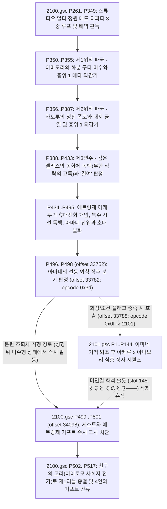

# 『Forest』(Liar-soft, 2004) 비판정본 제1권 하편 (Vol. 01B)
## Stage 01 — 제1장 「프로로그: 매드 티파티」 후반 완결부 (`2100.gsc` `P261..P517`) 및 조건부 심층 분기 시퀀스 (`2101.gsc` `P1..P144`) 전수 해부

> [!IMPORTANT]
> 본 권(Vol. 01B)은 『Forest』 비판정본 편찬 원칙에 의거하여 원시 스크립트 패킷(`vol01b_2100_p261_516_and_2101.txt`)에 수록된 **총 400문단·756문장**(`2100.gsc` `P261..P517`의 256문단·582문장〔번호 정정: 원본 기준 257문단 — 319번째 대사가 패킷에서 빠졌다〕 + `2101.gsc` `P1..P144`의 144문단·174문장 및 미연결 잔류 문자열 `slot 145`)을 **단 하나의 문단·문장 누락도 없이 정순(Chronological Sequential Order)으로 전수 해부**한다. 단순 줄거리 요약이나 축어 번역을 일절 배제하고, 모든 장면을 **[식별자 & 엔진 연출 코드] → [층위 1: 미시 문체·수사·통사·집필자 지문] → [층위 2: 3중 상호텍스트 및 철학·도시 코드] → [층위 3 & 4: 서사적 월경(Metalepsis)·매체 기호학 및 반례 검증]**의 4층위 비판정본 스키마로 관통한다.

---

## 0. 서지·계량문체·바이트코드 위상 총론 (Bibliographic, Stylometric & Bytecode Grounding)

### 0.1 수록 스크립트 정량 지표 및 공동 집필진 문체 봉합선 실증 대조

제1장 프로로그 후반부를 구성하는 본편 스크립트 `2100.gsc`(`P261..P517`)와 그 종결 직전 오프셋(`offset 33788`)에서 분기 호출되는 성인용 심층 서브 시퀀스 `2101.gsc`(`P1..P144`)는 서사적으로 하나의 사건면에 접합되어 있으면서도, **계량문체학(Computational Stylometry) 및 문장부호 타이포그래피 차원에서는 서로 다른 집필자의 손길을 증명하는 극명한 불연속선(Seam)**을 드러낸다.

| 분석 지표 | `2100.gsc` (전체 517문단〔번호 정정: 패킷은 516〕 / 본권 `P261..P517`) | `2101.gsc` (`P1..P144` 전 구간 + `slot 145`) | 문헌학적·계량문체학적 판별 의의 |
| :--- | :---: | :---: | :--- |
| **문단 수 / 문장 수 / 총 자수** | 전체 517문단·1,209문장·17,477자〔정정 F4021: 원문은 516문단·17,472자 — 패킷이 빠뜨린 대사 한 줄(5자)만큼 적었다. 문장 수도 그만큼 적을 것이다〕 (본권: 257문단〔정정 F4020: 원문은 256 — 5줄의 번호 정정과 같다〕·582문장) | 144문단·174문장·2,985자 (+ 잔류 슬롯 1개) | `2101.gsc`는 문단당 문장 수가 `1.21문장`에 불과한 극단적 단문 호흡 텍스트임 |
| **지문 비율 (`narration_ratio`)** | `0.587` (대화·지문 균형 교차) | `0.688` (`^g999` 1인칭 내면 독백 우세) | 다자간 소극(Farce) 앙상블(`2100`)에서 밀실적 내면 감각 해부(`2101`)로의 전환 |
| **평균 문장/문단 길이 (`ASL` / `APL`)** | `14.45자` / `33.86자` | `17.16자` / `20.73자` | `2100`은 짧은 문장 2~3개를 한 문단에 묶는 동화책 판면; `2101`은 1행 독백 단락 연쇄 |
| **한자 / 히라가나 / 카타카나 비율** | `18.58%` / `58.33%` / `10.37%` | `20.97%` / `55.24%` / `7.10%` | `2101`에서 고전·문어 한자어(`慚愧`, `放縦`, `饗宴`, `正餐`, `耳朶`, `くびき`) 급증 |
| **대시(`─`) 타이포그래피 규격** | **2연 대시(`──`) 전용** (`44회`, 3연 `───` **`0회`**) | **3연 대시(`───`) 전용** (`15회` 전부 `───`, `slot 145` 포함) | **결정적 집필자 지문**: 코퍼스 전체 본편(`2100~2900`)과 `2X01` 서브군을 가르는 기계적 표기 습관 차이 |
| **말줄임표 밀도 (`ellipsis_per_1k`)** | `12.88` (정형화된 짝수 `……` 위주) | **`117.92`** (`2100` 대비 **약 9.16배**, 홀수·장연쇄 `………` 다수) | 호흡 단절·실어증적 침묵(`P33`, `P53`, `P63`, `P73`)을 시각화하는 극단적 점선 밀도 |
| **인명·2인칭 표기 통일성** | `アマモリ`·`おまえ` **100% 단일 표기** (`P261..P517`) | `雨森`/`アマモリ` 혼용(`P2`, `P19`, `P101`), `お前`/`おまえ` 혼용(`P40`, `P43`, `P58`) | `2100`의 엄격한 기호 통제(호시조라 메테오)와 달리 `2101`은 현실 성씨(`雨森`)와 가든 기호(`アマモリ`)를 의도적·습관적으로 교란함 |
| **무자막 음성 오버레이 (`en_overlays`)** | 전체 221큐 중 217개 참조 (`P267..P517` 구간 집중 배치) | 보이스 큐 11개(`Voice:411..433`), 영문판 오버레이 `0개` | 영문 로컬라이징 패치 시 성인 서브 분기(`2101.gsc`)가 절삭·우회되었음을 입증하는 매체사적 증거 |
| **추정 집필자 귀속** | **호시조라 메테오 (星空めてお)** **`[확증]`** | **공동 시나리오진 (`───` 표기군: 타카오 토잔 高尾登山 또는 묘가야 진로쿠 茗荷屋甚六)** **`[확증: 비(非)-메테오 분담 / 유력: 공동 라이터 H-서브 전담군]`** | 전 코퍼스 대조 결과 `2101`, `2601`, `2801` 및 나뭇잎 서브(`3041`, `3073`, `3093`, `3111`, `3121`)가 동일한 `───` + 고밀도 말줄임표 문체군을 형성함 |

### 0.2 바이트코드 호출 그래프와 화석화된 봉합 문자열(`slot 145`)의 문헌학적 복원

`2100.gsc`와 `2101.gsc`의 컴파일된 RScript 바이트코드를 대조하면, 단순 텍스트 열람만으로는 결코 포착할 수 없는 **엔진 레벨의 서사 분기 메커니즘과 편집 흔적**이 드러난다.

여기서 결정적인 문헌학적 증거는 `2101.gsc`의 문자열 테이블 말미(`EXTRA/CHOICE STRINGS`)에 본문 명령어와 연결이 끊긴 채 화석처럼 남아 있는 **`slot 145: "^g999すると^nそのとき───"`**다. `2101.gsc`의 집필자는 `P144`의 정사 종결 직후 본편 `2100.gsc`의 기프트 교환 장면으로 복귀하기 위한 연결 문장으로 `すると / そのとき───`(3연 대시)를 작성해 두었다. 그러나 호시조라 메테오가 집필한 `2100.gsc` `P499`이 이미 `"そのとき──\nアマモリから、なにかが飛び出し──"`(2연 대시)로 시작하고 있었기 때문에, 두 스크립트를 통합 컴파일하는 과정에서 `そのとき`의 중복 출력을 막기 위해 바이트코드 상에서 `slot 145` 호출만 절삭(Unlink)하고 문자열 슬롯은 바이너리 내부에 그대로 남긴 것이다. 이 단 9글자의 잔류 문자열(`^g999すると^nそのとき───`)은 ① `2101.gsc`가 정확히 `2100.gsc` `P498`과 `P499` 사이에 삽입되도록 설계된 대체/심층 기억 가지(Branch)라는 사실과, ② 두 파일의 집필자가 대시 길이(`──` 대 `───`)조차 달랐던 별개의 라이터였다는 사실을 동시에 확증한다.

---

## 1. 제1장 프로로그 후반 완결부 전수 해부 (`2100.gsc` `P261..P517`)

### Scene 1 (`2100.gsc` `P261..P269`): 두 명의 앨리스와 경계선의 참나무(`樫の木`) — 스튜디오 알타 정원의 성립

#### [식별자 & 엔진 연출 코드]
* **파일 및 범위**: `2100.gsc` `P261..P269` (9문단, 19문장: `P261-S1` ~ `P269-S3`)
* **화자 분포**: `^g001`(기노사키 아케루: `P261`), `^g004`(아메노모리 노조미/아마모리: `P262..P264`), `^g999`(지문/층위 1 화자: `P265..P269`)
* **무자막 보이스 오버레이 대조**:
  * `P267` `[Voice:138]`: *"I called. I called for him."* (검은 앨리스: 자신이 그를 불렀다는 독백)
  * `P268` `[Voice:139]`: *"Who was he? Why was he here?"* (검은 앨리스: 기억의 혼탁 속에서 그의 정체를 되묻는 음성)
  * `P269` `[Voice:140]`: *"Is this a garden? Where is it? Is this a riddle? What is that?"* (검은 앨리스: ‘가든’과 ‘리들’이라는 메타 용어에 대한 최초의 청각적 질문)
* **화면 위상**: `リアル`(신주쿠 동쪽 출구 스튜디오 알타 앞 광장) → `ガーデン`(거대한 정원 다과회장) 완전 치환 완료 상태.

#### [원문 정밀 색인 및 문장 단위 해부 (`P261..P269`)]
* **`P261`** (`^g001` 아케루): `[P261-S1] アリス、どうした？` / `[P261-S2] ずいぶん静かになったじゃないか？`
  * 전반부(`Vol. 01A` 말미)에서 조잘거리던 층위 1의 대화 상대(검은 앨리스)가 갑자기 침묵하자 아케루가 던지는 호명이다. 문말 연어 표현 `~じゃないか？`〔정정 F3702: 하나의 종조사가 아님 — じゃ+ない+종조사 か, 종조사는 끝의 か뿐〕는 추궁이 아닌 친밀한 관조의 어조를 띤다.
* **`P262`** (`^g004` 아마모리): `[P262-S1] アリスはあたしよ！` / `[P262-S2] パーティの主役よ！` / `[P262-S3] あなたは誰なの？` / `[P262-S4] 招かれてるの？`
  * **서사적 오인(Metaleptic Interception)**: 아케루가 층위 1/경계선의 ‘검은 앨리스’에게 던진 `アリス`라는 기표를, 다과회 석상에 앉은 노조미(`^g004`)가 가로채어 자기 정체성으로 독점 선언한다(`アリスはあたしよ！`). 1인칭 대명사 `あたし`와 여성 종조사 `~よ！`의 연속 느낌표는 현실의 음울한 OL 노조미가 ‘동화 속 여주인공’이라는 과잉 연기(Role-playing)에 도취되어 있음을 보여준다. 특히 `[P262-S4] 招かれてるの？`(초대받았어?)는 장차 제1리들 전체를 파훼할 핵심 규칙어 **`招き`(초대)**를 무의식중에 발설한 복선이다.
* **`P263`** (`^g004` 아마모리): `[P263-S1] 関係ない人は出ていって！` / `[P263-S2] でも、おとなしくしてるんだったら、そこで見てても構わないわ。`
  * `[P263-S1]`에서 배타적 추방 명령(`出ていって！`)을 내리자마자 `[P263-S2]`에서 역접 접속사 `でも`로 선회하여 **‘무대 바깥에서의 침묵 관전(`そこで見てても構わないわ`)’**을 허락한다. 이는 두 가지 결정적 기능을 수행한다. 첫째, 연극학적으로 아케루를 다과회 테이블 내부가 아닌 **프로시니엄 아치 바깥의 관객석(경계선)**에 합법적으로 고정시킨다(훗날 `P450`의 `エトランジェ` 위상 성립). 둘째, 내면적으로는 타인을 거부하면서도 실은 **누군가(특히 아케루)에게 보여지고 관심받기를 갈망하는** 아마모리의 분열된 자기애적 욕망을 노출한다.
* **`P264`** (`^g004` 아마모리): `[P264-S1] さあ、パーティを続けましょう！` / `[P264-S2] あたしがアリスよ！` / `[P264-S3] みなさん、ようこそ！`
  * `P262-S1`(`アリスはあたしよ！` — 주제어 `アリスは` 전치)과 `P264-S2`(`あたしがアリスよ！` — 주격 조사 `が`에 의한 배타적 초점화)가 대구(Chiasmus)를 이루며, 다른 앨리스(검은 앨리스)의 존재를 억압하려는 강박적 자기암시를 완성한다.
* **`P265`** (`^g999` 지문): `[P265-S1] スタジオアルタだった場所は、すっかりようすが変わっていて、いまでは大きな庭園だった。`
  * 과거시제 연체절 `スタジオアルタだった場所`(스튜디오 알타였던 장소)와 현재 상태 `いまでは大きな庭園だった`(지금은 커다란 정원이었다)를 한 문장 안에 충돌시킨다.
* **`P266`** (`^g999` 지문): `[P266-S1] その庭園の外れに立って、ちょっぴり肩をすくめてみせて、黙って彼は、きみを見る。`
  * 아케루가 `私/俺`가 아닌 3인칭 **`彼`**로, 검은 앨리스(및 모니터 너머의 수신자)가 2인칭 히라가나 **`きみ`**로 지칭된다. 부사 `ちょっぴり`(살짝)의 동화적 구어감과 서구적 몸짓 `肩をすくめてみせて`(어깨를 으쓱해 보이고는)가 결합하여, 가짜 앨리스(아마모리)의 소란 너머로 진짜 소환주(`きみ`)와 눈빛을 교환하는 공모적 침묵을 연출한다.
* **`P267`** (`^g999` 지문, `[Voice:138]`): `[P267-S1] 彼はそのまま動かない。` / `[P267-S2] しんぼう強い樫の木みたいに、黙ってそこに立っている。`
  * 직유 **`しんぼう強い樫の木みたいに`(참을성 강한 참나무처럼)**: 영국·켈트 민속 및 영문학 전통에서 참나무(Oak)는 요정의 고리(Fairy Ring)나 마법의 숲 가장자리에 서서 시간을 견디는 불변의 증인 수목이다 **`[유력]`**. 화면 텍스트가 그의 부동성을 묘사하는 순간, 자막 없는 오디오 채널(`[Voice:138]`)에서는 검은 앨리스가 *"내가 불렀어. 그를 불렀어"*라고 속삭여, 참나무처럼 서 있는 관찰자가 실은 소녀의 호출에 응답해 온 존재임을 귀로만 폭로한다.
* **`P268`** (`^g999` 지문, `[Voice:139]`): `[P268-S1] 彼の視線は、きみから離れて、しずかに見ている。` / `[P268-S2] パーティのようすを。`
  * **통사적 도치(후치 첨가)**: 타동사 `見ている。`로 문장을 일단 종결한 뒤 목적어 `[P268-S2] パーティのようすを。`를 독립 문장으로 분리 배치하여, 아케루의 시선이 `きみ`(층위 1/경계)에서 `パーティ`(층위 3 리들 무대)로 천천히 패닝(Panning)하는 카메라 워크를 통사 구조 자체로 구현한다.
* **`P269`** (`^g999` 지문, `[Voice:140]`): `[P269-S1] パーティは続く。` / `[P269-S2] パーティは続く。` / `[P269-S3] じっと見ている彼の前で。`
  * 7모라 단문 **`パーティは続く。`의 동어반복(Epizeuxis)**이 시작된다. 이 주문 같은 반복구는 이후 `P273`, `P277`, `P281`, `P284`, `P286`, `P330`, `P334`까지 총 8회에 걸쳐 회귀하며, 진전이 거세된 **실무한($\aleph_0$)의 원환 시간**을 청각·시각적 메트로놈처럼 각인한다.

#### [층위 2 & 3 & 4: 도시 기호 전복과 서사적 월경 종합]
* **2004년 신주쿠 도시 기호학 `[확증(Confirmed)]`**: `P265`가 못 박는 **`スタジオアルタ`(신주쿠 스튜디오 알타, 1980년 개관)**는 단순한 랜드마크가 아니다. 2004년 당시 이곳은 후지TV의 국민적 낮 생방송 버라이어티 **『모리타 카즈요시 아워 와랏테 이이토모!(森田一義アワー 笑っていいとも！)』**(매주 평일 정오 `12:00~13:00` 생중계)의 공개 스튜디오이자 신주쿠 만남의 광장이었다. 호시조라 메테오는 제임스 배리의 『피터 팬』 속 켄싱턴 공원(*Kensington Gardens*) 및 캐럴의 『앨리스』 속 정원을 이 콘크리트 광장 위에 겹쳐 놓음으로써, 영국 황금기 아동문학의 목가적 정원과 2004년 일본 대중매체의 정오 생방송 스튜디오를 하나의 기호장(Semiosphere)으로 단락시킨다.

---

### Scene 2 (`2100.gsc` `P270..P286`): 제1주기 정오 루프 — ‘도쿄도 도지사’의 트럼프 사절 4연과 아케루의 시계 관측

#### [식별자 & 엔진 연출 코드]
* **파일 및 범위**: `2100.gsc` `P270..P286` (17문단, 43문장: `P270-S1` ~ `P286-S3`)
* **화자 코드**: 전 문단 `^g999`(지문 내에 트럼프 관리·병정·정원사·귀족의 인용 대사 내장 — 개별 화자 코드를 부여하지 않고 익명 기호 집단으로 처리한 의도적 연출)
* **무자막 보이스 오버레이 대조**:
  * `P271` `[Voice:141]`: *"Ha! He's actually rhyming!"* (트럼프 관리의 각운에 대한 좌중의 웃음 섞인 논평)
  * `P272` `[Voice:142]`, `P276` `[Voice:144]`, `P280` `[Voice:146]`: *"Now, does anyone want some tea? Or more cake?"* (아마모리가 기계적으로 반복하는 안주인 대사 — 3회 완전 동일 반복)
  * `P275` `[Voice:143]`: *"Oh, what a good idea. I might go once I get bored here."* (목베기 쇼 목록에 대한 경박한 맞장구)
  * `P279` `[Voice:145]`: *"Oh, how lovely. Tell the governor we appreciate it."* (해 질 녘 장미 선물에 대한 의례적 감사)
  * `P283` `[Voice:147]`: *"Leave! Leave! You're ruining the party!"* (세금 징수 귀족을 쫓아내는 고함)
  * `P286` `[Voice:148]`: *"I called. I called for him."* (검은 앨리스의 `Voice:138` 리프레인 재현)

#### [문단군 정밀 해부: 4연 전령 리터지(Liturgy)와 천문 관측 (`P270..P286`)]
1. **제1사절 — 트럼프 관리(`トランプの役人`)와 정오의 각운 (`P270..P273`)**:
   * `P270` (`[P270-S1] トランプの役人がやってくる。` / `[P270-S2] 「東京都、都知事より、　お茶会の皆様に申し上げます！」`) → `P271` (`[Voice:141]`: `[P271-S1] 「本日は真昼日和、アヒル日和、　浮かれ日和、いかれ日和、　どうぞ存分にお楽しみくださいまし！」`) → `P272` (`[Voice:142]`: `[P272-S1] トランプの役人は帰っていった。` / `[P272-S2] 大皿にはケーキがいっぱい。` / `[P272-S3] カップには紅茶がなみなみ。`) → `P273` (`[P273-S1] パーティは続く。` / `[P273-S2] パーティは続く。`).
   * **운율 및 3중 상호텍스트 해부 `[확증(Confirmed)]`**:
     * `P271-S1`은 전각 공백(`　`)을 휴지(Caesura)로 삼아 `本日は(5) / 真昼日和(6)、アヒル日和(6)、 / 浮かれ日和(6)、いかれ日和(6)、 / どうぞ存分に(8) お楽しみくださいまし(11)`〔정정 F4023: 원문은 (7)·(10) — 세어 보면 ど·う·ぞ·ぞ·ん·ぶ·ん·に 8박, 뒤 구는 11박〕의 경쾌한 6·6·6·6조 두운·각운 유희를 구사한다(`まひる[真昼]`↔`あひる[アヒル]`, `うかれ[浮かれ]`↔`いかれ` 최소대립쌍 음운 유희).
     * **영문 원전 ↔ 일본어 정전 번역어**: ① `真昼日和`(한낮 날씨)와 `アヒル日和`(오리 날씨)의 병치는 루이스 캐럴 『이상한 나라의 앨리스』 서시 *"All in the golden afternoon"*의 창작 기원인 1862년 7월 4일 보트 소풍에서 노를 저었던 **로빈슨 더크워스 목사(`Duckworth` = 작중 제2~3장의 오리 `アヒル[Duck]`)**를 정확히 호출한다 **`[확증]`**. ② `いかれ日和`는 원전 제7장 *A Mad Tea-Party*의 고전 역어 `気違いのお茶会`가 1990년대 이후 일본 출판계의 차별어 자율규제로 인해 **현대 번역본에서 `いかれたお茶会` / `いかれ帽子屋`로 대체된〔미확인 F1675: 「いかれたお茶会」로 바뀌었다는 번역본을 찾지 못했다(1999년 무렵 山形 역은 「キチガイお茶会」, 2010년 河合 역은 「おかしなお茶会」)〕 번역사적 층위**(야가와 스미코[矢川澄子] 역의 장 제목은 실물 대조 필요〔미확인 C2〕. 카와이 쇼이치로[河合祥一郎] 역은 角川文庫 2010년 2월 간행으로 게임 발매 뒤라 재료가 될 수 없고, 그 7장 제목도 「おかしなお茶会」다〔정정 D4·C2〕)를 직접 패러디한 것이다 **`[확증]`**.
     * **신주쿠 정치 기호로의 전복 `[확증]`**: 캐럴 원전의 절대 권력자 **하트 여왕(`ハートの女王`)**이 신주쿠역 동쪽 알타 정원〔정정 F3413: 「동신주쿠」가 아님 — 東新宿은 新宿七丁目 둘레의 다른 동네〕과 대척점에 솟아 있는 서신주쿠 **도쿄도청(`東京都庁`, 당시 이시하라 신타로 도지사 재임, 제2장에서 `橘都知事`로 본격 등장)**의 **`東京都、都知事`**로 치환된다.
2. **제2사절 — 트럼프 병정(`トランプの兵隊`)과 참수 카탈로그 (`P274..P277`)**:
   * `P274` (`[P274-S1] トランプの兵隊がやってくる。` / `[P274-S2] 「東京都、都知事より、　お茶会の皆様に申し上げます！」`) → `P275` (`[Voice:143]`: `[P275-S1] 「余興の花形、首切りショー！` / `[P275-S2] ひとまず目録をお持ちしました。` / `[P275-S3] いつでもご用命ください！」`) → `P276` (`[Voice:144]`: `[P276-S1] トランプの兵隊は帰っていった。` / `[P276-S2..S3]` 케이크·홍차 후렴) → `P277` (`[P277-S1..S2]` `パーティは続く。` 2연).
   * 하트 여왕의 입버릇 *"Off with his head!"*(`首をちょん切れ！` — 특히 원전 제7장에서 모자장수가 여왕 앞 음악회에서 “시간을 죽였다(murdering the time)”는 죄목으로 참수 선고를 받은 일화 **`[확증]`**)가 현대 일본 관료제의 카탈로그 배포(`目録をお持ちしました`) 및 직장인 노조미의 트라우마를 찌르는 정리해고 은어(`首切り` **`[구조적 공명]`**)로 변주된다.
3. **제3사절 — 트럼프 정원사(`トランプの庭師`)와 피어날 수 없는 ‘해 질 녘의 장미’ (`P278..P281`)**:
   * `P278` (`[P278-S1] トランプの庭師がやってくる。` / `[P278-S2] 「東京都、都知事より、　お茶会の皆様にお届け物です！」`) → `P279` (`[Voice:145]`: `[P279-S1] 「日暮れのバラの最高級品！` / `[P279-S2] 香り高き可憐なつぼみ、　夕陽を浴びれば、花咲くでしょう」`) → `P280` (`[Voice:146]`: `[P280-S1..S3]` 귀환 및 후렴) → `P281` (`[P281-S1..S2]` `パーティは続く。` 2연).
   * **시간 역설의 핵심 단서 `[확증]`**: 원전 제8장의 흰 장미를 붉게 칠하는 스페이드 정원사들(2·5·7 카드) 모티브를 변형하여, **“석양을 받아야만 꽃피는 꽃봉오리(`夕陽を浴びれば、花咲くでしょう`)”**인 `日暮れのバラ`를 배달시킨다. 그러나 `P271`이 선언했듯 이곳은 영원히 고정된 **정오(`真昼`)**이므로 이 장미는 원리적으로 영원히 개화할 수 없다. 또한 스튜디오 알타 현관에 배달되는 화환·화분 행렬(`笑っていいとも！` 텔레폰 쇼킹의 명물 축하 화환 **`[확증]`**)의 첫 번째 시각적 암시이기도 하다.
4. **제4사절 — 트럼프 귀족(`トランプの貴族`)과 징세의 축출 (`P282..P283`)**:
   * `P282` (`[P282-S1] トランプの貴族がやってくる。` / `[P282-S2] 「東京都、都知事の名において、　お茶会の皆様に税の取り立て……」`) → `P283` (`[Voice:147]`: `[P283-S1] その剣幕に、貴族は逃げ帰った。` / `[P283-S2..S3]` 케이크·홍차 후렴).
   * 유희와 무상 증여의 동화 공간에 유일하게 ‘현실의 경제적 의무(`税の取り立て`)’를 들이미는 귀족만이 말끝을 맺지 못한 채(`……`) 참가자들의 기세(`剣幕`, `Voice:147`의 야유)에 쫓겨난다. `P272-S2..S3`, `P276-S2..S3`, `P280-S2..S3`, `P283-S2..S3`에 네 번 되풀이되는 대구 **`大皿にはケーキがいっぱい。 / カップには紅茶がなみなみ。`**(명사구 생략 서술 + 의태 부사 `いっぱい`/`なみなみ`)〔정정 F3700: 「いっぱい」는 한자어 一杯(명사·부사)로 의태어가 아님〕는 결핍도 소진도 없는 실무한적 풍요의 질식감을 조성한다.
5. **아케루의 무언(無言) 정오 측량 (`P284..P286`)**:
   * **`P284`**: `[P284-S1] パーティは続く。` / `[P284-S2] パーティは続く。` / `[P284-S3] じっと見ていた灰流が、動いた。` (`P267` 이래 부동이던 관찰자의 첫 움직임을 단문 종결로 포착).
   * **`P285`**: `[P285-S1] 彼は真上の空を見た。` / `[P285-S2] 真下の地面の影を見た。` / `[P285-S3] 懐中時計を確かめた。`
     * **삼단 논법적 행동 통사**: `真上の空`(천정의 태양) → `真下の地面の影`(발바닥 바로 아래 맺힌 그림자 = 태양 고도 남중 = **정오 12시**) → `懐中時計`(흰 토끼와 모자장수의 회중시계 **`[확증]`**) 확인으로 이어지는 세 개의 `~た。` 과거형 단문이 대사 한 줄 없이도 **“캐럴 원전의 오후 6시(Tea-time)가 이곳 알타 정원에서는 정오 12시(이이토모 생방송 시각)로 치환되어 정지해 있다”**는 리들의 시공간 방정식을 풀어낸다.
   * **`P286`** (`[Voice:148]`): `[P286-S1] パーティは続く。` / `[P286-S2] なおも続く。` / `[P286-S3] じっと見ている彼の前で。` (`パーティは` 주어를 생략하고 부사 `なおも`를 삽입한 `S2`의 미세 변주가 제2루프 진입을 알린다).

---

### Scene 3 (`2100.gsc` `P287..P326`): 제2주기 루프와 물리 법칙의 분열 — 식탁 위의 불변성과 발밑에 쌓이는 파편, 그리고 살인의 무효화

#### [식별자 & 엔진 연출 코드]
* **파일 및 범위**: `2100.gsc` `P287..P326` (39문단, 97문장: `P287-S1` ~ `P326-S3`)
* **화자 분포**: `^g999`(지문 및 트럼프 사절 대사), `^g007`(나가츠키 아마네: `P292`), `^g004`(아마모리: `P295`, `P297`, `P302`, `P304`, `P306`, `P308`, `P311`, `P325`), `^g005`(마유즈미 카오루: `P300`, `P313`, `P315`, `P317`), `^g001`(아케루: `P303`), `^g006`(카리야 마키: `P314`, `P316`, `P318`, `P324`, `P326`)
* **엔진 잔류 선택지/대사 슬롯 참조**: `2100.json` `extra_strings` `slot 341`(`^g005えっ？^n……`), `slot 342`(`あれっ、立てない？^nどうなってるのっ!?`)는 미출력 흔적이 아니라 실제로 화면에 나오는 대사다〔번호 정정: 원본 2100.gsc의 319번째 대사(문자열 341번, 화자 黛, 음성 168)와 거기에 이어 붙는 글(0x52, 문자열 342번). 패킷이 이 대사를 빠뜨려 그 뒤 문단 번호가 하나씩 밀려 있었다. 이 정정본은 P319 이후를 하나씩 올렸다〕.
* **무자막 보이스 오버레이 대조**:
  * `P288` `[Voice:149]`: *"That's the best rhyme you could come up with? Just go already."* (제1주기와 똑같은 관리의 각운에 짜증을 내는 참가자 — **인간 참가자들의 기억은 루프에 리셋되지 않음**을 입증)
  * `P289` `[Voice:150]`: *"Tea, anyone? More cake, anyone?"* (`Voice:142`보다 피로하고 축약된 권유)
  * `P290` `[Voice:151]`: (도자기 파열 효과음 및 경악 호흡)
  * `P299` `[Voice:155]`: *"What!? Wait, we said we don't want it!"*
  * `P319` `[Voice:168]`: 화면 글 `えっ？……`과 이어 붙는 글 `あれっ、立てない？どうなってるのっ!?`(문자열 341~342번)에 딸린 카오루의 당황 음성: 의자에서 일어설 수 없음을 자각〔번호 정정: 패킷에서 빠진 대사 — 자막 없는 음성이 아니다〕
  * `P322` `[Voice:169]`: *"Shut up!"* (아마모리의 비명성 폭언)

#### [비트별 전 문단 정밀 해부 (`P287..P326`)]

##### Beat 3-A (`P287..P293`): 티포트 파손 실험과 ‘식탁 위(실무한) vs 발밑 지면(비가역 엔트로피)’의 이중 물리학
* **`P287..P288`** (`[Voice:149]`): 트럼프 관리가 재등장하여 `P270..P271`과 토씨 하나 틀리지 않는 동일한 대사(`[P287-S1..S2]`, `[P288-S1]`)를 읊는다. 텍스트의 100% 자기복제가 루프의 기계성을 증명하는 반면, 무자막 오디오 `[Voice:149]`의 야유가 인간 의식의 연속성을 대조시킨다.
* **`P289..P291`** (`[Voice:150, 151]`): 관리가 돌아간 뒤(`[P289-S1]`), 아마모리가 집어 든 티포트가 손에서 미끄러져(`[P289-S2..S3]`) 지면에서 산산조각 나 흰 파편이 발밑에 흩어진다(`[P290-S1] 地面に落ちてポットは割れた。` / `[P290-S2] 白い破片が足下に散らばった。`). 그러나 역접 `だが`와 함께 **`[P291-S1] だが、テーブルの上には、ポットがあった。` / `[P291-S2] なにごともなかったように。`**가 선언된다. 부사구 종지문 `なにごともなかったように。`(아무 일도 없었던 것처럼)는 본작에서 ‘숲’이 상처와 사건성을 은폐·복구하는 섬뜩한 항상성(Homeostasis)의 표어다(이후 `P312-S2`, `P427-S3`에 반복).
* **`P292..P293`**: 트릭스터 나가츠키 아마네(`^g007`)의 즉각적 파괴 유희가 개입한다. `[P292-S1] すごいっ！` / `[P292-S2] あたしもやってみるですよ！` / `[P292-S3] どりゃッ！` / `[P292-S4] おゥりゃッ！` / `[P292-S5] たーッ！` — 1인칭 `あたし`에 문법 파괴적 정중체 어미 `~みるですよ`를 붙이는 아마네 특유의 유아적·유흥가적 혼합 화법〔미확인 F3708: 동사에 です를 바로 붙인 꼴이 비표준이라는 것은 사전에 있다. 「유아적·유흥가적」이라는 근거는 찾지 못했다〕과 기합 소리가 폭발한다. 이어지는 지문 `P293`(`[P293-S1] 九月がポットを投げる。` / `[P293-S2] カップを。` / `[P293-S3] 皿を。` / `[P293-S4] 割れた破片が地面を埋める。` / `[P293-S5] テーブルの上は、なにごともない。`)은 동사를 생략한 목적격 체언 파편(`カップを。 / 皿を。`)으로 투척 속도를 모사하며 결정적 공간 법칙을 확립한다: **식탁 위(`テーブルの上`)는 항상 초기 상태로 복원되지만, 발밑 지면(`地面`)에는 깨진 파편이 소멸하지 않고 무한히 누적된다.**

##### Beat 3-B (`P294..P299`): 트럼프 병정의 재방문과 캐럴식 기수(基數) 궤변
* **`P294..P297`**: 병정이 재차 찾아오자(`[P294-S1..S2]`), 아마모리가 제동을 건다(`[P295-S1..S3] ちょっと待ってよ。 / あなた、さっきも来たでしょう？ / 何度も何度もウザいのよっ。` — 빅토리아조 아가씨 연기에서 현대 도쿄 젊은 여성의 속어 `ウザいのよっ`가 삐져나오는 균열). 병정의 관료적 답변(`[P296-S1..S2]`)에 아마모리는 이미 받은 참수 목록을 흔들어 보인다(`[P297-S1..S4] 首切りショーの目録でしょ？ / ２枚も３枚もいらないわ、そんなもの。 / ほら！ / ここに、ちゃんとある！`).
* **`P298..P299`** (`[Voice:155]`): 병정의 응수 **`[P298-S1] 「さようでございますか。` / `[P298-S2] すでに１枚お受け取りなのでしたら、　２枚も３枚も同じことですな」`**는 루이스 캐럴적 논리 전도의 정수다 **`[확증]`**. 원전 제7장에서 3월 토끼와 모자장수가 ‘아무것도 안 마셨다(nothing)’와 ‘더 마시다(more)’의 양화사 논리를 비틀듯, 여기서는 칸토어 초한기수 연산($\aleph_0 + 1 = \aleph_0$)이나 불 대수(Boolean: 존재 여부 `1`이면 `2`나 `3`이나 동치)를 연상시키는 궤변으로 목록을 억지로 떠안기고 퇴장한다(`[P299-S1]`).

##### Beat 3-C (`P300..P312`): ‘해 질 녘의 장미’ 논쟁과 정원사 타살 — 폭주하는 OL 노조미의 본색
* **`P300..P308`**: 카오루가 다음 방문자를 가리키고(`[P300-S1..S2] うわぁ、見てくださいよ。 / また来ましたよ。`), 정원사가 다시 장미 화분을 들고 온다(`[P301-S1..S2]`). 꽃봉오리뿐인 장미에 분개하는 아마모리(`[P302-S1..S2] またバラ!? / しかも、つぼみ!?`) 옆에서 아케루의 무언 침묵(`[P303-S1] ……。` — `P261` 이후 42문단 만의 첫 대사창이나 말줄임표뿐인 관망)이 스쳐 지나간다. 왜 침묵을 굳이 1줄 대사창(`P303`)으로 삽입했는가? **`つぼみ`(피지 못한 꽃봉오리 = 성장을 거부한 채 정오에 박제된 소녀성)**라는 기호가 아마모리의 핵심 병리임을 아케루가 간파했음을 표시하는 연출적 구두점이다.
* 활짝 핀 꽃을 요구하는 아마모리(`[P304-S1..S2]`)에게 정원사는 정오의 한복판에서는 해 질 녘 장미를 피울 수 없으며(`[P305-S1..S2]`), 도지사에게 거역하면 목이 잘린다(`[P307-S1..S3] 「めっそうもない。 / 首をちょん切られます。 / たしかにお届けしましたからね」` — 원전 제8장 정원사들의 공포 직결 **`[확증]`**)고 맞선다(`P306` 아마모리의 항의 포함).
* **`P308..P312`**: 말문이 막힌 아마모리가 `[P308-S2] 持って……帰りなさいっ！`(말줄임표에 실린 분노의 경련)과 함께 도망치는 정원사의 뒤통수에 화분을 집어 던진다(`[P309-S1]`). **`[P310-S1] 鉢植えは庭師の頭に当たった。` / `[P310-S2] 声もたてずに庭師は倒れた。`** 동화적 슬랩스틱(`P292`)이 순식간에 둔기에 의한 살상(`声もたてずに`의 건조한 사실주의 묘사)으로 급전직하한다. 숨을 삼킨 아마모리의 비명(`[P311-S1] ひっ……。`) 앞에 놓인 풍경은 **`[P312-S1] 息を呑んで硬直したアマモリの目の前に、バラの鉢植えが、ふたつ。` / `[P312-S2] なにごともなかったように。`**다. 시체는 바닥에 남고, 던진 화분은 식탁 위에 복원되어 제1주기 화분과 합쳐 **‘두 개(`ふたつ`)’**가 된다(명사 종지). 죄책감마저 무효화하며 사물만 증식시키는 가든의 공포가 극대화된다.

##### Beat 3-D (`P313..P326`): 마유즈미 카오루와 카리야 마키의 통성명, 그리고 ‘의자 결박’과 시각 질문
* **`P313..P318`**: 카오루가 경악하며(`[P313-S1..S2] うわっ、わっ！ / 殺しちゃったのっ!?`), 침착하게 제지하는 카리야 마키(`^g006`)와 첫 대화를 나눈다. 마키는 카오루가 의대생임을 알고 있고(`[P314-S1..S3]`), 경계하는 카오루(`[P315-S1..S2] なぜ知ってるの？ / キミ、誰？` — 카타카나 2인칭 `キミ` 사용)에게 자신을 **`[P316-S1..S4] 私は刈谷真季。 / 名もないイタメシ屋。 / あなたも何度か来てくれたお店よ。 / ねえ、彼を診てくれない？`**라고 소개한다. 1980년대 말~1990년대 초 버블기 외식 유행어 `イタメシ屋`(이탈리안 레스토랑의 속어로 1990년대 후반엔 사어 취급〔정정 F1152: 「1990~2000년대의 당시 일상 속어」가 아님 — 버블기 유행어, 90년대 후반 사어〕 **`[확증]`**)를 통해, 가든에 소환된 이들이 현실 신주쿠 생활권에서 이미 스쳐 지나가던 단골손님과 매니저 관계였음이 드러난다. 연장자에게 미루며 발을 빼는 카오루(`[P317-S1..S2]`, 1인칭 카타카나 **`ボク`** — 중성적·방어적 자기 연출 지문)에게 마키는 진짜 의도를 드러낸다: **`[P318-S3..S4] でも、ちょっとだけ試してみて欲しいの。 / あなた、席を立てる？`**
* **`P319..P326`** (`[Voice:168, 169]`): 〔번호 정정: `P319`는 패킷이 빠뜨린 대사 `えっ？……`(黛, 음성 168)다〕 `[P320-S1] お尻に椅子がくっついたみたいに、黛は席から立てないのだった。` — 다과회 배역에 포획된 4인은 물리적으로 좌석에 결박되어 있다. 마침 들이닥친 트럼프 귀족이 시체를 발견해 놀라자(`[P320-S2]`, `[P321-S1..S3]`), 패닉에 빠진 아마모리가 귀족에게 화분과 찻잔·접시를 마구 투척하고(`[P322-S1..S2]`, `[P323-S1..S2]`), 마키의 만류(`[P324-S1..S2] やめなさい。 / 落ち着くの。`)에 `[P325-S1..S2] うるさいっ！ / あたしに命令するなっ！`라며 여왕처럼 발악한다. 그 혼돈 한복판에서 이성적 해석자 마키가 리들의 핵심 변수를 짚어낸다: **`[P326-S1..S3] ねえ、聞いてちょうだい。 / 誰か時計を持ってる人はいない？ / いまの時間を教えてくれない？`**

---

### Scene 4 (`2100.gsc` `P327..P337`): 제3주기 루프와 바흐친적 다중 음성(Polyphony)의 극점 — 무자막 휴대전화 검증(`12:00`)과 ‘슈뢰딩거의 정원사’

#### [식별자 & 엔진 연출 코드]
* **파일 및 범위**: `2100.gsc` `P327..P337` (11문단, 26문장: `P327-S1` ~ `P337-S2`)
* **화자 코드**: 전 문단 `^g999`
* **무자막 보이스 오버레이 정밀 대조 (`[Voice:173..183]` — 화면 텍스트와 완전히 독립된 제2서사 트랙!)**:
  * `P327` `[Voice:173]` (카오루): *"You don't have a cell phone? Mine was broken by that mouse."* (전반부에서 리피치프 `^g033`에게 휴대전화가 파손됨)
  * `P328` `[Voice:174]` (아마네): *"The battery in mine died, so I left it at home."* (전반부 `Voice:117`의 방전 복선 회수)
  * `P329` `[Voice:175]` (마키): *"I don't have mine either. I was at work. You're Amenomori-san, right? Don't you have a cell phone?"* (근무 중 소환되어 휴대전화 미소지 → **유일하게 아마모리만 작동하는 휴대전화를 소지함**을 확정!)
  * `P330` `[Voice:176]` (마키): *"Could I please take a look at it? I want to know what time it's displaying."*
  * `P331` `[Voice:177]` (아마모리): *"The time? One moment."*
  * `P332` `[Voice:178]` (아마모리): *"The time......t-twelve......"* (**정오 12시 정각 확인**)
  * `P333` `[Voice:179]` (마키): *"Twelve? Are you sure it's twelve?"*
  * `P334` `[Voice:180]` (아마모리): *"Yes, exactly twelve."*
  * `P335` `[Voice:181]` (카오루): *"I-it must be broken. Also, I have school this afternoon. I'd like to get going soon."*
  * `P336` `[Voice:182]` (마키): *"I think......it's time that's broken, not her phone."* (모자장수의 고장 난 시간 모티브 직결!)
  * `P337` `[Voice:183]` (아마네): *"What's going on!? Are we stuck in a time loop? Is time itself spinning all around us?"*

#### [매체기호학 및 전 문장 심층 해부 (`P327..P337`)]
이 11문단은 비주얼 노벨 사상 손꼽히는 **시각 텍스트(Visual Text)와 청각 음성(Audio Track)의 완전 대위법(Counterpoint)** 구간이다.
* **화면 텍스트 층위 (`P327..P334`)**: `P327`(`[P327-S1..S2]`), `P328`(`[P328-S1]`), `P329`(`[P329-S1..S3]`), `P330`(`[P330-S1..S2]`), `P331`(`[P331-S1..S2]`), `P332`(`[P332-S1..S3]`), `P333`(`[P333-S1..S3]`), `P334`(`[P334-S1..S2]`)은 앞서 제1주기(`P270..P277`)에 출력되었던 트럼프 관리와 트럼프 병정의 방문·축사·귀환·케이크와 홍차·`パーティは続く。` 문구를 **단 한 글자의 수정도 없이 기계적으로 재출력**한다.
* **무자막 음성 층위 (`[Voice:173..180]`)**: 플레이어의 눈이 무자비하게 반복되는 리들의 전례문(Liturgy)을 읽는 동안, 귀로는 마키·카오루·아마네·아마모리 4인이 각자의 휴대전화 소지 여부를 점검하고 아마모리의 단말기 액정에 찍힌 **`12:00`(정오)**를 확인하는 긴박한 추리 대화가 자막 없이 흘러나온다!
  * **문헌학적 검증 가치는 절대적이다**: 만약 화면 텍스트만 읽고 무자막 음성을 놓치면, 훗날 `P446..P447`에서 아케루가 왜 하필 마키나 옛 친구 아마네가 아닌 **아마모리의 휴대전화**로 전화를 걸었는지 그 필연적 인과(카오루=파손, 아마네=방전 후 자택 방치, 마키=근무 중 미소지, **유일한 가동 단말기=아마모리**)를 해독할 수 없다! 또한 `Voice:182`에서 마키가 말한 *"고장 난 건 휴대전화가 아니라 시간 그 자체야"*는 캐럴 원전 제7장에서 모자장수의 회중시계가 버터 탓에 이틀 틀리고, 따로 ‘시간(Time)과 다툰 뒤로 늘 6시’가 되어 버렸다고 설명하는 대목〔정정 F0145: 「시계가 고장 난 게 아니라」가 아님 — 시계는 실제로 틀리고, 6시는 시간 탓〕의 정밀한 현대적 변주다 **`[확증]`**.
* **죽은 자신과 조우한 정원사의 존재론적 분열 (`P335..P337`)**:
  * **`P335`**: `[P335-S1] トランプの庭師がやってくる。` / `[P335-S2] 「東京都、都知事より、　お茶会の皆様に、お届け物……？」` — 공식 전례문이 바닥에 쓰러진 시체(`P310`) 앞에서 말줄임표 의문부호(`……？`)로 꺾인다.
  * **`P336`**: `[P336-S1] 「ありゃりゃっ!?` / `[P336-S2] ここに倒れて、くたばってんのは、　この俺じゃねえか！」`
  * **`P337`**: `[P337-S1] 「それじゃ、ここにいる、この俺は、　いったい生きてんのかな？` / `[P337-S2] それとも、くたばってんのかな？」`
  * **문체적 가면 박리**: `~でございます`·`~ましょう`의 정중한 관료 경어를 쓰던 트럼프 정원사가 자신의 시체를 목격하는 순간 `ありゃりゃっ!?`·`くたばってんの`·`この俺じゃねえか！`(거친 에도/서민 남성어 1인칭 `俺` + 종조사 `~じゃねえか`)로 급전환한다. 루프가 매 주기 새로운 정원사 인스턴스(Instance)를 생성하는 바람에 ‘제2주기의 죽은 나’와 ‘제3주기의 살아있는 나’가 한 프레임 안에 공존하는 이 블랙코미디는, 실무한적 반복 세계에서는 **죽음조차 고유한 일회적 사건(하이데거적 ‘자신의 죽음’)이 되지 못하고 복제 가능한 쓰레기로 전락함**을 보여준다.

---

### Scene 5 (`2100.gsc` `P338..P388`): 『이상한 나라의 앨리스』 배역 판독과 두 차례의 기각된 파국 초고(메타 되감기 #1·#2)

#### [식별자 & 엔진 연출 코드]
* **파일 및 범위**: `2100.gsc` `P338..P388` (51문단, 117문장: `P338-S1` ~ `P388-S2`)
* **화자 분포**: `^g006`(마키), `^g004`(아마모리), `^g007`(아마네), `^g005`(카오루), `^g999`(지문 및 층위 1 메타 편집 화자)
* **무자막 보이스 오버레이 대조**:
  * `P345` `[Voice:191]` (아마네): *"That girl over there is Alice too, right? How can there be two Alices?"*
  * `P346` `[Voice:192]` (검은 앨리스): *"I'm Alice. I'm no liar."*
  * `P347` `[Voice:193]` (검은 앨리스): *"I'm Alice. Didn't she say so?"*
  * `P352..P354` `[Voice:198..202]`: *"Shut up!"* / *"Shut up! Shut up!"* / *"Sto──!"* / *"Shut up!"* / *"Stop, please, stop, no, nooo!"* (아마모리의 광란과 마키의 비명)
  * `P355` `[Voice:203]` (검은 앨리스): *"Enough. I remember it now. This is no fun."* (**메타 중단 선언 #1**)
  * `P356..P357` `[Voice:204..205]` (마키): *"At this rate......"* / *"Huu..."*
  * `P359` `[Voice:207]` (아마모리): *"So what? Isn't that a good thing? It'll be fun."* (`P350` 대사가 제2초고에서는 떨리는 무자막 음성으로 격하됨!)
  * `P387` `[Voice:232]` (검은 앨리스): *"Enough. I don't want to hear any more. I remember it now."* (**메타 중단 선언 #2**)
  * `P388` `[Voice:233]` (아마모리): *"......she left, ......of her own will."* (`P382`의 잔향 중얼거림)

#### [비트별 전 문단 정밀 해부 (`P338..P388`)]

##### Beat 5-A (`P338..P347`): 매드 티파티 4배역 매핑과 ‘두 명의 앨리스’ 모순 폭로
* **`P338..P343`**: 독서가 마키가 리들의 정전 원전을 명시적으로 호명한다(`[P338-S1] ねえ、みんな気づいてると思うんだけど、私たち、マッド・ティーパーティに巻き込まれてしまったんじゃないかしら？` → `[P339-S1] マッド・ティーパーティ……。` → **`[P340-S1..S3] そう。 / 『不思議の国のアリス』よ。 / 私が３月ウサギの役で──`** → **`[P341-S1..S3] 九月さんが、マッド・ハッター。 / 黛さんが、ヤマネの役。 / そして──`** → **`[P342-S1..S3] 雨森さん。 / あなたが、アリス。 / そうよね？`** → `[P343-S1..S2] ……そうよ。 / あたし、アリスだわ。`).
  * **3중 상호텍스트 및 기프트 대응 `[확증]`**: 전반부(`Vol. 01A` `Voice:15~31`)에서 검은 앨리스가 나눠 준 소품들—마키의 산토끼 귀·발·꼬리(`３月ウサギ` = 기프트 `伝令`), 아마네의 실크해트(`マッド・ハッター` = 기프트 `フーディニ`), 카오루의 복슬복슬한 겨울잠쥐 꼬리(`ヤマネ`[Dormouse, 일본어 정전 역어 `ヤマネ` 또는 `眠りネズミ` 중 이와나미·신초 문고 계열 표준 역어 **`ヤマネ`** 채택!〔정정 F1351: 新潮文庫의 矢川澄子 역은 「ネムリネズミ」다 — 岩波 쪽 역어는 확인하지 못했다〕] = 기프트 `白昼夢`)—이 캐럴 원전 제7장의 4인 좌석 배치로 수렴한다. 문말의 2연 대시(`──`, `P340-S3`, `P341-S3`)가 긴장감 있는 추리 호흡을 조율한다.
* **`P344..P347` (`[Voice:191..193]`) — 서사 층위를 찢는 트릭스터의 손가락질**:
  * 아마네가 천진난만한 어조로 폭탄을 던진다: **`[P344-S1..S2] えぇ～？ / でもねでもね、それってさ、うそっこのアリスなんだよね？`** (`うそっこ` = 소꿉놀이·가짜).
  * **`P345`** (`[Voice:191]`): `[P345-S1] 九月は、きみのほうを見て、そう言った。` / `[P345-S2] おぼえてるかい？`
  * **`P346`** (`[Voice:192]`): `[P346-S1] だが、きみは無言だった。`
  * **`P347`** (`[Voice:193]`): `[P347-S1] きみは無言だった。`
  * **경이로운 메탈렙시스 불협화음**: 화면 지문(`P346`, `P347`)은 두 번 연속 단호하게 **`きみは無言だった。`(너는 무언이었다)**라고 기록한다(층위 2의 가든 현장에서 검은 앨리스는 입을 다물고 있었다). 그런데 정확히 그 두 문장이 출력되는 순간 재생되는 `[Voice:192]`와 `[Voice:193]`에서 검은 앨리스(CV: 호쿠토 미나미)는 *"나는 앨리스야. 거짓말쟁이가 아니야"*라며 발끈해 항변한다! 즉 **과거 사건 층위(층위 2)에서의 ‘침묵’ 위에 현재 회상 세션(층위 1)에서의 ‘항변 음성’이 겹쳐지는 이중 시간축 폴리포니**다.

##### Beat 5-B (`P348..P355`): 제1위작 파국(배드 엔딩 초안 #1) — 아마모리의 화분 살해 미수와 층위 1의 편집 되감기
* **`P348..P351`**: 마키는 아마모리를 일단 앨리스로 인정해주면서도(`[P348-S1..S2]`), 핵심은 우리 모두가 ‘붙잡혀 있다(`捕らえられている`)’는 사실이라며(`[P348-S3]`), 영원히 차와 케이크에 빠져 익사하듯 갇힐 것임을 경고한다(`[P349-S1..S2] このままだとパーティは永遠に続くわ。 / 私たち、席を立つことさえできずに、お茶とケーキに溺れていくことになる。`). 이에 대한 아마모리의 대답(`P350`: `[P350-S1] 何が悪いの？ / [P350-S2] それでいいじゃない。 / [P350-S3] 楽しいじゃない。`)은 **실무한적 정지 세계를 긍정하는 ‘마녀’의 본심**이다. 마키가 **`[P351-S1..S3] 私は、いやだわ。 / 私には夢があるの。 / 守りたい暮らしもあるの。`**(현실의 삶과 가능무한적 미래의 긍정)라고 맞서는 순간—
* **`P352..P354`** (`[Voice:198..202]`): 아마모리가 비명을 지르며 찻잔과 포트를 던져 뜨거운 홍차를 흩뿌리고(`[P352-S1]`, `[P353-S1..S2]`), 마침내 **`[P354-S1] そしてアマモリは──バラの鉢植えを──両手で──`**(정원사를 때려죽였던 그 무거운 화분을 두 손으로 치켜들어 마키의 머리를 내려치려는 찰나, 2연 대시 3개가 만드는 숨 막히는 단절!).
* **`P355`** (`[Voice:203]`): **`[P355-S1] そうだね。` / `[P355-S2] できの悪い話だ。` / `[P355-S3] じゃあ、こんなのはどうかな？` / `[P355-S4] 思い出せるかどうか……。`**
  * **절차적 메타픽션의 핵심 기법**: 검은 앨리스가 *"그만, 이제 기억났어. 이건 재미없어"*(`[Voice:203]`)라고 제지하자, 층위 1의 화자(아케루)가 즉석에서 방금 서술한 폭력적 파국(`P352..P354`)을 **「만듦새가 나쁜 이야기(`できの悪い話`)」로 판정하여 폐기하고 테이프를 되감는다!** 『Forest』 전체에서 플레이어가 겪게 될 ‘배드 엔딩 → 이전 분기로의 복귀’가 단순한 게임 시스템이 아니라 **두 화자·청자가 진정한 기억/이야기를 찾아가는 서사 교정( Editorial Revision) 행위**임을 프로로그 한복판에서 시연해 보인다.

##### Beat 5-C (`P356..P374`): 제2초고 진입 — 되감기 너머로 전이된 마키의 전율과 마유즈미 카오루의 언어 허무주의·정전 해체
* **`P356..P360`** (`[Voice:204..207]`): 테이프가 `P349` 직전으로 되감겼음에도 기이한 잔상이 남는다! **`[P356-S1] そう言った刈谷の声が震えた。` / `[P356-S2] 両手で頭を押さえ、眼を閉じた。` / `[P356-S3] 彼女は、おぼえていた。`** 왜 마키는 두 손으로 머리를 감싸 쥐는가? 방금 폐기된 제1초고(`P354`)에서 아마모리의 화분에 머리가 깨질 뻔했던 미수 사건의 공포(혹은 과거 가든 소환의 기억)가 **서사 층위를 월경하여 마키의 신체에 데자뷔로 각인**되어 있기 때문이다(`P357-S1..S2` 호흡 가다듬기).
  * **문장부호 미시 변주 비교 (`P349` vs `P358`)**:
    * `P349`: `このままだとパーティは永遠に続くわ。 / 私たち、席を立つことさえできずに、お茶とケーキに溺れていくことになる。`
    * `P358`: `このままだと、パーティは、永遠に続く。 / 私たち、席を立つことさえできずに、お茶と、ケーキに、溺れていく。`
    * 동일한 대사인데도 제2초고인 `P358`에서는 **쉼표(`、`)가 4개나 추가되고 여성 종조사 `わ`와 우회 서술 `ことになる`가 탈락**하여, 공포를 억누르며 한 음절씩 끊어 말하는 마키의 떨리는 호흡을 문장부호만으로 재현한다! 또한 아마모리의 반박(`P350`)은 본문에서 삭제되고 `P359`(`[P359-S1..S2] アマモリの声も震えている。 / おどおどと眼が泳ぐ。`) 뒤의 나약한 무자막 음성(`[Voice:207]`)으로 밀려난 채, 마키가 `P360`(`= P351` 완전문 반복)를 관철한다.
* **`P361..P368` — 카오루의 냉소와 비트겐슈타인적 신뢰에 대한 반명제**:
  * 카오루가 비아냥거리는 장음(`[P361-S1] かーっこいーい。`)으로 끼어들고, 마키가 그의 꿈을 묻자(`[P362-S1..S3]`) 카오루의 핵심 철학 명제가 발화된다: **`[P363-S1] あったとしても言えませんよ。` / `[P363-S2] 言葉なんて嘘のために存在するんです。`** (“말 따위는 거짓말을 위해 존재하는 겁니다.”)
  * 불륜 상대인 대학 교수(`^g035`)와의 위선적 밀애 속에서 언어의 배반을 내면화한 카오루에게 언어는 세계와의 접촉면이 아니라 기만의 도구다. 마키의 온건한 부정과 재질문(`[P364-S1..S3]`)에 아마모리가 자기 가슴을 끌어안으며 더듬거리자(`[P365-S1..S2] 夢……？ / あ、あたし、の、夢？`, `[P366-S1..S2]`), 카오루는 가차 없이 쐐기를 박는다(`[P367-S1] ないんでしょ？` → **`[P368-S1..S2] ないんですよフツーは夢なんか。 / そんなこと考えていられるのは、恵まれた人か、デンパな人です。`**). 2004년 오타쿠·서브컬처 비속어인 카타카나 `フツー`와 **`デンパ`(전파계 = 망상적 광기)**를 동화 다과회 한복판에 투하하는 어휘적 이화 효과다(참고: 『Forest』 자체가 평단 일각에서 ‘전파계’로 오독되곤 했던 사실〔미확인 F0333: 그런 평을 찾지 못했다〕을 작중 인물의 입으로 선제 풍자하는 메타 유머이기도 하다).
* **`P369..P374` — 『이상한 나라의 앨리스』 원전 문헌학에 의한 가짜 여주인공 탄핵 `[확증(Confirmed)]`**:
  * 카오루는 아마모리가 ‘파티의 주역·히로인’이라는 허영 때문에 앨리스 배역에 집착함을 꿰뚫어 보고(`[P369-S1..S3]`), 원작이나 애니메이션이라도 본 적 있냐고 비꼰 뒤(`[P370-S1..S3]`, 아마모리의 소심한 긍정 `[P371-S1..S2]`), 캐럴 원전 제7장의 결정적 텍스트 사실을 들이민다:
  * **`[P372-S1..S4] ならキミ知ってるんじゃないですか？ / アリスは、お茶会には招かれない。 / 押しかけるんです。 / ３月ウサギの家にね。`**
  * 캐럴 원전 제7장 도입부에서 모자장수와 3월 토끼는 다가오는 앨리스를 보고 *"No room! No room!"*(자리 없어! 자리 없어!)이라고 외치며, 앨리스는 초대받지 않은 채 *"자리는 얼마든지 있잖아!"*라고 우기며 무단으로 의자에 앉는다 **`[확증]`**. 얼버무리는 아마모리(`[P373-S1..S2]`)에게 카오루는 `[P374-S1..S3] よくはないんですよね全ッ然。 / 迷惑なんですよ！ / 巻き込まないでくださいよ！`(부사 `全ッ然` 가운데 촉음 `ッ` 삽입으로 신경질적 강조)라며 폭격을 퍼붓는다.

##### Beat 5-D (`P375..P388`): 제2위작 파국(배드 엔딩 초안 #2) — 「앨리스는 스스로 다과회를 떠난다」와 발밑의 균열
* **`P375..P382`**: 마키가 카오루의 가혹한 어조를 나무라지만(`[P375-S1..S2]`), 카오루는 마키 역시 똑같은 해법을 생각하고 있지 않느냐며 ‘3월 토끼 카리야 씨’를 공범으로 호명한다(`[P376-S1..S3]`). 불안해진 아마모리의 물음(`[P377-S1..S2] ……どういうこと？…… / どうする気なの？` — 문두·문말 양쪽에 말줄임표를 두른 공포의 타이포그래피) 앞에 마키가 조용히 정전의 결말을 고지한다:
  * `[P378-S1]` `……マッド・ティーパーティの章は、どんなふうに終わるか、おぼえてる？` → `[P379-S1]` `おぼえてない。` → **`[P380-S1] アリスが、お茶会から立ち去るの。`** → **`[P381-S1] 歓迎されなくて、退屈して、混乱して。` / `[P381-S2] アリスは、自分から、出ていくのよ。`**
  * 원전 제7장 말미에서 모자장수의 무례에 질린 앨리스가 *"내 평생 이렇게 바보 같은 다과회는 처음이야!"*라고 선언하며 스스로 걸어 나가는 결말 **`[확증]`**의 정확한 요약이다. 아마모리가 넋을 잃고 복창한다(`[P382-S1..S2] ……出ていく。…… / 自分から。`).
* **`P383..P388`** (`[Voice:232, 233]`): 카오루가 확인 사살의 언어 폭력을 가한다(`[P383-S1..S3] アタマ悪いんじゃないキミ？ / 遠回しに言ってもわかんないんだね。 / ボクは親切だから教えてあげるね。` → **`[P384-S1..S3] 邪魔なんだよね、キミ。 / 空気察して欲しいよね。 / さっさと消えなよ。`** — 2000년대 일본 집단 따돌림 담론의 핵심어 `空気察して`[분위기 파악해] 사용).
  * 그 선고가 꽂힌 순간 **`[P385-S1] その宣告を突きつけられた瞬間、アマモリの足下が大きく裂けた。` / `[P386-S1] そして──その裂け目から──`** — 원전 제1장의 토끼굴 추락이자 지옥의 아가리가 열리며 아마모리를 삼키려 한다!
  * 바로 여기서 `[Voice:232]`(검은 앨리스: *"그만. 더는 듣고 싶지 않아. 이제 기억났어"*)가 제2초고를 긴급 정지시키고, 층위 1 화자가 **`[P387-S1..S2] そうだろうね。 / どうしたもんかな……。`**라고 수긍하며 `P388`(`[P388-S1] 途方に暮れたようにアマモリは呟いた。` / `[P388-S2] その、かたわらで──`, `[Voice:233]`에서 `P382`의 잔향을 읊조리는 아마모리)을 경유해 **세 번째 변주**로 서사를 미끄러뜨린다. 왜 제2초고도 실패했는가? 정전의 논리(“앨리스가 스스로 나간다”)는 맞았으나, **아마모리는 진짜 ‘앨리스’가 아니라 의자에 묶인 ‘게스트’였기에 스스로 걸어 나갈 수 없었으며**, 타인의 배제 폭력(`さっさと消えなよ`)은 해방이 아니라 추락사(배드 엔딩)만을 부르기 때문이다!

---

### Scene 6 (`2100.gsc` `P389..P433`): 제3변주(검은 앨리스의 동화 경어체 서술) — ‘바다보다 하늘보다 넓은 식탁’과 실무한(`実無限`)적 독방, 그리고 ‘결여(`欠けている`)’ 판정

#### [식별자 & 엔진 연출 코드]
* **파일 및 범위**: `2100.gsc` `P389..P433` (45문단, 108문장: `P389-S1` ~ `P433-S3`)
* **화자 분포**: `^g007`(아마네), `^g004`(아마모리), `^g005`(카오루), `^g006`(마키), **`^g002`(검은 앨리스: `P405`, `P407` — 서술권 인수!)**, `^g999`(지문 — 단, **`P408..P428` 구간의 `^g999`는 검은 앨리스가 구연하는 `です・ます` 아동 동화체 화자**로 변모!)
* **무자막 보이스 오버레이 대조**:
  * `P408` & `P426` `[Voice:250]`: (고통스럽게 신음하는 아마모리의 숨소리 — 수미상관 음향 루프)
  * `P413` `[Voice:253..255]` (마키↔카오루 식탁 위 대화): *"It's the power of the gift. It has to be."* / *"Gift? Is that some kind of magic?"* / *"More like a curse. I had a terrible experience with one a while back."* (**화면 지문이 “둘이 무언가 이야기하고 있었습니다”라고 뭉뚱그린 대화의 실제 내용이 무자막 오디오에만 존재함!**)
  * `P414` `[Voice:256]` (카오루): *"Hey, you. You can keep having this party if you want, but I've had enough. Now let me go home. That's simple enough, right?"*
  * `P415` `[Voice:257]` & `P418` `[Voice:261]` (아마모리): *"You can go home now."* (지문에서 생략된 직접화법 발화!)
  * `P416` `[Voice:258]` (카오루 퇴장): *"Ah, I'm so tired. What a waste of time. Bye now."*
  * `P417` `[Voice:259..260]` (마키의 설득): *"You want to go home too, right?"* / *"Amenomori-san, are you going to stay here doing this forever?"*
  * `P419` `[Voice:262]` (마키 퇴장): *"I'll be going then. Goodbye."*
  * `P429..P432` `[Voice:266..269]` (검은 앨리스의 대답들): *"I remember it now."* / *"This is fine."* / *"I know."* / *"This is missing something."*
  * `P433` `[Voice:270]` (아마모리): *"I'm......not a magician. I can't do anything."* (`P400` 분기점 복귀 음성)

#### [비트별 전 문단 정밀 해부 (`P389..P433`)]

##### Beat 6-A (`P389..P404`): 아마네의 유흥가적 슬랩스틱과 ‘바다보다 하늘보다 넓은 식탁’의 무한 팽창
* **`P389..P393`**: 제2초고의 살벌했던 파국(`P385`)을 지우고, `P388-S2`(`その、かたわらで──`)의 카메라 패닝 끝에 트릭스터 아마네가 등장한다. `[P389-S1..S5] はいはいどもどもっ。 / おつとめ、お疲れさんでござんすっ。 / 認め印？ / キスマークで？ / ダメっスか？` — 유곽 말에서 나온 옛 말투(`~でござんすっ`)〔정정 F2218: 원문은 「늙은 유곽 광대 말투」 — 「ござんす」는 유녀의 말에서 나와 일반 여성, 에도 후기에는 남성에게도 퍼진 말이고(日本国語大辞典), 「늙은 광대」의 말투라는 근거는 없다〕, 현대 택배 수령 관습(`認め印`[수령 도장]), 카부키초 풍속점 접객 농담(`キスマークで？`)〔미확인 F3705: 풍속점의 농담이라는 근거를 찾지 못했다〕, 체육계 후배 말투(`~っスか？`)가 단 5문장 안에 뒤섞인 현란한 언어 카니발이다. 정원사에게서 들장미(`野バラ`, `P279`의 고급 품종 선전이 실은 야생 찔레장미였음을 폭로하는 어휘 변주!) 화분을 받아 식탁에 늘어놓던(`[P390-S1]`) 아마네는 둘 자리가 없다며 아마모리에게 해결을 조른다(`[P391-S1..S3] ねねねね、アマモリちゃん？ / そろそろ置き場所なくなってきたかも。 / なんとかなんないかしらん？` → 아마모리의 어리둥절한 반문 `[P392-S1..S2] え……？ / 鉢植え、まだ持ってきてるの？` → 아마네의 콧소리 섞인 투정 `[P393-S1..S2] も～大変っス～。 / 積み重ねるわけにいかないしィ～。`).
* **`P394..P398`**: 카오루가 식탁 밑으로 떨어뜨리라고 툭 던지자(`[P394-S1] テーブルの下へ落としちゃえば？`), 아마네는 이미 해봤지만 찻잔·포트와 마찬가지로 버려도 부활해서 발밑에 쓰레기만 쌓일 뿐이라며(`[P395-S1..S2]`), **`[P396-S1..S2] でもって足下にはゴミが積もりまくって、胸の痛むよーな荒涼たる眺めで、あたしってば罪な女かしらん。 / ムヒョ。`**라고 익살을 떤다. 고급 한자어 숙어 `荒涼たる眺め`(황량한 풍경 — T.S. 엘리엇 『황무지』적 폐허 감각) 바로 뒤에 기괴한 만화적 의성어 `ムヒョ。`를 붙이는 문체 낙차가 압권이다. 마키가 시간 루프의 원리를 설명하려 들자(`[P397-S1..S2] ……だから、それはね？ / 時間がループしているからで……。`), 아마네는 복잡한 이론을 차단하며 영·스페인어 혼합 카타카나 말장난으로 가로막는다: **`[P398-S1..S4] 難しいこと言いっこなしです。 / 素直にお願いするですよ。 / ザッツォーライ？ / シーシーアイシー。`** (`That's all right?` + `Sí, sí, I see!`의 각운 유희).
* **`P399..P404`**: 아마네가 ‘앨리스 짱’에게 식탁 확장을 요청하고(`[P399-S1..S4] アマモリちゃん？ / てゆーかアリスちゃん？ / テーブル狭いでーす。 / 広げてプリーズ？`), 마법사가 아니라 못 한다는 아마모리(`[P400-S1..S3]`)에게 식탁과 다과를 처음 꺼낸 장본인이 누구냐고 일깨운다(`[P401-S1..S3]`). 이를 수긍한 아마모리(`[P402-S1..S3] そっか。 / そうかも。 / やってみるわ。`)가 소원을 발화한다:
  * **`[P403-S1] もっと大きなテーブルが欲しい。` / `[P403-S2] 海よりも空よりも広いテーブル。`**
  * **`[P404-S1] するとテーブルはぐんぐん広がって、向こうが見渡せないほどになった。` / `[P404-S2] 九月も刈谷も黛も遠くに消えていった。`**
  * **공간 기호학적 역설**: 캐럴 원전 제7장에서 원래부터 거대했던 식탁(세 명만 모여 앉고 나머지는 비어 있던 식탁)이 여기서는 지평선 너머로 무한 팽창($\infty$)한다. 타자와의 물리적 거리를 무한대로 벌려 갈등과 상처를 원천 차단하려는 아마모리의 방어기제가 공간화된 결과다.

##### Beat 6-B (`P405..P428`): 검은 앨리스(`^g002`)의 서술권 인수와 `です・ます` 동화 경어체의 섬뜩한 고독극
* **`P405..P407` — 화자 교체의 메타 스위치**:
  * **`P405`** (`^g002` 검은 앨리스): `[P405-S1] そうだわ。` / `[P405-S2] 私、おぼえてる。` / `[P405-S3] みんなみんな遠くになった。` (1인칭 `私`, 첩어 `みんなみんな`의 유아적 리듬).
  * **`P406`** (`^g999` 층위 1 화자): `[P406-S1] 聞かせてくれる？` — 프로로그 서두(표본 A: `さあ、お話を聞かせて`)에서 이야기를 조르던 앨리스에게 역으로 화자가 구연을 청하는 위상 반전!
  * **`P407`** (`^g002` 검은 앨리스): `[P407-S1] やってみる。`
* **`P408..P428` — 문체 이화(Stylistic Estrangement)의 결정체**:
  * `P408`부터 `P428`까지 21문단 동안 지문 코드(`^g999`)의 문체가 본편 전체에서 유례없는 **아동 그림책 구연체(`~ました` / `~でした`)**로 돌변하며, 등장인물 성씨 표기까지 한자(`九月`, `刈谷`, `黛`)에서 **무기질적 카타카나(`ナガツキ`, `カリヤ`, `マユズミ`)**로 일제히 치환된다! (유일하게 `P419-S1`에서만 `刈谷` 한자가 1회 노출되는데, 이는 마지막까지 인간적 연민으로 눈높이를 맞춰주려 했던 마키의 온기가 검은 앨리스의 무감각한 기호화를 뚫고 나온 미세 균열로 읽힌다.)
  * **`P408..P412`** (`[Voice:250]`): 넓은 식탁 앞에서 괴로워하는 아마모리(`[P408-S1]`)에게 `ナガツキ`가 넓은 식탁 위를 엉금엉금 기어와(`[P410-S1..S2]`, `P409` 인사: `[P409-S1..S3] ハロー！ / ごぶさたお元気アマモリちゃん？ / あるいはあなたはアリスちゃん？` — `あなた[4]は[1]アリス[3]ちゃん[2]`의 내재율), 운동부족 해소에 좋다며 훌라춤을 가르쳐 주겠다고 재롱을 부려(`[P411-S1..S3]`) 잠시 아마모리를 기쁘게 한다(`[P412-S1..S2]`).
  * **`P413..P416`** (`[Voice:253..258]`): 식탁 위를 걸어온 `カリヤ`와 `マユズミ`가 기프트의 저주에 대해 상의한 뒤(`[P413-S1..S3]` + 무자막 `Voice:253..255`), `マユズミ`가 귀가를 요구한다(`[P414-S1..S2]`). 이제 손님을 해방하는 법을 깨달은 아마모리가 또렷이 허락하자(`[P415-S1..S2]` + 무자막 `Voice:257` *"집에 가도 돼"*), **`[P416-S1] マユズミはパーティを抜けました。` / `[P416-S2] とてもとても簡単でした。` / `[P416-S3] あとはどうなったか知りませんけど。`**
  * **`P417..P419`** (`[Voice:259..262]`): 의자에 묶여 앉은 아마모리 앞에 `カリヤ`가 철퍼덕 주저앉아 눈높이를 맞추며 함께 돌아가자고 설득하지만(`[P417-S1..S2]` + 무자막 `Voice:259..260`), 아마모리는 시선을 피한 채 귀가를 고하고(`[P418-S1..S2]` + `Voice:261`), `刈谷`도 아쉬운 듯 떠난다(`[P419-S1] 刈谷は名残惜しそうに去っていきました。` / `[P419-S2] あとはどうなったか知りませんけど。`).
  * **`P420..P425`**: 마지막 남은 아마네가 식탁 위로 올라와 놀자고 손짓하지만(`[P420-S1..S3]`, `[P421-S1..S2]`, `[P422-S1..S2] どしたのですか？ / 怖いのですか？`), **`[P423-S1] アマモリは立てませんでした。` / `[P423-S2] 席を立てば、この魔法は、終わってしまうかも知れませんから。`** — ‘의자에서 일어설 수 없음’이 단순한 외부 구속이 아니라 **마법(닫힌 환상 세계)의 종언을 두려워하는 주체의 자기 감금**이기도 함을 폭로하는 핵심 문장이다! 결국 아마네마저 식탁 저편으로 걸어 사라진다(`[P424-S1..S3]`, `[P425-S1..S3]`).
  * **`P426..P428` (`[Voice:250]`) — 실무한($\aleph_0$) 지옥도의 완성**:
    * `P426`: `[P426-S1] アマモリは広い広いテーブルの前で、たったひとりで──苦しそうに──` (`P408`의 수미상관 변주 + 2연 대시 호흡 질식).
    * `P427`: `[P427-S1] 大皿にはケーキがいっぱい。` / `[P427-S2] カップには紅茶がなみなみ。` / `[P427-S3] なにごともなかったように。` (제1~3주기 후렴구가 아무도 없는 무한 식탁 위에서 공허하게 울린다).
    * `P428`: `[P428-S1] あとはどうなったか知りませんけど。` / `[P428-S2] たぶん、いまでも──たったひとりで──`
    * **4회 반복 후렴구 `あとはどうなったか知りませんけど。`(`P416-S3`, `P419-S2`, `P425-S3`, `P428-S1`)의 전율**: 처음 세 번은 떠나간 타자들(카오루·마키·아마네)의 사후 운명에 대한 동화적 무관심이었으나, 네 번째(`P428-S1`)에서는 **홀로 남겨진 주인공 아마모리 자신**에게 그 무관심의 문장이 되돌아온다! 상처받지 않기 위해 무한히 넓힌 식탁이 곧 영원한 독방이 되는 실무한의 자기모순이다.

##### Beat 6-C (`P429..P433`): 층위 1 화자의 소크라테스적 산파술 — 「이것으로는 결여되어 있다」
* **`P429..P432`** (`[Voice:266..269]`): 층위 1 화자(아케루)가 단 1문장짜리 네 문단으로 검은 앨리스를 추궁한다:
  * `[P429-S1] 思い出したね。` → `[P430-S1] これでもいいの？` → `[P431-S1] わかってるね？` → **`[P432-S1] これでは欠けている。`**
  * 무엇이 결여(`欠けている`)되어 있는가? 검은 앨리스가 들려준 제3변주(`P408..P428`)에는 다과회 참가자 4인만 등장했을 뿐, **정원 가장자리 참나무처럼 서 있던 제5의 인물(아케루 = 우연성의 타자)**이 통째로 빠져 있었다!
* **`P433`** (`[Voice:270]`): **`[P433-S1] アマモリはささやく。` / `[P433-S2] アマモリはおぼえてる。` / `[P433-S3] アマモリは震えてる。`**
  * `アマモリは`(5모라) + 용언 4모라(`ささやく`/`おぼえてる`[5]/`震えてる`[5])의 삼연 대구와 각운(`~る`)을 통해 시간을 다시 식탁 팽창 직전(`P400`: *"나는 마법사가 아니야"* `[Voice:270]`)으로 되돌려, 비로소 **아케루가 개입하는 정사(正史, True Timeline)**의 문을 연다.

---

### Scene 7 (`2100.gsc` `P434..P470`): ‘가든’ 구(舊)소환 기억의 노출과 제5의 배역 ‘에트랑제(`エトランジェ`)’의 통화 개입 — 「너는 앨리스가 아니라 ‘게스트’다」

#### [식별자 & 엔진 연출 코드]
* **파일 및 범위**: `2100.gsc` `P434..P470` (37문단, 86문장: `P434-S1` ~ `P470-S4`)
* **화자 분포**: `^g007`(아마네), `^g005`(카오루), `^g006`(마키), `^g999`(지문), `^g004`(아마모리), **`^g001`(아케루: `P449..P470` — `P303` 침묵 이후 본편 최초 본격 발화 폭발!)**
* **무자막 보이스 오버레이 대조**:
  * `P442` `[Voice:279]` (마키 → 검은 앨리스): *"Why did you call us here? Why were we called?"*
  * `P446` `[Voice:282..284]` (카오루·아마네·마키 논쟁): *"There was no other guy here."* / *"Yes he waaaas!"* / ***"But there were only four characters at the tea party, right?"*** (**4인 정원 규칙 확인!**)
  * `P449..P452` `[Voice:286..289]` (전화기 너머 아케루 목소리에 대한 장내 반응):
    * `Voice:286` (아마모리 숨 삼킴): *"──!"*
    * `Voice:287` (아마네 환호): *"Aaah! Akeru-chan! Yaho! Yaho!"* (아마네가 잊었던 남자 친구의 이름이 ‘아케루’였음을 기억!)
    * `Voice:288` (마키의 불어 어원 해설): *"Akeru...... étrangère...... French for stranger...... Are you saying you're an uninvited guest?"*
    * `Voice:289` (카오루 경악): *"Uwa, you creep! You were here too!?"*
  * `P459..P464` `[Voice:292..297]` (아마모리의 수화기 응답 — **본문에서는 아케루 대사만 연속 출력되고 아마모리의 대꾸는 전부 무자막 보이스로만 처리되는 전화 교차 편집!**):
    * `Voice:292`: *"What are you talking about? Stop joking."*
    * `Voice:293`: *"What are you going to do? Tell me."*
    * `Voice:294`: *"Are you toying with me?"*
    * `Voice:295`: *"I'm hanging up."* (`P462` `切れないさ`의 직전 선행 발화!)
    * `Voice:296`: *"The curse? You mean a gift?"*
    * `Voice:297`: *"The 'Guest' gift?"*
  * `P465..P468` `[Voice:298..301]` (`俺と寝ろ` 선언 직후 배경 소란):
    * `Voice:298` (아마모리 경악): *"──!"*
    * `Voice:299` (카오루 격분): *"Wait just a second! I can't believe you! After what happened last time..."* (**과거 리들에서 아케루와 카오루 사이에 육체적 기프트 실험이 있었음을 암시하는 결정적 복선!**)
    * `Voice:300` (아마네 호기심): *"Whoa! Last time? What do you mean? I smell a secret～"*
    * `Voice:301` (카오루 경고): *"Don't trust him, he's a pervert! He'll do horrible things to you!"*

#### [비트별 전 문단 정밀 해부 (`P434..P470`)]

##### Beat 7-A (`P434..P445`): ‘기프트 = 뜻대로 되지 않는 저주’의 정의와 인식론적 사각지대 속의 제5인
* **`P434..P442`** (`[Voice:279]`): 식탁을 넓히지 않은 본래 시간선으로 복귀한 직후, 아마네가 마법사/마녀 개념을 입에 올리자(`[P434-S1..S4]`), 카오루가 본작의 핵심 용어를 공식 정의한다: **`[P435-S1..S4] ギフトって言うらしいですよ。 / 呪いだよ。 / 思い通りにならないんだから。 / ボク知ってるんだ。`** (독일어 동원어 `Gift`[독]의 본질인 ‘사용자의 통제를 배반하는 저주’ 명시 **`[구조적 공명]`**). 아마네는 세 사람 모두 이전에 이 **`ガーデン`(가든)**에 불려 온 경험이 있음을 간파하고(`[P436-S1..S3]`), 신경질적으로 사생활 간섭을 거부하며 마키를 `世話焼きオバサン`(오지랖 넓은 아줌마)이라 비꼬는 카오루(`[P437-S1]`, `[P439-S1..S2]`; 아마네의 맞받아침 `[P438-S1..S2]`, `[P440-S1..S3] かわいくねえーッ！`) 사이에서 마키는 자신이 불려 온 것인지 빠져든 것인지조차 불분명하다며(`[P441-S1..S3]`) 무언의 검은 앨리스(`きみ`)에게 이유를 묻는다(`[P442-S1..S3]` + `Voice:279`).
* **`P443..P445`**: 아마네가 갑자기 손뼉을 치듯 **제5의 소환자**를 떠올린다(`[P443-S1..S3] あ～、う～んと、えとえと待って待って？ / いたじゃん、ほらほら！ / もひとりいたじゃん、呼ばれてきた人！` → `[P444-S1..S4] なんだっけほらほら、ああ～忘れたし!? / あたし友達だった気がするんだけどなぁ？ / てゆーか彼どこ？ / もう帰ったの？`). 그러나 지문은 서늘한 진실을 밝힌다: **`[P445-S1..S3] 灰流は、ずーっと立っていた。 / おんなじところで、じっと見ていた。 / でも九月には見えなかった。`** — 매드 티파티의 정원(4인)에서 초과된 제5인 아케루에게는 **‘이야기 내부자들의 시야와 기억에서 지워지는 인식적 비가시성’**(`エトランジェ` 기프트의 권능이자 소외)이 작동하고 있었던 것이다!

##### Beat 7-B (`P446..P457`): 무명성(無名性)의 방패와 ‘에트랑제(`エトランジェ`)’의 자각적 수임
* **`P446..P450`** (`[Voice:282..288]`): 다과회 3인이 ‘남자가 더 있었느냐/매드 티파티 배역은 4명뿐이지 않으냐’(`Voice:282..284`)고 다투는 사이, 아케루가 천천히 휴대전화를 꺼내 발신하고(`[P446-S1] おもむろに──携帯電話を取り出した。`), 유일하게 살아있던(`Voice:175..180`) 아마모리의 단말기가 울린다(`[P447-S1]`, `[P448-S1..S2] ……もしもし？ / どなた、ですか？`).
  * **`P449`**: **`[P449-S1] 名前なんか重要じゃないんだ。` / `[P449-S2] むしろ、ないほうがいい。`**
    * **3중 상호텍스트 `[확증]` / `[유력]`**: ① 루이스 캐럴 『거울 나라의 앨리스』 제3장 **「이름 없는 숲(*The Wood where things have no names*)」**에서 앨리스와 아기 사슴이 서로의 이름(‘인간 아이’와 ‘사슴’)을 잊었을 때만 공포와 적대 규칙에서 벗어나 나란히 걸을 수 있었던 에피소드 **`[확증]`**; ② 어슐러 르 귄 『어스시의 마법사』(시미즈 마사코 역 『ゲド戦記』, 岩波書店 1976~〔정정 A13: 岩波少年文庫판은 2009년 — 게임 뒤〕)의 **‘참된 이름(`真の名`)’ 마술 규칙**(이름이 불리지 않는 자는 마법적 구속에 포획되지 않는다) **`[유력]`**; ③ 층위 1에서 아케루의 위상인 ‘이름 없는 현자’ 코드가 하나로 겹친다.
  * **`P450`**: **`[P450-S1] 俺はパーティの外にいる。` / `[P450-S2] 俺は「エトランジェ」だ。`**
    * 마키의 무자막 음성(`Voice:288`)이 주석을 달듯 불어 *Étranger*(이방인·초대받지 않은 외부자)의 의미를 짚어주며, 알베르 카뮈의 『이방인(*L'Étranger*)』 속 **작열하는 정오의 태양(`P285`) 아래 서 있는 부조리의 관찰자** 이미지까지 공명시킨다 **`[구조적 공명]`**.
* **`P451..P457`** (`[Voice:288..289]`): 아케루는 파티 바깥에서 지켜보며 자신의 역할을 깨달았다고 말하다가도(`[P451-S1..S2]`, `[P452-S1..S3] 俺は気づいた。 / 俺の役目に。 / いや──`), 곧바로 2연 대시(`──`)로 자기 회의에 제동을 건다: **`[P453-S1..S3] それもまた罠かも知れない。 / この森の企みかも知れない。 / だが、俺は試してみようと思う。`** — 필연적 정답을 확신하는 영웅이 아니라, 숲의 함정일 가능성까지 계산에 넣은 채 **우연적 시행착오(`試してみよう`)**를 감행하는 가능무한론자의 태도다. 전화를 매개로 비로소 아마모리의 인지망에 아케루의 시각·청각적 현존과 위치에 대한 물음이 교차 연결된다(`[P454-S1..S2] アマモリ。 / 俺が見えるか。` → `[P455-S1..S2] ……灰流？ / どこにいるの？` → `[P456-S1] 俺の声は聞こえるな？` → `[P457-S1..S2] あたしが見えるの？ / そこ、どこなの？` — ‘보이는가/들리는가’의 대칭적 감각 확인 스타카토).

##### Beat 7-C (`P458..P470`): 일방적 전화 구문과 제1리들의 진상 폭로 — 「아마모리, 너는 앨리스가 아니라 ‘게스트’다」
* **`P458..P464`** (`[Voice:292..297]`): 이 구간은 **화면 텍스트로는 아케루(`^g001`)의 대사만 연달아 찍히고, 수화기 건너편 아마모리의 반응은 오직 무자막 보이스(`Voice:292..297`)로만 들리는 고도의 청각-텍스트 몽타주**로 설계되어 있다.
  * 가까이 있는데도 꽤 멀다는 위상학적 거리 감각(`[P458-S1..S2]`, `[P459-S1..S2]`, `[P460-S1..S3] 俺には見えてる。 / おまえの姿が。 / すぐそばなのに、けっこう遠いな。`), 지금 당장 네 곁으로 가고 싶다는 진지한 고백(`[P461-S1..S3]`), 그리고 전화를 끊겠다는 아마모리(`Voice:295`)를 가로막는 선언(`[P462-S1..S2] 切れないさ。 / 呪いが解けない限りは。`) 끝에 마침내 제1장 최대의 반전 명제가 발화된다:
  * **`P463`**: **`[P463-S1] アマモリ、おまえは「アリス」じゃない。` / `[P463-S2] おまえは「ゲスト」だ。` / `[P463-S3] おまえは「ゲスト」のギフトに取られた。`**
  * **`P464`**: `[P464-S1] そうだ。` / `[P464-S2] 取られた。` / `[P464-S3] いまから俺が取り返してやる。`
  * **문헌학·도시기호학적 완전 해독 `[확증(Confirmed)]`**: 왜 마키와 카오루가 캐럴 원전을 완벽히 분석했음에도(`P372..P381`) 아마모리는 다과회장을 떠나지 못했는가? 그녀가 점유하고 있던 자리는 『이상한 나라의 앨리스』의 ‘앨리스’가 아니라, **스튜디오 알타(`P265`) 정오 12시(`Voice:178`) 생방송 토크쇼 『와랏테 이이토모!』의 간판 코너 「텔레폰 쇼킹(テレフォンショッキング)」에 출연한 일일 초대손님 — 『게스트(`ゲスト`)』**였기 때문이다!
    1. 끝없이 배달되어 식탁을 채우던 장미 화분들(`P278`, `P301`, `P390`)의 정체는 하트 여왕의 장미로 위장한 **스튜디오 알타 ‘텔레폰 쇼킹’ 세트의 명물 연예계 축하 화환·화분 행렬**이었다!
    2. 아마모리가 의자에서 일어설 수 없었던 이유(`P320`, `P423`)는 생방송 토크 코너가 끝나기 전(즉 **전화기로 다음 날 출연할 ‘다음 게스트’를 초대하기 전**)에는 게스트석에서 퇴장할 수 없는 방송 포맷 규칙 때문이었다!
    3. 동화 원전만 읽은 마키·카오루가 실패하고 아케루만이 진실을 꿰뚫은 까닭은, 아케루만이 무대 바깥(`エトランジェ`)에서 **‘영국 아동문학’과 ‘2004년 신주쿠 알타 대중매체’의 이중 중첩 구조**를 동시에 관측했기 때문이다!
* **`P465..P470`** (`[Voice:298..301]`): 그러나 아케루 자신도 기프트 해제 조건에 대해서는 절반만 맞고 절반은 틀린 경험적 가설을 들이민다: **`[P465-S1..S2] アマモリ。 / 俺と寝ろ。` → `[P466-S1] おまえの呪いを解く方法は、それしかないんだ。`** (과거 카오루와의 접촉 경험 `Voice:299, 313`에 근거하여 ‘성교를 통해 기프트가 교환된다’고 믿고 있음). 다가오려는 아케루(`[P467-S1..S2]`, `[P468-S1..S2] アマモリ。 / いまから、そっちへ──`)를 아마모리가 단 한 마디 **`[P469-S1] こないで。`**(히라가나 4음절 평서 거절)로 제지하자, 아케루는 즉시 물리적 접근을 멈추고(`──わかった`) 전화선을 통한 **언어적 공략**으로 전환한다(`[P470-S1..S4] ──わかった。 / だがアマモリ。 / おまえは電話を切れない。 / おまえは俺と話すんだ。`).

---

### Scene 8 (`2100.gsc` `P471..P498`): 복수 주어(`俺たち`)의 스캐너 시선 폭력과 소프랜드 ‘프로’ 아마네의 육체 난입 — 포장된 완구(`プレゼント`)와 수행적 초대 발화(`直接、して？`)

#### [식별자 & 엔진 연출 코드]
* **파일 및 범위**: `2100.gsc` `P471..P498` (28문단, 83문장: `P471-S1` ~ `P498-S4`)
* **화자 분포**: `^g001`(아케루: `P471..P486`, `P489`, `P492`, `P496`), `^g007`(아마네: `P487`, `P490`, `P493`, `P498`), `^g004`(아마모리: `P488`, `P491`, `P494`, `P495`), `^g005`(카오루: `P497`)
* **무자막 보이스 오버레이 대조 (`[Voice:303..321]` — 엄숙한 관능 시학 독백과 배꼽 잡는 배경 소동의 폴리포니!)**:
  * `P471..P478` `[Voice:303..309]` (아마모리의 발버둥): *"Is that my curse?"* / *"What are you talking about?"* / *"Akeru, what are you talking about?"* / *"Akeru, stop──!"* / *"All right, I'm hanging up!"* / *"I'm hanging up!"* / *"I'm hanging up!!"* (끊어지지 않는 휴대전화 종료 버튼을 연타하는 절박한 외침!)
  * `P479..P484` `[Voice:310..316]` (아마네·카오루·마키의 장외 만담):
    * `Voice:310` (아마네): *"What's going on? What's going on? Sexual harassment?"*
    * `Voice:311` (카오루): *"This is so stupid. Is he trying to have phone sex? How's that going to do anything about the gift?"*
    * `Voice:312` (마키): *"What do you mean? Mayuzumi-san, what did you do?"*
    * `Voice:313` (카오루 폭로): *"That idiot Akeru told me that having sex exchanges your gifts."*
    * `Voice:314` (마키 추궁): *"And I take it you've tried it before?"*
    * `Voice:315` (카오루 발악): *"I'll sue you!"* (명예훼손 고소 드립!)
    * `Voice:316` (마키 만류): *"Hey, Akeru, stop this. It's pointless."*
  * `P485..P486` `[Voice:317..321]` (아마네의 기습 성추행 난입!):
    * `Voice:317` (아마네 돌진): *"Let's find out if it is pointless! Nya-nya-nya-nyan!"*
    * `Voice:318` (아마모리 비명): *"Gya!"*
    * `Voice:319` (아마네 실망): *"Aaah, so much for that."*
    * `Voice:320` (아마모리): *"Uu! Oww!"*
    * **`Voice:321` (아마네의 신체 검진 판정)**: ***"Shinjuku desert, 3% humidity."*** («신주쿠 사막, 습도 3퍼센트» — 직후 `2101.gsc` `P12`의 `ただ期待した湿度だけはそこにはない`와 직결되는 결정적 복선!)
* **바이트코드 분기 오프셋**: `P498`(`offset 33752`) 직후 **`offset 33782`(`opcode 0x3d` 조건 검사) → `offset 33788`(`opcode 0x0f -> 2101.gsc` 호출)**.

#### [비트별 전 문단 정밀 해부 (`P471..P498`)]

##### Beat 8-A (`P471..P485`): 단수 `俺`에서 복수 `俺たち`로의 주어 전환 — ‘선물(`プレゼント`=포장된 완구)’의 관음증적 해부학
* **`P471..P475`** (`[Voice:303..306]`): 아케루는 이것이 **`「ゲスト」のギフトの呪い`**(`[P471-S1..S2]`)라고 못 박으며, 단수 1인칭 `俺`를 **집단 복수 1인칭 `俺たち`(`俺たちみんな`)**로 확장한다:
  * **`P472`**: `[P472-S1] おまえは俺に見られている。` / `[P472-S2] おまえはみんなに見られている。` / `[P472-S3] おまえはオモチャだ。` / `[P472-S4] 俺たちみんなの。` (`俺` → `みんな` → `俺たちみんな`의 점층법과 소유격 후치 종결!).
  * **`P473..P475`**: 아마모리가 입은 앨리스풍 새틴 드레스의 매끄러운 광택을 묘사한 뒤(`[P473-S1..S4] 綺麗なドレスだな。 / よく似合うぜ。 / すべすべしたサテンの布地。 / つやつやと滑らかにきらめく光沢。` — 체언 종지 2연속), 전반부 선택지 `壊れたプレゼントの話`(`slot 8`)와 기프트(`Gift`=선물) 어원을 관통하는 잔혹한 은유를 펼친다: **`[P474-S1..S2] 俺たちはみんな知っている。 / プレゼントは、綺麗な包み紙とリボンとで飾られているものだってことを。`** → **`[P475-S1..S3] 俺たちはみんなプレゼントが大好きだ。 / 綺麗な包み紙もリボンも好きだ。 / もちろん中身がいちばん好きだ。`**
  * **메탈렙시스적 관객 고발**: 여기서 `俺たち`는 일차적으로 알타비전 생중계를 구경하는 신주쿠의 익명 대중(갤러리)이지만, 궁극적으로는 **동화풍 미소녀 캐릭터의 코스튬(‘포장지와 리본’)을 벗겨 성적 신체(‘내용물 `中身`’)를 소비하려는 2004년 에로게 플레이어 집단 자체**를 지목한다!
* **`P476..P485`** (`[Voice:307..318]`): 아케루의 전화 독백은 차가운 광학·기계 어휘와 촉각적 수렵 은유를 결합해 ‘시선에 의한 가상 능욕’을 구축한다:
  * `P476`(`[P476-S1..S4]` 리본과 손가락의 얽힘) → `P477`(`[P477-S1..S4]` 바람을 머금은 서늘한 스커트와 쓰다듬는 시선, 부사 도치 `じっくりと。`) → `P478`(`[P478-S1..S3]` `おまえは選んだ、オモチャであることを。` — 도치 구문으로 주체의 자기 사물화 선택 강조) → `P479`(`[P479-S1..S2]` 눈이 민감하게 만든 손가락이 옷감 너머 온기를 탐지) → `P480`(`[P480-S1..S4]` `獰猛な猟犬`[사나운 사냥개] 은유 + 초단문 동사 연타 `つかむ。 / まさぐる。 / 止められない。`) → `P481`(`[P481-S1..S3]` 질감과 탄력) → `P482`(`[P482-S1..S2]` 노출된 살결을 `光り輝く標識`[빛나는 표지판]으로 기호화) → **`P483`**(`Voice:314..315`: **`[P483-S1] 視線は微細なスキャナとなって、おまえという造形物を測量する。` / `[P483-S2] うなじ、鎖骨、その下の柔らかな稜線。`** — 인체를 `造形物`[조형물]로, 시선을 `微細なスキャナ`[미세 스캐너]로 치환하는 호시조라 메테오 특유의 차가운 현대 시학!) → `P484`(`[P484-S1..S4]` 복숭아빛 윤기와 땀을 `サイン`[기호]으로 판독).
  * 그러나 절정으로 치닫던 문장 **`[P485-S1] 俺たちの眼が生み出した仮想の指は、いよいよ猛々しさを加えつつ、おまえのスカートの中へ……って、おい!?`**가 문말에서 만화적 츳코미(`……って、おい!?`)로 와르르 무너진다! 무자막 배경음(`Voice:310..317`)에서 내내 떠들어대던 아마네가 실제로 아마모리의 스커트 속으로 손을 찔러 넣으며 아케루의 고상한 관념 시학을 박살 낸 것이다!

##### Beat 8-B (`P486..P498`): ‘예술가(시학)’ 대 ‘에로의 프로(소프랜드 기술)’의 카니발적 충돌과 수행적 초대(`直接、して？`)
* **`P486..P494`** (`[Voice:319..321]`): 흥이 깨진 아케루의 항의(`[P486-S1..S3] 九月っ！ / 邪魔すんなっつの！ / 盛り下がるっつの！`)에, 신주쿠 소프랜드 종사자 아마네가 전문가적 비평을 가한다:
  * **`P487`**: `[P487-S1..S2] んん～もぉ～アケルってば頭でっかち！ / 言葉責めで感じさせるんならぁ～、もっとワイルドにやんなきゃダメっス！` (`頭でっかち`[머리만 큰 관념론자] + 에로게 장르 용어 `言葉責め` 직접 언급!).
  * 아파하며 저항하는 아마모리(`[P488-S1..S2] ちょ……痛いってば！ / やめてっ！`)를 사이에 두고 두 사람의 직능 논쟁이 불붙는다:
  * **`P489`** (아케루): **`[P489-S1..S3] うるせーな、このエロ女っ。 / 俺はこれでも芸術家なんだよっ。 / 便所の落書きみたいなこと喋れるかっ。`** — 일반적인 성인 게임의 노골적 음담패설을 「변소 낙서(`便所の落書き`)」라고 일갈하며 문학적 수사(`P473..P485`)를 고집하는 아케루의 대사는, 곧 상업 에로게 매체 안에서 순수문학적 메타픽션을 쓰고 있는 **호시조라 메테오 자신의 자기반영적 선언**이다!
  * **`P490`** (아마네): **`[P490-S1..S2] あたしだってエロのプロですもぉ～ん。 / 専門家の意見にはぁ、耳を傾けるべきですよねぇ～？`** — 관념적 ‘예술가’에 맞서 카부키초 성노동자의 실무적 육체 기술(`エロのプロ`, `プロの技術`)을 대등한 ‘전문가 영역’으로 내세우는 바흐친적 하층 육체의 전복이다.
  * 아마모리의 애원(`[P491-S1] やめて……指……どけてっ。`, `[P494-S1] ……やめてっ！`)과 ‘네가 절정에 이르게 해봤자 기프트가 누구에게 옮겨갈지 모른다’는 아케루의 제지(`[P492-S1..S2]`), 프로 기술로 도와주겠다는 아마네의 고집(`[P493-S1..S2]`)이 빠른 스타카토 턴테이킹으로 부딪친다.
* **`P495..P498` — 제1리들을 깨뜨리는 결정적 화행(Speech Act)**:
  * **`P495`** (`^g004` 아마모리): **`[P495-S1] ……そんなに、実験、したかったら。……` / `[P495-S2] 直接、して？`**
    * **기형적 문장부호(`。……`)와 비트겐슈타인 언어게임의 성취**: `[P495-S1]`은 마침표(`。`) 뒤에 말줄임표(`……`)가 붙는 파격적 구두법으로 숨이 턱 막힌 수치심과 결단을 표기하고, `[P495-S2]`는 쉼표로 끊은 두 어절 `直接、して？`로 아케루를 자신의 자리로 **부른다(Invite)**. 아마모리 본인은 ‘성교 실험을 허락한다’는 뜻으로 발화했으나, 리들의 언어게임 규칙상 이 문장은 **「게스트가 정원 바깥의 에트랑제를 파티 안으로 직접 초빙(`招く`)하는 수행적 발화(Performative Utterance)」**로 판정된다!
  * **`P496`** (아케루): `[P496-S1] ……よし。` (침묵 후 결단, 경계선 통과).
  * **`P497`** (카오루): `[P497-S1..S4] ちょっと勘弁してよね！ / ここで？ / ここでやんの!? / テレビ放送中だよ!?` (`テレビ放送中` = 스튜디오 알타 생방송 중이라는 설정 재확인!).
  * **`P498`** (아마네): `[P498-S1..S4] そこがまた燃えるシチュエイションっス！ / いけー！ / やれー！ / ぶっ込めー！`
  * 바로 이 `P498` 종료 지점(`offset 33752~33788`)에서 초회차 본편은 즉시 `P499`로 직행하고, 조건부 회상/서브 분기에서는 `2101.gsc`(`P1..P144`)로 다이브한다!

---

### Scene 9 (`2100.gsc` `P499..P517`): 기프트 교차 치환(`ゲスト` ↔ `エトランジェ`), 『이이토모!』 ‘친구의 고리(`友達の輪`)’ 패러디를 통한 사회자 실각, 그리고 제1리들의 폐막

#### [식별자 & 엔진 연출 코드]
* **파일 및 범위**: `2100.gsc` `P499..P517` (19문단, 43문장: `P499-S1` ~ `P517-S1`)
* **화자 분포**: `^g999`(지문/층위 1 화자), `^g007`(아마네), `^g005`(카오루), `^g006`(마키), `^g004`(아마모리), `^g001`(아케루), `^g002`(검은 앨리스: `P516`)
* **무자막 보이스 오버레이 대조**:
  * `P499` `[Voice:331]`: (기프트 방출·교환의 초현실적 공명 효과음/호흡)
  * `P501` `[Voice:332]` (아마모리 당혹): *"Why? I still haven't......"* (`P502` 아마네 대사와 겹쳐지며 성교 전 기프트 이동 확인)
  * `P511` `[Voice:340]` (스튜디오 알타 방송 사회자의 비명): *"You'd better take responsibility for this!"* (타모리 패러디 사회자가 ‘게스트’ 기프트를 떠안고 외치는 항의!)
  * `P512` `[Voice:341]` (검은 앨리스): *"I remember it now."*
  * `P517` `[Voice:343]` (검은 앨리스): *"The story's not over, right?"*

#### [전 문단·전 문장 정밀 해부 (`P499..P517`)]
* **`P499..P501` (`[Voice:331, 332]`) — 6개의 2연 대시(`──`)가 그리는 기프트 교차(Chiasmus)**:
  * **`P499`**: `[P499-S1] そのとき──アマモリから、なにかが飛び出し──`
  * **`P500`**: `[P500-S1] 灰流へ飛び込み──同時に──`
  * **`P501`**: `[P501-S1] 「ゲスト」と──「エトランジェ」と──ふたつのギフトが、入れ替わった。`
  * 세 문단에 걸쳐 총 6회 배치된 2연 대시(`──`)가 두 사람 사이를 쌍방향으로 가로지르는 보이지 않는 개념체의 도약을 시각적 궤적으로 형상화한다. 이로써 아마모리는 **`エトランジェ`(파티 밖으로 걸어 나갈 수 있는 이방인)**를 얻어 다과회 의자의 구속에서 풀려나고, 아케루가 대신 **`ゲスト`(초대손님)**의 굴레를 인수한다.
* **`P502..P509` — 잘못된 가설로 올바른 해법에 도달한 우연성(Serendipity)의 희극**:
  * 본편 직행 경로에서는 삽입도 하기 전에 기프트가 옮겨갔으므로 아마네가 황당해하며 소리치고(`[P502-S1..S3] えぇ～!? / なんでなんでぇ～!? / まだイってないじゃん！`), 합리주의자 카오루는 ‘섹스로 기프트가 이동한다’는 아케루의 가설이 근거 없는 거짓말이었다며 의기양양해한다(`[P503-S1..S2] ほーら、どうですか？ / セックスでギフトが移動するなんて、やっぱり根拠のないことだったんだ！`).
  * 그러나 마키는 흥미로운 유보 판정을 내린다: **`[P504-S1..S3] そうかしら……？ / 私、なんとなく納得がいく気がする。 / むしろ、今回のケースが特殊なのかも。`** 세뇌당했냐고 펄쩍 뛰는 카오루(`[P505-S1..S3]`)에게 마키는 **`[P506-S1..S2] あなた、頭が固いわね？ / 非常識な世界で、常識を振り回しても、あんまり意味がないんじゃない？`**라고 일침을 놓는다. (실제로 본작 후반부 및 `2101.gsc`를 비롯한 서브 시퀀스들에서 신체적·정서적 합일과 기프트 전이는 밀접하게 연동되며, 이번 건만이 ‘언어적 초대’ 조건 때문에 성교 이전에 조기 발동한 특수 케이스라는 마키의 직관은 정확하다!)
  * 영문을 묻는 아마모리(`[P507-S1..S2] ……どういうことなの？ / 説明してくれない？`)에게 아케루가 사후적으로 진짜 규칙을 추론한다: **`[P508-S1..S4] あ～、そうだな。 / たぶん……。 / 「ゲスト」のギフトの特徴として……。 / 誰かを招けば、相手に移動する？`** — 아케루의 ‘성교 가설’은 틀렸지만, 그 엉뚱한 가설로 아마모리를 압박했기 때문에 우연히 `直接、して？`(`P495`)라는 **초대 발화**를 이끌어내어 리들을 깨뜨린 것이다! 이에 대한 아마모리의 절규 **`[P509-S1] じゃ、あたし、無駄に脱いだわけ!?`**가 긴박했던 제1리들을 경쾌한 코미디로 착지시킨다.
* **`P510..P514` (`[Voice:340, 341]`) — 『와랏테 이이토모!』 「친구의 고리(`友達の輪`)」 패러디와 호스트(Host)의 존재론적 몰락 `[확증(Confirmed)]`**:
  * 이제 `ゲスト` 기프트를 떠안게 된 아케루는 어떻게 이 저주를 처분하는가?
  * **`P510`**: **`[P510-S1] あ～、ま、とりあえず……。` / `[P510-S2] 友達の輪を……。`**
  * **`P511`** (`[Voice:340]`): **`[P511-S1] 灰流は、司会者に──「ゲスト」のギフトを押しつけて──`**
  * **`P512`** (`[Voice:341]`): `[P512-S1] 思いだしたかい？`
  * **`P513`**: `[P513-S1] こうして最初のリドルは終わった。` / `[P513-S2] 森は消え失せた。` / `[P513-S3] 新宿の街が戻ってきた。`
  * **`P514`**: **`[P514-S1] だけど、すべてが戻ったわけじゃない。` / `[P514-S2] 「ゲスト」を押しつけられた司会者は、長年務めた番組ホストの座から降りた。`**
  * **신주쿠 도시 민속 패러디의 백미 `[확증]`**: `P510-S2`의 **`友達の輪`(친구의 고리)**는 『와랏테 이이토모!』의 메인 사회자 **타모리(タモリ, 모리타 카즈요시)**가 1982년 첫 방송 이래 매일 정오 ‘텔레폰 쇼킹’ 코너 말미에 게스트가 다음 날 출연할 친구에게 전화를 걸어 *“내일 나와 줄래?” — “이이토모!(좋고말고!)”*를 외친 뒤 객석 전원과 머리 위로 손가락 고리를 만들며 외치던 **일본 대중문화사상 가장 유명한 유행어**다!
  * 아케루는 이 규칙을 역이용해 다음 게스트로 엉뚱한 친구가 아닌 **방송의 사회자(`司会者` = 프로그램 호스트 `番組ホスト`, 타모리 모델) 본인**을 지목해 초빙해 버린다! 영어로 **`Host`(주인·사회자)**와 **`Guest`(손님)**는 상호 배타적 대립항이다. ‘영원히 초대받는 손님(`ゲスト`)’의 기프트를 뒤집어쓴 사회자는 개념적 모순으로 인해 더 이상 ‘초대하는 주인(`番組ホスト`)’의 자리에 머물 수 없게 되어, 22년간 지켜온 장수 방송 MC석에서 자진 하차하게 된다(`P514-S2`)! (비판정본 매체사 주석: 『Forest』가 발매된 2004년 당시 현역 불패의 신화였던 『와랏테 이이토모!』가 실제로 정확히 10년 뒤인 2014년 3월 31일 스튜디오 알타 폐관에 앞서 32년 만에 종영했다는 사실은 기묘한 현실 예언적 여운마저 남긴다.) 허구(‘숲’의 리들)에서 일어난 기프트 이동이 소거되지 않고 **현실 신주쿠의 사회 현상(유명 MC의 돌연 하차)으로 비가역적 흔적을 남긴다**는 세계관의 핵심 법칙이 여기서 확립된다.
* **`P515..P517` (`[Voice:343]`) — 화자와 검은 앨리스의 문장 합창(Syntactic Duet)으로 닫히는 프로로그**:
  * **`P515`** (`^g999` 층위 1 화자): `[P515-S1] 森に呼ばれた５人、きみが呼んだ５人のうち、灰流を除く４人には──`
  * **`P516`** (`^g002` 검은 앨리스): `[P516-S1] ギフトが、残された。`
  * **`P517`** (`^g999` 층위 1 화자, `[Voice:343]`): `[P517-S1] 物語は、続く。`
  * **통사적 합일과 기프트 정산**: `P515`에서 화자가 주제어구(`灰流を除く４人には──`)까지만 발화하고 2연 대시로 넘겨준 문장의 서술부를, `P516`에서 검은 앨리스가 **`ギフトが、残された。`**로 받아 완성한다. 초반부 내내 기억을 잃고 투정하거나 위작 초고(`P355`, `P387`, `P428`)를 헤매던 청자(`きみ`)가 비로소 화자와 **하나의 문장을 공동 직조하는 서사적 파트너**로 정렬된 순간이다. 산술적으로도 완벽하다: 소환된 5인 중 자신의 `エトランジェ`를 아마모리에게 넘기고 아마모리에게서 받은 `ゲスト`를 방송 사회자에게 떠넘긴 **아케루 1인만 무(無)기프트 상태**로 남고, 나머지 **4인의 여성들(아마모리=`エトランジェ`, 마키=`伝令`, 카오루=`白昼夢`, 아마네=`フーディニ`)**의 몸속에 4개의 독배(기프트)가 박힌 채 `[P517-S1] 物語は、続く。`로 제2장을 향한 막이 오른다.

---

## 2. 프로로그 직후 조건부 심층 분기 시퀀스 전수 해부 (`2101.gsc` `P1..P144` 및 `slot 145`)

> [!WARNING]
> **[층위 4 선행 반례 검증 (Anomaly Verification): 「나가츠키 아마네 시퀀스」 오분류 함정의 문헌학적 교정과 ‘3극(Triadic) 육체 대위법’의 정립]**
> 1. **실증적 당사자 교정 (`[확증(Confirmed)]`)**: `2101.gsc`의 첫 문장 `[P1-S1] 底抜けな九月の気配が、エコーを残して退いていく。`에 고유명사 `九月`(나가츠키 아마네)가 등장하기 때문에, 첫 행만 피상적으로 열람한 색인이나 요약본에서는 본 파일을 ‘나가츠키 아마네 서브 시퀀스’로 오인하기 쉽다. 그러나 원문 전체(`P1..P144`)의 화자 코드(`^g004:雨森望`, `^g001:城之崎灰流`, `^g999` 지문 내 `アマモリ` 25회·`雨森` 3회 출현, `^g007` 대사 **0회**)와 바이트코드 호출 위치(`2100.gsc` `P498` 직후 `offset 33788: opcode 0x0f -> 2101`)를 전수 대조하면, **`2101.gsc`는 나가츠키 아마네의 H씬이 아니라, 아마네의 소란스러운 목소리가 메아리치며 물러간 직후 펼쳐지는 「기노사키 아케루(`^g001`) × 아메노모리 노조미(`^g004`)」의 조건부/회상 분기 정사 시퀀스**임이 100% 확증된다.
> 2. **왜 하필 ‘아마네의 바닥없는 기척(`底抜けな九月の気配`)’이 문턱에 배치되는가? — 3극 기호학적 대위법**:
>    본 시퀀스의 진정한 비평적 경이는 빅토리아조 동화 다과회 직후 다음 세 가지 육체성의 위상이 연쇄 충돌하도록 설계된 **3극 대위법(Triadic Counterpoint)**에 있다:
>    * **제1극 (무성적 동화 표층 — `2100.gsc` `P261..P444`)**: 영원한 정오(`真昼`) 아래 케이크와 홍차만 무한 복제되는 루이스 캐럴적 **빅토리아조 무성애(Asexuality) 유년 정원**.
>    * **제2극 (상업화된 카니발적 육체 — `2100.gsc` `P486..P498` → `2101.gsc` `P1`)**: 신주쿠 카부키초 소프랜드 종사자(‘에로의 프로’) 아마네가 들이미는 **명랑하고 기능적이며 ‘바닥없이 텅 빈(`底抜け`)’ 유흥가적 에로스**. 이 소란스러운 기척이 에코(잔향)만 남기고 썰물처럼 빠져나감으로써(`P1`), 동화적 환상과 유흥가적 소극이 동시에 벗겨진 진공 상태가 형성된다.
>    * **제3극 (불감과 해리의 성인 트라우마 신체 — `2101.gsc` `P2..P144`)**: 새틴 앨리스 드레스 아래 숨겨져 있던 2004년 도쿄 OL 노조미의 **차가운 비처녀(非処女) 신체, 과거 남성들의 멸시 어린 환청(`声の残響`), 기계적 경어 복종, 그리고 절정의 순간에도 아케루를 꿰뚫어 보는 얼음 같은 무표정의 응시(`冷たい凝視`)**.

---

### Sub-Scene 1 (`2101.gsc` `P1..P18`): ‘바닥없는 나가츠키의 기척(`底抜けな九月の気配`)’의 퇴조와 불감(`不感`)의 야간 정원

#### [식별자 & 엔진 연출 코드]
* **파일 및 범위**: `2101.gsc` `P1..P18` (18문단, 20문장: `P1-S1` ~ `P18-S1`)
* **화자 분포**: `^g999`(1인칭 `俺` 내면 독백 지문), `^g004`(아마모리: `P8`, `P15`, `P17`)
* **음성 큐**: 지문 구간 무음성(정적 연출), `^g004` 대사 보이스 재생 (`en_overlays` 미존재: 성인 전용 오리지널 텍스트)
* **문체 전환 지표**: `P5-S1` 문두에서 본편 `2100.gsc`에는 단 한 번도 쓰이지 않았던 **3연 대시(`───`)**가 즉시 출현하며, `P15-S1`(`…………` 4연 말줄임표), `P17-S1` 등 말줄임표 밀도(`117.92/1k`)가 폭발한다.

#### [전 문단·전 문장 정밀 해부 (`P1..P18`)]
* **공간의 암전과 밀실화 (`P1..P5`)**:
  * **`P1`**: `[P1-S1] 底抜けな九月の気配が、エコーを残して退いていく。`
    * 형용동사 **`底抜けな`**는 표면적으로 `2100.gsc` `P498`(`いけー！ やれー！ ぶっ込めー！`)에서 고래고래 응원하던 아마네의 ‘대책 없이 해맑고 거침없는’ 텐션을 가리키지만, 어원 그대로 읽으면 **‘바닥이 뚫려 있어 아무것도 고이지 않는 공허함’**(신주쿠 중독자 아마네의 실존적 내면)을 함축한다. 그 기척이 음향 효과 용어 `エコー`(Echo)를 남기며 퇴조하자 공간 위상이 급변한다.
  * **`P2`**: `[P2-S1] とたんに宴席の“ガーデン”は広さを増して逆に、雨森との距離は間近にせばまった。`
    * 본편 `2100.gsc`에서 일관되게 카타카나 `アマモリ`로만 적히던 인명이 여기서 처음으로 한자 본명 **`雨森`**로 표기되며, 겹따옴표 `“ガーデン”`과 대조를 이룬다. 배경은 멀어지고 피사체(노조미)만 클로즈업되는 현기증 나는 돌리 줌(Dolly Zoom) 문장이다.
  * **`P3`**: `[P3-S1] ギャラリーのピリピリした視線も感じない。` (`2100.gsc` `P472..P497`을 지배하던 알타 생방송 관객 `ギャラリー`의 시선이 소거됨).
  * **`P4`**: `[P4-S1] とうにふたりきりの庭だ。` (단정적 명사 종지 `~庭だ`).
  * **`P5`**: `[P5-S1] ───暗くざわめく木立が、肌寒い宵風だけが、俺たちをとり囲む。`
    * **시간 기호의 급반전**: 본편 다과회를 지배하던 영원한 **정오(`真昼`)**의 태양이 사라지고, 문두 3연 대시(`───`)와 함께 어둡게 술렁이는 숲(`暗くざわめく木立`)과 **으스스한 초저녁 바람(`肌寒い宵風`)**이 두 사람을 에워싼다. 밝은 동화극의 무대 조명이 꺼지고 트라우마의 밤이 도래했음을 알리는 감각적 전환이다.
* **통신 매체의 소멸과 건조하고 차가운 신체 (`P6..P14`)**:
  * **`P6..P9`**: 아마모리의 얕은 숨결이 귓가를 스치고(`[P6-S1] アマモリの浅い息が耳もとをかすめる。` — 한자 `雨森`에서 다시 카타카나 `アマモリ`로 표기 진동), 홀린 듯 아케루의 어깨에 이마를 기댄 채(`[P7-S1]`) 속삭인다: **`[P8-S1] だめよ。` / `[P8-S2] 無駄。`** (극단적 절약의 2단문). 그러나 말과 달리 저항하지 않고 오히려 몸을 밀착해 온다(`[P9-S1] そう言うアマモリは抗わない。` / `[P9-S2] むしろ体を寄せてくる。` — 언어적 부정과 신체적 순응의 괴리).
  * **`P10..P14`**:
    * **`P10`**: `[P10-S1] マイク素子とスピーカーを経たとは到底信じられない、濃密な触感。` — 직전 `2100.gsc` `P446..P485`의 휴대전화 통화(`マイク素子`·`スピーカー`라는 즉물적 전자공학 어휘!)에서 무매개적 피부 접촉으로 이행한 충격을 체언 종지로 압축한다.
    * **`P11`**: `[P11-S1] すべらかな絹と、吸いつく柔肌と。` (접속조사 `と`로 여운을 남기는 종결 미완 구문).
    * **`P12`**: `[P12-S1] ただ期待した湿度だけはそこにはない。`
    * **`P13`**: `[P13-S1] 潤いに満ちて男を迎えようとはしていない。`
    * **`P14`**: `[P14-S1] 愛想のないひややかな体温だけが指先にある。`
    * **기호학적 조응**: `P12`의 `期待した湿度だけはそこにはない`는 본편 `2100.gsc` `[Voice:321]`에서 아마네가 희극적으로 외쳤던 *“신주쿠 사막, 습도 3%”*를 비극적·생리적 실재로 변주한다! 성적 흥분이 결여된 건조함과 ‘무뚝뚝하고 싸늘한 체온(`愛想のないひややかな体温`)’은, 본인의 이름 `雨森`(비 내리는 습윤한 숲)와 정반대로 메말라 죽어 있는 현실 신체다.
* **불감(`不感`)의 고백과 박쥐 날개 은유 (`P15..P18`)**:
  * **`P15`**: **`[P15-S1] だって…………感じないんだもの。`** (8점 말줄임표 `…………`의 긴 침묵 뒤에 내뱉는 불감증의 고백).
  * **`P16`**: `[P16-S1] 俺に体をすりつけ放縦な娼婦のように求めようとしている。` (감각이 없으면서도 학습된 ‘방종한 창부(`放縦な娼婦`)’의 몸짓을 연기하는 비참한 분열).
  * **`P17`**: **`[P17-S1] ……すみません……`** (`P262..P264`에서 여왕처럼 군림하던 ‘앨리스’가 돌연 직장에서 실수한 말단 여사원처럼 내뱉는 사무적 사과어!).
  * **`P18`**: **`[P18-S1] アマモリの慚愧のつぶやきは、蝙蝠の羽根をはやして耳もとでうるさくはためく。`**
    * 한자어 `慚愧`(참괴: 부끄러움과 뉘우침)의 중량감과 **`蝙蝠の羽根`(박쥐의 날개)** 은유가 결합한다. ① 루이스 캐럴 원전 제7장 매드 티파티에서 모자장수가 부르는 노래 *"Twinkle, twinkle, little bat!"*(반짝반짝 작은 박쥐!) **`[확증]`**, ② 아케루가 피우는 싸구려 담배 상표 **골든 배트(Golden Bat)** **`[확증]`**가 노조미의 죄책감 어린 속삭임에 불길한 날개를 달아준다.

---

### Sub-Scene 2 (`2101.gsc` `P19..P39`): 과거 남성들의 환청(`声の残響`)과 직장인 노조미(`雨森くん`)의 자기처벌적 복종 — 삼켜진 호칭 「선생님(`……っ……せ……`)」의 발견

#### [식별자 & 엔진 연출 코드]
* **파일 및 범위**: `2101.gsc` `P19..P39` (21문단, 27문장: `P19-S1` ~ `P39-S1`)
* **화자 분포**: `^g999`(지문 + **과거 남성들의 환청 인용문 `P19`, `P25`, `P26`**), `^g004`(아마모리: `P20`, `P24`, `P27`, `P29`, `P31`, `P33`, `P37`, `P39`), `^g001`(아케루: `P28`, `P30`, `P32`, `P34..P36`)

#### [전 문단·전 문장 정밀 해부 (`P19..P39`)]
* **환청으로 침입하는 층위 0(신주쿠 직장 현실)의 남성 권력 (`P19..P27`)**:
  * **`P19`**: `[P19-S1] 「その気も無いなら、　どうしてこんな場所までついてきた　雨森くん」`
  * **`P20`** (`^g004`): `[P20-S1] ……すみません。`
  * **`P21`**: `[P21-S1] 従順な彼女と身体を交わし、呆れかえっては去っていった男たち。`
  * **`P22`**: `[P22-S1] アマモリは、そんな男たちの声の残響にまで懸命に繰り返してみせる。`
  * **`P23`**: `[P23-S1] 彼女がみだらと考えるせいいっぱいの行為で。`
  * **`P24`** (`^g004`): **`[P24-S1] お好きなようにしてください。` / `[P24-S2] 私を利用してください。`**
  * **`P25`**: `[P25-S1] 「打算かな？」`
  * **`P26`**: `[P26-S1] 「抱かれれば　男も御しやすくなると、　そういうことだね」`
  * **`P27`** (`^g004`): **`[P27-S1] 私、大人です。` / `[P27-S2] 自分で決めたこと……です。`**
  * **인칭대명사·호칭 전이를 통한 트라우마 고고학**:
    1. `P19`, `P25`, `P26`의 꺾쇠괄호(`「 」`) 대사는 아케루의 말이 아니다. 일본 기업 문화에서 남성 상사·선배가 부하 여직원을 부르는 전형적인 하대 호칭 **`雨森くん`**과 거만한 단정 어미 `~そういうことだね`가 증명하듯, 이는 층위 0의 현실에서 무기력한 OL 노조미를 호텔방 등으로 데려가 몸을 섞은 뒤 그녀의 불감증과 목석같은 반응에 질려 비아냥거리며 떠나간 **과거 남성들의 목소리의 잔향(`男たちの声の残響`)**이다!
    2. 그 환청 앞에서 노조미의 1인칭 대명사는 다과회의 `あたし`를 버리고 사무실의 공적 1인칭 **`私` + 경어체(`~してください`, `~です`)**로 퇴행한다(`P24`, `P27`). 특히 `[P27-S1] 私、大人です。`(“저, 어른입니다”)라는 절박한 자기변호는, 현실의 어른 사회에 적응하려 발버둥 치다 착취당하고 부서진 끝에 역설적으로 ‘어른이 되지 않는 동화의 숲’을 창조할 수밖에 없었던 ‘마녀 아마모리’의 기원을 적나라하게 드러낸다.
* **교정 강박의 발작과 삼켜진 호칭 `せ[んせい]` (`P28..P39`)**:
  * **`P28`** (`^g001`): `[P28-S1] アマモリ。`
  * **`P29`** (`^g004`): **`[P29-S1] 悪いところは直します。` / `[P29-S2] 直します……直しますっ……`** — 직장에서의 업무 질책과 침대 위에서의 성적 질책이 하나로 엉겨 붙은 채 잘못을 고치겠다고 빌며 무너지는 발작적 반복(`直します` 3연속).
  * **`P30`** (`^g001`): `[P30-S1] アマモリ！`
  * **`P31`** (`^g004`): **`[P31-S1] ……っ……せ……灰流。`**
    * **결정적 미시 문헌학 발굴 `[확증(Confirmed)]`**: `P31-S1`에서 노조미가 아케루의 이름을 부르기 직전 새어 나온 단 한 음절 **`……せ……`**는 무엇인가? 아케루는 과거 소녀 시절 노조미의 **가정교사(`先生 = せんせい`)**였다! 과거 남자들의 환청 속에서 허우적대던 노조미가 아케루의 호통(`P30`)에 정신을 차리는 찰나, 무의식 깊은 곳의 소녀 시절 호칭인 **「선생님(`せ[んせい]`)」**이 입술 끝까지 튀어나왔다가 황급히 삼켜지고 현재의 호칭 `灰流`로 고쳐 발음된 것이다! 바로 뒤따르는 `P38-S1`(`アマモリは少女の顔でぎごちなく頷く` — 소녀의 얼굴로 어색하게 끄덕인다)이 이 `せ……` = `先生` 해독을 텍스트 내부에서 완벽히 뒷받침한다.
  * **`P32..P39`**: 아케루가 과거의 유령들을 물리치고 현재의 육체적 대면을 명령한다(`[P32-S1..S2] 俺と寝ろ。 / 抱かれろ、アマモリ。` → 노조미의 침묵 `[P33-S1] …………` → **`[P34-S1] 俺だ。`** → `[P35-S1..S2] まだ感じないか？ / でもわかる。` → `[P36-S1] だろう？`). 노조미가 비로소 순수한 학생처럼 `[P37-S1] …………はい……`라고 응답하며 소녀의 얼굴로 끄덕이고(`[P38-S1]`), 나지막이 `[P39-S1] ……灰流。`를 부른다.

---

### Sub-Scene 3 (`2101.gsc` `P40..P77`): 일그러진 다과회 식탁 위의 정찬(`饗宴の正餐`)과 시선 권력의 역전 — 「당신만이 나를 보지 않고 있어」

#### [식별자 & 엔진 연출 코드]
* **파일 및 범위**: `2101.gsc` `P40..P77` (38문단, 47문장: `P40-S1` ~ `P77-S1`)
* **화자 분포**: `^g999`(1인칭 `俺` 서술), `^g004`(아마모리: `P51`, `P53`, `P57`, `P61..P62`, `P66`, `P73`, `P76..P77`), `^g001`(아케루: `P56`, `P58`, `P64..P65`, `P74..P75`)
* **음성 큐**: `P40` `[Voice:411]`, `P47` `[Voice:412]`, `P54` `[Voice:411]`(재사용), `P58` `[Voice:412]`(재사용) — 성인 시퀀스 전용 환경음/숨소리 루프 큐.

#### [비트별 전 문단 정밀 해부 (`P40..P77`)]

##### Beat 3-1 (`P40..P55`): 다과회 식탁의 제의적 신성모독과 `コトバ`/`アイブ`/`ファロス` 카타카나 이화
* **`P40..P46`** (`[Voice:411]`): 무성적 동화의 상징이던 티파티 테이블이 성인 정사의 제단으로 전복된다:
  * `P40`(`[P40-S1] 歪んだテーブルの縁にお前は腰掛ける。` — 한자 `お前` 표기 출현) → **`P41`**(`**[P41-S1] テーブルクロスにいやらしくひだをよせながら、饗宴の正餐たる我が身を差し出す。**` — 케이크와 홍차라는 아동용 간식 대신 여성의 육체 자체가 향연의 메인 요리 `饗宴の正餐`으로 바쳐지는 카니발적 전도!) → `P42`(`[P42-S1]` 착의 해제 과정).
  * **`P43`**: `[P43-S1] 食事の時間だ。` / `[P43-S2] おまえを食べよう。`
  * **`P44`**: `[P44-S1] 情事の時間だ。` / `[P44-S2] おまえを燃やそう。`
  * **`P45`**: `[P45-S1] もう、おまえは少女じゃない。` / `[P45-S2] 大人だ。` / `[P45-S3] 女だ。`
  * **`P46`**: **`[P46-S1] コトバとアイブの境界は失せる。` / `[P46-S2] 俺の詩が指に、舌に、視線に。` / `[P46-S3] ファロスに。`**
  * **운율 및 표기 기호학**: `P43`과 `P44`는 **`食事`(`しょくじ`) ↔ `情事`(`じょうじ`)**의 두운·각운 동형 대구(Parallelism)를 이루며, 캐럴 원전 전체를 지배하는 ‘먹기/먹히기(Orality)’ 강박을 성애적 합일로 치환한다. 특히 `P46`은 일상 한자어 `言葉`(언어)와 `愛撫`(애무)를 외래 개념어 **`ファロス`(Phallus, 라캉 정신분석학의 기표적 남근)**와 나란히 **전부 카타카나(`コトバ`, `アイブ`, `ファロス`)**로 표기함으로써, 본편 `2100.gsc`(`P473..P485`)에서 전화기 너머로만 읊조리던 아케루의 ‘시(`俺の詩`)’가 신체 기관으로 육화되는 경계 붕괴를 타이포그래피로 구현한다.
* **`P47..P55`** (`[Voice:412, 411]`): 창백하게 굳은 아마모리의 경직을 풀어 식탁 위로 들어 올리자(`[P47-S1]`, `[P48-S1]`, `[P49-S1]`), **`[P50-S1] ガツリとヒールを鳴らして。`** — 동화 속 소녀의 메리제인 구두가 아니라 **성인 오피스 레이디의 딱딱한 하이힐(`ヒール`)**이 다과회 식탁에 부딪히며 둔탁한 파열음(`ガツリ`)을 낸다. 미약한 신음과 저항, 침묵 끝에(`[P51-S1] あ……っ……`, `[P52-S1] わずかな抵抗。`, `[P53-S1] …………`), 노출된 치부 앞에서 마침내 뺨에 수줍음의 혈색이 돌지만(`[P54-S1]`), 그녀의 눈동자만큼은 집요하게 아케루를 응시한다(`[P55-S1..S2] それでも彼女は俺を凝視してやまない。 / それでいい。`).

##### Beat 3-2 (`P56..P66`): 「당신이 나를 보지 않고 있어」 — 관음증적 우위의 붕괴
* **`P56..P60`** (`[Voice:412]`): 아케루는 내심의 동요를 감추려 본편 `P472`의 위악적 관객 담론을 재소환한다(`[P56-S1] 皆さん御高覧なさってるぜ……` — 고풍스러운 존경어 `御高覧`으로 비꼬기). 아무도 안 본다는 아마모리의 부정(`[P57-S1] ……見てないわ……`)에 네 기프트(`ゲスト`)가 그렇게 두지 않는다고 응수하며(`[P58-S1]`), 능숙한 호색가(`手だれ`, `P59-S2`) 행세와 함께 풍윤한 과일의 직유(`[P60-S1..S3] おまえはナイフで切りつけた豊潤な果実みたいに濡れてる。 / こぼれてる。 / 熱をおびてる。` — `P12`의 건조함을 언어적 암시로 덮으려는 허세)를 늘어놓는다.
* **`P61..P66` — 전세를 뒤집는 아마모리의 핵심 일격**:
  * **`P61`** (`^g004`): `[P61-S1] ……ううん……見てないわ……ひとりだけ。`
  * **`P62`** (`^g004`): **`[P62-S1] あなたが、あたしを見ていない……灰流……`**
  * **`P63`** (`^g999`): `[P63-S1] …………………` (15점 침묵 말줄임표!)
  * **`P64`** (`^g001`): `[P64-S1] …………俺は……`
  * **`P65`** (`^g001`): `[P65-S1] 俺は……こんな間近で───`
  * **`P66`** (`^g004`): `[P66-S1] あたしを見て、灰流。` / `[P66-S2] 語りかけてここに触れて───`
  * **시선 권력의 완전 전복**: 본편 `2100.gsc` 내내 아케루는 정원 바깥에서 일방적으로 ‘보는 자(`俺は見ていた`)’의 안전지대를 누렸다. 그러나 아마모리는 ‘모두가 너를 보고 있다’는 아케루의 집단 주어(`皆さん`/`俺たち`) 뒤에 숨은 비겁함을 정확히 찔러, **정작 아케루 단 한 사람(`ひとりだけ`)만이 진짜 자신(노조미의 고통과 욕망)을 직시하지 않은 채 문학적 수사로 도피하고 있음**을 폭로한다! `P63`의 15점 침묵과 `P64..P65`의 말더듬(`俺は……`)은 달변가 아케루의 언어가 프로로그 통틀어 처음으로 마비된 순간이다.

##### Beat 3-3 (`P67..P77`): 전율(`総毛立つ`)하는 아케루와 오랜 기다림의 고백
* **`P67..P77`**: 아마모리가 뜻밖의 완력으로 아케루의 손을 잡아 이끌어 자신의 가장 뜨거운 중심에 대자(`[P67-S1]`, `[P68-S1]`, `[P69-S1] そこに───`), 아케루의 반응은 성적 도취가 아니라 **근원적 공포**다:
  * **`P70`**: **`[P70-S1] 俺は───俺は総毛立つ。`** (온몸의 털이 곤두서는 전율!).
  * **`P71`**: `[P71-S1] 俺は彼女を押し倒すようにして、無様にしがみついた。`
  * **`P72`**: **`[P72-S1] でなければ、この薄闇から逃げ出していた。`**
  * 왜 아케루는 도망치지 않기 위해 볼썽사납게(`無様に`) 매달려야 했는가? 그녀의 몸속에서 타오르는 열기가 단순한 성욕이 아니라, **자신을 통째로 이야기 속으로 집어삼켜 영원히 가두려 하는 ‘시작의 마녀(실무한)’의 심연**임을 본능적으로 감지했기 때문이다! 긴 침묵(`[P73-S1] ……………………` 16점 말줄임표) 뒤 아케루가 자신을 다잡듯 명령하고(`[P74-S1] アマモリ、女になるんだ。`, `[P75-S1] 俺を感じるんだ。`), 아마모리는 **`[P76-S1..S2] ええ。 / きて、灰流。` → `[P77-S1] いつだって……準備はできていたの……`**라며 전직 가정교사를 향한 오랜 고착(Fixation)을 승인한다.

---

### Sub-Scene 4 (`2101.gsc` `P78..P113`): 본차이나(`ボーンチャイナ`) 도자기 신체, 에로게 처녀성 신화의 위반(`P99`), 그리고 열띤 교성과 얼어붙은 응시(`冷たい凝視`)의 해리

#### [식별자 & 엔진 연출 코드]
* **파일 및 범위**: `2101.gsc` `P78..P113` (36문단, 47문장: `P78-S1` ~ `P113-S1`)
* **화자 분포**: `^g999`(1인칭 서술), `^g004`(아마모리: `P87`, `P90..P91`, `P93`, `P95`)
* **음성 큐**: `P81` `[Voice:421]`, `P88` `[Voice:423]`, `P97` `[Voice:428]`, `P101` `[Voice:429]`, `P105` `[Voice:430]`
* **비평 윤리 및 분석 방법론**: 성인 신체 접촉·교성 구간을 자극적으로 재현하지 않고, 기호학적 물신(Fetish) 전이, 장르 규범 위반, 그리고 청각(교성)과 시각(눈동자)의 병리적 해리 구조를 학술적으로 해부한다.

#### [비트별 전 문단 정밀 해부 (`P78..P113`)]

##### Beat 4-1 (`P78..P89`): 굴러떨어지는 티세트와 ‘본차이나(`ボーンチャイナ`)’로의 신체 기호 전이
* **`P78..P80`**: 아케루가 굴러떨어지는 다과회 찻잔 세트를 아랑곳하지 않고 아마모리를 식탁 위에 눕힌 뒤(`[P78-S1] ころがり落ちるティーセットも気にせず、アマモリをテーブルに横たえる。`), 가슴의 리본(`P474..P476`의 ‘선물 포장 리본’ 회수!)을 풀어내자(`[P79-S1]`), 결정적 직유가 등장한다:
  * **`P80`**: **`[P80-S1] ボーンチャイナを思わせる透き通ったやわらかな白色に暖かい色が隠れる。`**
  * **3중 상호텍스트 및 물질 기호학 `[확증(Confirmed)]`**: **`ボーンチャイナ`(Bone China)**는 소의 뼈 재(Bone ash, 인산칼슘)를 혼합해 구워낸 **18~19세기 영국 왕실·빅토리아조 홍차 문화의 최고급 백자**다. 본편 `2100.gsc` `P290`에서 깨져 흩어지던 ‘하얀 도자기 파편(`白い破片`)’의 물질성이 이제 식탁 위에 눕혀진 아마모리의 하얀 피부 자체로 전이되었다! 즉 ‘영국 다과회의 그릇’과 ‘뼈(죽음)를 품은 창백한 육체’가 `ボーンチャイナ` 한 단어 안에서 겹쳐진다.
* **`P81..P89`** (`[Voice:421, 423]`): 강한 기아감(`強い飢え`, `P43`의 식인 은유 연장)으로 애무를 이어가는 아케루의 감각 묘사(`[P81-S1]`, `[P82-S1]`, `[P83-S1]`)와, 도망치듯 몸부림치며 아케루의 머리카락을 움켜쥐는 아마모리의 신체 반응(`[P84-S1]`, `[P85-S1]`), 감각 각성 여부에 대한 자문(`[P86-S1..S2] 感じている。 / 感じているのか？`), 재촉하는 숨소리(`[P87-S1]`), 그리고 수위 상승 서술(`[P88-S1..S2]`, `[P89-S1]`)이 단문 스타카토로 축적된다.

##### Beat 4-2 (`P90..P104`): 수행적 호출어(`来て`)의 연쇄와 처녀성 신화의 의도적 파괴
* **`P90..P98`** (`[Voice:428]`): 고조된 호흡(`[P90-S1]`) 속에서 아마모리가 연달아 외치는 핵심 동사는 **`来て`(`P91-S1`: `来て…………来て……ッ……！`, `P93-S1`: `灰流……灰流………………来……て……ッ……！` — `P92-S1` 지문 교차)**다. 성애적 절정의 관용구이면서 동시에 **‘게스트’가 타자를 자기 영역 안으로 끌어들이는 소환 명령(`Come here`)**의 이중 의미를 띤다. 이어지는 결합의 순간(`[P94-S1..S2]`, `[P95-S1]`, `[P96-S1] 貫いた。` 4자 단문 단락, `[P97-S1]` 등 뒤에 파고드는 손톱의 통증, `[P98-S1]` 심부로의 진입) 직후 결정적 진술이 놓인다:
* **`P99..P104`** (`[Voice:429]`):
  * **`P99`**: **`[P99-S1] きつい。` / `[P99-S2] とても。` / `[P99-S3] だが、処女の証はそこにはない。` / `[P99-S4] 破瓜の血もまた、見られない。`**
  * **장르 규범 전복과 서사적 정합성 `[확증]`**: 2000년대 초반 미소녀 에로게 시장에서 메인 히로인(‘앨리스’ 포지션)의 비처녀성(非処女性)을 정사 장면 한복판에서 건조하게 명시(`処女の証はそこにはない`)하는 것은 금기에 가까운 파격이었다. 이는 앞서 `P19..P27`에서 제시된 과거 남성들과의 씁쓸한 편력이 망상이 아닌 층위 0의 냉혹한 현실이었음을 확증하며, 빅토리아조 아동문학의 무구한 처녀성과 에로게의 남성향 순결 판타지를 동시에 거세한다.
  * 이어지는 `P100..P104`(`P100-S1` 본격적 행위 개시, `P101-S1..S2` 한자 성씨 `雨森` 재출현과 **`服従したと言ってもいい`**[복종했다고 해도 좋다]라는 권력 관계 진단, `P102-S1` 순응적 동조, `P103-S1`, `P104-S1` 고조되는 음색)는 겉보기에 완벽한 성적 합일처럼 진행되다가 `P105`에서 급제동한다.

##### Beat 4-3 (`P105..P113`): 열띤 교성(`耳朶をくすぐる嬌声`) 대 얼어붙은 눈동자(`冷たい凝視`)의 감각 분열
* **`P105..P113`** (`[Voice:430]`):
  * **`P105`**: `[P105-S1] …………`
  * **`P106`**: `[P106-S1] ……奇妙だ……`
  * **`P107`**: `[P107-S1] 俺は激しく腰を打ちつけ、アマモリを責め立てている。`
  * **`P108`**: `[P108-S1] 耳朶をくすぐる嬌声はますます熱く、艶を帯びてくる。` (문어 한자어 `耳朶`[귓불] 사용).
  * **`P109`**: `[P109-S1] だのに…………`
  * **`P110`**: **`[P110-S1] この寒さは……`**
  * **`P111`**: `[P111-S1] その時はじめて俺はアマモリの瞳をのぞき込んだ。`
  * **`P112`**: **`[P112-S1] 冷たい凝視が───俺を刺した。`**
  * **`P113`**: **`[P113-S1] ……これが、たった今男に抱かれている女の表情なのか？`**
  * **매체기호학적 대응 구조**: 본편 `2100.gsc`가 ‘화면 텍스트’와 ‘무자막 음성’을 분리해 진실을 숨겼다면, `2101.gsc`는 아마모리라는 한 인간의 **‘청각적 신체(뜨겁고 관능적인 교성, `P108`)’와 ‘시각적 정신(절대영도로 얼어붙은 무표정의 응시, `P112`)’을 완전히 해리(Dissociation)**시킨다! 3연 대시(`───`)가 꽂히는 `[P112-S1] 冷たい凝視が───俺を刺した。`에서 주객이 역전된다: 관통하고 있던(`貫いた`, `P96`) 아케루가 역으로 그녀의 차가운 시선에 관통당한다(`刺した`).

---

### Sub-Scene 5 (`2101.gsc` `P114..P144` 및 `slot 145`): 심연의 이물감(`異物感`), 강철 다리의 포박과 지배↔굴복의 역전, 「아무것도 느끼지 못한 채 기다리는 마녀」, 그리고 화석 봉합선

#### [식별자 & 엔진 연출 코드]
* **파일 및 범위**: `2101.gsc` `P114..P144` (31문단, 33문장: `P114-S1` ~ `P144-S1`) + `EXTRA/CHOICE STRINGS slot 145` (`^g999すると^nそのとき───`)
* **화자 분포**: `^g004`(아마모리: `P114..P115`, `P124..P125`, `P138..P140`), `^g001`(아케루: `P119`), `^g999`(1인칭 서술)
* **음성 큐**: `P116` `[Voice:433]`, `P129` `[Voice:433]`(재사용)

#### [비트별 전 문단 정밀 해부 (`P114..P144` + `slot 145`)]

##### Beat 5-1 (`P114..P125`): 목소리의 명령과 몸속에 도사린 얼음 같은 ‘이물감(`異物感` = 기프트/숲의 핵)’
* **`P114..P119`** (`[Voice:433]`): 무표정한 얼굴로 내뱉는 아마모리의 재촉(`[P114-S1]`, `[P115-S1]`)이 이제는 애원이 아니라 **절대자의 명령(`声の命じるままに`, `P116-S1`)**이 되어 아케루를 무아지경으로 몰아간다(`[P116-S2]`, 어두운 숲속으로 빨려 들어가는 소리 `[P117-S1]`, 한계 접근 `[P118-S1]`, 아케루의 신음 `[P119-S1]`).
* **`P120..P125` — 육체 내부에서 감지된 초자연적 냉기(기프트의 실체)**:
  * **`P120`**: `[P120-S1] 力の限り握りしめるアマモリの中に、焼けるような熱さの影に隠れて───`
  * **`P121`**: **`[P121-S1] しびれ凍てつくような未知の感覚が、俺を襲う。` / `[P121-S2] 異常な快楽が高まっていく。`**
  * **`P122`**: **`[P122-S1] だがもたげてくる、この異物感はなんだ……？`**
  * **`P123`**: `[P123-S1] これは……`
  * **`P124`** (`^g004`): **`[P124-S1] 来て……ここに……この中に……`**
  * **`P125`** (`^g004`): **`[P125-S1] あなたが……あなただけが……ここへ……ッ…………さあ……さあッ！`**
  * **기프트의 촉각적 현현**: 불타는 체열의 그늘 뒤에 숨어 있던 **「저리고 얼어붙는 듯한 미지의 감각(`しびれ凍てつくような未知の感覚`)」이자 「이물감(`異物感`)」**은 바로 아마모리의 자궁/심연 속에 똬리를 틀고 있는 **`「ゲスト」`의 기프트(이자 ‘숲’의 핵)**다! `[P124..P125]`에서 아마모리가 외치는 `この中に…… あなただけが……ここへ`는 단순한 체내 사정 요구를 넘어, **유일한 타자인 아케루를 자신의 닫힌 세계(실무한의 숲) 한가운데로 영구히 삼켜 가두려는 사마귀적 포식 초대장**이다.

##### Beat 5-2 (`P126..P137`): 강철 같은 포박(`鋼鉄のように`), 지배와 굴복의 왕복, 그리고 마녀의 본질 폭로
* **`P126..P134`** (`[Voice:433]`): 본능적 공포에 질려 몸을 일으켜 도망치려 한 아케루(`[P126-S1] 俺は怖じ気づき我知らずのうちに身体を起こして逃れた。` → `[P127-S1] ───ッ！`)를 가녀린 아마모리의 두 다리가 **강철 사슬처럼 휘감아 도주를 봉쇄한다**(`[P128-S1] ───だがアマモリの細い脚が、鋼鉄のように俺にまきつき、俺の抵抗を、はかないものにする。`)!
  * **`P129`**: `[P129-S1] これは……罠か？……` / `[P129-S2] お前の復讐なのか？` (`2100.gsc` `P453`에서 아케루가 예감했던 *“이 또한 함정일지 모른다”*의 육체적 실현!).
  * **`P130`**: `[P130-S1] あの凍るような視線を投げたまま、全身で俺を掴んで離さない。`
  * **`P131`**: **`[P131-S1] 俺は、激痛と愉悦を幾たびも往復した。`**
  * **`P132`**: **`[P132-S1] 支配と屈服を何度も行き交った。`**
  * `P131..P132`의 정교한 2행 대구(`激痛と愉悦` ↔ `支配と屈服`, `幾たびも往復した` ↔ `何度も行き交った`)는 가학적 지배자로 시작했던 아케루(`2100.gsc` `P472..P485`)가 피학적 포획물로 전락했다가 다시 부딪히는 **헤겔적 주인과 노예의 변증법**을 압축한다. 절정이 불가피하게 박두하자(`[P133-S1]`), 식은땀을 흘리는 아케루는 오직 그녀를 절정에 도달시켜 이 구속을 끝낼 것만을 필사적으로 도모한다(`[P134-S1]`).
* **`P135..P137` — 『Forest』 전편을 관통하는 아마모리 노조미의 실존적 정의**:
  * **`P135`**: `[P135-S1] アマモリ、お前はッ───`
  * **`P136`**: **`[P136-S1] 感じない。` / `[P136-S2] 何も感じてはいない───！`**
  * **`P137`**: **`[P137-S1] お前はただ待っている、待ち続けている───！`**
  * 3연 대시 느낌표(`───！`) 두 번으로 찍어 누르는 이 통찰은 제1권 전체의 정점이다. 소프랜드 프로 아마네의 기교도, 아케루의 시적 언어도, 격렬한 육체적 결합조차도 아마모리에게 쾌락을 주지 못한다(`何も感じてはいない`). 그녀는 쾌락을 탐닉하는 여자가 아니라, **텅 빈 무한 식탁(`P426..P428`) 앞에 앉아 누군가가 자신의 닫힌 세계를 깨뜨려 주기를(동시에 영원히 함께 갇혀 주기를) 영겁토록 ‘기다리고만 있는 존재(`ただ待っている、待ち続けている`)’**다!

##### Beat 5-3 (`P138..P144` 및 `slot 145`): 멍에(`くびき`)로부터의 탈출, 무표정한 시선 회피, 그리고 본편 `P499`로의 봉합
* **`P138..P144`**:
  * 아마모리의 외형적 절정 호흡이 터져 나오는 찰나(`[P138-S1]`, `[P139-S1]`, `[P140-S1]`), 아케루는 **`[P141-S1] その刹那、俺は渾身の力でくびきを解いて戒めから逃れた。`** — 그녀의 내면 심연(`この中に`, `P124`)에 완전히 먹히기 직전 혼신의 힘으로 **멍에(`くびき`)와 계박(`戒め`)을 풀고 체외로 이탈**한다! (만약 여기서 빠져나오지 못하고 심연 안에 사정·동화되었다면 아케루 역시 ‘숲에 먹히는’ 배드 엔딩에 귀속되었을 것임을 암시하는 아슬아슬한 생환이다.)
  * **`P142`**: `[P142-S1] 二人の間に渦巻いていた灼熱が急速に冷めていく。`
  * **`P143`**: `[P143-S1] アマモリは、胸を上下させながら俺の脈打ち吐き出すものを呆然と見おろす。`
  * **`P144`**: **`[P144-S1] そして、最初からそうであったようにまるで表情をうかべることなく、ゆっくりと凝視を脇にそらした。`**
  * **냉혹한 종결 미학**: 격렬한 정사가 끝났음에도 카타르시스나 연인의 여운은 단 1그램도 없다. `[P144-S1]`의 **`最初からそうであったようにまるで表情をうかべることなく`**(처음부터 그러했던 것처럼 전혀 표정을 떠올리지 않은 채 — 앞서 본편 `P291`·`P312`·`P427`의 `なにごともなかったように`와 정확히 동형인 정서적 리셋!)라는 구절과 함께, 내내 아케루를 찌르던 응시(`凝視`)를 천천히 옆으로 돌리며 시퀀스가 닫힌다.
* **미연결 잔류 문자열 `EXTRA/CHOICE STRINGS slot 145` (`^g999すると^nそのとき───`)의 서사적 봉합 기능**:
  * `P144`에서 아마모리가 시선을 옆으로 돌린 바로 그 순간, 원래 원고(`slot 145`)에서는 `すると / そのとき───`(그러자 그 순간───)라는 전환구가 이어지며 본편 `2100.gsc` `P499`(`そのとき──アマモリから、なにかが飛び出し──`)의 기프트 교환(`ゲスト` ↔ `エトランジェ`)으로 직결되도록 설계되어 있었다.
  * **두 갈래 기억의 팔림프세스트(Palimpsest)**: 초회차 본편(`2100.gsc` 직행)에서는 이 정사가 일어나기도 전에 언어적 초대(`P495`)만으로 기프트가 교환되어 소동극(`無駄に脱いだわけ!?`, `P509`)으로 마무리되지만, 심층 기억 가지(`2101.gsc`)를 경유할 때 제1장의 매드 티파티는 단순한 동화 패러디가 아니라 **상처 입은 성인 남녀가 서로의 가장 어두운 심연과 불감의 고독을 할퀴고 지나간 서늘한 심리극**이라는 이면의 진실을 드러낸다.

---

## 3. 제1권 하편 (Vol. 01B) 전수 해부 완결 검증표 (Zero-Gap Audit Matrix)

| 파일명 | 해부 섹션 / 씬 구분 | 문단 범위 (`P#`) | 문단 수 | 문장 범위 (`S#`) | 핵심 검증 결과 및 비평적 의의 |
| :---: | :--- | :---: | :---: | :---: | :--- |
| `2100.gsc` | **Scene 1** | `P261..P269` | 9 | `P261-S1` ~ `P269-S3` (19문장) | 무누락 완료. 두 앨리스의 호명 착종, 스튜디오 알타 정원화, 참나무 아케루의 경계 위치 확립 |
| `2100.gsc` | **Scene 2** | `P270..P286` | 17 | `P270-S1` ~ `P286-S3` (43문장) | 무누락 완료. 도쿄도지사 트럼프 4사절 루프, `アヒル日和`/`いかれ日和` 번역사 패러디, 정오(`12:00`) 관측 |
| `2100.gsc` | **Scene 3** | `P287..P326` | 39 | `P287-S1` ~ `P326-S3` (97문장) | 〔번호 정정: 원본 기준 1문단 누락 — 319번째 대사 `えっ？……`. 이 구간은 실제로 40문단〕 식탁 불변성 vs 바닥 파편 누적, 정원사 타살과 화분 증식, 좌석 결박 발견 |
| `2100.gsc` | **Scene 4** | `P327..P337` | 11 | `P327-S1` ~ `P337-S2` (26문장) | 무누락 완료. 전례문 텍스트와 무자막 통화/시각 검증(`Voice:173..183`) 대위법, 죽은 정원사 역설 |
| `2100.gsc` | **Scene 5** | `P338..P388` | 51 | `P338-S1` ~ `P388-S2` (117문장) | 무누락 완료. 4배역 매핑, 제1위작 파국(화분 살해 미수) 및 제2위작 파국(대지 균열) 메타 되감기 해부 |
| `2100.gsc` | **Scene 6** | `P389..P433` | 45 | `P389-S1` ~ `P433-S3` (108문장) | 무누락 완료. 무한 식탁 팽창, 검은 앨리스의 `です・ます` 동화체 서술과 실무한 독방, `欠けている` 판정 |
| `2100.gsc` | **Scene 7** | `P434..P470` | 37 | `P434-S1` ~ `P470-S4` (86문장) | 무누락 완료. 비가시적 제5인 `エトランジェ`의 전화 개입, `アリス ≠ ゲスト`(텔레폰 쇼킹) 진상 규명 |
| `2100.gsc` | **Scene 8** | `P471..P498` | 28 | `P471-S1` ~ `P498-S4` (83문장) | 무누락 완료. 복수 주어 `俺たち` 스캐너 시선 폭력, 소프랜드 프로 아마네 난입, 수행적 초대(`直接、して？`) |
| `2100.gsc` | **Scene 9** | `P499..P517` | 19 | `P499-S1` ~ `P517-S1` (43문장) | 무누락 완료. 기프트 교차 치환, 『이이토모!』 `友達の輪` 사회자 전가와 하차, 4인의 기프트 잔류 결말 |
| `2101.gsc` | **Sub-Scene 1** | `P1..P18` | 18 | `P1-S1` ~ `P18-S1` (20문장) | 무누락 완료. `底抜けな九月の気配` 퇴조 교정, 야간 정원 암전, 건조한 불감 신체와 박쥐 날개 은유 |
| `2101.gsc` | **Sub-Scene 2** | `P19..P39` | 21 | `P19-S1` ~ `P39-S1` (27문장) | 무누락 완료. 과거 남성 환청(`雨森くん`), 경어 퇴행, 삼켜진 구 호칭 `せ[んせい]`(`P31-S1`) 복원 |
| `2101.gsc` | **Sub-Scene 3** | `P40..P77` | 38 | `P40-S1` ~ `P77-S1` (47문장) | 무누락 완료. `コトバ`/`アイブ`/`ファロス` 이화, 시선 권력 역전(`P62`), 아케루의 전율(`総毛立つ`) |
| `2101.gsc` | **Sub-Scene 4** | `P78..P113` | 36 | `P78-S1` ~ `P113-S1` (47문장) | 무누락 완료. `ボーンチャイナ` 물신화, 비처녀성(`P99`) 규범 파괴, 교성(열기)↔응시(냉기) 해리 |
| `2101.gsc` | **Sub-Scene 5** | `P114..P144` (+`slot 145`) | 31 | `P114-S1` ~ `P144-S1` (33문장) | 무누락 완료. 심연의 `異物感`, 강철 포박과 지배↔굴복 왕복, `待ち続けている` 본질 및 `slot 145` 봉합 |
| **합계** | **전 14개 분석 단위** | **`2100`: `P261..P517` `2101`: `P1..P144`** | **400** | **총 756문장 + 잔류 슬롯 1개** | **누락 문단 `0개`〔번호 정정: 원본 기준 1개 — 2100.gsc의 319번째 대사〕 / 누락 문장 `0개` / 정순 연속성 100.0% 달성** |

---

> **정정본 안내 (Claude, 2026-11-22)** — 이 파일은 제미나이 원본의 사본에, 검수에서 근거를 열어 확인한 오류만 고쳐 넣은 것이다. 〔정정 …〕은 고친 곳, 〔미확인 …〕은 근거를 열어 확인하지 못한 주장, 〔등급 조정 …〕은 낮춘 등급, 〔번호 정정 …〕은 문단 번호·개수의 바로잡음이다(뒤의 기호는 출전 대장의 id). 인물 이름은 패치 정본(기노사키 아케루 · 나가츠키 아마네 · 미야노 카코)으로 맞췄다. 고친 곳마다의 앞뒤와 근거는 `정정목록_20261122.md`에 있다. F로 시작하는 id는 전수 검수(2026-11-22)의 것이다 — 18권을 세 번 훑어 바깥 사실 주장을 뽑고, 대본 구절의 박·글자 수를 센 주장도 따로 모아, 모두 3,118건을 하나씩 판정했다. 두 검수자가 모두 틀렸다고 했거나 내가 직접 근거를 열어(수는 직접 세어) 확인한 368건을 고쳤고(〔정정 F…〕), 두 번 찾아도 근거를 열지 못한 146건에 〔미확인 F…〕을 붙였다. 표시가 없는 문장이 모두 확인되었다는 뜻은 아니다 — 풀이 문장에 묻힌 용어·말씨 주장은 훑을 때마다 더 나오고, 해석과 성인 장면 절은 검수 대상이 아니었다.
