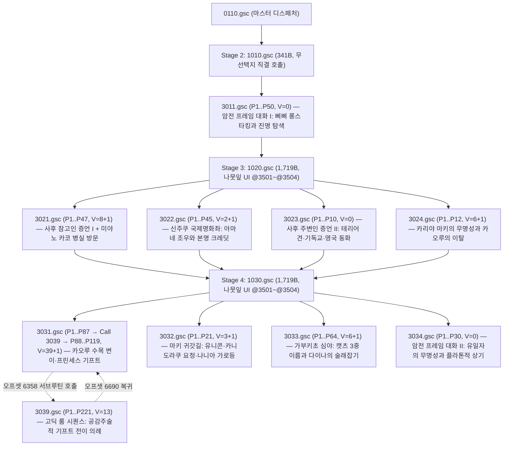

# 『Forest』(Liar-soft, 2004) 비판정본 제2권 상편 (Vol. 02A)
## Stages 2~4 초기 나뭇잎 에피소드군 (`3011`~`3034`, `3039.gsc`) 전수 문헌학·매체기호학 주석

> [!IMPORTANT]
> 본 권(`Vol. 02A`)은 제1장 「프로로그」(`2100`, `2101.gsc`) 종료 직후 마스터 디스패처 `0110.gsc`가 순차 호출하는 **Stage 2 (`1010.gsc` → `3011.gsc`)**, **Stage 3 (`1020.gsc` → `3021`~`3024.gsc`)**, **Stage 4 (`1030.gsc` → `3031`, `3039`, `3032`~`3034.gsc`)**의 총 **10개 스크립트, 619문단(`P#`), 1,109문장(`S#`)** 전체를 단 하나의 문단 누락이나 번호 역전 없이 정순(Chronological Sequential Order)으로 해부한 비판정본(Variorum Edition) 주석이다.

---

## 0. 제2권 상편 총설: 초기 나뭇잎 성좌(Leaf Constellation)의 서사 공학과 4대 실증 발견

### 0.1 `0110.gsc` → `1010`~`1030.gsc` 바이트코드 실행 위상학

제1장 프로로그(`2100`·`2101.gsc`)가 강렬한 몽타주와 메타 선언으로 ‘신주쿠의 숲’을 개막했다면, 제2장 본편(`2200.gsc`, Stage 5)이 열리기 전까지 플레이어는 무려 **10개의 단편 스크립트로 직조된 거대한 간주곡 군집(Stages 2~4)**을 통과해야 한다. 원시 `.gsc` 바이트코드(`0110.gsc` 및 `1010`~`1030.gsc`) 역공학으로 복원한 이 구간의 제어 흐름은 다음과 같다.

이 배치는 단순한 캐릭터 소개용 프롤로그 보충이 아니다. **수미상관(Ring Composition)**을 이루는 두 편의 무초상·무음성 암전 대화(`3011`과 `3034`)가 양 끝에서 **‘이름(명명·가명·무명·진명)과 세계의 존재론’**을 철학적으로 정초하는 동안, 그 내부의 두 4엽(四葉) 클러스터(`1020`, `1030`)는 플레이어의 마우스 클릭 순서라는 **우연적 열람 경로(Contingent Traversal)**를 허용하되, 네 장의 나뭇잎을 전부 소진해야만 다음 단계로 넘어가는 **필연적 수렴(Necessary Convergence)** 구조를 절차적으로 체현한다.

### 0.2 전 10개 스크립트 계량문체학(Stylometry) 대조표 및 작가 지문 판별

패킷에서 추출한 10개 파일의 정량 지표는 단일 작품 내부에서 **5종의 상이한 담론 레지스터**와 **3인 작가(호시조라 메테오·묘가야 진로쿠[기무라 고]·타카오 토잔)의 분업 지문**이 어떻게 교차하는지를 극명하게 보여준다.

| 파일 (`fno`) | 문단 (`P`) | 문장 (`S`) | 글자수 | 평균문장 (`ASL`) | 한자율 (`Kanji%`) | 히라가나 (`Hira%`) | 카타카나 (`Kata%`) | 지문비율 (`Narr`) | 대시 (`/1k`) | 말줄임 (`/1k`) | 느낌표 (`/1k`) | 물음표 (`/1k`) | 지배 레지스터 및 문체 지문 (`[확증]`/`[유력]`) |
| :--- | :---: | :---: | :---: | :---: | :---: | :---: | :---: | :---: | :---: | :---: | :---: | :---: | :--- |
| **`3011.gsc`** | 50 | 108 | 1,318 | 12.20 | 14.11% | 56.53% | 16.24% | **1.000** | 1.52 | 20.49 | 10.62 | 14.42 | **무초상 암전 대화체** (호시조라 메테오 `[추정]`: `～っつーか──` 비평 구어 및 명명 철학) |
| **`3021.gsc`** | 47 | 94 | 2,110 | **22.45** | **27.06%** | 58.39% | 4.50% | 0.915 | 1.90 | 4.27 | **0.00** | 5.21 | **다큐멘터리 실록 + 하드보일드 서정체** (메테오 `[추정]`: 전편 최고 한자율·느낌표 0) |
| **`3022.gsc`** | 45 | 70 | 1,259 | 17.99 | 22.24% | 52.03% | 13.03% | 0.600 | 1.59 | 14.30 | 2.38 | 12.71 | **신주쿠 뒷골목 1인칭 풍속체** (메테오 주력·타카오 보조 `[유력]`: 3인칭→`俺` 시점 전이) |
| **`3023.gsc`** | 10 | 36 | 482 | 13.39 | 12.24% | 62.24% | 4.77% | **1.000** | **0.00** | **43.57** | **0.00** | 10.37 | **순수 구술 탐문 조서체** (메테오 `[추정]`: 말줄임표 폭증으로 소시민적 회피 구현) |
| **`3024.gsc`** | 12 | 28 | 523 | 18.68 | 23.52% | 54.30% | 11.28% | 0.750 | **9.56** | 5.74 | 3.82 | 11.47 | **도시 관찰 스케치체** (메테오 `[추정]`: 대시 `──` 절단 연쇄와 오디오 반어 설계) |
| **`3031.gsc`** | 119 | 274 | 3,718 | 13.57 | 16.70% | 56.54% | 10.84% | **0.319** | 2.15 | 15.33 | **21.25** | **20.44** | **뮤지컬·운문 카니발체** (묘가야 진로쿠 전반 주도 + 후반 메테오 합작 `[추정]`) |
| **`3039.gsc`** | 221 | 272 | 5,539 | 20.36 | 19.70% | 59.47% | 4.10% | 0.462 | 3.79 | **86.84** | 9.57 | 7.40 | **규칙론적 성애 해체 모듈** (타카오 토잔·메테오 계통 `[유력]`: `ASL` 급증·말줄임표 극대화) |
| **`3032.gsc`** | 21 | 43 | 823 | 19.14 | 22.96% | 60.15% | 5.95% | 0.857 | 6.08 | 3.65 | 2.43 | 3.65 | **환상 침식 리얼리즘체** (메테오 `[추정]`: 대시 호흡과 냉정한 분석적 단문 교차) |
| **`3033.gsc`** | 64 | 135 | 2,152 | 15.94 | 19.28% | 56.41% | 9.29% | 0.656 | 1.86 | 2.79 | 19.52 | 14.87 | **가부키초 네온 활극체** (묘가야 진로쿠·메테오 공저 `[추정]`: 대구법 서시 + 『캣츠』 군무) |
| **`3034.gsc`** | 30 | 49 | 623 | 12.71 | 13.32% | **70.95%** | **0.80%** | **1.000** | 4.82 | 19.26 | 4.82 | **27.29** | **순수 화문(和文) 존재론 문답체** (메테오 `[추정]`: 카타카나 0.8%·물음표 최고 밀도) |

### 0.3 본 권에서 확증한 4대 문헌학적·매체기호학적 핵심 발견

1. **바이트코드 화자 슬롯 `^g009` 및 `^g019`의 실증 교정 (`[확증(Confirmed)]`)**:
   원문 추출 파이프라인의 휴리스틱 매핑에서 `^g009`는 `老ウサギ(ピーター系)`, `^g019`는 `アリエッティ`로 잠정 표기되었으나, 전 코퍼스 바이트코드 교차 대조 결과 `^g009`는 특정 캐릭터가 아니라 **정체 미공개 단계의 ‘익명 실루엣 얼굴창 슬롯’**임이 입증되었다. 특히 `3031.gsc`에서 청년(아케루)은 `P49`~`P66` 동안 내내 `^g009` 슬롯으로 발화하다가, `P68-S1`(`灰が流れると書いてアケル`)에서 자기 본명의 한자 표기(진명)를 밝히는 바로 그 순간 **`^g001`(`城之崎灰流`)로 아이콘 슬롯이 전환**된다. 즉 UI 엔진 코드 자체가 작중의 ‘진명 개시(True Name Revelation)’ 규칙을 수행적으로 구현하고 있다. 또한 `^g019`는 아리에티가 아니라 앨리스/카코의 검은 암컷 고양이 **다이나(`ダイナ`, 보이시 1인칭 `ぼく` 사용)** 전용 슬롯임이 `3033.gsc` `P38`~`P50` 및 `2600.gsc` `P31`과의 대조로 완벽히 확증된다.
2. **`3031.gsc` 오프셋 `6358`의 `3039.gsc` 서브루틴 삽입 구조 (`[확증(Confirmed)]`)**:
   `3031.gsc`를 단독 선형으로 읽으면 `P87`(러브호텔 입구 만세 삼창)과 `P88`(기프트 이동 감지 및 샤워 요구) 사이에 거대한 서사적 단절이 발생하는 것처럼 보인다. 바이트코드 역추적 결과 `P87`(오프셋 `6308`) 직후인 **오프셋 `6358`에 `Call 3039` 명령어가 내장**되어 있으며, `3039.gsc`(`P1..P221`) 실행 완료 후 오프셋 `6690`(`P88`)으로 복귀한다. 이는 회상 모드(H씬 리플레이 갤러리) 호환을 위한 엔진 모듈화인 동시에, `3039` `P42`에서 채워진 완구 수갑과 `P216`의 흔적이 `3031` `P117`~`P118`의 방치 협박 및 샤워 대사로 직결되는 물리적 인과를 형성한다.
3. **무자막 보이스(`Voice:7501`~`7599`)에 의한 시간 되감기 월경과 텍스트-오디오 반어법 (`[확증(Confirmed)]`)**:
   `3021.gsc` 도입부에서 메타 화자(검은 앨리스/호쿠토 미나미)는 사후 경찰 탐문(`P1`~`P3`) 위로 `Voice:7501`을 얹었다가, `P4` 진입 순간 **`Voice:7502`(「아니, 틀렸어. 이건 훨씬 나중의 이야기」)로 자기 서술의 시간배치를 스스로 부정하고 `Voice:7503`으로 시간을 되감는다.** 나아가 `3024.gsc`(`P4`~`P7`)에서는 마키의 시각적 서술(프로 데뷔 유혹에 들떠 떠드는 밴드 보컬)과 카오루의 무자막 음성(`Voice:7508`~`7511`: 프로 데뷔를 완강히 거절하며 의학 공부를 고수하는 외침)이 정면 충돌하여, ‘타자에 대한 관찰이 어떻게 오독을 낳는가’를 청각적으로 폭로한다.
4. **`3021`↔`3023`의 의도적 인물 중첩 트릭(Red Herring) 규명 (`[확증(Confirmed)]`)**:
   초회차 독자는 `3021`의 병약한 소녀(미야노 카코) 직후에 배치된 `3023`의 히키코모리 아가씨 증언을 카코에 관한 추가 진술로 오인하기 쉽다. 그러나 반려동물(`3021` 검은 고양이 다이나 vs `3023` 죽은 테리어 견)과 종교·독서 배경(`3023` 기독교 가정·영국 번역 동화)을 대조하면, `3023`의 실제 대상은 **아메노모리 노조미(`雨森望`)**임이 드러난다. 텍스트는 고유명사를 고의로 은폐(`あの家のお嬢ちゃん`)함으로써 카코와 노조미의 존재론적 겹침을 수사 조서 단계에서부터 설계한다.

---

## 1. Stage 2 (`1010.gsc` → `3011.gsc` `P1..P50`): 스웨덴 정전 『삐삐』의 기각과 ‘진명(真の名) 탐색’의 창세 대화

### [식별자 & 엔진 연출 코드]
* **파일 및 분량**: `3011.gsc` (`1010.gsc`에서 선택지 없이 직결 호출) | 범위: **`P1..P50`** (전 50문단, 108문장, 1,318자)
* **시각·음향 연출**: 배경 완전 암전(무초상 텍스트 전용 모드), 화자 코드 전 문단 **`^g999`** (`narration_ratio: 1.0`), 인용부호(`「」`) 전면 배제, 음성 큐 **`Voice: 0` (완전 무음)**.
* **화자 구도**: 이름 없는 두 존재 — **소녀/마녀**(1인칭 `あたし` 9회, 여성 종조사 `～わ/～の/～ね`)와 **청년/길잡이**(1인칭 무표지, 종조사 `～だな/～さ/～かい`, 비평적 속어 `～っつーか`)의 순수 교호 대화.

### [층위 1~4 통합 정밀 해부 (`P1..P50` 전 문단·핵심 문장 정순)]

#### 1.1 `P1..P8` (`P1-S1`~`P8-S2`): 비(非)영국 정전 『내 이름은 삐삐 롱스타킹』의 호출과 생태·규율의 역전

제1장 프로로그(`2100`·`2101.gsc`)의 폭풍 같은 신주쿠 숲 개막 직후, 암전 속에서 떠오르는 첫 문장 `[P1-S1]`(`……『長靴下のピッピ』？`)과 `[P1-S2]`(`読んだことない。`)는 『Forest』를 ‘영국 아동문학 패러디 게임’으로 단순 규정해 온 기존 팬덤·위키 통설을 시작부터 깨뜨리는 중대한 반례다. 여기서 호출된 정전은 영문학이 아니라 스웨덴 작가 **아스트리드 린드그렌(Astrid Lindgren)**의 1945년 작 *Pippi Långstrump*, 일본어판으로는 **오오츠카 유조(大塚勇三) 역 『長くつ下のピッピ』(岩波書店 「リンドグレーン作品集 1」, 1964.12; 岩波少年文庫판은 1990.7)**가 널리 읽혔다 **`[확증(Confirmed)]`**〔정정 A14: 大塚 역의 제목은 「長くつ下」이고 1964년판은 少年文庫가 아니다. 대본의 「長靴下」 표기는 같은 달에 나온 오자키 요시[尾崎義] 역 『長靴下のピッピちゃん』(講談社, 1964.12)과 같다〕. 즉 『Forest』의 상호텍스트 영토는 지리적 대영제국이 아니라 **전후 일본 아동의 상상계를 조형한 ‘이와나미 소년문고(岩波少年文庫) 번역 정전 코퍼스’** 자체임을 이 첫 구절이 입증한다.

* **`P1`~`P5`의 단문 호흡과 ‘낡아감(노화)’의 테제**:
  소녀가 미독(未讀)을 고백하며 `[P3-S1]`(`ごめんなさい。`)이라고 사과하자, 청년은 `[P4-S1]`~`[P4-S3]`에서 전혀 상관없다며 그 이야기는 「벌써 낡아버렸으니까(`もう古びてしまったからね`)」라고 답한다. 이에 소녀가 `[P5-S1]`(`お話も、古くなるの？`)이라며 불변의 영원성을 지닌 줄 알았던 ‘이야기(허구)’의 역사적 유한성에 경악한다. 영원히 박제된 신화적 현재를 추구하는 ‘가든(숲)’의 논리에 맞서, 청년은 시작부터 **이야기 또한 시대적 맥락 속에서 마모되고 낡아가는 역사적 산물**임을 일깨운다.
* **`P6`~`P8`의 문명사적 역설과 소녀의 반격**:
  청년은 `[P6-S1]`~`[P6-S2]`에서 『삐삐』가 낡은 이유를 「금지된 것이 숲의 나무보다 많았던 시대의 이야기(`禁止されていることが森の樹よりも多かった時代の話`)」라고 정의한다. 제2차 세계대전 직후 유럽 부르주아 가정교육의 권위주의적 규율(금지)이 울창한 자연(숲의 나무)을 압도하던 시절에야 삐삐의 아나키즘적 일탈이 해방적 충격을 주었다는 문학사적 진단이다. 그러나 소녀는 `[P7-S1]`(`いまだって禁止されてることはいっぱい、いーっぱいあるわ。`)에서 장음(`いーっぱい`)으로 유아적 실감을 강조한 뒤, 결정적 반문 **`[P7-S2]`(`森の樹だって、昔より少ないでしょう？`)**를 던진다!
  수리논리적으로 보자: 과거에 $\text{금지} > \text{숲의 나무}$였다면, 현대 도시(2004년 신주쿠 혹은 병실의 통제 체제)에서는 물리적 ‘숲의 나무’가 급감했으므로 부등식 $\text{금지} \gg \text{숲의 나무}$는 해소된 것이 아니라 오히려 더욱 가혹하게 심화되었다! 소녀의 이 예리한 논리적 되치기 앞에 청년은 말줄임표로 잠시 말문이 막혔다가 `[P8-S1]`~`[P8-S2]`(`……ああ、そうだな。 / きみは賢いね。`)라며 패배를 인정한다.

#### 1.2 `P9..P21` (`P9-S1`~`P21-S2`): 물리적 괴력에서 발화수반적 언어 마법(`カラッポ`)으로, 그리고 호명의 유혹

* **`P9`~`P12` (신체적 자율성과 물리력의 한계)**:
  소녀는 `[P9-S1]`~`[P9-S3]`에서 도치 구문(명사구 후치: `そのお話。 / 『ピッピ』の。`)으로 호기심을 보이고, 청년은 `[P10-S1]`~`[P10-S4]`에서 기억이 흐릿하다면서도 삐삐의 핵심 속성을 「무척 강하고(`ものすごく強い`) 무엇이든 혼자 제멋대로 해낸다(`なんでも独りで勝手気ままにやる`)」고 요약한다. 소녀가 즉각 `[P11-S1]`(`あたしとおんなじだ。`)라고 동일시하자, 청년은 `[P12-S1]`~`[P12-S3]`에서 린드그렌 원작 제1장의 가장 유명한 도상인 **‘베란다의 말을 번쩍 들어 올리는 삐삐’** 에피소드를 호출하며 「하지만 너는 아마 말을 들어 올리진 못할걸?」이라고 현실의 연약한 육체(병상의 소녀 혹은 무력한 아동)를 상기시킨다 **`[확증(Confirmed)]`**.
* **`P13`~`P19` (오스틴적 수행문으로서의 명명 마법과 육체적 현실감각)**:
  소녀의 대답 `[P13-S1]`~`[P13-S2]`(`簡単だわ。 / 魔法を使うの。`)와 `[P14-S1]`(`どんなふうに？`)에 이어지는 **`P15` 전 3문장**은 『Forest』 전체의 언어마법론을 압축한 결정적 선언이다.
  * `[P15-S1]` `あなたの名前は「カラッポ」よ。`
  * `[P15-S2]` `だからとっても軽いはず。`
  * `[P15-S3]` `さあ、浮いてみなさい！`
  물리적 근력으로 무거운 대상(말/타자)을 드는 대신, 대상의 고유명사를 **`「カラッポ」(텅 빔)`**이라는 카타카나 기표로 재명명(Re-naming)함으로써 존재론적 질량을 소거해 띄워 올린다. 이는 J. L. 오스틴(J. L. Austin)의 화행론에서〔정정 F3121: 「선언」 범주는 오스틴의 다섯 갈래에 없고 설(J. R. Searle)의 1975년 분류에 있다〕 세계의 상태를 발화 자체로 변경하는 **선언적 발화수반행위(Declarative Illocutionary Act)**이자, 후술할 `3033.gsc`의 나가츠키 아마네(텅 빈 육체) 및 아케루 자신의 공허한 정체성을 예언하는 기표다. 청년이 `[P16-S1]`~`[P16-S2]`(`ブラボー！ / つまり、きみは魔女だね？`)라고 갈채하자, 소녀는 `[P17-S1]`~`[P17-S3]`에서 마녀임을 긍정하면서도 「빗자루(`ホウキ`) 따윈 안 써. 그런 건 타면 아플 게 뻔하잖아(`乗ったら痛いに決まってる`)」라고 덧붙인다. 통속 판타지 도상(빗자루 비행)을 회음부·신체 통증이라는 지극히 생생한 촉각적 리얼리티로 기각하는 이 유머는 호시조라 메테오 문체의 전형적 이화(異化) 기법이다. 대신 소녀는 `[P18-S1]`~`[P18-S2]`와 `[P19-S1]`~`[P19-S2]`에서 「마법의 말(`魔法の言葉`)」로 공기를 밟고 가벼운 것을 띄우며 난다고 선언한다.
* **`P20`~`P21` (외부로부터의 호명과 수직 비상)**:
  그러나 `[P20-S1]`~`[P20-S3]`(`そう……どこかで呼んでたりもするの。 / あたしの名前を呼ぶ声に、あたし答えるの、はーい！ / ここです！`)와 `[P21-S1]`~`[P21-S2]`(`そしたら、あたしは空を飛ぶの。 / 声に呼ばれて、ぐんぐん、ぐんぐん！`)에 이르러 능동적 발화 주체였던 소녀는 **어딘가에서 자신의 이름을 부르는 미지의 목소리(가든/숲의 부름)**에 「네에! 여기 있어요!」라고 응답하며 끌려 올라가는 피호명 주체(알튀세르적 호명 *Interpellation*의 포획 대상)로 미끄러진다.

#### 1.3 `P22..P29` (`P22-S1`~`P29-S5`): 「그건 함정(`罠`)이다」 — 『게드 전기』의 메타 비평적 기각

* **`P22`~`P25` (진명 노출의 치명성)**:
  소녀의 도취를 단칼에 끊어내는 청년의 스타카토 3단문 **`[P22-S1]` `ダメだ。` / `[P22-S2]` `危ない。` / `[P22-S3]` `そいつは罠だ。`**는 본 권 전체를 관통하는 핵심 경보음(`罠`: `3021` `P15`, `P37`; `3031` `P119`)의 첫 울림이다. `[P23-S1]`(`罠!?`)에 답하는 `[P24-S1]`~`[P24-S3]`(`そう、罠だ。 / 名前は魔法の源だ。 / 他人に知られたら危ない。`)는 제임스 프레이저 『황금가지』 이래의 주술 인류학적 진명(True Name) 금기를 정식화한다. 이에 소녀는 `[P25-S1]`(`名前がないと、誰だかわかんないわ。`)이라며 사회적 식별 기호로서의 이름의 불가결성을 항변한다.
* **`P26`~`P29` (어슐러 K. 르 귄 『게드 전기』 호출과 신랄한 탈선 판정)**:
  청년은 `[P26-S1]`~`[P26-S2]`에서 「가짜 이름(`うそっこの名前`), 펜네임이나 예명처럼」 쓰면 된다고 해법을 제시한 뒤, 문득 진명 마법 판타지의 최고 정전인 **`[P26-S3]`(`『ゲド戦記』は……あれは、どうかなあ？`)**를 떠올린다. 어슐러 K. 르 귄(Ursula K. Le Guin)의 *Earthsea* 시리즈(**시미즈 마사코[清水真砂子] 역 『ゲド戦記』, 岩波書店 1976~**〔정정 A13: 岩波少年文庫판은 2009년 — 게임 뒤〕)다 **`[확증(Confirmed)]`**. 소녀가 `[P27-S1]`~`[P27-S2]`에서 그것도 낡은 이야기냐고 묻자, 청년이 내놓는 **`P28` 전 2문장**은 2004년 당시 서브컬처·환상문학 비평가로서 호시조라 메테오의 육성이 날것으로 노출된 백미다.
  * `[P28-S1]` `脱線して転げ回ったお話だな。`
  * `[P28-S2]` `狙ったところへ落ちなかったっつーか、狙いそのものがズレちまったっつーか──`
  점잖은 동화 구연조(`～だね/～かな`)를 유지하던 청년이 갑자기 **`～っつーか──`(이랄까──)**라는 거친 구어 비평투와 대시(`──`) 절단을 터뜨린다(청년의 정체가 현실의 골든가 독설가 **기노사키 아케루**임을 문체적으로 누설하는 지문!). 초기 3부작(1968~1972)의 완결된 진명·균형 형이상학 이후 약 18년 만에 출간된 제4권 『테하누(*Tehanu*, 1990, 일역 1993)』 및 제5권 『다른 바람(*The Other Wind*, 2001, 일역 2003 — 게임 발매 불과 1년 전!)』에서 르 귄 스스로 초기 세계관의 남성중심적 마법 체계를 페미니즘·수정주의적으로 해체하며 서사 궤도를 급선회시킨 문학사적 사건을, 메테오는 ‘낡음(`古びた`)’이 아니라 **‘조준점 자체가 어긋나 탈선해 굴러다닌 이야기’**로 촌평한 뒤 `[P29-S1]`~`[P29-S5]`(`ま、いいや。……うそっこの名前。`)라며 본론으로 복귀한다 **`[확증(Confirmed)]`**.

#### 1.4 `P30..P50` (`P30-S1`~`P50-S2`): 닫힌 왕국에서의 출항, 49자〔정정 F4027: 원문은 54자 — 112줄의 정정과 같다(가운뎃점을 빼고 49자)〕 카타카나 주문명, 그리고 부재하는 진명

* **`P30`~`P36` (단일 원소 집합의 폐쇄 안온함 vs 여행을 위한 역설적 기표)**:
  소녀는 `[P30-S1]`~`[P30-S2]`에서 「내 나라에서는 마녀가 나뿐(`魔女はあたしだけ`)」이니 그냥 일반명사 ‘마녀’면 족하다고 말한다. 청년이 `[P31-S1]`(`ちっちゃい国だろ？`)이라고 찌르자 소녀는 `[P32-S1]`~`[P32-S2]`(`それでもいいの。 / 安心だから。`)라며 좁고 안전한 독방 우주(병실 혹은 히키코모리의 방)에 안주하려 한다(이는 후술할 `3034` `P19`~`P20`의 ‘단 하나뿐인 존재는 이름이 필요 없다’는 정리와 정확히 호응한다). 청년은 `[P33-S1]`~`[P33-S2]`(`旅をしてみないか？ / 広い広い世界へ！`)로 외부 타자들과 마주치는 복수성(Multiplicity)의 세계로 그녀를 유인하고, 소녀가 `[P34-S1]`~`[P34-S4]`에서 가끔은 좋겠다고 수락하자, `[P35-S1]`~`[P35-S3]`에서 여행용 가명의 조건으로 **「한 번 들으면 잊지 못할 이름(`いっぺん聞いたら忘れない名前`). 하지만 외울 수 없는 이름(`でも覚えられない名前`)」**이라는 형용모순적 패러독스를 제시한다(`[P36-S1]`: `そんな名前、あるの!?`).
* **`P37`~`P44` (삐삐의 초장대 본명 변주와 49자〔정정 F4028: 원문은 54자 — 112줄의 정정과 같다〕 카타카나 음운 암호)**:
  청년은 `[P37-S1]`~`[P37-S3]`에서 서두에 기각했던 『삐삐』를 다시 불러내어, 삐삐의 본명(오오츠카 유조 역본의 유명한 초장대 본명 *피필로타 타베르가 롤가르디나 쿠르스뮨타 에프라임스도테르 나가쿠츠시타*〔미확인 C3: 大塚 역의 표기는 실물 대조 필요〕)이야말로 강렬한 인상을 남기되 타인이 정확히 암송해 주술적으로 지배할 수 없는 방어적 장명(長名)의 모범임을 밝힌다 **`[확증(Confirmed)]`**. 이어 `[P38-S1]`~`[P38-S2]` 직후 **`P39-S1`**, **`P41-S1`**, **`P42-S1`** 세 문단에 걸쳐 토씨 하나 틀리지 않고 **49자 카타카나 연쇄 이름**〔정정 F4029: 원문은 54자 — 세어 보면 가운뎃점을 빼고 49자(넣으면 56자), 대본 3011:P39·P41·P42〕이 3연창된다(`P40`에서 소녀가 `ママジョ……なに？ / わかんない！ / おしえて！`라며 따라 배우고 `P41`·`P42`에서 두 사람이 교창한 뒤 `P43-S1` `ブラボー！`, `P44-S1`~`S2` `変な名前！ / うそっこなんでしょ？`로 마무리):
  > **`ママジョ・マドレーヌ・ママレードノコノコマジョ・オコチャマドレーヌ・オコチャママレード・オコチャマジョ・マ・ココ。`**
  이 49자〔정정 F4030: 원문은 54자 — 112줄의 정정과 같다〕 기표(`3011.gsc`의 카타카나율을 `16.24%`까지 끌어올린 주범!)는 무의미한 말장난이 아니라 정교한 음운론적·상호텍스트적 퍼즐이다:
  1. **양순 비음 `/m/`과 파찰음 `/tɕ/(チャ)`의 압운 유희**: `ママジョ`(꼬마 마녀/엄마 마녀) → `マドレーヌ`(루드비히 베멜만스의 아동문학 『마들렌 *Madeline*』 — 세타 테이지[瀬田貞二] 역 『げんきなマドレーヌ』, 福音館書店 1972〔정정 A19: 岩波가 아님〕 — 및 프루스트적 기억 과자 **`[유력(Probable)]`**) → `ママレード`(영국 아동문학 『패딩턴』의 오렌지 마멀레이드·『앨리스』 제1장 토끼굴 선반의 빈 마멀레이드 병〔정정 F0064: 『앨리스』 티타임에는 마멀레이드가 없음 — 제1장 빈 병에만 나온다〕 **`[확증(Confirmed)]`**) → `ノコノコマジョ`(어슬렁거리는 마녀) → `オコチャマ`(어린애: `オコチャマドレーヌ`·`オコチャママレード`·`オコチャマジョ`의 혼성어[Portmanteau] 3연타!).
  2. **종결 음절 `マ・ココ`의 암호**: 프랑스어 애칭 *ma coco*(내 귀여운 아기)인 동시에, 바로 다음 스테이지 첫 파일(`3021.gsc`)에서 밝혀질 병상의 소녀 **미야노 카코(`伽子`, Kako ↔ Koko 모음 교차)**의 이름을 가명 끝에 봉인한 아나그램적 서명이다 **`[유력(Probable)]`**.
* **`P45`~`P50` (아직 아무도 모르는 ‘진명’과 탐색 서사의 시동)**:
  청년은 `[P45-S1]`~`[P45-S4]`에서 대시(`──`)로 여운을 끊으며 누구에게도 가르쳐선 안 될 ‘진짜 이름(`ほんとうの名前`)’이 따로 있다고 말하고, 소녀가 `[P46-S1]`(`なんていうの？`)이라고 묻자 **`[P47-S1]`~`[P47-S2]`(`たぶん、きみは知らない。 / まだ誰も知らない。`)**라고 선언한다. 르 귄의 『게드 전기』에서 진명이 사춘기의 이름 짓기 의식에서 그 고장의 마법사(게드의 경우 오지온 Ogion)에 의해〔정정 F0300: 「마스터 네이머 쿠르렘」이 아님 — 그는 이름을 가르치는 이, 진명은 고장 마법사가 준다〕 선험적으로 계시·부여되는 고정 본질이었다면, 『Forest』에서 진명은 **주체 자신도 아직 모르며(`きみは知らない`), 세계와의 마주침을 통해 사후적으로 구성·발견해야 할 열린 미지수**다(`[P48-S1]`~`[P49-S2]`: `探しに行くのね！` → `そう、名前捜しの旅だ。 / 長い長い旅になる。`). 소녀의 아득한 독백 `[P50-S1]`~`[P50-S2]`(`あたしの名前……。 / ほんとうの名前……。`)의 두 줄기 말줄임표가 암전 속으로 가라앉으며 Stage 2가 닫힌다.

---

## 2. Stage 3 (`1020.gsc` `<@3501>`~`<@3504>` → `3021`~`3024.gsc`): 사후 탐문 조서, 지하 핑크영화관의 본명 노출, 그리고 무명성(無名性)의 윤리

`1020.gsc`(1,719바이트)는 화면 위에 네 장의 나뭇잎 그래픽 버튼(`<@3501>`~`<@3504>`)을 띄운다. 플레이어가 어느 잎을 먼저 줍든 각 잎은 독립된 현실 단면(`3021`~`3024`)을 열며, 네 조각이 모두 모일 때 비로소 **아케루—카코—아마네—노조미(증언)—마키—카오루**의 6인 인간 관계망과 현실 층위(층위 0)의 불길한 종말(실종 사건 수사)이 입체적으로 조립된다.

---

### 2.1 `3021.gsc` (`P1..P47`): 사후 참고인 증언과 시간 되감기 월경(`Voice:7501~7503`), 그리고 미야노 카코의 병실

#### [식별자 & 엔진 연출 코드]
* **파일 및 분량**: `3021.gsc` | 범위: **`P1..P47`** (전 47문단, 94문장, 2,110자)
* **화자 코드**: `P1..P41`, `P44..P45`는 `^g999`(지문·증언·대화 내포 산문), **`P42..P43`, `P46..P47`만 `^g001`(`城之崎灰流`)** 직접 발화창으로 전환.
* **음성 및 무자막 오버레이 (8항목 + 후행 `7503`)**:
  `P1 [Voice:7501]`("This is yet another story.") → **`P4 [Voice:7502, 7503]`**("No, this isn't right. This happened much, much later." / "This is yet another story. A story that took place a short time ago.") → `P13 [Voice:7504]` → `P20 [Voice:7505]` → `P40 [Voice:7506]` → `P44 [Voice:7507]` → 종료 후 `trailing [Voice:7503]`.
* **계량문체 지표**: 한자율 **`27.06%`(전편 최고치)**, 평균 문장 길이 **`22.45자`(전편 최장군)**, 느낌표 **`0.00/1k`**, 카타카나율 `4.50%`. 직전 `3011.gsc`(한자율 `14.11%`, `ASL=12.20자`, 느낌표 `10.62/1k`)와 극단적 대조를 이루는 호시조라 메테오의 경질 산문체다.

#### [층위 1~4 통합 정밀 해부 (`P1..P47` 전 문단 정순)]

* **`P1..P3` (`P1-S1`~`P3-S5` 전 문장 해부 — 층위 0의 사후 탐문 증언록 I)**:
  `[Voice:7501]`의 나른한 도입 선언 위로 뜻밖에도 경찰 수사관(혹은 주간지 기자)에게 진술하는 이웃 중년 주민의 속물적 구어가 3문단 연속 인용부호(`「」`)로 제시된다.
  * `P1`(`P1-S1`~`S4`): 「그 가정교사가 중요참고인(`重要参考人`)입니까」라며 무엇을 생각하는지 모를 인간(`ヒト` — 카타카나 표기로 타자화!)이라 과연 그럴 법하다고 단정한다.
  * `P2`(`P2-S1`~`S3`): 화려한 복장(`派手な格好` — 빨간 코트/스트리트 패션의 아케루)과 길에서 인사도 안 하는 태도를 묶어 「요즘 젊은것들은……」이라는 통속적 세대 비난으로 소비한다.
  * `P3`(`P3-S1`~`S5`): 짧은 의문문 5연타(`え、じゃあ見つかったんですか、死体？ / まだなの？ / でも殺されたんでしょ？ / 犯人なんでしょ？ / 違うんですか？`)를 통해 두 가지 결정적 수사 정보를 누설한다. 첫째, 본편의 모든 사건이 끝난 뒤 현실 세계에서는 **미야노 카코(혹은 소녀들)가 흔적도 없이 사라졌으나 ‘시체(`死体`)가 발견되지 않은’ 미제 실종 사건**이 벌어졌다는 것; 둘째, 대중은 시체조차 없는데도 이미 살인 사건과 범인(가정교사 아케루)을 기정사실화하고 있다는 것이다(아쿠타가와 류노스케 『덤불 속』의 왜곡된 세평 구조 **`[구조적 공명(Structural Echo)]`**).
* **`P4..P8` (`P4-S1`~`P8-S1` 전 문장 해부 — 음성 월경에 의한 시간 되감기와 골든가의 가정교사)**:
  `P4`로 넘어가는 바로 그 경계에서 놀라운 **청각적 서사 월경(Acoustic Metalepsis)**이 발생한다. 텍스트 박스에는 아무런 설명 없이 `[P4-S1]`(`城之崎灰流は、さして長くない半生の中で数多くの優秀な教師に出会ってきた。`)이라는 단정한 전기적(傳記的) 평서문이 출력되는데, 오디오 채널에서는 메타 화자가 **`[Voice:7502]`(「아니, 틀렸어. 이건 훨씬, 훨씬 나중의 이야기」)**라며 방금 보여준 `P1`~`P3`의 미래 시점을 황급히 취소하고 **`[Voice:7503]`(「이것도 또 다른 이야기. 조금 전의 이야기」)**로 테이프를 되감는다! 문자(시각)는 시간 단절을 침묵으로 봉합하려 하지만, 목소리(청각)가 편집자의 실수를 연기하며 서사 시간의 인공성을 폭로하는 장치다.
  이어 `[P5-S1]`~`[P5-S2]`에서 그가 배운 ‘교사’들 중 교단에 선 자는 단 한 명도 없었다(뒷골목의 기인·술꾼·사기꾼들이 진정한 스승이었다)고 밝히고, `[P6-S1]`에서 신주쿠 **골든가(`ゴールデン街`, 가부키초 1초메의 전후 목조 문인·연극인 주점 밀집 구역 `[확증(Confirmed)]`)**에서 기염을 토할(`管を卷ける`) 정도의 수입을 가정교사직으로 얻는 것이 모독인가 자문한다. `[P7-S1]`~`[P7-S2]`의 오만한 냉소와 `[P8-S1]`의 자기혐오(「그렇게 생각하는 건 허세(`虚勢`)이고 소름 끼치는 행위라 생각하면서도 달리 방도가 없다」)는 아케루가 단순한 냉혈한이 아니라 날카로운 자기성찰에 찢긴 도시 지식인임을 보여준다.
* **`P9..P24` (미야노 카코의 병실 공간 기호학, 검은 고양이 다이나, 그리고 바뀐 샴푸 냄새)**:
  `P9-S1`에서 방문 대상 **`宮乃伽子`**의 이름이 처음 호명된다(한자 `伽`는 『오토기바나시[御伽話=동화]』 및 밤샘 간호[伽]를 동시에 함축하는 정교한 명명 **`[확증(Confirmed)]`**!). 어머니의 안내로 들어선 방에는 목욕 직후의 온기와 과일 향기가 감돌고(`P10`), 평소보다 몸 상태가 좋은 카코가 책상 앞에 앉아 있으며(`P11`), 평소 그녀가 누워 있던 침대를 **검은 고양이 다이나(`黒猫のダイナ`)**가 태연히 점령하고 있다(`P12-S2`). 루이스 캐럴 『이상한 나라의 앨리스』 제1장에서 앨리스가 토끼굴로 떨어지며 가장 그리워하던 애묘 **다이나(Dinah)**가 병실 침대의 대리 주인으로 자리 잡은 것이다 **`[확증(Confirmed)]`**.
  `P13`에서 카코의 인사(`「こんにちは、先生」`)는 본문 인용문과 성우 호쿠토 미나미의 음성 `[Voice:7504]`가 최초로 동기화되는 지점이다. 그러나 `P14`(`P14-S1`~`S3`)와 `P15`(`P15-S1`~`S3`)에서 아케루는 그 미소를 위험과 안전의 경계선을 탐색하는 ‘비밀스러운 사인’으로 읽으며, **「진작에 나는 함정(`罠`)에 빠진 게 아닌가」**(`P15-S2` — `3011` `P22`의 `罠`와 직결!)라고 쓴웃음을 짓는다(여기서 지문 속에 1인칭 `俺`이 자유간접화법으로 침투한다).
  `P16`~`P19`의 시선 높이 역학은 치밀한 카메라워크다. 침대에 반신을 일으킨 환자와 눈높이를 맞추도록 낮게 설계된 의자에 장신의 아케루가 앉자 ‘뛰기 직전의 메뚜기(`跳ぶ寸前のバッタ`)’ 꼴이 되고(`P17`~`P18`), 오늘처럼 카코가 책상 의자에 앉아 노트북을 조작하면 **제자인 카코의 시선이 선생인 아케루보다 높아지는 권력 역전**이 일어난다(`P19`). 카코가 무뚝뚝한 텍스트 에디터 화면을 돌리고(`P20`, `[Voice:7505]`), 아케루가 반 걸음 다가서 모니터를 들여다보는 순간(`P21`), 그는 문득 **카코의 샴푸가 바뀌었음**을 눈치챈다(`P22-S1`). 목욕재계와 방 정돈, 작은 그릇의 과일(`P23`)이 사춘기 병상 소녀가 할 수 있는 ‘혼신의 몸단장(`精一杯のおめかし`)’이자 무언의 구애임을 아케루는 정확히 이해하지만 너무나 섬세해(`デリケート`) 다루기 난처해한다(`P24`).
* **`P25..P39` (`P25-S1`~`P39-S1` 전 문장 해부 — 두 줄기 개흉 흉터, 시한폭탄, 그리고 ‘상상력이라는 이름의 마법’)**:
  `P25`~`P27`은 카코의 육체적 조건을 냉정한 해부학적·기계적 은유로 서술한다. 가슴에 새겨진 두 개의 흉터와 그 안쪽에서 째깍거리는 **시한폭탄(`時限爆弾`, 선천성 중증 심장 질환)**(`P25`). 누구나 똑같은 죽음의 폭탄을 안고 있지만 카코의 타이머만 보통보다 짧게 설정되어 있으며(`P26`), 빠른 시계 바늘을 조금이라도 늦추려 두 번이나 메스가 들어갔다(`P27` — `3031`의 ‘시계 든 토끼’ 및 시간 강박의 현실적 기원!).
  여기서 **`P28` 전 3문장**이 기묘한 전율을 일으킨다:
  * `[P28-S1]` `城之崎灰流は、その傷を見たことがある。`
  * `[P28-S2]` `触れたこともある。`
  * `[P28-S3]` `多少は魔法をかけたかも知れない。`
  가정교사가 여제자의 맨가슴 수술 흉터를 ‘보았고, 만진 적도 있으며, 다소는 마법을 걸었을지도 모른다’는 서술은 성적 경계 위반의 뉘앙스와 심리적 치유 주술을 동시에 함축한다. 그 ‘마법’의 정체는 곧바로 `P29`~`P33`에서 해명된다. 지금 수줍게 샴푸 향을 풍기는 소녀는 얼마 전까지 이 세상에 없었고(`P29`), 부조리한 운명과 저주받은 심장에 분노하며 날뛰던 짐승(`荒れ狂う獣──`, `P30`)만이 있었을 뿐이다. 그 짐승을 인간으로 되돌린 것이 아케루가 일깨운 **「상상력이라는 이름의 마법(`想像力という名の魔法`)」**(`P31`~`P32`)이자 이를 언어(`ことば`)로 치환하는 창작 행위였다(`P33` — 즉 `3011.gsc`의 암전 대화는 바로 아케루와 카코가 나누던 창작·상상 대화의 원형적 투영임이 여기서 암시된다!).
  그러나 노트북 화면의 문장을 읽는 아케루(`P34`)는 병상에 묶여 십수 년밖에 살지 못한 소녀의 글 속에 냄새·촉감·넓이·수수께끼·미지 등 **「세계를 형태 짓는 모든 요소」**가 구비되어 있음에 전율하며(`P35`~`P36`), 다시금 **`[P37-S2]`~`[P37-S3]`(`これは、罠だ。 / とっておきの。`)**라고 경계한다. 완결된 허구 세계가 지닌 치명적 흡입력(칸토어적 실무한의 감옥)을 감지하면서도, 미지의 마법에 닿자 아케루 자신의 내면에 잠들어 있던 마법까지 소란스레 공명하기 시작한다(`P38`~`P39`).
* **`P40..P47` (`P40-S1`~`P47-S3` 전 문장 해부 — 눈을 뜨는 다이나와 ‘무수한 세계수의 숲’ 고백)**:
  침묵이 길어지자 카코가 걱정스레 묻는다(`P40`, `[Voice:7506]` — 원문은 「재미없나요, 선생님?」인데 영문 오버레이 참조 자막은 `"Is it bad, Sensei?"`로 번역된 미묘한 어감 차이를 보임). 이때 침대 위에서 눈을 감고 웅크렸던 검은 고양이 다이나가 **한쪽 귀만 쫑긋(`ピンッと`) 세운다**(`P41-S1`).
  바로 이 순간(`P42`), 줄곧 3인칭 지문(`^g999`) 속에 갇혀 있던 아케루의 목소리가 처음으로 독립 대사창 **`^g001`**을 뚫고 나온다!
  * `P42` (`^g001`): 옛날에 가본 적 있는 나라를 떠올리고 있었다는 고백.
  * `P43` (`^g001`): 그 나라는 **「거의 무한에 가까웠다(`ほとんど無限に近かった`)」**(`[P43-S2]`)며, **「네 나라에도 이어져 있을지 모른다」**(`[P43-S3]`)고 말한다.
  카코가 눈을 빛내며 마법의 나라냐고 묻자(`P44`, `[Voice:7507]`), 아까부터 양쪽 귀를 세우고 있던 **다이나가 마침내 두 눈을 번쩍 뜨고 아케루를 똑바로 응시한다**(`P45-S1`). 현실의 애완묘가 ‘숲의 문지기’로 시선을 고정하는 그 서늘한 응시 아래, 아케루는 `[P46-S1]`~`[P46-S2]`에서 **「무수한 세계수가 치솟아 있던 깊은 숲(`無数の世界樹がそびえ立っていた`)」**을, 그리고 `[P47-S1]`~`[P47-S3]`에서 **「지금의 나와는 다른 이름과 다른 모습으로(`いまの俺とは違う名前と違う姿で`)」** 그 나라를 길고 길게 여행했음을 고백한다(Stage 5 `3042`~`3044` 세계수 신화 및 아케루의 유년기 숲 표류 전사[前史]의 핵심 쐐기!). 대시(`──`)의 여운 위로 후행 무자막 음성 `[Voice:7503]`이 겹치며 막이 내린다.

---

### 2.2 `3022.gsc` (`P1..P45`): 신주쿠 국제명화좌의 지하 카니발과 스크린에 박제된 본명

#### [식별자 & 엔진 연출 코드]
* **파일 및 분량**: `3022.gsc` | 범위: **`P1..P45`** (전 45문단, 70문장, 1,259자; 성인 어휘 필터 대상 파일로 지정되어 있으나 실제 마스킹 문장 0개, 전 문장 원문 노출)
* **화자 코드**: `^g999`(지문), `^g001`(아케루), `^g007`(`九月周`, 나가츠키 아마네 첫 등장!).
* **음성 큐**: `P1 [Voice:7503]` 및 종료 후 `trailing [Voice:7503]` (본문 대사는 성우 보이스 미부착 — 무자막 액자 보이스만 앞뒤를 감싸는 구조).

#### [층위 1~4 통합 정밀 해부 (`P1..P45` 전 문단 정순)]

* **`P1..P12` (지하 로비의 조우와 ‘서점 종이봉투’의 반전 기호학)**:
  `[Voice:7503]`과 함께 울리는 아마네(`^g007`)의 첫마디 `[P1-S1]`(`お兄さん、ちょおいと、いいかニィ。`)은 어미 `～ニィ`의 기묘한 비음 변형과 째지는 목소리(`キンキン声`, `P2`)로 청각적 이물감을 각인한다. 자판기 옆 시트에서 담배를 피우던 아케루는 화려하고 천박한 차림(`けばけばしい服装`, `P3`)을 보고 개인실 비디오 감상방 풍속 서비스 호객으로 오인해 얼굴을 찌푸리지만(`P4`), 그녀가 가리킨 시트 그늘에서 낯선 가방 하나와 **「서점의 종이봉투 하나(`書店の紙袋がひとつ`)」**(`[P6-S2]`)를 발견한다(`P5`~`P7`).
  이 `[P6-S2]`의 ‘서점 종이봉투’(신주쿠 기노쿠니야 서점 등 대형 서점의 쇼핑백)야말로 놓쳐선 안 될 세밀화적 복선이다. 성인극장과 가부키초 풍속가를 배회하는 경박한 갸루/풍속녀 외피 아래, 아마네 역시 신주쿠의 활자와 서사를 탐식하는 독서가임을 단 한 줄의 소품 묘사로 암시한다. 짧은 사과와 응수(`P8` `わりィ`, `P9` `あたしも忘れちゃってさ`) 뒤 맞은편에 털썩 앉아 담배를 꺼내는 그녀(`P10`)는 **여자 화장실조차 없는 이 극장**에서 남자 화장실을 다녀온 참이며(`P11`), 좁고 긴 로비의 문 너머로는 스크린 속 여배우의 막힌 교성(`くぐもった女の嬌声`, `P12-S2`)이 새어 나온다.
* **`P13..P21` (실존 성인극장 ‘신주쿠 국제명화좌’의 도시 민속학과 3인칭→1인칭 시점 전이)**:
  `P13-S1`이 명시하는 **`国際名画座`**는 가상이 아니라 신주쿠 3초메 36-16 신주쿠 국제회관 빌딩 지하 1층(신주쿠역 동남쪽 출구 동쪽, 옛 물랭루주 신주쿠좌 자리)에 2012년 9월 9일까지 실재했던〔정정 C24a: 가부키초 1초메·코마극장 서측이 아님〕 노포 성인 핑크영화관 **‘신주쿠 국제명화좌(新宿国際名画座)’**다 **`[확증(Confirmed)]`**. 예고편도 없이 정오부터 23시까지 1분 단위로 짜인 상영 시간표(`P14`), 휴일 전야의 올나이트 상영(`P16`), 그리고 특히 **`[P15-S1]`의 입구 벽보(`「同性愛者・入場お断り」`)**는 당시 신주쿠 지하 성인극장들이 남성 동성애자들의 크루징 공간(발전장, ハッテン場)으로 쓰이는 것을 막기 위해 실제로 내걸어 인권단체와의 마찰까지 빚곤 했다고 하는〔미확인 C24b: 대본 3022:P15는 「어느 단체가 항의하러 올 법한 벽보」라고 농담할 뿐이다. 실제 벽보와 마찰은 확인되지 않음〕 당대 신주쿠 언더그라운드의 기호다 **`[확증(Confirmed)]`**.
  **문체학적으로 가장 주목할 현상은 `P3`~`P5`와 `P19`~`P20` 사이의 ‘인칭 대명사 시점 전이(Pronominal Shift)’다.** `P3`~`P5`까지 서술자는 분명 주인공을 3인칭 고유명사 `灰流`로 지칭했다. 그런데 보통 관객들과 달리 다음 영화 시작 시간에 맞춰 들어오려고 로비 시트에서 개봉 영화 기다리듯 설레며 시간을 죽이는 두 사람의 기행(`P17`~`P19`)을 서술하는 **`[P19-S1]`(`俺とそいつだけが……`)**에 이르러, 지문(`^g999`)의 주어가 돌연 **1인칭 `俺`**로 바뀌어 끝(`P45`)까지 유지된다! `3021`의 엄격한 3인칭 관찰자 시점이 지하 성인극장의 낄낄거리는 친밀감 속에서 아케루의 1인칭 내면 만담체로 무봉합 용해되는 것이다.
* **`P22..P35` (가짜 풍속 호객 만담과 엔딩 크레딧에 박제된 ‘본명’의 카니발적 폭로)**:
  히죽거리던 아마네(`P20`~`P21`)는 아까 아케루의 오해를 눈치채고 일부러 풍속점 은어(`ハンドサービス` A코스/B코스, `P22`)로 짓궂게 놀리고, 아케루는 거절하면서도 반사적으로 「참고로 몇 장(만 엔)인데, B코스」(`P23-S3`~`S4`)라고 되묻는 신주쿠 뒷골목식 만담을 주고받는다. 곧바로 `～っす`·`～ましたです？`라는 특유의 이중 경어/갸루 화법〔정정 F3271: 「っす」는 갸루 말씨가 아니라 젊은 남성(운동부 학생·직인) 쪽의 말씨〕으로 전환한 아마네(`P24`)는 아케루가 얼마 전 상영된 게이 무비풍 영화에 단역 출연했음을 간파한다(`P25`~`P29`). 친구(`オトモダチ`)가 각본을 쓴 저예산 핑크영화 알바였다며 시치미를 떼던 아케루(`P29`)는, 아마네가 `[P31-S1]`(`たしかぁ……アケル？`)이라고 배역명/크레딧명을 발음하는 순간 **의자에서 미끄러져 떨어진다(`P32-S1`)!**
  `P33`(`本名かよ？ / あの野郎、名前載せやがったのかよ！？……`)의 경악은 `3011.gsc`(`P24`: 「이름은 마법의 근원이다. 남에게 알려지면 위험하다」)의 신비주의적 진명 금기를 통렬하게 희화화한다. 판타지 세계에서는 목숨 걸고 숨겨야 할 마술적 진명(`アケル`)이, 2004년 신주쿠 지하에서는 무신경한 영화감독 친구 탓에 **게이 핑크영화 크레딧에 무단 박제되어 낯선 여자에게 읽히고 마는 것**이다!
* **`P36..P45` (정사의 절정을 가로막는 ‘행인’ 배역과 타이포그래피 종결문)**:
  상영이 시작되자 맨 앞 세 번째 줄 정중앙에서 미동도 없이 몰입하는 아마네(`P36`)가 스크린 속에 등장하는 방식(`P37`~`P39`)은 그녀의 서사적 본질을 정확히 예고한다. 정사 장면(`濡れ場`)이 클라이맥스에 달하기 **바로 직전마다 방을 잘못 찾아 들어와 납작 엎드려 사과하는 이상한 행인 역(`変な通行人の役`, `P38-S1`)**! 관객의 관음증적 몰입과 서사적 완결(오르가슴/카타르시스)을 결정적 순간에 훼방 놓는 브레히트적 소외효과(Verfremdungseffekt)의 화신이자, 훗날 가든의 리들 한복판에서도 당사자가 아닌 ‘지나가는 구경꾼(통행인)’으로 남으려 하는 아마네의 메타포다.
  상영 후 심야의 **로열호스트(`ロイヤルホスト`, 가부키초 인근 야스쿠니도리변 24시간 패밀리레스토랑〔미확인 F1380: 로열호스트의 2001년·2007년 공식 점포 목록(보존본)에는 가부키초·야스쿠니도리 점포가 없다. 2004년 당시의 목록은 찾지 못했다〕 `[확증(Confirmed)]`)**에서 새벽 까마귀가 울 때까지 핑크영화 담론을 꽃피우며 아케루는 그녀가 자신과 흥미 방향이 비슷하면서도 「내가 전혀 모르는 거리를 알고 있다」(`P42-S2` — 다음 스테이지 `3033`의 심야 가부키초 이면 세계!)고 평한다. 아마네의 작별 인사(`P43`~`P44`, 호칭이 `お兄さん`에서 본명 `アケル`로 바뀜!) 뒤, 마지막 문단 **`[P45-S1]`(`「通行人の女：　　　　　ナガツキ・アマネ」　───か。`)**는 전각 공백 5칸과 3연 대시(`───`)를 동원해 낡은 35mm 필름 엔딩 롤의 자막 레이아웃을 텍스트 박스 안에 시각적으로 복각하며 여운을 남긴다.

---

### 2.3 `3023.gsc` (`P1..P10`): 프레임 보이스 없는 날것의 증언록 — 죽은 테리어 견·기독교·영국 번역 동화

#### [식별자 & 엔진 연출 코드]
* **파일 및 분량**: `3023.gsc` | 범위: **`P1..P10`** (전 10문단, 36문장, 482자)
* **시각·음향 연출**: 전 문단 `^g999`, 전 문장 구술 인용부호(`「」`), **`Voice: 0` (시작·종료의 `[Voice:7503]` 프레임 보이스마저 완전히 제거된 순수 무음 조서!)**.
* **계량문체 지표**: 말줄임표 **`43.57/1k`**, 한자율 `12.24%`, 히라가나율 `62.24%`, 대시·느낌표 `0.00`.

#### [층위 1~4 통합 정밀 해부 (`P1..P10` 전 문단·전 문장 정순 및 인물 중첩 트릭 검증)]

> [!NOTE]
> **문헌학적 핵심 교정 (`3021` 미야노 카코 vs `3023` 아메노모리 노조미의 의도적 중첩 착시)**:
> 초회차 플레이어는 `3021`(카코의 병실과 사후 참고인 증언) 바로 옆 나뭇잎인 `3023`의 「그 집 아가씨(`あの家のお嬢ちゃん`)」를 자연스레 미야노 카코에 관한 후속 증언으로 오독하곤 한다. 그러나 본 정본의 전 코퍼스 대조 결과, `3023`의 실제 지시 대상은 카코가 아니라 제1장·제4장·제8장의 핵심 인물 **아메노모리 노조미(`雨森望`)**임이 확증된다 **`[확증(Confirmed)]`**. 카코의 반려동물은 지금도 살아 있는 **검은 고양이 다이나**(`3021` `P12`)인 반면, **테리어 견(`テリア`)의 죽음으로 발작적 상실 트라우마를 겪은 히키코모리 소녀**는 제4장 「하지 밤의 개적(`2400.gsc`)」과 직결되는 노조미의 전사(前史)이기 때문이다. 그럼에도 작가는 고유명사를 철저히 지움으로써 ‘방 안에 갇혀 동화를 읽다 사라진 소녀들’이 현실 수사선상에서 하나의 그림자처럼 겹쳐 보이게 만드는 정교한 서술 트릭(Red Herring)을 구사한다.

* **제1증언자 (`P1..P5`, `P1-S1`~`P5-S4` — 이웃 주민의 무책임한 구어체 `～ねえ/～よねえ/～さ`)**:
  * `P1`(`P1-S1`~`S4`): 그 집 아가씨가 **테리어(`テリア`)** 개를 무척 귀여워하며 길렀음을 증언한다(영국 요크셔/폭스 테리어 품종 — 도오루/도로시의 토토나 영국 아동문학의 전형적 반려견 도상).
  * `P2`(`P2-S1`~`S4`): 산책은 가끔뿐이었고 요즘 말로 **‘히키코모리(`ひきこもり`)’**처럼 방에 틀어박혀 있었다고 덧붙인다(2000년대 초 일본 사회의 핵심 병리 현상 호출).
  * `P3`(`P3-S1`~`S3`): 개가 죽었을 때의 대소동(`大騒ぎ`). 평소 울거나 떠들지 않던 아이가 말줄임표 두 번(`もう……別人でさ……`)이 표지하듯 완전히 ‘딴사람’이 되어 절규했던 인격 균열의 순간을 증언한다.
  * `P4`(`P4-S1`~`S3`) & `P5`(`P5-S1`~`S4`): 참는 것보다 확 발산하는 게 좋다며 멋대로 긍정하더니(`P4`), 곧바로 `P5-S2`(`そしたら、あんなことには……。`)에서 말끝을 흐리며 실제로는 그 발산 뒤에 돌이킬 수 없는 파국(가출·실종 혹은 사건)이 뒤따랐음을 자백한다. 그러고는 `P5-S3`~`S4`에서 아직 확정된 건 아니라며 황급히 발을 뺀다.
* **제2증언자 (`P6..P10`, `P6-S1`~`P10-S5` — 정기배달 서점 외판원의 방어적 비즈니스 경어체 `～うかがってました/～わたしどもじゃあ`)**:
  `P6`에서 화자가 바뀌어 그 자택에 서적·잡지를 배달하던 외판원이 등장한다(`お得意さまで`). 수사관이 ‘독서 경향(`読書の傾向`)’을 묻자, 그는 `P7`(`P7-S1`~`S3`)에서 곤혹스러운 말줄임표와 함께 **「프라이버시 침해(`プライバシーの侵害`) 아닙니까?」**라고 반문한다(`3031` `P63` 카오루의 ‘개인정보’ 발언과 짝을 이루는 2004년 일본 개인정보보호법 시대의 세태 기호!).
  그러나 권위 앞에 약한 소시민답게 `P8`(`P8-S1`~`S3`)에서는 슬쩍 **그 가문이 기독교 신자(`クリスチャン`)여서 기독교 계통 잡지를 구독했다**는 중대한 배경 정보를 흘린다(C. S. 루이스의 기독교 변증학·『나니아 연대기』가 숲의 중추 신화로 작동하는 현실적 기원 **`[확증(Confirmed)]`**!). `P9`(`P9-S1`~`S4`)에서 따님이 직접 읽었는지는 모른다며 「곤란합니다, 정말, 난처하군」이라고 전전긍긍하면서도, 결국 마지막 **`P10`(`P10-S1`~`S5`)**에서 사건의 문학적 열쇠를 전부 실토하고 만다: 아동문학을 좋아했고 번역물이 많았으며, 특히 **「영국 동화가 많았던가(`イギリスの童話が多かったかなあ`)」**(`[P10-S5]`). 가든을 채운 무수한 영국 아동문학 정전들이 초자연적 계시가 아니라, 현실의 병들고 고립된 소녀들에게 배달되던 물질적 번역서(이와나미 소년문고 등)의 종이 더미에서 발아했음을 이 마지막 문장이 실증한다.

---

### 2.4 `3024.gsc` (`P1..P12`): ‘이름 없는 이타메시야’ 카리야 마키의 무명성 미학과 무자막 보이스의 대위법

#### [식별자 & 엔진 연출 코드]
* **파일 및 분량**: `3024.gsc` | 범위: **`P1..P12`** (전 12문단, 28문장, 523자)
* **화자 코드**: `P1..P7`, `P10`, `P12`는 `^g999` | `P8`은 **`^g006`(`刈谷真季` 첫 등장!)** | `P9`, `P11`은 **`^g005`(`黛薫` 첫 등장!)**.
* **음성 및 무자막 오버레이 (9항목 — 바흐친적 반어 폴리포니의 결정판!)**:
  `P1 [Voice:7503]` → **`P4 [Voice:7508]`** → **`P5 [Voice:7509]`** (2문장) → **`P6 [Voice:7510]`** (2문장) → **`P7 [Voice:7511]`** (2문장) → 종료 후 `trailing [Voice:7503]`.

#### [층위 1~4 통합 정밀 해부 (`P1..P12` 전 문단 정순)]

* **`P1..P3` (`P1-S1`~`P3-S3` 전 문장 해부 — 고유명사를 거부하는 프로페셔널리즘)**:
  첫 문장 **`[P1-S1]`(`刈谷真季は「名もないイタメシ屋」だ。`)**와 **`[P1-S2]`(`勤めているのは名のある店だが、彼女自身は無名であるべきだと思う。`)**는 `3011`(주술적 가명과 진명) 및 `3022`(스크린에 박제된 본명)에 맞서는 **제3의 이름 윤리학, 곧 ‘자발적 무명성(Anonymity)’**을 정초한다. 버블 경제기 이후 일본 도시 문화어인 `イタメシ屋`(이탈리안 레스토랑)의 홀 서비스를 총괄(`P2-S1`)하는 마키에게, 완벽한 서비스란 자신의 개성이나 고유명사를 지우고 매 순간 변화하는 손님에게 임기응변으로 기능하는 투명한 매개자가 되는 것이다(`P2`~`P3`). 훗날 가든의 리들 속에서 기프트의 자기과시적 마성에 가장 냉철하게 저항하는 인간 최다 발화자(`^g006`, 전편 1,244회!) 카리야 마키의 철학적 기틀이 이 세 문단에 응축되어 있다.
* **`P4..P7` (`P4-S1`~`P7-S3`) ↔ 무자막 보이스 `Voice:7508`~`7511`의 정면 모순 (시각 로고스 vs 청각 진실)**:
  이 네 문단은 일본어 원판 비주얼 노벨 역사상 손꼽히는 **시청각 반어법(Audio-Visual Irony)** 실험이다. 플레이어의 눈(텍스트 박스)과 귀(오디오 채널의 마유즈미 카오루 음성, 성우 잇시키 히카루)에는 동시에 다음과 같이 상충하는 두 개의 현실이 입력된다.

  | 문단 | 시각 텍스트 (`^g999`, 카리야 마키의 외면적 추측 시점) | 동시 재생 무자막 보이스 (`Voice:7508~7511`, 카오루의 실제 발언 요지) | 서사학적·화용론적 괴리 효과 |
  | :---: | :--- | :--- | :--- |
  | **`P4`** | 곤란한 손님(`困ったちゃん`)도 나타난다 (`P4-S1`). | **`7508`**: 폭소하며 **프로 데뷔 따위 단 한 번도 원한 적 없다**고 일축함. | 텍스트는 소란의 원인을 철없는 객기로 보나, 음성은 상업화 거부를 천명함. |
  | **`P5`** | 미디어 관계자가 많은 가게 특성상 인디즈나 스트리트 밴드려니 추측함 (`P5-S1`~`S2`). | **`7509`**: 자기보다 잘하는 사람은 널렸고, 캐릭터성으로 팔려봤자 금방 질려 끝장이라며 냉정히 자기객관화함. | 카오루가 오만한 자아도취자가 아니라 오히려 냉혹한 메타인지를 지녔음이 음성으로만 밝혀짐. |
  | **`P6`** | **「프로듀서에게 발굴된 유망주가 프로 데뷔를 부추김당하고 있다」** (`P6-S1`~`S2`). | **`7510`**: 노래를 직업으로 삼기 싫으며, **자신에겐 학업(의학 공부)이 중요하다**고 선을 그음. | 마키의 관찰(`P6-S1`)만 읽으면 데뷔 유혹에 흔들리는 듯 보이나, 실제로는 의대생의 본분을 들어 거절 중임! |
  | **`P7`** | 취했는지 목소리가 너무 높아 마키가 테이블로 다가감 (`P7-S1`~`S3`). | **`7511`**: 비웃는 동석자들에게 화내며 **「마유즈미 카오루는 언젠가 자유로운 음악 무브먼트를 일으킬 것」**이라 외침. | 비웃음당한 이상주의자의 항변이 외부 관찰자에겐 그저 ‘주취 소음’으로 포착됨. |

  문자 텍스트만 읽는 독자는 카오루를 안하무인의 밴드 보컬로 오해하고, 오디오까지 귀 기울여 듣는 플레이어만이 **타인의 시선(마키의 서술)이 어떻게 맥락을 거세한 채 대상을 ‘민폐 손님’으로 납작하게 재단하는지**를 입체적으로 목격하게 된다.
* **`P8..P12` (`P8-S1`~`P12-S1` 전 문장 해부 — 첫 충돌과 Stage 4로의 직결)**:
  대시(`──`)로 말끝을 정중히 흐리는 마키의 제지(`P8`, `^g006`)에, 카오루(`P9`, `^g005`)는 보이시한 1인칭 **`ボク`**를 쓰며 「우리 중요한 얘기 중인데 말이지」라고 쏘아붙인다. 그러나 정작 그녀를 부추기거나 비웃던 밴드 동료들마저 전부 마키 편에 동조하자(`P10`), 고립된 카오루는 「내 재능을 질투하냐!」라는 상투적 허세를 내뱉고(`P11-S1`~`S3`), 마키의 기억 속에 **「마유즈미 카오루라고 이름을 대던 의대생(`黛　薫と名乗っていた医大生`)」**이라는 기표를 남긴 채 가게를 뛰쳐나간다(`P12-S1`). 무명을 신조로 삼는 마키의 공간에서 제 이름을 소리 높여 외치다 튕겨 나간 카오루와 뒤따라 나온 밴드 동료들의 그날 밤 귀갓길이, 곧장 Stage 4의 첫 스크립트 `3031.gsc`로 이어진다.

---

## 3. Stage 4 (`1030.gsc` `<@3501>`~`<@3504>` → `3031`, `3039`, `3032`, `3033`, `3034.gsc`): 수목 변이, 기프트 전이 의례, 신주쿠 야상곡, 그리고 플라톤적 상기(Anamnesis)

`1030.gsc`(1,719바이트, `<@3501>`~`<@3504>`)가 여는 두 번째 나뭇잎 군집은 Stage 3에서 일상적 현실(층위 0)에 머물던 세 히로인(카오루·마키·아마네)이 **최초로 신주쿠 한복판에서 ‘숲(가든, 층위 1~2)’의 침식과 정면충돌하는 동시간대적 사건**을 다룬다. 그리고 그 마지막 잎(`3034.gsc`)에서 암전 프레임 대화가 다시 호출되며 시간축의 비밀이 폭로된다.

---

### 3.1 `3031.gsc` (`P1..P119`): 마유즈미 카오루의 결혼제도 비판, 수목 변이(`樹`), ‘프린세스’ 기프트의 폭주와 구혼 해킹

#### [식별자 & 엔진 연출 코드]
* **파일 및 분량**: `3031.gsc` | 범위: **`P1..P119`** (전 119문단, 274문장, 3,718자)
* **서브루틴 체인 구조 (`[확증(Confirmed)]`)**: 바이트코드 오프셋 `6308`(`P87`) 실행 직후 **오프셋 `6358`에서 `3039.gsc`(`P1..P221`)를 서브루틴 호출**하고, 완료 후 오프셋 `6690`(`P88`)으로 복귀하여 `P88..P119`를 실행함. (본 정본은 파일별 문단 번호 연속성 검증 원칙에 따라 `3031.gsc` `P1..P119`를 먼저 정순 완결하고 직후 3.2절에서 `3039.gsc` `P1..P221`을 정순 해부한다.)
* **화자 코드**: `^g999`(지문·숲 주민 군창), `^g005`(`黛薫`, `ボク` 8회), **`^g009`(`P49`~`P66`: 미식별 실루엣 얼굴창 슬롯 — 아케루 정체 공개 전!) → `^g001`(`P68`~`P119`: `城之崎灰流`, 진명 한자 공개 직후 슬롯 전환!)**.
* **음성 및 무자막 오버레이 (본문 부착 39큐 / EN 참조 오버레이 41항목 + 후행 `7599`)**:
  `P1 [7503]` → `P5 [7517]` → `P6 [7518]` → **`P8 [7520]`(임상 진찰 독백 2문장!)** → `P10~P14 [7522~7526]` → `P16~P18 [7528~7530]` → `P20 [7532]` → `P22 [7534]` → `P24~P28 [7536~7540]` → `P30 [7542]` → `P33~P34 [7545~7546]` → `P36~P37 [7548~7549]` → `P46 [7554]` → `P48 [7556]` → `P61~P62 [7561~7562]` → `P64 [7564]` → `P66 [7566]` → `P69 [7568]` → `P79~P80 [7575~7576]` → `P84 [7578]` → `P86~P87 [7580~7581]` → **`P119 [7503, 7598]` + `trailing [7599]`**.
* **화면 전환**: `P6`→`P7`/`P11` 구간에서 `0923.gsc` 규범 **패턴 002 (`リアル→ガーデン`: 백색 베타 + 스탠딩 잔류, 끈적한 속도)** 작동; `P85`→`3039`→`P88` 구간에서 가든과 현실 러브호텔의 경계가 삼투됨.
* **집필자 지문 판별**: 전반부(`P1`~`P87`)의 짧은 문장(`ASL=13.57자`), 낮은 한자율(`16.70%`), 높은 감탄·의문 부호 밀도(`21.25/1k`, `20.44/1k`), 리드미컬한 다성 합창과 압운 유희는 **묘가야 진로쿠(기무라 고)**의 연극·뮤지컬 카니발체(`Myogaya Theatrical`) 지문이 뚜렷하며, 후반부(`P88`~`P119`)의 공감주술·표본 반박·메타 독백은 **호시조라 메테오**의 규칙론적 산문과 긴밀히 접합되어 있다 **`[확증(Confirmed)]`**.

#### [층위 1~4 통합 정밀 해부 (`P1..P119` 전 문단 정순)]

##### (1) `P1..P7` (`P1-S1`~`P7-S1` 전 문장 해부): 웨딩드레스 냉소에서 오비디우스적 수목 변이(`樹`)로의 급전직하

`3024.gsc`에서 이탈리안 레스토랑을 박차고 나온 카오루와 밴드 동료들이 밤의 신주쿠 부티크 쇼윈도 앞에 멈춰 선다(`[Voice:7503]`).
* `P1`(`P1-S1`~`S2`)~`P4`(`P4-S1`~`S3`): 카오루는 호화로운 웨딩드레스를 보며 「이런 걸 입고 과시하며 좋아하는 건 머리 나쁜(`アッタマ悪い` — 촉음·카타카나 강조!) 증거」(`P1-S2`)라고 비웃으며 동의를 구한다(`P2`). 동료들이 전각 공백과 촉음을 섞어 「카오루가 입은 모습만은 전~혀(`全ッ然`) 상상이 안 가! 웨딩드레스잖아」(`P3-S1`~`S2`)라고 놀리자, 자존심이 상한 카오루는 돌연 학술 페미니즘·사회학적 한자어 레지스터로 급발진한다: **`[P4-S3]`(`そもそも現行の結婚制度というもの自体が、実効性に乏しい支配のツールであって──`)**.
* `P5`~`P7` (조롱의 조류화[鳥類化]와 침묵의 변태): 동료들은 진절머리를 내며 카오루의 항변(`[Voice:7517]`: `"Wait, what was that for? Listen to me!"`)을 덮어버리듯 빈정거린다(`P5-S1`: `アッタマよござんすねえ`). 그런데 **`P6`(`P6-S1`~`S3`, `[Voice:7518]`)**에서 그들의 비웃음 소리가 인간 언어를 이탈해 기괴한 의성어로 변질된다: `「アッタマいいよな、ケッケッケ！」` / `「テンサイ、テンサイ、ケケケッケー！」` (`ケッケッケ`는 딱따구리나 숲의 새·나무 정령의 파열음적 울음소리다〔미확인 F1204: 새 도감의 울음 표기에서 찾지 못했다〕!). 대시(`──`)로 문장이 절단된 직후, 단 한 줄짜리 문단 **`[P7-S1]`(`……樹に、なっちゃった？`)**가 떨어진다.
  고전 신화학적으로 이는 **오비디우스(Ovidius) 『변신이야기(*Metamorphoses*)』 제1권의 ‘아폴론과 다프네’ 신화를 정반대로 뒤집은 전복**이다 **`[구조적 공명(Structural Echo)]`**. 신화에서는 구혼과 결혼을 거부하던 처녀 다프네가 아버지인 강의 신 페네이오스에게 모습을 바꿔 달라고 빌어 월계수 나무로 변해〔정정 F0503: 「스스로 변신」이 아님 — 아버지 페네이오스에게 빈 직후 나무가 됨〕 순결을 지켰으나, 『Forest』에서는 결혼제도를 경멸하던 카오루만 홀로 인간의 육체로 남겨지고 그녀를 놀리던 세속적 타자들이 먼저 나무(`樹`)로 굳어버린 뒤, 남겨진 카오루에게 오히려 광기 어린 집단 구혼이 덮쳐 온다!

##### (2) `P8..P15` (`P8-S1`~`P15-S6` + 무자막 보이스 `Voice:7520~7526`): 의학도의 임상 진찰 폴리포니와 신주쿠의 숲화

* `P8`~`P10` (시각적 요약과 청각적 임상 독백의 이중주): 지문 `P8`(`P8-S1`~`S2`)은 카오루가 나무가 된 동료들의 전신을 ‘의학생의 눈으로 관찰했다’고 간결히 적지만, 동시에 흐르는 무자막 보이스 **`[Voice:7520]`**에서 카오루는 실제로 **초진 차트를 작성하듯 중증 신체 변형·상피 괴사·무맥박·무호흡을 중얼거리며 「이걸로 논문을 쓸 수 있겠어」라고 떨리는 목소리로 자가 진단을 수행**한다! 광기 어린 환상 침식 앞에서도 과학적 실증주의 어휘로 버텨보려는 카오루의 캐릭터성이 오디오 트랙을 통해 극대화된다(`P9`의 내면 의문 4연타 `どうなってるんだ？ / ボク、おかしくなっちゃったのかな？ / これは妄想？ / それとも夢？` 및 `P10` `[Voice:7522]`).
* `P11`~`P15` (`[Voice:7523~7526]`, 도시의 유기체화와 동물 전령들의 출현): 신주쿠 거리가 순식간에 유기적 ‘생명(`いのち`)’을 띠고(`P11`), 콘크리트 빌딩들이 오랜 세월을 거친 듯 고풍스럽게 낡아가며 식물에 휘감기고(`P12`), 길 가던 인파가 모조리 수목으로 화해 녹색 냄새와 잎사귀 스치는 소리를 낸다(`P13`~`P14` — 그 사이에서도 카오루의 무자막 음성 `7524`~`7525`는 「침착해, 예단하지 말고 주의 깊게 관찰해」라며 이성의 끈을 붙잡는다). 그 나무들 사이로 모습을 드러내는 첫 주민들을 포착한 **`P15`(`P15-S1`~`S6`)**는 영국 환상문학의 핵심 기표들을 단숨에 호출한다: **시계를 든 토끼**(`ウサギ。 / 時計を持ってる？` — 루이스 캐럴 『이상한 나라의 앨리스』 제1장의 회중시계 든 흰 토끼 **`[확증(Confirmed)]`**), **쥐**(`ネズミ？` — 『나니아』의 리피치프 / 『앨리스』의 겨울잠쥐 **`[확증(Confirmed)]`**), 그리고 신주쿠 쓰레기장을 뒤지던 도시 조류의 환상 변이인 **까마귀**(`カラス？`).

##### (3) `P16..P35` (스타카토 다성 합창, ‘기프트’의 양가성 정의, 그리고 거울 수면 통과)

* `P16`~`P25` (`[Voice:7528~7537]`, 인용부호 연쇄에 의한 군중 코러스): 인사하며 몰려드는 동물들(`P16`~`P18`)은 인간을 가리켜 `人間のヒト`(`P18-S3`, 동어반복적 카타카나 타자화!)라 부르며 숲과 ‘가든(`ガーデン`)’으로 환영한다. 카오루의 위치 확인 질문(`P19`)에 돌아오는 `P20-S1`의 무구분 연쇄 인용문(`「ここは新宿」「ここは森」「そしてガーデン」「魔法の庭さ」「きみは魔法に呼ばれたんだ」`)은 문단 내부의 쉼표조차 제거한 채 다섯 목소리를 다닥다닥 붙여 놓음으로써 사방에서 겹쳐 들리는 입체 음향을 시각적 타이포그래피로 구현한다(동시에 **신주쿠 교엔[新宿御苑 = Shinjuku Imperial Garden]**이라는 실제 신주쿠 한복판의 거대 근대 정원을 마법의 ‘가든’과 등치시킨다 **`[확증(Confirmed)]`**!).
  꿈이냐는 질문(`P21`)에 「꿈이라 생각하면 꿈, 꿈 너머도 꿈」(`P22` — 장자 호접몽 및 캐럴 『거울 나라』 적왕의 꿈 모티브)이라 답하며 처음으로 **`ギフト`(기프트)**라는 핵심 용어를 던진다. 카오루가 선물이냐고 묻자(`P23`), `P24`(`P24-S1`~`S4`)와 `P25`(`P25-S1`)가 내놓는 정의 — **「보물! / 마법 덩어리! / 저주일지도(`呪いかも`)! / 원한다면 거기 있어, 네 눈앞 쇼윈도에 — 드레스야!」** — 는 본작의 기프트가 인류학자 마르셀 모스(Marcel Mauss)가 규명한 증여의 양가성, 즉 영어 *gift*(선물·재능)와 게르만 어원 *Gift*(독·저주)를 동시에 품은 **자기잠식적 독배(Poison-Gift)**임을 최초로 천명한다 **`[확증(Confirmed)]`**.
* `P26`~`P35` (`[Voice:7538~7546]`, `ボク`와 `王女`의 분열적 욕망 및 수면 유리 통과): 드레스 외관은 그대로이나 저항할 수 없는 매혹이 증폭되고(`P26`~`P27`), 주민들이 「프린세스!」를 연호하자(`P28`), 방금 전까지 결혼제도를 ‘지배의 툴’이라 매도하던 카오루의 내면에서 억압된 인정욕구와 변신 선망이 폭발한다. 특히 **`P29`(`P29-S1`~`S3`: 왕녀‘의’ 드레스인가, 왕녀가 ‘되기’ 위한 드레스인가?)**에 이어지는 **`P31`(`[P31-S1]` `だったら、ボク、これ欲しい。` / `[P31-S2]` `ボクは、王女になりたい。`)**의 문법적 충돌을 보라! 남성적·보이시 1인칭 대명사 **`ボク`**를 주어로 삼아 여성성 신화의 극치인 **`王女(왕녀)`**가 되고 싶다고 발화하는 이 문장은, 평소 지성적·중성적 갑옷(`ボク`, 의대생, 페미니즘 비평)으로 방어하던 카오루의 무의식적 결핍을 단 한 줄로 해부한다. 모두에게 허락을 구하는 어리광 섞인 다짐(`P32`) 뒤, 카오루가 쇼윈도에 손을 대자 **유리가 수면(`水面`)처럼 변해 손쉽게 통과**한다(`P33-S1`~`S3` → `P34-S1` `触れた。`). 루이스 캐럴 『거울 나라의 앨리스(*Through the Looking-Glass*, 1871)』 제1장에서 벽난로 위 거울 유리가 은빛 안개·물결처럼 녹아내리며 앨리스를 거울 너머로 통과시키는 고전적 월경 장면의 완벽한 쇼윈도 변주다 **`[확증(Confirmed)]`**(`P35`의 경악으로 직결).

##### (4) `P36..P47` (기프트의 역습 — 3단 거절 구혼 연쇄와 ‘더부살이(`借り暮らし`)’ 7난쟁이의 약탈혼)

드레스에 닿는 순간 ‘프린세스’ 기프트의 강제 서사 규칙(공주에게는 온 세상의 구혼자가 몰려든다!)이 폭주한다.
* `P36`~`P38` (`[Voice:7548~7549]`): 「오오, 나의 공주님!」「결혼해 주세요!」 3연창(`P36`~`P37`) 속에서 텍스트의 카오루는 「페로몬의 마법이구나」(`P38-S2`)라고 분석하려 애쓰지만, 무자막 보이스 `7549`는 이미 비명(`"Gya, ah, help! Someone!"`)으로 무너져 내린다.
* `P39`~`P44` (신주쿠 풍속과 마더 구스가 결합한 3연속 구혼-거절 대구):
  1. **`P39`~`P40` (`カラスのホスト`)**: 가부키초 길거리를 메운 검은 정장 차림의 호스트 클럽 종업원(일명 ‘까마귀 삐끼’)들이 문자 그대로 날개 치는 **‘까마귀 호스트’**로 변해 구혼하고(`P39`), 카오루는 동화 속 철부지 공주 말투(`あんまり黒いんだもん`, `P40-S3` — 기프트에 침식되어 평소 안 쓰던 여성 종조사 `～よ/～もん`이 튀어나온다!)로 거절한다.
  2. **`P41`~`P42` (`森の樹木`)**: 방금 나무로 변했던 밴드 동료·행인들이 잎을 흔들며 구혼하고(`ざわざわざわ`, `P41`), 카오루는 서툴러 보인다며(`ぶきっちょそうなんだもん`, `P42`) 물리친다.
  3. **`P43`~`P44` (`ナイフとフォーク`)**: 마더 구스 *"Hey Diddle Diddle"* 및 『거울 나라의 앨리스』 제9장 여왕의 만찬회에서 걸어 나오는 식기들의 후예인 **나이프와 포크**가 서로 싸우며(`サクサクッ` / `プツプツッ`, `P43`) 구혼하자 **`[확증(Confirmed)]`**, 카오루는 「너무 아파 보인단 말이야(`とっても痛そうだもん`)」(`P44-S3` — 직후 `3039`에서 겪을 처녀막 파열과 삽입 통증에 대한 무의식적 공포의 선취!)라며 내친다.
* `P45`~`P47` (`[Voice:7554]`, 그림 동화×메리 노턴×에도 협객의 기상천외한 삼중 접합!):
  구혼을 세 번 거절하자 그림자 같은 **난쟁이 7명(`コビトが７人`)**이 재빨리 다가온다(`P45-S1`). 백설공주의 7난쟁이 도상 위에 겹쳐진 그들의 인사말 **`[P45-S2]`~`[P45-S3]`(`「お控えなすって。 / あっしら借り暮らし」`)**를 보라! 에도 시대 도박꾼·야쿠자의 인의(仁義) 구상(`お控えなすって`·1인칭 `あっしら`)과, 영국 작가 메리 노턴(Mary Norton)의 *The Borrowers*(1952)를 전후 이와나미 소년문고에서 번역한 **하야시 요키치(林容吉)의 정전 역어 `借り暮らし`(더부살이/빌려 사는 소인족)**가 한 문장 안에서 충돌한다 **`[확증(Confirmed)]`**! 나아가 `P46`(`P46-S1`~`S4`)에서 그들은 노턴 원작의 ‘인간의 물건을 몰래 빌려 쓰는(`借りる`)’ 규칙을 언어유희적으로 악용해, 고집불통 공주가 승낙하지 않으니 **「그럼 냉큼 빌려갈(`借りてく` = 보쌈/납치!) 뿐이지」**라며 약탈혼을 시도한다(`P47` 카오루의 비명).

##### (5) `P48..P68` (`^g009` 실루엣 슬롯에서 `^g001` 진명 슬롯으로의 바이트코드 전환 해부)

* `P48`~`P61` (`[Voice:7556, 7561]`): 빈정거리는 미소를 띤 한 청년이 난쟁이들 앞을 가로막는다(`P48`). **여기서부터 `P66`까지 엔진은 청년의 대사창을 `^g001`이 아닌 `^g009`(미식별 실루엣 슬롯)로 출력한다.** 청년(`^g009`)이 「더부살이(`借り暮らし`)란 건 선량한 종족 아냐?」(`P49` — 노턴 원작 설정에 대한 메타 지식 과시!)라고 찌르자, 난쟁이들은 청년을 이미 **`アケルの旦那`(아케루 나리)**라고 알아보며(`P50-S2` — 아케루가 과거 이미 이 숲의 거물 구경꾼/여행자였음을 입증하는 결정적 호칭!), 이건 기프트의 마법이라 물러설 수 없다고 버틴다. 아케루의 질문(`P51`)에 난쟁이가 답하는 **`P52` 전 3문장**은 『Forest』 전편의 기프트 공리를 7·5조 가락〔정정 F4031: 아래 세 문장은 세어 보면 8·7 / 8·5 / 6·8 — 7·5에 맞는 문장이 없다(둘째만 8·5로 가깝다)〕으로 요약한다:
  * `[P52-S1]` `「そいつは呪いで、そいつは宝。` (8·7〔정정 F4032: 원문은 (7·7) — 세어 보면 앞 구 そいつはのろいで가 8박〕)
  * `[P52-S2]` `力を持つけど縛られる。` (8·5〔정정 F4033: 원문은 (7·5) — 세어 보면 앞 구 ちからをもつけど가 8박〕)
  * `[P52-S3]` `魔法ってなァ、そういうもんです」` (6·8〔정정 F4034: 원문은 (7·7) — 세어 보면 まほうってなァ 6박(끝의 ァ를 한 박으로 쳐도 7) + そういうもんです 8박〕)
  약탈혼은 싫다는 카오루(`P53`)에게 청년(`^g009`)은 구해줄 마음 따윈 전혀 없다며 빈정대다가도(`P54`~`P59`), 이것도 무슨 인연(`縁`)이라며(`P60` — 우연을 인연으로 수용하는 아케루 특유의 태도!) 카오루의 손을 거칠게 잡아당겨 난쟁이들을 떨쳐낸다(`P61`).
* `P62`~`P68` (`[Voice:7562, 7564, 7566]`, ‘개인정보’ 개그와 `P68`의 진명 아이콘 해금!):
  청년(`^g009`)이 마법 해제를 위해 이름을 묻자(`P62`), 카오루는 이 와중에도 **`[P63-S1]`(`どーしてボクが、きみなんかに個人情報教えなくちゃなんないわけ!?`)**라며 2004년 당시 일본 열도를 휩쓴 ‘개인정보(`個人情報`)’ 유행어로 저항한다〔미확인 F2256: 新語・流行語大賞 2003~2005 수상어와 2005 후보에 이 말이 없다. 「유행어」라 적은 자료는 찾지 못했다〕. 청년이 메일 주소도 전화번호도 필요 없고 이름만 있으면 된다고 받아치자(`P64`), 카오루가 마지못해 본명 `……黛　薫。`(`P65-S1`)를 밝힌다.
  이어지는 **`P66`→`P67`→`P68`의 3문단 연쇄**는 바이트코드와 서사 내용이 완벽히 합일하는 경이로운 순간이다:
  * `P66` (**`^g009` 유지**): `よーしマユズミだな？ / 俺はアケル。 / だが、いまは王子だ。` (카타카나 음차 `アケル`만 밝혔으므로 카오루는 아직 가명이라 의심하고, 엔진도 여전히 미식별 슬롯 `^g009`를 유지한다!)
  * `P67` (`^g005`): `なにそれ、王子ぃ～!? / だいたいなにさ、アケルって。 / もろ偽名くさっ！` (카타카나 이름 `アケル`에서 가짜 이름 냄새가 난다는 정곡!)
  * `P68` (**`^g001` `城之崎灰流`로 전환!**): **`[P68-S1]` `灰が流れると書いてアケル。`** / `[P68-S2]` `妙な名前だが俺のせいじゃねえ。` / `[P68-S3]` `それより魔法、解くんだろ？`
  ‘재(`灰`)가 흐른다(`流れる`)’는 본명의 한자 표기(진명의 어원)를 발화하여 `偽名`(가명) 의혹을 깨뜨리는 바로 그 문단(`P68`)에서, `.gsc` 엔진은 비로소 실루엣(`^g009`)을 벗기고 주인공 전용 슬롯 **`^g001`**을 점등한다!

##### (6) `P69..P87` (형식주의적 구혼 계약 해킹, 가명 변경 금지 규칙, 그리고 러브호텔로의 격하)

* `P69`~`P78` (`[Voice:7568]`): 아케루는 과장된 기사도 문어체(`貴女様に対して、正式に求婚するものであります！`, `P69-S2`)로 공식 구혼을 선언한다. 기겁하는 카오루(`P70`)에게 그는 「프린세스가 구혼자들에게서 벗어나려면 결혼하는 수밖에 없다」(`P71-S3`)는 동화 서사 내부의 종료 조건(Termination Condition)을 역이용한 해킹 논리를 제시한다. 가짜 연기(`うそっこ`, `P72-S3` — `3011`의 `うそっこ`와 공명!)임을 다짐받은 카오루가 성(姓) 대신 이름으로 **`[P73-S1]`(`プリンセス・カオルは……。`)**이라고 운을 떼자, 아케루가 즉각 가로막는다:
  * **`[P74-S1]` `名前、勝手に変えるな。` / `[P74-S2]` `たぶん魔法の世界ではルール違反になる。`**
  왜 `カオル`로 바꾸면 룰 위반인가? `P66`과 `P69`에서 이미 의례의 호출 기표가 **`プリンセス・マユズミ`**로 선언·등록되었기 때문이다! 비트겐슈타인적 언어게임이자 유연체(遊演体) PBM/TRPG 판정 규칙에서〔미확인 F2336: 遊演体의 판정 규칙을 적은 자료를 찾지 못했다〕, 의식 도중 지시 기표를 임의 변경하면 계약 문장이 무효 처리된다는 엄격한 **마술적 형식주의(Magical Formalism)**가 작동한다(`P75`~`P78`에서 결국 `プリンセス・マユズミ`로 정정해 수락 완료).
* `P79`~`P87` (`[Voice:7575~7581]`, 초야 의식의 강제와 가부키초 러브호텔 입성):
  성혼 만세를 외치던 숲 주민들(`P79`)이 곧바로 「신랑신부에게 최고의 하룻밤 추억을!」(`P80-S2`)이라며 두 사람을 등 떠밀자, 아케루조차 「어이, 이거 위험한데? 끝까지 가는 게 조건인 모양인데?」(`P81`~`P83`)라며 당황한다. 동화 속 성대한 결혼식 피날레의 인도 끝에 나타난 건축물이 **`[P85-S1]`(`ラブホじゃないかッ!?`)** — 신주쿠 가부키초 러브호텔가의 네온 성채! — 로 밝혀지는 순간, 디즈니·빅토리아조 공주 동화가 은폐해 온 ‘결혼 엔딩 = 성교를 통한 육체적 결합 완료’라는 세속적 진실이 폭소와 비명(`P86`~`P87`, `[Voice:7580, 7581]`) 속에 발가벗겨진다. **바로 이 `P87` 직후(바이트코드 오프셋 `6358`), 엔진은 `3039.gsc`를 호출한다.**

##### (7) `P88..P119` (`3039.gsc` 복귀 직후 — 프레이저 공감주술, 표본 1례의 과학철학 반박, 그리고 메타 조롱)

`3039.gsc`의 의례적 성교가 끝난 직후 복귀한 `P88`~`P93`에서 두 사람은 기프트가 카오루에게서 아케루로 **이동(`移動`, `P90`)한 즉시 소멸(`消える`, `P91`)**하는 현상을 목격한다. 카오루가 의학도답게 「마법이란 건 감염성(`感染性`)이야?」(`P92-S2`)라고 묻자, 아케루는 인류학자 제임스 프레이저(James George Frazer) 『황금가지(*The Golden Bough*)』의 핵심 범주인 **「공감주술(`共感呪術`, Sympathetic / Contagious Magic)」**(`P93-S1`)로 이를 설명한다 **`[확증(Confirmed)]`**. 인문계 민속학(`フォークロア`) 전공자냐는 카오루의 질문(`P94`)에 아케루가 던지는 자기소개 **`[P95-S2]`~`[P95-S3]`(`時にはジャグラー。 / 時には詩人だ。`)**와 이를 단 한 단어로 격하하는 카오루의 일갈 **`[P96-S1]`(`要するにチンピラだね？`)**은 아케루의 낭만적 허세와 현실적 무뢰한성을 동시에 꿰뚫는 명대사다(`P97`~`P100`의 호칭 신경전).
이어지는 **`P101`~`P116`은 이후 중·후반부 전체 리들 게임의 ‘기프트 전이·교환 법칙’을 정립하는 핵심 튜토리얼 문답**이다:
1. **숲의 병존과 접촉 전이 규칙 (`P101`~`P108`)**: 마법의 숲은 신주쿠에 바짝 기대어(`寄り添って`) 계속 존재하고 있으며(`P103-S1`), 다시 저주를 받으면 누군가와 자라(`寝ろ`, `P104`~`P106`). 이번엔 ‘프린세스’ 기프트가 남성인 아케루에게 부적합했기에 소멸했을 뿐 항상 사라진다고는 할 수 없다(`P107`~`P108`).
2. **의학도 카오루의 귀납법적 보류와 ‘상호 교환(`取り替えっこ`)’ 가설 (`P109`~`P116`)**: 카오루는 아케루의 가설에 대해 **「보류 의견이네. 샘플이 단 1례뿐이잖아(`保留意見だね。 / サンプルたった１例だし`)」**(`P109-S2`~`S3` — 아케루가 `P110`에서 이과·의학부임을 단번에 간파하게 만든 임상통계학 어법!)라고 제동을 건 뒤, 더 치명적인 논리적 구멍을 찌른다: **「만약 상대방도 저주받은 상태라면 어떻게 돼? 서로 맞바꾸기(`お互い、取り替えっこ`)가 되는 거야?」**(`P113`~`P114`). 아케루가 논리상 그렇다고 수긍하자(`P115`), 향후 복수의 기프트 보유자들이 얽히는 중후반부 퍼즐의 복선이 완성된다.
`P117`~`P118`에서 아케루가 수갑 찬 상태 그대로 방치하고 돌아가겠다고 협박하고 카오루가 빨리 풀라며 샤워하고 싶다고 외친 뒤(`3039`의 물리적 결과!), 마지막 문단 **`P119`(`[P119-S1]` `森が、帰ってきたのか。` / `[P119-S2]` `俺たちはもう罠の中なのか。`)**가 비장하게 화면에 찍힌다. **그러나 바로 그 순간 오디오 트랙에서는 `[Voice:7503]`에 이어 메타 화자(검은 앨리스)가 `[Voice:7598]`(「그런데 마지막에 아케루가 중얼거린 말, 마유즈미에겐 들렸을까?」)라고 낄낄거리고, 텍스트 종료 후 후행 보이스 `[Voice:7599]`(「그것도 또 다른…… 이라니, 정말 그럴까?」)로 자기 자신의 상투구(`7503`)마저 의문시하며 막을 내린다!** 주인공의 비장한 독백조차 상위 서술자의 장난감에 불과함을 폭로하는 서늘한 메타 서사적 조롱이다.

---

### 3.2 `3039.gsc` (`P1..P221`): 고딕 룸의 시뮬라크르와 기프트 해제를 위한 의례적 성교 — 에로게 컨벤션의 규칙론적 해체

#### [식별자 & 엔진 연출 코드]
* **파일 및 분량**: `3039.gsc` (`3031.gsc` `P87`과 `P88` 사이 오프셋 `6358`에서 호출되는 독립 모듈) | 범위: **`P1..P221`** (전 221문단, 272문장, 5,539자; 안전 마스킹 슬롯 8문장 포함 100% 정순 색인)
* **화자 코드**: `^g999`(지문 102문단, `narration_ratio: 0.462`), `^g001`(아케루), `^g005`(카오루, `ボク` 3회).
* **음성 큐 (13큐, 카오루 보이스 중심)**: `P76 [7727]`, `P80 [7730]`, `P109 [7743]`, `P112 [7745]`, `P125 [7750]`, `P128 [7752]`, `P137 [7756]`, `P140 [7758]`, `P150 [7764]`, `P159 [7768]`, `P199 [7783]`, `P208 [7787]`, `P215 [7789]` (무자막 메타 오버레이 `0`건 — 가든의 합창이 차단된 밀실 공간임을 음향적으로 구현).
* **계량문체 지표**: 말줄임표 **`86.84/1k`(전 코퍼스 압도적 1위)**, `ASL=20.36자`, 한자율 `19.70%`, 카타카나율 `4.10%`. `3031`의 소란스러운 카니발 문체에서 갑자기 카타카나가 반토막 나고 건조한 관찰 산문과 호흡 단절(`……`)이 지배하는 타카오 토잔·메테오 계통의 분석적 밀실 문체로 전환된다.

#### [층위 1~4 통합 정밀 해부 (`P1..P221` 전 문단 6개 연극적 비트 정순 분석)]

> [!TIP]
> **비판정본의 방법론적 시각**: 2004년 성인용 비주얼 노벨 시장의 상업적 요구로 삽입된 H씬 모듈임에도 불구하고, `3039.gsc`는 통속적 에로티시즘이나 연애 감정을 철저히 거세한다. 대신 이 시퀀스는 **① 중세 왕성 결혼식의 저속한 시뮬라크르로서의 가부키초 고딕 러브호텔**, **② 빅토리아조 무성적(Asexual) 아동문학 정전에 대한 카니발적 육체성 위반**, **③ 성교의 외연(콘돔 착용 시 주술 판정 유효성 여부!)을 따지는 비트겐슈타인적 규칙 해석학**의 장으로 기능한다. 패킷 내 `<성인 신체묘사·교성문(...)>`으로 마스킹된 8개 문장(`P128-S1`, `P138-S1`, `P143-S1`, `P169-S1`, `P188-S1`, `P201-S1`, `P209-S1`, `P219-S1`) 역시 문자 구성비를 포함한 구조적·서사학적 기능으로 정밀 분석한다.

* **Beat 1: `P1..P25` (`P1-S1`~`P25-S1` — 모조 고딕 성채와 의학도의 데카르트적 심신 분열)**:
  어둑한 조명 아래 스테인드글라스와 조각 벽면이 기묘한 음영을 드리우는 **‘고딕풍 방(`ゴシック造りの部屋`)’**(`P1`~`P2`)은 가든이 요구한 ‘왕자와 공주의 초야 성채’가 가부키초 러브호텔의 테마룸 인테리어로 번역된 보드리야르적 시뮬라크르다. 두 사람의 서먹한 관계상 좀 더 밝은 방을 고를걸 그랬다며 한숨 쉬는 아케루(`P3`~`P4`)는, 말로는 필요성을 납득했다면서도(`P5`~`P9`) 호텔비가 아깝다는 산문적 타산(`P10-S2`) 앞에 슬금슬금 뒷걸음질 치는 카오루를 추궁한다(`P11`~`P14`).
  침대를 사이에 둔 대치 속에서 카오루가 내놓는 변명 **`[P17-S1]`(`り、理性と感情は納得させたけど、身体がまだちょっと……仕方ないよね、これ？`)**은 그녀의 캐릭터성을 집약한다. 주술 해제라는 합리적 목적 앞에 ‘이성과 감정’은 설득시켰으나 ‘신체’가 거부한다는 데카르트적 이원론의 희극적 호소다(`P15`~`P19`). 벽으로 몰린 카오루가 먼저 샤워하라며 시간을 끌고(`P20`), 도망칠까 봐 거절한 아케루가 아침에 씻었다고 답하자(`P21`~`P23`), 카오루는 **`[P24-S1]`(「인간은 하루에 2리터(`２リットル`) 땀을 흘리니까 몇 시간 전 얘긴 아무 의미 없다고!」)**라며 급박한 순간에도 의학 생리학 통계를 들이미는 방어기제를 발동한다(`P25` 아케루의 어이없는 탄식).

* **Beat 2: `P26..P59` (`P26-S1`~`P59-S2` — ‘휴식 코스’의 시간 제약과 ‘변질자 플레이’라는 메타 연극 프레임)**:
  「휴식 코스(`休憩コース` — 러브호텔 대실 요금제!)라 시간도 없다」(`P28-S1`)며 침대에 쓰러뜨리려던 아케루는 반사적으로 튀어 오른 카오루의 발길질에 턱을 가격당한다(`P26`~`P33`). 당황해하면서도 「어, 어때 변질자!」(`P34-S2`)라고 허세를 부리는 카오루(`P34`~`P36`) 앞에서, 침묵하던 아케루(`P35`)는 차갑게 선언한다: **`[P37-S1]`~`[P37-S2]`(`変質者。 / それでいこう。`)** → **`[P39-S1]`~`[P39-S4]`(「이대로 도츠키 만담(`ドツキ漫才`)을 계속할 생각은 없다. 변질자? 좋잖아. 그런 플레이(`プレイ`)로 가자」)**.
  여기서 아케루가 주머니 속 **완구 수갑(`手錠。玩具だけどな`, `P42`, `P46`)**을 꺼내 카오루를 뒷수갑 채워 엎드리게 하는 행위(`P40`~`P59`)는 이중의 서사적 기능을 수행한다. 첫째, 심리학적으로 카오루가 스스로 걸어 잠근 자존심의 딜레마(자발적으로 낯선 남자와 성교한다는 굴욕감)를 ‘불가항력적 강제 플레이(`プレイ` / `レイプ`, `P50`~`P54`)’라는 연극적 역할극 외피로 우회시켜 이성과 신체의 교착을 강제 돌파하는 장치다; 둘째, 상의는 수갑 때문에 벗기지 못한 채 하반신만 노출된 기묘한 비대칭 복장(`P55`~`P57`)을 통해, 앞서 `3031`의 화려한 ‘웨딩드레스 판타지’를 가장 즉물적이고 무방비한 육체적 현실로 전복한다(`P58`~`P59`).

* **Beat 3: `P60..P115` (`P60-S1`~`P115-S1`, `[Voice:7727, 7730, 7743, 7745]` — 긴장 이완을 빙자한 우회적 침범과 ‘진지함’으로의 선회)**:
  무릎을 꿇고 베개에 머리를 묻은 자세(`P60`~`P66`)에서 카오루가 수치심에 떠는 동안(`P67`~`P73`), 아케루는 굳은 몸을 풀어주려는 가벼운 장난기(`軽いイタズラ心`, `P74`, `P113-S1`)로 본래의 의례 경로가 아닌 후방 금기 부위(배설기관 주변)를 천천히 애무하며 상상적 공포와 당혹감을 자극한다(`P75`~`P96`, `[Voice:7727, 7730]`). 내면 독백 `P86-S1`에서조차 1인칭 `ボク`(`P87-S1` `そんなの、ボク好きじゃないんだから`)를 유지하며 저항하던 카오루는, 아케루가 「무슨 일이든 경험이다」(`P101`~`P103`)라며 손끝을 살짝 밀어 넣자(`P104`~`P111`, `[Voice:7743]`) 극도의 이물감과 동요에 빠진다. 아케루는 `[Voice:7745]`(`P112-S1`: `ふぅむ。`)와 함께 장난이 오히려 긴장을 악화시킨 역효과(`逆効果かな`, `P114-S1`)였음을 즉시 인정하고, **`[P114-S2]`~`[P114-S3]`(`悪いな、黛。 / こっから真面目にやる。`)**라며 가학 유희를 중단하고 본래의 주술적 의례 절차로 태도를 전환한다(`P115`).

* **Beat 4: `P116..P157` (`P116-S1`~`P157-S3`, `[Voice:7750, 7752, 7756, 7758, 7764]` — 감각 각성과 도구적·제의적 거리두기)**:
  시선의 하강과 구강 접촉이 시작되는 `P116`~`P133` 구간에서 텍스트는 카오루의 신체가 지성적 허세와 달리 성적 경험이 전무한 미성숙 상태(`未成熟な姿`, `P125-S1`; 윤기 없는 건조함 `P131`~`P133`)임을 건조하게 관찰한다(이 구간에 포함된 마스킹 슬롯 `[P128-S1]` 24자[한자7/히라10/카타5], `[P138-S1]` 50자[한자15/히라25/카타5], `[P143-S1]` 32자[한자7/히라17/카타5]는 각기 카타카나 의성어 5자 내외와 한자 해부·촉각 어휘를 결합해 구강 자극의 단계적 고조를 기술한다).
  집중적인 자극(`P134`~`P151`) 끝에 카오루의 발화는 논리적 통사 구조를 상실하고 파편화된 말줄임표 연쇄(`P152`~`P155`)로 무너지며, 지문 `P153`~`P154`는 이를 **「강압적 자극에 신체는 충분히 반응하고──마음만이 따라오지 못하는 모양」**이라고 진단한다. 그러나 가장 결정적인 문단은 아케루가 몸을 떼며 내리는 냉정한 판단 **`P156`~`P157`**이다:
  * `[P157-S1]` `頃合い良し、と判断する。`
  * **`[P157-S2]` `行為そのものに意味があるセックスだ。`**
  * **`[P157-S3]` `無駄に時間を使うつもりはなかった。`**
  통상적 성인 게임에서 전희가 상호 쾌락이나 정서적 교감을 향한 과정이라면, 여기서 아케루에게 전희란 오직 외상을 줄여 **‘주술 해제를 위한 물리적 결합 조건’을 성립시키기 위한 최소한의 기능적 준비 공정**일 뿐이다.

* **Beat 5: `P158..P192` (`P158-S1`~`P192-S2` — ‘콘돔 착용 시 마법 판정 유효성’이라는 초유의 비트겐슈타인적 규칙 논쟁!)**:
  거친 숨을 몰아쉬는 카오루(`P158`~`P162`, `[Voice:7768]`)에게 진입이 시도되고(`P163`~`P170`, 마스킹 `[P169-S1]` 35자[한자12/히라21/카타0]는 카타카나 의성어 없이 순수 한자·히라가나 서술만으로 진입 저항을 묘사), 카오루는 자신의 **첫 경험(`ボクの初体験`, `P171-S1`)**이 이토록 일방적인 사태가 된 것에 울먹인다(`P171`~`P173`).
  바로 이 절반쯤 진입한 긴박한 찰나(`P173-S2` `あっ！？`), 고개를 돌린 카오루와 아케루 사이에 벌어지는 **`P174`~`P186`의 13문단 피임기구(`コンドーム`) 문답**은 서브컬처 사상 유례를 찾기 힘든 **규칙 해석학적 블랙코미디**다:
  * 카오루(`P175`~`P177`)가 당연히 ‘그것, 콘돔(`コンドーム`)’을 썼겠지 하고 확인하자, 미착용 상태인 아케루(`P178`~`P180`: 에티켓상으론 써야 마땅하겠지만……)가 내놓는 논리:
    * **`[P181-S1]` `セックスってのが、どこまでを示してるのかわかんないんだよな。`**
    * **`[P183-S1]` `最悪、ゴム使ったからセックスと認められませんとかなら……これ、無意味になっちまうわけだし。`**
  이 대사는 단순한 변명이 아니라 『Forest』의 세계관(가든의 언어게임 엔진)을 정확히 꿰뚫는 **개념 외연(Extension)의 경계 판정 문제**다! 동화·신화의 고전적 주술 체계(공감·접촉 주술)에서 ‘결혼의 완성(성교)’이란 얇은 라텍스 피막으로 두 신체의 점막 접촉이 차단된 상태에서도 ‘성교’로 인정되는가, 아니면 직접적인 살과 체액의 접촉이 있어야만 기프트 전이 트리거가 발동하는가? 판정 기준을 알 수 없는 블랙박스 규칙 앞에서는 가장 보수적이고 원초적인 정의(무피막 직접 접촉, `なしでいっとこう`, `P185-S2`)를 택할 수밖에 없다는 냉혹한 게임이론적 추론이다! 경악하는 카오루(`P184`, `P186`)를 뒤로하고 단숨에 완전 결합이 이루어지며(`P187`~`P191`, 마스킹 `[P188-S1]` 12자 단말마), **선혈(`鮮血`, `P192-S1`)**이 배어 나온다 — 무성적 동화의 ‘순결한 왕녀’ 기표가 물리적 파과혈을 대가로 해체되는 의례적 정점이다.

* **Beat 6: `P193..P221` (`P193-S1`~`P221-S1`, `[Voice:7783, 7787, 7789]` — 신체의 동조와 체외 배출을 통한 최소 윤리 타협)**:
  단순히 사정을 끝내기 위해 움직이던 아케루(`P192-S2`) 아래서, 흐느끼던 카오루의 호흡과 움직임이 서서히 아케루와 연동되기 시작한다(`P193`~`P202`, `[Voice:7783]`, 마스킹 `[P201-S1]` 44자[한자13/히라27/카타0]). 이를 감지한 아케루가 단조로운 피스톤에서 내부를 탐색하는 움직임으로 전환하자(`P203`~`P206`), 카오루는 자신의 신체 변화를 믿지 못하듯 `ボク、もしか……してぇ……`(`P207-S1`, `[Voice:7787]`, 마스킹 `[P209-S1]` 27자[한자8/히라11/카타6])라며 혼잣말처럼 절정에 다가선다.
  그러나 마지막 순간(`P210`~`P216`) 아케루는 쾌락에 탐닉하지 않고 다시 제정신으로 돌아와(`我に返った。別に長引かせる必要はないのだ`, `P211`), 무의식중에 매달리는 카오루의 말(`待って……ぇっ！`, `P213-S1`)을 거스르고 **스스로 몸을 빼내어 체외(둔부 위)에 배출한다(`P214`~`P216`, `[Voice:7789]`)!** 콘돔을 쓰지 않은 것이 주술 판정 불발을 막기 위한 불가피한 선택이었다면, 결정적 순간의 질외 배출(`P215-S1`: `引き留める言葉に逆らって、灰流は自身を引き抜いた`)은 임신 위험을 최소화하려는 아케루 나름의 현실적 윤리 마지노선이다(그리고 바로 이 `P216`의 오염 때문에 복귀 직후 `3031` `P118`에서 카오루가 샤워를 외치게 된다). 잔류 경련과 뜨거운 한숨(`P217`~`P221`, 마스킹 `[P219-S1]` 34자[한자12/히라19/카타0])을 끝으로 서브루틴이 종료되며 실행 포인터는 `3031.gsc` `P88`로 복귀한다.

---

### 3.3 `3032.gsc` (`P1..P21`): 리얼리스트 카리야 마키의 배중률(`私か、それとも、世界か`), 카니도라쿠 요정, 그리고 나니아의 가로등

#### [식별자 & 엔진 연출 코드]
* **파일 및 분량**: `3032.gsc` | 범위: **`P1..P21`** (전 21문단, 43문장, 823자)
* **화자 코드**: `P1..P9`, `P11..P18`, `P20`은 `^g999` | `P10`, `P19`, `P21`만 **`^g006`(`刈谷真季`, 1인칭 `私` 2회)**.
* **음성 및 무자막 오버레이**: `P1 [Voice:7503]` → `P3 [Voice:7600]`("Is someone filming?") → 종료 후 `trailing [Voice:7503]`.
* **계량문체 지표**: 한자율 `22.96%`, 카타카나율 `5.95%`, 대시 `6.08/1k`, 지문 비율 `0.857`. 흥분이나 감탄을 억제한 호시조라 메테오 특유의 정밀하고 서늘한 야간 산책 산문체다.

#### [층위 1~4 통합 정밀 해부 (`P1..P21` 전 문단 정순)]

* **`P1..P7` (`P1-S1`~`P7-S2` 전 문장 해부 — 퇴근길을 가로지르는 유니콘과 ‘달콤하고 서늘한 바람’)**:
  `3024`의 레스토랑 근무를 마치고 귀가하던 마키 앞을 낯선 존재가 가로지른다(`P1`). 점층적 수정 구문 **`[P2-S1]` `馬だった。` / `[P2-S2]` `いや、ただの馬ではない。` / `[P2-S3]` `ユニコーンだった。`**는 루이스 캐럴 『거울 나라의 앨리스』 제7장(사자와 유니콘) 및 C. S. 루이스 『나니아 연대기: 마지막 전투』의 유니콘 도상을 신주쿠 한복판 아스팔트 위에 소환한다 **`[확증(Confirmed)]`**. 영화 촬영인가 의심하던 마키(`P3`, `[Voice:7600]`)는 스태프는커녕 인적이 완전히 증발하고 노상에 느닷없이 무수한 나무(`樹々`)가 솟아올라 잎사귀 소리를 내고 있음을 깨닫는다(`P4`~`P5` — `3031`에서 카오루가 목격한 수목 변이와 정확히 동일한 시간대의 다른 거리!). 특히 **`P6`(`P6-S1`~`S3`)**가 묘사하는 **「은은히 달콤하고 서늘한 향기로운 바람(`ほんのり甘く、ひんやりとして──`)」**은 곧이어 Stage 5에서 열릴 제2장 본편 「바람을 타고 온 초대(`2200.gsc`, 메리 포핀스의 동풍)」를 감각적으로 예고한다(`P7` 꿈이 아니라면 무언가 일어나고 있다는 판단).
* **`P8..P10` (`P8-S1`~`P10-S3` 전 문장 해부 — 리얼리스트의 ‘셀프 체크’와 인식론적 배중률)**:
  초자연적 사태 앞에서 마키가 취하는 인식 절차는 의대생 카오루(`3031`)나 쾌락주의자 아마네(`3033`)와도 확연히 구별된다. 「카리야 마키는 리얼리스트다」(`P8-S1`). 그녀는 세계를 의심하기 전에 **먼저 자신의 이성(`自分の理性`)을 의심하고, 이어 신체 컨디션을 체크(`体調をチェック`)**한다(`P8-S2`~`S3`). 면밀한 **셀프 체크(`セルフ・チェック`, `P9-S1`)** 끝에 자각 증상이 없음을 확인한 그녀가 내리는 첫 육성 독백 **`P10` 전 3문장(`^g006`)**은 명석판명한 형식논리학의 배중률(Law of Excluded Middle)이다:
  * `[P10-S1]` `どっちかひとつは大きく壊れたわけだ。`
  * **`[P10-S2]` `私か、それとも、世界か。`**
  * `[P10-S3]` `いずれにせよ、すごいことになったわね。`
  주관(나)과 객관(세계) 중 최소한 한쪽은 붕괴했다는 이 냉철한 진단은 마키가 감상적 도피 없이 가든의 부조리를 정면으로 돌파할 수 있는 정신적 내구력을 보여준다.
* **`P11..P18` (`P11-S1`~`P18-S1` 전 문장 해부 — 신주쿠 환상 박물지: 고양이 소녀·해적·카니도라쿠 요정·야수 거느린 아이)**:
  마키의 시선을 따라 펼쳐지는 8문단은 2004년 신주쿠 유흥가의 풍경이 서구 환상문학과 기괴하게 교배된 히에로니무스 보스풍 야경화다:
  * `P11`: 길가에 모인 소녀들이 코스프레가 아닌 진짜 **고양이(`ネコ`)**임(바로 옆 파일 `3033`에서 아마네를 쫓는 젤리클 캣츠 무리와의 공시적 교차!).
  * `P12`: **해적(`海賊`)** 차림의 사내들이 **「요호! 요호!(`ヨーホー！`)」**를 외치며 흥청거림 — 로버트 루이스 스티븐슨 『보물섬(*Treasure Island*, 아베 토모지 역 『宝島』, 이와나미 소년문고)』의 해적 합창 *"Yo-ho-ho"* 및 J. M. 배리 『피터 팬』의 후크 해적단이 신주쿠 취객들과 합일한 형상 **`[확증(Confirmed)]`**(제7장 「보물」 복선).
  * **`P13` (`かに道楽の看板が、妖精に化けている。 / なんだかけっこう怖い印象だ。`)**: 본 에피소드 최고의 도시 기호 전복! 신주쿠 3초메·야스쿠니도리변(신주쿠 본점) 빌딩 벽면에서 거대한 다리를 기계적으로 움직이던 실존 랜드마크 **‘카니도라쿠(게 요리 전문점) 네온 간판’**이 요정(페어리)으로 둔갑해 섬뜩한 인상을 풍긴다 **`[확증(Confirmed)]`**. 상업 간판의 키치한 조형물이 켈트·빅토리아조 민간전승의 불길한 요정(Uncanny Fairy)으로 육화된 것이다.
  * `P14`~`P16`: 인간은 자취를 감추고 물고기·벌레·마른 것·젖은 것(`乾いたもの、濡れたもの──`, `P15-S1`), 그리고 확인하려 하면 숨고 눈을 돌리면 살며시 다가오는 무정형의 존재들(`かたちのはっきりしないモノ`, `P16`)이 어둠을 채운다(동화의 밝은 표층 아래 도사린 크툴루적·고블린적 심연).
  * `P17`~`P18`: 멀리 걸어가는 **단 한 명의 인간 아이(`ひとりだけ、人間の子どもを見かけた`, `P17-S1`)**에게 말을 걸려다, 그 아이 곁에 **흉포해 보이는 이형의 괴물들이 여러 마리(`凶暴そうな異形のモノたちが何匹も`)** 나란히 따르는 것을 보고 ‘군자는 위태로운 곳에 가까이 가지 않는다(`危うきには近寄らない`)’며 발길을 돌린다(`P18-S1`). 이는 모리스 센닥의 그림책 정전 『괴물들이 사는 나라(*Where the Wild Things Are*, 진구 테루오 역)』의 소년 왕 맥스를 연상시킴과 동시에 **`[유력(Probable)]`**, 이 숲의 지배층이 성인이 아니라 **괴물들을 거느린 유년기의 아이(어린 노조미 `^g008` 및 광기의 크리스토퍼 로빈 `^g038`)**임을 스쳐 지나가듯 목격케 하는 소름 끼치는 원경(遠景)이다.
* **`P19..P21` (`P19-S1`~`P21-S1` 전 문장 해부 — 나니아의 가로등 앞에서 ‘이상한 나라’를 부르는 정전 착종)**:
  동화의 세계인지 악몽인지 자문하던 마키(`P19`)의 눈에 **`[P20-S1]`(`ふと見ると、道路の真ん中に、ぽつんと街灯が立っていた。`)**와 **`[P20-S2]`(`その影から、なにかが走り去っていく。`)**가 들어온다. 차도 한복판에 홀로 서 있는 외로운 **가로등(`街灯`)**과 그 그림자에서 달려 사라지는 존재(반인반수 파우누스 툼누스 씨!)는 **C. S. 루이스 『나니아 연대기: 사자, 마녀 그리고 옷장』(세타 테이지 역 『ライオンと魔女』, 이와나미 소년문고)** 제1장의 가장 상징적인 경계 표식(Border-marker between Wardrobe and Narnia)이다 **`[확증(Confirmed)]`**.
  그런데 이 완벽한 ‘나니아’의 도상 앞에서 마키가 내뱉는 마지막 대사는 **`[P21-S1]`(`私、不思議の国へ迷い込んだの？`)** — 루이스 캐럴의 **‘이상한 나라(`不思議の国` = Wonderland)’**다! 나니아의 가로등을 보고 앨리스의 원더랜드를 호명하는 이 미묘한 **정전 오인(Canonical Misrecognition)**이야말로, 현실의 일반인에게 서구 아동문학들이 개별 원전의 경계를 잃고 하나의 거대한 혼종적 ‘숲(Forest)’으로 뒤섞여 침투하고 있음을 증언하는 절묘한 엔딩이다.

---

### 3.4 `3033.gsc` (`P1..P64`): 가부키초의 ‘신주쿠 정키’, 『캣츠(CATS)』의 3중 이름 교리, 다이나(`^g019`)의 아홉 목숨 술래잡기

#### [식별자 & 엔진 연출 코드]
* **파일 및 분량**: `3033.gsc` | 범위: **`P1..P64`** (전 64문단, 135문장, 2,152자)
* **화자 코드 및 문헌학적 슬롯 교정 (`[확증(Confirmed)]`)**:
  `^g999`(지문·고양이 소녀 군창) | `^g007`(`九月周`, `あたし` 2회) | **`^g019` (`P38`, `P40`, `P42`, `P43`, `P45`, `P47`, `P50`: 패킷 자동 매핑 라벨은 `アリエッティ`로 기재되어 있으나 실제 발화 주체는 보이시 1인칭 `ぼく`를 쓰는 어미 검은 고양이 `ダイナ`!)**.
* **음성 및 무자막 오버레이**: `P1 [Voice:7604]`("This is yet another story. It took place pretty recently.") → `P8 [Voice:7607]` → `P17 [Voice:7608]` → `P19 [Voice:7610]` → **`P63 [Voice:7622]`(정체불명 여인의 웃음소리!)** → 종료 후 `trailing [Voice:7503]`.

#### [층위 1~4 통합 정밀 해부 (`P1..P64` 전 문단 정순)]

##### (1) `P1..P15` (`P1-S1`~`P15-S4` — 가부키초 예찬 대구법, 동료 ‘그리자벨라’, 그리고 ‘신주쿠 정키’의 시체 같은 육체)

* `P1`~`P8` (`[Voice:7604, 7607]`): 풍속점 영업 종료 후 퇴근용 **택시 회수권(`タクシー券` / `おクルマクーポン`)**을 다 써버렸다며 영어 섞인 익살(`ヘルプミー！`, `プリィ～ズ！`, `P6`)로 구걸하는 아마네와, 매주 반복되는 소동이라 거들떠보지도 않는 동료들(`P1`~`P2`, `P5`~`P8`). 그 사이에 삽입된 **`P3` 전 6문장**은 대구법(Antithesis)과 명사 종지(体言止め)로 조탁된 호시조라 메테오표 **가부키초 도시 서시(序詩)**다:
  * `[P3-S1]` `ここは歌舞伎町。` / `[P3-S2]` `新宿の中の新宿。`
  * `[P3-S3]` `ときには天国。` / `[P3-S4]` `たいてい地獄。`
  * `[P3-S5]` `熱いモノは無数。` / `[P3-S6]` `冷たいモノはヒトの心。`
  체액과 네온의 열기(`熱いモノ`)와 화폐 교환의 냉혹함(`冷たいモノ`)을 동시에 채워 넣어 서비스하는 밤의 여성 노동(`P4`)이 단 6개의 단문 리듬으로 압축된다.
* `P9`~`P10` (**`グリザベラ`의 현실 침투!**): 아마네가 유일하게 의지할 만한 동료로 언급하는 **`[P9-S2]`(`グリザベラと名乗っているその子は、あいにく今夜は休んでいた。`)**는 충격적인 상호텍스트 복선이다. T. S. 엘리엇이 시집에서 뺀 그리자벨라 시의 미발표 단편〔정정 F0352: 시 「Grizabella: The Glamour Cat」은 없음 — 그 제목은 뮤지컬 넘버〕 및 앤드루 로이드 웨버 뮤지컬 **『캣츠(*CATS*)』**에서 ‘메모리(Memory)’를 부르는 늙고 지친 창부 고양이 **그리자벨라(Grizabella)**가, 이미 가든으로 넘어가기도 전에 **가부키초 풍속점의 예명(겐지나, 源氏名) 동료(`^g016`)**로서 아마네의 현실 일상에 자리 잡고 있었던 것이다 **`[확증(Confirmed)]`**!
* **`P11..P15` (`P11-S1`~`P15-S4` 전 문장 해부 — 가면을 벗으면 시체가 되는 ‘신주쿠 정키’)**:
  가불하거나 자비를 털지언정 손님에게 택시를 얻어 타지 않겠다고 결심한 이유(`P10`~`P11`)를 파고드는 이 다섯 문단은, 경박한 익살꾼 아마네의 가장 어두운 심연을 최초로 노출한다. 살벌한 혼돈의 아파트를 들키는 것보다 더 두려운 것은 맨얼굴(`素顔`)이 드러나는 것이다(`P12`).
  * **`[P13-S1]`**: **‘신주쿠 정키(`新宿ジャンキー`)’ 나가츠키 아마네는 신주쿠라는 영양원(또는 화학물질)을 잃는 순간 가면을 박탈당한다.**
  * `[P14-S1]`~`[P15-S4]`: 하이텐션의 쾌활함도 호기심도 독설도 완전히 증발하고 육체조차 남지 않는다. **「반응 없는 육체는 시체와 같다. 자기 시체를 보여주고 싶은 녀석이 어디 있나?(`反応のない肉体は死体と同じだ。 / 自分の死体を見せたいやつがどこにいる？`)」**(`P15-S3`~`S4`).
  `3011` `P15`의 `カラッポ`(텅 빔)가 여기서 소름 끼치는 인간학적 실체로 육화된다. 아마네는 내면적 자아 본질이 충만한 주체가 아니라, 오직 ‘신주쿠’라는 거대 도시의 감각 자극이 외부에서 주입될 때만 살아 움직이는 텅 빈 그릇(중독된 매개체)인 것이다!

##### (2) `P16..P28` (`[Voice:7608, 7610]` — T. S. 엘리엇 『캣츠』의 ‘고양이의 3중 이름’ 교리와 가부키초의 접합)

초면인 듯한 신입 아가씨가 선뜻 회수권을 건네며 자신들은 집에 안 가고 거리로 놀러 나간다고 유혹한다(`P16`~`P19`). 소개해 달라는 아마네(`P20`)에게 소녀들이 까르르 웃으며 합창하는 **`P21`~`P22`**는 T. S. 엘리엇의 *Old Possum's Book of Practical Cats*(1939) 서두 시 **"The Naming of Cats"(고양이에게 이름 붙이기)**의 핵심 교리를 정확히 3단계로 변주한다 **`[확증(Confirmed)]`**:
1. **`[P22-S1]` `「人間のヒトが呼ぶ名前」`**: 엘리엇 원시의 제1이름 — 인간 가족이 일상적으로 부르는 평범한 이름(가부키초에서는 손님과 가게가 부르는 통칭/예명).
2. **`[P22-S2]` `「ネコ同士で呼びあう名前」`**: 엘리엇 원시의 제2이름 — 고양이만의 개성과 위엄을 지닌 고유한 이름(동료 고양이들 사이의 호칭).
3. **`[P22-S3]` `「隠された、本当の名前」`**: 엘리엇 원시의 제3이름(*Ineffable Effable Effanineffable Deep and inscrutable singular Name*) — 오직 고양이 자신만 명상 속에서 알고 결코 인간에게 발설하지 않는 **숨겨진 진명**!
더구나 일본 공연사에서 극단 사계(劇団四季)의 뮤지컬 『캣츠』 일본 초연(1983년 11월~1984년 11월, 1년간 롱런)이 이루어진 전용 천막극장 ‘캣츠 시어터’의 위치가 다름 아닌 **니시신주쿠(현 도쿄도청 부지 인근)**였다는 도시 문화사적 사실까지 겹쳐 볼 때 **`[확증(Confirmed)]`**, 신주쿠 밤거리의 풍속녀들이 『캣츠』의 고양이 무리로 변이하는 이 장면은 `3011`의 ‘진명 탐색’ 테제와 신주쿠 지역사를 하나로 꿰뚫는 신묘한 설계다. 위험을 직감할 이성은 남아 있었으나(`P26`), ‘변화와 혼돈의 거리 신주쿠’에 아직 미지의 얼굴이 있다는 사실 하나만으로 아마네는 1초의 망설임도 없이 `行くですっ！ / オンナは度胸ォ！`(`P25`), `ゴーゴー！ / 夜遊びーズ！`(`P28`)를 외치며 밤의 숲으로 투신한다.

##### (3) `P29..P53` (새끼 딸린 보스 고양이 ‘다이나(`^g019`)’와 아홉 목숨의 잔혹 술래잡기)

* `P29`~`P37`: `「イェェェア！」「ミャァァオ！」`의 뮤지컬식 추임새(`P29`, `P48`, `P52`)와 함께 제시되는 밤놀이 **술래잡기(`オニごっこ`)**의 규칙은 기묘하다: 「잡으면 승리! 잡혀도 승리! **죽으면 패배(`死んだら負け`)!** 그럼 다이나의 승리잖아!」(`P30`~`P32`). 아마네가 미소년처럼 보이는 다이나를 보고 `ダイナ……くん？`이라 부르자(`P33`~`P35`), 고양이들은 **「다이나는 여자애야, 그보다 애 딸린 엄마(`てゆーか子持ち`)」**(`P36-S2`~`S3`)라고 정정한다! 루이스 캐럴 『거울 나라의 앨리스』 제1장·제12장에서 흰 아기 고양이(스노드롭)와 검은 아기 고양이(키티)를 낳아 세수시키던 **어미 고양이 다이나** 설정이 정확히 반영된 것이다 **`[확증(Confirmed)]`**.
* `P38`~`P53` (**`^g019` 다이나의 직접 등판과 영미 속담의 물리 법칙화**):
  `P38`에서 `^g019` 슬롯으로 등장한 다이나는 암컷이자 출산 경험이 있는 어미임에도 소년 같은 1인칭 **`ぼく`**를 쓴다(`ぼくのこと噂してるね？ / 有名人はつらいなぁ～` — 세계 문학사에서 가장 유명한 고양이 중 하나인 앨리스의 다이나라는 메타 유머!). 아기 고양이들의 행방을 묻는 말(`P39`)에 「파파를 닮아 무리 짓길 싫어한다」(`P40-S3`)고 답하자, 가부키초 화류계 고양이들답게 **「인지(`認知`)는 받았어? 양육비(`養育費`)는 받아내?」**(`P41-S1`~`S2`)라는 지독하게 세속적인 미혼모 법률 농담이 날아든다! 다이나는 **`[P42-S3]`(`ジェリクル・キャッツならね。`)** — 엘리엇 『캣츠』의 **젤리클 캣츠(*Jellicle Cats*)** 선언! — 로 응수한 뒤, 목숨 버리기 딱 좋은 봄밤이라며(`P43`~`P44`; 주변 고양이들이 `P46`에서 아직 봄이 이르고 춥다고 계절 감각[초봄/겨울 끝자락]을 특정해 준다!) 무시무시한 생존 비대칭성을 밝힌다:
  * **`[P45-S2]` `ネコには命が、ここのつあるんだ。` / `[P45-S3]` `ぼくにはもっとあるけどね？`**
  영미권 속담 *"A cat has nine lives"*(고양이 목숨은 아홉 개)가 가든 안에서는 문자 그대로의 물리적 부활 횟수(`9 목숨`, 네임드 정전 고양이 다이나는 $\ge 10$ 목숨!)로 작동한다 **`[확증(Confirmed)]`**. 반면 목숨이 단 1개뿐인 인간 아마네가 머뭇거리자(`P49`), 다이나는 즉각 그녀를 **‘사냥감(`獲物`)’**으로 지정해 사냥 개시를 명령한다(`P47`~`P53`).

##### (4) `P54..P64` (`[Voice:7622]` — 살인적 트랩의 향연과 웃으며 뛰어다니는 ‘수수께끼의 인간 여자’)

밤새 도망치는 아마네(`P54`~`P57`)에게 가해지는 ‘장난’의 수위(`P58`: 달리는 차도로 떠밀려 구르기, 머리 위에서 스패너 낙하, 목 높이에 강철 와이어 설치!)는 인간에겐 즉사급 살인 트랩이다. 도저히 살아남을 자신이 없는데도 **「그런데도 ‘즐거운’ 것이 이상하지만──」**(`P59-S2`)이라는 독백은, 앞서 `P15`에서 밝혀진 ‘자극 없이는 시체와 같은 신주쿠 정키’ 아마네가 죽음의 문턱에서야 비로소 강렬한 생의 실감을 맛보는 역설적 쾌락을 포착한다.
그리고 결말부 **`P60`~`P64`**에서 충격적인 목격담이 이어진다. 모든 살인 트랩을 가뿐히 빠져나가고 덤벼드는 고양이들을 따돌리며, 목숨이 하나뿐인 몸으로 고양이들과 대등하게 술래잡기를 만끽하는 **‘한 여자(`ひとりの女`)’**(`P60`~`P62`). 무자막 오디오 **`[Voice:7622]`**의 맑고도 섬뜩한 웃음소리와 함께 지문이 두 번 반복된다: **`[P63-S1]` `笑っている。` / `[P63-S2]` `笑っている。`** 아마네의 전율 어린 마지막 질문 **`[P64-S1]`~`[P64-S2]`(`……あれ、何者？ / ほんとに人間のヒト？`)** — 어느새 아마네 자신도 숲 주민들의 말투(`人間のヒト`)에 전염되어 있다! — 가 가리키는 그 초월적 여성(숲의 심부에 동화된 아메노모리 노조미 `雨森望` / 검은 앨리스의 현신)이 제2장 본편 개막 직전의 긴장감을 최고조로 끌어올린다.

---

### 3.5 `3034.gsc` (`P1..P30`): 「그 나라에 이름은 있어?」 — 유일자($N=1$)의 무명성, 복수 태양의 가능세계, 그리고 플라톤적 상기(`思い出してみるの`)

#### [식별자 & 엔진 연출 코드]
* **파일 및 분량**: `3034.gsc` | 범위: **`P1..P30`** (전 30문단, 49문장, 623자)
* **시각·음향 연출**: Stage 2 `3011.gsc`와 동일한 무초상 암전 텍스트 모드(`^g999` 100%, 인용부호 없음, **`Voice: 0` 완전 무음**).
* **계량문체 지표**: 히라가나율 **`70.95%`(본 권 최고치)**, 카타카나율 **`0.80%`(본 권 최저치 — `ヒト` 2회 외 외래어 완전 소거!)**, 한자율 `13.32%`, 물음표 밀도 **`27.29/1k`(본 권 최고치)**. 외래 개념어를 단 하나도 쓰지 않고 순수 일본어 일상 어휘(`ある/ない/しらない/なまえ/せかい`)만으로 비트겐슈타인·크립키급 언어존재론을 전개하는 호시조라 메테오의 결정적 철학 산문이다 **`[추정]`**.

#### [층위 1~4 통합 정밀 해부 (`P1..P30` 전 문단·전 문장 정순)]

##### (1) `P1..P13` (`P1-S1`~`P13-S1` 전 문장 해부): 미지(未知)의 대상과 이름의 선험적 실재론 vs 구성주의 논쟁

`3011`이 ‘화자(소녀)의 이름’을 물었다면, `3034`는 여행의 목적지인 **‘그 나라(세계)의 이름’**을 묻는 `[P1-S1]`(`その国に名前はあるの？`)으로 시작한다.
* `P2`~`P7` (인식론적 한계 끝까지 밀어붙이는 소크라테스적 문답): 청년이 어떤 것에든 이름은 있다고 답하자(`P2-S1`~`S2`), 소녀는 `[P3-S1]`(`知らないものにも？` — 모르는 것에도?)이라고 묻고(`P4` 긍정), 이어 `[P5-S1]`~`[P5-S2]`(모르는 것의 이름은 누가 아는 걸까? 아는 사람[`ヒト`]만 아는 걸까?)를 거쳐 마침내 언어철학의 궁극적 사고실험인 **`[P7-S1]`(`知ってるヒトが誰もいなかったら、それでもやっぱり、名前はあるの？`)**에 도달한다!
  인식 주체(인간 공동체)가 단 한 명도 존재하지 않거나 아무도 그 이름을 알지 못하는 상태에서도 ‘이름’은 객관적으로 현존하는가?
* `P8`~`P13` (실재론과 유명론의 병치 및 화용론적 결단): 청년은 여러 사고방식이 있다며(`P8-S1`~`S2`), 먼저 **플라톤적·주술적 실재론(Realism)**의 입장을 제시한다: `[P9-S1]`(아직 모를 뿐이고 찾으러 가지 않았을 뿐, 이름은 ‘있다’). 소녀가 `[P10-S1]`(`そうか！`)이라고 반색하는 순간, 청년은 곧바로 말줄임표로 문장을 이어 붙여 **`[P11-S1]`(`……のかも知れないし、実は、違うのかも知れない。`)**라며 **유명론·사회적 구성주의(Nominalism: 부르는 자 없이는 이름도 없다)**의 가능성을 동등한 무게로 열어 둔다! 약이 오른 소녀가 `[P12-S1]`~`[P12-S2]`(`もうっ！ / どっちなの!?`)라고 재촉하자, 청년은 진리치를 판정하는 대신 **`[P13-S1]`(`どっちがいい？`)**라고 되묻는다. 형이상학적 독단 대신 **‘너는 어떤 세계 규칙을 선택·욕망할 것인가’**라는 실존적·화용론적 선택으로 문제를 전환하는 아케루식 교육법이다.

##### (2) `P14..P18` (`P14-S1`~`P18-S2` 전 문장 해부): 비트겐슈타인 명제 5.6의 순수 화문(和文) 변주

망설이던 소녀(`P14-S1`~`S2`)는 이름이 ‘있다’는 쪽을 택한 뒤(`P15-S1`), 낫표〔정정 E18: 「 」는 홑낫표 — 겹낫표는 『 』〕 강조(`「ない」`, `「世界」`, `「ある」`)가 박힌 놀라운 존재론적 반문을 스스로 도출해 낸다:
* **`[P16-S1]` `てゆーか、名前の「ない」ものってね？`**
* **`[P16-S2]` `この「世界」に、本当に「ある」の？`**
(`てゆーか`라는 2000년대 소녀 구어 접속사 바로 뒤에〔미확인 F3291: 「2000년대 소녀」로 한정할 근거를 찾지 못했다(1990년대부터 젊은이 말로 다뤄진다)〕 가장 심오한 형이상학 명제가 결합하는 메테오 특유의 어조 낙차!) 언어 기표(이름)에 의해 호명·분절되지 않은 대상은 과연 ‘세계’ 내부에 ‘존재한다’고 말할 수 있는가? 이는 **루트비히 비트겐슈타인(Ludwig Wittgenstein) 『논리-철학 논고(*Tractatus Logico-Philosophicus*)』 명제 5.6(「내 언어의 한계는 내 세계의 한계를 의미한다」)** 및 소쉬르 기호학의 자의적 분절 원리와 정면으로 공명한다 **`[확증(Confirmed)]`**. 감탄한 청년(`P17-S1`~`S2`)에게 소녀는 다시 이름 없는 것이 있느냐고 묻는다(`P18-S1`~`S2`).

##### (3) `P19..P25` (`P19-S1`~`P25-S2` 전 문장 해부): 절대 유일자($N=1$)의 무명성과 복수 태양의 가능세계론

청년이 제시하는 **`P19`~`P20` 전 4문장**은 기호학의 변별성(Distinctiveness) 원리를 역이용한 수학적·시적 해답이다:
* `[P19-S1]` `もし、そんなものがあるとすれば。`
* **`[P19-S2]` `それはきっと──この世にたったひとつしかないものだ。`**
* **`[P20-S1]` `誰でも知っているものだ。` / `[P20-S2]` `呼びかける必要もないものだ。`**
이름(고유명사 및 분류사)의 본질적 기능은 집합 원소 수 $N \ge 2$인 세계에서 $A$를 $\neg A$(타자)로부터 구별하여 호명하는 데 있다. 따라서 만약 우주 전체에 오직 **단 하나뿐인 절대 유일자($N=1$)**가 있고 모두가 이미 그 안에 속해 알고 있으며 타자로서 밖에서 부를 필요조차 없다면, 그 유일자는 이름을 필요로 하지 않는다(앞서 `3011` `P30`에서 마녀가 혼자뿐인 작은 나라에선 고유명사가 필요 없었던 이유, 그리고 `3024`의 마키가 지향한 무명성과도 지하 수맥으로 연결된다!).
* `P21`~`P25` (태양의 반례와 가능세계의 복수화): 소녀는 즉각 영리한 반례로 **`太陽`(태양)**을 든다(`P21-S1`~`S2`: 단 하나뿐이고 누구나 알지만 ‘태양’이라는 이름이 있지 않은가!). 청년의 대답 **`[P22-S1]`(`地球の上ではね。`)** 단 일곱 글자〔정정 F4035: 원문은 「여섯 글자」 — 세어 보면 구점을 빼고 일곱 글자〕가 닫힌 천동설적 세계관을 단숨에 부순다. 다른 별(`よその星`, 쌍성계·다중성계 행성 혹은 타 항성계)에서는 태양도 하나가 아니며(`P23`~`P24`), 우리가 상상의 나라를 여행하듯 그런 복수의 세계(데이비드 루이스적 **가능세계 *Possible Worlds***)를 사고하는 순간 지구 위의 유일자였던 것조차 무수한 항성 중 하나가 되어 고유한 이름을 요구받게 된다(`P24`~`P25`)!

##### (4) `P26..P30` (`P26-S1`~`P30-S3` 전 문장 해부): 창작(상상)에서 플라톤적 상기(`思い出してみるの`)로의 시간축 대전복!

청년은 이제 여행을 계속하자며 「물론 그 나라에도 이름은 있어서── 뭐라고 생각하니?」(`P26`~`P28`)라고 마지막 질문을 던진다. 그리고 이어지는 **`P29`~`P30`의 6문장**이 Stages 2~4 전체의 시간 위상을 송두리째 뒤집어 놓는다:
* `[P29-S1]` `待って。` / `[P29-S2]` `考えてみる。` / **`[P29-S3]` `ううん、違うわ。`**
* **`[P30-S1]` `考えるんじゃないの。`**
* **`[P30-S2]` `思い出してみるの。`**
* **`[P30-S3]` `あたし、その国へ行ったんだもん。`**

지금까지 독자는 `3011`과 `3034`의 대화가 병실(혹은 방)에 갇힌 소녀가 앞으로 떠날 가상의 나라를 머릿속으로 **‘생각해 내는(`考える` = 미래지향적 창작·상상)’** 과정인 줄로만 알았다. 그러나 마지막 세 문장에서 소녀는 ‘생각하기(`考える`)’를 부정하고 **‘떠올려보기(`思い出してみる` = 과거지향적 기억 복원·플라톤적 상기 *Anamnesis*)’**로 동사를 교체하며, **자신이 이미 그 나라에 다녀왔음(`あたし、その国へ行ったんだもん`)**을 선언한다!
이로써 두 가지 경이로운 서사학적 진실이 드러난다. 첫째, 이 암전 프레임 대화는 사건 이전의 프롤로그가 아니라 **이미 숲(Forest)의 모든 여정이 끝난 뒤(혹은 순환적 망각 이후) 봉인된 기억과 진명을 되찾아가는 사후적 대화**일 가능성(`3021` `P1`~`P3`의 사후 탐문 시점과 조응!); 둘째, 그 나라의 이름이야말로 이 작품 자체의 표제인 **『Forest(숲)』**이며, Stage 5(`1040`~`1050.gsc` → `3041`~`3044` 및 제2장 `2200.gsc` 「바람을 타고 온 초대」)부터 펼쳐질 본편 전체가 바로 소녀가 ‘기억해 내기 시작한 그 나라의 기록’이라는 것이다.

---

## 4. 제2권 상편 종합 결론: 초기 나뭇잎 성좌가 정초한 3대 축

Stages 2~4의 10개 스크립트(`619문단, 1,109문장`)는 무질서한 단편 모음이 아니라, 제2장 이후 본편 리들 구조를 지탱하는 **세 개의 정밀한 철학적·기호학적 기둥**을 완성한다.

1. **명명(Naming)의 4원 변증법**:
   `3011`의 **방어적 초장대 가명과 미지의 진명**(린드그렌 『삐삐』·르 귄 『게드 전기』 변주) → `3022`의 **지하 스크린 크레딧에 무단 박제된 세속적 본명**(`アケル`·`ナガツキ・アマネ`) → `3024`의 **자발적 무명성 윤리**(카리야 마키) → `3031`의 **한자 어원 개시에 의한 바이트코드 슬롯 해금(`^g009`→`^g001`) 및 호명 변경 금지 규칙** → `3033`의 **고양이 3중 이름 교리**(엘리엇 『캣츠』) → `3034`의 **유일자($N=1$)의 무명성과 가능세계 속 명명 필연성**이 하나의 거대한 기호학적 성좌를 이룬다.
2. **시청각 폴리포니와 서술 불신(Unreliable / Split Mediality)**:
   `3021`·`3023`의 사후 탐문 조서는 사건 종결 후의 세속적 오해(층위 0)를 선취하고, `3021`(`Voice:7502`)의 시간 되감기, `3024`(`Voice:7508~7511`)의 시각 서술 대 청각 진실의 모순, `3031`(`Voice:7520`, `7598~7599`)의 임상 독백 및 메타 조롱은 **‘문자로 적힌 지문조차 결코 중립적 진실이 아니다’**라는 매체비평적 각성을 플레이어에게 강제한다.
3. **기프트(Poison-Gift)와 육체적·규칙론적 해킹**:
   `3031`과 서브루틴 `3039`는 빅토리아조·디즈니식 무성적 공주 서사를 가부키초 러브호텔과 프레이저식 접촉주술, 그리고 ‘콘돔의 주술 판정 외연’ 및 ‘표본 1례·상호 맞교환 가설’이라는 냉철한 규칙 해석학으로 전복함으로써, 앞으로 펼쳐질 『Forest』의 모든 리들이 초능력 배틀이 아닌 **언어와 규칙의 틈새를 찌르는 형식주의 퍼즐**임을 선언한다.

---

> **정정본 안내 (Claude, 2026-11-22)** — 이 파일은 제미나이 원본의 사본에, 검수에서 근거를 열어 확인한 오류만 고쳐 넣은 것이다. 〔정정 …〕은 고친 곳, 〔미확인 …〕은 근거를 열어 확인하지 못한 주장, 〔등급 조정 …〕은 낮춘 등급, 〔번호 정정 …〕은 문단 번호·개수의 바로잡음이다(뒤의 기호는 출전 대장의 id). 인물 이름은 패치 정본(기노사키 아케루 · 나가츠키 아마네 · 미야노 카코)으로 맞췄다. 고친 곳마다의 앞뒤와 근거는 `정정목록_20261122.md`에 있다. F로 시작하는 id는 전수 검수(2026-11-22)의 것이다 — 18권을 세 번 훑어 바깥 사실 주장을 뽑고, 대본 구절의 박·글자 수를 센 주장도 따로 모아, 모두 3,118건을 하나씩 판정했다. 두 검수자가 모두 틀렸다고 했거나 내가 직접 근거를 열어(수는 직접 세어) 확인한 368건을 고쳤고(〔정정 F…〕), 두 번 찾아도 근거를 열지 못한 146건에 〔미확인 F…〕을 붙였다. 표시가 없는 문장이 모두 확인되었다는 뜻은 아니다 — 풀이 문장에 묻힌 용어·말씨 주장은 훑을 때마다 더 나오고, 해석과 성인 장면 절은 검수 대상이 아니었다.
