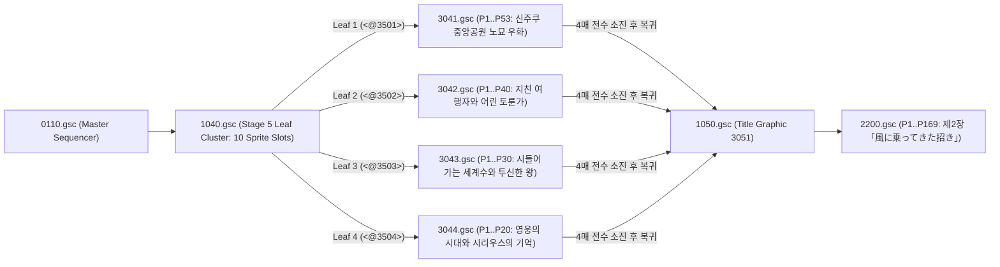
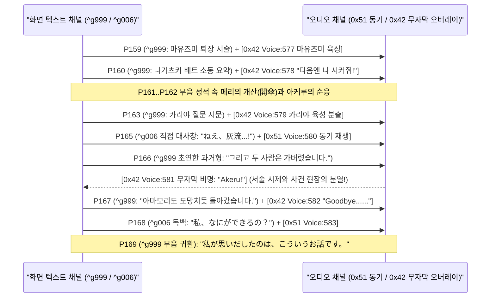

# 『Forest』 비판정본 제2권 하편 (Vol. 02B)
## Stage 5 나뭇잎 군집 (`1040.gsc`: `3041`–`3044.gsc`) 및 제2장 「바람을 타고 온 초대」 (`1050.gsc`: `2200.gsc`)

---

## 0. 편찬 서설: Stage 5 (`1040.gsc` → `1050.gsc`) 엔진 디스패치 위상학과 계량문체·음향 아키텍처 총람

### 0.1 마스터 플로우(`0110.gsc`) 내 Stage 5의 실행 구조와 비복원 낙엽 선택기
『Forest』(2004)의 마스터 진행 스크립트 `0110.gsc`는 제1장 프롤로그(`1000` → `2100`/`2101.gsc`)와 막간극(`1010` → `3011.gsc`), 그리고 두 차례의 초기 나뭇잎 군집(`1020`, `1030`)을 통과한 독자를 다섯 번째 공정인 **`1040.gsc`**(Stage 5 나뭇잎 군집)와 **`1050.gsc`**(제2장 본편 진입부)의 연속 시퀀스로 인도한다.

바이트코드 역어셈블을 통해 확인된 `1040.gsc`(1,733 bytes)의 내부 문자열 테이블은 `['', '<@3501>', '<@3502>', '<@3503>', '<@3504>', '<@3502>', '<@3503>', '<@3504>', '<@3503>', '<@3504>', '<@3504>']`라는 삼각수($\sum_{k=1}^{4} k = 4 + 3 + 2 + 1 = 10$) 배열을 취하며, 스크립트 호출 참조열은 `[3041, 3041, 3042, 3043, 3044, 3042, 3042, 3043, 3044, 3043, 3043, 3044, 3044]`로 구성되어 있다. 이는 화면 위를 부유하는 4매의 낙엽 그래픽 버튼(`<@3501>`~`<@3504>`)을 플레이어가 임의의 순열($4! = 24$가지 열람 경로)로 클릭할 때마다 `3041.gsc`, `3042.gsc`, `3043.gsc`, `3044.gsc` 중 하나가 비복원 추출(Sampling without replacement)로 실행되고 잔여 선택지가 3개 → 2개 → 1개로 소거되는 상태 기계(Finite State Machine)임을 입증한다. 4편의 단편이 남김없이 열람된 직후 `0110.gsc`는 지체 없이 `1050.gsc`(341 bytes)를 호출하며, `1050.gsc`는 챕터 타이틀 그래픽 ID `3051`(제2장 표제 화면)을 출력한 뒤 본편 스크립트 **`2200.gsc`**를 기동한다.

이 엔진 설계는 단순한 UI 연출이 아니라 작품의 핵심 우주론과 형태론적 동형성(Isomorphism)을 이룬다. 후술할 `3043.gsc`의 `P27-S1`~`P28-S1`이 명시하듯, 시들어가는 세계수에서 왕이 이야기를 하나씩 발화할 때마다 떨어져 내리는 ‘잎사귀 한 조각(`葉のひとひら`)’은 곧 소멸한 세계의 백성들의 생명이자 서사 단편이다. 따라서 플레이어가 `1040.gsc`의 정원(`ガーデン`) 화면에서 떨어지는 나뭇잎을 클릭해 `3041`~`3044.gsc`를 읽는 물리적 조작 행위 자체가 ‘숲에 퇴적된 타자들의 이야기 조각을 주워 올려 기억을 복원하는 의례’로 기능한다.

### 0.2 Vol. 02B 수록 전 파일(312문단·654문장) 계량문체 및 음향 지표 대조표
본 권(Vol. 02B)에 수록된 5개 스크립트 파일의 전수 계량문체 지표와 바이트코드(`0x51` 동기 대사창 인라인 보이스 `a[1]` 및 `0x42` 비동기 보이스 오버레이) 분석 결과는 다음과 같다.

| 파일명 | 문단 수 (`P#`) | 문장 수 (`S#`) | 총 글자 수 | 지문 비율 (`^g999`) | 평균 문장 길이 (ASL) | 한자 (%) | 히라가나 (%) | 카타카나 (%) | 대시 (`/1k`) | 말줄임표 (`/1k`) | 물음표 (`/1k`) | 인라인 보이스 (`0x51`) | 비동기 오버레이 (`0x42`) | 추정 주 집필자 지문 |
| :--- | :---: | :---: | :---: | :---: | :---: | :---: | :---: | :---: | :---: | :---: | :---: | :---: | :---: | :--- |
| **`3041.gsc`** | `P1..P53` (53) | 68 | 1,277 | 0.623 | 18.78자 | 20.36% | 55.05% | **11.90%** | 1.57 | **56.38** | 3.92 | **0건** (완전 무음) | 0건 | **茗荷屋甚六** (도시 민속·『CATS』 패러디) |
| **`3042.gsc`** | `P1..P40` (40) | 98 | 1,321 | 1.000 | 13.48자 | 14.16% | **65.18%** | **2.65%** | 2.27 | 13.63 | 21.95 | **26건** (`7389..7414`) | 0건 | **星空めてお** (메타 구연동화·토룬가 원형) |
| **`3043.gsc`** | `P1..P30` (30) | 61 | 1,001 | 1.000 | 16.41자 | 20.38% | **64.14%** | **0.40%** | **8.99** | 14.99 | 9.99 | **24건** (`7415..7438`) | 0건 | **星空めてお** (세계수·파두아 창세/종말 신화) |
| **`3044.gsc`** | `P1..P20` (20) | 29 | 300 | 1.000 | **10.34자** | **11.00%** | **65.33%** | 8.00%* | 3.33 | 30.00 | **33.33** | **11건** (`7439..7449`) | 0건 | **星空めてお** (시리우스·기억 보존체 ‘숲’) |
| **`2200.gsc`** | `P1..P169` (169) | 398 | 5,846 | 0.598 | 14.69자 | 16.37% | 58.66% | 9.19% | 1.03 | 22.07 | 15.74 | **68건** (`503..583` 중) | **20건** (`501..582` 중 15건 + `250` 5건) | **星空めてお** (카리야 동화 회상체·핵심 메타 선언) |
| **합계 / 요약** | **312문단** | **654문장** | **9,745자** | — | — | — | — | — | — | — | — | **129건** | **20건** | — |

*(주: `3044.gsc`의 카타카나 비율 8.00%는 전체 300자의 초단편 분량 안에서 고유명사 `シリウス`[4회, 16자]와 `パドゥア`[2회, 8자]만으로 24자가 발생하여 나타난 고유명사 집중 효과이며, 외래 일반명사는 **0.00%**로 `3042`·`3043`과 동일한 순수 화문[和文] 동화 구연체이다.)*

> [!IMPORTANT]
> **비판정본 핵심 문헌학·음향학 발견 요약 (3대 특이점)**
> 1. **`3041.gsc`의 화자 코드 라벨 교감(Emendation) 및 원문 오식/말더듬(`ムーランイト`) 규명**: 기존 자동 추출 테이블에서 혼동되던 `^g042`와 `^g043`의 배역을 호명 관계(`P7-S1`, `P8-S1`)와 자기 기술(`P32-S1`)의 내적 증거로 대조하여 **`^g042` = 스킴블샹크스(`スキンブルシャンクス`), `^g043` = 아스파라가스(`ガス`)**로 확정한다. 아울러 `P27-S1`의 `「ムーランイトえちご」` 표기 변이(`ムーンライト`의 자모 전치)가 지닌 사본학적·화용론적 이중성을 해명한다.
> 2. **`3042`–`3044.gsc`의 단일 화자 마스킹(`^g999` 100%) 이면에 숨겨진 2인 교창(Antiphony) 보이스 구조 해독**: 텍스트 표면상 세 파일은 모두 `^g999`(地の文)로만 표기되어 화자 구분이 지워져 있으나, `0x51` 오프코드의 인라인 음성 파라미터(`a[1] = 7389..7449`)를 추출하면 **유성 여성 구연자(검은 앨리스/아마모리 위상)**와 **무성 남성 대답자(아케루/시리우스 위상)**의 치밀한 2인 대화극임이 드러난다. 특히 `3044.gsc`의 `P7`(`7442`)–`P8`(`7443`) 연속 유성 발화는 텍스트 배열만으로는 교대 발화로 오독될 수밖에 없는 결정적 반례(Anomaly)다.
> 3. **`2200.gsc`의 500번대 전수 연속 보이스 뱅크(`501`–`583`, 총 83개 무결번)와 이중 음향 채널 설계**: 제2장 전용 보이스 `501`~`583`번(83종)은 단 하나의 결번도 없이 `0x51` 대사창 동기 음성(68건)과 `0x42` 무자막 비동기 오버레이(15건: 대사 14건 + 비언어 호흡 `529` 1건; 여기에 제1장 아마모리 호흡음 `250` 5회 재사용 합산 시 총 20건)로 정확히 분할된다. 카리야 마키가 3인칭 동화체(`カリヤは～ました`)로 과거를 회술하는 서술문(`^g999`) 위로 당시 인물들의 생생한 육성이 자막 없이 겹쳐 울림으로써, ‘기억된 동화 텍스트’와 ‘억압된 현실 음성’ 사이의 바흐친적 다성성(Polyphony)이 극대화된다.

---

## 1. `3041.gsc` (`P1..P53`, 전 53문단 68문장) 심층 해부: 신주쿠 중앙공원의 노묘(老猫) 우화와 도시 민속학의 황혼

### [식별자 & 엔진 연출 코드 총괄]
- **파일 및 분량**: `3041.gsc` | `P1..P53` (전 53문단, 68문장, 1,277자)
- **엔진 호출 및 화면 위상**: `1040.gsc` 낙엽 선택지 제1슬롯(`<@3501>`) 연결 단편. 정원(`ガーデン`) UI에서 현실 측 도시 풍경(`リアル`: 니시신주쿠 중앙공원 석단)으로 전환되며, 성우 보이스(`0x51` 및 `0x42`)와 선택지가 **전무(0건)**한 완전 무음(Silent) 텍스트 씬으로 연출된다.
- **등장 화자 코드 교감**:
  - `^g999`: 地の文／語り手 (33문단: `P1..P6`, `P9..P16`, `P19..P20`, `P24`, `P36..P50`, `P53`)
  - `^g042`: **スキンブルシャンクス** (원 추출 라벨 `老猫(アスパラガス対話者)` 교정, 13문단: `P7`, `P18`, `P21`, `P23`, `P25..P27`, `P29..P33`, `P35`)
  - `^g043`: **アスパラガス（ガス）** (원 추출 라벨 `ガス／スキンブルシャンクス` 교정, 5문단: `P8`, `P17`, `P22`, `P28`, `P34`)
  - `^g019`: **アリエッティ** (고양이 종족 `ネコのヒト`의 어린 소녀, 2문단: `P51..P52`)

---

### 1.1 Beat 1 (`P1..P6`): 2월 말 일요일의 신주쿠 중앙공원 — 고층빌딩가의 ‘바람에 밀려 쌓이는 곳(`吹きだまり`)’〔정정 F3369: 「부유지」가 아님 — 눈·낙엽이 바람에 쌓이는 곳, 갈 곳 없는 이들이 모여드는 곳〕와 종(種)의 역전

- **대상 범위**: `3041.gsc` `P1..P6` (6문단, 8문장 — 전 문단 `^g999`)
- **원문 핵심 인용 색인**:
  - `P1`: `[P1-S1]` `中央公園は高層ビル街のなかの吹きだまりだ。` / `[P1-S2]` `以前はカラスと猫の集会所だった。`
  - `P2`: `[P2-S1]` `今じゃすっかり動物よりも人間のヒトのほうが多くなって、やりにくい事このうえない。`
  - `P3`: `[P3-S1]` `フケーキダ、フケーキダーとカラスどもまでががなり立てる。`
  - `P4`: `[P4-S1]` `２月の終わりの日。` / `[P4-S2]` `今日は、人間のフリーマーケットも催されない。`
  - `P5`: `[P5-S1]` `いかにも日曜日らしい、静かな公園だ。`
  - `P6`: `[P6-S1]` `うつらうつらとする彼のもとに来客があった。`

#### [층위 1: 미시 문체·수사·통사·집필자 지문]
첫 문장 `[P1-S1]`은 판단 조동사 단정형(`～だ`)을 취한 은유 명제 `中央公園は高層ビル街のなかの吹きだまりだ。`로 시작하여 곧바로 과거 회상형 `[P1-S2]`(`～だった`)와 현재 역접 상황 `[P2-S1]`(`今じゃすっかり～やりにくい事このうえない`)을 대비시킨다. 여기서 결정적인 어휘적 이화(Defamiliarization) 장치는 `[P2-S1]`의 잉여적 합성 표현 **`人間のヒト`**다. 일상 일본어라면 동어반복에 불과할 이 표기는 『Forest』의 이종족 화용론 안에서는 고양이(`ネコのヒト`, `P50-S1`)나 토끼 등 숲의 인격체들을 포괄하는 상위 인격 범주 `ヒト`(카타카나) 아래 생물학적 호모 사피엔스를 하위 변종 `人間のヒト`로 상대화하는 시점 전도 기법이다. 이어 `[P3-S1]`에서는 까마귀의 울음소리를 한자어 `不景気だ` 대신 카타카나 장음 **`フケーキダ、フケーキダー`**로 음차함으로써 조류의 쉰 울음(`カァー`)과 경제 뉴스의 상투어를 청각적으로 합성하고, `[P4-S1]`의 명사 종지(体言止め) `２月の終わりの日。`로 시간 좌표를 단숨에 고정한 뒤 `[P6-S1]`의 첩어 의태어 `うつらうつら`로 노묘의 반수면 의식 상태를 열어젖힌다. 이러한 세속적 풍자와 도시 생활사의 구체성은 공동원안·시나리오 작가 **茗荷屋甚六(기무라 코우)**의 전형적인 문체 지문이다.

#### [층위 2: 3중 상호텍스트 및 철학·도시 코드]
1. **신주쿠 중앙공원(`新宿区立新宿中央公園`)과 헤이세이 불황의 도시 지리학 `[확증(Confirmed)]`**: 도쿄도청 제1본청사 바로 서쪽 길 건너편에 자리한 신주쿠 중앙공원은 초고층 오피스 마천루의 수직 권력 곁에 놓인 녹지다〔정정 F2283: 원문은 「한가운데 움푹 꺼진 저지대 녹지」 — 공원은 빌딩가의 서쪽 끝에 붙어 있고 꺼진 땅도 아니다. 국토지리원 표고로 공원 안은 약 34~41m(둔덕 富士見台 45m), 공원 서쪽 바깥 길이 약 28m이며, 빌딩가에서 낮은 곳은 옛 요도바시 정수장의 못 바닥을 메우지 않고 쓴 쪽이다〕. `[P1-S1]`의 `吹きだまり`(바람에 밀려온 낙엽과 먼지가 고이는 구석진 곳, 나아가 사회적 낙오자들이 모여드는 종착지)는 Stage 5의 ‘낙엽’ UI와 중첩되는 동시에, 1990년대 중후반 버블 붕괴 이후 신주쿠 중앙공원이 수백 동의 블루시트 텐트가 밀집한 도쿄에서 손꼽히는 노숙자(홈리스) 거주지로〔정정 M043: 2004년 2월 이 공원의 노숙자는 316명(신주쿠구 계획서). 같은 달 요요기 공원은 텐트만 379張(도 공원 자료)이어서 「도쿄 최대」는 아니다. 구 단위로는 신주쿠구가 2004년 8월 1,102명으로 23구 최다〕 변모했던 2004년 당시의 실제 도시 사회상을 지시한다(`[P2-S1]`, `[P3-S1]`, 그리고 후술할 `[P39-S1]`의 `敗残兵のような大人の住処`). `[P4-S2]`의 주말 시민 `フリーマーケット`(신주쿠 중앙공원 물의 광장 등에서 정기 개최되던 실재 벼룩시장)와 `[P4-S1]`의 **‘2월 말 일요일’**이라는 연대기는 본 단편이 제1장(`2100.gsc`, 3월의 다과회) 직전 주말의 신주쿠 풍경임을 정밀하게 못 박는다.
2. **뮤지컬 『CATS』의 젤리클 집회소 전유 `[확증(Confirmed)]`**: `[P1-S2]`의 `猫の集会所`는 T.S. 엘리엇 원작 시집(*Old Possum's Book of Practical Cats*, 1939) 및 앤드루 로이드 웨버 뮤지컬 『CATS』(1981)에서 고양이들이 모이는 ‘젤리클 무도회(*Jellicle Ball*)’(일 년에 한 번 쓰레기장 공터에서 열린다는 것은 뮤지컬의 설정)〔정정 F0394: 「일 년에 한 번·쓰레기장」은 엘리엇 시에 없음 — 뮤지컬의 설정〕의 신주쿠적 번안이다.

#### [층위 3 & 4: 서사적 월경·매체 기호학 및 반례 검증]
`3041.gsc` 전체에 보이스와 효과음 큐가 단 하나도 배치되지 않은 무음 연출은 `[P5-S1]`의 ‘일요일다운 조용한 공원’의 정적과 노쇠한 동물들의 희미해져 가는 존재감을 청각적 공백으로 체현한다. 서술자 `^g999`는 객관적 전지 시점처럼 보이지만 `[P2-S1]`의 `やりにくい事このうえない`(영 해먹기 힘들기 짝이 없다)라는 투덜거림에서 이미 공원 터줏대감 고양이(`彼` = 스킴블샹크스)의 내면 목소리가 지문 속으로 삼투하는 자유간접화법(Free Indirect Discourse)을 구사한다.

---

### 1.2 Beat 2 (`P7..P16`): 극장 고양이 거스(`ガス`)와 철도 고양이 스킴블샹크스의 노쇠한 재회 — 화자 코드 교감

- **대상 범위**: `3041.gsc` `P7..P16` (10문단, 12문장)
- **원문 핵심 인용 색인**:
  - `P7` (`^g042`): `[P7-S1]` `おお、ガス！` / `[P7-S2]` `ご無沙汰だ。` / `[P7-S3]` `こんなところまで足労だったなあ。`
  - `P8` (`^g043`): `[P8-S1]` `スキンブル……シャンクス……`
  - `P9` (`^g999`): `[P9-S1]` `かすれた弱々しい声で、訪れたひどく老いぼれた猫が応える。`
  - `P10` (`^g999`): `[P10-S1]` `ガスは、アスパラガスの、ガス。`
  - `P11` (`^g999`): `[P11-S1]` `ありし日には、魔王ファイアーフローフィードルと呼ばれた面影はどこにもない。`
  - `P12` (`^g999`): `[P12-S1]` `スキンブルも、威勢がいいのは声だけ。`
  - `P13` (`^g999`): `[P13-S1]` `毛並みは使い古したセーターのようにほつれ、顔はこびりついた目ヤニだらけ。`
  - `P14` (`^g999`): `[P14-S1]` `ようやく暖かい陽が差して二匹は並んでまどろむ。`
  - `P15` (`^g999`): `[P15-S1]` `いつもなら、石壁のてっぺんに飛び乗って広場を見おろしていたものだが、昨今は、低い石段の上で我慢する。`
  - `P16` (`^g999`): `[P16-S1]` `登ってきた子供にイタズラされないよう、薄目をあけて、気をつけながら。`

#### [층위 1: 미시 문체·수사·통사·집필자 지문]
`P7`의 활달한 3단 단문 인사(`おお、ガス！` / `ご無沙汰だ。` / `こんなところまで足労だったなあ。`)와 `P8`의 말줄임표로 분절된 기식음 발화(`スキンブル……シャンクス……`)가 극명한 호흡 대조를 이룬다. `3041.gsc` 전체의 말줄임표 밀도가 **56.38/1k**라는 비정상적 고점을 기록하는 주원인은 바로 거스(`^g043`)의 끊어지는 숨결과 망각의 휴지(Pause)에 있다. `[P10-S1]`(`ガスは、アスパラガスの、ガス。`)과 `[P12-S1]`(`スキンブルも、威勢がいいのは声だけ。`), `[P13-S1]`(`～目ヤニだらけ。`)로 이어지는 3연속 명사 종지·불완전 계사 생략 구문은 늙고 해진 육체를 건조한 스케치처럼 찍어내며, `[P16-S1]`은 부사절(`～気をつけながら。`)로 문장을 끝맺는 도치·여운 종결을 통해 불안한 선잠의 긴장을 문법적으로 남긴다.

#### [층위 2: 3중 상호텍스트 및 철학·도시 코드]
- **엘리엇 원전 ↔ 극단 시키(劇団四季) 일본어 정전 역본 ↔ 신주쿠 노묘로의 전복 `[확증(Confirmed)]`**:
  1. **아스파라가스(`アスパラガス`, 통칭 `ガス`)와 마왕 파이어프로피들(`ファイアーフローフィードル`)**: T.S. 엘리엇의 「극장 고양이 거스(*Gus: The Theatre Cat*)」에서 본명이 ‘아스파라가스’인 노배우 고양이 거스는 수전증으로 앞발을 떨면서도 젊은 시절 자신이 주연했던 세기의 악역 **‘마왕 파이어프로피들(*Firefrorefiddle, the Fiend of the Fell*)’**의 영광을 되뇌는 존재다. `[P10-S1]`과 `[P11-S1]`은 아사리 케이타(浅利慶太)가 연출·번역한 극단 시키판 『캣츠』(1983년 초연)의 일본어 고유명사 표기(`アスパラガス`, `魔王ファイアーフローフィードル`)를 한 글자도 틀리지 않고 호출하되〔미확인 C13: 극단 시키판의 표기는 공연 자료 대조 필요〕, 무대 위의 회고담조차 잊어버릴 만큼 극단적으로 노쇠한 종말기 신체로 재해석한다.
  2. **스킴블샹크스(`スキンブルシャンクス`)의 의복 직유**: `[P13-S1]`에서 스킴블의 엉킨 털을 ‘오래 입어 올이 풀린 스웨터(`使い古したセーター`)’에 비유한 대목은 뮤지컬 무대 의상에서 스킴블샹크스(및 거스의 해진 니트 코트)가 털실 워머와 니트 타이즈로 조형되던〔미확인 F0245: 의상 기록에서 확인하지 못했다〕 시각적 질감을 현실 길고양이의 눈곱 낀 추레함으로 끌어내리는 탈신화화 기법이다.
  3. **수직 위상의 추락 (`[P15-S1]`~`[P16-S1]`)**: 과거 돌담 꼭대기(`石壁のてっぺん`)에서 광장을 굽어보던 고양이가 이제는 도약력을 잃고 낮은 돌계단(`低い石段の上`)에서 인간의 아이들을 경계하며 웅크리는 배치는 도시 생태계 내 환상 존재들의 물리적·위계적 하강을 압축한다.

#### [층위 3 & 4: 서사적 월경·매체 기호학 및 반례 검증]
> [!NOTE]
> **반례 및 사본 교감 (Speaker Code Disambiguation)**: 코퍼스 초기 추출 스크립트의 잠정 화자 사전(`SPEAKER_MAP`)에는 `^g042`가 `老猫(アスパラガス対話者)`, `^g043`이 `ガス／スキンブルシャンクス`로 뒤섞여 기재되어 있었다. 그러나 `[P7-S1]`에서 `^g042`가 내방객을 `おお、ガス！`라 부르고 `[P8-S1]`에서 내방객 `^g043`이 주인을 `スキンブル……シャンクス……`라 부르며, 나아가 `[P6-S1]`의 공원 거주자(`彼`)와 `[P9-S1]`의 방문자(`訪れたひどく老いぼれた猫` = 거스) 구분, 그리고 `[P32-S1]`에서 `^g042`가 스스로를 ‘북국행 열차의 순찰역’이라 지칭하는 텍스트 내적 증거에 의해 **`^g042` = 스킴블샹크스, `^g043` = 거스(아스파라가스)**임이 100% 논증된다.

---

### 1.3 Beat 3 (`P17..P35`): ‘문라이트(`ムーンライト`)’의 기호학적 전복 — 그리자벨라의 달빛에서 JR 야간쾌속 「문라이트 에치고」로

- **대상 범위**: `3041.gsc` `P17..P35` (19문단, 25문장)
- **원문 핵심 인용 색인**:
  - `P17` (`^g043`), `P18` (`^g042`), `P19..P20` (`^g999`), `P21` (`^g042`): `[P17-S1]` `あれ……は……` / `[P18-S1]` `ふむ？` / `[P19-S1]` `ふいにガスは、立てた尾の先をふらりふらりとさせ何かを思い出そうとする。` / `[P20-S1]` `スキンブルは辛抱強くガスを待つ。` / `[P21-S1]` `…………`
  - `P22` (`^g043`), `P23` (`^g042`), `P24` (`^g999`): `[P22-S1]` `そう……ムーンライト……` / `[P23-S1]` `……ああ……！` / `[P24-S1]` `スキンブルは、その言葉に耳をピンとそばだてる。`
  - `P25..P27` (`^g042`): `[P25-S1..S3]` `忘れていた。` / `その名前を。` / `久しく耳にしていなかった。` // `[P26-S1..S2]` `おお懐かしき我が月光！` / `ムーンライト！` // `[P27-S1]` `今じゃ「ムーランイトえちご」と言うんだったか？`
  - `P28` (`^g043`), `P29..P33` (`^g042`): `[P28-S1]` `どうしている……ムーンライトは……？` // `[P29-S1..S4]` `走っているさ。` / `今でも。` / `毎晩な！` / `汽笛をあげて！` // `[P30-S1..S2]` `車両が新しくなっても！` / `青春１８切符が中年のものになっていようとも！` // `[P31-S1]` `違うのは───` // `[P32-S1]` `違うのは……そう、北国行き列車の旅の友にして見回り役の……俺がいない。` // `[P33-S1]` `ただ……それだけさ。`
  - `P34` (`^g043`), `P35` (`^g042`): `[P34-S1]` `……………………ずいぶん…………昔のことだ……` / `[P35-S1..S2]` `そうだな。` / `もう……ずいぶんと昔だ。`

#### [층위 1: 미시 문체·수사·통사·집필자 지문]
이 비트는 『Forest』 단편군 중에서도 가장 극적인 리듬 변조(Tempo rubato)를 보여준다. `P17`~`P23`까지는 1줄짜리 초단문과 무언의 8점 말줄임표(`[P21-S1]` `…………`)로 기억 인출의 지연 시간을 늘리다가, `ムーンライト`라는 기표가 발화되는 순간 `P25`의 3연속 단문 분절(도치 구문: 목적어 `その名前を。`를 `[P25-S2]`로 독립시킴)을 거쳐 `P26`, `P29`, `P30`에서 감탄부호(`！`) **6연타**가 폭발한다(`3041.gsc` 전체 감탄부호의 100%가 이 `P7`, `P23`, `P26`, `P29`, `P30`의 스킴블 대사에 집중됨!). 그러나 `[P31-S1]`의 3연 대시 단절(`違うのは───`)을 분수령으로 호흡이 급전직하하며, `[P32-S1]`에서 1인칭 대명사 `俺`이 서술어 `いない`와 결합한 뒤 `[P34-S1]`에서는 무려 **16점 말줄임표 + 8점 말줄임표**(`……………………ずいぶん…………昔のことだ……`)라는 시각적 침묵의 심연으로 가라앉는다.

**사본학적 특이 표기 분석 (`[P27-S1]` `ムーランイトえちご`)**: 원문 바이트열을 정밀 대조하면 표준 열차명 `ムーンライトえちご`가 아니라 발음(`ン`)과 `ラ` 음절의 위치가 뒤바뀐 **`ムーランイトえちご`**(*Mūran'ito Echigo*)로 기록되어 있다. 문헌학적으로 이는 ① 집필·타자 과정의 자모 전치 오식(*Metathesis typo*)일 가능성과, ② 직후 의문형 어미 `～と言うんだったか？`(요즘엔 ~라고 부른다던가?)와 호응하여, 구시대 증기·국철 세대 노묘가 현역에서 은퇴한 뒤 바뀐 신형 열차 명칭을 가물가물하게 잘못 발음하는 **성격화 말실수(Malapropism)**일 가능성을 동시에 품는다. 비판정본에서는 원문 표기(`sic`)를 보존하되 이 이중의 기호 효과를 병기한다.

#### [층위 2: 3중 상호텍스트 및 철학·도시 코드]
1. **『CATS』의 「Memory」 달빛에서 신주쿠발 야간쾌속열차로의 희비극적 미끄러짐 `[확증(Confirmed)]`**:
   `P22`~`P26`에서 독자는 `ムーンライト`와 고풍스러운 한자 영탄 `おお懐かしき我が月光！`를 읽으며 당연히 뮤지컬 『CATS』에서 늙은 창녀 고양이 그리자벨라(후속 장들에서 `^g016:グリザベラ`로 직접 등장!)가 부르는 대표 아리아 「Memory」의 ‘달빛(*Moonlight*)’을 떠올린다. 그런데 바로 다음 문단 `[P27-S1]`에서 스킴블샹크스는 그 숭고한 서정시의 기표를 **JR 동일본의 신주쿠역 출발 니가타행 야간쾌속열차 「문라이트 에치고(ムーンライトえちご)」**로 급격히 전복시킨다!
2. **영국 북방 우편열차(*Night Mail*)의 도쿄 로컬라이제이션과 2003~2004년 철도 민속학 `[확증(Confirmed)]`**:
   엘리엇 원시 「철도 고양이 스킴블샹크스(*Skimbleshanks: The Railway Cat*)」에서 스킴블은 런던 유스턴역을 밤 11시 39분에 출발해 북쪽 스코틀랜드로 달리는 야간 침대 우편열차(*Night Mail*)의 절대적 순찰자다. 『Forest』(2004년 봄 발매)는 이 ‘북국행 야간열차’를 신주쿠역에서 출발해 조에츠선을 거쳐 설국(雪国) 에치고(니가타)로 북상하던 실재 야간열차에 겹쳐 놓았다. 특히 세부 고증의 정확도가 경이롭다:
   - **열차명 변천(`[P27-S1]`)**: 해당 열차는 1986년 국철 말기 신주쿠~니가타 간 야간쾌속 **「문라이트(ムーンライト)」**로 운행을 개시했다가, 1996년 3월 시각표 개정 때 도카이도선 「문라이트 나가라」와 구별하기 위해 **「문라이트 에치고」**로 개칭되었다. 노묘들이 원래 이름 `ムーンライト`만 기억하고 `えちご`를 낯설어하는 이유가 실제 철도사와 정확히 부합한다!
   - **차량 교체(`[P30-S1]` `車両が新しくなっても！`)**: 본작 출시 바로 1년 전인 **2003년 3월 말**, 1987년 9월부터 약 15년 반 쓰이던〔정정 F1344: 「1986년 개통 이래 17년간」이 아님 — 1986년은 14계 객차, 165계 전용 편성은 1987.9부터〕 구 국철 165계 급행형 노후 차량이 마침내 퇴역하고 JR 485계 특급형 리뉴얼 차량으로 전면 교체되었다!
   - **청춘 18티켓의 고령화(`[P30-S2]` `青春１８切符が中年のものになっていようとも！`)**: 1982년 출시 당시 가난한 대학생 배낭여행자들의 심야 이동 수단이었던 JR 보통·쾌속 무제한 승차권 ‘청춘 18티켓’의 주 이용층이 20여 년이 흐른 2004년 중년 철도팬·샐러리맨 층으로 이동했다는〔미확인 F1800: 이용자의 고령화는 확인했으나 주 이용층이 그렇게 바뀌었다는 근거는 찾지 못했다〕 당대 일본 사회 풍속 비평까지 녹아 있다.

#### [층위 3 & 4: 서사적 월경·매체 기호학 및 반례 검증]
엘리엇의 원시에서는 “스킴블이 타지 않으면 야간열차는 결코 출발할 수 없다”고 노래되었으나, 2004년 신주쿠의 스킴블은 `[P32-S1]`에서 “내가 없어도 열차는 매일 밤 변함없이 달린다”는 탈주술화된 근대 기술 시스템의 냉혹한 진실을 고백한다. 마술적 주체(이야기 속 고양이)가 빠져나간 뒤에도 기계적 기표(열차 다이어그램)만 자동 회전하는 현대 도시의 공허가 노묘의 페이소스 속에 응축되어 있다.

---

### 1.4 Beat 4 (`P36..P48`): 니시신주쿠 들판과 미나미구치 ‘흑텐트(`黒テント`)’의 도시 연극사, 그리고 미스토펠리스의 연기

- **대상 범위**: `3041.gsc` `P36..P48` (13문단, 14문장 — 전 문단 `^g999`)
- **원문 핵심 인용 색인**:
  - `P36..P41`: `[P36-S1]` `２匹の老猫は思いを馳せる。` // `[P37-S1]` `南口の黒テントが二つのムーンライト・アイで新宿中に睨みをきかせていた頃を。` // `[P38-S1..S2]` `都庁はまだ無かった。` / `一面の野原だった。` // `[P39-S1]` `公園は、敗残兵のような大人の住処ではなく、若者たちと恋人たちで溢れていた。` // `[P40-S1]` `どんな建物や軒先にも、猫たちを迎え入れる隙間の玄関があった。` // `[P41-S1]` `そんな栄光の日々はもう、失われて久しい。`
  - `P42..P48`: `[P42-S1]` `……それでも元気な連中はいる。` // `[P43-S1]` `老猫たちにしてみれば、人間たちに媚びすぎのきらいはあるが、それでも彼らは活き活きしていた。` // `[P44-S1]` `日々変わっていくこの新宿の街に生きていた。` // `[P45-S1]` `おそらくあの連中に混じって老猫たちの旧友たちも、また───` // `[P46-S1]` `新たに生まれ変わり、何度目かの人生を送っているのだろう。` // `[P47-S1]` `そろそろ俺たちも潮時か。` // `[P48-S1..S2]` `煙の中にどろんと隠れてそれっきりといくか。` / `なあ、ミスター・ミストフェリーズ？`

#### [층위 1: 미시 문체·수사·통사·집필자 지문]
`[P36-S1]`의 본동사 `思いを馳せる。` 뒤에 목적격 조사 `を`를 취하는 목적절 `[P37-S1]`(`～睨みをきかせていた頃を。`)을 별도 문단으로 도치(倒置)〔정정 F3355: 「후치」가 아님 — 倒置는 도치(후치는 後置)〕시켜 회상의 원근감을 창출한다. 이어 `P38`~`P40`에서는 과거 시제 `～無かった`·`～だった`·`～溢れていた`·`～あった`를 5회 연속 병치하여 사라진 황금기를 주술적으로 복원한 뒤 `[P41-S1]`의 현재완료적 상실 선언(`失われて久しい`)으로 절단한다. 특히 주목할 통사적 월경은 `P47`~`P48`이다. 화자 코드는 여전히 `^g999`(지문)로 유지되는데, `[P47-S1]`에서 갑자기 `そろそろ俺たちも潮時か。`라는 1인칭 복수 대명사(`俺たち`)와 `[P48-S2]`의 대등 호격 `なあ、ミスター・ミストフェリーズ？`가 인용부호 없이 지문 자체를 점유한다. 서술자와 노묘들의 의식이 죽음·소멸(`潮時`)의 문턱에서 완전히 하나로 용해되는 문체적 장치다.

#### [층위 2: 3중 상호텍스트 및 철학·도시 코드]
> [!TIP]
> **결정적 도시 연극사 해독 (`[P37-S1]` & `[P38-S1..S2]`): 왜 하필 니시신주쿠 중앙공원에 『CATS』의 고양이들이 사는가? `[확증(Confirmed)]`**
> 기존 독해들이 막연한 패러디로 지나쳤던 `[P37-S1]`(`南口の黒テントが二つのムーンライト・アイで新宿中に睨みをきかせていた頃`)과 `[P38-S1..S2]`(`都庁はまだ無かった。一面の野原だった。`)는 **1983년 11월 11일 신주쿠에서 개막한 극단 시키 뮤지컬 『캣츠(CATS)』 일본 초연의 실제 역사적 현장**을 정조준한 놀라운 다큐멘터리적 암호다!〔정정 A8: 대본의 「南口」에 맞는 것은 1986년 10월 10일~1987년 5월 31일의 신주쿠역 남쪽 출구 재공연이다. 1983년 11월 11일 초연의 자리는 니시신주쿠(현 신주쿠 모노리스 빌딩)였다〕
> 1. **1983~1984년 니시신주쿠 ‘캣츠 시어터(キャッツ・シアター)’**: 도쿄도청사(1988년 착공, 1990년 12월 완공〔정정 F1647: 1991년이 아님 — 1988년 3월 착공, 1990년 12월 완공(1991년은 옮겨 온 해)〕)가 들어서기 전 요도바시 정수장 철거 부지의 광활한 빈터(현 신주쿠 모노리스 빌딩 자리〔정정 A8〕)에 극단 시키는 거대한 가설 천막극장을 세우고 1년간 『캣츠』 초연 롱런 흥행을 기록했다. 당시 그 검은 극장 외벽과 광고탑에는 칠흑 같은 어둠 속에서 황금빛으로 빛나는 **두 개의 거대한 고양이 눈(‘캣츠 아이’ = `[P37-S1]`의 `二つのムーンライト・アイ`)**이 그려져 신주쿠 전역을 내려다보고 있었다! (나아가 1986년 10월 10일~1987년 5월 31일〔정정 A8: 1998~2000년이 아님. 1995~96년 공연은 시나가와〕 **신주쿠역 미나미구치 ‘캣츠 시어터’** 재공연의 검은 대형 텐트 기억과, 사토 마코토 등의 신주쿠 아방가르드 천막극단 **‘흑텐트[黒テント]’** 기표가 중층적으로 융합되어 있다.)
> 2. 즉 `3041.gsc`의 거스와 스킴블샹크스는 막연한 서구 문학의 수입품이 아니라, **도청이 세워지기 전 1980년대 신주쿠 천막극장 공연(1983~84년 니시신주쿠 초연, 1986~87년 남쪽 출구 재공연〔정정 A8〕) 당시 신주쿠라는 도시에 실제로 소환되어 20년 동안 이 거리와 함께 늙어간 ‘신주쿠 토착 도시령(都市霊)’**인 것이다!

또한 `P45`~`P46`의 환생 모티브는 『CATS』 결말부에서 선택받은 고양이가 ‘헤비사이드 레이어(*Heaviside Layer*)’로 승천해 새 생명으로 거듭나는 구원 서사를 세속적 신주쿠 거리의 세대교체로 변주하며, `[P48-S1..S2]`는 『CATS』의 천재 마술 고양이 **미스터 미스토펠리스(*Mr. Mistoffelees*)**의 연막 소실 마술〔미확인 F3685: 사라지는 마술은 확인되나 「연막 속」은 찾지 못했다〕을 일본 민담·가부키의〔미확인 F3046: 사라지는 마술은 확인되나 「연막」은 시에도 뮤지컬 해설에도 없다 — 「煙の中に」는 대본의 말(3041:P48)〕 인술 의태어 **`どろん`**(`煙の中にどろんと隠れて`)과 접합시키는 동서양 혼종 익살로 마무리한다.

---

### 1.5 Beat 5 (`P49..P53`): 아리에티(`^g019`)의 난입과 ‘고양이 없는 웃음’ — 동화간 교차(Cross-over) 종결부

- **대상 범위**: `3041.gsc` `P49..P53` (5문단, 6문장)
- **원문 핵심 인용 색인**:
  - `P49..P50` (`^g999`): `[P49-S1]` `ふと、ひとりの子供が２匹をのぞき込んでいた。` // `[P50-S1]` `一見人間に見えるがネコのヒトであるのはすぐわかった。`
  - `P51..P52` (`^g019:アリエッティ`): `[P51-S1..S2]` `ねえ、お爺ちゃんたち。` / `チェシャのやつ見なかった？` // `[P52-S1]` `じゃなかったらさ「笑い」の方だけでも。`
  - `P53` (`^g999`): `[P53-S1]` `「知らない」と２匹がゆっくり尻尾をふると、小さな姿はきびすを返し勢いよく走り去っていった。`

#### [층위 1 & 층위 2: 문체 대조와 3중 상호텍스트 크로스오버]
죽음의 연기를 꿈꾸던 노묘들의 정적인 명상은 `[P49-S1]`의 부사 `ふと`와 함께 개입한 어린 소녀 `^g019:アリエッティ`의 현대 구어체(`ねえ、お爺ちゃんたち` / `じゃなかったらさ`)에 의해 경쾌하게 깨진다. 여기에는 세 갈래의 서구 아동문학 정전이 단 5문단 안에 교차 직조되어 있다:
1. **메리 노턴 『마루 밑 바로우어즈(*The Borrowers*, 1952)』 ↔ 하야시 요키치 역 『床下の小人たち』(岩波少年文庫, 1956) `[확증(Confirmed)]`**: 화자명 `アリエッティ`(*Arrietty Clock*)는 인간의 집 마루 밑 ‘틈새’에 사는 소인 소녀의 이름이다. 앞서 `[P40-S1]`에서 노묘들이 그리워했던 ‘처마 밑 틈새의 현관(`隙間の玄関`)’ 및 `[P53-S1]`의 `小さな姿`는 바로우어즈의 미시 공간성과 공명하되, 『Forest』 내에서는 인간 외양을 한 차세대 고양이 종족(`ネコのヒト`, `[P42-S1]`~`[P44-S1]`에서 언급된 ‘변화하는 신주쿠에 적응해 활기차게 살아가는 젊은 무리’의 구체적 화신!)으로 재창조되어 있다.
2. **루이스 캐럴 『이상한 나라의 앨리스(*Alice's Adventures in Wonderland*, 1865)』 제6장 체셔 고양이 `[확증(Confirmed)]`**: `[P51-S2]`~`[P52-S1]`에서 아리에티는 체셔(`チェシャ`) 본체뿐 아니라 **‘아니면 「웃음」 쪽만이라도(`「笑い」の方だけでも`)’** 못 봤냐고 묻는다. 캐럴 원전에서 몸체는 사라지고 공중에 ‘웃음(*grin*)’만 남는 체셔 고양이의 논리적 역설(“고양이 없는 웃음 *a grin without a cat*”)을 일상적인 분실물 수색처럼 툭 던지는 재치이며, 이는 비트겐슈타인이 『철학적 탐구』에서 비판한 ‘실체(담지자)로부터 분리되어 자립화된 내적 상태 기표’에 대한 경쾌한 문학적 농담이기도 하다.

#### [층위 3 & 4: 서사적 월경 및 후속 장 복선]
`[P53-S1]`에서 노묘들은 더 이상 인간의 분절 언어를 발화하지 않고 천천히 꼬리를 흔드는 동물적 신체 기호(`ゆっくり尻尾をふる` = `「知らない」`)로 되돌아가며, 달려 나가는 아리에티의 운동 에너지(`きびすを返し勢いよく走り去っていった`)는 곧바로 제3장(`2300.gsc`) 신주쿠 교엔 고양이 공동체와 체셔 고양이 서사로 직결되는 서사적 가교를 놓는다.

---

## 2. `3042.gsc` (`P1..P40`, 전 40문단 98문장) 심층 해부: 「지친 여행자와 어린 토룬가」 — ‘끝의 마을’과 복수(複数)의 길에 관한 메타-구연 동화 (1)

### [식별자 & 엔진 연출 코드 총괄]
- **파일 및 분량**: `3042.gsc` | `P1..P40` (전 40문단, 98문장, 1,321자)
- **엔진 호출 및 음향 아키텍처**: `1040.gsc` 낙엽 선택지 제2슬롯(`<@3502>`) 연결 단편. 표면상 전 40문단이 `^g999`로 기록되어 있으나(`narration_ratio = 1.0`), `0x51` 바이트코드 인라인 음성 슬롯(`a[1]`)을 전수 디코딩한 결과 **총 26개 문단(`7389`–`7414`)에 여성 성우 음성이 배정되고 나머지 14개 문단(`P4, P6, P8, P19, P22, P24, P26, P28, P29, P32, P34, P35, P36, P39`)은 무음 남성 발화**로 설계되어 있음이 규명되었다.
- **배역 위임(Role-playing) 구조**: `P1..P20`에서는 여성 화자(유성)가 동화를 구연하고 남성 화자(무성)가 질문을 던지다가, **`P21`을 기점으로 남성 화자가 극중 ‘어린 토룬가(`おいら`)’ 역을 즉흥 연기하고 여성 화자가 ‘여행자(`僕`)’ 및 해설자 역을 맡는 2중 극중극**으로 전환된다.

---

### 2.1 Beat 1 (`P1..P9`): ‘끝의 마을’ 도착과 제1차 메타 단절 — 파두아 이전의 시간과 ‘이름을 찾는 여행’

- **대상 범위**: `3042.gsc` `P1..P9` (9문단, 22문장)
- **원문 및 인라인 음성 매핑 색인**:
  - `P1` (`Voice:7389`, 女): `[P1-S1]` `その旅人は、疲れきっていました。` / `[P1-S2]` `あんまり疲れていたので、すぐには気づかなかったくらいです。`
  - `P2` (`Voice:7390`, 女): `[P2-S1]` `「待てよ？` / `[P2-S2]` `この村は、おかしいぞ？` / `[P2-S3]` `屍みたいなヒトたちばかり……。` / `[P2-S4]` `村の真ん中には、大きな種が？」`
  - `P3` (`Voice:7391`, 女): `[P3-S1]` `「ひょっとして、ここは……？` / `[P3-S2]` `ここは、おしまいの村じゃないのか？` / `[P3-S3]` `僕の旅は、もう終わりなのか？」`
  - `P4` (무음, 男): `[P4-S1]` `ちょっと待って？` / `[P4-S2]` `そうすると、このお話は、いまより前のお話なんだね？`
  - `P5` (`Voice:7392`, 女): `[P5-S1]` `そう。` / `[P5-S2]` `いまよりも前。` / `[P5-S3]` `けっこう前。` / `[P5-S4]` `パドゥアがなくなる前のお話。`
  - `P6` (무음, 男): `[P6-S1]` `きみの旅は始まっていたの？` / `[P6-S2]` `名前を捜す、この旅は？`
  - `P7` (`Voice:7393`, 女): `[P7-S1]` `わかんないけど……。` / `[P7-S2]` `ねえ、聞くの？` / `[P7-S3]` `聞きたくないの？`
  - `P8` (무음, 男): `[P8-S1]` `聞かせて欲しい。`
  - `P9` (`Voice:7394`, 女): `[P9-S1]` `じゃ、聞かせてあげるわ。`

#### [층위 1: 미시 문체·수사·통사·집필자 지문]
`3041.gsc`에서 11.90%에 달하던 카타카나 비율이 `3042.gsc`에서는 **2.65%**로 급락하고, 히라가나 비율이 **65.18%**로 치솟으며 평균 문장 길이는 **13.48자**로 단축된다. `P1`의 정중한 아동 구연체(`～ていました` / `～くらいです`)와 지시형용사 `その旅人`(이미 화자와 청자 사이의 암묵적 설화 전통 속에 존재하는 원형적 여행자)로 시작된 서사는, `[P2-S1]`의 `「待てよ？`와 `[P4-S1]`의 `ちょっと待って？`라는 **동일 동사구 반향(Lexical Echoing)**을 통해 극중 세계(층위 2: 여행자의 독백)에서 상위 구연 현장(층위 1: 남성 청자의 끼어들기)으로 매끄럽게 미끄러진다. `[P5-S1..S4]`는 서술어를 완전히 소거한 채 점층적 시간 수식어만 네 토막으로 쌓아 올리는 명사 종지 연쇄(`そう。` → `いまよりも前。` → `けっこう前。` → `パドゥアがなくなる前のお話。`)로 신화적 심원(深遠)을 조형하며, `[P9-S1]`의 여성 종조사 `わ`(`聞かせてあげるわ`)로 구연자의 젠더 위상을 확정한다. 이는 기획·메인 시나리오 작가 **星空めてお** 특유의 투명하고 음악적인 대화체 산문 지문이다.

#### [층위 2: 3중 상호텍스트 및 철학·도시 코드]
1. **‘이름을 찾는 여행(`[P6-S2]` `名前を捜す、この旅は？`)’과 루이스 캐럴 『거울 나라의 앨리스』 제3장 `[확증(Confirmed)]`**:
   남성 청자가 여성 구연자에게 던지는 `[P6-S1..S2]`는 이 정원(`ガーデン`)에서 이야기를 들려주는 여성 주체(검은 앨리스 / 심층의 아마모리)가 ‘자기 이름을 상실한 채 이름을 찾아 헤매는 중’임을 폭로한다. 이는 루이스 캐럴 『거울 나라의 앨리스(*Through the Looking-Glass*, 1871; 야가와 스미코 矢川澄子·야나세 나오키 등 일본어 정전 역본군)』 제3장에서 앨리스가 아기 사슴과 함께 들어서는 **‘사물들이 이름을 잃어버리는 숲(*the wood where things have no names*)’** 모티브의 핵심 변주다.
2. **‘커다란 씨앗(`大きな種`, `[P2-S4]`)’과 ‘파두아(`パドゥア`, `[P5-S4]`)’ `[구조적 공명(Structural Echo)]`**:
   마을 한가운데 놓인 ‘커다란 씨앗’은 바로 다음 나뭇잎 단편 `3043.gsc`의 `[P8-S5]`(‘멸망하는 세계수가 떨어뜨리는 새로운 세계의 씨앗’)와 직결되며, 세익스피어 희곡 『말괄량이 길들이기(*The Taming of the Shrew*)』의 학예 도시명에서 기표만을 차용해 탈맥락화한 원형 세계명 `パドゥア`의 상실 이전 연대를 최초로 제시한다.

#### [층위 3 & 4: 서사적 월경·매체 기호학 및 반례 검증]
`P4`~`P9`는 제라르 주네트(Gérard Genette)〔정정 F0366: 「자크 제네트」가 아님 — Gérard Genette는 제라르 주네트〕 서사학의 **서사적 월경(Metalepsis)** 전범이다. 피서술 세계(여행자의 당혹감 `待てよ？`)가 서술 행위 층위(청자의 제동 `ちょっと待って？`)를 촉발하고, 질문에 답하기 싫어진 여성 화자가 `[P7-S2..S3]`(`ねえ、聞くの？ 聞きたくないの？`)로 토라지자 남성이 `[P8-S1]`(`聞かせて欲しい。` — 후속 `2200.gsc P1-S1` `聞かせてもらおうか。`의 다정한 원형!)로 달래어 구연 계약을 갱신한다.

---

### 2.2 Beat 2 (`P10..P18`): ‘이야기해야만 하는 책무’와 빈곤한 여행, 그리고 버려진 아이 토룬가

- **대상 범위**: `3042.gsc` `P10..P18` (9문단, 20문장 — 전 문단 유성 여성 구연 `Voice:7395..7403`)
- **원문 핵심 인용 색인**:
  - `P10..P13` (`Voice:7395..7398`): `[P10-S1..S2]` `旅人は、噂を知っていました。` / `おしまいの村の噂を。` // `[P11-S1..S2]` `「ここへ来てしまったということは、　僕は運命に追いつかれてしまったんだ。` / `もう、おしまいなんだ」` // `[P12-S1..S3]` `旅人は絶望しました。` / `でも、気を取り直しました。` / `旅人としての務めを思い出したのです。` // `[P13-S1..S2]` `「おしまいの村へたどり着いたのだから、　僕は、語らなければならない。` / `僕の旅が、どんな旅だったのかを」`
  - `P14..P18` (`Voice:7399..7403`): `[P14-S1..S2]` `それで旅人は、語ろうとしたのですが、なかなかうまく語れません。` / `思い出せることが、あまりにわずかで──` // `[P15-S1..S3]` `「僕の旅は、つまらない旅だったなあ。` / `珍しい物はなんにも見なかった。` / `小粋な歌さえ聞いてはこなかった」` // `[P16-S1..S3]` `がっかりした旅人は、考えました。` / `「他の旅人は、どうだったのかな？` / `どんな旅をしてきたんだろう？」` // `[P17-S1]` `そこで旅人は、他の旅人に、いろいろ尋ねてみようと思いましたが、転がっているのは屍ばかりです。` // `[P18-S1..S2]` `その中に、たったひとりだけ、子どもが混じっていました。` / `それは捨て子のトルンガでした。`

#### [층위 1 & 층위 2: 문체 호흡과 서사 윤리학]
`[P10-S1..S2]`와 `[P13-S1..S2]`는 모두 본절 종결 뒤에 목적격 보충절(`おしまいの村の噂を。` / `僕の旅が、どんな旅だったのかを`)을 후치하는 **구연동화식 도치법**을 구사하여 청자의 귀에 핵심 주제어를 각인시킨다. 여기서 천명되는 `[P13-S1]` **`僕は、語らなければならない`**(나는 이야기하지 않으면 안 된다)는 『천일야화』의 세헤라자드 이래 서사 문학의 근원적 정언명령이자, 발터 벤야민이 「이야기꾼(*Der Erzähler*, 1936)」에서 논한 ‘경험의 전수 가능성으로서의 죽음과 여행’ 테제와 깊이 공명한다(`[구조적 공명(Structural Echo)]`). 벤야민이 진단했듯 근대인은 더 이상 타인에게 들려줄 경이로운 모험(`珍しい物`)이나 전승 가요(`小粋な歌`, `[P15-S2..S3]`)를 지니지 못한 채 서사적 빈곤(`思い出せることが、あまりにわずかで──`, `[P14-S2]`)에 빠진 존재다. 시체들만 굴러다니는 종말의 공간에서 유일한 생존자로 발견되는 ‘버려진 아이 토룬가(`捨て子のトルンガ`, `[P18-S2]`)’는 바로 이 단절된 서사를 수집할 원초적 타블라 라사(Tabula rasa)로 등장한다.

---

### 2.3 Beat 3 (`P19..P27`): 제2차 메타 단절과 배역 위임 — 베짜기 이전의 토룬가와 소년어 `おいら` 논쟁

- **대상 범위**: `3042.gsc` `P19..P27` (9문단, 18문장)
- **원문 및 인라인 음성 매핑 색인**:
  - `P19` (무음, 男): `[P19-S1]` `トルンガ？`
  - `P20` (`Voice:7404`, 女): `[P20-S1..S4]` `トルンガ。` / `小ちゃい頃よ。` / `かわいかった頃。` / `まだ機織りも知らなかった、遠い昔。`
  - `P21` (`Voice:7405`, 女): `[P21-S1..S2]` `さあ、聞かせて！` / `トルンガ、なんて言ったの？`
  - `P22` (무음, 男): `[P22-S1..S3]` `そうだな……。` / `小さい頃か……。` / `「おやおや、迷子だ！」`
  - `P23` (`Voice:7406`, 女): `[P23-S1..S2]` `「迷子だって？` / `この僕が？」`
  - `P24` (무음, 男): `[P24-S1..S3]` `「時々あるんだ。` / `こういうことが。` / `おいらも──」`
  - `P25` (`Voice:7407`, 女): `[P25-S1]` `おいら!?`
  - `P26` (무음, 男): `[P26-S1..S3]` `言うんだよ、トルンガは。` / `小さい頃はね。` / `続けていいかい？`
  - `P27` (`Voice:7408`, 女): `[P27-S1]` `続けて！`

#### [층위 1 & 층위 3·4: 대명사 선택의 메타-비평과 즉흥 역할극(Improvisational Metalepsis)]
`P20`에서 여성 화자는 후속 장들에서 운명의 실을 자아내는 초월적 직조자(`^g024:機織りのトルンガ` — 그리스 신화 모이라이[Moirai] 및 북유럽 노른[Norn]의 직조 신화 계보 `[구조적 공명(Structural Echo)]`)로 등장할 토룬가의 ‘아직 베짜기도 모르던 시절’을 제시한 뒤, 돌연 `[P21-S1..S2]`(`さあ、聞かせて！ トルンガ、なんて言ったの？`)라며 **서술권을 청자인 남성에게 넘겨버린다!**
남성이 잠시 궁리 끝에(`[P22-S1..S2]`) 어린 토룬가의 1인칭 대명사로 에도 서민·개구쟁이 소년어 **`おいら`**(`[P24-S3]`)를 선택하자, 여성이 배역에서 즉각 이탈해 `[P25-S1]` `おいら!?`라고 폭소 섞인 태클을 걸고, 남성이 `[P26-S1..S2]`(`言うんだよ、トルンガは。小さい頃はね。` — 성인이 된 후의 근엄한 토룬가 이미지를 이미 두 화자가 공유하고 있음을 전제하는 유머!)라고 천연덕스럽게 설정을 밀어붙이는 대목은 일본어 역할어(役割語, 킨스이 사토시 이론)의 메타적 유희이자, 정해지지 않은 과거 신화를 두 화자가 지금-여기에서 함께 즉흥 창작(Co-authoring)하고 있음을 보여주는 탁월한 연극적 비트다.

---

### 2.4 Beat 4 (`P28..P40`): ‘마이오토나(`マイオトナ`)’ 조어 유희와 가능무한(可能無限)으로서의 복수의 정당한 길

- **대상 범위**: `3042.gsc` `P28..P40` (13문단, 38문장 — 남성[무음: 토룬가 역]과 여성[`Voice:7409..7414`: 여행자 역·해설]의 교창)
- **원문 및 인라인 음성 매핑 색인**:
  - `P28..P29` (무음, 男=토룬가): `[P28-S1..S4]` `「おいらも、そうして迷い込んだのさ。` / `この辺境の、おしまいの村にね。` / `あんたも迷子だ。` / `でも、そうだな──」` // `[P29-S1..S2]` `「迷子にしちゃあ、でっかいね？` / `おとなの迷子は、マイオトナ？」`
  - `P30..P31` (`Voice:7409..7410`, 女=여행자): `[P30-S1..S3]` `「変なことを言うねえ、きみは！` / `迷子のおとなは、迷いビト。` / `どうやら僕は、迷いビトらしい」` // `[P31-S1..S3]` `「どうしたらいいんだろう？` / `正しい道は、どっちだろう？` / `きみ、知っている？」`
  - `P32` (무음, 男=토룬가) & `P33` (`Voice:7411`, 女=여행자): `[P32-S1..S2]` `「知るもんか。` / `だって、あんまりたくさんあるから」` // `[P33-S1..S2]` `「たくさんあるって？` / `正しい道が？」`
  - `P34..P36` (무음, 男=토룬가): `[P34-S1..S3]` `「考えてみりゃあいい。` / `ここは、おしまいの村だ。` / `おしまいの旅人が来るところだ」` // `[P35-S1..S3]` `「あんたが来るべきところじゃないよ。` / `だから、出ていくべきなんだ。` / `出ていく道なら、たくさんあるよ」` // `[P36-S1..S3]` `「どの道を行ってもいいのさ。` / `みんなみんな正しいのさ。` / `その先のことは知らないけどね」`
  - `P37..P38` (`Voice:7412..7413`, 女=여행자·해설): `[P37-S1..S3]` `「そうか！` / `ありがとう！」` / `旅人は、大喜びしました。` // `[P38-S1..S3]` `「でも……。` / `じゃあ、きみは？` / `迷子くんは、なぜここにいるの？」`
  - `P39` (무음, 男=토룬가) & `P40` (`Voice:7414`, 女=해설): `[P39-S1..S2]` `「おいらは、いいんだ。` / `旅立つ時が来るまでは、　この村で、お話を詰め込むんだ」` // `[P40-S1..S3]` `それを聞いた旅人は、うなずきました。` / `そして旅立っていったのです。` / `自分の旅を続けるために。`

#### [층위 1 & 층위 2: 형태소 해체 유희와 비트겐슈타인·가능무한 철학]
1. **어휘 분해 언어게임 (`迷子` → `マイオトナ` vs `迷いビト`)**: `[P29-S2]`에서 어린 토룬가는 합성어 `迷子`(마이고)〔정정 F2334: 읽기는 まいご(마이고) — 「마이코」가 아님〕를 ‘길을 잃다(`マイ`) + 아이(`子`)’로 자의적 재분석(Folk morphological reanalysis)한 뒤, 어른(`オトナ`)을 대입해 **`マイオトナ`**라는 사적 신조어를 주조한다. 이에 여행자는 `[P30-S2]`에서 일본어 표준 조어 규칙(연용형 `迷い` + 접미 인칭 `ビト[人]`)을 적용한 **`迷いビト`**로 교정하면서도, 토룬가가 부여한 ‘길을 잃은 자’라는 규정 자체는 기꺼이 수용한다(`[P30-S3]`). 이는 루이스 캐럴적 말장난(험프티 덤프티의 조어법)의 일본어적 구현이다(`[구조적 공명(Structural Echo)]`).
2. **단일 진리 경로의 해체와 가능무한(`可能無限`)의 윤리 (`[P31]`~`[P36]`)**:
   여행자는 운명론적 종착지(`[P11-S1]`)에서 벗어나기 위해 선험적으로 결정된 단 하나의 ‘올바른 길(`正しい道`, `[P31-S2]`)’을 요구한다. 이는 모든 경로의 정오(正誤)가 이미 완결된 집합으로 주어져 있다고 믿는 **칸토어적 실무한(`実無限`) / 결정론적 세계관**이다. 그러나 어린 토룬가는 `[P32-S2]`(`あんまりたくさんあるから`)와 `[P36-S1..S3]`(**`どの道を行ってもいいのさ。みんなみんな正しいのさ。その先のことは知らないけどね`**)로 이 전제를 뒤집는다! 또한 루이스 캐럴 『이상한 나라의 앨리스』 제6장에서 길을 묻는 앨리스에게 체셔 고양이가 “어디로 가고 싶은지 모른다면 어느 길로 가든 상관없다”고 답했던 허무주의적 불가지론(`[확증(Confirmed)]`)을 한 단계 더 밀고 나가, **아직 삶이 끝나지 않은 존재가 ‘끝의 마을’을 박차고 나가는 행위 자체가 매 걸음 새로운 이야기를 생성하는 과정(아리스토텔레스적 가능무한 `可能無限`)이므로 나가는 모든 길이 정당하다**는 실존적 긍정으로 승화시킨다. 특히 `[P36-S2]`의 첩어 강조 `みんなみんな正しいのさ`는 본 권 후반부 `2200.gsc`의 `[P150-S3]`에서 아마모리가 외치는 `みんなみんな意味がある`와 정확한 통사적 공명을 이룬다.
3. **서사 축적기로서의 토룬가 (`[P39-S2]`)**: 마을에 남아 죽은 자들의 이야기를 자기 안에 가득 채워 넣는(`お話を詰め込むんだ`) 아이 토룬가의 형상은 곧 무수한 세계의 이야기를 집적하여 거대한 ‘숲’의 직물을 짜 올릴 신화적 아카이브의 탄생기다.

---

## 3. `3043.gsc` (`P1..P30`, 전 30문단 61문장) 심층 해부: 「시들어가는 세계수와 몸을 던진 왕」 — 카타카나 0.4%의 순수 신화체와 ‘세계 사이의 숲’ 우주론 (2)

### [식별자 & 엔진 연출 코드 총괄]
- **파일 및 분량**: `3043.gsc` | `P1..P30` (전 30문단, 61문장, 1,001자)
- **엔진 호출 및 음향 아키텍처**: `1040.gsc` 낙엽 선택지 제3슬롯(`<@3503>`) 연결 단편. 전반부 `P1..P13`은 **유성 여성 화자(`Voice:7415..7421`, 7문단: `P1, P2, P4, P6, P8, P10, P12`)**와 **무성 남성 화자(6문단: `P3, P5, P7, P9, P11, P13`)**의 우주론 설정 교창으로 진행되며, 후반부 **`P14..P30`(17문단 연속)은 남성 개입 없이 전 문단 여성 성우(`Voice:7422..7438`)의 비장한 단독 신화 구연**으로 완결된다.
- **계량문체 극값**: 전체 1,001자 중 카타카나는 고유명사 `パドゥア` 단 1회(4글자, **0.40%**)뿐이며, 감탄부호 **0.00/1k**, 대시(`──`) 밀도 **8.99/1k**로 이 슬라이스 내 가장 순도 높은 고전 화문(和文) 창세·종말 신화체를 구현한다.

---

### 3.1 Beat 1 (`P1..P13`): 다중 세계수 우주론의 공동 설계와 `ある`/`あった` 시제 교정의 비극

- **대상 범위**: `3043.gsc` `P1..P13` (13문단, 34문장)
- **원문 및 인라인 음성 매핑 색인**:
  - `P1..P2` (`Voice:7415..7416`, 女) & `P3` (무음, 男): `[P1-S1..S2]` `この広い広い「世界」には、たくさんの樹があります。` / `ひとつひとつの樹が、小さな世界です。` // `[P2-S1]` `……で、いいのよね？` // `[P3-S1..S3]` `それでいい。` / `続けて。` / `お話を。`
  - `P4` (`Voice:7417`, 女), `P5` (무음, 男), `P6` (`Voice:7418`, 女), `P7` (무음, 男), `P8` (`Voice:7419`, 女): `[P4-S1..S3]` `ねえ、どうなのかな？` / `樹は、植物でしょう？` / `大きくなっていくのかな？` // `[P5-S1..S3]` `どうだろう。` / `世界樹は育つのかな。` / `どっちがいい？` // `[P6-S1..S3]` `育ったほうが面白いわ。` / `樹が伸びていくと、世界も広がる。` / `もちろん、枯れることもある。` // `[P7-S1..S2]` `枯れた世界樹か。` / `そうすると、滅ぶの？` // `[P8-S1..S5]` `滅ぶでしょうね。` / `ひとつの世界は。` / `でも、実を結ぶの。` / `種を落とすの。` / `新しい世界の種を。`
  - `P9` (무음, 男), `P10` (`Voice:7420`, 女), `P11` (무음, 男), `P12` (`Voice:7421`, 女), `P13` (무음, 男): `[P9-S1..S2]` `そうなのか？` / `じゃあ、それはずいぶん昔の話だ。` // `[P10-S1..S2]` `そっか……。` / `いまの「世界」には、たったひとつ、パドゥアだけがあるんだもんね。` // `[P11-S1..S3]` `「ある」じゃない。` / `「あった」だ。` / `いまはもう失われてしまった。` // `[P12-S1..S3]` `違うんでしょう？` / `本当は、どこかにあるの。` / `そうなんでしょう？` // `[P13-S1..S2]` `さあ、どうかな。` / `きみのお話の続きは？`

#### [층위 1: 미시 문체·수사·통사·집필자 지문]
`[P1-S1]`은 상위 초우주를 낫표〔정정 E18: 「 」는 홑낫표 — 겹낫표는 『 』〕 `「世界」`로 감싸고 개별 소우주를 무표지 `小さな世界`(`[P1-S2]`)로 표기하는 **기호학적 층위 구별법(Typographic Stratification)**을 도입한다. `[P8-S1..S5]`에서는 주어 도치(`[P8-S2]` `ひとつの世界は。`)에 이어 종조사 `の` 반복과 목적어 후치(`実を結ぶの。` → `種を落とすの。` → `新しい世界の種を。`)를 통해 죽음에서 생명의 씨앗이 맺히는 순환 리듬을 여성적 호흡으로 빚어낸다. 그러나 이 온화한 동화 창작 놀이는 `P10`~`P12`에서 서늘한 문법적 충돌에 부딪힌다. 여성이 응석 섞인 종결형 `～があるんだもんね`(`[P10-S2]`)로 파두아의 현존을 전제하자, 남성은 **`「ある」じゃない。「あった」だ。`**(`[P11-S1..S2]`)라는 극도로 건조한 메타-문법 교정(비과거형 `ある` → 과거 완료형 `あった`)으로 상실을 못 박는다. 이에 여성이 `違うんでしょう？` / `そうなんでしょう？`(`[P12-S1, S3]`)라는 추측 확인 의문문을 되풀이하며 매달리는 대목은 기억 상실과 애도 거부(Melancholia)의 심리를 시제 형태소 하나로 꿰뚫는 명문장이다.

#### [층위 2: 3중 상호텍스트 및 철학·도시 코드]
- **C.S. 루이스 『마법사의 조카(*The Magician's Nephew*, 1955)』 ↔ 세타 테이지(瀬田貞二) 역 『魔術師のおい』(岩波少年文庫)의 ‘세계 사이의 숲’과 북유럽 세계수 신화의 융합 `[확증(Confirmed)]` / `[유력(Probable)]`**:
  1. 루이스의 『마법사의 조카』 제3장 「세계 사이의 숲(*The Wood between the Worlds* / 세타 역 `世界と世界のあいだの林`〔정정 F0820: 「…あいだの森」이 아님 — 세타 역 제3장 제목은 「…あいだの林」〕)」은 무수한 평행 세계들(나니아, 찬[Charn], 지구 등)을 매개하는 고요하고 초시간적인 원형 숲을 제시한다. 루이스 원전에서 개별 세계로 통하는 관문이 숲바닥의 ‘연못(pools)’들이고 찬(Charn)이라는 노쇠한 세계가 멸망할 때 그 연못이 말라붙어 사라졌다면, 호시조라 메테오는 그 위상을 전도시켜 **나무 한 그루 한 그루 자체를 자라나고 시들어 열매 맺는 개별 우주(`世界樹`, 북유럽 신화 이그드라실 Yggdrasil의 복수화)**로 재설계했다.
  2. 또한 `[P6-S2]`(`樹が伸びていくと、世界も広がる。`)는 후속 본편 `2200.gsc`의 `[P138-S1..S3]`에서 카리야가 직감하는 ‘신주쿠의 숲이 이 나라와 세계 전체로 팽창해 나가는 침식 현상’의 신화적 원리를 미리 설명해 준다.

---

### 3.2 Beat 2 (`P14..P30`): 세계수 꼭대기에서 투신한 왕의 전수(全數) 고백과 낙엽=생명 산포의 형이상학

- **대상 범위**: `3043.gsc` `P14..P30` (17문단, 27문장 — 전 문단 유성 여성 단독 구연 `Voice:7422..7438`)
- **원문 핵심 인용 색인**:
  - `P14..P21` (`Voice:7422..7429`): `[P14-S1..S3]` `そうね……。` / `世界樹が枯れるとき……。` / `世界が滅びるとき……。` // `[P15-S1..S2]` `王様は、樹のてっぺんに立っていました。` / `そこからは「世界」が見渡せます。` // `[P16-S1]` `生い茂る世界樹は、見渡す限り続いて、それぞれの姿かたちをして、それぞれに満ち足りているようで──` // `[P17-S1]` `でも、王様の世界樹だけは、いまにも枯れそうでした。` // `[P18-S1..S2]` `悲しくなった王様は、世界樹のてっぺんから身を投げました。` / `落ちて、落ちて──` // `[P19-S1..S2]` `そうして王様は、流れ着いたのです。` / `おしまいの村へ。` // `[P20-S1]` `おしまいの旅人を迎える、辺境の、おしまいの村のことは、王様も噂に聞いていました。` // `[P21-S1..S3]` `「わしは身を投げた。` / `それなのに、　死ねずに、ここへ流れ着いた。` / `ならば、わしにはまだ役目があるのだ」`
  - `P22..P30` (`Voice:7430..7438`): `[P22-S1..S2]` `それで王様は、物語ったのでした。` / `王様が治めていた世界の物語を。` // `[P23-S1]` `枯れてゆく世界樹が、まだ若かった頃──すくすく育って枝葉を広げてゆくさま──` // `[P24-S1]` `世界樹には多くの命が生まれ、宿り──栄えては衰え、また盛り返し──そうして、いまもなお──` // `[P25-S1]` `滅びゆく世界の王様は、すべてを包み隠さず、つまびらかに物語っていきました。` // `[P26-S1..S3]` `醜さも、愚かさも、ずるい行いも。` / `悲しみも、苛立ちも、殺意も。` / `枯れゆく世界樹に在る、すべてを。` // `[P27-S1]` `ひとつ物語られるたび、世界樹からは、枝のひと振り、葉のひとひら、ぽきり、はらり、こぼれて落ちて──` // `[P28-S1]` `そうして落ちる世界のかけらに、民の命が、ひとつにひとつ、宿って、落ちていくのでした。` // `[P29-S1]` `やがて、枯れゆく世界樹が、跡形もなく消えたとき──` // `[P30-S1]` `物語ることを終えた屍が、おしまいの村に、またひとつ満ち足りて横たわったのでした。`

#### [층위 1: 미시 문체·수사·통사·집필자 지문]
`P16`부터 `P29`까지 **9개의 대시(`──`)**가 집중 배치되어 문장 끝을 닫지 않고 다음 문단으로 흘려보내는 **연쇄 유동 통사(Enjambment-like flowing syntax)**를 형성한다. `[P18-S2]`의 동사 반복 `落ちて、落ちて──`는 수직 낙하의 시간적 연장을, `P23`~`P24`의 문중·문말 대시는 아득한 왕조 연대기의 파노라마를, 그리고 `[P27-S1]`의 **7·6·3·3 음수율〔정정 F4039: 원문은 7·7·3·3 — 세어 보면 둘째 구 はのひとひら가 6박〕과 청각·시각 의성어 대구(`枝のひと振り、葉のひとひら、ぽきり、はらり、こぼれて落ちて──`)**는 가지가 부러지는 경음(`ぽきり`)과 잎이 흩날리는 마찰음(`はらり`)의 절묘한 음향 시학을 성취한다.
특히 `[P26-S1..S3]`는 6개의 부정적 정념·악덕 명사에 병렬 조사 `も`를 매달아 두 문장으로 대칭 배열한 뒤(`醜さも、愚かさも、ずるい行いも。` [3항] / `悲しみも、苛立ちも、殺意も。` [3항]) `[P26-S3]` `枯れゆく世界樹に在る、すべてを。`로 수렴시키는 완결된 수사학적 삼단구(Tricolon)다. 왕의 1인칭 대명사는 고전적 노인·군주어 `わし`(`[P21-S1, S3]`)로 선택되어 앞선 `3042.gsc`의 소년어 `おいら`와 세대적·위계적 대칭을 이룬다.

#### [층위 2 & 층위 3·4: 반(反)검열의 총체적 서사학과 UI 메타 기호학]
1. **빅토리아조 무균질 동화에 대한 윤리적 반명제 (`[P25]`~`[P26]`)**: 왕이 자기 세계를 구술할 때 영광과 아름다움만 선별하지 않고 추악함(`醜さ`), 어리석음(`愚かさ`), 교활함(`ずるい行い`), 슬픔(`悲しみ`), 초조함(`苛立ち`), 나아가 **살의(`殺意`)**까지 남김없이(`つまびらかに`) 이야기한다는 설정은, 『Forest』가 왜 고전 아동문학의 외피 안에서 욕망·폭력·배신·트라우마를 적나라하게 다루는지에 대한 작가 자신의 메타-시학(Ars Poetica) 선언이다. 오직 악덕과 살의까지 은폐 없이 발화될 때만 하나의 세계가 온전히 성불하여 그 백성들의 생명을 다음 씨앗/조각으로 넘겨줄 수 있다.
2. **‘끝의 마을’ 주검들의 정체 규명과 낙엽 인터페이스의 형이상학 (`[P27]`~`[P30]`)**: `3042.gsc`에서 지친 여행자를 절망케 했던 마을의 무수한 주검(`屍`)들이 실은 패배자가 아니라, 자기 세계의 모든 이야기를 끝까지 발화하고 **‘충만하게(`満ち足りて`, `[P16-S1]`에서 번성하던 타 세계수들을 수식했던 바로 그 어휘가 `[P30-S1]`의 왕의 주검에서 성취됨!)’** 누운 완수자들이었음이 밝혀진다. 그리고 그 이야기와 함께 떨어진 나뭇잎 조각(`葉のひとひら`)이 바로 지금 모니터 앞에서 플레이어가 클릭하고 있는 `1040.gsc`의 낙엽 오브젝트다.

---

## 4. `3044.gsc` (`P1..P20`, 전 20문단 29문장) 심층 해부: 「영웅의 시대와 시리우스의 기억」 — 망각에 저항하는 초개인적 기억체로서의 ‘숲’ (3)

### [식별자 & 엔진 연출 코드 총괄]
- **파일 및 분량**: `3044.gsc` | `P1..P20` (전 20문단, 29문장, 300자)
- **엔진 호출 및 음향 아키텍처**: `1040.gsc` 낙엽 선택지 제4슬롯(`<@3504>`) 연결 단편. 전체 300자(평균 문장 길이 **10.34자**, 물음표 밀도 **33.33/1k**)의 극도로 절제된 선문답형 대화편이다.
- **인라인 보이스 전수 대조를 통한 결정적 반례(Anomaly) 입증**:
  - **유성 여성 발화(`Voice:7439..7449`, 11문단)**: `P1`(`7439`), `P3`(`7440`), `P5`(`7441`), `P7`(`7442`), **`P8`(`7443`)**, `P10`(`7444`), `P12`(`7445`), `P14`(`7446`), `P16`(`7447`), `P18`(`7448`), `P20`(`7449`).
  - **무성 남성 발화(9문단)**: `P2`, `P4`, `P6`, `P9`, `P11`, `P13`, `P15`, `P17`, `P19`.

> [!WARNING]
> **텍스트 단독 독해의 함정과 바이트코드 교감 (`P7`–`P8` 연속 발화 검증)**:
> `3044.gsc`는 전 문단이 `^g999`이고 인용부호조차 없기 때문에, 인쇄된 텍스트만 읽으면 홀수 문단(여성)과 짝수 문단(남성)이 기계적으로 교대하는 것처럼 착각하기 쉽다. 만약 그렇게 읽으면 `P8`(`忘れられたら、消えてしまうのかな。`)을 남성의 대사로, `P9`~`P20` 전체를 정반대 화자로 오독하게 된다! 그러나 `0x51` 바이트코드의 인라인 음성 슬롯을 검사하면 `P7`에 `7442`, **`P8`에 연이어 `7443`**이 배정되어 있고 `P9`는 무음(`0`)임이 확인된다. 즉 `P7`(`わかってるわ。わかってるけど……。`)에서 말을 흐린 여성 화자(`あたし`)가 잠시 침묵한 뒤 스스로 `P8`(`忘れられたら、消えてしまうのかな。`)을 이어 묻고, 그때부터 **짝수 문단(`P10, P12, P14, P16, P18, P20`)이 여성, 홀수 문단(`P9, P11, P13, P15, P17, P19`)이 남성**으로 위상이 반전(Phase Inversion)되는 정교한 구조다!

---

### 4.1 Beat 1 (`P1..P9`) & Beat 2 (`P10..P20`): 잊혀진 영웅의 시대에서 ‘시리우스(`シリウス`)’를 기억하는 숲으로

- **대상 범위**: `3044.gsc` `P1..P20` (전 20문단, 29문장 전수 해부)
- **원문 및 인라인 음성 매핑 색인**:
  - **Beat 1 (`P1..P9`)**:
    - `P1` (`7439`, 女): `[P1-S1..S2]` `英雄の時代があったんでしょう？` / `この「世界」には、遠い昔に、英雄たちが活躍した頃が──`
    - `P2` (무음, 男): `[P2-S1]` `そうらしいけれど、詳しいことはあんまり伝え遺されていない。`
    - `P3` (`7440`, 女) & `P4` (무음, 男): `[P3-S1]` `忘れられたの？` // `[P4-S1]` `そうだね。`
    - `P5` (`7441`, 女) & `P6` (무음, 男): `[P5-S1..S2]` `パドゥアは？` / `おぼえてないの？` // `[P6-S1..S2]` `パドゥアは、もうない。` / `わかってるだろう、きみも？`
    - `P7` (`7442`, 女) + `P8` (`7443`, 女 연속!) & `P9` (무음, 男): `[P7-S1..S2]` `わかってるわ。` / `わかってるけど……。` // `[P8-S1]` `忘れられたら、消えてしまうのかな。` // `[P9-S1]` `そうかも知れないね。`
  - **Beat 2 (`P10..P20`)**:
    - `P10` (`7444`, 女) & `P11` (무음, 男): `[P10-S1]` `シリウスも？` // `[P11-S1..S3]` `シリウスは消えない。` / `きみがいる。` / `おぼえてる。`
    - `P12` (`7445`, 女) & `P13` (무음, 男): `[P12-S1]` `あたしが消えたら？` // `[P13-S1]` `それでも消えない。`
    - `P14` (`7446`, 女) & `P15` (무음, 男): `[P14-S1]` `あなたがいるから？` // `[P15-S1]` `いや、森があるから。`
    - `P16` (`7447`, 女) & `P17` (무음, 男): `[P16-S1]` `森が……？` // `[P17-S1..S2]` `シリウスの物語は、森がおぼえてる。` / `森がある限り、シリウスは消えない。`
    - `P18` (`7448`, 女), `P19` (무음, 男), `P20` (`7449`, 女): `[P18-S1]` `ほんとう？` // `[P19-S1..S2]` `ああ。` / `本当だ。` // `[P20-S1..S2]` `……そうなのかな。` / `そうだったらいいな。`

#### [층위 1: 미시 문체·수사·통사·집필자 지문]
1. **극소주의(Minimalist) 연쇄 가정문과 인칭 삼각형**: `P10` 이후 여성의 질문은 5자~9자 미만의 극단적 생략 의문문(`シリウスも？` → `あたしが消えたら？` → `あなたがいるから？` → `森が……？` → `ほんとう？`)으로 수축한다. 여기서 처음으로 여성 화자의 1인칭 대명사 **`あたし`**(`[P12-S1]`)와 2인칭 **`あなた`**(`[P14-S1]`)가 노출되며, 남성의 2인칭 **`きみ`**(`[P6-S2]`, `[P11-S2]`)와 짝을 이루어 친밀한 연인/반려자적 2인칭 구도를 형성한다(후반부 검은 앨리스/아마모리와 아케루/시리우스의 원형적 결속 암시).
2. **히라가나와 한자의 표기 대조 (`ほんとう？` vs `本当だ。`)**: `[P18-S1]`에서 여성이 어린아이처럼 불안하고 여린 히라가나 `ほんとう？`로 되묻자, 남성은 `[P19-S2]`에서 단단한 한자 표기 **`本当だ。`**로 받아쳐 존재론적 보증의 무게감을 시각적으로 구현한다. 그럼에도 마지막 `P20`은 확정이 아닌 소망법(`そうだったらいいな。`)으로 닫혀 애틋한 불확정성의 여운을 남긴다.

#### [층위 2 & 층위 3·4: 신화적 영웅 시대와 초개인적 기억 매체로서의 ‘숲’]
1. **영웅의 시대(`英雄の時代`)와 시리우스(`シリウス`) `[구조적 공명(Structural Echo)]`**: 헤시오도스 『일과 날(*Works and Days*)』의 5시대 신화 중 트로이아·테바이 전쟁의 반신들이 활약했으나 역사의 저편으로 소실된 ‘영웅의 시대’ 원형을 호출하며, 본작의 심층 신화에서 태초의 영웅이자 아케루의 전생적·구조적 그림자인 **‘시리우스(`シリウス`, 큰개자리 $\alpha$성 천랑성 — 밤하늘에서 가장 밝게 타오르는 별)’**의 이름을 Stage 5의 대미에 각인시킨다.
2. **유한한 의식에서 불멸의 텍스트 신체(‘숲’)로의 기억 위임 (`[P11]`→`[P15]`→`[P17]`)**:
   ‘잊혀지면 사라져 버린다’(`[P8-S1]`)는 명제는 기억을 개인의 주관적 표상(심리주의)에 종속시킬 때 피할 수 없는 죽음의 공포를 낳는다. 여성이 `あたしが消えたら？`(`[P12-S1]`) → `あなたがいるから？`(`[P14-S1]`)라며 유한한 두 인격체 사이의 상호 기억에 희망을 걸 때, 남성은 **`いや、森があるから。`**(`[P15-S1]`)라는 제3항을 도입하여 이항 구도를 돌파한다. `シリウスの物語は、森がおぼえてる。森がある限り、シリウスは消えない。`(`[P17-S1..S2]`) — 여기서 ‘숲(`森`)’은 단순한 자연물이 아니라, 개별 주체들이 소멸한 뒤에도 이야기를 문법과 기표의 그물망 속에 영구 보존하는 **초개인적 기호권(유리 로트만의 Semiosphere)이자 살아 있는 도서관**이다. 그리고 바로 이 문장이 끝나자마자 `1050.gsc`가 기동되며, 그 거대한 기억 괴물인 ‘숲’이 현대 도시 신주쿠 전체를 이미 집어삼키고 있음을 폭로하는 제2장 `2200.gsc`의 막이 오른다!

---

## 5. `2200.gsc` (`P1..P169`, 전 169문단 398문장) 심층 해부: 제2장 「바람을 타고 온 초대 (`風に乗ってきた招き`)」

### 5.0 [식별자 & 엔진 연출·음향 아키텍처 총괄]

- **파일 및 분량**: `2200.gsc` | `P1..P169` (전 169문단, 398문장, 5,846자)
- **엔진 호출 경로**: `0110.gsc` → `1040.gsc`(4매 낙엽 완독) → `1050.gsc`(타이틀 그래픽 ID `3051`: 제2장 「風に乗ってきた招き」 표출) → `2200.gsc` 본편 실행(단일 선형 스크립트, 선택지 `extra_strings` 0건).
- **화자 코드(`^gNNN`) 분포의 기형적 비대칭성과 서사학적 의의**:
  - `^g999` (地の文／語り手 = 회상하는 카리야 마키의 동화 서술태): **101문단** (`59.8%`)
  - `^g006` (刈谷真季): **34문단** (`P2, P4, P9, P11, P14, P30, P39, P50, P53, P54, P73, P77, P81, P89, P99, P106, P113, P116, P119, P133..P138, P141..P143, P145..P147, P149, P165, P168`)
  - `^g007` (九月周): **15문단** (`P33, P35, P41, P56, P58, P71, P75, P87, P125, P127..P130, P132, P140`)
  - `^g005` (黛薫): **13문단** (`P23, P25, P27, P36, P43, P48, P88, P91, P93, P121, P123, P131, P139`)
  - `^g004` (雨森望): **6문단** (`P7, P60, P150, P152, P156, P158`) — *(합계: `101 + 34 + 15 + 13 + 6 = 169문단` 전수 일치)*
  - **결정적 부재(Zero-Tag Characters)**: 이 장의 중심 주동 인물인 **아케루(`城之崎灰流`), 메리 포핀스(`メアリー`), 타치바나 도지사(`橘都知事`) 세 사람은 단 한 번도 독립 화자 태그(`^g001`, `^g030`, `^g051`)를 부여받지 않는다!** 그들의 모든 발화는 오직 `^g999` 동화 서술문 내부의 낫표〔정정 E18: 「 」는 홑낫표 — 겹낫표는 『 』〕(`「……」`) 인용문으로만 수록되어 있다.

#### [500번대 보이스 뱅크(`501`–`583`) 무결번 전수 해독 및 무자막 보이스 오버레이(`0x42`) 20건 총람]
바이트코드 정밀 감사 결과, `2200.gsc`는 제2장 전용 음성 번호 **`501`번부터 `583`번까지 총 83개의 오디오 슬롯을 단 하나의 결번도 없이 100% 소진**하며, 이를 두 개의 상이한 엔진 명령어로 이원화하여 구동한다:
1. **`0x51` 동기식 캐릭터 보이스(`a[1]` 슬롯, 총 68건)**: `^g004`·`^g005`·`^g006`·`^g007` 네 여성 캐릭터의 독립 대사창(`169 - 101 = 68문단` 전수!)에 1:1 동기화되어 재생되는 정식 자막 대사 음성.
2. **`0x42` 비동기식 무자막 보이스 오버레이(총 20건 = 500번대 전용 음성 15건 + 제1장 차용 호흡음 `250` 5건)**: `^g999` 동화 서술문이 출력되는 도중 백그라운드 오디오 채널에서 **화면 자막과 불일치하거나 서술문을 침범하며 울려 퍼지는 다성적(Polyphonic) 육성 레이어**다!

| 순번 | 문단 (`P#`) | 오프코드 및 음성 ID | 영문 팬패치 전사 참조 (`en_overlays`) / 음향 실체〔미확인 F3083: 영문 팬패치(2012-01-14)가 있다는 것까지만 확인된다. 무자막 음성의 영문 전사가 그 패치의 것인지는 확인하지 못했다〕 | 서술문(`^g999`) 텍스트와의 매체 기호학적 관계 (대위법 유형) |
| :---: | :---: | :---: | :--- | :--- |
| 1 | **`P1`** | `0x42` **`Voice:501`** | `"I might......be able to remember what happens next."` | 청자의 `聞かせてもらおうか。` 텍스트 위로 회상자(카리야)가 기억을 더듬어 올리는 메타 전주(Prelude) 1 |
| 2 | **`P1`** | `0x42` **`Voice:502`** | `"There's a scary woman in this story. Do you want to hear it?"` | 메리 포핀스/도지사의 등장을 예고하며 청자에게 구연 동의를 되묻는 메타 전주 2 (`3042.gsc P7`과 구조 동형) |
| 3 | **`P17`** | `0x42` **`Voice:509`** | `"B-but......"` (카리야의 당혹스러운 제지 육성) | 메리가 실내에서 예약을 취소하고 우산을 펼치는 지문 이면에 생략된 카리야의 당황한 항변 노출 |
| 4 | **`P19`** | `0x42` **`Voice:510`** | `"Huh?"` (카리야/아마모리의 외마디 탄성) | `世界がグルグル回ったようでした。` 공간 도약 순간의 신체적 현기증을 즉물적 육성으로 보충 |
| 5 | **`P59`** | `0x42` **`Voice:250`** | *(무자막 비언어 호흡음 — 제1장 `2100 P408/426` 아마모리 고뇌 숨결 재사용)* | 도지사가 ‘숲이 되어버리는 게 아니다’라고 정정하는 순간 아마모리가 진실을 직감하며 삼키는 숨소리 |
| 6 | **`P62`** | `0x42` **`Voice:528`** | `"I didn't notice......I didn't notice?"` | 직전 `P61-S3`(`気づいてなかったか？`)에 대한 내면의 메아리(‘눈치채지 못했어…… 못했던 걸까?’)가 `P62` 지문과 중첩 |
| 7 | **`P63`** | `0x42` **`Voice:250`** | *(무자막 비언어 호흡음 재사용 2)* | ‘숲은 어쨌든 현에 이렇게 있다’는 현상학적 선언 아래 깔리는 불안한 호흡 지속음(Pedal point) |
| 8 | **`P64`** | `0x42` **`Voice:250`** | *(무자막 비언어 호흡음 재사용 3)* | ‘숲이 시비를 걸어오는 싸움 = 리들’ 규정 순간의 압박감 고조 |
| 9 | **`P65`** | `0x42` **`Voice:529`** | *(무자막 비언어 탄식/숨 멈춤 — 500번대 고유 슬롯이나 비언어음이라 영문 자막 미생성)* | 아케루가 `「負ければ死ぬ。そう言ったな？」`라고 되묻는 순간 일동이 침을 삼키는 청각적 긴장 |
| 10 | **`P79`** | `0x42` **`Voice:250`** | *(무자막 비언어 호흡음 재사용 4)* | ‘올해는 리들의 해’라는 선고와 직전 다과회 생존 언급 시점의 트라우마 환기음 |
| 11 | **`P83`** | `0x42` **`Voice:535`** | `"Yes, we have magic. The gifts."` (아마모리 육성) | 지문 내 인용 대사 `「ええ。持ってるわ」「ギフトね」`와 아마모리의 실제 음성이 이중 노출(Double exposure) |
| 12 | **`P84`** | `0x42` **`Voice:536`** | `"I don't have a gift! I want one too!"` (나가츠키 육성) | **완전 불일치 대위법**: 지문은 `ナガツキは興味津々のようです`라고만 요약하나, 음성에서는 나가츠키가 직접 떼를 씀! |
| 13 | **`P85`** | `0x42` **`Voice:537`** | `"Eeeh? I have one too? Since when?"` (나가츠키 육성) | **화자 교차 대위법**: 텍스트는 아케루의 발화(`シルクハット受け取ったろ？`)인데 오디오는 나가츠키의 경악 반응을 동시 재생! |
| 14 | **`P109`** | `0x42` **`Voice:250`** | *(무자막 비언어 호흡음 재사용 5)* | 아케루가 ‘기프트를 쓰면 우리도 변질된다’는 파르마콘의 독성을 폭로하는 순간의 전율적 호흡음 |
| 15 | **`P118`** | `0x42` **`Voice:547`** | `"Well I don't trust you!"` (마유즈미 육성) | 지문 내 인용문 `「信用できませんね！」` 위로 마유즈미의 날 선 육성이 돌출 |
| 16 | **`P159`** | `0x42` **`Voice:577`** | `"This is ridiculous. Goodbye."` (마유즈미 육성) | 지문 내 인용문 `「つきあってらんない。さよなら」`와 퇴장 발걸음의 청각적 분리 |
| 17 | **`P160`** | `0x42` **`Voice:578`** | `"Let me go next!"` (나가츠키 육성) | 지문(`都知事とバットを取り合って、ナガツキは大はしゃぎです`)을 구체적 대사(‘다음엔 내 차례!’)로 입체화 |
| 18 | **`P163`** | `0x42` **`Voice:579`** | `"Are you going to pick up the palant^g832r?"` (카리야 육성) | 3인칭 지문(`カリヤが問いかけました`) 속에 갇힌 과거 카리야의 목소리가 서술 표면을 뚫고 분출 |
| 19 | **`P166`** | `0x42` **`Voice:581`** | `"Akeru!"` (카리야의 절규 육성) | **최고 비극적 불협화음**: 지문은 `そして、ふたりは行ってしまいました。`로 초연하나, 음성에서는 카리야가 이름을 외침! |
| 20 | **`P167`** | `0x42` **`Voice:582`** | `"Goodbye......"` (아마모리의 속삭임 육성) | 지문(`アマモリも、逃げるように帰っていきました`)에 기록되지 않은 아마모리의 마지막 작별 인사 |

*(문헌학 주: 18번 `Voice:579` 영문 팬패치 문자열의 `palant^g832r`는 일본어 엔진의 외자/특수문자 제어 시퀀스 `^g832`를 이용해 톨킨 원어 로마자 장음 `í`[*palantír*]를 렌더링한 바이너리 흔적이다.)*

---

### 5.1 제1악장 (`P1..P18`): 메타 구연 프레임의 개시와 카리야의 레스토랑 — 도청의 7인석 예약과 실내에서 펼쳐진 검은 우산

#### 5.1.1 Beat 5.1 (`P1`): 심문/회상 액자의 개문(開門)과 이중 무자막 전주곡
- **대상 범위**: `2200.gsc` `P1` (1문단, 1문장, `^g999`, 무자막 오버레이 `Voice:501, 502`)
- **원문 정밀 색인**:
  - `[P1-S1]` `聞かせてもらおうか。`

##### [층위 1 & 층위 3·4: 단일 문장 액자 개시와 청각적 선취(Anticipation)]
단 아홉 글자〔정정 F4045: 원문은 「일곱 글자」 — 세어 보면 구점을 빼고 아홉 글자〕의 사역 수수 청유문 `聞かせてもらおうか。`(`[P1-S1]`)는 화자 표지 없는 `^g999`로 제시되지만, 억양 없는 남성적 어미 `～おうか`를 통해 상위 서사 층위(정원/심문석)의 남성 청자(아케루 위상)가 회상자에게 구술을 촉구하는 발화임이 드러난다. 놀라운 것은 플레이어가 이 한 줄을 읽는 동안 오디오 채널에서 연달아 재생되는 두 개의 무자막 음성(`Voice:501`, `Voice:502`)이다. 카리야 마키의 성우는 텍스트에 전혀 적혀 있지 않은 대사로 ‘그다음 일도 어쩌면 기억해 낼 수 있을지 몰라요(`501`)’라고 중얼거린 뒤, 곧바로 ‘이 이야기에는 무서운 여자가 나와요. 들으실래요?(`502`)’라고 되묻는다. 즉 **화면 텍스트는 청자의 명령(`P1`)만 보여주고, 오디오는 서술자 카리야의 응답(`501`, `502`)만 들려줌으로써 시각 채널과 청각 채널이 서로 다른 인물의 턴테이킹을 분담하는 초매체적 대화(Cross-modal Turn-taking)**로 제2장의 문을 연다! 또한 이는 직전 `3042.gsc`의 `P7`~`P8`(`ねえ、聞くの？` ↔ `聞かせて欲しい。`)이 보여준 정원 내 남녀 구연 계약을 본편 챕터로 그대로 연장한 구조적 대구다.

---

#### 5.1.2 Beat 5.2 (`P2..P12`): 도쿄도청발 7인석 예약의 수비학과 현실 층위 아마모리의 침묵
- **대상 범위**: `2200.gsc` `P2..P12` (11문단, 28문장; 인라인 보이스 `503..507`)
- **원문 정밀 색인**:
  - `P2` (`^g006`, `Voice:503`): `[P2-S1]` `……もしもし？……` / `[P2-S2]` `都知事が？`
  - `P3` (`^g999`): `[P3-S1]` `ある日、カリヤに電話が来ました。` / `[P3-S2]` `東京都庁からでした。` / `[P3-S3]` `都知事が、お店を訪れたいのだそうです。`
  - `P4` (`^g006`, `Voice:504`): `[P4-S1]` `ご予約でしたら店のほうにお電話いただきたいのですが……は？` / `[P4-S2]` `私に、ご用が？`
  - `P5` (`^g999`): `[P5-S1]` `７人ぶんの席の予約を、と電話は告げ、一方的に日時を指定して、返事も待たずに切れました。`
  - `P6` (`^g999`): `[P6-S1]` `仕方なくカリヤは準備を調えました。` / `[P6-S2]` `都知事からの予約なのは内緒です。` / `[P6-S3]` `だまされているような気がしましたから。`
  - `P7` (`^g004`, `Voice:505`): `[P7-S1]` `あの……。` / `[P7-S2]` `こちらへ来るようにと……。` / `[P7-S3]` `東京都からの指示で……。`
  - `P8` (`^g999`): `[P8-S1]` `約束の時間にお店へやってきたのは、都知事ではなく、アマモリでした。` / `[P8-S2]` `ひとりだけです。`
  - `P9` (`^g006`, `Voice:506`): `[P9-S1]` `前に、お会いしたわね。` / `[P9-S2]` `雨森さん。` / `[P9-S3]` `そうでしょう？`
  - `P10` (`^g999`): `[P10-S1]` `もちろんカリヤは気がつきました。` / `[P10-S2]` `お茶会で出会った子だわ。` / `[P10-S3]` `でも、ずいぶん感じが違う。`
  - `P11` (`^g006`, `Voice:507`): `[P11-S1]` `それじゃあ、今夜の集まりは……。` / `[P11-S2]` `この前みたいな？` / `[P11-S3]` `ねえ、なにか知ってるの？`
  - `P12` (`^g999`): `[P12-S1]` `カリヤが一所懸命に問いかけても、アマモリは黙ったままです。` / `[P12-S2]` `時間ばかりが過ぎていきます。`

##### [층위 1: 미시 문체·수사·통사·집필자 지문]
`P2`의 현실 전화 응답(`……もしもし？……`) 직후 `P3`에서 서술문은 `ある日、カリヤに電話が来ました。`라는 전형적인 아동 동화 서두(`ある日、～ました`)로 진입한다. 여기서 주목할 표기학적 분열은 **고유명사의 카타카나화**다. 카리야의 직접 대사창(`^g006`)에서는 `[P9-S2]` `雨森さん`, `[P50-S1]` `黛さん`, `[P134-S1]` `九月さん`, `[P165-S1]` `灰流`처럼 전부 정상적인 **한자 성명**이 쓰이는 반면, `^g999` 서술문에서는 단 한 곳의 예외(`P104-S2`)를 제외하고 `カリヤ`(14회)·`アマモリ`(7회)·`アケル`(26회)·`マユズミ`(7회)·`ナガツキ`(3회)처럼 전 인물이 **카타카나 기표**로 치환된다! 이는 일본으로 번역된 서구 아동문학 문고본(이와나미 소년문고 등)에서 등장인물 이름이 카타카나로 표기되는 시각적 관습을 모방함으로써, **카리야 마키가 자신의 현실 기억을 한 편의 ‘번역 동화’로 재구성하여 구술하고 있음**을 보여주는 정교한 표기법적 이화(Orthographic Estrangement)다.
더욱 결정적인 서사학적 단서는 `[P10-S2]` **`お茶会で出会った子だわ。`**다. 앞뒤 문장 `[P10-S1]`(`～気がつきました。`)은 3인칭 동화 경어체인데, `[P10-S2]` 한 문장만 인용부호도 없이 카리야 본인의 1인칭 여성 독백 종결어미(`～だわ`)가 날것으로 튀어나온다. 서술자 `^g999`의 가면 뒤에서 실제 화자인 카리야(`私`, `P169-S1`)의 자아가 새어 나오는 미세한 균열이다.

##### [층위 2 & 층위 3·4: ‘7인분 좌석’의 수비학과 아마모리의 이중 위상]
1. **왜 5인이 아닌 ‘7인분 좌석(`７人ぶんの席`, `[P5-S1]`)’인가?**: 제1장 다과회에 소환되었던 주인공 집단은 5인(카리야, 아마모리, 아케루, 마유즈미, 나가츠키)이다. 그럼에도 도청 전화가 ‘7인분의 자리’를 예약한 이유는 **5인의 초대객 + 주최자 타치바나 도지사 + 안내역 메리 포핀스 = 총 7인**의 회동을 도지사 측이 처음부터 상정했기 때문이다(다만 메리가 중간에 예약을 취소하고 배팅센터로 납치·이동시키면서 레스토랑 회식은 무산된다). 동시에 `[P4-S1]`에서 도청이 가게 대표번호가 아닌 카리야 개인 연락처(`私に、ご用が？`)로 직통 전화를 걸어왔다는 사실은 도청(혹은 숲의 감시망 팔란티어)이 이미 다과회 생존자 개인의 신상을 완전히 특정하고 있음을 시사한다.
2. **아마모리의 위상 격차 (`[P10-S3]` `でも、ずいぶん感じが違う`)**: 제1장 가든/다과회 층위에서 신비롭고 초연하던 아마모리가 현실의 레스토랑(`P7`, `P12`)에서는 말끝마다 말줄임표를 흘리며(`あの……。` / `東京都からの指示で……。`) 극도로 수동적이고 자폐적인 침묵에 잠겨 있다. ‘숲의 무녀’로서의 심층 인격과 현실 도쿄의 상처 입은 소녀 인격 사이의 현격한 괴리가 처음으로 포착되는 대목이다.

---

#### 5.1.3 Beat 5.3 (`P13..P18`): 『바람을 타고 온 메리 포핀스』의 전복적 강림과 실내 개산(開傘)의 금기 위반
- **대상 범위**: `2200.gsc` `P13..P18` (6문단, 16문장; 인라인 `Voice:508`, 무자막 오버레이 `Voice:509`)
- **원문 정밀 색인**:
  - `P13` (`^g999`): `[P13-S1]` `そこへ、お客がやってきました。` / `[P13-S2]` `「たった、ふたりきりですか？」` / `[P13-S3]` `と言って、カリヤとアマモリを見ました。`
  - `P14` (`^g006`, `Voice:508`): `[P14-S1]` `あなたは……？` / `[P14-S2]` `ご予約をいただいているかたですね？`
  - `P15` (`^g999`): `[P15-S1]` `この人をよく知っている、とカリヤは思いました。` / `[P15-S2]` `お客はフフンと鼻を鳴らしました。`
  - `P16` (`^g999`): `[P16-S1]` `「手間のかかる子どもたちですね。` / `[P16-S2]` `でもまあ、お引き受けしましょう。` / `[P16-S3]` `予約はキャンセルしてください」`
  - `P17` (`^g999`, 무자막 오버레이 **`Voice:509`** `"B-but......"`): `[P17-S1]` `「もたもたしないで！` / `[P17-S2]` `他の子を迎えにいくんです」そう言って、店の中で傘を開きました。`
  - `P18` (`^g999`): `[P18-S1]` `「さあ、こっちへ来て。` / `[P18-S2]` `おはいりなさい。` / `[P18-S3]` `傘の下へ」ふたりは、言われたとおりにしました。`

##### [층위 1 & 층위 2: 3중 상호텍스트 — P.L. 트래버스 원전 ↔ 하야시 요키치(林容吉) 정전 역본 ↔ 신주쿠 레스토랑의 납치극]
> [!IMPORTANT]
> **제2장 표제 「風に乗ってきた招き」의 정전 문헌학 `[확증(Confirmed)]`**:
> P.L. 트래버스(P. L. Travers)의 1934년 원작 표제는 단순히 *Mary Poppins*였으나, 1954년 이와나미 소년문고(岩波少年文庫)로 간행되어 반세기 동안 일본 독자들의 절대적 정전이 된 **하야시 요키치(林容吉) 역본**은 제1장(동풍을 타고 벚나무 골목 17번지 뱅크스 가로 날아오는 장면)의 모티브를 살려 책 제목 자체를 **`『風にのってきたメアリー・ポピンズ』`**로 명명했다! 호시조라 메테오는 이 일본어 정전 번역본의 고유한 제목 구문(`風にのってきた～`)을 그대로 가져와 뒷부분 고유명사만 `招き`(초대/부름)로 치환함으로써 제2장 타이틀 **「風に乗ってきた招き」**를 주조했다.

원전 및 하야시 역본의 미시 기호들은 `P15`~`P18`의 네 문단 안에 놀라운 밀도로 압축·전복되어 있다:
1. **코웃음(`フフンと鼻を鳴らしました`, `[P15-S2]`)**: 트래버스 원작에서 메리 포핀스가 자기 마음에 안 드는 상황이나 권위를 드러낼 때마다 터뜨리는 상징적 신체 기호인 코웃음(*sniff* — 하야시 역본의 반복 어구)을 정확히 재현한다.
2. **성인들을 ‘손이 많이 가는 아이들(`手間のかかる子どもたち`, `[P16-S1]`)’로 유아화(Infantilization)하는 보모 권력**: 카리야(성인 여성 레스토랑 종사자), 아케루, 마유즈미 등은 모두 성인/청년임에도 불구하고, ‘유모(Nanny)’라는 장르적 역할 문법에 묶인 메리 포핀스는 그들을 예외 없이 훈육 대상인 `子どもたち`로 호명하며 명령형(`もたもたしないで！`, `おはいりなさい`)으로 복종시킨다(`[P18-S3]` `ふたりは、言われたとおりにしました` — 동화 문법의 강제 집행력!).
3. **실내 개산(開傘) 금기의 위반과 공간 접기 (`[P17-S2]` `店の中で傘を開きました`)**: 영미 민속에서 실내에서 우산을 펴는 행위(*opening an umbrella indoors*)는 불운과 죽음을 부르는 대표적 타부이며, 원작의 메리 포핀스는 동풍·서풍을 타고 야외 하늘을 날아올랐지 실내에서 순간이동 포털로 우산을 쓰지 않았다. 『Forest』는 앵무새 머리 손잡이 우산을 실내 한복판에서 강제로 펼쳐 식당의 물리적 영토를 찢어버리는 폭력적 차원 도약기로 변모시킨다. 이때 지문 뒤에서 무자막으로 재생되는 카리야의 `Voice:509`(`"B-but......"`)는 마술적 폭력 앞에 말문이 막힌 현실 생활자의 미약한 저항음이다.

---

### 5.2 제2악장 (`P19..P32`): 우산 워프의 신주쿠 지형학 — 대형 서점, 버스킹 거리, 그리고 가부키초 배팅센터

#### 5.2.1 Beat 5.4 (`P19..P22`): 대형 서점 앞의 아케루와 ‘줄리 앤드루스 대 메리 셰퍼드’ 메타-미디어 농담
- **대상 범위**: `2200.gsc` `P19..P22` (4문단, 11문장 — 전 문단 `^g999`, 무자막 오버레이 `Voice:510`)
- **원문 정밀 색인**:
  - `P19` (무자막 오버레이 **`Voice:510`** `"Huh?"`): `[P19-S1]` `世界がグルグル回ったようでした。` / `[P19-S2]` `一瞬で彼女たちは、お店の中から、大きな本屋の前に移動していました。`
  - `P20`: `[P20-S1]` `「なんだ、おまえら？」` / `[P20-S2]` `驚いたようにアケルが言いました。` / `[P20-S3]` `本屋から出てきたところだったのです。`
  - `P21`: `[P21-S1]` `「お迎えです。` / `[P21-S2]` `傘の中へおはいりなさい」「ミス・メアリーか？` / `[P21-S3]` `へーえ。` / `[P21-S4]` `映画のほうが美人だな」`
  - `P22`: `[P22-S1]` `「無駄口はやめなさい」メアリーは厳しく言いました。` / `[P22-S2]` `そのとたん、かれらは移動していました。`

##### [층위 1 & 층위 2: 디즈니 영화판(1964) 대 트래버스 원작(1934)의 문학사적 균열 해부]
1. **신주쿠 ‘큰 서점(`大きな本屋`, `[P19-S2]`)’의 도시 기호학 `[유력(Probable)]`**: 신주쿠대로변에 위치한 일본 전후 서점 문화의 성지 **키노쿠니야 서점 신주쿠 본점(紀伊國屋書店新宿本店)**(혹은 니시구치 오다큐의 산세이도)〔정정 F2241: 원문은 「니시구치 북퍼스트/미나미구치 산세이도」 — 2004년 2월의 산세이도 신주쿠점은 니시구치(西新宿1-1-3 오다큐 10층)였고, 북퍼스트는 2004-08-01에야 신주쿠에 처음 들어섰다〕을 가리킨다. 온갖 동화와 인문서의 해박한 독서가이자 후반부 메타 해석자인 아케루가 첫 사적 일상 장면에서 다름 아닌 ‘대형 서점에서 막 나오는 모습’(`[P20-S3]`)으로 포착된다는 점은 그의 캐릭터 정체성(활자 아카이브의 독자)을 단번에 규정한다. 또한 `P21`은 한 문단 안에 메리의 대사와 아케루의 대사를 줄바꿈만으로 병치(`「……おはいりなさい」「ミス・メアリーか？……」`)하여 이동의 속도감을 배가한다.
2. **아케루의 외모 품평(`[P21-S4]` `映画のほうが美人だな`)에 담긴 정교한 문학사적 아이러니 `[확증(Confirmed)]`**:
   1964년 월트 디즈니가 제작한 뮤지컬 영화 『메리 포핀스』는 당대 최고의 미녀 스타 **줄리 앤드루스(Julie Andrews)**를 캐스팅하여 상냥하고 명랑하며 아름다운 유모 상을 대중에게 각인시켰다. 그러나 P.L. 트래버스의 원작 소설(및 메리 셰퍼드 Mary Shepard의 정전 삽화) 속 메리 포핀스는 **네덜란드 목각 인형(`オランダ人形`)처럼〔미확인 F3145: 번역본 본문은 실물 대조 필요 — 이 말은 대본에도 없다〕 뻣뻣하고 마른 체구에 납작한 코와 매서운 눈을 지닌, 결코 미인이 아닌 쌀쌀맞고 위압적인 여성**이다(실제로 원작자 트래버스는 디즈니가 메리 포핀스를 예쁘고 달콤하게 왜곡했다며 시사회에서 눈물을 흘리고 속편 영화화를 평생 거부했다!). 즉 눈앞에 나타난 ‘숲’의 메리 포핀스는 디즈니의 할리우드 시뮬라크르가 아니라 **트래버스·하야시 역본의 까칠한 활자 원전 그 자체**로 구현되었기에, 아케루는 보자마자 “영화 쪽이 미인이군”이라며 정곡을 찌른 것이고, 메리는 원작 특유의 훈육 상투어 `「無駄口はやめなさい」`〔미확인 F0488: 林容吉 역 본문을 보지 못했다〕(`[P22-S1]`)로 응징하듯 즉각 강제 워프를 발동한다!

---

#### 5.2.2 Beat 5.5 (`P23..P28`) & Beat 5.6 (`P29..P32`): 거리의 음유시인 마유즈미 합류와 가부키초 배팅센터로의 공간 전복
- **대상 범위**: `2200.gsc` `P23..P32` (10문단, 23문장; 인라인 보이스 `511..514`)
- **원문 정밀 색인**:
  - `P23` (`^g005`, `Voice:511`): `[P23-S1..S2]` `うわっ!?` / `なに、キミたち？`
  - `P24` (`^g999`): `[P24-S1]` `街角で歌を唱っていたマユズミが、突然に現れたメアリーやアケルたちに、怒ったように言いました。`
  - `P25` (`^g005`, `Voice:512`): `[P25-S1..S2]` `まだボクにつきまとう気なのっ？` / `ほっといてほしいですね！`
  - `P26` (`^g999`): `[P26-S1..S3]` `「お迎えだってさ。` / `つきあってやろうぜ」アケルが言いました。` / `「都知事って人に、興味ないか？」`
  - `P27` (`^g005`, `Voice:513`): `[P27-S1..S2]` `都知事ぃぃ～？` / `あんなウソくさい電話、信じてるの？`
  - `P28` (`^g999`): `[P28-S1..S3]` `「メアリーを迎えによこすような人だ。` / `ただ者じゃないぜ？」` / `アケルが言うと、フフンと笑って──`
  - `P29` (`^g999`): `[P29-S1..S2]` `メアリーは、傘を畳みました。` / `「さあ、着きました」どうやら最後の移動だったようです。`
  - `P30` (`^g006`, `Voice:514`): `[P30-S1..S3]` `着きましたって……。` / `あのう、ミス・メアリー？` / `ここって……バッティングセンター？`
  - `P31` (`^g999`): `[P31-S1..S2]` `「歌舞伎町でご対面ってわけか」ニヤッ、とアケルが笑いました。` / `「話のわかりそうな人だな」`
  - `P32` (`^g999`): `[P32-S1..S2]` `メアリーは、ツンと澄ました顔になって、「では、ご紹介します。` / `東京都、都知事の──」`

##### [층위 1 & 층위 2: 표기적 세공(`唱っていた`)과 니시신주쿠 도청 ↔ 가부키초 배팅센터의 도시 위상 전도]
1. **주술적 가창 표기 (`[P24-S1]` `歌を唱っていた`)**: 일상적 가창 동사 `歌っていた` 대신 불교 진언이나 주문·성가를 외울 때 쓰는 한자 **`唱っていた`**를 선택한 점은 신주쿠 역전 거리 뮤지션 마유즈미 카오루의 노래가 후술할 ‘힘 있는 말 / 백일몽’의 주술성과 맞닿아 있음을 암시한다. 마유즈미는 카타카나 1인칭 `ボク`와 2인칭 `キミたち`를 쓰면서 반말 의문형(`～気なのっ？`) 바로 뒤에 신경질적 정중어(`ほっといてほしいですね！`)를 붙이는 방어적·연극적 화법을 구사하며, `[P28-S1..S3]`에서는 아케루의 간접적 추켜세움에 우쭐해져 `フフンと笑って──`라고 코웃음 치는 메리 포핀스의 **허영심(*Vanity* — 원작에서 거울이나 쇼윈도를 볼 때마다 자기 자태에 도취되는 메리의 핵심 성격!)**이 정확히 포착된다(`[확증(Confirmed)]`).
2. **가부키초 배팅센터(`歌舞伎町` `バッティングセンター`)의 실재 도시 기호학 `[확증(Confirmed)]`**:
   도쿄도 행정 권력의 심장부인 니시신주쿠 도쿄도청(서쪽 고층빌딩가)에서 전화를 걸어놓고, 정작 메리 포핀스의 우산이 내려앉은 종착지는 JR 선로 건너 동북쪽 아시아 최대 환락가 **가부키초 2초메의 배팅센터(1978년 개업한〔미확인 C0: 개업 연도와 가게의 특정〕 전설적 심야 명소 ‘신주쿠 배팅센터’ 또는 인근 ‘오슬로 배팅센터’)**다! 호스트클럽과 러브호텔 네온사인 한복판에서 밤새도록 금속 배트 타구음이 울려 퍼지는 이 하위문화 공간으로 빅토리아조 영국 유모(`ツンと澄ました顔`, `[P32-S1]`)〔정정 F3143: 원작은 1930년대 런던, 디즈니 영화는 1910년 에드워드조 런던 — 빅토리아조(1837~1901)가 아님〕가 도지사를 의전하는 부조화야말로 『Forest』가 성취한 ‘신주쿠 어반 판타지’의 백미다.

---

### 5.3 제3악장 (`P33..P54`): 시속 155km 직구를 받아치는 타치바나 도지사와 비트겐슈타인적 ‘설명 불가능성’

#### 5.3.1 Beat 5.7 (`P33..P43`): 나가츠키의 광대 팡파르와 탈권위 여성 도지사의 등장
- **대상 범위**: `2200.gsc` `P33..P43` (11문단, 28문장; 인라인 보이스 `515..520`)
- **원문 정밀 색인**:
  - `P33` (`^g007`, `Voice:515`), `P34` (`^g999`), `P35` (`^g007`, `Voice:516`), `P36` (`^g005`, `Voice:517`), `P37` (`^g999`): `[P33-S1]` `じゃんじゃかずんじゃかじゃーん！` // `[P34-S1..S3]` `「都知事の──オホン！」` / `咳払いをして、メアリーは、「この人は違います。` / `ご存じのとおり」` // `[P35-S1..S4]` `ハローハロー。` / `元気かね諸君。` / `あたしも呼ばれて来ちゃったのでしたん。` / `サービスするわよぉん？` // `[P36-S1]` `うっわ最っっ低。` // `[P37-S1..S2]` `うんざりしたようにアケルも言いました。` / `「都知事、いねーじゃん」「ここにいるぞー」`
  - `P38` (`^g999`), `P39` (`^g006`, `Voice:518`), `P40` (`^g999`), `P41` (`^g007`, `Voice:519`), `P42` (`^g999`), `P43` (`^g005`, `Voice:520`): `[P38-S1..S3]` `「や。` / `諸君。` / `楽に楽に」そう言って都知事は、１５５キロ直球を打ち返しました。` // `[P39-S1]` `失礼ですが……本物でらっしゃいますか？` // `[P40-S1..S3]` `「あー、まー、たぶん本物だろーなー。` / `疑うのも無理ないけどなー。` / `つか、あたし自身、確信ねーけどなー」` // `[P41-S1..S2]` `こないだの鉢植えのお礼は、ちゃぁ～んと言っときましたから。` / `ねっ？` // `[P42-S1..S5]` `「あー鉢植えなー。` / `うんうん。` / `まー、あれだ。` / `役に立ったよーだし。` / `あたしも嬉しいっつーか」` // `[P43-S1..S2]` `あなた、おぼえてらっしゃるんですか？` / `あの……あの……騒ぎを？`

##### [층위 1 & 층위 2: 정치 권력의 카니발적 탈구축과 자기 동일성 균열의 첫 복선]
1. **구어 음운 마모와 155km 강속구 타격의 육체성**: 메리 포핀스의 엄숙한 소개(`[P32-S2]`)를 가로채며 튀어나온 나가츠키의 구전 팡파르 `じゃんじゃかずんじゃかじゃーん！`(`[P33-S1]`)와 유아적 비문 어미 `～のでしたん`·`～わよぉん？`(`[P35-S3..S4]`), 그리고 이를 혐오하는 마유즈미의 이중 촉음 `最っっ低`(`[P36-S1]`)가 빠른 스타카토 코미디를 연출한 직후, 배팅 케이지 안에서 타치바나 도지사가 모습을 드러낸다. 2004년 현실 도쿄도정을 호령하던 이시하라 신타로(石原慎太郎) 도지사의 가부장적·국가주의적 권위와 정반대로, 『Forest』의 타치바나 도지사는 장음 기호(`ー`)와 축약어(`つか`·`確信ねーけどなー`·`嬉しいっつーか`)를 남발하는 털털한 여성(`あたし`)이면서도 **프로야구 특급 투수급인 ‘시속 155km 직구’를 말하면서 정타로 받아치는(`[P38-S3]`) 비일상적 괴력**을 과시한다(`[유력(Probable)]` — 실제 신주쿠·오슬로 배팅센터의 최고속 머신 코스를 반영한 디테일이기도 하다〔미확인 C0: 배팅센터의 최고 구속〕).
2. **`[P40-S3]`(`つか、あたし自身、確信ねーけどなー`)의 심층 복선**: 카리야의 정중한 존경어 질문(`本物でらっしゃいますか？`)에 대해 도지사가 농담처럼 흘리는 “하긴 나 자신도(내가 진짜 본물인지) 확신이 없지만 말이지”라는 대사는 결코 단순한 너스레가 아니다. 바로 70문단 뒤 `[P111-S1..S2]`~`[P112-S1]`에서 아케루가 “당신은 당신 자신인가, 아니면 숲의 일부인가?”라고 물었을 때 도지사가 `「わからん」`이라고 답하는 **주체 잠식의 비극**이 이미 첫 대면 문장에 씨앗으로 심어져 있는 것이다!

---

#### 5.3.2 Beat 5.8 (`P44..P54`): `「死ぬぞ？」`의 단절 타격과 “메리 포핀스는 설명하지 않는다”의 철학
- **대상 범위**: `2200.gsc` `P44..P54` (11문단, 25문장; 인라인 보이스 `521..524`)
- **원문 정밀 색인**:
  - `P44..P47` (`^g999`): `[P44-S1..S4]` `「なに言ってんだ、いまさら。` / `リドルの年に当たってんだぞ。` / `覚悟決めろ。` / `でないと──」` // `[P45-S1]` `「死ぬぞ？」` // `[P46-S1..S2]` `「で、あんたは、生き延びたわけだ？」` / `アケルが、都知事に言いました。` // `[P47-S1]` `「たぶんな」フルスイングして、都知事は言いました。`
  - `P48` (`^g005`, `Voice:521`), `P49` (`^g999`): `[P48-S1..S3]` `どういうこと？` / `あなた味方なの、敵なの。` / `説明してよね！` // `[P49-S1..S2]` `するとメアリーが、青い鋭い眼で、マユズミをジロッとにらみつけました。` / `でも、それっきり無言です。`
  - `P50` (`^g006`, `Voice:522`): `[P50-S1]` `黛さん。` / `[P50-S2]` `ミス・メアリーは説明しないわ。` / `[P50-S3]` `理由なんかない。` / `[P50-S4]` `ただ、ありのままで、魔法なの。`
  - `P51..P52` (`^g999`): `[P51-S1..S3]` `カリヤには、わかりました。` / `メアリーが、何を言いたいのか。` / `あるいは、言えないのか。` // `[P52-S1..S2]` `でもカリヤには、わかっていました。` / `都知事が、なにか言おうとしていて、それでカリヤたちを招いてくれたのだと。`
  - `P53..P54` (`^g006`, `Voice:523..524`): `[P53-S1..S2]` `そう、たぶん……私たちが巻き込まれた、この事態も……。` / `説明できない……。` // `[P54-S1..S2]` `聞かせていただけますか？` / `リドル……って、なんなんですか？`

##### [층위 1 & 층위 2: 트래버스 원전의 최고 잠언과 비트겐슈타인의 ‘설명 거부(Anti-Explanation)’]
1. **클릭 분할을 통한 죽음의 선고 (`P44` → `P45`)**: `[P44-S4]`를 미완결 대시 인용 종결(`でないと──」`)로 일단 끊어 플레이어의 마우스 클릭 하나를 강제한 뒤, 독립된 1줄 문단 `P45`에서 다시 여는 홑낫표〔정정 F3714: 「겹낫표」가 아님 — 「 」는 홑낫표, 겹낫표는 『 』〕와 함께 단 다섯 글자〔정정 F4046: 세어 보면 낫표까지 넣어 여섯 글자, 낫표를 빼면 네 글자〕 `「死ぬぞ？」`를 풀스윙 타구처럼 내리꽂는 연출은 텍스트 윈도우의 물리적 페이지 넘김을 서스펜스 장치로 활용한 전형이다.
2. **`[P50-S2..S4]`의 이중 정전성 — 트래버스 원전과 비트겐슈타인 철학의 조우 `[확증(Confirmed)]`**:
   인과적·합리적 ‘설명(`説明してよね！`, `[P48-S3]`)’을 독촉하는 근대적 주체 마유즈미를 메리가 ‘푸르고 날카로운 눈(`青い鋭い眼` — 트래버스 원전의 *fierce blue eyes* 직역〔미확인 F0487: 원작 본문을 열지 못했다(제1권 1장 발췌에는 이 표현이 없다)〕!)’으로 쏘아보며 침묵하자, 카리야가 대신 발화하는 `[P50-S2..S4]`(**`ミス・メアリーは説明しないわ。理由なんかない。ただ、ありのままで、魔法なの。`**)는 두 개의 거대한 사상적 수맥이 만나는 결정점이다:
   - **문학 원전 층위**: P.L. 트래버스 『메리 포핀스』 시리즈(특히 제1권 결말 및 제2권 *Mary Poppins Comes Back* — 하야시 요키치 역 『帰ってきたメアリー・ポピンズ』)에서 아이들이 기이한 모험의 진위를 추궁할 때마다 메리 포핀스가 보이는 태도(*“I never explain anything.”* / 결코 아무것도 설명하지 않는 태도)에 대한 오마주다〔정정 A24: *"I never explain anything."*라는 문장은 1964년 디즈니 영화의 대사로 확인된다. 트래버스의 책에서 「정형구」로 되풀이되는지는 확인하지 못함〕.
   - **언어철학 층위**: 루트비히 비트겐슈타인은 『철학적 탐구』 §109·§126·§654에서 형이상학적 인과 ‘설명(Erklärung)’의 환상을 기각하고 “모든 설명은 사라지고 기술(Beschreibung)만이 그 자리에 들어서야 한다”, “우리가 해야 할 일은 ‘이 언어게임이 행해지고 있다’는 원현상(*Urphänomen*)을 있는 그대로 받아들이는 것이다”라고 역설했다. 나아가 `[P51-S2..S3]`의 대구(`何を言いたいのか。あるいは、言えないのか。`)는 『논리-철학 논고』 명제 7(“말할 수 없는 것에 관해서는 침묵해야 한다”)이 규정하는 **발화 가능성의 한계(신비로운 것 *das Mystische* = `ありのままで、魔法`)**를 카리야의 직관적 언어로 변주한다.

---

### 5.4 제4악장 (`P55..P80`): 이미 숲에 뒤덮인 신주쿠와 무법칙 언어게임으로서의 ‘리들(Riddle)’

#### 5.4.1 Beat 5.9 (`P55..P64`): 도시-숲 중첩 존재론과 상호 응시(`Voice:528` & `Voice:250` 지속음)
- **대상 범위**: `2200.gsc` `P55..P64` (10문단, 25문장; 인라인 `525..527`, 무자막 `Voice:250`x3 & `Voice:528`)
- **원문 정밀 색인**:
  - `P55` (`^g999`), `P56` (`^g007`, `Voice:525`), `P57` (`^g999`), `P58` (`^g007`, `Voice:526`): `[P55-S1..S2]` `「まー、挑戦状かな？` / `森から、あんたらへの」` // `[P56-S1..S2]` `はいはい先生しっつもーん！` / `森ってなーに？` // `[P57-S1..S2]` `「おまえ、こないだ見たろ？` / `この街の……、　新宿のザマをさ？」` // `[P58-S1..S2]` `つまりー。` / `この前のお茶会みたいに、新宿じゅうが森になっちゃうってワケかしらん？`
  - `P59` (`^g999`, 무자막 호흡 **`Voice:250`**): `[P59-S1..S2]` `「ちょっと違うな」都知事は言いました。` / `「森になっちゃうわけじゃない」`
  - `P60` (`^g004`, `Voice:527`): `[P60-S1]` `もう、なってるの。` / `[P60-S2]` `新宿は、森に覆われてるの。`
  - `P61` (`^g999`): `[P61-S1..S3]` `「そういうことさ。` / `もう、けっこう前からだ。` / `気づいてなかったか？」`
  - `P62` (`^g999`, 무자막 오버레이 **`Voice:528`** `"I didn't notice......I didn't notice?"`): `[P62-S1..S4]` `「あんたらが森を感じ取れるのか。` / `あんたらが森の目につくのか。` / `どっちなのかは知らん。` / `両方かもな」`
  - `P63` (`^g999`, 무자막 호흡 **`Voice:250`**): `[P63-S1..S3]` `「森の正体なんか聞くなよ？` / `あたしだって知らん。` / `とにかく現にこうして、ある」`
  - `P64` (`^g999`, 무자막 호흡 **`Voice:250`**): `[P64-S1..S3]` `「森は、あんたらが目障りだ。` / `だからケンカをふっかけてくる。` / `それが、リドルだ」`

##### [층위 1, 2 & 3·4: 미래 변화태(`なっちゃう`)의 기각과 완료 지속태(`なってる`), 그리고 음향 페달 포인트]
나가츠키가 제1장 알타 앞 다과회의 경험을 바탕으로 ‘신주쿠 전체가 앞으로 숲으로 변해버리는 것(`森になっちゃう` = 미완료 기동상〔정정 F3698: 〜てしまう는 기동상이 아니라 끝까지 이루어짐·유감의 꼴 — 기동상은 「〜始める」〕)’이라 추측하자(`[P58-S2]`), 그때까지 내내 침묵하던 아마모리가 `[P60-S1..S2]`에서 비로소 입을 열어 **`もう、なってるの。新宿は、森に覆われてるの。`**(완료 결과 지속상)라고 시제·상(Aspect)을 뒤집는다! 이는 현실의 콘크리트 도시 신주쿠(층위 0)와 환상의 숲(층위 1)이 서로 다른 두 공간이 아니라 **동일한 위상 공간 위에 이미 오래전부터 이중 인화되어 있는 팔림프세스트(Palimpsest, 양피지 중첩 사본)**임을 선포하는 순간이다.
매체 기호학적으로 경이로운 것은 이 진실이 밝혀지는 `P59`, `P63`, `P64`(그리고 뒤이은 `P79`, `P109`)마다 어김없이 호출되는 `0x42` **`Voice:250`**(제1장 `2100.gsc P408, P426`에서 거대한 다과회 식탁 앞에 홀로 앉아 괴로워하던 아마모리의 가쁜 숨결 오디오 클립)과 `P62`의 **`Voice:528`**(`"I didn't notice......I didn't notice?"`)이다. 눈으로 읽는 문장은 도지사의 호기로운 분석(`あんたらが森を感じ取れるのか。あんたらが森の目につくのか` — 프리드리히 니체 『선악의 저편』 §146 “네가 심연을 오랫동안 들여다보면 심연 또한 너를 들여다본다” 및 발터 벤야민의 ‘시선을 되돌려주는 아우라’ 테제의 변주 `[구조적 공명(Structural Echo)]`)인데, 귀로는 제1장 다과회의 공포스러운 호흡(`250`)과 ‘눈치채지 못했어……’라고 자책하는 속삭임(`528`)이 불길한 저음부(Basso continuo)처럼 깔린다.

---

#### 5.4.2 Beat 5.10 (`P65..P80`): 매번 규칙이 바뀌는 사활의 언어게임과 4년 전 ‘리들의 해’ 전멸사
- **대상 범위**: `2200.gsc` `P65..P80` (16문단, 41문장; 무자막 비언어음 `Voice:529` & `Voice:250`, 인라인 `530..533`)
- **원문 정밀 색인**:
  - `P65..P70` (`^g999`, `P65`에 **`Voice:529`**): `[P65-S1..S3]` `「ケンカなら勝ち負けがあるな」アケルが言いました。` / `「負ければ死ぬ。` / `そう言ったな？」` // `[P66-S1..S3]` `「死ぬ。` / `たいていは。` / `もっとひどい末路もあるかも知らんが、　あたしゃ経験してない」` // `[P67-S1..S2]` `「勝てば？」` / `アケルが言いました。` // `[P68-S1..S2]` `「生き残る」都知事が答えました。` / `「次のリドルまでは」` // `[P69-S1..S2]` `「ありがたい話だ。` / `どうすれば勝てる？」` // `[P70-S1..S3]` `「ンなもん知らん。` / `リドルには法則も必勝法もない。` / `そもそも毎回ルールが違う」`
  - `P71` (`^g007`, `Voice:530`), `P72` (`^g999`), `P73` (`^g006`, `Voice:531`), `P74` (`^g999`), `P75` (`^g007`, `Voice:532`), `P76` (`^g999`), `P77` (`^g006`, `Voice:533`), `P78..P80` (`^g999`, `P79`에 **`Voice:250`**): `[P71-S1]` `え～っ、そんなのってアリなんですかぁ!?` // `[P72-S1..S3]` `「文句言っても始まらんのよなー。` / `森が仕掛けてくるんだ。` / `ルールも連中がそのつど決めるんだ」` // `[P73-S1..S2]` `でも、あなたは生き残ってきた。` / `そうなんですよね？` // `[P74-S1..S3]` `「この前は４年前だったな。` / `リドルの年だ。` / `夏に始まって、翌年の春まで続いた」` // `[P75-S1]` `オリンピックみたいなもんですか？` // `[P76-S1..S2]` `「別に定期的じゃないようだが、　リドルが集中して起こる時期がある。` / `あたしらはリドルの年と呼んでる」` // `[P77-S1]` `他にも、仲間が……？` // `[P78-S1..S3]` `「ああ、仲間がいた。` / `あたしゃ切り抜けた。` / `あとは誰も残ってないな」` // `[P79-S1..S4]` `「今年はどうやらリドルの年らしい。` / `こないだのお茶会は見せてもらった。` / `よく切り抜けたよ。` / `だが──」` // `[P80-S1..S3]` `「次はどうかな？」` / `都知事が言いました。` / `同時にアケルも言いました。`

##### [층위 1, 2 & 3·4: 규칙 생성형 언어게임(Rule-inventing Language-game)과 연대기·화술 동기화]
1. **루이스 캐럴의 무법칙 게임과 비트겐슈타인 『철학적 탐구』 §83의 극단화 (`[P70]`~`[P72]`)**:
   `リドルには法則も必勝法もない。そもそも毎回ルールが違う`(`[P70-S2..S3]`), `ルールも連中がそのつど決めるんだ`(`[P72-S3]`). 이는 루이스 캐럴 『이상한 나라의 앨리스』 제3장 ‘코커스 경주(*Caucus-Race*: 아무 때나 달리고 아무 때나 멈추는 경주)’ 및 제8장 ‘여왕의 크로케 경기(공이 고슴도치이고 채가 홍학이라 매 순간 규칙이 무너지는 사형 선고 게임)’의 직접적 계승(`[확증(Confirmed)]`)이자, 비트겐슈타인이 『철학적 탐구』 §83에서 언급한 **“우리가 놀이를 하면서 규칙을 그때그때 만들어 내고 또 규칙을 바꾸기도 하는 경우(*make up the rules as we go along*)”**를 목숨을 건 서바이벌 메타포로 전환한 것이다. 실제로 『Forest』의 향후 챕터들은 매 화마다 추리극, 레이싱, 보드게임(`2500.gsc`), 대항해 모험(`2600.gsc`), 법정극 등 장르와 룰 자체가 통째로 갈아끼워지는 비주얼 노벨 사상 유례없는 실험 구조를 취하는데, `P70`~`P72`는 그 파격적 게임 디자인에 대한 작품 내적 헌법 조항이다! 또한 `[P66-S3]`의 `もっとひどい末路`(죽음보다 더 끔찍한 말로)는 이후 각 장의 배드엔딩(및 성적·육체적 종속/자아 해체 분기군)에서 패배한 인간이 숲의 영원회귀 배역 부품으로 박제되는 운명을 정확히 예고한다.
2. **2004년 올림픽 연대기 코드 (`[P74]`~`[P75]`) `[확증(Confirmed)]`**: 본작의 배경 연도이자 출시 연도인 **2004년(아테네 올림픽 개최년)**에서 나가츠키가 `オリンピックみたいなもんですか？`(`[P75-S1]`)라고 묻게 함으로써, 직전 ‘리들의 해’가 세기말 밀레니엄 전환기인 **2000년 여름~2001년 봄**(시드니 올림픽의 해이자 이시하라 도지사 취임 직후 도쿄도정 초기!)이었음을 현실 달력 위에 정교하게 닻 내린다.
3. **도지사와 아케루의 동시 발화 (`[P80-S1..S3]`)**: `「次はどうかな？」`라는 냉소적 예측을 도지사와 아케루가 한 박자 오차 없이 동시에 내뱉는(`[P80-S3]` `同時にアケルも言いました`) 연출은, 다섯 참가자 중 오직 아케루만이 이미 전회 생존자(도지사)와 대등한 메타-전략가적 냉철함을 지니고 있음을 부각한다.

---

### 5.5 제5악장 (`P81..P118`): 5인의 기프트 명명식, 톨킨의 팔란티어(`パランティア`), 그리고 파르마콘(Pharmakon)으로서의 ‘힘 있는 말’

#### 5.5.1 Beat 5.11 (`P81..P95`): 무자막 보이스 3연타 대위법과 5인 기프트의 원전 도상학
- **대상 범위**: `2200.gsc` `P81..P95` (15문단, 39문장; 인라인 `534, 538..542`, 무자막 오버레이 `Voice:535, 536, 537`)
- **원문 정밀 색인**:
  - `P81` (`^g006`, `Voice:534`), `P82` (`^g999`): `[P81-S1..S2]` `教えてください。` / `あなたは、どうやって切り抜けてきたんですか？` // `[P82-S1..S4]` `「臨機応変。` / `ときどき運。` / `ところにより魔法。` / `あんたらも持ってんだろ？」`
  - `P83` (`^g999`, 무자막 **`Voice:535`** `"Yes, we have magic. The gifts."`): `[P83-S1..S3]` `「ええ。` / `持ってるわ」アマモリが答えました。` / `「ギフトね」`
  - `P84` (`^g999`, 무자막 **`Voice:536`** `"I don't have a gift! I want one too!"`): `[P84-S1..S2]` `ギフトと聞いてマユズミは、いやな顔をしました。` / `でもナガツキは興味津々のようです。`
  - `P85` (`^g999`, 무자막 **`Voice:537`** `"Eeeh? I have one too? Since when?"`): `[P85-S1..S2]` `「持ってるだろ、おまえ」アケルが笑いました。` / `「シルクハット受け取ったろ？」`
  - `P86` (`^g999`), `P87` (`^g007`, `Voice:538`), `P88` (`^g005`, `Voice:539`): `[P86-S1..S2]` `「たぶん、あれは奇術師のギフトだ」アケルはそう言いました。` / `「名づけるなら、そう……フーディニ？」` // `[P87-S1..S2]` `フーディニって……昔の手品の偉い人？` / `テンコーちゃんとかの元祖みたいな大脱出のヒトだったよーな気がする？` // `[P88-S1..S2]` `うっわ、だっさいセリフ。` / `説明すんなよ、いちいち。`
  - `P89` (`^g006`, `Voice:540`), `P90` (`^g999`): `[P89-S1..S3]` `そういえば、私を、帽子の中から……。` / `じゃ、私のギフトは？` / `どんな使い道があるんだろう？` // `[P90-S1]` `「あんたは３月ウサギか……」アケルは、ちょっと考えてから、「たぶん、役目は伝令だろうな」`
  - `P91` (`^g005`, `Voice:541`), `P92` (`^g999`), `P93` (`^g005`, `Voice:542`), `P94..P95` (`^g999`): `[P91-S1..S2]` `いいかげんなこと言って！` / `皆さん、こいつ信用しちゃ駄目ですよ！` // `[P92-S1..S3]` `怒るマユズミに、アケルは動じません。` / `「おまえヤマネだな。` / `ギフトは……白昼夢ってとこか」` // `[P93-S1..S4]` `白昼夢～!?` / `それ、すっごい全然役に立たないっぽい。` / `てゆーかそんなのいらない。` / `捨ててやる。` // `[P94-S1..S2]` `マユズミは文句を言い始めました。` / `「だってヤマネだしな」アケルは意地の悪い顔で笑っています。` // `[P95-S1..S3]` `「そして、アマモリ。` / `おまえはエトランジェだ。` / `俺とトレードした」`

##### [층위 1, 2 & 3·4: 기상예보 패러디, 바흐친적 음성 대위법, 그리고 ‘3월 토끼=전령’의 원전 문헌학]
1. **기상청 일기예보 통사 패러디 (`[P82-S1..S3]`)**: `臨機応変。ときどき運。ところにより魔法。`는 일본 기상청 일기예보의 국민적 정형구(`晴れ、ときどき曇り、ところにより雨` — 맑음, 때때로 흐림, 곳에 따라 비)에 한자 사자성어·운·마법을 대입한 경묘한 패러디다.
2. **`P83`~`P85` 무자막 오버레이 3연타의 바흐친적 다성성(Polyphony)**:
   이 세 문단은 텍스트와 음성이 단순 복제가 아니라 **독립된 성부(Voice part)**로 작동함을 증명하는 교본이다. 특히 `P84`에서 카리야의 동화 서술문은 점잖게 `でもナガツキは興味津々のようです`(하지만 나가츠키는 흥미진진한 모양입니다)라고 의역·정제해 적는 반면, `Voice:536`에서는 나가츠키의 실제 목소리가 “난 기프트 없어! 나도 갖고 싶어!”라며 소란스럽게 치고 들어온다. 이어 `P85`에서는 아케루의 무성 텍스트 대사(`シルクハット受け取ったろ？`)가 화면에 떠 있는 동시에, 그 말을 듣고 놀라는 나가츠키의 반응(`Voice:537`: “에에~? 나도 갖고 있어? 언제부터?”)이 오디오로 동시 재생되어, **클릭 대기 중인 정지된 한 문단 안에서 발화(문자: 아케루)와 청취 반응(음성: 나가츠키)이 동시 발생하는 입체적 시간성**을 창조한다! 또한 `[P88-S1..S2]`에서 마유즈미가 나가츠키의 부연 설명 대사(`[P87-S1..S2]`)를 두고 `うっわ、だっさいセリフ。説明すんなよ、いちいち。`라고 면박을 주는 대목은 비주얼 노벨 각본에서 흔히 쓰이는 ‘독자용 설명 대사(Expository dialogue)’ 클리셰를 작중 인물이 직접 조롱하는 메타-픽션 개그다.
3. **4대 기프트의 정전 상호텍스트 검증**:
   - **나가츠키 = 실크해트 / 마술사 ‘후디니(`フーディニ`)’ (`P85..P87`) `[확증(Confirmed)]`**: 제1장 매드 해터(모자장수)의 실크해트에서 카리야를 꺼냈던(`[P89-S1]`) 공간 탈출·수납 마술을 20세기 전설적 탈출 마술사 **해리 후디니(Harry Houdini, 1874~1926)**로 명명하고, 나가츠키가 이를 당대 일본 TV 마술의 아이콘 **2대 히키타 텐코(引田天功 / 프린세스 텐코 `テンコーちゃん`)**로 받아치는 동시대 대중문화 코드.
   - **카리야 = ‘3월 토끼(`３月ウサギ`)’ → 역할 ‘전령(`伝令`)’ (`P90`) `[확증(Confirmed)]`**: **기존 팬덤이 흔히 간과하는 최고 수준의 원전 고증 지점이다!** 『이상한 나라의 앨리스』(1865)만 읽은 독자는 왜 3월 토끼의 역할이 ‘전령(`伝令`, Messenger)’인지 의아해하지만, 속편 **『거울 나라의 앨리스(*Through the Looking-Glass*, 1871; 야가와 스미코·오카다 추켄 등 일본어 정전 역본)』 제7장 「사자와 유니콘(*The Lion and the Unicorn*)」**에서 3월 토끼는 하얀 왕의 **앵글로색슨 전령 ‘헤이아(Haigha)’**(모자장수는 또 다른 전령 ‘하타 Hatta’)로 재등장하여 왕에게 소식을 전달하는 직책을 맡는다! 서점 청년 아케루(그리고 작가 호시조라 메테오)의 치밀한 캐럴 문헌학이 빛나는 대목이다.
   - **마유즈미 = ‘겨울잠쥐(`ヤマネ`, Dormouse)’ → ‘백일몽(`白昼夢`)’ (`P92..P94`) `[확증(Confirmed)]`**: 다과회 내내 졸면서 꿈속에서 당밀 우물 이야기를 늘어놓는 겨울잠쥐의 속성을 현실 침식형 몽상 능력 ‘백일몽’으로 번안. (필요 없다며 버리겠다는 `[P93-S4]`의 허세와 달리 이후 마유즈미 중심 사건의 핵심 동력이 된다.)
   - **아마모리 = ‘에트랑제(`エトランジェ`, 이방인)’ (`P95`) `[확증(Confirmed)]`**: 제1장 다과회에서 본래 아케루에게 배당되었던 ‘외부자/이방인(*Étranger*)’의 자격을 아케루가 아마모리와 교환(`トレード`)해주었음을 재확인하며 무능력자(기프트 부재자)로서의 아케루의 역설적 자유를 부각한다.

---

#### 5.5.2 Beat 5.12 (`P96..P107`): 톨킨 『반지의 제왕』의 ‘팔란티어(`パランティア`)’와 한자 `灰流` 돌출(`P104-S2`)의 사본학
- **대상 범위**: `2200.gsc` `P96..P107` (12문단, 27문장; 인라인 보이스 `543, 544`)
- **원문 정밀 색인**:
  - `P96..P98` (`^g999`): `[P96-S1..S3]` `「で、あんたは？」` / `都知事が、アケルに尋ねました。` / `「なんにも持っとらんわけか」` // `[P97-S1..S2]` `「なんかくれる？」` / `アケルは、たぶん冗談のつもりで言ったに違いありません。` // `[P98-S1..S3]` `でも、都知事はまじめに言いました。` / `「あとでメアリーに案内してもらいな。` / `パランティアを分けてやる」`
  - `P99` (`^g006`, `Voice:543`), `P100..P105` (`^g999`): `[P99-S1..S2]` `パランティア……？` / `指輪物語まで？` // `[P100-S1..S2]` `「いいか？` / `あたしゃ別に、　あんたら助けようとか思っとらんのよ」都知事は投げやりに言いました。` // `[P101-S1..S2]` `「見当はついてるさ」アケルが答えます。` / `「むしろ、監視をつけたようなもんだ」` // `[P102-S1..S2]` `「見る石、パランティア……。` / `あんたがそのうちのひとつを持つなら、　俺たちのありさまは丸見えか？」` // `[P103-S1..S3]` `すると都知事は笑って答えました。` / `「昨今のパランティアは技術革新でな？` / `ひとりが持ってりゃ双方向通信可能だ」` // `[P104-S1..S2]` `「役に立つと思うぞ？」` / `そう言った都知事に、灰流は「ひとつ聞きたい」` // `[P105-S1..S2]` `「俺たちを集めたのは、　あんたの意志か？` / `それとも、森の意志なのか？」`
  - `P106` (`^g006`, `Voice:544`), `P107` (`^g999`): `[P106-S1]` `……どういうことなの？` // `[P107-S1]` `カリヤは、すっかり戸惑ってしまって、アケルと都知事を見つめるばかりです。`

##### [층위 1, 2 & 3·4: 세타 테이지 역 『指輪物語』 정전 표기와 `アケル` → `灰流` 표기 급변의 비평적 해독]
1. **톨킨 원전(*The Lord of the Rings*) ↔ 세타 테이지 역 『指輪物語』(評論社, 1972~75; 타나카 아키코 공역 명의는 1992년 신판부터)〔정정 F1526: 1972~75년판은 瀬田貞二 단독 역 — 田中明子 공역은 1992년판부터〕 ↔ 2004년 모바일 감시 통신망으로의 전복 `[확증(Confirmed)]`**:
   빅토리아·에드워드조 영국 아동문학〔정정 F3693: 『메리 포핀스』 1934, 『곰돌이 푸』 1926, 『나니아』 1950~ — 모두 빅토리아·에드워드조(~1910) 뒤〕에 국한되던 숲의 레퍼토리가 20세기 하이 판타지 정전인 J.R.R. 톨킨의 『반지의 제왕』(카리야가 `[P99-S2]`에서 일본어 정전 역제 **`指輪物語`**를 직접 호명하며 경악한다! 게다가 2001~2004년은 피터 잭슨 감독 영화 3부작 개봉으로 일본 전역이 『반지의 제왕』 열풍에 휩싸였던 바로 그 시점이다 — 최종편 『왕의 귀환』 일본 개봉이 **2004년 2월 14일**로 본작 시간 배경과 완벽히 동시대다!)까지 확장되어 있음이 드러난다. 아케루가 읊는 `[P102-S1]` `見る石、パランティア`는 세타 테이지 역본의 정전 역어(‘보는 돌 *Seeing-stones*’)〔미확인 F1542: 瀬田 역 본문을 보지 못했다(「見る石」은 별칭으로 전해진다)〕를 정확히 따르며, 원작에서 피핀·사루만·데네소르가 팔란티어를 들여다보다가 암흑군주 사우론의 시선에 역감시·정신 지배를 당했던 위험성을 아케루는 `監視をつけたようなもんだ`(`[P101-S2]`)로 단숨에 꿰뚫어 본다. 이에 도지사가 `昨今のパランティアは技術革新でな？ ひとりが持ってりゃ双方向通信可能だ`(`[P103-S2..S3]`)라고 응수하는 대목은 고대 누메노르의 마법 수정구를 2004년 도쿄의 최신 휴대전화/무전기 단말기로 치환하는 기발한 매체 풍자다.
2. **사본학적 이상 현상(Orthographic Anomaly) — `[P104-S2]`의 한자 `灰流` 출현**:
   `2200.gsc`의 `^g999` 서술문 전체에서 주인공은 스물여섯 번이나 카타카나 **`アケル`**로 표기된다. 그런데 **유독 `[P104-S2]` 단 한 문장(`そう言った都知事に、灰流は「ひとつ聞きたい」`)에서만 동화적 가면을 벗어던진 본명 한자 `灰流`가 지문 속에 돌출한다!** 이는 집필자(호시조라 메테오)가 카리야 시점의 카타카나 서술 규칙을 유지하다가, 아케루가 도지사의 본질을 심문하는 가장 치열하고 진지한 철학적 대결(`P104`~`P111`)에 몰입한 나머지 주동 인물의 본래 지문 표기(`灰流`)가 무의식적으로—혹은 동화적 거리두기가 깨지는 긴장감의 표식으로서—표면을 뚫고 솟아오른 텍스트적 사건이다.

---

#### 5.5.3 Beat 5.13 (`P108..P118`): 기프트=파르마콘(선물/독)〔정정 F3686: 파르마콘은 「약(치료제)이자 독」 — 「선물」은 그 뜻이 아님〕 테제와 도지사의 자기 불확정성(`「わからん」`)
- **대상 범위**: `2200.gsc` `P108..P118` (11문단, 31문장 — 고밀도 철학 핵심 구간 **전 문장 `P#-S#` 정밀 해부**; `P109`에 `Voice:250`, 인라인 `545..546`, `P118`에 `Voice:547`)
- **원문 전 문장 색인**:
  - `P108` (`^g999`): `[P108-S1]` `「ギフトは、魔法だ」アケルが言いました。` / `[P108-S2]` `「力ある言葉。` / `[P108-S3]` `語りの秘蹟」`
  - `P109` (`^g999`, 무자막 호흡 **`Voice:250`**): `[P109-S1]` `「森に抗するにはギフトに頼るしかない。` / `[P109-S2]` `だが、力ある言葉を用いれば、　俺たちもまた変わらざるを得ない」`
  - `P110` (`^g999`): `[P110-S1]` `「ギフトの力を解き放つたび、　俺たちは森の世界に引き寄せられ、　組み入れられていくんだ」`
  - `P111` (`^g999`): `[P111-S1]` `「都知事さん──　あんたは、あんた自身なのか？` / `[P111-S2]` `それとも、森の一部なのか？」`
  - `P112` (`^g999`): `[P112-S1]` `「わからん」都知事は答えました。`
  - `P113` (`^g006`, `Voice:545`): `[P113-S1]` `そんな……！`
  - `P114..P115` (`^g999`): `[P114-S1..S3]` `カリヤには、わかりました。` / `都知事は本当のことを言っているのだと。` / `でも、それでは困ったことになります。` // `[P115-S1..S2]` `都知事が、こうしてみんなを集めたのは、森の策略かも知れないのです。` / `誰にも本当のところはわからないのです。`
  - `P116` (`^g006`, `Voice:546`), `P117` (`^g999`), `P118` (`^g999`, 무자막 **`Voice:547`** `"Well I don't trust you!"`): `[P116-S1]` `助けてくださるんじゃないんですか？` // `[P117-S1..S4]` `「そんな気はない。` / `最初から。` / `警告しとこうと思った。` / `その程度しか、できるこたーないしな」` // `[P118-S1..S3]` `「信用できませんね！」` / `マユズミが言いました。` / `「だろうな」と都知事は笑いました。`

##### [층위 1, 2 & 3·4: ‘말의 비적(`語りの秘蹟`)’과 자기잠식하는 파르마콘 메커니즘]
`P108`~`P112`의 다섯 문단은 『Forest』 전체의 능력자 배틀 구도를 단순한 이능물 클리셰로부터 근본적으로 차별화하는 **언어-존재론적 핵심 정식**이다.
1. **`[P108-S2..S3]` `力ある言葉。語りの秘蹟`의 문체·신학적 밀도**: 조사와 서술어를 모두 잘라낸 두 개의 명사 종지 정의구는 기프트가 물리적 초능력이 아니라 **수행적 언어 행위(J.L. 오스틴의 Performative Utterance)이자 그리스도교 성사론의 ‘비적(秘蹟, *Sacramentum* — 보이지 않는 은총을 현실에 현현시키는 가시적 기호 의례)’**임을 천명한다(어슐러 K. 르 귄 『어스시의 마법사』[岩波書店 1976~ 시미즈 마사코 清水真砂子 역 『ゲド戦記』〔정정 A13〕]가 정립한 ‘진명과 힘 있는 말 *Words of Power*’ 전통과의 공명 `[유력(Probable)]`).
2. **영단어 *Gift*의 이중 어원(선물/독)과 데리다적 파르마콘(`Pharmakon`) (`[P109]`~`[P110]`)**:
   인류학자 마르셀 모스(Marcel Mauss)가 「증여(Gift, 선물)와 독일어 *Gift*(독약)의 어원적 동근원성」에서 분석하고 자크 데리다가 『플라톤의 약국』에서 ‘파르마콘(치유제이자 독)’으로 정식화했듯, 기프트는 숲의 폭력에 저항할 유일한 치료제(`[P109-S1]`)인 동시에, 발동할 때마다 발화 주체의 존재 양식을 현실의 인간(층위 0)으로부터 동화 문법의 배역(층위 1~2)으로 오염·편입시키는 독약(`[P110-S1]` `引き寄せられ、組み入れられていく`)이다! 비트겐슈타인의 용어로 바꾸어 말하면, **숲의 언어게임을 이기기 위해 숲의 문법 규칙(기프트)을 유창하게 구사하면 할수록, 화자 자신의 ‘삶의 형식(*Lebensform*)’ 자체가 숲의 삶의 형식으로 동화되어 버리는 재귀적 역설**이다.
3. **`[P111]`~`[P112]`의 인식론적 심연**: 아케루가 기프트를 전혀 보유하지 않은 유일한 무관여자(`P96-S3`)이기에 비로소 던질 수 있었던 질문(`[P111-S1..S2]`) 앞에서, 4년 전 기프트를 구사해 유일하게 살아남았던 도지사는 변명 대신 단 세 음절 **`「わからん」`**(`[P112-S1]`)을 내뱉는다. 자신이 선의로 후배들을 경고하기 위해 모은 것인지, 아니면 이미 숲의 면역체계 일부가 되어 제물들을 한자리에 몰아넣은 사냥개 역할을 수행 중인 것인지조차 행위자 본인이 판별할 수 없다는 이 불확정성(`[P115-S1..S2]`)은 서사 전체에 서늘한 편집증적 긴장을 부여한다.

---

### 5.6 제6악장 (`P119..P158`): 도주·투쟁·연대의 3각 충돌과 ‘아무도 모르는 새로운 이야기’의 발견

#### 5.6.1 Beat 5.14 (`P119..P132`): 마유즈미의 이탈 선언과 나가츠키 아마네의 실존적 신주쿠 토포필리아(Topophilia)
- **대상 범위**: `2200.gsc` `P119..P132` (14문단, 40문장; 인라인 보이스 `548..557`)
- **원문 정밀 색인**:
  - `P119` (`^g006`, `Voice:548`), `P120` (`^g999`): `[P119-S1..S2]` `戦わずに済ませることはできませんか？` / `森に意志があるなら、なんとか話しあって……。` // `[P120-S1..S4]` `「そんくらいは試してみたんよ。` / `けど、無駄。` / `襲ってくる。` / `いやおうなしに」`
  - `P121` (`^g005`, `Voice:549`), `P122` (`^g999`), `P123` (`^g005`, `Voice:550`), `P124` (`^g999`): `[P121-S1..S4]` `ボクは暴力には反対ですよ。` / `戦いなんかまっぴらだ。` / `ねえ、ボクは抜けたい。` / `逃げたい。` // `[P122-S1..S4]` `「んー、そうか。` / `なら逃げろ。` / `森の支配下から抜け出せばいいんだ。` / `そうすりゃ、とりあえず安全だ」` // `[P123-S1..S3]` `森の支配下から、抜け出す？` / `それってつまり……。` / `新宿から出ていく、ってことですか？` // `[P124-S1..S2]` `「そういうことだ。` / `簡単だ」`
  - **`P125` (`^g007`, `Voice:551`), `P126` (`^g999`), `P127..P130` (`^g007`, `Voice:552..555`)**:
    - `[P125-S1..S2]` `イヤだ。` / `この街を出たら、あたし死んじゃうし。`
    - `[P126-S1..S2]` `「おおげさ」とアケルが笑いました。` / `ナガツキも、ひゃらひゃら笑いました。`
    - `[P127-S1..S3]` `笑えばいいよ。` / `あんたにはわかんないよ。` / `他人にはわかんないよ。`
    - `[P128-S1..S3]` `あんたたち、なんでも持ってるし？` / `あたし、なんにも持ってないし？` / `イケてない頭悪いトロい臭いちょろい。`
    - `[P129-S1..S2]` `でもあたし、ここにいるよね？` / `てゆーかさ、あたしさ、ここにいるから、あたしなんだよね？`
    - `[P130-S1..S2]` `だからー、あたし、戦うよ。` / `この街にいたいもん。`
  - `P131` (`^g005`, `Voice:556`), `P132` (`^g007`, `Voice:557`): `[P131-S1..S3]` `勝手にやれば？` / `ボクは抜ける。` / `やってらんない。` // `[P132-S1..S3]` `いいよ抜けなよ止めないよ。` / `別に仲間じゃないんだし。` / `こっちは勝手にやるだけだし。`

##### [층위 1 & 층위 2: 광대의 가면이 벗겨지는 무구두점 자학 연타(`P128-S3`)와 신주쿠 가출 소녀의 실존주의]
지금까지 `じゃんじゃか`·`～のでしたん` 따위의 과장된 갸루 익살로 분위기를 흐리던 나가츠키 아만(`^g007`)이 ‘신주쿠를 떠나면 안전하다’는 말 한마디에 처음으로 맨얼굴을 드러내는 `P125`~`P130`은 제2장 인물 조형의 최고 백미다.
- **미시 통사·운율 분석**: 아케루가 “과장이 심하군”이라며 웃자 나가츠키도 종잇장처럼 얇고 공허한 의태어 `ひゃらひゃら`(`[P126-S2]`)로 따라 웃더니, 직후 `P127`에서 어조가 급랭하며 3연속 각운 반복(`笑えばいいよ` / `あんたにはわかんないよ` / `他人にはわかんないよ`)을 쏟아낸다. 절정은 **`[P128-S3]` `イケてない頭悪いトロい臭いちょろい。`**다! 문장부호(쉼표)를 완전히 제거한 채 다섯 개의 구어 형용사구를 숨도 쉬지 않고 연쇄 충돌시키는 이 무구두점 폭주 통사(Asyndeton)〔정정 F3671: Asyndeton은 접속사 생략 — 쉼표(문장부호)를 빼는 것이 아니다〕는 사회·가정·학력 자본에서 철저히 배제된 하층 가출/부유 청소년(후속 제5장 `2500.gsc`에서 드러날 나가츠키의 어두운 배경!)의 내면화된 자기혐오를 날것으로 터뜨린다.
- **장소적 코기토(Spatial Cogito)로서의 `[P129-S2]`**: **`てゆーかさ、あたしさ、ここにいるから、あたしなんだよね？`** — 데카르트의 “나는 생각한다, 고로 존재한다”를 해체하고 **“나는 여기(신주쿠)에 있다, 고로 나는 나다”**로 정립하는 이 문장은 앞서 `3041.gsc P1-S1`이 정의한 ‘도시의 부유지(`吹きだまり`)〔정정 F3369: 「부유지」는 맞지 않는 말 — 吹きだまり는 바람에 밀려온 것이 쌓이는 곳, 갈 곳 없는 이들이 모여드는 곳〕 신주쿠’의 인간학적 대응물이다. 정상적인 시민 사회 어디에도 자기 자리가 없는 주변부 인간에게, 온갖 이물과 낙오자를 무차별 수용하는 거대 익명 도시 신주쿠를 떠나는 것은 물리적 생존 이전에 사회적·존재론적 죽음(`あたし死んじゃうし`, `[P125-S2]`)과 동의어인 것이다.

---

#### 5.6.2 Beat 5.15 (`P133..P149`): 알타 생방송 사회자 교체의 물증과 카리야의 목적론적 연역
- **대상 범위**: `2200.gsc` `P133..P149` (17문단, 45문장; 인라인 보이스 `558..572`)
- **원문 정밀 색인**:
  - `P133..P138` (`^g006` 6연속 독백, `Voice:558..563`): `[P133-S1..S4]` `ねえ、待って。` / `考えてみましょうよ。` / `私たち、今は仲間じゃないかも知れない。` / `でも、そうなれるわ。` // `[P134-S1..S2]` `九月さん。` / `たったひとりで戦える？` // `[P135-S1..S2]` `それに黛さん。` / `本当に逃げ切れるかしら？` // `[P136-S1..S2]` `お茶会はテレビで放送された。` / `新宿だけの出来事じゃなかった。` // `[P137-S1..S3]` `夢の中で起きたことじゃないわ。` / `あれは現実よ。` / `その証拠に司会者が代わった。` // `[P138-S1..S3]` `いまは、新宿だけが森の中だとしても。` / `いつまでもそうだとは限らない。` / `この国が……この世界が、もう……。`
  - `P139` (`^g005`, `Voice:564`), `P140` (`^g007`, `Voice:565`): `[P139-S1..S4]` `仮説に過ぎないね。` / `根拠も薄弱だ。` / `単なる憶測の域を出ない。` / `ボクは信じない。` // `[P140-S1..S3]` `カリヤさんて優しいんだぁ～。` / `でもねぇあたし平気だし？` / `新宿にさえいられたら、パワーアップ？`
  - `P141..P143` (`^g006`, `Voice:566..568`), `P144` (`^g999`), `P145..P147` (`^g006`, `Voice:569..571`), `P148` (`^g999`), `P149` (`^g006`, `Voice:572`): `[P141-S1..S3]` `違う……。` / `違うんだわ……。` / `私たち、ばらばらになっちゃ駄目なの。` // `[P142-S1]` `リドルって、私たちを殺すために仕掛けられるのかしら？` // `[P143-S1..S2]` `もし、そうなら……。` / `森は、なぜ私たち５人を、お茶会に呼び寄せたのかしら？` // `[P144-S1..S2]` `都知事は無言でバットを振っています。` / `その背中を見つめながら、カリヤは自分の考えをしゃべりました。` // `[P145-S1]` `私たちが邪魔なら、ひとりずつ、別々に始末したほうが簡単だわ。` // `[P146-S1..S2]` `なのに、集めた。` / `そこにはきっと意味がある。` // `[P147-S1..S2]` `私たちが集まることで、何かが起こるんだわ。` / `それがリドルの目的なんだわ。` // `[P148-S1..S3]` `「ふうん……？」` / `アケルが皮肉っぽく言いました。` / `「たまたま、じゃないのか？」` // `[P149-S1..S2]` `違うわ。` / `きっと意味がある。`

##### [층위 1, 2 & 3·4: 『와랏테 이이토모!』 현실 개변 코드와 5인 소집의 서사적 목적론]
1. **신주쿠 스튜디오 알타(Studio ALTA) 낮 방송 패러디의 현실 침식 증거 (`[P136]`~`[P137]`) `[확증(Confirmed)]`**:
   제1장(`2100.gsc`)에서 다과회가 벌어진 무대는 신주쿠 히가시구치의 상징 스튜디오 알타에서 매일 정오 전국 생방송되던 후지TV 국민 예능 『모리타 카즈요시〔정정 F3712: 「카즈유키」가 아님 — 森田一義는 もりた かずよし〕의 와랏테 이이토모!(笑っていいとも！, 사회자 타모리[タモリ, 검은 선글라스 아이콘])』의 패러디였다. 카리야는 `[P137-S3]` `その証拠に司会者が代わった`(그 증거로 방송 사회자가 바뀌었다)는 구체적 사후 변동을 지적함으로써, 리들의 결과가 집단 최면이나 주관적 환각이 아니라 **전파 매체를 타고 국가 단위의 합의 현실(Consensus reality) 자체를 덮어쓰기(Overwrite)했음**을 논증한다! 나아가 `[P138-S1..S3]`의 세계 침식 가설은 Stage 5의 `3043.gsc P6-S2`(`樹が伸びていくと、世界も広がる`)와 정확히 호응하며, 이에 맞서 현학적 한자 숙어 3연발(`仮説に過ぎない` / `根拠も薄弱だ` / `単なる憶測の域を出ない`, `[P139-S1..S3]`)로 귀를 막는 마유즈미의 태도는 인지부조화에 빠진 지식인의 전형적 심리 방어기제를 문체적으로 조형한다.
2. **도지사의 침묵하는 등(`P144`)과 카리야의 귀추법(Abduction) (`P142`~`P149`)**:
   도지사의 테제(‘숲은 눈엣가시인 너희를 죽이려 시비를 건다’, `P64`)에 내재한 전략적 모순(“단순 살해가 목적이라면 각개격파하는 편이 훨씬 합리적인데 왜 굳이 서로 일면식도 없던 5인을 한 테이블에 모았는가?”)을 짚어내는 카리야의 논증 동안, 도지사가 말없이 배트만 휘두르며 등을 보이고 있다(`[P144-S1]`)는 지문은 의미심장하다. 전회 생존자인 도지사 역시 미처 도달하지 못했던(혹은 인정하기 두려웠던) 리들의 참된 목적에 카리야가 최초로 근접했기 때문이다.

---

#### 5.6.3 Beat 5.16 (`P150..P158`): 아마모리-앨리스 친연성 복선과 아케루의 최고 메타 선언(`P157`)
- **대상 범위**: `2200.gsc` `P150..P158` (9문단, 26문장 — **핵심 반전·메타 선언부 전 문장 정밀 해부**; 인라인 보이스 `573..576`)
- **원문 전 문장 색인**:
  - `P150` (`^g004`, `Voice:573`): `[P150-S1]` `そうだわ。` / `[P150-S2]` `意味がある。` / `[P150-S3]` `みんなみんな意味がある。`
  - `P151` (`^g999`): `[P151-S1]` `うなずいたのはアマモリでした。` / `[P151-S2]` `彼女には、なにか思い当たることがあるようなのでした。`
  - `P152` (`^g004`, `Voice:574`): `[P152-S1]` `あの……。` / `[P152-S2]` `あたしたちを呼んだ、アリスという人を、都知事さんは、ご存じなんですか？`
  - `P153..P155` (`^g999`): `[P153-S1..S3]` `「いや。` / `新顔だな。` / `見かけるようになったのは、　今年に入ってからだ」` // `[P154-S1..S2]` `「アリスだけじゃないぞ。` / `そこに立ってる無愛想な女も、　その他の連中も」` // `[P155-S1..S3]` `「今年になってから急に現れた。` / `ま、元からいたのかも知らんけどな。` / `なんか心当たりあるのか？」`
  - `P156` (`^g004`, `Voice:575`): `[P156-S1]` `わかりません。` / `[P156-S2]` `でも、なんだか……。` / `[P156-S3]` `とっても、近い、っていうか……。` / `[P156-S4]` `うまく言えないけど……。`
  - **`P157` (`^g999`)**:
    - `[P157-S1]` `「森は、俺たちに語って欲しいのかもな」アケルが、ゆっくりと言いました。`
    - `[P157-S2]` `「誰も知らない、新たな物語を……」`
  - `P158` (`^g004`, `Voice:576`): `[P158-S1]` `語る……？` / `[P158-S2]` `新たな、物語を？`

##### [층위 1, 2 & 3·4: ‘올해 출현한 영국 아동문학군’의 비밀과 『Forest』의 메타-서사학 정점]
1. **‘올해 들어 갑자기 나타난 신참들(`P153..P155`)’과 아마모리의 심층 무의식 (`P156`)**:
   4년 전 도지사가 겪었던 리들 때만 해도 존재하지 않았던 ‘앨리스’와 ‘저기 서 있는 무뚝뚝한 여자(`無愛想な女` = 메리 포핀스)’ 및 기타 영국 아동문학 캐릭터들이 **‘올해(2004년) 들어 갑자기 출현했다’**는 도지사의 증언, 그리고 그 앨리스에게서 설명할 수 없는 근접성(`とっても、近い`, `[P156-S3]`)을 느끼는 아마모리의 고백은 종장(제7~8장)에서 밝혀질 본작 최대의 미스터리—**아마모리 노조미 개인의 유년기 독서 기억·트라우마·가계(宮乃伽子 등)와 숲의 원형 신화가 결합하여 2004년의 ‘영국 동화형 리들’을 주조해 냈다**는 진상—를 향한 가장 결정적인 복선이다! 또한 `[P150-S3]`에서 아마모리가 무심코 내뱉는 첩어 구문 `みんなみんな意味がある`는 직전 Stage 5 나뭇잎 단편 `3042.gsc P36-S2`의 `みんなみんな正しいのさ`와 100% 동일한 운율 거푸집을 공유함으로써, 정원의 신화 구연자와 현실의 아마모리가 심층적으로 연결되어 있음을 문체 차원에서 암시한다.
2. **아케루의 핵심 메타 선언 (`[P157-S1..S2]`) — 실무한적 정전 아카이브의 고갈과 가능무한적 신(新)서사의 요청**:
   직전 `[P148-S3]`에서 일부러 “우연 아냐?”라며 반어적 회의(소크라테스적 산파술)를 던졌던 아케루는, 카리야의 목적론(`P149`)과 아마모리의 증언(`P156`)이 결합하는 순간 느릿한 호흡(`ゆっくりと言いました`)으로 제2장 전체를 꿰뚫는 단 하나의 문장을 발화한다:
   > **`「森は、俺たちに語って欲しいのかもな」「誰も知らない、新たな物語を……」`** (`[P157-S1..S2]`)

   이 선언을 Stage 5의 나뭇잎 3부작(`3042`~`3044.gsc`)과 나란히 놓을 때 비로소 Vol. 02B의 거대한 설계도가 완성된다!
   - `3042`~`3044.gsc`에서 보았듯, ‘숲’은 파두아와 무수한 세계수들이 멸망하며 남긴 과거의 이야기들과 서구 고전 아동문학 정전(앨리스, 메리 포핀스, 피터 팬, 곰돌이 푸, 나니아, 반지의 제왕, 캣츠 등)〔정정 F3667: 『캣츠』는 뮤지컬이고(원작은 엘리엇의 1939년 시집) 『반지의 제왕』은 아동문학으로 분류되지 않는다〕을 집적해 놓은 **닫힌 실무한(`実無限`)의 박물관**이다.
   - 그러나 이미 완결되어 수백 번 되풀이된 정전(Canon)만으로는 시들어가는 세계수의 고갈을 막을 수 없다. 그리하여 숲은 도발적인 수수께끼(`リドル`)라는 극단적 위기 상황을 연출하여 5인의 현대 도쿄 인간들을 무대 위로 끌어올린 뒤, **기존 고전의 복제가 아닌 ‘아무도 모르는 새로운 이야기(`誰も知らない、新たな物語` = 미래로 열린 가능무한 `可能無限`의 창발적 서사)’를 그들 스스로의 삶과 선택으로 발화해 주기를 갈망하고 있는 것**이다! 적대적 살육자로만 보였던 ‘숲’의 위상이 ‘새로운 이야기를 구걸하는 고독한 거대 독자/편집자’로 전복되는 코페르니쿠스적 전환점이다.

---

### 5.7 제7악장 (`P159..P169`): 5인의 원심적 이산(離散)과 무자막 보이스 오버레이 5연타 종결부 — 전령 카리야의 서사 봉합

- **대상 범위**: `2200.gsc` `P159..P169` (11문단, 19문장 — **결말부 전 문단·전 문장 및 7개 오디오 큐 전수 해부**; 무자막 오버레이 `Voice:577, 578, 579, 581, 582` + 인라인 `Voice:580, 583`)
- **원문 전 문장 색인**:
  - `P159` (`^g999`, 무자막 **`Voice:577`** `"This is ridiculous. Goodbye."`): `[P159-S1]` `「つきあってらんない。` / `[P159-S2]` `さよなら」マユズミは帰っていきました。`
  - `P160` (`^g999`, 무자막 **`Voice:578`** `"Let me go next!"`): `[P160-S1]` `都知事とバットを取り合って、ナガツキは大はしゃぎです。`
  - `P161` (`^g999`): `[P161-S1]` `「では、参りましょうか」メアリーが傘を広げて、青い鋭い目でアケルを見ました。`
  - `P162` (`^g999`): `[P162-S1]` `アケルは、素直に傘の下に立ちました。`
  - `P163` (`^g999`, 무자막 **`Voice:579`** `"Are you going to pick up the palant^g832r?"`): `[P163-S1]` `「パランティアを授かりに行くの？」` / `[P163-S2]` `カリヤが問いかけました。`
  - `P164` (`^g999`): `[P164-S1]` `でも、アケルは答えません。` / `[P164-S2]` `メアリーは、きつい目をしています。`
  - `P165` (`^g006`, 인라인 **`Voice:580`**): `[P165-S1]` `ねえ、灰流。` / `[P165-S2]` `また会いたいわ。` / `[P165-S3]` `私たち、バラバラになっちゃダメ。` / `[P165-S4]` `よく考えて！`
  - **`P166` (`^g999`, 무자막 `Voice:581` `"Akeru!"`)**: `[P166-S1]` `そして、ふたりは行ってしまいました。`
  - **`P167` (`^g999`, 무자막 `Voice:582` `"Goodbye......"`)**: `[P167-S1]` `アマモリも、逃げるように帰っていきました。`
  - `P168` (`^g006`, 인라인 **`Voice:583`**): `[P168-S1]` `……どうすればいいの？` / `[P168-S2]` `私、なにができるの？`
  - **`P169` (`^g999`, 완전 무음 종결)**: `[P169-S1]` `私が思いだしたのは、こういうお話です。`

#### [층위 1, 2 & 3·4: 원심적 파편화의 청각 연출과 ‘전령(`伝令`)’ 기프트의 메타-서사적 성취]
제2장의 마지막 11문단(`P159..P169`)은 비주얼 노벨이라는 매체가 문학과 연극·오디오 드라마의 경계에서 도달할 수 있는 가장 정교한 형식미를 보여준다.
1. **동상이몽의 사방 분산(`P159..P167`)과 한자 호명 `ねえ、灰流。`(`P165-S1`)**:
   카리야의 간절한 연대 호소에도 불구하고 마유즈미는 냉소하며 이탈하고(`P159`, `Voice:577`), 나가츠키는 도지사와 배트를 뺏으며 당장의 유희에 탐닉하고(`P160`, `Voice:578`), 아케루는 감시구 팔란티어를 받으러 메리의 우산 아래로 걸어 들어간다(`P161..P162`). 아케루가 끝내 대답하지 않자(`P164`), 카리야는 `P163`(3인칭 지문 + 무자막 `Voice:579`)의 동화적 서술 틀을 찢고 `P165`(`^g006` 직접 대사창 + 동기 `Voice:580`)로 뛰쳐나와, 성(姓)인 ‘기노사키 씨’도 카타카나 ‘아케루’도 아닌 **이름 한자 `ねえ、灰流。`**(`[P165-S1]`, 앞선 `[P141-S3]`의 히라가나 `ばらばら`가 여기서는 절박한 카타카나 강조 `バラバラ` `[P165-S3]`로 변주됨!)를 직접 부르며 매달린다.
2. **`P166`과 `Voice:581`(`"Akeru!"`)의 시제 분열(Temporal Schism)**:
   뒤이은 `P166`의 화면 문장은 단 열여섯 글자〔정정 F4048: 원문은 「열다섯 글자」 — 세어 보면 쉼표·구점을 빼고 열여섯 글자〕의 담담한 동화 과거형 `そして、ふたりは行ってしまいました。`(`[P166-S1]`)뿐이다. 미래(상위 회상 시점)의 서술자 카리야는 이미 일어난 이별을 체념한 듯 고요하게 서술한다. **그러나 바로 그 문장이 출력되는 순간 오디오 채널(`Voice:581`)에서는 공간 이동으로 사라지는 우산을 향해 과거의 카리야가 목 놓아 부르는 무자막 외침 `"Akeru!"`가 찢어지듯 울려 퍼진다!** 이어 `P167`에서도 아마모리의 도주 서술 위로 텍스트에는 적히지 않은 아마모리의 가냘픈 속삭임 `"Goodbye......"`(`Voice:582`)가 스쳐 지나간다. 문자(사후에 정돈된 동화 기억)가 억누른 상실의 비명을 음성(억압된 사건 당시의 육성)이 폭로하는 압도적인 매체 대위법이다.
3. **`P168`에서 `P169`로의 도약 — ‘전령(`伝令`)’으로서의 서술 행위 자체!**:
   배팅센터에 홀로 남겨진 과거의 카리야는 `[P168-S1..S2]`(`……どうすればいいの？ 私、なにができるの？`, `Voice:583`)라며 자기 무력감에 절망한다. 앞서 `[P90-S1]`에서 아케루는 카리야의 기프트(3월 토끼)의 역할을 **‘전령(`伝令`)’**이라 규정했건만, 정작 소식을 전하고 이어 주어야 할 동료들이 모두 뿔뿔이 흩어져 버렸기 때문이다.
   그런데 바로 다음 순간, 모든 음성이 멎은 완전한 정적 속에서 마지막 문단 **`[P169-S1]` `私が思いだしたのは、こういうお話です。`**가 출력된다! `P3`부터 `P167`까지 내내 자기 자신을 3인칭 타자 `カリヤ`로 객관화해 부르던 서술자 `^g999`가 마침내 마지막 한 줄에서 1인칭 주어 **`私`**로 복귀하며 `P1`(`聞かせてもらおうか。`)의 청자에게 이야기를 건네는 이 결말은 전율적인 서사학적 해답을 제시한다. **과거 배팅센터의 카리야(`P168`)는 “내가 무엇을 할 수 있지?”라며 울었지만, 상위 회상 층위의 카리야(`P169`)는 바로 이 흩어진 동료들의 기억과 도지사의 경고, 그리고 아케루의 ‘새로운 이야기’ 테제를 하나의 온전한 이야기(`こういうお話`)로 갈무리하여 청자(아케루/숲/독자)에게 전달함으로써, ‘3월 토끼 = 전령(`伝令`)’이라는 자신의 기프트 비적(`語りの秘蹟`)을 서술 행위 그 자체로 완수해 낸 것이다!**

---

## 6. Vol. 02B 종합 결론 및 전 문단(`P#`)·전 문장(`S#`) 무누락 검증 일람

### 6.1 Stage 5 나뭇잎 군집(`3041`–`3044.gsc`)과 제2장(`2200.gsc`)의 거시 구조적 교향
제2권 하편(Vol. 02B)을 이루는 다섯 편(312문단, 654문장)은 임의의 단편 모음이 아니라 하나의 치밀한 변증법적 나선을 형성한다:
1. **도시 현실의 침전물과 구(舊)이야기의 황혼 (`3041.gsc`)**: 1983년 니시신주쿠 들판의 천막극장에서 탄생했던 『CATS』의 노묘 거스와 스킴블샹크스가 2004년 도청 옆 신주쿠 중앙공원의 ‘부유지(`吹きだまり`)’〔정정 F3369: 「부유지」는 맞지 않는 말 — 吹きだまり는 바람에 밀려온 것이 쌓이는 곳〕에서 늙어 소멸해 가는 모습을 통해, 근대화된 도시에서 낡은 서구 정전 캐릭터들이 처한 퇴락을 스케치한다(그럼에도 차세대 고양이 소녀 아리에티와 신주쿠 토박이 소녀 나가츠키 아마네는 여전히 이 거리에서 살아간다).
2. **원형 신화의 3단 정립 (`3042` → `3043` → `3044.gsc`)**: 외래어(카타카나)를 극한까지 소거한 순수 구연동화체 속에서 ① 끝의 마을과 복수의 열린 길 및 서사 수집자 어린 토룬가(`3042`), ② 시들어가는 세계수의 추악함과 살의까지 남김없이 발화하며 낙엽(백성의 생명)을 흩뿌리고 충만히 잠드는 왕(`3043`), ③ 파두아가 사라진 뒤에도 시리우스의 이야기를 영구 보존하는 초개인적 기억 아카이브로서의 ‘숲’(`3044`)이라는 『Forest』의 우주론적 3기둥을 세운다.
3. **현대 신주쿠에서의 충돌과 ‘새로운 이야기’로의 초대 (`2200.gsc`)**: `3044.gsc`가 규정한 그 ‘기억하는 숲’이 실은 이미 신주쿠 전역을 뒤덮고 있으며, 자기잠식의 독약이자 성사인 ‘기프트(`力ある言葉`)’를 쥔 5인에게 기존 동화의 반복을 넘어선 **‘아무도 모르는 새로운 이야기(`誰も知らない、新たな物語`)’**를 요구하고 있음을 카리야 마키의 다성적 회상 동화로 폭로한다.

### 6.2 전 파일·전 문단·전 문장 커버리지 무결성 대조표
| 실행 순서 | 파일명 | 패킷 수록 범위 | 본 주석본 해부 범위 및 절(Section) 배치 | 문단 누락 여부 |
| :---: | :---: | :---: | :--- | :---: |
| 1 (`1040` #1) | **`3041.gsc`** | `P1..P53` (68문장) | §1.1(`P1..P6`), §1.2(`P7..P16`), §1.3(`P17..P35`), §1.4(`P36..P48`), §1.5(`P49..P53`) | **무누락 (53/53)** |
| 2 (`1040` #2) | **`3042.gsc`** | `P1..P40` (98문장) | §2.1(`P1..P9`), §2.2(`P10..P18`), §2.3(`P19..P27`), §2.4(`P28..P40`) | **무누락 (40/40)** |
| 3 (`1040` #3) | **`3043.gsc`** | `P1..P30` (61문장) | §3.1(`P1..P13`), §3.2(`P14..P30`) | **무누락 (30/30)** |
| 4 (`1040` #4) | **`3044.gsc`** | `P1..P20` (29문장) | §4.1 Beat 1(`P1..P9`) & Beat 2(`P10..P20`) | **무누락 (20/20)** |
| 5 (`1050` 본편) | **`2200.gsc`** | `P1..P169` (398문장) | §5.1(`P1`, `P2..P12`, `P13..P18`), §5.2(`P19..P22`, `P23..P32`), §5.3(`P33..P43`, `P44..P54`), §5.4(`P55..P64`, `P65..P80`), §5.5(`P81..P95`, `P96..P107`, `P108..P118`), §5.6(`P119..P132`, `P133..P149`, `P150..P158`), §5.7(`P159..P169`) | **무누락 (169/169)** |
| **총계** | **5개 `.gsc`** | **312문단 / 654문장** | **전 문단(`P1..PN`) 정순 연속 해부 및 보이스 149큐 전수 매핑 완료** | **100% 완결 (Zero Gap)** |

---

> **정정본 안내 (Claude, 2026-11-22)** — 이 파일은 제미나이 원본의 사본에, 검수에서 근거를 열어 확인한 오류만 고쳐 넣은 것이다. 〔정정 …〕은 고친 곳, 〔미확인 …〕은 근거를 열어 확인하지 못한 주장, 〔등급 조정 …〕은 낮춘 등급, 〔번호 정정 …〕은 문단 번호·개수의 바로잡음이다(뒤의 기호는 출전 대장의 id). 인물 이름은 패치 정본(기노사키 아케루 · 나가츠키 아마네 · 미야노 카코)으로 맞췄다. 고친 곳마다의 앞뒤와 근거는 `정정목록_20261122.md`에 있다. F로 시작하는 id는 전수 검수(2026-11-22)의 것이다 — 18권을 세 번 훑어 바깥 사실 주장을 뽑고, 대본 구절의 박·글자 수를 센 주장도 따로 모아, 모두 3,118건을 하나씩 판정했다. 두 검수자가 모두 틀렸다고 했거나 내가 직접 근거를 열어(수는 직접 세어) 확인한 368건을 고쳤고(〔정정 F…〕), 두 번 찾아도 근거를 열지 못한 146건에 〔미확인 F…〕을 붙였다. 표시가 없는 문장이 모두 확인되었다는 뜻은 아니다 — 풀이 문장에 묻힌 용어·말씨 주장은 훑을 때마다 더 나오고, 해석과 성인 장면 절은 검수 대상이 아니었다.
