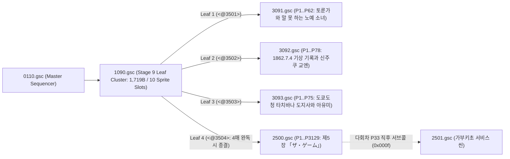

# 『Forest』 비판정본 제5권 A편 (Vol. 05A)
## Stage 9 나뭇잎 군집 (`1090.gsc`: `3091`–`3093.gsc`) 및 제5장 「더 게임(ザ・ゲーム)」 제1부 (`2500.gsc` `P1..P800`)

---

## 0. 편찬 서설: Stage 9 (`1090.gsc`) 일체형 디스패치 위상학과 계량문체·음향·화자 교감 총람

### 0.1 마스터 플로우(`0110.gsc`) 내 Stage 9 (`1090.gsc`)의 바이트코드 구조: 낙엽과 본편의 등위 결합
마스터 시퀀서 `0110.gsc`는 하지(夏至) 밤의 광상 가극인 제4장(`1080.gsc` → `2400.gsc`)이 막을 내린 직후, 플레이어를 아홉 번째 공정인 **`1090.gsc`**(1,719 bytes)로 진입시킨다. 바이트코드 역어셈블 결과 확인된 `1090.gsc`의 내부 문자열 테이블과 호출 참조열은 선행 Stage 5(`1040.gsc` → `1050.gsc`)와 결정적인 위상학적 차이를 드러낸다.

- **`1090.gsc` 문자열 슬롯 배열 (11슬롯, 유효 스프라이트 10개)**:
  `['', '<@3501>', '<@3502>', '<@3503>', '<@3504>', '<@3502>', '<@3503>', '<@3504>', '<@3503>', '<@3504>', '<@3504>']` ($\sum_{k=1}^{4} k = 4 + 3 + 2 + 1 = 10$)
- **`1090.gsc` 스크립트 호출 참조열 (`0x000f` Call Target)**:
  `[3091, 3091, 3092, 3093, 2500, 3092, 3092, 3093, 2500, 3093, 3093, 2500]`

Stage 5에서는 `1040.gsc`가 4편의 막간 단편(`3041`~`3044.gsc`)만을 비복원 추출한 뒤 별도의 타이틀 호출기 `1050.gsc`를 거쳐 본편 `2200.gsc`로 넘어갔던 반면, Stage 9의 `1090.gsc`는 정원(`ガーデン`) 화면 위를 떠다니는 4매의 낙엽 그래픽 버튼(`<@3501>`~`<@3504>`) 가운데 **제1~3슬롯에 막간 단편 `3091.gsc`, `3092.gsc`, `3093.gsc`를 배치하고, 제4슬롯(`<@3504>`)에 거대 본편 스크립트 `2500.gsc`(411,002 bytes, 전 3,129문단)를 직접 바인딩**하고 있다.

이 설계는 제5장 「더 게임」의 서사적 성격을 엔진 층위에서 예고한다. 플레이어에게 본편 `2500.gsc`조차 특권적 중심 서사가 아니라 숲의 세계수에서 떨어진 ‘네 장의 나뭇잎 중 하나(`<@3504>`)’와 등위(同位)로 제시되며, 세 편의 선행 단편이 각각 **① 창작자의 자기애와 말 못 하는 육체(`3091`)**, **② 1862년 7월 4일 기상 기록과 기억의 황금빛 거짓말(`3092`)**, **③ 서신주쿠 도쿄도청의 세속 권력과 상실 트라우마(`3093`)**라는 세 개의 좌표축을 세운 뒤, 그 교차점 한복판인 신주쿠 전역을 거대한 패치워크 보드게임판으로 폭발시키는 것이 바로 `2500.gsc`이기 때문이다.

### 0.2 Vol. 05A 수록 범위(1,015문단·2,163문장) 계량문체 및 이중 음향 채널 대조표
본 권(Vol. 05A)이 관할하는 4개 스크립트 구간(`3091`, `3092`, `3093` 전편 및 `2500` 제1부 `P1..P800`)의 계량문체 지표와 원시 바이트코드 음향 채널(`0x51` 대사창 동기 인라인 보이스 `a[1]` 및 `0x42` 무자막 비동기 보이스 오버레이) 전수 집계는 다음과 같다.

| 파일명 (수록 범위) | 문단 수 (`P#`) | 문장 수 (`S#`) | 글자 수 (전체 기준) | 지문 비율 (`^g999`) | 평균 문장 길이 (ASL) | 한자 (%) | 히라가나 (%) | 카타카나 (%) | 대시 (`/1k` 및 형태) | 말줄임표 (`/1k`) | 인라인 보이스 (`0x51` `a[1]`) | 무자막 오버레이 (`0x42`) | 주 집필자 지문 판별 |
| :--- | :---: | :---: | :---: | :---: | :---: | :---: | :---: | :---: | :---: | :---: | :---: | :---: | :--- |
| **`3091.gsc`** (`P1..P62` 전편) | 62 | 125 | 1,891자 | **1.000** | 15.13자 | 18.72% | **62.72%** | 6.03% | 1.06 (`──` 2연) | 17.45 | **34건** (`7136..7169` 무결번) | 0건 | **星空めてお** (암전 메타 구연·토룬가 신화) |
| **`3092.gsc`** (`P1..P78` 전편) | 78 | 100 | 1,758자 | 0.628 | 17.58자 | **24.80%** | 59.56% | **3.70%** | 1.14 (`───` 3연) | 37.54 | **21건** (`8301..8321` 전수 `^g003`) | **1건** (`8322` @ `P78`) | **星空めてお + 高尾登山/茗荷屋** 교차 지문 (`───` 3연 대시·고한자율 실록 서정체) |
| **`3093.gsc`** (`P1..P75` 전편) | 75 | 103 | 1,788자 | 0.400 | 17.36자 | 23.83% | 55.70% | 7.72% | 3.36 (`───` 3연) | **46.98** | **0건** (완전 무음) | 0건 | **高尾登山 / 茗荷屋甚六** (`───` 3연 대시·관료제 풍자·도시 실록체) |
| **`2500.gsc`** (`P1..P800` / 전 3,129) | 800 *(전 3,129)* | 1,835 *(전 6,992)* | 106,810자 *(전편)* | **0.082** *(전편)* | 15.28자 | 15.62% | 57.88% | **12.16%** | **5.57** (`──` 주류, 일부 `───`) | 16.15 | **502건** (`1301..1808`, 전편 1,938건) | **5건** (`1369, 1371, 1432, 1433, 1480`; 전편 67건) | **3인 합작 PBM 세션** (**星空めてお** 메타·카오루·아마모리 + **茗荷屋甚六** 군상 활극 + **高尾登山** 수리·주사위 규칙) |
| **Vol. 05A 합계** | **1,015문단** | **2,163문장** | — | — | — | — | — | — | — | — | **557건** | **6건** | — |

*(계량문체학 주記: 자동 추출 지표에서 `3092.gsc`와 `3093.gsc`의 대명사 빈도에 각각 `"わし": 1`이 검출된 것은 노인 1인칭 대명사 `わし`가 아니라 형용사 어간 일부인 `まぎらわしい`[`3092` `P50-S1`]와 동사 활용형 `まわして`[`3093` `P4-S1`]의 부분 문자열 일치에 따른 형태소 미분절 착시[False Positive]다. 실제 노인/동물 1인칭 `わし`는 본 권에서 `2500.gsc` `P187-S1`[`わしら`]에서 비로소 출현한다.)*

> [!IMPORTANT]
> **Vol. 05A 비판정본 6대 문헌학·음향학·기호학 핵심 발견**
> 1. **`3091.gsc`의 `^g999` 단일 마스킹 해체와 ‘서사권 찬탈(`P33..P43`)’의 음향적 실증**: 표면상 62문단 전체가 무초상 지문(`^g999`, `Narr=1.00`)으로 기록되어 있으나, `0x51` 오프코드 제2인자(`a[1]`)를 역추적하면 **`7136`~`7169`번(34개 무결번 트랙)**이 여성 청자(`あたし`)의 발화에만 정밀 배당되어 있다. 전반부(`P13..P22`)에서 10문단 연속 무성(`a[1]=0`)으로 이야기를 주도하던 남성 구연자는 `P33`~`P43`(`7147`~`7157`)에 이르러 **11문단 연속 유성 발화를 쏟아내는 여성 청자에게 서사 작법권을 완전히 찬탈**당하며, 마침내 `P58`(`7167`)에서 3인칭 작중인물(`奴隷娘`)과 1인칭 청자(`あたし`)의 경계가 붕괴하는 서사적 월경이 발생한다.
> 2. **`3092.gsc`의 1862년 7월 4일 기상 기록 역설과 `P78`(`それは嘘だ。伽子。`) + `[Voice:8322]`의 삼중 다성성**: 루이스 캐럴 헌시의 ‘황금빛 오후’가 기상대 공식 관측상 ‘서늘하고 비 오는 날(`涼しく、雨模様`)’이었다는 영문학사 최대의 실증적 역설(`P1..P4`)은 파일 말미 `P78`에서 절정에 달한다. `8301`~`8321`번이 카코(`^g003`)의 대사 21개를 순서대로 담당한 직후, 유일한 무자막 `0x42` 오버레이 **`[Voice:8322]`**(죽음이 두렵지 않다는 카코의 육성)가 지문 `それは嘘だ。伽子。` 위에 중첩됨으로써, ① 다이나가 묻혀 오는 나뭇잎이 교엔의 백합나무라는 착각(`P76`), ② 죽음이 두렵지 않다는 카코의 자기기만(`P58`/`8322`), ③ 신주쿠 교엔의 맑은 오후 기억 자체의 허구성까지 동시에 탄핵하는 3중 대위법이 완성된다.
> 3. **`3093.gsc`의 화자 슬롯 정밀 교감 및 3연 대시(`───`) 문체 지문 확정**: 원시 추출 사전에서 `^g055`가 범용 라벨 `都庁職員`으로, `^g052`가 `都知事秘書・参与`로 혼재되어 있던 오류를 내적 호명(`P1`, `P28`, `P35`, `P45`, `P54`, `P69`, `P73`)으로 교감하여 **`^g051` = 타치바나 케이코 도지사, `^g052` = 이즈미 유키 비서, `^g055` = 토키와 아이 도지사 참여(비상근 특별직·재계 인사)**로 확정한다. 또한 2연 대시(`──`)를 쓰는 호시조라 메테오 단독 집필분과 구별되는 **3연 대시(`───`)** 구두점 지문이 `3092`, `3093`, 그리고 `2500`의 특정 연결 지문(`P472`)에 분포함을 실증한다.
> 4. **`2500.gsc` 개막부(`P1..P38`)의 글로벌 플래그(`7107`/`7110`) 연동 상승적 서사 월경(Metalepsis)과 `2501.gsc` 서브콜 해명**: 회상자(`^g999`)의 기억 층위로 나가츠키 아마네(`^g007`)가 무단 침입(`なんでおまえが、このレベルに──`, `P7`)하는 충격적 도입부는 바이트코드 오프셋 `114..232`의 글로벌 클리어 플래그 판정에 의해 1회차 강제 본편 진입(`P1..P12` → `P39`)과 다회차 가부키초 서비스 분기(`P13..P38`, `P33`–`P34` 사이 오프코드 `0x000f`로 `2501.gsc` 호출)로 갈라진다.
> 5. **`2500.gsc` 제1부의 5대 화자 슬롯 전면 교감**: 범용 테이블의 오표기를 바로잡아 **`^g019` = 검은 암컷 고양이 다이나(`ダイナ`)**, **`^g018` = 신주쿠 2초메 호스트이자 까마귀 두령 솔로몬(`ソロモン`)**, **`^g021` = 체셔 고양이(`チェシャ猫`)**, **`^g028` = 실험토끼 벤자민(`ベンジャミン`)**임을 입증하고, 익명 실루엣 슬롯 **`^g009`**가 미공개 등장 국면마다 **엘아라이라(`P125`) → 피글렛·이요르·래빗(`P185..P187`) → 토라(`P188`) → 체셔 고양이(`P198`) → 트라이포드(`P213..P217`) → 인레의 검은 토끼(`P721..P734`)**의 6개 배역을 순차 대리하는 엔진 연출 법칙을 규명한다.
> 6. **인레의 검은 토끼(`^g009`)의 ‘상보적 복자 암호(`P721 ∪ P723`, `P727 ∪ P734`)’ 수학적 복원**: 마유즈미 카오루가 피터의 죽음 직후 반쯤 열린 지각으로 목격하는 사신(死神)의 복자(`■`) 대사 두 쌍은 무작위 노이즈가 아니라 두 차례의 전송 문자열을 문자 위치별로 합집합($S_1 \cup S_2$)하면 원문이 완벽히 복원되도록 설계된 비트마스크 암호임이 최초로 증명된다.

---

## 1. `3091.gsc` (`P1..P62`, 전 62문단 125문장) 초고밀도 해부: 「ねえ、お話を聞かせて？」 — 토룬가의 자기애적 창작, 말 못 하는 노예 소녀, 그리고 청자의 서사 찬탈

### [식별자 & 엔진 연출 코드 총괄]
- **파일 및 분량**: `3091.gsc` | `P1..P62` (전 62문단, 125문장, 1,891자)
- **엔진 호출 및 화면 위상**: `1090.gsc` 낙엽 선택지 제1슬롯(`<@3501>`). 스탠딩 CG와 배경을 완전히 소거한 암전 프레임(`Narr=1.000`, 전 문단 `^g999` 표기).
- **음향 채널 해독 (`0x51` 인라인 보이스 `7136..7169`, 총 34건 무결번 / `0x42` 0건)**:
  - **유성 여성 청자(`あたし`: 검은 앨리스 / 유년기 아마모리 / 카코의 원형 위상, 34문단)**: `P1`(`7136`), `P3`(`7137`), `P5`(`7138`), `P7`(`7139`), `P10`(`7140`), `P12`(`7141`), `P23`(`7142`), `P25`(`7143`), `P27`(`7144`), `P29`(`7145`), `P31`(`7146`), **`P33..P43` 연속 11문단(`7147..7157`)**, `P45`(`7158`), `P47`(`7159`), **`P49..P54` 연속 6문단(`7160..7165`)**, `P56`(`7166`), `P58`(`7167`), `P60`(`7168`), `P62`(`7169`).
  - **무성 남성 구연자(`a[1]=0`: 아케루 / 시리우스 / 도지슨의 창작자 위상, 28문단)**: `P2`, `P4`, `P6`, `P8..P9`, `P11`, **`P13..P22` 연속 10문단**, `P24`, `P26`, `P28`, `P30`, `P32`, `P44`, `P46`, `P48`, `P55`, `P57`, `P59`, `P61`.

---

### 1.1 Beat 1 (`3091.gsc` `P1..P12`): 암전 구연의 개막과 ‘이야기 포화(`物語が積もった`)’로서의 창작 충동

- **대상 범위**: `3091.gsc` `P1..P12` (12문단, 24문장 — 전 문단 `^g999`)
- **전 문단·핵심 문장 색인**:
  - `P1` (`7136`): `[P1-S1]` `ねえ、お話を聞かせて？` / `P2` (무음): `[P2-S1]` `どんなお話がいいの？`
  - `P3` (`7137`): `[P3-S1]` `……トルンガのお話。` / `P4` (무음): `[P4-S1]` `……。`
  - `P5` (`7138`): `[P5-S1]` `……ねえ、トルンガは、どうして旅を始めたの？`
  - `P6` (무음): `[P6-S1..S3]` `……そうだな。……` / `トルンガは満足できなくなったんだ。` / `おしまいの村での生活にね。`
  - `P7` (`7139`): `[P7-S1]` `どうして？`
  - `P8..P9` (무음): `[P8-S1..S2]` `聞き続けることに飽きたんだ。` / `聞いて、聞いて、なお聞いているうちに、トルンガの中には物語が積もった。` // `[P9-S1..S2]` `数多くの物語を詰め込まれた魂は、やがて満足できなくなってくる。` / `生み出さずにはいられなくなってくる。`
  - `P10` (`7140`): `[P10-S1..S3]` `……うん。` / `うん、そうよね。` / `やっぱり、みんなそうなんだ。`
  - `P11` (무음): `[P11-S1..S2]` `そう、みんな、みんなそうなんだ。` / `だから、トルンガが語りだしたことにも、なんの不思議もないんだ。`
  - `P12` (`7141`): `[P12-S1..S2]` `でも、誰が聞いてくれるの？` / `旅を終えた旅人たちが、新しいお話を聞きたがるかな？`

#### [층위 1: 미시 문체·수사·통사·집필자 지문]
`P1-S1`의 상승 억양 의문문(`ねえ、お話を聞かせて？`)으로 열리는 도입부는 시각적 화자 표지를 일절 제거한 채 오직 어미의 젠더 표지(`～て？` / `～だな` / `～よね`)와 유·무성 채널의 교차만으로 두 인격의 거리를 조형한다. 특히 `P4-S1`(`……。`)과 `P6-S1`(`……そうだな。……`)에 배치된 남성 구연자의 긴 침묵은 ‘토룬가의 이야기’가 단순한 옛날이야기가 아니라 구연자 자신의 치부를 건드리는 고백임을 암시한다. `[P8-S2]`의 3중 동사 점층 반복(`聞いて、聞いて、なお聞いているうちに`)과 ‘눈이나 먼지처럼 이야기가 쌓였다’는 물성적 은유(`物語が積もった`), 이어지는 `[P9-S1]`~`[P9-S2]`의 이중 부정 필연 구문(`生み出さずにはいられなくなってくる`)은 입력된 텍스트의 퇴적이 임계치를 넘을 때 수용자가 창작자로 돌변하는 과정을 생리학적 압력으로 묘사한다. `[P10-S3]`(`やっぱり、みんなそうなんだ`)을 `[P11-S1]`(`そう、みんな、みんなそうなんだ`)이 메아리처럼 되받는 연쇄복사(Anadiplosis)는 호시조라 메테오 특유의 서정적 구연 리듬이다.

#### [층위 2: 3중 상호텍스트 및 철학·도시 코드]
- **『아라비안 나이트』·엔데 『끝없는 이야기』와 ‘수용자에서 창작자로의 전이’ `[구조적 공명(Structural Echo)]`**: 선행 막간(`3042`, `3082.gsc`)에서 세상의 종착지인 ‘끝마을(`おしまいの村`)’에 정착해 죽어가는 여행자들의 이야기를 듣고 태피스트리로 짜던 소년 토룬가(`トルンガ`)는, 여기서 단순한 아카이브 기록자(수동적 독자)의 지위를 버리고 능동적 발화자로 변모한다. 이는 『Forest』 전체를 관통하는 메타 문학 테제—수백 권의 서구 아동문학 정전을 읽고 흡수한 독자(아마모리 노조미, 미야노 카코, 나아가 기노사키 아케루)가 필연적으로 자기만의 ‘숲(허구 세계)’을 산출할 수밖에 없는 이유—에 대한 신화적 기원담이다.

#### [층위 3 & 4: 서사적 월경·매체 기호학 및 반례 검증]
`[P10-S3]`에서 여성 청자가 `やっぱり、みんなそうなんだ`(역시 다들 그렇구나)라고 공감하는 대목은 중대한 복선이다. 청자 자신 또한 무수한 이야기를 주입받은 끝에 스스로 이야기를 낳고 싶어 하는 존재(습작 소설을 쓰는 `3092.gsc`의 미야노 카코이자, 가든의 리들을 주재하는 `2500.gsc`의 검은 앨리스)이기 때문이다.

---

### 1.2 Beat 2 (`3091.gsc` `P13..P22`): 타자의 삶을 첨삭하는 ‘완전한 이야기’의 폭력과 청자의 소멸

- **대상 범위**: `3091.gsc` `P13..P22` (10문단, 22문장 — **10문단 전수 무성 남성 구연자 `a[1]=0`**)
- **전 문단·핵심 문장 색인**:
  - `P13..P15`: `[P13-S1..S2]` `聞きたがるヒトもいたし、いやがるヒトもいた。` / `だから、トルンガは遠慮しぃしぃ始めた。` // `[P14-S1..S2]` `旅人が語り終えた物語について、語り直すことからトルンガは始めた。` / `すでにタペストリでやっていたことだ。` // `[P15-S1..S2]` `物語の骨組みは変えずに、細部を整え、描写をつけ加えて、彩り豊かにした。` / `すると旅人たちは喜んでくれたので──`
  - `P16..P17`: `[P16-S1..S3]` `トルンガは、さらに多くをつけ加えた。` / `時には削ったり、変えたりもした。` / `その手際は大胆になり、自信にあふれた。` // `[P17-S1..S3]` `あなたの旅の物語は、実は、こうです。` / `こっちのほうが完全に近いでしょう？` / `美しく、印象深いでしょう？`
  - `P18..P20`: `[P18-S1]` `だが、そうして「完全」に近づいてゆく物語の聞き手は、どんどん減った。` // `[P19-S1]` `おしまいの村へ流れ着く旅人の多くは長い旅に疲れ、死に瀕していた。` // `[P20-S1]` `自分の物語を語り終えると、それで役目を果たしたとでもいうように次々と息絶えていくのだった。`
  - `P21..P22`: `[P21-S1..S2]` `トルンガは「誰かの物語」を語ることの限界と困難とを悟った。` / `そして、自分の物語を夢想し始めた。` // `[P22-S1..S2]` `……言ってること、わかるかい？` / `難しくないかな？`

#### [층위 1: 미시 문체·수사·통사·집필자 지문]
`P13`부터 `P22`까지 10문단 동안 성우 보이스는 완전히 침묵하고 무성 텍스트만이 스크린을 메운다. 구어적 연어〔정정 F3475: 「의태어」가 아님 — する의 연용형 し를 겹친 연어(…しながら)〕 `遠慮しぃしぃ`(`[P13-S2]`, 눈치를 살피며 조심조심)로 시작된 토룬가의 개작 행위는 `P15-S2`의 2연 대시 절단(`喜んでくれたので──`)을 경계로 급격히 오만해진다. 특히 `P17`은 인용 부호 없이 토룬가의 정중한 교정 화법(`あなたの旅の物語は、実は、こうです。こっちのほうが完全に近いでしょう？`)을 지문 속에 직접 삽입하는 자유직접화법을 구사하여, 타인의 우연하고 남루한 실존을 미학적으로 재단하는 ‘편집자-작가의 오만’을 서늘하게 드러낸다. 반면 `P18`의 역접(`だが`)과 낫표〔정정 F3477: 「겹낫표」가 아님 — 「 」는 낫표(홑낫표), 겹낫표는 『 』〕 강조(`「完全」`)는 문학적 완결성이 높아질수록 정작 살아 있는 청자는 죽어 사라진다는 반어(Irony)를 구조화한다.

#### [층위 2: 3중 상호텍스트 및 철학·도시 코드]
1. **실무한적 ‘완전성(`「完全」`)’의 사멸성 대 가능무한적 실존 `[확증(Confirmed)]`**: 토룬가가 추구한 `「完全」に近づいてゆく物語`(`P18-S1`)는 우연한 잉여와 모순을 깎아내고(`削ったり、変えたり`) 필연적 인과율과 미적 대칭을 부여한 닫힌 체계, 즉 칸토어적 실무한(Actual Infinity)으로서의 완결된 텍스트다. 그러나 살아 있는 여행자들에게 자기 삶의 이야기를 완결 짓는 순간은 곧 죽음(`次々と息絶えていく`, `P20-S1`)과 동의어다. 발터 벤야민이 「이야기꾼(*Der Erzähler*)」에서 통찰했듯 완결된 서사의 권위는 죽음으로부터 빌려오는 것이며, 역으로 타인의 삶을 ‘완전한 이야기’로 고정하려는 시도는 살아 있는 타자를 박제화한다.
2. **아케루의 창작 지도와 카코의 습작 소설에 대한 자기반영 `[확증(Confirmed)]`**: 바로 다음 단편인 `3092.gsc`(`P34..P36`, `3091.gsc`와의 연쇄)에서 아케루는 카코의 습작 소설을 지도하며 자기 충족을 얻는 스승으로 등장한다. `P22-S1..S2`(`……言ってること、わかるかい？ 難しくないかな？`)의 다정하면서도 위계적인 어조는 어린 제자를 가르치는 ‘선생님(`先生`)’ 아케루의 화법과 정확히 포개진다.

#### [층위 3 & 4: 서사적 월경·매체 기호학 및 반례 검증]
10문단 연속 무음 구간은 독자로 하여금 성우의 목소리에 의존하지 않고 묵독(黙読)의 내면성 속에서 ‘이야기를 쓰는 자의 고독’을 체험하게 만든다. 그러나 `P22`에서 남성 구연자가 청자의 이해도를 어른스럽게 배려하며 던진 질문은, 곧이어 벌어질 청자의 격렬한 반격을 촉발하는 도화선이 된다.

---

### 1.3 Beat 3 (`3091.gsc` `P23..P43`): 청자의 반란과 11문단 연속 유성 독점(`7147..7157`) — 독약으로 목소리를 잃은 노예 소녀의 우화

- **대상 범위**: `3091.gsc` `P23..P43` (21문단, 50문장 — **`P33..P43` 11문단 연속 여성 보이스 독점**)
- **전 문단·핵심 문장 색인**:
  - `P23` (`7142`), `P24` (무음), `P25` (`7143`), `P26` (무음), `P27` (`7144`), `P28` (무음): `[P23-S1..S3]` `わかる。だいじょうぶ。続きを聞かせて。` // `[P24-S1]` `……ほんとうに聞きたい？` // `[P25-S1..S2]` `あたし、もう子どもじゃないわ。` / `トルンガは恋をするんでしょう？` // `[P26-S1..S3]` `恋、か。そうかも知れない。違うのかも知れない。` // `[P27-S1..S2]` `どんなヒトなの？ きれいなヒトなんでしょう？` // `[P28-S1..S2]` `どうかな。きみはどう思う？`
  - `P29` (`7145`), `P30` (무음), `P31` (`7146`), `P32` (무음): `[P29-S1..S3]` `とっても綺麗な女のヒト。` / `トルンガよりも、ちょっとだけ年下。` / `でも言葉が通じないの。` // `[P30-S1..S2]` `えっ？` / `トルンガは、あらゆる言葉を──` // `[P31-S1..S3]` `口が利けないの。` / `字も書けないの。` / `シンタイショーガイシャなの。` // `[P32-S1..S2]` `……なるほど。じゃあ捨て子かな？`
  - `P33..P37` (`7147..7151` 연속 유성): `[P33-S1..S4]` `違うわ。奴隷なの。とても綺麗で頭も良くて素晴らしいヒト。だから、奴隷商人は欲張ったの。` // `[P34-S1]` `国がひとつ、丸ごと買えるくらいの値段をそのヒトにつけたの。` // `[P35-S1]` `それだけの値打ちはあったはずなのに、買い手はつかなかった。` // `[P36-S1..S3]` `だって、そのヒトは頭がいいから。` / `本当のことしか言わないから。` / `間違ったことは言わないから。` // `[P37-S1..S2]` `そんな奴隷を、うっかり買ったら、恥をかくかも知れない。` / `王様も、大金持ちも、それを恐れたの。`
  - `P38..P43` (`7152..7157` 연속 유성): `[P38-S1..S2]` `奴隷商人は、そのヒトを連れて、世界という世界を巡って歩いたわ。でも、とうとう買い手は現れなかった。` // `[P39-S1]` `長い間、鎖で繋がれたままだったので、そのヒトの手も脚も、すっかり萎えてしまった。` // `[P40-S1..S3]` `そのヒトの声も失われてしまったわ。` / `奴隷商人が、毒薬で灼いたの。` / `本当のことを言えないようにね。` // `[P41-S1..S2]` `そうして、とうとう買い手がつかないまま、奴隷商人は、おしまいの村に流れ着いたの。` / `もの言わぬ、手萎え脚萎えの奴隷と共に。` // `[P42-S1..S2]` `そうしてトルンガは、恋をしたの。` / `奴隷の娘に恋をしたの。` // `[P43-S1]` `でも、もしかしたらトルンガは、自分の物語に恋をしたのかも知れない。`

#### [층위 1: 미시 문체·수사·통사·집필자 지문]
이 구간의 백미는 **표기법의 불협화음(Orthographic Dissonance)**과 **구연 권력의 완전한 역전**이다. `P28-S2`에서 남성 화자가 가볍게 던진 `きみはどう思う？`를 기점으로, 여성 청자(`あたし`)는 `P29`에서 히로인의 설정을 스스로 규정하더니, `P30-S2`에서 모든 언어를 해독하는 토룬가의 능력을 들어 반문하려는 남성 화자의 말허리를 대시(`──`)로 끊어버리고 `P31`에서 3연속 종결어미 `～なの`로 쐐기를 박는다.
특히 **`[P31-S3]` `シンタイショーガイシャなの。`**는 앞선 토룬가 신화의 고아한 순수 화문(和文) 동화 문맥 한복판에 현대 일본의 행정·복지 한자어 ‘신체장애인(身体障害者)’을 의도적인 **장음 기호 섞인 전각 카타카나(`シンタイショーガイシャ`)**로 박아 넣는 충격적인 이화(異化) 기법이다. 이어 `P41-S2`에서는 정반대로 고전 설화풍 아어(雅語)인 **`もの言わぬ、手萎え脚萎えの奴隷`**(말 못 하고 손발이 오그라든 노예 — 일본 신화 『고사기』의 히루코[水蛭子]나 설경절[説経節]의 불구 서사를 연상시키는 고어체)로 문체를 되돌림으로써, 현대 병원의 휠체어 소녀와 고대 신화의 노예 처녀를 문체론적으로 강제 접합한다.

#### [층위 2: 3중 상호텍스트 및 철학·도시 코드]
1. **이솝(Aesop)·안데르센 『인어공주』·오비디우스 필로멜라 신화의 전복적 합성 `[구조적 공명(Structural Echo)]`**: 왕과 부자들이 진실을 말하는 총명한 노예를 두려워해 사지 않는 모티브(`P36..P37`)는 고대 그리스 『이솝 우화집(아이소포스 전기)』에서 크산토스가 노예 시장에서 진실과 논리로 주인을 논파하는 이솝을 마주하는 일화 및 안데르센의 『벌거벗은 임금님』의 진실 발화 공포와 공명한다. 한편 권력자/상인이 진실 폭로를 막기 위해 여성의 발성 기관을 물리적으로 훼손하는 모티브(`奴隷商人が、毒薬で灼いたの`, `P40-S2`)는 오비디우스 『변신이야기』 제6권에서 테레우스가 필로멜라의 혀를 자르는 신화(그리고 필로멜라가 ‘베 짜기/태피스트리’로 진실을 기록하는 모티브!) 및 안데르센 『인어공주』의 목소리 상실을 잔혹하게 비튼 것이다.
2. **피그말리온 콤플렉스 비판 (`自分の物語に恋をしたのかも知れない`, `P43-S1`) `[확증(Confirmed)]`**: 침묵하고 움직이지 못하는 여성 신체는 남성 창작자(토룬가)가 자신의 서사를 무한히 투사해도 결코 반박하지 않는 완벽한 백지(Tabula Rasa)다. 여성 화자는 `P43`에 이르러 낭만적 구원 서사의 가면을 스스로 벗겨내며, 토룬가의 사랑이 타자에 대한 사랑이 아니라 **반론 불가능한 수신자 위에 투사된 ‘자기 이야기(나르시시즘)’에 대한 사랑**임을 폭로한다.

#### [층위 3 & 4: 서사적 월경·매체 기호학 및 반례 검증]
> [!TIP]
> **인라인 보이스(`7147..7157`)가 증명하는 `P43`의 화자 귀속**: 원문 텍스트만 읽으면 `P42`(`～恋をしたの。` 여성 어미)에서 `P43`(`でも、もしかしたらトルンガは、自分の物語に恋をしたのかも知れない。` 중립 종결형)으로 넘어갈 때 다시 남성 구연자가 해설을 되찾은 것처럼 오독하기 쉽다. 그러나 바이트코드 `0x51` 검증 결과 `P43`에는 명확히 여성 성우의 보이스 **`7157`**이 할당되어 있으며, 직후 `P44`(무음 `a[1]=0`: `どういうこと？`)에서 남성 화자가 당황해 되묻는다. 즉 ‘토룬가가 자기 이야기에 사랑에 빠졌을지도 모른다’는 날카로운 메타 비평은 남성 창작자의 자기성찰이 아니라 **여성 청자가 창작자에게 가하는 선제적 탄핵**이다.

---

### 1.4 Beat 4 (`3091.gsc` `P44..P62`): 유물론적 육체 혐오 대 실존적 현존, 그리고 `P58`의 서사적 월경 폭발

- **대상 범위**: `3091.gsc` `P44..P62` (19문단, 29문장 — 유·무성 고속 격돌 구간)
- **전 문단·핵심 문장 색인**:
  - `P44` (무음), `P45` (`7158`), `P46` (무음), `P47` (`7159`), `P48` (무음): `[P44-S1]` `どういうこと？` // `[P45-S1..S4]` `だって奴隷娘は口が利けないのよ？ 字も書けない。身振りもできない。気持ちが通うわけがないじゃない？` // `[P46-S1]` `それは違う。` // `[P47-S1..S2]` `なぜ？ なぜ言い切れるの？` // `[P48-S1]` `奴隷娘が、生きているからさ。`
  - `P49..P54` (`7160..7165` 6문단 연속 유성 폭발): `[P49-S1..S3]` `屍とおんなじでしょう？ 美しいのは顔だけよ。あとは、なにもかも醜いわ。` // `[P50-S1..S3]` `お説教はやめてね。言いそうなこと、わかってるわ。心、魂、汚れのなさ！` // `[P51-S1..S3]` `汚れのなさって、なんのこと？ 鈍感だってことでしょう？ なに言われても感じないんでしょう？` // `[P52-S1..S4]` `心の中は見えないし触れないわ。言葉はいくらでも嘘で飾れるわ。魂？ そんなもの、どこにあるの？` // `[P53-S1..S2]` `トルンガはね、聞いて欲しかったのよ。自分だけの物語を、喜んで、真剣に、飽きもせずに聞いて欲しいだけなのよ。` // `[P54-S1..S3]` `トルンガが！` / `恋したのは！` / `トルンガ自身だったのよっ！`
  - `P55` (무음), `P56` (`7166`), `P57` (무음): `[P55-S1]` `そうだとしても！` // `[P56-S1]` `……!?` // `[P57-S1..S2]` `……そうだとしても、奴隷娘は、許した。` / `なぜなら、彼女は、独りだったから。`
  - `P58` (`7167`), `P59` (무음), `P60` (`7168`), `P61` (무음), `P62` (`7169`): `[P58-S1..S2]` `いやよ、あたし。` / `そんなの許したくない。` // `[P59-S1..S3]` `きみのことなんか聞いてない。` / `奴隷娘の話をしてるんだ。` / `彼女と、トルンガの話だ。` // `[P60-S1..S3]` `あたしはどうなるの!?` / `あたし、出てこないの!?` / `そんなお話、聞きたくないっ！` // `[P61-S1]` `トルンガの話を望んだのは、きみだ。` // `[P62-S1]` `もう聞きたくない！`

#### [층위 1: 미시 문체·수사·통사·집필자 지문]
`P46`(`それは違う。`)과 `P48`(`奴隷娘が、生きているからさ。`)의 극도로 압축된 남성 단문과, 이에 맞서 쏟아지는 `P49`~`P54`의 격정적 여성 독백이 불꽃을 튀긴다. 특히 `P50-S3`의 3단 명사 나열 조소(`心、魂、汚れのなさ！`)에 이어, `P54`에서는 **단일 문장(`トルンガが恋したのはトルンガ自身だったのよっ！`)의 주어절·서술절·보어절을 세 개의 독립 느낌표 문장(`[P54-S1] トルンガが！ / [P54-S2] 恋したのは！ / [P54-S3] トルンガ自身だったのよっ！`)으로 토막 내어 내리꽂는 분절 스타카토 수사법**이 구사된다(이는 후술할 `2500.gsc` `P755`에서 검은 앨리스가 아마모리에게 격분할 때 쓰는 `[P755-S2] この森が！ / [P755-S3] あなた程度に！`와 완벽히 동일한 통사적 감정 폭발 지문이다!).

#### [층위 2: 3중 상호텍스트 및 철학·도시 코드]
- **비트겐슈타인 후기 철학의 ‘사적 언어 불가능성’과 유물론적 회의주의 `[확증(Confirmed)]`**: `[P52-S1..S4]`(`心の中は見えないし触れないわ。言葉はいくらでも嘘で飾れるわ。魂？ そんなもの、どこにあるの？`)는 비트겐슈타인이 『철학적 탐구』에서 논파한 ‘상자 속의 딱정벌레(Beetle in a box)’ 비유—외적 표현 수단(발화·문자·몸짓, `P45-S1..S3`)이 완전히 차단된 내면의 사적 감각이나 ‘영혼’은 언어게임 안에서 검증될 수 없으며, 언어로 덧칠된 내면 미화는 얼마든지 위선(`嘘`)일 수 있다는 급진적 회의를 정면으로 체현한다. 그러나 남성 구연자는 `P55`(`そうだとしても！`)와 `P57`에서 그 나르시시즘 혐의조차 부정하지 않고 정면 수용(`そうだとしても`)한 뒤, 영혼의 순결함이 아니라 **‘절대적 고독(`独りだったから`) 속에서 타자의 이기적 이야기라도 곁에 두기를 택한 살아 있는 육체의 용서’**라는 실존적 지평으로 논점을 도약시킨다.

#### [층위 3 & 4: 서사적 월경·매체 기호학 및 반례 검증]
이 단편의 결정적 파국은 **`P58-S1..S2`(`いやよ、あたし。そんなの許したくない。`)**에서 일어난다. 직전 `P57`까지 분명 3인칭 설화 속 인물인 ‘노예 소녀(`奴隷娘` / `彼女`)’의 용서 여부를 논하고 있었는데, 여성 청자는 무의식중에 주어를 1인칭 **`あたし`**로 바꿔치기하며 자신이 곧 그 불구의 노예 소녀임을 자백해 버린다. 그러나 남성 화자는 `P59`(`きみのことなんか聞いてない。奴隷娘の話をしてるんだ。`)에서 냉혹하게 프레임 경계를 다시 그으며 청자를 이야기 바깥으로 추방한다. `P60`(`あたしはどうなるの!? あたし、出てこないの!?`)의 절규는 창작자(스승/아케루/토룬가)의 본원적 서사 속에서 자신이 주인공이 아닌 타자화된 잔여물로 밀려났음을 깨달은 피조물(검은 앨리스/카코의 그림자)의 존재론적 원한이며, 바로 이 배제된 원한이 이어지는 `3092.gsc`의 애절한 현실 기억과 `2500.gsc` 검은 앨리스의 전제적 주최자 권력으로 변주된다.

---

## 2. `3092.gsc` (`P1..P78`, 전 78문단 100문장) 초고밀도 해부: 1862년 7월 4일 런던 기상대 공문서(`涼しく、雨模様`)의 역설과 신주쿠 교엔의 황금빛 거짓말

### [식별자 & 엔진 연출 코드 총괄]
- **파일 및 분량**: `3092.gsc` | `P1..P78` (전 78문단, 100문장, 1,758자)
- **엔진 호출 및 화면 위상**: `1090.gsc` 낙엽 선택지 제2슬롯(`<@3502>`). 현실 측 과거 회상(`リアル`: 초여름 일요일 오후의 신주쿠 교엔 `御苑公園`). 한자 비율 **24.80%**(전편 최상위권), 카타카나 비율 **3.70%**(최저권), 느낌표 **0.00/1k**(전 문단 느낌표 전무!), 말줄임표 **37.54/1k**의 절제된 정적 서정체.
- **등장 화자 및 음향 채널 해독 (`8301..8322` 전 22개 무결번 보이스 뱅크)**:
  - `^g999`: 地の文／語り手 (= 1인칭 회상자 `俺` 기노사키 아케루, 49문단) — `P1..P77` 무음, **`P78`에만 비동기 무자막 오버레이 `[Voice:8322]` 중첩!**
  - `^g003`: **宮乃伽子** (성우: 호쿠토 미나미 `北都南`, 21문단 전수 `0x51` 인라인 보이스 `8301..8321` 완비)
  - `^g001`: **城之崎灰流(アケル)** (8문단: `P6, P8, P10, P13, P37, P39, P44, P73` — 무음)

---

### 2.1 Beat 1 (`3092.gsc` `P1..P4`): 영문학사 최대의 실증적 역설 — 1862년 7월 4일의 ‘서늘하고 비 오는 날씨(`雨模様`)’ 대 ‘황금빛 오후’ 전 문장 해부

- **대상 범위**: `3092.gsc` `P1..P4` (4문단, 6문장 — 전 문단 `^g999` 무음 에피그래프)
- **전 문장 원문 완결 색인**:
  - `P1`: `[P1-S1]` `ロンドン気象台の公記録によれば１８６２年７月４日の天気は、「涼しく、雨模様」だった。`
  - `P2`: `[P2-S1]` `しかしルイス・キャロル自身もアリス・ハーグーリーヴス夫人もそろって、その日をこう思い返している。`
  - `P3`: `[P3-S1]` `「あの夏の日の午後。` / `[P3-S2]` `頭上には雲ひとつない青空。」`
  - `P4`: `[P4-S1]` `「鏡のような水面。` / `[P4-S2]` `太陽がぎらぎらと照りつけて……」`

#### [층위 1: 미시 문체·수사·통사·집필자 지문]
작품 전체의 중추를 이루는 이 4문단 6문장은 단 하나의 감탄사도 없이 서늘한 백과사전·실록체로 기동한다.
- **`[P1-S1]`**: 출처 한정 부사절(`ロンドン気象台の公記録によれば`)과 전각 아라비아 숫자 날짜(`１８６２年７月４日`)를 앞세워 공문서의 실증적 권위를 확립한 뒤, 낫표〔정정 F3478: 「겹낫표」가 아님 — 「 」는 낫표(홑낫표), 겹낫표는 『 』〕 인용 `「涼しく、雨模様」`과 과거 단정형 `だった。`로 역사적 사실(Fact)을 못 박는다.
- **`[P2-S1]`**: 역접 접속사 `しかし`로 문맥을 180도 뒤집으며, 창작자(`ルイス・キャロル自身`)와 모델 소녀의 노년기 결혼 성명(`アリス・ハーグーリーヴス夫人` = Alice Pleasance Hargreaves, née Liddell)을 병렬 조사 `～も～もそろって`로 묶어 두 당사자의 공모적 회상(`思い返している` — 역사적 현재 진행형)을 대립시킨다.
- **`[P3-S1..S2]` & `[P4-S1..S2]`**: 한 쌍의 인용문 안에 **3연속 명사 종지(体言止め)**(`あの夏の日の午後。` / `頭上には雲ひとつない青空。` / `鏡のような水面。`)를 배치하여 영원히 박제된 풍경화 같은 정지 이미지를 주조한 뒤, 마지막 `[P4-S2]`에서만 의태어 `ぎらぎらと`와 연결어미 미완 종결(`照りつけて……`)로 아지랑이처럼 번지는 기억의 환영을 남긴다.

#### [층위 2: 3중 상호텍스트 및 철학·도시 코드]
1. **1862년 7월 4일 템스강 뱃놀이 기상 기록 역설의 문헌학적 원전 고증 `[확증(Confirmed)]`**:
   1862년 7월 4일 금요일, 옥스퍼드 크라이스트 처치의 수학 강사 찰스 루트위지 도지슨(루이스 캐럴)은 동료 로빈슨 덕워스(Robinson Duckworth), 그리고 학장 헨리 리델의 세 딸(로리나, 10세의 앨리스, 이디스)과 함께 폴리 브리지(Folly Bridge)에서 고드스토(Godstow)까지 템스강(아이시스강)을 거슬러 오르는 보트 소풍을 떠나 즉흥적으로 『땅속 나라의 앨리스(*Alice's Adventures Under Ground*)』를 구연했다.
   - **허구·회상의 정전**: 캐럴은 1865년 출간본 『이상한 나라의 앨리스』 서두 헌시 첫 행을 영문학사상 가장 유명한 구절인 ***"All in the golden afternoon..."***(온통 황금빛 오후에)으로 열었으며, 1887년 『시어터(*The Theatre*)』지 회고문 「무대 위의 앨리스(*Alice on the Stage*)」에서는 구름 한 점 없는 파란 하늘과 거울 같은 강물을 회상했다〔정정 F0050: 「불타오르는 태양열」은 이 글에 없다 — blazing 은 앨리스의 1932년 회고〕. 앨리스 리델(하그리브스 부인) 역시 후년의 회고록(1932년 *Cornhill Magazine* 등)에서 타는 듯한 햇볕 아래 건초더미 그늘에 숨어 이야기를 들었다고 똑같이 증언했다(`[P3-S1..P4-S2]`는 이 두 회고문의 정확한 일본어 응축이다).
   - **기상학적 반증**: 그러나 1950년대 영국의 기상학자·문헌학자들이 런던 기상청(Meteorological Office, 캠던 타운 관측소 글레이셔 기록)〔미확인 F3118: 그날의 기록을 「캠던 타운 관측소 글레이셔 기록」이라 한 근거를 찾지 못했다 — 글레이셔는 기상청이 아니라 그리니치 왕립천문대 소속이었다〕 및 옥스퍼드 래드클리프 천문대(Radcliffe Observatory)의 1862년 7월 4일 공식 관측 일지를 대조한 결과, 당일 오후 날씨는 최고기온 약 $19^\circ\text{C}$ 미만의 ***"cool and rather wet"***(서늘하고 비가 꽤 내린 흐린 날씨, 약 4mm 강우)였음이 밝혀졌다〔미확인 C35b: "cool and rather wet"라는 기록은 확인(이견도 있음). 1950년의 런던 기상청 조회와 옥스퍼드 래드클리프 천문대 기록은 가드너 주석판에 있다고 독립 검수가 확인했다(내가 다시 열지는 못함). 「캠던 타운 관측소」는 어느 자료에도 없고, 약 4mm·19℃ 미만은 확인되지 않음〕(마틴 가드너 『주석 달린 앨리스[*The Annotated Alice*]』 및 야가와 스미코·야나세 나오키 등 일본 캐럴 연구서를 통해 널리 알려진 결정적 일화).
2. **`「雨模様」`에 각인된 여주인공 `雨森(아마모리)`의 기표학적 암호 `[확증(Confirmed)]`**:
   영문 기상 기록 *"cool and rather wet"*을 번역하면서 작가는 단순히 `雨天`이나 `小雨`가 아니라 정확히 **`雨模様`**이라는 어휘를 선택했다〔미확인 F3434: 작가가 직접 옮긴 말인지, 기존 일본어 번역의 문구인지 가리지 못했다〕. 『Forest』 전체에서 **‘비(`雨`)’**는 곧 여주인공 **아메노모리 노조미(`雨森 望` = 비의 숲)**의 고유 원소다. 즉 실제 현실(Real)은 차갑고 축축한 ‘비의 날(`雨模様`)’이었으나, 이야기를 들려준 남자와 이야기를 들은 소녀는 그 서늘한 우천의 현실을 공모적으로 지워버리고 **‘구름 한 점 없는 황금빛 오후(Garden의 원형)’**라는 아름다운 집단 환각으로 기억을 개작했다는 뜻이다.

#### [층위 3 & 4: 서사적 월경·매체 기호학 및 반례 검증]
기존 팬덤에서는 이 서두(`P1..P4`)를 단순히 ‘캐럴 트리비아 인용’ 정도로 가볍게 소비하곤 했다〔미확인 F3082: 그런 평·통설을 적은 자료를 찾지 못했다〕. 그러나 서사 구조상 이 4문단은 직후 펼쳐질 `P5..P78`의 신주쿠 교엔 산책 전체에 **‘신뢰할 수 없는 회상(Unreliable Memory)’이라는 인식론적 괄호**를 씌운다. `P15-S1`에서 아케루가 묘사하는 `初夏らしい、気持ちのいい晴れ間だ`(초여름다운 기분 좋은 갠 날씨)와 `P17-S1`의 `かすかに昨夜までの雨の残り香がある`(어젯밤까지 내린 비의 잔향)조차, 과연 있는 그대로의 객관적 날씨였는지 아니면 죽어가는 소녀 카코와의 마지막 외출을 도지슨과 리델처럼 ‘황금빛 오후’로 윤색한 기억의 굴절인지 독자로 하여금 끝까지 의심하게 만드는 고도의 메타 장치다.

---

### 2.2 Beat 2 (`3092.gsc` `P5..P23`): 신주쿠 교엔(`御苑公園`) 입장과 가난한 스승·휠체어 소녀의 경쾌한 응수

- **대상 범위**: `3092.gsc` `P5..P23` (19문단, 27문장 — 카코 보이스 `8301..8307`)
- **전 문단·핵심 문장 색인**:
  - `P5` (`^g003`, `8301`), `P6` (`^g001`), `P7` (`^g003`, `8302`), `P8` (`^g001`), `P9` (`^g003`, `8303`), `P10` (`^g001`): `[P5-S1]` `先生はよく来るんですか？` // `[P6-S1..S2]` `たまにかな。昼寝か、タバコを吸いに。` // `[P7-S1..S2]` `……それだけ？ 毎日来たらいいのに。` // `[P8-S1..S2]` `そうだな。入園料がタダだったら。` // `[P9-S1]` `じゃあ私が払います。` // `[P10-S1]` `なぜ。`
  - `P11..P12` (`^g003`, `8304..8305`), `P13` (`^g001`), `P14` (`^g003`, `8306`): `[P11-S1]` `先生、遊んでばかりいてお金が無いんでしょう。` // `[P12-S1]` `それとも、読まないまま忘れちゃうような難しい御本ばかり買っているせい？` // `[P13-S1..S2]` `……ほっといてくれ。どうせ金はねえよ。` // `[P14-S1]` `ふふっ……`
  - `P15..P21` (`^g999`): `[P15-S1]` `初夏らしい、気持ちのいい晴れ間だ。` // `[P16-S1]` `めずらしく外出を許可された伽子の車椅子を押して、俺は御苑公園のゲートをくぐる。` // `[P17-S1]` `かすかに昨夜までの雨の残り香がある。` // `[P18-S1]` `伽子の屋敷は公園のすぐ裏手だ。` // `[P19-S1]` `でも伽子本人がこの公園に訪れたことは数えるほどしか無い。` // `[P20-S1]` `彼女の部屋の窓、繁った木々の合間から、公園のユリの木の先端がかすかにのぞくくらいのものだ。` // `[P21-S1..S2]` `「せっかくの外出の機会を　こんな近所でよかったのか？」` / `と尋ねると───`
  - `P22` (`^g003`, `8307`), `P23` (`^g999`): `[P22-S1..S3]` `どこだっていいの。` / `本当は。……` / `先生がいてくれたら。` // `[P23-S1]` `そう、はにかみながら言った。`

#### [층위 1: 미시 문체·수사·통사·집필자 지문]
`P5`~`P14`의 10문단은 지문 한 줄 없이 오직 대화만으로 진행되는 스타카토 응수(Stichomythia)다. 특히 `P10-S1`에서 물음표 대신 마침표로 끊어 치는 아케루의 2음절〔정정 F3293: 「단음절」이 아님 — な・ぜ 2음절〕 반문(`なぜ。`)과, `P12-S1`에서 아케루의 현학적 독서벽을 찌르는 카코의 경어체 조롱(`難しい御本`)이 생동감 있는 리듬을 만든다. 이어 `P15`부터 지문이 개입하면서 현재시제 현장 서술(`くぐる`, `残り香がある`)로 시간축을 끌어당기며, `P21-S2`(`と尋ねると───`)에서 **3연 대시(`───`)**가 출현하여 `P22`의 도치 고백(`どこだっていいの。 / 本当は。…… / 先生がいてくれたら。`)을 감싸 안는다.

#### [층위 2: 3중 상호텍스트 및 철학·도시 코드]
- **2004년 신주쿠 교엔(`新宿御苑`)의 도시·식물학적 실재 좌표 `[확증(Confirmed)]`**:
  1. **입장료(`入園料`, `P8-S2`)**: 환경성 소관 국민공원인 신주쿠 교엔은 신주쿠 중앙공원(`3041.gsc`)과 달리 유료 입장 게이트(2004년 당시 성인 200엔)를 통과해야 하며(`御苑公園のゲートをくぐる`, `P16-S1`), 가난한 청년 아케루가 ‘공짜였다면 매일 왔을 것’이라 투덜대는 디테일은 극도로 현실적이다.
  2. **백합나무(`ユリの木`, *Liriodendron tulipifera*, `P20-S1`)와 센다가야·신주쿠교엔마에 저택가**: 신주쿠 교엔 영국 풍경식 정원 한복판에 치솟은 수령 100년 이상의 거대한 튤립나무(백합나무, 높이 30m 이상)는 교엔을 상징하는 대표 거목으로, 공원 바로 뒤편 저택(`公園のすぐ裏手`, `P18-S1` — 센다가야~신주쿠 1·2초메 경계 고급 주택지〔정정 F2290: 「타이토/」 삭제 — 다이토구(台東区)는 23구 북동부로 교엔과 떨어져 있다. 교엔은 신주쿠구와 시부야구에 걸친다〕) 2층 병실 창문에서도 수관(樹冠) 끝부분(`先端`)이 실제로 조망된다〔미확인 F2291: 대본의 저택은 가상의 곳이라 확인할 실재 지점이 없다〕.
  3. **직전 단편 `3091.gsc`와의 거울상 대비 `[확증(Confirmed)]`**: `3091.gsc`의 사지가 마비된 노예 소녀(`手萎え脚萎えの奴隷`)는 여기서 외출조차 거의 허락받지 못한 채 휠체어에 앉아 창밖 나뭇가지 끝만 바라보는 병약한 영애 **미야노 카코(`伽子の車椅子`, `P16-S1`)**로 현실화된다.

#### [층위 3 & 4: 서사적 월경·매체 기호학 및 반례 검증]
총론에서 확인된 엔딩 크레딧(`5000.gsc`)의 핵심 실증처럼, **미야노 카코(`^g003`)와 검은 앨리스(`^g002`)는 성우 호쿠토 미나미(`北都南`)의 1인 2역**이다. 플레이어는 `8301`~`8307`번에서 울려 퍼지는 청초하고 가냘픈 소녀의 음성이, 곧이어 시작될 `2500.gsc`에서 목숨을 건 살육 보드게임을 주최하는 검은 앨리스의 오만한 음성과 물리적으로 동일한 성대(声帯)에서 발원한다는 청각적 이중노출(Double Exposure)을 경험하게 된다.

---

### 2.3 Beat 3 (`3092.gsc` `P24..P42`): 습작 소설의 ‘엇갈림(`すれ違ってしまう場面`)’과 각운 언어유희 `おはなしの、はなし、は、なし`

- **대상 범위**: `3092.gsc` `P24..P42` (19문단, 23문장 — 카코 보이스 `8308..8312`)
- **전 문단·핵심 문장 색인**:
  - `P24..P31` (`^g999`): `[P24-S1]` `日曜日の公園はあんのじょうにぎわっていた。` // `[P25-S1..S2]` `家族連れ。日光浴で寝そべる外国人、缶コーヒー片手のくたびれたサラリーマン。` // `[P26-S1]` `それでもまだ、芝地はじゅうぶんに広々としている。` // `[P27-S1]` `此処にいると自分が都心にいる事実を忘れる。` // `[P28-S1]` `ふだん路地裏でのたくる我が身としてはなおさらだ。` // `[P29-S1]` `それは、一日じゅう部屋の壁かモニターを見つめて過ごす伽子にしても、同じだろう。` // `[P30-S1]` `伽子は、顔をほころばせ、熱心に自分の創作の構想について語る。` // `[P31-S1]` `その話題が俺を喜ばせると知っていたからだ。`
  - `P32..P33` (`^g003`, `8308..8309`): `[P32-S1]` `……だからいっそ、二人がすれ違ってしまう場面にしたいと思ったんです。` // `[P33-S1..S3]` `そうしたら残酷すぎるでしょうか。` / `それとも……美しいと感じられますか？` / `先生───`
  - `P34..P36` (`^g999`): `[P34-S1]` `実際、申し分ない生徒だった。` // `[P35-S1]` `彼女がしたためる習作小説は日々密度を高めて、もう手習いの域を脱しつつある。` // `[P36-S1]` `俺にこれほどの充足を与えてくれる彼女は、たとえようもなく魅力的な存在だった。`
  - `P37` (`^g001`), `P38` (`^g003`, `8310`), `P39` (`^g001`), `P40..P41` (`^g003`, `8311..8312`), `P42` (`^g999`): `[P37-S1]` `……伽子。` // `[P38-S1]` `はい。` // `[P39-S1]` `今日はお話しの話は無しにしよう。` // `[P40-S1]` `……そう、ですか。` // `[P41-S1..S2]` `はい。` / `今日は、おはなしの、はなし、は、なし。` // `[P42-S1]` `少女は楽しそうに言葉をころがしてみせた。`

#### [층위 1: 미시 문체·수사·통사·집필자 지문]
`[P39-S1]`에서 한자·가나 혼용으로 표기된 아케루의 제안 **`今日はお話しの話は無しにしよう。`**(오늘은 이야기[창작 소설]에 관한 이야기는 없는 것으로 하자)를, 카코는 `[P41-S2]`에서 한자를 전부 해체하고 쉼표로 음절 단위를 분절한 순수 히라가나 동음이의 연쇄 **`今日は、おはなしの、はなし、は、なし。`**(`/o-ha-na-shi-no / ha-na-shi / wa / na-shi/`)로 되받아친다. `P42-S1`의 지문 `言葉をころがしてみせた`(말을 사탕이나 구슬처럼 입안에서 굴려 보였다)는 바로 앞 문단 `8312`번 성우 연기의 또렷한 분절 발음을 공감각적 촉각으로 번역한 명문장이다. 또한 `P33-S3`(`先生───`)에서 다시 3연 대시가 사용되어 카코의 간절한 승인 욕구를 표시한다.

#### [층위 2: 3중 상호텍스트 및 철학·도시 코드]
1. **캐럴적 말놀이(Wordplay)와 메타 담론의 중지 `[확증(Confirmed)]`**: 루이스 캐럴의 『앨리스』 연작에서 ‘꼬리 이야기(*tail* / *tale*)’나 공작부인의 동음이의 언어유희가 서사의 무거움을 경쾌하게 전복하듯, `おはなしの、はなし、は、なし`는 3중 메타 구조(‘허구 이야기[お話]’에 관한 ‘메타 담화[話]’의 ‘부재[無し]’)를 7·5조 변격 음율〔정정 F4116: 세어 보면 5·3·1·2(합 11박) — 7·5조의 변격으로 보기 어렵다〕로 압축한다.
2. **`3091.gsc` 토룬가 비판의 메아리와 제9장 에필로그(`2900.gsc`) 예언 `[확증(Confirmed)]`**:
   - `[P31-S1]`(`その話題が俺を喜ばせると知っていたからだ`)과 `[P36-S1]`(`俺にこれほどの充足を与えてくれる彼女は…`)은 아케루 자신이 `3091.gsc`의 토룬가처럼 소녀를 통해 ‘창작적 자기충족’을 탐닉하고 있었음을 무의식중에 자백한다. 아케루가 문득 `P39`에서 ‘창작 이야기를 멈추자’고 제동하는 것은, 소녀를 ‘내 이야기의 거울’이 아니라 지금 눈앞에 살아 있는 한 사람으로 마주하려는 윤리적 각성이다.
   - 동시에 카코가 구상한 `[P32-S1]` **`二人がすれ違ってしまう場面`**(두 사람이 서로 스쳐 지나가 버리는 장면 — 그것이 잔혹한가 아름다운가?)은 『Forest』 전체의 대단원인 **제9장 에필로그(`2900.gsc`)에서 신주쿠 인파 속 아케루와 노조미가 서로를 알아보지 못한 채 스쳐 지나가는 엔딩 장면 그 자체**를 작품 중반부에서 미리 예고하는 소름 끼치는 구조적 복선이다.

#### [층위 3 & 4: 서사적 월경·매체 기호학 및 반례 검증]
카코가 실내에서 하루 종일 응시하던 `部屋の壁かモニター`(`P29-S1`)는 현대 비주얼 노벨 플레이어가 모니터 너머로 허구를 소비·창작하는 매체 조건과 겹치며, 야외의 잔디밭(`芝地`, `P26-S1`)으로 나오는 행위는 닫힌 텍스트 공간(`お話しの話`)으로부터 우연한 감각 세계로의 일시적 탈출을 뜻한다.

---

### 2.4 Beat 4 (`3092.gsc` `P43..P55`): 가벼운 육체, 혼동스러운 식물명, 그리고 NTT 도코모 빌딩의 석양 실루엣

- **대상 범위**: `3092.gsc` `P43..P55` (13문단, 17문장 — 카코 보이스 `8313`)
- **전 문단·핵심 문장 색인**:
  - `P43` (`^g003`, `8313`), `P44` (`^g001`): `[P43-S1]` `あのすこし高くなってる場所、入れるんですか？` // `[P44-S1]` `もちろん。`
  - `P45..P50` (`^g999`): `[P45-S1]` `新緑に萌える公園のすみずみまでその瞳に焼きつけようと、伽子は観察の手を伸ばした。` // `[P46-S1]` `俺はそのたび少女の興味の向く方向へと車椅子をころがす。` // `[P47-S1..S2]` `苦にはならない。` / `少女は軽い。` // `[P48-S1]` `脆弱な俺の腕でも、やすやすと抱えあげられてしまうほど。` // `[P49-S1]` `たびたび木々の名を尋ねられ、俺はつたない植物学の知識をかり出す。` // `[P50-S1]` `まぎらわしい植物を植えた公園職員を恨まずにいられない。`
  - `P51..P55` (`^g999`): `[P51-S1..S3]` `池の水面に、さざなみが走る。` / `風がすこし強くなった。` / `人の流れがばらばらと門へ向う。` // `[P52-S1..S2]` `閉園が間近だ。` / `帰宅の予定時間はとっくに通りこしていた。` // `[P53-S1]` `ペンシル型のＮＴＴビルは、夕陽のなかで黒いシルエットとなり、` // `[P54-S1]` `逆に公園脇の建物は、窓のひとつひとつが、金貨のように輝いている。` // `[P55-S1]` `俺たちはふたり、同じ景色を見つめながらただ、樹々のさざめきに耳を澄ませていた。`

#### [층위 1: 미시 문체·수사·통사·집필자 지문]
`[P42-S1]`에서 ‘말을 굴리던(`言葉をころがしてみせた`)’ 동사가 `[P46-S1]`에서는 ‘휠체어를 굴리다(`車椅子をころがす`)’로 변주되어 언어적 유희와 신체적 돌봄을 하나의 동사 축으로 엮는다. `[P47-S1..S2]`(`苦にはならない。少女は軽い。`)의 극단적으로 짧은 단문 병치는 병마에 야윈 소녀의 생물학적 체중 미달을 어떤 신파적 수식어도 없이 서늘하게 전달한다. 또한 `P53`의 쉼표 연결절(`～シルエットとなり、`)이 문단 경계를 넘어 `P54`(`逆に～金貨のように輝いている。`)에서 완결되는 **문단 간 행간 걸침(Enjambment across paragraphs)**은 화면 클릭 한 번에 역광(흑색 실루엣)에서 순광 반사(금화빛 창문)로 시선이 패닝(Panning)되는 영화적 카메라워크를 구현한다.

#### [층위 2: 3중 상호텍스트 및 철학·도시 코드]
1. **2000년 완공 NTT 도코모 요요기 빌딩(`ペンシル型のＮＴＴビル`)의 정밀한 태양 방위각 고증 `[확증(Confirmed)]`**:
   신주쿠 교엔 남서쪽(센다가야/요요기 방향) 하늘에 우뚝 솟은 첨탑형 마천루 **NTT 도코모 요요기 빌딩(2000년 9월 준공, 높이 240m, 엠파이어 스테이트 빌딩을 연상시키는 연필 모양 외관)**은 2004년 당시 신주쿠 교엔 잔디 광장에서 볼 때 가장 압도적인 랜드마크다. 폐원 시각(하절기 오후 4시 30분경, `P52-S1`) 서쪽 하늘로 기우는 석양(`夕陽`)을 등지고 있기 때문에 교엔에서 남서~서쪽을 바라보면 NTT 빌딩은 **역광을 받아 칠흑 같은 실루엣(`黒いシルエット`, `P53-S1`)**이 되고, 정반대로 서쪽 석양빛을 정면으로 반사하는 공원 동북쪽/북쪽 외곽 빌딩들은 **창문 하나하나가 금화처럼 번쩍인다(`金貨のように輝いている`, `P54-S1`)**. 신주쿠 교엔에 실제로 서 본 사람만이 쓸 수 있는 완벽한 광학적·지리적 실측 묘사다.
2. **거울 같은 수면의 파문 (`池の水面に、さざなみが走る`, `P51-S1`) `[확증(Confirmed)]`**: 서두 `P4-S1`의 캐럴 회상(`鏡のような水面`)을 고스란히 호출하되, 바람이 강해지며 잔물결(`さざなみ`)이 일어 거울이 깨지는 장면을 통해 ‘영원한 황금빛 정지 시간’의 종료(폐원 및 다가오는 죽음)를 암시한다.

#### [층위 3 & 4: 서사적 월경·매체 기호학 및 반례 검증]
`[P49-S1]`~`[P50-S1]`에서 카코가 나무 이름을 묻고 아케루가 헷갈리는 식물을 심은 공원 직원을 원망하는 유머러스한 대목은 단순한 일상 스케치가 아니다. 바로 말미 `P76`과 `P78`에서 터져 나올 **‘나뭇잎의 진짜 나무 이름(식물학적 기원 대 환상 숲의 기원)’** 반전을 위해 매설된 치밀한 서사적 복선이다.

---

### 2.5 Beat 5 (`3092.gsc` `P56..P70`): 죽음의 공포와 실존의 역설 — `死をよく知る人間ほど生きている`

- **대상 범위**: `3092.gsc` `P56..P70` (15문단, 17문장 — 카코 보이스 `8314..8318`)
- **전 문단·핵심 문장 색인**:
  - `P56` (`^g003`, `8314`), `P57` (`^g999`), `P58` (`^g003`, `8315`), `P59` (`^g999`): `[P56-S1]` `……先生……` // `[P57-S1]` `髪の先を風に揺らしながら伽子がつぶやく。` // `[P58-S1]` `…………先生、私、死ぬのは怖くないの。` // `[P59-S1]` `そんな人間はいない。`
  - `P60..P62` (`^g003`, `8316..8318`), `P63..P70` (`^g999`): `[P60-S1]` `ただ……` // `[P61-S1]` `ただね……大切な人と逢えなくなると思うと……` // `[P62-S1]` `すこし……胸が苦しい……` // `[P63-S1]` `…………` // `[P64-S1]` `……その苦しさは、生きている証なんだ、伽子。` // `[P65-S1..S3]` `誰だって、いつかは死ぬ。` / `誰だって怖い。` / `考えないようにしてるだけだ。` // `[P66-S1]` `それを考えないまま、死んでいく事もできるさ。` // `[P67-S1]` `死を何か別のものに置き換えてそう信じ続けることだって。` // `[P68-S1]` `だけど俺はごめんだ。` // `[P69-S1]` `自分から生きる喜びを遠ざけて何になる。` // `[P70-S1]` `死をよく知る人間ほど生きている。`

#### [층위 1: 미시 문체·수사·통사·집필자 지문]
`P58`~`P63`에서 말줄임표(`……` 내지 4연속 `…………`)가 폭발적으로 증식하며 숨이 가빠오는 병자의 호흡을 시각화한다. 주목할 점은 `P59`와 `P64`~`P70`의 화자 코드가 대화창(`^g001`)이 아니라 전부 지문(`^g999`)이라는 사실이다! 즉 아케루는 차마 카코의 면전에 대고 `そんな人間はいない`(그런 인간은 없어)나 `だけど俺はごめんだ`라고 소리 내어 쏘아붙이지 못한 채(`P63-S1` 침묵 `…………`), **입 밖으로 발화되지 못한 내면의 독백(`^g999`)**으로만 그녀의 체념에 격렬히 저항하고 있다. `[P70-S1]` **`死をよく知る人間ほど生きている。`**는 호시조라 메테오 철학 문체의 정수를 보여주는 역설적 경구(Aphorism)다.

#### [층위 2: 3중 상호텍스트 및 철학·도시 코드]
- **하이데거의 ‘죽음을 향한 존재(*Sein zum Tode*)’와 ‘죽음의 치환(`死を何か別のものに置き換えて`)’ 비판 `[확증(Confirmed)]`**:
  `[P67-S1]`의 **`死を何か別のものに置き換えてそう信じ続けること`**(죽음을 무언가 다른 것으로 치환하여 그렇게 계속 믿는 것)는 『Forest』 전체의 기프트·가든 비판 이론을 한 문장으로 요약한다. 바로 뒤이어 `2500.gsc`에서 그리자벨라가 죽음을 **‘천국행 티켓(`天国への切符`, 젤리클 고양이의 환생)’**으로 치환하고(`P262`, `P612..P613`), 카오루의 연구실이 죽음 회피만을 위한 연명 연구에 매달리며(`P115`), 요절한 소녀의 잔류 사념이 죽음을 ‘끝나지 않는 이야기 숲’으로 치환하는 모든 도피 기제를 아케루는 `だけど俺はごめんだ`(`P68-S1`)로 단호히 거부한다. 죽음의 유한성을 허구적 영원으로 은폐하지 않고 직시할 때만 삶의 강렬함(`生きる喜び`)이 성립한다는 실존주의 테제다.

#### [층위 3 & 4: 서사적 월경·매체 기호학 및 반례 검증]
`P59`와 `P64..P70`이 발화 대사(`^g001`)가 아닌 내면 지문(`^g999`)으로 처리되었기 때문에, 작중 현실의 카코는 아케루의 이 대답을 듣지 못했다. 전달되지 못한 그 내면의 반박이 끝내 도달하지 못한 채 유령처럼 메아리치는 지점이 바로 마지막 `P78`이다.

---

### 2.6 Beat 6 (`3092.gsc` `P71..P78`): 검은 고양이 다이나(`ダイナ`)의 출현과 `[Voice:8322]` 무자막 오버레이가 찢어발기는 결말 — `それは嘘だ。伽子。`

- **대상 범위**: `3092.gsc` `P71..P78` (8문단, 10문장 — 카코 보이스 `8319..8321` + **`P78` 비동기 오버레이 `[Voice:8322]`**)
- **전 문장 원문 완결 색인**:
  - `P71` (`^g999`): `[P71-S1]` `茂みの中から、ざっと黒い塊が飛び出して伽子の膝の上に乗った。`
  - `P72` (`^g003`, `8319`): `[P72-S1]` `……まあ、ダイナ。` / `[P72-S2]` `びっくりした。`
  - `P73` (`^g001`): `[P73-S1]` `驚かせるなよ。`
  - `P74` (`^g999`): `[P74-S1]` `当の本人は何くわぬ顔で毛繕いをしている。`
  - `P75` (`^g003`, `8320`): `[P75-S1]` `ちょうどいいわ。` / `[P75-S2]` `一緒に帰りましょう。`
  - `P76` (`^g003`, `8321`): `[P76-S1]` `あなたがいつもくっつけてくる葉っぱの木がわかったのよ？`
  - `P77` (`^g999`): `[P77-S1]` `公園の猫たちはベンチに寝そべったまましっぽの先でさよならを告げていた。`
  - `P78` (`^g999`) **`[Voice:8322]`**: `[P78-S1]` `それは嘘だ。` / `[P78-S2]` `伽子。`
    *(원판 무자막 `0x42` 보이스 `[Voice:8322]` 영문 패치 전사 대조〔미확인 F2054: 영문 패치(2012-01-14 Amaterasu Translations 판)의 본문은 열어 보지 않았다. 설명서와 포럼 보존본에는 이 전사가 없다〕: `"I'm not afraid of dying. I got to be with Sensei. I've lived more than enough already."`)*

#### [층위 1: 미시 문체·수사·통사·집필자 지문]
`[P71-S1]`에서 처음엔 무정물적 시각 덩어리(`黒い塊`)로 지각되었다가 `[P72-S1]`에서 고유명사 `ダイナ`로 호명되고 `[P74-S1]`에서는 의인화 명사 **`当の本人`**(정작 당사자 본인 — 동물이 아닌 인격체 대우!)으로 격상되는 서술 추이는 현실의 반려묘 다이나가 이미 가든의 인격체(`ネコのヒト`)와 경계를 맞대고 있음을 문법적으로 시사한다. 마지막 `P78`은 호격 명사를 쉼표로 붙이지 않고 마침표로 절단하여 두 개의 문장(`[P78-S1] それは嘘だ。` / `[P78-S2] 伽子。`)으로 분리함으로써, 돌이킬 수 없는 사후(死後)의 단절감과 비통한 탄식을 극대화한다.

#### [층위 2: 3중 상호텍스트 및 철학·도시 코드]
- **캐럴 『이상한 나라의 앨리스』·『거울 나라의 앨리스』의 반려묘 다이나(`ダイナ`) `[확증(Confirmed)]`**: 앨리스가 토끼굴로 떨어지는 동안에도 가장 그리워하던 집고양이 다이나(야가와 스미코·야나세 나오키 등 여러 역본의 표기 `ダイナ`〔정정 F0133: 「전 역본 공통」이 아님 — 1910년 丸山英観 역 『愛ちやんの夢物語』은 「玉(たま)」〕)가 현실의 병약한 소녀 미야노 카코의 고양이로 등장한다. 이로써 **[도지슨 ↔ 아케루]**, **[앨리스 리델 ↔ 미야노 카코(및 검은 앨리스)]**, **[반려묘 다이나 ↔ 검은 고양이 다이나(`2500.gsc` `^g019`)]**, **[1862.7.4 템스강 소풍 ↔ 신주쿠 교엔 일요일 산책]**의 4원 대응 등식이 완벽히 성립한다.

#### [층위 3 & 4: 서사적 월경·매체 기호학 및 반례 검증]
> [!WARNING]
> **`P78` 지시 대명사 `それ`(`それは嘘だ`)와 무자막 오버레이 `[Voice:8322]`의 삼중 대위법 검증**:
> 텍스트만 읽는 독자는 `P78`의 `それは嘘だ`(그건 거짓말이다)가 무엇을 가리키는지 단일 층위로 축소하기 쉽다. 그러나 원시 바이트코드에서 `P78` 출력 직전 비동기 오디오 채널(`0x42`)로 무자막 보이스 **`8322`**(카코가 "죽는 건 무섭지 않아요, 선생님과 함께 있을 수 있었으니까요, 이미 충분히 살았어요"라고 속삭이는 육성)가 재생된다는 사실을 결합하면, 지시어 **`それ`**는 세 개의 층위를 동시에 관통한다:
> 1. **식물학·우주론적 층위 (`P76` → `P78`)**: 카코는 다이나가 털에 묻혀 오던 나뭇잎의 출처를 신주쿠 교엔의 나무(`P20` 백합나무 등)에서 찾았다고 기뻐하지만(`P76`), 아케루는 그 나뭇잎이 교엔의 현실 식물이 아니라 **이계인 ‘숲(가든의 세계수 — Stage 9 `1090.gsc`의 낙엽)’에서 떨어진 불길한 초대장**임을 알고 있다.
> 2. **청각·실존적 층위 (`[Voice:8322]` + `P58` → `P78`)**: 문자 화면에 찍히지 않는 카코의 육성(`8322`: "죽음은 두렵지 않다, 충분히 살았다")에 대해, 아케루의 문자 서술 `それは嘘だ。伽子。`가 매체 채널을 가로질러 직접 응답하며 소녀의 애처로운 강변을 부정한다(살고 싶어 했고, 더 살아야만 했다는 애도).
> 3. **메타 기억 층위 (`P1..P4` → `P78`)**: 1862년 7월 4일의 ‘구름 한 점 없는 황금빛 오후’가 기상 기록상 거짓(`涼しく、雨模様`)이었듯, 벤치의 고양이들이 꼬리 끝으로 작별을 고하던(`P77`) 이 평화롭고 눈부신 교엔의 오후 회상 전체가 상실의 고통을 견디기 위해 직조된 ‘아름다운 거짓말’일 가능성을 열어젖힌다.

---

## 3. `3093.gsc` (`P1..P75`, 전 75문단 103문장) 심층 해부: 서신주쿠 도쿄도청의 타치바나 도지사(`^g051`)·이즈미 비서(`^g052`)·토키와 참여(`^g055`), 관료제 활극과 여동생 아유미(`あゆみ`)의 3주기〔정정 F3371: 「4주기」가 아님 — 四回忌는 만 3년째 기일, 곧 3주기〕

### [식별자 & 엔진 연출 코드 총괄]
- **파일 및 분량**: `3093.gsc` | `P1..P75` (전 75문단, 103문장, 1,788자)
- **엔진 호출 및 화면 위상**: `1090.gsc` 낙엽 선택지 제3슬롯(`<@3503>`). 현실 측(`リアル`: 니시신주쿠 도쿄도청 제1본청사 도지사 집무실 → 전용/일반 엘리베이터 → 32층 직원식당). 성우 보이스(`0x51` 및 `0x42`) **0건(완전 무음)**. 3연 대시(`───`) 6회 출현, 말줄임표 **46.98/1k**의 도회적 콩트 겸 심리 암전극.
- **화자 슬롯 정밀 교감 (원시 `SPEAKER_MAP` 오표기 완전 바로잡음)**:
  - `^g999`: 地の文／語り手 (30문단: 이즈미 유키 비서의 제한적 시점에 근접한 3인칭 서술)
  - `^g051`: **橘けーこ (타치바나 도지사)** (17문단: `P3, P12, P14, P16, P18..P19, P21, P30, P35, P38..P39, P43..P44, P47, P50, P66, P68` — 1인칭 `あたし`)
  - `^g052`: **和泉由紀 (도지사 비서 이즈미 유키)** (12문단: `P1..P2, P6, P27, P29, P31..P32, P63, P65, P73..P75` — 1인칭 `私`)
  - `^g055`: **常葉愛 (비상근 특별직·문화행정촉탁 도지사 참여 토키와 아이)** (16문단: `P11, P13, P15, P17, P20, P22..P23, P25, P28, P36..P37, P48..P49, P51, P64, P67` — 원 추출 라벨 `都庁職員`을 교정! 1인칭 `あたし`, 젊은 재계 총아 여성)

---

### 3.1 Beat 1 (`3093.gsc` `P1..P32`): 회전의자의 도지사와 부러진 샤넬 카멜리아 뮬(`シャネルのミュール`) — 관료제 권력 공간의 탈권위화

- **대상 범위**: `3093.gsc` `P1..P32` (32문단, 44문장 — 전 문단 무음)
- **전 문단·핵심 문장 색인**:
  - `P1..P6`: `[P1-S1]` `『───橘都知事、　参与がお見えになりました』` (`^g052`) // `[P2-S1]` `『すこし早く着かれましたが、　よろしいですか？』` (`^g052`) // `[P3-S1..S2]` `うーい。通してー。` (`^g051`) // `[P4-S1]` `合革張りの白い椅子をぐるんぐるんまわして、けーこは応じた。` (`^g999`) // `[P5-S1]` `執務室の扉が開いて訪問客が案内される。` // `[P6-S1..S2]` `どうぞ。……大丈夫ですか？` (`^g052`)
  - `P7..P18`: `[P7-S1]` `大丈夫大丈夫、と言いながら長髪の若い女が顔を出す。` // `[P8-S1]` `涼しげな、袖の短い黒のスーツに、カメリアの載った黒のミュールをつっかけている。` // `[P9-S1]` `けーこの秘書は飲み物を用意しようと部屋をいったん離れながら、あ、シャネルの新作だなと思った。` // `[P10-S1]` `女は片足立ちでぴょんぴょん跳ねながら部屋に入ってくる。` // `[P11-S1]` `いっちっちっち……` (`^g055`) // `[P12-S1]` `どした。` (`^g051`) // `[P13-S1..S2]` `いやあー、そこんとこですっ転んじっちまいまして。あー、かかとがー` (`^g055`) // `[P14-S1]` `いい大人がぽてぽて転ぶなよ。` (`^g051`) // `[P15-S1]` `だって出納長のヤロー、あたしん目の前でニヤケながら、エレベータ閉めやがって……` (`^g055`) // `[P16-S1]` `ほう。` // `[P17-S1..S2]` `で、全階先回りして、ボタン押してきてやりました。へっへーいざまみろ。` (`^g055`) // `[P18-S1..S2]` `とんでもないことするな、お前。あいかわらず。` (`^g051`)
  - `P19..P32`: `[P19-S1..S2]` `ふぅ……最近、こっち顔出さなかったじゃないか。忙しいのか。` // `[P20-S1..S2]` `ま、それなりですか。知事ほどじゃありませんが。` // `[P21-S1..S2]` `座り話もなんだな。メシでも食いながらにするか。` // `[P22-S1..S2]` `あーそっすねー。ちょっと待ってください。` // `[P23-S1..S2]` `フンッ───ボキッ！` / `フンッ───バキッ！` (`^g055`) // `[P24-S1]` `ぐらぐらになったヒールを、まだ無事だった方もろとも剥がしてクズかごにシュートする。` // `[P25-S1]` `（パンパン）うしっと。` (`^g055`) // `[P26-S1]` `部屋に戻ってきた秘書がその惨状を目にするなり情けない声をあげる。` // `[P27-S1]` `あ～っシャネルのミュール！` (`^g052`) // `[P28-S1..S2]` `お、由紀さんも行こーか。メシ。` (`^g055`) // `[P29-S1]` `……え、あっと、私はここで仕事が。` // `[P30-S1..S2]` `いーよ。あんたも来てよ。` // `[P31-S1..S2]` `……いいのかなあ。わかったよ、けーこちゃん。` // `[P32-S1..S2]` `でもせっかく持ってきたアイスコーヒーは飲んで。勿体ないから。` (`^g052`)

#### [층위 1: 미시 문체·수사·통사·집필자 지문]
`3093.gsc`는 구두점과 의성어·구어 축약에서 뚜렷한 타카오 토잔·묘가야 진로쿠 계열의 경쾌한 세태 희극 지문을 보인다.
1. **3연 대시(`───`)와 만화적 의성·의태어**: 인터폰 음성 표시 겹낫표 첫머리의 `『───橘都知事`(`P1-S1`), 양쪽 구두 굽을 꺾어버리는 대칭 구문 `フンッ───ボキッ！ / フンッ───バキッ！`(`P23-S1..S2`), 그리고 대사창 안에 지문처럼 괄호로 삽입된 손뼉 털기 효과음 **`（パンパン）うしっと。`**(`P25-S1`)는 비주얼 노벨보다는 연극 대본이나 TRPG 리플레이의 토막 지시에 가깝다.
2. **히라가나 이름 표기(`けーこ`)와 공·사 어체 전환**: 엄숙한 한자 직함 `橘都知事`(`P1-S1`)가 지문에서는 장음 기호를 섞은 친근한 히라가나 **`けーこ`**(`P4-S1`, `P9-S1`, `P58-S2`)로 표기되며, 비서 이즈미 유키 역시 공무 모드(`P1..P2`, `P29` `私はここで仕事が`)에서 사적 친구 모드(`P31-S2` `わかったよ、けーこちゃん`)로 순식간에 코드 스위칭(Code-switching)을 수행한다.

#### [층위 2: 3중 상호텍스트 및 철학·도시 코드]
1. **2004년 도쿄도청(`東京都庁`) 관료제와 이시하라 신타로(`石原慎太郎`) 도정의 젠더 반전 패러디 `[확증(Confirmed)]`**:
   - **도지사 참여(`参与`) 대 출납장(`出納長`)의 실제 권력 암투**: 1999년 취임해 2004년 재선 임기 중이던 이시하라 신타로 도지사는 기존 도청 정통 관료 조직(부지사·출납장 라인 — 일본 지방자치법상 `出納長`은 2007년 회계관리자 개편 전까지 부지사와 맞먹는 도청 최고위 특별직 관료였다)을 견제하기 위해 외부 민간인 전문가들을 **‘비상근 특별직 도지사 참여(`都知事参与`)’**로 대거 기용하여 마찰을 빚었다〔미확인 F1780: 「参与」 직이 있었다는 것만 확인했다〕. 출납장이 젊은 민간인 여성 참여(`常葉愛`) 코앞에서 비웃으며 엘리베이터 문을 닫아버리고(`P15-S1`), 토키와가 계단으로 전 층을 앞질러 버튼을 전부 눌러 복수하는(`P17-S1`) 에피소드는 당시 도청 내부의 ‘관료 대 도지사 직속 참여’ 갈등을 통쾌한 슬랩스틱으로 전유한 것이다.
   - **인조가죽 흰색 의자(`合革張りの白い椅子`, `P4-S1`)와 샤넬 카멜리아 뮬(`カメリアの載った黒のミュール`, `P8..P9`, `P27`)**: 버블기 단게 겐조 설계의 초호화 청사 이면에서 재정 개혁기 검약용 인조가죽 회전의자를 빙글빙글 돌리는 도지사, 그리고 2003~2004년 초여름 유행했다는〔미확인 C0〕 샤넬의 아이코닉 아이템인 ‘카멜리아 장식 블랙 뮬’의 수만 엔짜리 굽〔미확인 F3049: 값과 「아이코닉 아이템」이라는 근거를 찾지 못했다〕을 미련 없이 양쪽 다 분질러 쓰레기통에 슛(`シュート`, `P24-S1`)하는 토키와의 행동은 명품 기호와 권위주의를 동시에 조소한다.

#### [층위 3 & 4: 서사적 월경·매체 기호학 및 반례 검증]
> [!NOTE]
> **사본 교감 증명 (`^g055` = `常葉愛`)**: 원시 바이트코드에서 `^g055`는 전용 스탠딩 CG가 없는 서브 캐릭터 공용 슬롯이기 때문에 초기 자동 추출기에서 `都庁職員`으로 라벨링되었다. 그러나 `P1`에서 예고된 ‘참여(`参与`)’가 `P7..P10`에서 검은 수트와 샤넬 뮬 차림으로 입장해 `^g055` 코드로 말하고, `P35`에서 도지사가 `^g055`를 `常葉`라 부르며 `P45`가 그 정식 직함을 `非常勤特別職・文化行政嘱託都知事参与───常葉愛`로 명시하므로, 본 파일의 `^g055`는 100% **토키와 아이**다.

---

### 3.2 Beat 2 (`3093.gsc` `P33..P60`): 무음으로 하강하는 엘리베이터 — ‘에어프론트 프로젝트’에서 죽은 여동생 ‘아유미(`あゆみ`)의 3주기’〔정정 F3372: 「4주기」가 아님 — 四回忌는 만 3년째 기일, 곧 3주기〕로

- **대상 범위**: `3093.gsc` `P33..P60` (28문단, 38문장 — 전 문단 무음)
- **전 문단·핵심 문장 색인**:
  - `P33..P39`: `[P33-S1]` `都知事と参与、そして満足顔の秘書は下腹に手をやり微妙な顔でエレベータに乗り込む。` // `[P34-S1]` `流れるビル街の風景に目をやり都知事はぽつりと言った。` // `[P35-S1..S2]` `……で、常葉。あの事なんだが……` (`^g051`) // `[P36-S1..S2]` `ああエアフロント・プロジェクト？ いいんじゃないすか？` (`^g055`) // `[P37-S1..S2]` `ま、ちょっとうちのまわりも騒がしくはなるけど。時代の流れにゃね───` (`^g055`) // `[P38-S1]` `いや、違うんだ。` (`^g051`) // `[P39-S1]` `……あゆみのことだ。` (`^g051`)
  - `P40..P51`: `[P40-S1]` `参与の顔から、ふっと表情が失われる。` // `[P41-S1]` `傍らの秘書も小さく息を呑んだ。` // `[P42-S1]` `都知事は淡々と続ける。` // `[P43-S1..S2]` `そろそろ四回忌だ。うちの母親も、あんたの顔見たがってる。` (`^g051`) // `[P44-S1]` `忙殺されてるのは分かってるが……そろそろ、来てやってくれないか。` // `[P45-S1]` `非常勤特別職・文化行政嘱託都知事参与───常葉愛は答えない。` // `[P46-S1]` `無音のままエレベーターは下降していく。` // `[P47-S1]` `やっぱり……まだ、あたしを恨んでるか。` (`^g051`) // `[P48-S1]` `…………` (`^g055`) // `[P49-S1..S2]` `いえ……あれは事故です。先輩を恨んだりするのは、筋違いなんですよ。` (`^g055`) // `[P50-S1]` `…………` (`^g051`) // `[P51-S1]` `…………ただあいつのことは、まだ……` (`^g055`)
  - `P52..P60` (`^g999`): `[P52-S1..S2]` `気持ちに整理がつかない。信じたくない。` // `[P53-S1]` `そんなたぐいの言葉を参与は飲み込んでいるのだろうか。` // `[P54-S1]` `都知事秘書、和泉由紀は自分事のように胸を痛めた。` // `[P55-S1]` `接戦だった選挙戦を乗りこえ、怒濤の初年が過ぎ、ようやく落ち着いてきたと思い始めたころ……` // `[P56-S1]` `彼女は───都知事の妹あゆみは死んだ。` // `[P57-S1..S2]` `交通事故と聞いている。` / `重い神経症を患っていた、とも聞いている。` // `[P58-S1..S2]` `二つの事柄から導き出される連想はある。が、その話題をけーこ自身が自分で切り出すことは無い。` // `[P59-S1]` `亡くなった彼女と常葉参与が同級生だったとは聞き及んでいた。` // `[P60-S1]` `ただ、二人が親友と呼べる間柄だったと分かったのは最近のことだ。`

#### [층위 1: 미시 문체·수사·통사·집필자 지문]
전반부(`P1..P33`)의 소란스러운 코미디(아이스커피를 억지로 원샷해 배를 움켜쥔 세 여자의 모습, `P33-S1`)는 `P39-S1`(`……あゆみのことだ。`) 단 한 줄로 얼어붙는다. `P40`~`P42`의 3연속 1줄 단문(`表情が失われる。` / `小さく息を呑んだ。` / `淡々と続ける。`)은 공기의 밀도를 단숨에 압축하며, `P45-S1`에서 지금까지 가벼운 말투로 까불던 젊은 여성에게 20자에 달하는 무거운 관직명(`非常勤特別職・文化行政嘱託都知事参与───常葉愛`)을 처음으로 풀네임 부여함으로써 공적 가면 뒤의 사적 상처를 부각한다. 특히 `P57-S1..S2`(`交通事故と聞いている。重い神経症を患っていた、とも聞いている。`)와 `P58-S1`(`二つの事柄から導き出される連想はある。` — 즉 ‘자살’이라는 단어를 끝내 발화하지 않는 완곡어법[Euphemism / Paralipsis])의 절제미가 탁월하다.

#### [층위 2: 3중 상호텍스트 및 철학·도시 코드]
1. **수직 하강하는 전망 엘리베이터와 내면 심층으로의 잠항 `[유력(Probable)]`**: 도쿄도청 제1본청사 고층부에서 흘러가는 서신주쿠 마천루 풍경〔미확인 F3421: 지사실이 몇 층인지 적은 자료를 찾지 못했다〕(`流れるビル街の風景`, `P34-S1`)을 배경으로 수직 하강하는 엘리베이터(`無音のままエレベーターは下降していく`, `P46-S1`)는 하루키 문학(『세계의 끝과 하드보일드 원더랜드』의 니시신주쿠 엘리베이터)〔미확인 F1403: 그 건물이 니시신주쿠라는 근거를 찾지 못했다〕 이래 도쿄 도시소설에서 표층 의식으로부터 트라우마의 무의식으로 내려가는 고전적 장치다〔정정 F3607: 그 소설 첫머리의 엘리베이터는 오르는지 내리는지 알 수 없게 그려지고 화자는 올라간다고 짐작한다 — 「내려가는」 장치의 선례로 들기는 어렵다〕.
2. **불교식 기제 연대기(`四回忌` = 사후 만 3년)를 통한 시간축 계산 `[확증(Confirmed)]`**: 일본 불교 의례에서 `一回忌`는 사망 당년(또는 1주기 `一周忌`), `三回忌`는 만 2년, **`四回忌`(혹은 관용적 만 3년째 기일)**는 도지사 당선 초년(`怒濤の初年が過ぎ`, `P55-S1`) 직후 사망한 시점으로부터 약 3년이 경과했음을 뜻한다. 무엇보다 중요한 것은 『Forest』에서 가든의 기프트가 침투하는 조건이다: **‘죽음을 받아들이지 못한 채 마음의 정리가 끝나지 않은 상실(`信じたくない`, `P52-S2`)’**. 제6장(`2600.gsc`)에서 타치바나 도지사가 기프트 ‘팔란티르(`パランティア`)’를 손에 쥐고 수몰되는 신주쿠와 가든의 항해를 관전하게 되는 심층 동기가 바로 이 죽은 여동생 아유미의 빈자리다.

#### [층위 3 & 4: 서사적 월경·매체 기호학 및 반례 검증]
파일 전체가 성우 음성 없는 완전 무음(`0x51=0`, `0x42=0`)으로 설계된 이유가 `[P46-S1]` **`無音のままエレベーターは下降していく。`**에서 자기지시적으로 드러난다. 텍스트 내용상의 ‘무음(無音)’과 엔진 오디오 채널의 ‘무음’이 완벽한 매체적 동형성을 이루며, `P48`과 `P50`의 점선 침묵(`…………`)을 독자의 귀에 물리적 진공으로 체감시킨다.

---

### 3.3 Beat 3 (`3093.gsc` `P61..P75`): 도청 일반식당(`一般食堂`)의 폭식 승부와 비서의 언론 통제 — 공적 스펙터클로 봉합되는 상처

- **대상 범위**: `3093.gsc` `P61..P75` (15문단, 21문장 — 전 문단 무음)
- **전 문단·핵심 문장 색인**:
  - `P61..P68`: `[P61-S1]` `しかし目的の階に着くやいなや、二人は何事もなかったかのように普段の二人へと戻った。` // `[P62-S1]` `秘書は降りた階の表示を見て戸惑った。` // `[P63-S1..S2]` `あ、あの、この階って？ 一般食堂でいいんですか？` (`^g052`) // `[P64-S1..S2]` `え？ 意外といけるよ、ここ。` (`^g055`) // `[P65-S1]` `で、でも、ちゃんとした店に案内しますから。` // `[P66-S1..S2]` `コラコラ、由紀。仮にも都職員たるものがそういう態度ではイカンなあ。` (`^g051`) // `[P67-S1]` `なにより食べ放題の勝負がついてないっすからねー。` (`^g055`) // `[P68-S1..S2]` `そゆことー。食うぞー。` (`^g051`)
  - `P69..P75`: `[P69-S1]` `一般客も利用可能な食堂へ、経済界の若き雄と、都知事その人が乗り込むと、店内は一瞬静まりかえった。` // `[P70-S1]` `しかし二人はお構いなしで、自分のトレーに山盛りに料理を積み上げていく。` // `[P71-S1]` `例によって都知事のいつもの奇行が出たというわけだ。` // `[P72-S1]` `ひとくさりため息をついて、秘書は携帯の短縮をプッシュする。` // `[P73-S1..S2]` `あ……企画部ですか？ 和泉です。` (`^g052`) // `[P74-S1..S2]` `すいません。カメラさんと記者さん寄こしてもらえますか？` // `[P75-S1]` `そうなんです……また毎度の癖が……お忍びで視察、と云う体裁で……ええ……ハイ……ハイ…………`

#### [층위 1: 미시 문체·수사·통사·집필자 지문]
엘리베이터 문이 열리는 순간(`着くやいなや`, `P61-S1`) 무거운 애도의 문체는 다시 카타카나 감탄사(`コラコラ`, `イカン`, `P66`)와 구어 축약(`そゆことー`, `P68-S1`)의 익살극으로 되튀어 오른다. 마지막 `P75-S1`은 한자 고어 표기 `と云う体裁で`와 말줄임표로 페이드아웃되는 전화 응대(`……ええ……ハイ……ハイ…………`)를 결합하여, 통화 중인 비서의 목소리가 멀어지며 암전(Fade-out)되는 시네마틱 엔딩을 연출한다.

#### [층위 2: 3중 상호텍스트 및 철학·도시 코드]
- **도쿄도청 제1본청사 32층 직원식당(`一般客も利用可能な食堂`, `P69-S1`)과 미디어 정치학 `[확증(Confirmed)]`**: 도쿄도청 제1본청사 32층 직원식당은 실제로 일반 시민과 관광객도 출입증을 받아 식권을 사거나 카페테리아 트레이(`自分のトレー`, `P70-S1`)에 반찬을 골라 담을 수 있는 서신주쿠의 명물 공간이다. 여동생의 죽음이라는 내면의 균열을 식탐 대결이라는 과장된 기행(`いつもの奇行`, `P71-S1`)으로 덮어버리는 두 권력자와, 그 우발적 기행마저 즉시 도청 기획부 기자단을 불러 **‘미행 시찰(`お忍びで視察`)’이라는 정치 홍보 서사로 재포장하는 비서(`P73..P75`)**의 모습은, `3091.gsc`의 토룬가(이야기 편집), `3092.gsc`의 캐럴(기억 윤색)에 이어 **현실 정치 권력 또한 어떻게 우연과 상처를 ‘체재 좋은 이야기(`体裁`)’로 가공하는가**를 보여주는 제3의 변주곡이다.

---

## 4. `2500.gsc` 제1부 (`P1..P800`, 800문단 1,835문장) 심층 해부: 제5장 「더 게임(ザ・ゲーム)」 개막 — 메타 서사 월경, 종족 대표 총집결, 그리고 주사위 신주쿠의 탄생

### [식별자 & 엔진 연출 코드 총괄 (`2500.gsc` `P1..P800`)]
- **파일 및 분량**: `2500.gsc` (전체 411,002 bytes, 전 3,129문단 6,992문장 106,810자 중 본 권 제1부 **`P1..P800`: 800문단, 1,835문장**)
- **엔진 호출 및 계량문체 혁명**: `1090.gsc` 제4낙엽(`<@3504>`)으로 기동. 지문(`^g999`) 비율이 선행 장들의 50~100%에서 **`0.082` (8.2% — `P1..P800` 내 `^g999`는 단 20문단!)**로 급락하는 전대미문의 **절차적 보드게임·군상 연극 스크립트(Procedural PBM Script)**다. 순수 지문 대신 **나가츠키 아마네(`^g007`), 카리야 마키(`^g006`), 마유즈미 카오루(`^g005`) 세 인간 히로인이 자신의 대사창 코드(`^g007`/`^g006`/`^g005`)와 성우 인라인 보이스를 유지한 채 1인칭 시점 서술까지 수행**하는 다중 초점화(Multiple Internal Focalization)〔정정 F3081: 인물이 번갈아 시점을 맡는 것은 주네트의 「가변(variable) 내적 초점화」 — 「다중」은 같은 사건을 여러 시점으로 거듭 보이는 것〕 기법이 전면 도입된다.
- **음향 채널 (`P1..P800`)**:
  - `0x51` 대사창 동기 인라인 보이스: **502건** (`1301..1808`, 전편 1,938건 중 제1부 배당분)
  - `0x42` 무자막 비동기 보이스 오버레이: **5건** (`[Voice:1369]` @ `P97`, `[Voice:1371]` @ `P99`, `[Voice:1432, 1433]` @ `P199`, `[Voice:1480]` @ `P286`)
- **내장 선택지 (`EXTRA/CHOICE STRINGS`, `P1..P800` 구간 6개 메뉴·18슬롯)** 및 서브스크립트 호출:
  1. `P18` 직후 슬롯 `19..21` *(다회차 플래그 `7107`/`7110` 충족 시 출현)*: `お楽しみは、どっち？` → `20: 歌舞伎町` (`P19` → `P21..P38`, `P33` 직후 오프코드 `0x000f`로 **`2501.gsc`** 호출!) / `21: ゲームスペース柏木` (`P20` → `P39`)
  2. `P35` 직후 슬롯 `39..41` *(`2501.gsc` 종료 복귀 후)*: `この後、どうする？` → `40: ゲームにつきあう` (`P36` → `P39`) / `41: 遠慮しとく` (`P37..P38` → 챕터 즉시 종료 복귀)
  3. `P384` 직후 슬롯 `391..393`: `雨森は誰についていく？` → `392: 九月` (`P385..P407`) / `393: 黛` (`P408..P434`)
  4. `P521` 직후 슬롯 `531..533`: `サイコロに気合を？` → `532: 思いっきり気合注入！` (`P522..P529`) / `533: まだまだ序盤。セーブセーブ` (`P530..P538`)
  5. `P578` 직후 슬롯 `591..593`: `マユズミちゃんが遅れてるけど……？` → `592: 構わず先を急ぐ！` (`P586` 직행) / `593: マユズミちゃんを急がせる` (`P579..P585`)
  6. `P585` 직후 슬롯 `601..603`: `マユズミちゃんが遅れてるので……` → `602: 焦らず、ひと休み` / `603: ロストした数字を補充する` (후속 턴 분기 플래그 저장)
- **`2500.gsc` 제1부 공용·오표기 화자 슬롯 전면 실증 교감표**:
  - `^g019`: **ダイナ** (검은 암컷 고양이 소녀·새끼 고양이 어미; 원 추출 라벨 `アリエッティ` 교정)
  - `^g018`: **ソロモン** (신주쿠 2초메 호스트·까마귀 두령, 1인칭 `我輩`; 원 추출 라벨 `バストファー・ジョーンズ` 교정)
  - `^g021`: **チェシャ猫** (입술부터 출현하는 고양이 여인, 1인칭 `あたし`; 원 추출 라벨 `ボンバルリーナ` 교정)
  - `^g028`: **実験ウサギ・ベンジャミン** (피터 사망 후 교대한 실험토끼, 1인칭 `ぼく` + 경어; 원 추출 라벨 `助手／青年` 교정)
  - `^g009`: **익명 실루엣 공용 슬롯** — ① `P125` 엘아라이라 / ② `P185` 코부타·`P186` 이요르·`P187` 래빗 / ③ `P188` 토라 / ④ `P198` 체셔 고양이 / ⑤ `P213, P215, P217` 트라이포드 / ⑥ `P721, P723, P727, P734` **인레의 검은 토끼(死神)**

---

### 4.1 Beat 1 (`2500.gsc` `P1..P20`): 회상 프레임으로의 나가츠키 아마네(`^g007`) 무단 난입(`なんでおまえが、このレベルに──`) — 상승적 서사 월경과 에로게 문법의 전복

- **대상 범위**: `2500.gsc` `P1..P20` (20문단, 49문장 — 나가츠키 인라인 보이스 `1301..1312` + 다회차 선택지 `19..21`)
- **전 문단·핵심 문장 색인**:
  - **1회차 진입 루트 (`P1..P12` → `P39` 점프)**:
    - `P1..P2` (`^g999`): `[P1-S1]` `さて、思い出してみようか──` // `[P2-S1]` `そう、あれは７月の──蒸し暑い夜だったな──`
    - `P3` (`^g007`, `1301`): `[P3-S1..S3]` `な～にカッコつけてんの？` / `さっ、行こ！` / `あたしとゲームに、つきあうじゃん！`
    - `P4..P5` (`^g999`), `P6` (`^g007`, `1302`), `P7` (`^g999`): `[P4-S1]` `思い浮かぶのは──「ザ・ゲーム」の晩の出来事──いや、待てよ？` // `[P5-S1..S2]` `なんか、妙だな？` / `歌舞伎町の記憶が──` // `[P6-S1..S3]` `ん～ふ～ふ～。忘れたとは言わせませんわよ～。たっぷりお楽しみでしたわよ～。` // `[P7-S1..S2]` `なっ、なんだ、おまえ!?` / `なんでおまえが、このレベルに──`
    - `P8..P9` (`^g007`, `1303..1304`), `P10` (`^g999`), `P11..P12` (`^g007`, `1305..1306`): `[P8-S1..S2]` `ん～まぁ、いろいろバレバレ？ ちょっと仕掛けてみました～って感じ？` // `[P9-S1..S3]` `この森の「意志」が、あたしを見てる──と、仮定するなら、ですよ？ やぁ～っぱ、ね？ そーゆー場面がね？` // `[P10-S1..S3]` `なに言ってんだ、おまえ!?` / `いいから引っ込め！` / `おまえはあの晩、グリザベラと──` // `[P11-S1..S2]` `はいはい、わかってますって！` / `あたしのアレとかコレとかはぁ～、「ザ・ゲーム」を解いてから！` // `[P12-S1..S2]` `そう簡単にはサービスしませんよ？ ん～ふ～ふ～。`
  - **다회차 플래그(`7107`/`7110`) 해금 루트 (`P13..P20`)**:
    - `P13` (`^g007`, `1307`), `P14` (`^g999`), `P15..P16` (`^g007`, `1308..1309`), `P17` (`^g999`): `[P13-S1..S2]` `じゃーん！ まぁ～たまたお会いしましたねぇ～？` // `[P14-S1..S2]` `なんだよ、おまえ……。引っ込んでろよ！` // `[P15-S1..S3]` `あんたこそ邪魔なんですよぉ。お客さまはお楽しみをお求めですからね。あんたなんか引っ込んでて──` // `[P16-S1..S4]` `──ってワケにもいかないかぁ～？` / `お楽しみにはオモチャがつきものだし？` / `おいでおいで～。` / `ウィンナちゃ～ん。` // `[P17-S1..S2]` `ふざけんな、このっ!?` / `俺は単なる肉棒かっ!?`
    - `P18` (`^g007`, `1310`): `[P18-S1..S3]` `そぉ～れでは、お客さまン？` / `お楽しみなら歌舞伎町へ参りましょ！` / `それとも「ザ・ゲーム」に挑戦します？`
    - **[선택지 슬롯 `19..21`]**: `お楽しみは、どっち？` → `20: 歌舞伎町` (`P19` 경유 `P21`행) / `21: ゲームスペース柏木` (`P20` 경유 `P39`행)
    - `P19` (`^g007`, `1311`): `[P19-S1..S2]` `かしこまりましたぁ～！ おひとりさま、ごあんなぁ～い！` // `P20` (`^g007`, `1312`): `[P20-S1..S2]` `マジですかっ!? お客さぁ～ん、マニヤですねい？`

#### [층위 1: 미시 문체·수사·통사·집필자 지문]
`P1`과 `P2`는 호시조라 메테오 특유의 **2연 대시(`──`) 회상 프레임 문체**(`さて、思い出してみようか──` / `そう、あれは７月の──蒸し暑い夜だったな──`)로 장중한 분위기 속에 개막한다. 그런데 `P3`에서 느닷없이 성우 미루(`みる`)의 콧소리 섞인 갸루·풍속점 어조(`な～にカッコつけてんの？`, 물결표 `～`의 범람과 카타카나 부사화)가 난입하여 그 진지한 회상 독백을 산산조각 낸다. 당황한 서술자(`^g999` = 상위 기억 층위의 아케루)가 `P7-S2`에서 외치는 **`なんでおまえが、このレベルに──`**(어째서 네가 ‘이 레벨[서사 층위]’에—!)는 일본 비주얼 노벨 사상 유례를 찾기 힘든 명시적 서사학 용어(`レベル` = Narrative Level)의 대사화다. 이어 다회차 분기 `P16..P17`에서는 플레이어를 ‘손님(`お客さま`)’으로 호명하면서 주인공 아케루를 성인 게임의 도구적 남근(`オモチャ` / `ウィンナちゃ～ん` ↔ `俺は単なる肉棒かっ!?`)으로 격하시키는 폭소 어린 자기풍자가 작렬한다.

#### [층위 2: 3중 상호텍스트 및 철학·도시 코드]
- **제라르 주네트(Gérard Genette)의 ‘상승적 서사 월경(Métalepse ascendante)’〔정정 F0368: 주네트 자신의 용어 짝은 métalepse/antimétalepse(2004) — 「상승적」은 클리멕 등 뒤 연구자의 말〕과 18금 미소녀게임 산업 규범의 카니발적 해체 `[확증(Confirmed)]`**:
  주네트의 서사학에서 회상하는 외적 서술자(층위 0: `^g999`)와 회상되는 과거 사건 속 인물(층위 1: 7월 밤 그리자벨라와 함께 있던 나가츠키, `P10-S3`) 사이에는 넘을 수 없는 존재론적 장벽이 있다. 그런데 나가츠키는 ‘이 숲의 의지가 나를 보고 있다(= 모니터 너머 플레이어/관음적 시선이 성인 서비스 장면을 기대한다)’는 가설(`P9-S1..S3`)을 역이용해 과거 기억 데이터를 조작(`歌舞伎町の記憶が──`, `P5-S2`)하며 상위 회상 레벨로 기어 올라온다. 특히 `P11-S2`(`あたしのアレとかコレとかはぁ～、「ザ・ゲーム」を解いてから！`)는 실제로 바이트코드 오프셋 `114..232`에서 **글로벌 클리어 플래그(`7107`/`7110`)가 켜지기 전까지는 H씬 루트(`P13..P38`) 자체를 잠가버리는 엔진 로직**을 작중인물이 직접 설명하는 제4의 벽 돌파다. 에로게에서 흔히 서사적 개연성을 해치는 ‘보상형 H씬’을 아예 메타-기억 해킹 사건으로 격상시킨 메테오·묘가야의 천재적 연출이다.

#### [층위 3 & 4: 서사적 월경·매체 기호학 및 반례 검증]
다회차에서 플레이어가 성인 장면을 마다하고 곧바로 본편(`21: ゲームスペース柏木`)을 고르면 `P20`에서 나가츠키가 아케루가 아닌 **모니터 앞 플레이어(`お客さぁ～ん`)를 정면으로 응시하며 `マニヤですねい？`(에로보다 보드게임 리들을 택하다니 매니아시네요!)라고 놀리는 대목**은 플레이어 주체마저 가부키초 유흥가의 ‘손님’으로 포획하는 매체적 도발이다.

---

### 4.2 Beat 2 (`2500.gsc` `P21..P38`): 다회차 가부키초 호객·서비스 분기와 서브스크립트 `2501.gsc` 호출의 카니발적 육체성

- **대상 범위**: `2500.gsc` `P21..P38` (18문단, 49문장 — `P33`–`P34` 사이 `2501.gsc` 서브콜 + 선택지 `39..41`)
- **전 문단·핵심 문장 색인**:
  - `P21` (`^g001`), `P22` (`^g007`), `P23` (`^g001`), `P24` (`^g007`), `P25` (`^g001`), `P26` (`^g007`), `P27` (`^g001`): `[P21-S1..S3]` `んんっ!? 俺……なぜ、こんなとこに？ たしか、さっきまで伽子んちで……。` // `[P22-S1..S2]` `お客さぁ～ん？ なぁ～にキョロキョロしてんですかぁん？` // `[P23-S1..S4]` `おうッ!? 九月じゃねーかよ。気味悪いっつの。シッシッ。` // `[P24-S1..S2]` `……ずいぶんですねい？ いたいけなエッチぃ仔猫ちゃんが誘惑のポーズで迫ってるとゆーのに。` // `[P25-S1]` `熱中症か？` // `[P26-S1..S3]` `ムッキー！ いいから来いオラ、こっちだこっち！ お客さま、おひとり入りまぁ～す！` // `[P27-S1..S4]` `わっ。待てっ。なんだ、どーした。おまえんとこの店ってこんなヤバい商売やってんのかっ!?`
  - `P28` (`^g007`), `P29` (`^g001`), `P30..P31` (`^g007`), `P32` (`^g001`), `P33` (`^g007`): `[P28-S1]` `これもリドルのうちなんですねい！` // `[P29-S1]` `なに……!?` // `[P30-S1..S4]` `森には意志はない。偶然だけだ。あんた、そんなこと言ってたよね？ あたし、おぼえてるんですねい。` // `[P31-S1..S3]` `でも、やっぱり意志はあるですよ。「誰」の意志かは謎だけど……。ま、サービスしてやろーと思うですよ！` // `[P32-S1..S3]` `待て、おいっ！ それとこれと、なんの関係が……。あっ、てめえ、サイフ返せ！` // `[P33-S1]` `レッツ・サービスタァ～イム！`
  - *(바이트코드 오프셋 `1649`: 오프코드 `0x000f`로 성인 서브스크립트 **`2501.gsc`** 실행 후 복귀)*
  - `P34..P35` (`^g007`): `[P34-S1..S3]` `……ふう。お楽しみいただけましたですかねい？ さて、この後、どうしましょ？` // `[P35-S1..S3]` `あたしとしては、もういっちょ！ 「ザ・ゲーム」なんか遊んでみたいっス。つきあってもらえます？`
  - **[선택지 슬롯 `39..41`]**: `この後、どうする？` → `40: ゲームにつきあう` (`P36` → `P39`) / `41: 遠慮しとく` (`P37..P38` → 스크립트 종료)
  - `P36` (`^g007`): `[P36-S1..S3]` `そ～ぉこなくっちゃ！ ほんじゃま、グリザベラも誘って！ いきましょねい！` // `P37..P38` (`^g007`): `[P37-S1..S3]` `ふぅ～ん？ やっぱりあたしのカラダが目当てか。エロガキだな、こいつ……。` // `[P38-S1..S3]` `ま、いつでも金持っていらっしゃいませ？ たぁ～っぷり楽しませてさしあげます。あたし、これでもプロですからねい？`

#### [층위 1: 미시 문체·수사·통사·집필자 지문]
나가츠키 특유의 조어 어미 **`～ですねい`**(`P20`, `P24`, `P28`, `P30`, `P34`, `P36`, `P38`)와 아케루의 건조한 한마디 반격(`熱中症か？`, `P25-S1`; `サイフ返せ！`, `P32-S3`)이 만담의 호흡을 만든다. 특히 `P37`에서 아케루(혹은 플레이어)가 게임 본편 진입을 거부(`41: 遠慮しとく`)하자마자 방금 전까지의 아양 섞인 접객용 비음(`～ですねい`)을 싹 지우고 차갑게 내뱉는 독백 **`エロガキだな、こいつ……。`**(`P37-S3`)과 `P38-S3`(`あたし、これでもプロですからねい？`)의 급격한 온도 차는 유흥업소 노동자의 프로페셔널한 가면과 내면의 냉소를 한순간에 노출한다.

#### [층위 2: 3중 상호텍스트 및 철학·도시 코드]
1. **빅토리아조 무성적(Asexual) 아동문학 정전에 대한 가부키초 육체성의 카니발적 위반 `[확증(Confirmed)]`**:
   영국 황금기 아동문학(캐럴, 루이스, 밀른, 포터)이 억압하고 배제했던 성적 육체성과 화폐 교환(`サイフ返せ！` / `金持っていらっしゃいませ`)을 2004년 신주쿠 가부키초 풍속가의 호객(`お客さま、おひとり入りまぁ～す！`, `P26-S3`)으로 정면 충돌시킨다. 바흐친적 카니발 이론의 관점에서 `P33`→`2501.gsc`→`P34`의 육체적 교섭은 숭고한 문학적 수수께끼(`リドル`)를 세속적 물질·신체 층위로 끌어내리는 하방화(Degradation) 의례다.
2. **우연론(`森には意志はない。偶然だけだ`) 대 관음적 의지론(`「誰」の意志かは謎だけど`)의 변증법 `[확증(Confirmed)]`**:
   `P30`~`P31`에서 나가츠키는 앞선 장에서 아케루가 천명했던 ‘숲=순수 우연’ 테제를 정확히 기억(`あたし、おぼえてるんですねい`)하면서도, 다회차 루프를 반복하며 특정 장면을 욕망하는 **‘누군가의 의지(= 플레이어의 메타적 시선이자 검은 앨리스/숲의 연출 의지)’**를 간파하고 그에 맞서 스스로 육체적 ‘서비스’를 베푸는 주체적 거래자로 나선다.

#### [층위 3 & 4: 서사적 월경·매체 기호학 및 반례 검증]
`P21-S3`에서 영문도 모른 채 가부키초 한복판으로 강제 소환된 작중 아케루가 `たしか、さっきまで伽子んちで……`(분명 방금 전까지 카코네 집에서……)라고 중얼거리는 대목은, 실제 본편 시간축에서 아케루가 미야노 카코의 저택에 있다가 다이나에게 물려 주사위 타워로 배달(`P204..P210`)되기 직전의 시간을 나가츠키가 상위 레벨에서 납치해 왔음을 입증하는 정교한 시간축 이음매다.

---

### 4.3 Beat 3 (`2500.gsc` `P39..P55`): 기타신주쿠 「게임 스페이스 카시와기(`ゲームスペース柏木`)」와 독일·영미 보드게임 정전 호명

- **대상 범위**: `2500.gsc` `P39..P55` (17문단, 47문장 — 나가츠키 `^g007` 1인칭 시점 서술 개시)
- **전 문단·핵심 문장 색인**:
  - `P39` (`^g007`), `P40` (`^g016`), `P41..P42` (`^g007`), `P43` (`^g016`): `[P39-S1..S3]` `じゃんじゃかずんじゃかじゃーん！` / `ここが噂のゲームスペース柏木ですよ～！` / `いい感じでしょ、グリザベラ？` // `[P40-S1..S3]` `あたいとしちゃあ勘弁して欲しいねえ。` / `ここ、うぬぼれ屋のにおいがするよ。` / `頭がよくて鼻持ちならない野郎のにおい。` // `[P41-S1]` `まぁ～たまたグリザベラったら、きっついなぁ～！` // `[P42-S1..S2]` `失敗したかなって一瞬思った。でもねえグリザベラ、あたし思うけど、あんた、おんなじにおいがするよ？` // `[P43-S1..S2]` `でもさぁ、意外な感じしちゃうよね？ あんた、こんな店に出入りしてんだ。`
  - `P44..P45` (`^g007`), `P46` (`^g016`), `P47..P49` (`^g007`): `[P44-S1..S2]` `てゆーか、あたしってオヤジかも？ 囲碁とか将棋とか麻雀とかオセロとか、テーブル囲むゲームって好きなのね。` // `[P45-S1..S3]` `ディプロマシーとか、すっごい好き。` / `スコットランドヤードとかクルーとか。` / `最近はもっぱらカタンだけどぉ？` // `[P46-S1]` `……あんた、調子に乗って、すっごいマニアックなことしゃべり散らしてんじゃないの？` // `[P47-S1]` `そんなことないですよぉ～？` // `[P48-S1..S4]` `この店の噂は開店前から聞いてた。あたしのお客はみんな口が軽くなるんだ。もちろん全部聞き流す。ことにしといて。` // `[P49-S1..S3]` `あたしはこの店の常連になっちゃった。こんなにハマるとは思ってなかった。なんか、すっごい気持ちいいんだよね～。`
  - `P50` (`^g016`), `P51` (`^g007`), `P52` (`^g016`), `P53..P55` (`^g007`): `[P50-S1..S3]` `で？ あたいたち、なにして遊ぶの？ 教えてくれるって言ったよね？` // `[P51-S1..S3]` `でしたでしたそーでした。さぁ～てと。グリたんにちょーどいいゲームっつったら、なにかなぁ～？` // `[P52-S1..S2]` `あんたねえ、やめて、その呼び方。「たん」なんて呼ばれて嬉しがるよーなトシでもガラでもないんだから。` // `[P53-S1..S3]` `ん～ふ～ふ～。心理攻撃～。すでに戦いは始まっているのだぁ～。` // `[P54-S1..S2]` `あたしはオヤジな女だけれども、グリザベラも似たようなもんだと思う。外見はあたしとタメぐらいだけどね。` // `[P55-S1..S3]` `このひとの中身を「読み」たい。` / `だから、ここへ連れてきた。` / `ゲームの力を借りれば、見切れるかも。`

#### [층위 1: 미시 문체·수사·통사·집필자 지문]
`P42`, `P48..P49`, `P54..P55`에서 주목할 서사 기법은 **화자 코드가 `^g999`로 바뀌지 않고 `^g007`(나가츠키)로 유지된 채 과거형 내면 독백(`思った`, `聞いてた`, `見切れるかも`)이 성우 보이스와 함께 발화**된다는 점이다. 특히 `P48-S3..S4`(`もちろん全部聞き流す。 / ことにしといて。`)처럼 마침표 뒤에 보충 부사절을 뚝 떼어 붙이는 파격적 구절 절단과, 오타쿠 은어 접미사 `グリたん`(`P51-S3`, 「ちゃん」의 유아어에서 온 `～たん` 호칭〔정정 F1098: 「2000년대 초 아키하바라/2ch 발상」이 아님 — 1980년대 만화에도 「A子たん」, 인터넷 유행은 그 뒤〕)을 이용한 심리전(`心理攻撃～`, `P53-S2`)은 유연체(遊演体) PBM 및 테이블탑 게임 문화권 출신인 **타카오 토잔·호시조라 메테오**의 생생한 서브컬처 지문이다.

#### [층위 2: 3중 상호텍스트 및 철학·도시 코드]
1. **신주쿠 구지명 ‘카시와기(`柏木` = 현 기타신주쿠 `北新宿`)’와 2000년대 초 도쿄 보드게임 살롱 문화 `[확증(Confirmed)]`**:
   `ゲームスペース柏木`(`P39-S2`)의 ‘카시와기(柏木)’는 1971년 주거표시 개편〔정정 F1655: 「1970년」이 아님 — 주거표시 실시는 1971년 1월 1일〕 이전 요도바시구·신주쿠구의 실제 구 정명(旧町名: 카시와기 1~5초메, 오쿠보역·신주쿠 서북쪽 일대; 지금의 JR 중앙선 신주쿠~나카노 구간에 1906~1917년 있던 역 이름(柏木駅, 지금의 東中野駅)이었고 오늘날에도 기타신주쿠 상호들에 남아 있는 지명〔정정 F1657: 「도쿄~신주쿠 구간의 철도 유구」가 아님 — 철도의 柏木는 지금의 東中野駅〕)이다. 또한 나가츠키가 `P45`에서 거명하는 4대 서구 보드게임은 각각 정교한 서사적 암시를 품고 있다:
   - **『디플로머시(*Diplomacy*, 1959)』**: 주사위(운)가 전혀 없이 오직 협상·동맹·배신만으로 승패가 갈리는 외교 전략 게임 → `2500.gsc` 후반부의 동맹과 배신 예고.
   - **『스코틀랜드 야드(*Scotland Yard*, 1983)』**: 런던 시내 대중교통망 위에서 보이지 않는 괴도 미스터 X를 추격하는 비대칭 추격전 → 신주쿠 시가지 격자판 위에서 추격자(검은 기수)와 벌이는 숨바꼭질의 직접적 원형!
   - **『클루(*Clue* / 영국 원제 *Cluedo*, 1949)』**: 저택 살인 추리 보드게임.
   - **『카탄의 개척자(*The Settlers of Catan*, 1995)』**: 2000년대 초 일본 보드게임 카페 붐(타카다노바바·신주쿠 일대 게임 스페이스들의 태동기)을 촉발한〔정정 F1168: 일본 보드게임 카페 붐은 2015년 무렵부터 — 카탄이 2000년대 초 붐을 촉발했다는 풀이는 물러선다〕 주사위 확률·자원 교환 게임의 대명사다.
2. **게임의 인식론적 기능 (`このひとの中身を「読み」たい`, `P55-S1`) `[확증(Confirmed)]`**: 가부키초에서 또래 미녀(`外見はあたしとタメぐらい`, `P54-S2`)의 모습을 하고 있지만 실은 늙은 고양이인 그리자벨라(`トシでもガラでもない`, `P52-S2`)의 본심을 간파하기 위해 나가츠키는 일상 대화가 아닌 ‘규칙 지배적 극한 상황(게임)’을 시험대로 선택한다.

#### [층위 3 & 4: 서사적 월경·매체 기호학 및 반례 검증]
그리자벨라가 보드게임 카페에 들어서자마자 맡는 `頭がよくて鼻持ちならない野郎のにおい`(`P40-S3`, 머리 좋고 재수 없는 놈들의 냄새)는 남성 중심 보드게임 오타쿠 살롱의 공기이자 동시에 이 기프트를 설계한 지성주의적 창작자(및 아케루류 인간들)에 대한 야성적 후각 반응이다.

---

### 4.4 Beat 4 (`2500.gsc` `P56..P75`): 만화경 기프트(`万華鏡`) 폭발과 버클리적 피지각 실존론 — 패치워크 격자로 평탄화된 신주쿠

- **대상 범위**: `2500.gsc` `P56..P75` (20문단, 55문장 — `リアル→ガーデン` 백색 침식 전환점)
- **전 문단·핵심 문장 색인**:
  - `P56..P60`: `[P56-S1..S5]` `おやぁ～？ これ、なんだろ？ アンティークな物体があるですね～。このゲーム誰のですか？ 見ていいかな？` (`^g007`) // `[P57-S1..S2]` `居合わせた常連さんたちは「さあ？」 誰も知らないってゆーか、そもそもそんな物があると気づいてなかった。` // `[P58-S1..S3]` `じゃ、ちょっと見てみましょっか！…… なにこれ、重たい……。 万華鏡ですよぉ～。` // `[P59-S1..S3]` `サイコロ模様が描いてあんじゃないか。あんた、見てみなよ。次、あたいに貸してね？` (`^g016`) // `[P60-S1]` `わかってますよ～。` (`^g007`)
  - **`P61..P63` (`^g007` 핵심 철학 독백)**:
    - `P61`: `[P61-S1]` `ギフトだ。` / `[P61-S2]` `そう直感してたのね、あたし。` / `[P61-S3]` `でも、別にいいや。` / `[P61-S4]` `あたし森ってわりかし好きだ。`
    - `P62`: `[P62-S1]` `だって、森はあたしを「見てる」もん。` / `[P62-S2]` `見られてるあたしは、そこにちゃんといる。` / `[P62-S3]` `そう思わない？`
    - `P63`: `[P63-S1]` `だから、あたしは万華鏡をのぞき込む。` / `[P63-S2]` `こんなあからさまな罠だけど。` / `[P63-S3]` `乗ってあげるのはお約束。` / `[P63-S4]` `てゆーか礼儀。`
  - `P64..P72` (`^g007` 주사위 공간 폭발): `[P64-S1..S2]` `はひょお～。サイコロ、ころころ～。` // `[P65-S1..S3]` `万華鏡の中にはサイコロが詰まってた。色とりどりの数字が踊る。数字のしるしの点々が駆け回る。` // `[P66-S1..S3]` `もちろん、ただのサイコロなわけがない。` / `１の裏が６とは限らない。` / `１３だったり、赤だったり、剣だったり。` // `[P67-S1]` `ひょええええっ!?` // `[P68-S1..S2]` `乱舞するサイコロ空間の向こうに、新宿の街が見えた。` / `と思ったとたん、万華鏡が爆発した。` // `[P69-S1..S2]` `巻物がほどけて走り出したみたいに、万華鏡は広がっていった。` / `中から無数のサイコロが飛び出す。` // `[P70-S1..S2]` `サイコロは勝手に積み上がってゆく。あたしたちのいる場所は、サイコロ・タワーのてっぺんになった。` // `[P71-S1]` `うっわーお……！` // `[P72-S1..S2]` `そこからは街じゅうを見渡せるのだった。` / `新宿の街が、パッチワークみたいにマス目に区切られて、平坦になっていた。`
  - `P73` (`^g016`), `P74` (`^g007`), `P75` (`^g016`): `[P73-S1..S3]` `……これって「ザ・ゲーム」じゃないの!? ちょっと、ねえ、すごいわよ。あたいジェリクルキャッツになれるかな？` // `[P74-S1]` `ああ～、グリザベラって、やっぱり人間のヒトじゃなくって、ネコのヒトだったんだぁ～？` // `[P75-S1..S3]` `あんたって本当にお気楽だねえ。わかってんの？ これに勝てば、なんでも願いがかなうの！`

#### [층위 1: 미시 문체·수사·통사·집필자 지문]
`P61`~`P63`은 나가츠키 아마네라는 인물의 실존적 핵을 단 11문장으로 꿰뚫는 초고밀도 독백이다. `[P61-S1]`의 4음절 단문 `ギフトだ。`에 이어, `[P62-S1]`~`[P62-S2]`는 **`森はあたしを「見てる」` → `見られてるあたしは、そこにちゃんといる`**라는 능동-수동 연쇄(Chiasmic Passive)를 통해 익명적 대도시 가부키초에서 투명인간처럼 소비되던 풍속점 여성이 왜 기꺼이 위험한 함정(`あからさまな罠`)을 들여다보는지를 설득력 있게 해명한다. 이어 `P66-S2..S3`(`１の裏が６とは限らない。１３だったり、赤だったり、剣だったり。`)에서는 표준 육면체 주사위의 대면 합 법칙($1+6=7$)이 붕괴하고 비유클리드적 기호 주사위로 변이하는 순간을 경쾌한 열거법으로 포착한다.

#### [층위 2: 3중 상호텍스트 및 철학·도시 코드]
1. **조지 버클리(George Berkeley)의 *Esse est percipi*(존재하는 것은 지각되는 것이다)와 라캉적 타자의 시선 `[확증(Confirmed)]`**:
   `[P62-S2]` `見られてるあたしは、そこにちゃんといる`는 버클리 경험론 명제의 현대 도시적 변주이자, 타자(숲/관객/플레이어)의 응시 속에서만 자기 존재의 윤곽을 확인받는 연희자(Performer)의 존재론이다.
2. **캐럴 『거울 나라의 앨리스』 체스판 풍경과 『캣츠』의 ‘젤리클 선택(`ジェリクルキャッツ`, `P73-S3`)’ `[확증(Confirmed)]`**:
   - **`[P72-S2]` 패치워크 격자 신주쿠**: 『거울 나라의 앨리스』 제2장에서 앨리스가 언덕 꼭대기에 올라 내려다본 세상이 시냇물과 생울타리에 의해 거대한 체스판(패치워크 격자)으로 구획되어 있던 유명한 광경을, 주사위 타워(`サイコロ・タワー`, TRPG에서 주사위를 굴려 내리는 기구 *Dice Tower*를 거대 건축물로 실체화한 중의어!) 꼭대기에서 내려다본 **격자형 보드판 신주쿠**로 치환했다.
   - **그리자벨라의 비원**: 뮤지컬 『CATS』에서 늙고 버림받은 창녀 고양이 그리자벨라가 부르는 아리아 「메모리(*Memory*)」의 목적은 단 하나, 올드 듀터로노미에게 선택받아 헤비사이드 레이어(천국)로 승천해 새 생명을 얻는 ‘올해의 젤리클 고양이(`ジェリクルキャッツ`)’가 되는 것이다.

#### [층위 3 & 4: 서사적 월경·매체 기호학 및 반례 검증]
바이트코드 오프셋 `4102..4208`에서 `0923.gsc` 규범에 따른 백색 와이프 및 가든 레이어 전환(`リアル→ガーデン`)이 실행되며, 일반 상점 손님들에게는 아예 인지조차 되지 않던(`そもそもそんな物があると気づいてなかった`, `P57-S2`) 기프트 만화경이 두루마리처럼 풀려 나가며(`巻物がほどけて走り出したみたいに`, `P69-S1`) 신주쿠 전체를 게임판으로 덮어쓴다.

---

### 4.5 Beat 5 (`2500.gsc` `P76..P92`): 카리야 마키(`^g006`)의 귀갓길 스탬피드 — 음식점 ‘학살여왕’에게 바쳐진 기사 리피치프(`^g033`)의 검

- **대상 범위**: `2500.gsc` `P76..P92` (17문단, 51문장 — 카리야 `^g006` 1인칭 시점 전환)
- **전 문단·핵심 문장 색인**:
  - `P76..P82` (`^g006`): `[P76-S1..S2]` `……なに？ リドル？` // `[P77-S1..S3]` `私はそのときジムで汗を流した帰りだった。ここちよく疲れると体はかえって軽くなる。きっと余計な考えが消えるからだろう。` // `[P78-S1..S3]` `カラスが鳴くのはいつものことだ。群れて飛ぶのもいつものことだ。でも、ネズミはそうじゃないはずだ。` // `[P79-S1..S3]` `私の足下はネズミのスタンピード状態。新宿にもこんなにネズミがいるんだ。仕事柄、けっこうショックな事実だけど。` // `[P80-S1..S3]` `通行人が悲鳴をあげている。逃げようとして転ぶ人もたくさんいる。どうかネズミを踏んづけませんように。` // `[P81-S1..S3]` `そんなふうに考えるのは偽善かもね。私は食べ物を扱う商売だ。ネズミに限らず、対策はきっちりやる。` // `[P82-S1..S3]` `対策っていうのは、つまり罠だったりする。駆除業者の手配も怠りない。ネズミたちにとって私は虐殺女王だろう。`
  - `P83..P85` (`^g006`): `[P83-S1..S4]` `そのとき、一匹の──いや違う。` / `ひとりのネズミが、立ち止まって私を見た。` / `見上げた、と言うべきじゃない。` / `決して。` // `[P84-S1..S3]` `こんばんは、騎士リーピチープ。ごきげんよろしゅう。私にご用ですか？` // `[P85-S1..S4]` `ネズミの騎士は、かしこまって一礼する。ああ、リーピチープ。勇気ある騎士。ナルニアの人々の中で最高のお気に入り。`
  - `P86` (`^g033`), `P87` (`^g006`), `P88..P90` (`^g033`), `P91` (`^g006`), `P92` (`^g033`): `[P86-S1..S3]` `これは、イヴの娘ご殿！` / `やはりわたしの眼に狂いはないようです。` / `あなたは剣を捧げるにふさわしいお方だ！` // `[P87-S1..S3]` `私に、あなたが、忠誠を誓ってくださる？ いけないわ、リーピチープ。私は、そんな大それた女ではないもの。` // `[P88-S1..S2]` `ごけんそんめさるな、高貴なお方！ あなたの魂は高潔で、勇気にあふれ、なによりも公平無私であらせられる。` // `[P89-S1]` `ご存じかどうかはわかりませぬが、姫よ、ただいまわたしが申し述べた資質は、まさに王者たるべき者にふさわしい。` // `[P90-S1..S4]` `姫よ、イヴの娘ごよ！ どうか許すと！ わたしの剣と忠誠とを受けると！ そして、わたしの旅を見届けてください！` // `[P91-S1]` `あなたの、旅？` // `[P92-S1..S3]` `リドルが始まろうとしております。「ザ・ゲーム」です。さあ姫、わたしと共に、参りましょう！`

#### [층위 1: 미시 문체·수사·통사·집필자 지문]
나가츠키의 들뜬 갸루 문체(`P39..P75`)에서 카리야 마키(`^g006`)의 단정하고 자기성찰적인 성인 여성 문체(`P76..P92`)로 시점이 매끄럽게 전환된다. 특히 `[P83-S1..S4]`에서 동물 수분류사 **`一匹の`**를 대시(`──`)로 즉시 자기교정하여 인간 수분류사 **`ひとりのネズミ`**로 고쳐 부르고, 물리적 신장 차이에 따른 동사 `見上げた`(올려다보았다)마저 기사의 존엄에 대한 결례로 보아 `見上げた、と言うべきじゃない。決して。`라고 단호히 부정하는 문장은 카리야의 문학적 경외심을 통사 차원에서 완벽히 체현한다.

#### [층위 2: 3중 상호텍스트 및 철학·도시 코드]
1. **C. S. 루이스 『나니아 연대기』(『캐스피언 왕자』·『새벽 출정호의 항해』) ↔ 세타 테이지(`瀬田貞二`, 이와나미 소년문고) 정전 번역어 ↔ 신주쿠 음식점 방역 현실의 충돌 `[확증(Confirmed)]`**:
   - **번역어 실증**: 리피치프(`^g033`)가 카리야를 부르는 호칭 **`イヴの娘ご殿！`(`P86-S1`) / `イヴの娘ごよ！`(`P90-S1`)** 및 무사풍 문어 어미(`ごけんそんめさるな`, `わかりませぬ`)는 루이스 원전의 *Daughter of Eve*를 세타 테이지가 이와나미 소년문고판 『나니아 나라 이야기(`ナルニア国ものがたり`)』에서 고풍스러운 일본 중세 기사도 어투(`イヴの娘ご`)로 옮긴 번역 문체를 직접 계승한 것이다〔미확인 C7: 瀬田 역의 표기 「イヴの娘ご」는 실물 대조 필요〕. 또한 `[P90-S4]`의 `わたしの旅を見届けてください！`는 『새벽 출정호의 항해(*The Voyage of the Dawn Treader*)』 말미에 세상의 끝 동쪽 바다 너머 아슬란의 나라로 홀로 조각배를 저어 떠나는 리피치프의 순례(제6장 `2600.gsc`의 직접적 예고!)를 가리킨다.
   - **신주쿠 위생 방역의 자기풍자**: 신주쿠 번화가의 악명 높은 시궁쥐 떼를 목격하며 요식업 경영자 카리야가 스스로를 쥐들의 **`虐殺女王`**(`P82-S3`, 쥐덫과 구제업자를 동원하는 학살자)이라 자조하는 순간, 정작 그 설치류의 정점인 기사 리피치프가 그녀의 ‘공평무사함(`公平無私`, `P88-S2`)’에 충성을 바치는 아이러니는 현실의 생물학적 구제 관계와 문학적 기사도 윤리를 기묘하게 화해시킨다.

#### [층위 3 & 4: 서사적 월경·매체 기호학 및 반례 검증]
카리야는 나가츠키와 달리 원전을 정확히 독파한 교양 독자(`ナルニアの人々の中で最高のお気に入り`, `P85-S4`)이기 때문에, 가든의 주민을 만났을 때 그 문학적 전거와 금기(리피치프를 ‘작다/귀엽다’고 모욕하면 결투를 신청한다는 원전 설정, `P83-S3..S4` 및 후술할 `P150`)를 즉시 숙지하고 예법을 갖춰 응대한다.

---

### 4.6 Beat 6 (`2500.gsc` `P93..P126`): 마유즈미 카오루(`^g005`)와 대학 교수(`^g035`) 연구실 — 무자막 오버레이(`[Voice:1369, 1371]`), 피학의 심리학, 그리고 엘아라이라(`^g009`)의 상추 트릭

- **대상 범위**: `2500.gsc` `P93..P126` (34문단, 97문장 — 카오루 `^g005` 1인칭 시점 + 무자막 오버레이 `[Voice:1369]`, `[Voice:1371]`)
- **전 문단·핵심 문장 색인**:
  - `P93` (`^g005`), `P94` (`^g035`), `P95..P96` (`^g005`), `P97` (`^g012`, **`[Voice:1369]`**), `P98` (`^g005`), `P99` (`^g035`, **`[Voice:1371]`**), `P100` (`^g005`): `[P93-S1..S4]` `ケージの中のウサギたちが暴れ出したとき、ボクはとっさに「地震？」と思った。でも違うとわかった。すぐにだ。` // `[P94-S1..S2]` `どうしたんだろう？ 地震の前兆じゃないだろうか？` // `[P95-S1..S2]` `わかりませんけど……。なんだか怖い……。` // `[P96-S1..S3]` `わかってたけど知らないふりをする。頭の悪い女の子のふりまでする。なんでこんなことやってんのかな、ボク？` // `[P97-S1..S3]` (`[Voice:1369]`) `わかんないの？ 「ザ・ゲーム」だよ！ 始まっちゃうよ！` // `[P98-S1..S3]` `ボクは焦った。このウサギ、ずいぶん大胆なやつだ。教授の前で口を利くなんて。` // `[P99-S1..S2]` (`[Voice:1371]`) `どうしたんだ、黛くん？ そのウサギが、どうかしたの？` // `[P100-S1..S4]` `教授にはウサギの言葉が聞こえてない。安心？ ものたりない？ どっちなんだろ、ボクとしては？`
  - `P101` (`^g012`), `P102..P103` (`^g005`), `P104` (`^g035`), **`P105..P109` (`^g005` 핵심 심리 독백)**:
    - `[P101-S1..S3]` `ねえねえ、ねえ無視しないでよ！ おねえちゃん味方でしょ？ 言ってること通じてるでしょ？` // `[P102-S1..S2]` `なんだか興奮しているみたいですね。どうしたんでしょう……。` // `[P103-S1..S4]` `あーもう、うるさいウサギだなっ。たかが実験動物のくせに。ボクは関係ない。リドルにもギフトにも。` // `[P104-S1..S3]` `……この子たちには、きっとわかるんだ。自分たちが、実験のために飼われてるって。だから、やりきれなくなるんだ。`
    - `P105`: `[P105-S1..S2]` `そういう種類の投影をしてしまうのは不健康な精神状態だと思います。` / `家畜は家畜として生きるのが自然です。`
    - `P106..P109`: `[P106-S1..S3]` `でも、教授？ ウサギたちは、教授の心をわかっていると思います。だから、きっとけっこう平気ですよ？` // `[P107-S1]` `わかってるのはウサギじゃないって、このボクなんだって、教授、あなたはわかってます？` // `[P108-S1..S2]` `教授はウサギたちを愛してますよね？ 愛されてれば、たいていのことはフツーに耐えられちゃうもんですよ。` // `[P109-S1..S3]` `耐えられないから愛したいんでしょう？` / `愛するって、いいですもんね。` / `愛されるのの次に、いいですもんね。`
  - `P110..P111` (`^g012`), `P112` (`^g035`), `P113` (`^g005`), `P114..P115` (`^g035`), `P116` (`^g012`), `P117` (`^g035`), `P118..P120` (`^g005`), `P121` (`^g035`), `P122` (`^g005`), `P123` (`^g035`), `P124` (`^g005`), `P125` (`^g009` = **엘아라이라**), `P126` (`^g005`):
    - `[P110-S1..S3]` `えー、やだよ、ぼく。こんなとこにいるの、やだ！ 広いところへ行きたい！` // `[P111-S1..S3]` `出してよ！ 出してよ！ 「ザ・ゲーム」が始まっちゃうよ！` // `[P112-S1..S2]` `……そうだろうね。こんなところに閉じ込められて、嬉しいはずはないんだ。` // `[P113-S1..S2]` `教授っ!? なにをなさるんですかっ！` // `[P114-S1..S2]` `黛くん。私は、今度の研究テーマには、気乗りがしないんだ……。` // `[P115-S1..S3]` `人間が考えなくちゃならないのは死に方だ。そしてもちろん、生き方もね。生き続けるためだけの研究は無意味だ。` // `[P116-S1..S3]` `おねえちゃん、もたもたすんなよ！ 「ザ・ゲーム」だ！ ぼくらと一緒にゲームしに行こう！` // `[P117-S1..S3]` `行ってきたまえ黛くん。きみは、ここにいてはいけない。きみには未来があるんだから。` // `[P118-S1..S3]` `教授……？ わかるんですか、そのう……。このウサギの言うこと？` // `[P119-S1]` `そのとき、ボクは──なにか思い出しそうになって──` // `[P120-S1]` `でも、その感じは不確かで──すぐに逃げていってしまって──` // `[P121-S1..S3]` `きみは準備が調っているようだね？ さあ、「ザ・ゲーム」に挑戦するんだ。運命に追いつかれないうちにね！` // `[P122-S1..S3]` `教授……。待ってください教授。行きたくない……離れたくないんです！` // `[P123-S1..S3]` `わかるさ、黛くん。もちろんわかる。ところで、教授という人なら、さっきからぐっすり眠っているようだね。` // `[P124-S1..S3]` `えっ……!? キミ誰！ 教授に、なにをしたのっ！` // `[P125-S1..S4]` (`^g009`) `さあね。` / `レタスでも食べたんだろうさ。` / `早く行ってきたまえ。` / `運命に追いつかれないうちにね！` // `[P126-S1..S2]` `うわっ？ わっ、わーっ!?`

#### [층위 1: 미시 문체·수사·통사·집필자 지문]
마유즈미 카오루(`^g005`) 구간의 문체적 핵심은 **1인칭 대명사 `ボク`를 쓰는 냉소적 내면 독백과, 불륜 상대인 유부남 교수 앞에서 연기하는 순종적 여성 경어체(`～ですね` / `～ですもんね`)의 분열적 교차**다. 특히 `P95`(발화: `なんだか怖い……`) 직후 `P96`(내면: `頭の悪い女の子のふりまでする`), `P102`(발화: `どうしたんでしょう……`) 직후 `P103`(내면: `あーもう、うるさいウサギだなっ`), 그리고 `P106`(발화) → `P107`(내면: `わかってるのはウサギじゃないって、このボクなんだって、教授、あなたはわかってます？`) → `P108..P109`(발화 겸 고백)의 고속 왕복은 동일한 `^g005` 슬롯 안에서 성우 잇시키 히카루(`一色ヒカル`)의 연기 톤 변화만으로 외적 발화와 내적 독백을 가르는 고난도 연출이다.

#### [층위 2: 3중 상호텍스트 및 철학·도시 코드]
1. **베아트릭스 포터 『플롭시 토끼들(*The Tale of the Flopsy Bunnies*, 1909)』과 리처드 애덤스 『워터십 다운(*Watership Down*, 1972)』의 절묘한 2중 토끼 신화 접합 `[확증(Confirmed)]`**:
   - **`[P125-S2]` `レタスでも食べたんだろうさ`**: 교수가 잠든 이유를 묻는 카오루에게 익명 실루엣(`^g009`)이 던지는 농담은 베아트릭스 포터의 『플롭시 토끼들』(이시이 모모코 역 『フロプシーのこどもたち』) 첫머리에 나오는 유명한 문장—**상추(`レタス` / *lettuce*)에는 강한 최면 성분(*"soporific"*)이 들어 있어 배불리 먹은 아기 토끼들이 맥그리거 씨의 밭 바깥 도랑의 쓰레기 더미에서 곯아떨어졌다〔정정 F0859: 「맥그리거 씨의 밭에서」가 아님 — 밭 바깥 도랑의 쓰레기 더미〕**는 고전적 모티브를 그대로 인용한 것이다!
   - **교수로 변신한 트릭스터 신 엘아라이라(`エル・アライラー`, `P145-S2` 확증)**: 『워터십 다운』(진구 테루오 `神宮輝夫` 역 『ウォーターシップ・ダウンのうさぎたち』)에서 토끼들의 시조 영웅이자 트릭스터 신인 엘아라이라는 천변만화하는 변신술과 기지로 토끼들을 우리(워렌의 재앙)에서 탈출시킨다. `P112`~`P123`에서 교수가 갑자기 케이지 문을 열어주며 ‘연명만을 위한 연구는 무의미하다(`P115-S3`)’고 말할 때 이미 실제 교수는 잠들어 있었고 엘아라이라가 교수의 형상(`^g035`)을 빌려 카오루의 속마음(`離れたくないんです！`, `P122-S3`)을 떠본 뒤 본색(`^g009`)을 드러낸 것이다.
2. **실험동물에 투사된 불륜의 종속 심리학 (`P105..P109`) `[확증(Confirmed)]`**: 카오루가 실험토끼들을 ‘가축(`家畜`, `P105-S2`)’이라 부르며 ‘사랑받기만 하면 웬만한 고통은 견딜 수 있다(`P108-S2`)’고 말할 때, 처자식이 있는 교수에게 미래 없는 관계로 사육당하면서도 놓지 못하는 자기 자신을 케이지 속 실험토끼와 무의식적으로 동일시하고 있음이 드러난다.

#### [층위 3 & 4: 서사적 월경·매체 기호학 및 반례 검증]
무자막 비동기 보이스 오버레이 **`[Voice:1369]`**(`P97` 직전, 카오루의 숨 막히는 경악 호흡 `"――!"`(받아쓰기: 「はっ！」))와 **`[Voice:1371]`**(`P99` 직전, 교수에게 태연하게 둘러대는 카오루의 무자막 육성 `あ、いいえ。`〔정정 V1371: 받아쓰기 두 벌 일치(「あ、いいえ」/「あ、いえ」). 원문의 `あ、なんでもないです`는 영문 자막 "Ah, it's nothing."을 되옮긴 것〕)은 텍스트 창에 교수와 토끼의 대사만 출력되는 동안 오디오 트랙에서 카오루의 당황한 숨소리와 임기응변 대답이 실시간으로 겹쳐 흐르게 하여, 3자 대면의 청각적 비대칭(토끼 소리가 카오루에게만 들리는 상황)을 입체적으로 구현한다. 또한 `P119..P120`에서 카오루가 ‘무언가 떠올릴 뻔하다가 놓치는 감각’은 앞선 리들(제3~4장)의 망각 처리된 기억 잔상이다.

---

### 4.7 Beat 7 (`2500.gsc` `P127..P168`): 주사위 타워 정상 집결 — 신주쿠 2초메 호스트 까마귀 솔로몬(`^g018` 교감)과 태피스트리에 직조된 신주쿠

- **대상 범위**: `2500.gsc` `P127..P168` (42문단, 113문장 — 나가츠키 `^g007` → 카리야 `^g006` 시점 릴레이)
- **전 문단·핵심 문장 색인**:
  - `P127..P136` (까마귀 두령 솔로몬 등장 및 기원론): `[P127-S1..S3]` `さあ、集まってきた、集まってきた。あたいたちの対戦相手だよ。ごらん、あれは２丁目の代表だ。` (`^g016`) // `[P128-S1..S4]` `カラスの頭領、ソロモンだよ。人間の中ではホストとして暮らしてる。食えないやつさ。気をつけなきゃね。` (`^g016`) // `[P129-S1..S3]` (`^g018` = **솔로몬**) `おや、これはこれは、グリザベラ嬢。意外なお方がネコ族の代表ですな！ さては、抜け駆けをなさいましたかな？` // `[P130-S1..S2]` `ハッ！ 大きなお世話だ、変態野郎め！` (`^g016`) // `[P131-S1..S4]` `グリザベラ。そうだよ、聞き覚えがある。『ＣＡＴＳ』のヒロインだ。嫌われ者だけど、最後は幸せになるんだ。` (`^g007`) // `[P132-S1..S2]` `やほやほー。ソロモンさん、あたしのことおぼえてるー？` (`^g007`) // **`[P133-S1..S3]` `ソロモンの元ネタって、なんだろう？` / `てゆーか、どうなってんのかな。` / `どっちが「先」なのかな。`** // `[P134-S1..S2]` (`^g018`) `はて？ チャーミングな娘さん、我輩、あなたのような方にお会いすれば、決して忘れるはずはないのだが……。` // `[P135-S1..S2]` `お世話になったのですよー。５月の連休あたりにー。` // **`[P136-S1..S3]` `森が先なのか。` / `物語が先なのか。` / `それともそもそもソロモンが存在した？`**
  - `P137..P150` (카리야·리피치프 합류 및 카오루 공중 출현): `[P137-S1..S3]` `おやおや、リーピチープだ。相変わらず威勢のいいチビ助だ。一緒にいる女、あんたの友達かい？` // `[P138-S1..S2]` `ヤーですダーですトゥルーです！ 刈谷さぁ～ん！` (`^g007`) // `[P139..P142]` 카리야·리피치프 인사 및 지난번 다과회(`アリス殿のお茶会`, 제1장 `2100.gsc`) 회상 // `[P143-S1]` `わっ、わーっ!?` (`^g005` — 직전 `P126`과 음향적·시각적 매치컷!) // `[P144-S1..S2]` `ご本人、空中から出現……。続いてウサギが、後から後から、いくらでも出てくる……。` // `[P145-S1..S4]` `ふむ。エル・アライラーのしわざですな。ご存じのとおり、ウサギの神です。あの者が動くとなると、やっかいだ。` (`^g033`) // `[P146-S1]` `……エル・アライラーって、魔法っていうよりは、トンチで勝負するタイプじゃなかった？` (`^g006`) // `[P147-S1..S3]` `さて、どうでしょうかな？ なんにせよ、しょせんはウサギの神。我らが神と仰ぐは、ただひとり──` (`^g033`) // `[P148-S1..S2]` `アスラン。……そうよね？` (`^g006`) // `[P149..P150]` 리피치프의 득의양양한 수염과 ‘귀엽다(`かわいいなあ`)’는 말을 삼키는 카리야.
  - `P151..P168` (태피스트리 신주쿠 판면과 주사위 타워 등반): `[P151..P153]` 타워로 부르는 나가츠키와 등반 준비 // `[P154-S1..S2]` `足下は、見渡す限り一面に、パネル状の物が敷き詰められている。よく見るとそれは新宿の地図、というか縮小版なのだった。` // `[P155-S1]` `パネルの一枚一枚に、新宿の街──それもたぶん「本物」が、箱庭みたいにきっちり収められているのだ。` // **`[P156-S1..S3]` `触れてみて驚いた。` / `たぶん布だ。` / `その下に見える街並みは、タペストリーに織り込まれているらしい。`** // `[P157-S1..S3]` 신주쿠역 주변 타워와 평평한 부도심 빌딩가 패널 대비 // `[P158..P161]` 리피치프의 꼬리 에스코트 사양(`お気持ちだけいただくわ、騎士殿`, `P160`), 종이 주사위와 상아 주사위(`紙のサイコロは踏み抜きそうだし、象牙は傷つけたくない`, `P161` `^g999`) // `[P162..P168]` 이미 정상 맞은편에 앉아 있는 카오루와 『워터십 다운』 문답(`知らない`, `P167`).

#### [층위 1: 미시 문체·수사·통사·집필자 지문]
`P138-S1`에서 나가츠키가 외치는 다국어 긍정 감탄사 연쇄 **`ヤーですダーですトゥルーです！`**(독일어 *Ja* + 러시아어 *Da* + 영어 *True*)는 묘가야·메테오 합작 특유의 팝 언어유희다. 또한 `P126-S2`(`わっ、わーっ!?`)에서 연구실 허공으로 빨려 들어간 카오루의 비명이 17문단 뒤인 `P143-S1`(`わっ、わーっ!?`)에서 토씨 하나 다르지 않게 반복되며 주사위 타워 상공으로 떨어지는 **동시성 몽타주(Simultaneous Montage)**는 다중 시점 편집의 교과서적 성취다.

#### [층위 2: 3중 상호텍스트 및 철학·도시 코드]
1. **화자 슬롯 교감 (`^g018` = 까마귀 두령 솔로몬) 및 J. M. 배리 『켄싱턴 공원의 피터 팬』·로렌츠 『솔로몬의 반지』 `[확증(Confirmed)]`**:
   원시 `SPEAKER_MAP`에서 `^g018`은 1인칭 `我輩`와 신사풍 초상 슬롯 공유로 인해 `バストファー・ジョーンズ`로 표기되어 있으나, `P128`(`カラスの頭領、ソロモン`)과 `P132`, `P266..P270`에 의해 본 장의 `^g018`은 **신주쿠 2초메(게이 바 밀집 유흥가〔정정 F1584: 「호스트 클럽 밀집」이 아님 — 호스트 클럽이 몰린 곳은 가부키초〕이자 신주쿠 교엔 인접 구역 — 그래서 그리자벨라가 `変態野郎め！`[`P130`]라 욕한다)의 대표이자 까마귀 두령 솔로몬**임이 확증된다. 그의 문학적 기원(`P133`의 질문)은 J. M. 배리의 『작은 흰 새』(1902) 및 『켄싱턴 공원의 피터 팬』(1906)에서 새들의 섬을 다스리는 늙고 지혜로운 까마귀 두령 **솔로몬 코(*Solomon Caw*)**와, 후술할 `P269`에서 본인이 직접 밝히는 유대 전승·콘라트 로렌츠(히다카 도시타카 역 『ソロモンの指環』〔정정 F1241: 「指輪」가 아님 — 早川書房판 표제 글자는 指環〕)의 **솔로몬 왕**이 결합된 형상이다.
2. **가든 존재론의 근본 화두 (`森が先なのか。物語が先なのか`, `P136-S1..S2`)와 토룬가의 태피스트리(`P156-S3`) `[확증(Confirmed)]`**:
   - 나가츠키가 던지는 ‘숲이 먼저인가, 인간 작가들이 쓴 영미 문학 이야기가 먼저인가’라는 물음은 후반부(`2700`~`2800.gsc`)에서 밝혀질 숲의 창세기 비밀을 정면으로 겨냥한다.
   - 더욱 전율스러운 연결고리는 `P156-S2..S3`에서 카리야가 발밑 게임판 패널을 만져보고 그것이 플라스틱이나 돌이 아니라 **직물 천, 곧 ‘태피스트리(`タペストリー`)’에 직조된 진짜 신주쿠 거리**임을 깨닫는 대목이다! 직전 막간 단편인 `3091.gsc`(`P14-S2`: `すでにタペストリでやっていたことだ`)에서 **베 짜는 토룬가가 여행자들의 이야기를 씨실과 날실로 짜 넣던 바로 그 ‘태피스트리’**가 `2500.gsc`의 신주쿠 보드게임판 자체의 물질적 기저(Substrate)로 구현되어 있는 것이다!

#### [층위 3 & 4: 서사적 월경·매체 기호학 및 반례 검증]
`P135-S2`에서 나가츠키가 솔로몬에게 ‘5월 골든위크 연휴 무렵 신세 졌다’고 말하는 대목은 제3장(`2300.gsc`, 5월 신주쿠 표류 리들) 사건을 가리키나, 솔로몬이 이를 기억하지 못하는(`P134-S2`) 것은 각 리들 종료 시 작동하는 기억 초기화/분리 법칙과 나가츠키의 예외적 메타 기억 보유를 대조한다.

---

### 4.8 Beat 8 (`2500.gsc` `P169..P198`): 마이크 켈리(`マイク・ケリー`)풍 지하도 괴물 군단, 분열된 로빈(`^g038`), 그리고 다중 명칭의 토라(`^g022`)

- **대상 범위**: `2500.gsc` `P169..P198` (30문단, 78문장 — 카리야 `^g006` 중심 + 익명 군중 `^g009` 4연속 변신)
- **전 문단·핵심 문장 색인**:
  - `P169..P182` (아마모리와 지하도 봉제인형 일행 등장): `[P169-S1..S2]` `また誰か来ますね～。あっ、アマモリちゃんですよっ！` (`^g007`) // `[P170..P171]` 소동물 무리 너머로 걸어오는 기괴한 존재들 // **`[P172-S1]` `ケリーのアートっぽいですね～。` (`^g007`) // `[P173-S1..S3]` `それは私も感じていた。` / `マイク・ケリー。` / `彼は世間ではどの程度メジャーなのかな？` (`^g006`)** // `[P174..P175]` `キモいね。あれって、なに？ オバケ族？` (`^g005`) // `[P176..P179]` 솔로몬(`^g018`)의 유료 정보 타령과 ‘지하도의 주민들(`地下道の住人たち`)’ 지목, 그리자벨라가 주목한 ‘귀여운 남자아이(`かわいい男の子`, `P177` = 크리스토퍼 로빈)’ // `[P180..P182]` 무표정하게 소년을 바라보며 무언가 속삭이는 아메노모리 노조미.
  - `P183..P188` (조증 로빈 `^g038`과 백 에이커 숲 동물들 `^g009`): `[P183-S1..S3]` `ぼく、やりたいなあ、ゲーム！ おもしろそうじゃないか！ ねえ、どう思う、クマ？` (`^g038`) // `[P184-S1..S2]` `なんとか言いなよ、クマ！ きみって本当に頭が悪いねえ！` (`^g038`) // `[P185-S1..S2]` (`^g009` = **코부타/피글렛**) `あのう、ぼく思うんだけどね？ あの、あのう、ぼくたち、勇気があるってこと、見せなくちゃ！` // `[P186-S1..S3]` (`^g009` = **이요르**) `いやはや！ 途方もないこった！ 愚かな冒険の結果として、真っ先に犠牲になるのは、この老いぼれというわけだ！` // `[P187-S1]` (`^g009` = **래빗**) `まあ、やるもやらんも、どっちにせよ、あのはねっかえりが仲間にいないのは、わしらにとって重畳至極で──` // `[P188-S1]` (`^g009` = **토라**) `ぼくならここだよ！`
  - `P189..P198` (토라 `^g022`의 정체와 배달 사고): `[P189..P192]` 테이블 한가운데 불쑥 나타난 존재의 이름을 맞히는 카리야(`あなたのお名前は、トラー。そうでしょ？`, `P192`) // **`[P193-S1..S4]` (`^g022`) `たぶんね。そうだった気もするよ。でもぼく名前がたくさんあるんだ。自分でもよくわかんなくなったりするよ。`** // `[P194-S1..S2]` `そりゃあ、あんただってネコのはしくれ。名前はたくさんあって当然さ。` (`^g016`) // **`[P195-S1..S2]` `ぼくネコじゃないよ。` / `ぼくは、トラーだったり、そうじゃなかったりするもんなんだよ。`** // `[P196..P197]` 로빈의 추궁과 토라의 사과(`お届け物の配達を頼まれてたんだ。でも、途中で落としてきちゃった。`, `P197`) // `[P198-S1]` (`^g009` = **체셔 고양이 미공개 음성**) `それだったら、もうすぐ届くよ。`

#### [층위 1: 미시 문체·수사·통사·집필자 지문]
`P185`~`P188`의 4문단은 단일 익명 코드 `^g009`만을 사용하면서도 **말더듬 간투사(`あのう…あの、あのう` = 피글렛), 비관적 반어(`真っ先に犠牲になるのは、この老いぼれというわけだ！` = 이요르), 한자 숙어 섞인 권위적 1인칭 복수(`あのはねっかえり…わしらにとって重畳至極で──` = 래빗), 천진난만한 출현 선언(`ぼくならここだよ！` = 티거/토라)**이라는 네 가지 뚜렷한 문체 지문만으로 『곰돌이 푸』의 주역 4인방을 순식간에 구별해 내는 성우·문체 곡예다.

#### [층위 2: 3중 상호텍스트 및 철학·도시 코드]
1. **현대미술가 마이크 켈리(*Mike Kelley*, 1954–2012)의 봉제인형 아상블라주와 니시신주쿠 지하도 `[확증(Confirmed)]`**:
   `P172`~`P173`에서 나가츠키와 카리야가 입을 모아 언급하는 **마이크 켈리(`マイク・ケリー`)**는 버려지고 더러워진 헌 봉제인형(Stuffed Animals)들을 기괴하게 꿰매어 붙여 유년기의 순수성 신화 이면에 숨은 억압·트라우마·언캐니(Uncanny)〔정정 F3235: 「불쾌한 골짜기」가 아님 — 그것은 모리 마사히로의 uncanny valley(로봇공학), 켈리와 이어지는 것은 프로이트의 언캐니〕를 폭로한 미국 개념미술의 거장이다(대표작 *More Love Hours Than Can Ever Be Repaid*, 1987). A. A. 밀른의 평화로운 ‘백 에이커의 숲’ 봉제인형들(푸, 피글렛, 이요르)을 신주쿠역 서쪽 지하도(`地下道の住人たち`, `P176` — 홈리스들의 골판지 집과 버려진 인형들이 뒤섞인 어두운 지하 공간)에서 기어 나온 **마이크 켈리의 기괴한 누더기 조각물**로 재조형한 발상은 『Forest』의 미학적 전위성을 단적으로 증명한다.
2. **이시이 모모코(`石井桃子`) 역 『곰돌이 푸』의 역어 `トラー`와 T. S. 엘리엇 『고양이의 이름 짓기』 교차 `[확증(Confirmed)]`**:
   - 밀른 원작의 *Tigger*를 이시이 모모코가 이와나미서점 단행본(1940)·이와나미 소년문고판(1956)에서〔정정 F1183: 1940년판은 소년문고판이 아님 — 岩波書店 단행본 『熊のプーさん』〕 일본어 호랑이(`虎`)를 살려 **`トラー`**로 번역한 결과, 디즈니판(`ティガー`)이나 다른 전승(신주쿠 도시전설의 **‘타이거 마스크’ 신문 배달부를 원형으로 한 직전 챕터/단편의 배달부 호랑이!〔정정 D5: 「기부」는 2010년 12월에 시작된 타이거 마스크 운동(익명 기부)의 이야기로, 신주쿠 타이거의 일이 아니다〕** `P343` `毎朝、配達するんだ`)과 겹치며 토라 스스로 **`ぼく名前がたくさんあるんだ` / `ぼくは、トラーだったり、そうじゃなかったりするもんなんだよ`**(`P193`, `P195`)라고 번역사적·전승사적 정체성 분열을 고백한다!
   - 이에 대해 그리자벨라가 `P194`에서 ‘고양이과라면 이름이 여럿인 건 당연하다’고 받는 대사는 T. S. 엘리엇 『CATS』의 개막 시 **「고양이의 이름 짓기(*The Naming of Cats*)」**(모든 고양이에게는 일상 이름, 고유한 이름, 그리고 오직 자신만이 아는 세 번째 비밀 이름이 있다는 교리)를 정확히 빗댄 것이다.

#### [층위 3 & 4: 서사적 월경·매체 기호학 및 반례 검증]
크리스토퍼 로빈이 여기서는 신경질적으로 푸를 학대하는 조증 코드 **`^g038`**(`きみって本当に頭が悪いねえ！`, `P184`)로 발화하다가, 뒤이어 `P320`에서는 온화한 코드 **`^g034`**(`ありがとう、クマ。きみって忠実だね`)로 바뀌는 이중 슬롯 구조는 유년기 상상의 주인이 지닌 유아적 전능감과 잔혹한 변덕을 바이트코드 캐릭터 슬롯 자체로 이원화한 장치다.

---

### 4.9 Beat 9 (`2500.gsc` `P199..P230`): 입술 괴물 체셔 고양이(`^g021` 교감), 아케루를 물어 온 다이나(`^g019` 교감), 그리고 소인족 트라이포드(`^g023`)

- **대상 범위**: `2500.gsc` `P199..P230` (32문단, 83문장 — 무자막 오버레이 `[Voice:1432, 1433]` 포함)
- **전 문단·핵심 문장 색인**:
  - `P199` (`^g016`, **`[Voice:1432, 1433]`**), `P200` (`^g021` = **체셔 고양이**), `P201` (`^g016`), `P202..P203` (`^g021`), `P204` (`^g016`), `P205` (`^g021`), `P206..P208` (`^g006`):
    - `[P199-S1..S3]` (`[Voice:1432: "Hyaa!", 1433: "A lip monster!"]`) `まったく……。あいかわらず不作法だねえ、チェシャ猫は。その芸当は消えるときだけにしな。` // `[P200-S1..S3]` (`^g021`) `そりゃあもちろんかまわないけどさ？ あたしが、こうして姿を見せたら、グリザベラ。あんた見劣りしちゃうだろ。` // `[P201..P203]` 미모 신경전과 ‘애 엄마라고는 믿기지 않게 달리는 다이나(`ダイナったら。あれで子持ちとは思えないよね？`, `P203-S3..S4`)’ // `[P204-S1]` `ダイナが口にくわえてる、あの男は誰だい。` // `[P205-S1..S2]` `知らないの？ ダイナのいいひと。` // **`[P206-S1]` `「ダイナのいいひと」と、チェシャ猫が言ったとき、雨森さんの表情が動いた気がした。`** // `[P207..P208]` 자기 키의 배는 되는 성인 남자(아케루)를 아기 고양이처럼 입에 물고 가볍게 뛰어오는 괴력의 다이나.
  - `P209` (`^g019` = **다이나**), `P210` (`^g001`), `P211` (`^g022`), `P212` (`^g001`), `P213` (`^g009` = **트라이포드 미공개**), `P214` (`^g006`), `P215` (`^g009`), `P216` (`^g001`), `P217` (`^g009`), `P218` (`^g006`), `P219` (`^g023` = **트라이포드 공개**):
    - `[P209-S1..S2]` (`^g019`) `落とし物！ １割もらっていい？` // `[P210-S1..S2]` `ちょっと待て！ 俺はサイフか!?` // `[P211-S1..S3]` `拾ってくれてありがとう。届けてくれてありがとう。お礼に１割、もちろんあげるよ。` // `[P212-S1]` `勝手に話を進めるな！` // `[P213..P217]` 아케루의 온몸에서 스며 나온 그림자 무리(`^g009`)가 ‘생고기, 생피(`なま肉、なま血？`, `P215`)’로 1할 사례를 하겠다며 **`アタリキ、シャリキのコンコンチキ。あっしら、しがねえ借り暮らしでござんす。`**(`P217`)라고 익살을 부림 // `[P218-S1..S2]` `か、借り暮らし……!? って、あの、アリエッティとか、ホミリーとかポッドとかの……？` (`^g006`) // `[P219-S1..S3]` (`^g023`) `こりゃあ奥さん、よくご存じで。あっしゃア、トライポッド。ポッドの親父さんは御先祖様でさァ。`
  - `P220..P230` (다이나의 부성 인지 요구 소동과 검은 앨리스 강림 예고): `[P220-S1..S3]` (`^g019`) `ん～、１割、なにがいいかな？ 考えておく！ ねえねえパパ、ゲームまだ？` // `[P221-S1]` `誰がパパだ。` // `[P222-S1..S3]` `じゃ、ハズ。ダーリン。スゥイートハート。` // `[P223-S1]` `保健所送りにすっぞ、こんガキャ……。` // `[P224-S1]` `まだ認知してもらってないの？` (`^g021`) // `[P225-S1..S2]` `べつにいいんだ。仔猫にパパなんかいらないんだ。` (`^g019`) // `[P226..P228]` 나가츠키의 야유(`なんかその反応、身に覚えあるっぽいし！`, `P227`)와 집단 성토에 질리는 아케루 // `[P229-S1..S3]` `もちろん、違うさ。ダイナ？ あんたのご主人様がおみえだよ。` (`^g021`) // `[P230-S1..S3]` `いよいよ始まりだねえ？ 「ザ・ゲーム」がさ。楽しみ、楽しみ。`

#### [층위 1: 미시 문체·수사·통사·집필자 지문]
`2500.gsc`의 다성적 어투 충돌이 최고조에 달하는 구간이다. 트라이포드(`^g023`)가 구사하는 쇼와 초기 아사쿠사·에도 변두리 만담 리듬 **`アタリキ、シャリキのコンコンチキ`**(`P217-S1`, ‘당연하지[当たり前だ]’에 인력거[車力]·여우 장단을 붙인 에도코 고전 말장난)와 연모음 장음 표기(`あっしゃア`, `でさァ`, `P219`)는 영국 아동문학의 소인족을 철저히 도쿄 서민 뒷골목의 야쿠자·장인 계층 어투로 토착화한 묘가야 진로쿠의 장기가 빛나는 대목이다. 또한 다이나(`^g019`)가 `パパ`가 거절당하자마자 `ハズ`(Husband의 쇼와풍 준말) → `ダーリン` → `スゥイートハート`(`P222`)로 호칭을 연쇄 치환하는 리듬은 유아성과 성숙한 암컷성의 경계를 교란한다.

#### [층위 2: 3중 상호텍스트 및 철학·도시 코드]
1. **메리 노턴 『마루 밑 바로우어즈(*The Borrowers*, 1952)』 ↔ 하야시 요키치(`林容吉`, 이와나미 소년문고 『床下の小人たち』) 정전 번역어 `[확증(Confirmed)]`**:
   원작의 클락 일가(아버지 포드 *Pod*, 어머니 호밀리 *Homily*, 딸 아리에티 *Arrietty* — `P218-S2`에서 카리야가 세 이름을 정확히 호명한다!)가 인간 집에서 물건을 ‘훔치는’ 것이 아니라 ‘빌려 사는 존재’라고 자칭한 개념어 *Borrowers*를 하야시 요키치가 번역한 일본어 정전 역어가 바로 **`借り暮らし`**(`P217-S2`, `P218-S1`)다. 그 후손을 자칭하는 이름 **‘트라이포드(`トライポッド`)’**는 ‘포드(*Pod*)의 3대손(*Tri-Pod*: `三代前はエゲレス渡り`, `P786-S2`에서 본인이 직접 3대 전 영국 도래인임을 인증한다!)’이자 카메라 ‘삼각대(*Tripod*)’를 겸한 기막힌 중의적 작명이다.
2. **일본 유실물법(`遺失物法`) 보로금 규정(법정 5~20%, 관행상 1할)〔정정 M015: 「1할」이라는 조문은 없음〕과 『이상한 나라의 앨리스』 체셔 고양이의 역순 출현 `[확증(Confirmed)]`**:
   - **체셔 고양이(`^g021`)와 무자막 보이스 `[Voice:1432, 1433]`**: 캐럴 원작 제6장에서 체셔 고양이가 몸부터 서서히 사라지고 마지막에 ‘고양이 없는 웃음(입술)’만 허공에 남던 장면을 뒤집어, 출현할 때도 **허공에 입술만 먼저 둥둥 떠서 말하게(`P198`)** 만든 뒤 오디오 트랙 `[Voice:1432, 1433]`에서 나가츠키가 비명(`"Hyaa!"` / `"A lip monster!"` = 입술 귀신!)을 지르게 연출했다.
   - **유실물 1할 보상(`落とし物！ １割もらっていい？`, `P209`)**: 일본 유실물법 제28조(습득자가 유실물 가액의 5~20%, 통상 관행 1할[10%]의 보로금을 청구할 권리)를 토라가 떨어뜨린 ‘배달물 아케루’에 그대로 적용해 아케루를 분실 지갑 취급(`俺はサイフか!?`, `P210`)하고, 소인족이 아케루의 신체 10%(`なま肉、なま血`, `P215` — 셰익스피어 『베니스의 상인』 샤일록의 살 1파운드 모티브 패러디!)를 떼어주겠다고 협박하는 블랙코미디다.

#### [층위 3 & 4: 서사적 월경·매체 기호학 및 반례 검증]
`P206`~`P207`에서 체셔 고양이가 아케루를 **‘다이나의 연인(`ダイナのいいひと`)’**이라 불렀을 때 줄곧 무표정하던 아마모리의 표정이 미세하게 흔들리고 눈으로 아케루를 쫓는 장면은, 직전 `3092.gsc`에서 다이나의 원래 주인이 미야노 카코였다는 사실(`2500.gsc`와 `3092.gsc`의 교차!) 및 아마모리와 아케루 사이의 억압된 유대를 시선 처리만으로 암시하는 정밀한 복선이다.

---

### 4.10 Beat 10 (`2500.gsc` `P231..P258`): 주최자 ‘검은 앨리스(`^g002`)’의 강림과 제12회 「더 게임」의 헌장 — 전통을 파괴하는 ‘인간·비인간 복식조’ 규칙

- **대상 범위**: `2500.gsc` `P231..P258` (28문단, 75문장 — 카리야 `^g006` 관찰 시점 + 검은 앨리스 `^g002` 개회사)
- **전 문단·핵심 문장 색인**:
  - `P231..P234` (`^g006` 강림 목격과 원인 모를 눈물): `[P231-S1]` `黒いドレスの少女──アリスは、私たちが囲むテーブルの上、ど真ん中に、すうっ……と空から舞い降りてきた。` // `[P232-S1..S2]` `そのとき私は、雨森さんを見ていた。なぜだかは自分でもわからない。` // **`[P233-S1..S2]` `雨森さんは、黒いアリスを見ていた。` / `痛ましいものを見る表情だった。`** // **`[P234-S1..S2]` `なぜだかわからないのだけれど──不意に私は泣きたくなった。` / `とても大事なものを失ったように感じた。`**
  - `P235..P242` (`^g002`와 `^g006`의 정전 대조): `[P235-S1..S2]` `どうしたの、皆さん？ 「ザ・ゲーム」の始まりだというのに、お葬式みたいな顔をしているのね？` // `[P236-S1..S3]` `チャンスが与えられるのよ！ 楽しまなくちゃ！ ねえ、そうでしょう、皆さん？` // `[P237..P240]` 다이나의 주인 앨리스와의 대조 — 사건에 휘둘리던 원작 앨리스와 달리 사태를 통제하는 기능체(`森の一部として機能している？`, `P239-S3`)이며 차라리 아마모리가 진짜 앨리스에 가깝다는 카리야의 통찰(`雨森さんのほうが、よっぽどアリスだ`, `P240-S1`) // **`[P241-S1..S2]` `さしずめ、彼女は──黒いアリス。` / `影横たわる森の、暗闇の結晶。`** // `[P242-S1..S3]` 개회 선언.
  - `P243..P258` (300년 만의 제12회 개최와 페어·교대제 규칙): `[P243-S1..S2]` `今回は、第１２回めの「ザ・ゲーム」で、実に３００年ぶりの開催なんだって。みんな、びっくりでしょ？` (`^g002`) // `[P244..P246]` 300년 전이라는 신화적 연대에 대한 경악과 리피치프·카오루의 회의 // `[P247..P248]` **`人間のヒト！ それ以外のヒト！ ふたりひと組で、今回はプレイします！`** // `[P249..P251]` 종족당 단독 대표라는 전통 위반에 항의하는 그리자벨라와 **`ルールを決めるのは、主催者です。つまり、私。`**(`P250-S1..S2`)로 찍어누르는 앨리스 // `[P252..P253]` 무제한 중도 교대 허용(`プレイヤーの途中交替も認めます。何回でも！ 自由に！`), 단 골인 시점 플레이어만 승리권 보유 // `[P254..P258]` 참가자 모집과 앨리스가 스킵할 때 삐걱거리는 싸구려 테이블(`それなりに重いわけね`, `P256-S4`), 그리고 주최자 지명권 발동.

#### [층위 1: 미시 문체·수사·통사·집필자 지문]
`P241-S2`의 시적 명사구 **`影横たわる森の、暗闇の結晶。`**(그림자 드리운 숲의, 어둠의 결정)은 호시조라 메테오가 작품 핵심 메타포에 부여하는 고전적 시어 조탁(彫琢)이다. 반면 직후 `P243-S1`에서 주최자인 검은 앨리스 자신이 `実に３００年ぶりの開催なんだって`(실로 300년 만의 개최라나 봐)라며 **전문(伝聞) 종결어미 `～なんだって`**를 흘리는 미세한 어법 균열에 주목하라! 자신이 절대적 지배자(`つまり、私`, `P250-S2`)라고 위세를 부리면서도 정작 ‘제12회·300년 만’이라는 역사적 설정은 누군가로부터 전해 들은 대본을 읽고 있음을 문법적으로 자백하고 있는 것이다(이는 `P752`에서 아마모리가 `あなたはルールを読み上げているだけ`라고 정면 간파하는 결정적 복선이다!).

#### [층위 2: 3중 상호텍스트 및 철학·도시 코드]
1. **‘300년 만의 제12회 개최(`300年ぶり`, `P243`)’가 함축한 서구 근대 소설·동화사 연대기 `[유력(Probable)]`**:
   작중 현재인 **2004년으로부터 정확히 300년 전인 1704년**은 앙투안 갈랑(Antoine Galland)의 불역본 『천일야화(*Les Mille et Une Nuits*, 1704년 제1권 출간 — `3091.gsc` 프레임 구연 설화의 원조!)』가 유럽에 출간되고, 샤를 페로의 『어미 거위 이야기』(1697)와 디포의 『로빈슨 크루소』(1719)·스위프트의 『걸리버 여행기』(1726)로 이어지는 **유럽 근대 환상·아동문학 코퍼스의 탄생기**이자 영국 앤 여왕 치세(1702년 3월 8일 즉위) 초기다〔정정 B14: 1704년은 치세의 출발점이 아님〕. 동시에 ‘12’는 시계 문자판·열두 달·『거울 나라』 및 아서왕 원탁의 완결수다.
2. **유령이 아닌 물질적 질량(`それなりに重いわけね`, `P256-S4`) `[확증(Confirmed)]`**: 하늘에서 깃털처럼 내려왔던(`すうっ……と`, `P231`) 검은 앨리스가 테이블 위에서 깡충거리자 싸구려 테이블이 무게를 이기지 못해 삐걱거린다. 가든의 존재들은 무형의 환영이 아니라 인간의 목을 조르고 테이블을 흔드는 냉엄한 물리적 질량(실재성)을 지닌다.

#### [층위 3 & 4: 서사적 월경·매체 기호학 및 반례 검증]
`P232`~`P235`의 정서적 공명은 극도로 중요하다. 검은 앨리스가 스스로 지적하듯(`お葬式みたいな顔をしているのね？`, `P235-S2` — **‘장례식 같은 얼굴’!**), 아마모리가 검은 앨리스를 ‘가엾고 아픈 것을 보는 표정(`痛ましいものを見る表情`, `P233-S2`)’으로 바라보고 카리야조차 영문 모를 상실감에 울컥하는(`P234`) 까닭은, 검은 앨리스의 존재 자체가 요절한 소녀(미야노 카코 / 죽은 ‘원래의 앨리스’)의 장례식 위에 피어난 어두운 대체물이기 때문이다.

---

### 4.11 Beat 11 (`2500.gsc` `P259..P287`): 종족 대표 지명 전반부 — 천국행 티켓, 솔로몬의 반지, 그리고 리피치프의 ‘영원한 생명’ 앞에 떨리는 앨리스의 목소리

- **대상 범위**: `2500.gsc` `P259..P287` (29문단, 72문장 — 무자막 오버레이 `[Voice:1480]` 포함)
- **전 문단·핵심 문장 색인**:
  - `P259..P265` (① 고양이 대표 그리자벨라·나가츠키 조): `[P259-S1]` `ネコのヒトの代表は──グリザベラ！` // `[P260-S1]` `イィィヤッハァァァ！` (`^g016`) // `[P261..P262]` 소원 선언: `ジェリクルキャッツだ。望みはひとつ、天国への切符さ！` // `[P263..P265]` 파트너로 나가츠키 지명 및 쾌락적 수락.
  - `P266..P274` (② 까마귀 대표 솔로몬 기권): `[P266..P270]` 까마귀 대표 솔로몬(`^g018`)의 소원 선언: `わが名の由来となりし、ソロモン王の魔法の指輪を求めたいものですな。`(`P269-S2`) // `[P271..P274]` 교우 관계가 좁아 인간 파트너를 지명하지 못해 불참·관전 선언(`では、高見の見物と参りましょうか`, `P273-S2` — `P358..P360`에서 나가츠키가 아마모리를 소개하려 해도 사양하는 일관된 관찰자 태도).
  - `P275..P287` (③ 쥐 대표 리피치프·카리야 조와 ‘영원한 생명’의 진의):
    - `[P275..P276]` 단독 지원한 리피치프 지명 // **`[P277-S1]` `永遠の命を！` (`^g033`)** // `[P278-S1..S2]` `……永遠の、命？ リーピチープ、それはあまりに大きな望みね。` (`^g002`)
    - **`[P279-S1..S3]` `不死を望むわけではございませぬ。それはこの世のさだめに反すること。卑怯未練の行いと心得ております。`** // **`[P280-S1..S3]` `わが望みは、命ではない。わが望みは、思うさま生き抜くこと。男の意気地と誇りを貫くこと。`** // **`[P281-S1..S3]` `わが望みは大きく、命はあまりにちっぽけ。それゆえ時間が必要なのです。生き続け、挑み続けるための時間が！`**
    - **`[P282-S1..S2]` (`^g002`) `心得ましたわ、リーピチープ。` / `あなたは老いの手を逃れ、病の床を知らずに生き続けるでしょう。`**
    - **`[P283-S1..S3]` (`^g006`) `そう言ったアリスの声が、震えていた。` / `ほんのかすかな震えだったけれど。` / `でも、私には、それが伝わった。`**
    - **`[P284-S1..S3]` (`^g006`) `それと──これは気のせいかも知れないが、灰流の表情も、動いた。` / `と、思う。` / `たぶん、彼はそのことを隠そうとした。`**
    - `[P285]` 파트너 지명 요구 → `[P286-S1]` (`^g033`, **`[Voice:1480]`**) `むろん、わが姫を！` *(무자막 오버레이 `[Voice:1480]` 영문 전사: `"I humbly accept."` — 카리야의 조용한 수락 음성)* // `[P287-S1..S3]` 검은 앨리스의 목적과 아케루가 숨긴 비밀을 의심하는 카리야.

#### [층위 1: 미시 문체·수사·통사·집필자 지문]
리피치프의 3단 변론(`P279..P281`)은 고전 한문 훈독투의 대구법(`わが望みは大きく、命はあまりにちっぽけ`, `P281-S1` — 설치류 생쥐의 평균 수명이 고작 2~3년에 불과하다는 생물학적 비애를 영웅적 웅변으로 승화!)으로 구축되어 있다. 그러나 이 대목의 진정한 문학적 절정은 그에 응답하는 검은 앨리스의 `P282-S2` 표현 **`病の床を知らずに生き続けるでしょう`**(병상[病床]을 모른 채 계속 살아가게 되겠지요)와, 직후 카리야가 포착한 미세한 균열(`そう言ったアリスの声が、震えていた`, `P283-S1`; `灰流の表情も、動いた`, `P284-S1`)이다.

#### [층위 2: 3중 상호텍스트 및 철학·도시 코드]
- **`3092.gsc` 미야노 카코의 병상(`病の床`)과 공명하는 존재론적 통점 `[확증(Confirmed)]`**:
  왜 냉혹한 주최자 검은 앨리스의 목소리가 유독 `病の床を知らずに生き続ける`(병상을 모른 채 살아간다)라는 문장을 발화할 때 떨렸으며(`P283`), 왜 곁에 있던 아케루의 표정까지 동시에 굳어졌는가(`P284`)? 리피치프는 그저 노쇠와 질병 없는 현역 기사의 시간을 원했을 뿐이지만, **병상(`病の床`) 위에서 짧은 생을 마감해야 했던 소녀 미야노 카코(`3092.gsc`와 `2500.gsc`를 잇는 성우 호쿠토 미나미 1인 2역의 비밀!)**와 그녀를 지켜본 아케루에게 ‘도전할 시간의 부족’과 ‘병상 없는 삶’은 가장 잔인한 핵심 상처였기 때문이다! Stage 9에서 `3092.gsc`를 먼저 읽고 `2500.gsc`에 진입한 독자만이 이 두 문단(`P283..P284`)의 전율을 100% 해독할 수 있다.

#### [층위 3 & 4: 서사적 월경·매체 기호학 및 반례 검증]
`P286`에서 리피치프가 대사창(`0x51`)으로 `むろん、わが姫を！`라고 외칠 때, 텍스트 창에는 카리야의 수락 대사가 전혀 적히지 않고 오직 비동기 오디오 채널(`0x42` `[Voice:1480]`)로만 노즈키 마히루(`野月まひる`)의 정중한 수락 육성(`謹んでお受けいたします` / `"I humbly accept."`)이 포개진다. 주군과 기사의 서약이 텍스트 전환의 지연 없이 한 호흡에 공명하는 음향 연출이다.

---

### 4.12 Beat 12 (`2500.gsc` `P288..P317`): 토끼 종족의 집단 야유(`ＢＷＷＷｗｗｏｏｏｏｏ！！`), 카오루의 상실 공포, 그리고 실험토끼 피터(`^g025`)의 시한부 서약

- **대상 범위**: `2500.gsc` `P288..P317` (30문단, 79문장)
- **전 문단·핵심 문장 색인**:
  - `P288..P295` (역순 지명과 집단 야유): `[P288..P289]` 토끼 전원 자원 사태로 인해 인간 파트너 마유즈미 카오루를 먼저 지명하는 앨리스 // `[P290-S1..S3]` `はぁ!? やだよボク。断固、拒否する！` (`^g005`) // `[P291-S1..S2]` (`^g999`) `ＢＷＷＷｗｗｏｏｏｏｏ！！` / `ＢＷＷＷｗｗｗｗｏｏｏｏｏ！！` // `[P292..P295]` 기권 의사냐는 앨리스의 추궁과 더 거세진 3연속 야유 폭격(`P294`)에 말문이 막히는 카오루(`そ……。ちょ……うる……。`, `P295`).
  - `P296..P304` (파트너 보상 규정과 카오루의 소원 본질): `[P296..P299]` 소원 선언권이 원래 종족 대표에게 있으나 이번엔 먼저 지명된 카오루에게 넘어간다는 나가츠키의 규칙 해석 // `[P300..P302]` ‘밑져야 본전(`ダメモト`)’이라는 나가츠키의 가벼운 말에 발끈하는 카오루 // **`[P303-S1..S3]` `ああ、そうさ。ボクには望みがある。でもそれは宝物をもらってワーイってなるようなフィジカルな欲求じゃないんだ。`** // **`[P304-S1..S3]` `ボクは、欲しいんじゃないんだ。` / `失いたくないだけなんだ。` / `それってゲームの賞品になっちゃうわけ!?`**
  - `P305..P317` (실험토끼 피터 `^g025`의 설득과 교대 복선): `[P305..P307]` 연구실 케이지에 있던 토끼가 이름을 밝힘(`ぼくピーターっていうんだ。教授さんはそう呼んでくれるんだ。`, `P307`) // `[P308..P310]` 교수를 좋아하면서도 전혀 즐거워 보이지 않는 카오루의 뒤틀림을 찌르는 피터(`おねえちゃん、なんか変なんだ。どっか狂ってるんだ。`, `P310-S1..S2`) // `[P311..P313]` ‘털복숭이 현자님(`毛むくじゃらの賢者さん`)’이라 비꼬면서도 피터가 제시한 소원(`どっか行こうよ、違うとこへ。素敵な場所へ。幸せになれる場所へ。`, `P312`)을 수용하는 카오루 // **`[P314-S1..S3]` (`^g025`) `うん、いいよ。` / `途中で交替できるんだもんね？` / `ぼくが走るの、やめてもさ？`** // `[P315..P317]` 중도 교대 자유 재확인과 피터의 안도(`よかった。ありがとう。`, `P316`).

#### [층위 1: 미시 문체·수사·통사·집필자 지문]
`P291`과 `P294`의 지문(`^g999`)을 가득 채우는 전각 알파벳 대소문자 혼합 표기 **`ＢＷＷＷｗｗｏｏｏｏｏ！！`**는 2000년대 초반 일본 인터넷 게시판(2ch)의 잔디/소음 아스키 감각과 미국 스타디움 야유(*Booooo!*)를 결합한 타이포그래피 효과음이다. 반면 그 직후 이어지는 `P304-S1..S2`(`ボクは、欲しいんじゃないんだ。失いたくないだけなんだ。`)는 경박한 카타카나 어휘(`フィジカルな欲求`, `ダメモト`) 뒤로 숨으려던 카오루의 가장 연약한 진심을 담백한 대조 구문으로 노출한다.

#### [층위 2: 3중 상호텍스트 및 철학·도시 코드]
- **베아트릭스 포터 『피터 래빗 이야기(*The Tale of Peter Rabbit*, 1902)』의 현대 의학 실험실적 전복 `[확증(Confirmed)]`**:
  교수가 실험용 흰토끼에게 붙여준 이름 **‘피터(`ピーター`, `P307-S1`)’**는 영미 아동문학 사상 가장 유명한 토끼의 고유명사다. 포터의 원작에서 피터의 아버지는 맥그리거 부인에게 잡혀 고기 파이가 되었고 피터는 파란 재킷을 잃어버린 채 정원에서 구사일생으로 도망쳤다. 그러나 2004년 도쿄 대학 의학부 연구실의 실험토끼 피터는 이미 **오늘 몸속에 악성 종양을 이식받은 검체(`P666`에서 밝혀질 잔혹한 진실!)**다. 그렇기에 피터가 `P314-S3`에서 넌지시 확인하는 **`ぼくが走るの、やめてもさ？`**(‘내가 달리는 걸 그만두게 되더라도’ = 곧 레이스 도중 종양 전이로 죽더라도 다른 토끼에게 바통을 넘길 수 있는가?)는 단순한 체력 걱정이 아니라 **자신의 임박한 죽음을 이미 알고 있는 시한부 생명체의 자기희생적 포석**이다(`P696..P697`에서 회수!).

#### [층위 3 & 4: 서사적 월경·매체 기호학 및 반례 검증]
피터가 제시한 소원 `どっか行こうよ、違うとこへ。素敵な場所へ。幸せになれる場所へ`(`P312`)는 『워터십 다운』에서 파괴될 고향 워렌을 떠나 높은 언덕의 이상향을 찾아가는 토끼들의 대이동(Exodus) 모티브와 불륜의 수렁에서 빠져나오지 못하는 카오루의 구원 갈망을 하나로 포갠다.

---

### 4.13 Beat 13 (`2500.gsc` `P318..P360`): 지하의 주민 푸(`^g015`)·온화한 로빈(`^g034`)의 ‘무욕(無欲) 퇴장’과 아케루의 귓속을 점거한 트라이포드(`^g023`)

- **대상 범위**: `2500.gsc` `P318..P360` (43문단, 108문장)
- **전 문단·핵심 문장 색인**:
  - `P318..P340` (⑤ 지하의 주민 대표 푸·로빈의 무욕과 자진 하차):
    - `[P318..P323]` 의외의 참가자인 푸(`^g015`)에게 소원을 묻자 `……望み？ そんなもの、ない。ロビンくんが、望むから、望んだ。`(`P319`) / 온화한 로빈(`^g034`): `ぼくらはべつに望みはない。いまのままで充分に幸せさ。`(`P323`)
    - `[P324..P329]` 아무 소원도 없이 모든 것을 내던질(`なにもかも抛つ`, `P324-S3`) 각오냐는 앨리스의 경악 → 한자어 `抛つ`를 못 알아듣고 `ナゲウツって、なに？ 捨てること？`(`P325-S1..S2`)라 되묻는 로빈 → 푸가 가진 유일한 것: `……ハ、ハチミツ。……あと、ロビンくん。`(`P326`) → 로빈의 섬뜩한 한마디: **`ぼくが捨てられちゃうわけないだろ？ 捨てることなら、あるかも知れないけど。`**(`P327-S2..S3`) → 푸의 애원: **`捨てないで。 / 捨てないで。`**(`P328-S1..S2`) → ‘변화를 바라지 않는 것’으로 규정하는 앨리스(`P329`).
    - `[P330..P333]` 카오루가 판돈(패배 리스크)의 존재를 뒤늦게 깨닫고 항의하자 앨리스가 태연히 내뱉는 핵심 폭로: **`なにを騒いでいるの？ たかが命じゃない？`**(`P333-S1..S2`, 겨우 목숨뿐이잖아?)
    - `[P334..P340]` 인간 파트너 대신 오직 `ロビンくん`만을 고집하는 푸(`P334, P336`) → 규칙상 두 지하 주민끼리는 조 편성 불가(`P335`) → 미련 없이 게임을 포기하고 떠나는 로빈과 푸(`じゃ、やーめた。望みはないよ。ハ、ハチミツのほかには。`, `P338`), 이를 무언으로 배웅하는 아마모리(`P339`).
  - `P341..P344` (토라의 참가 기각): 아침마다 지상에 나와 배달하는 토라(`^g022`)는 ‘지하의 주민’ 자격 미달로 각하.
  - `P345..P360` (⑥ 더부살이 대표 트라이포드·아케루 인질 조 확정 및 솔로몬 재사양):
    - `[P345..P348]` 더부살이 대표 트라이포드(`^g023`)의 소원: **`人間様を従えることです。好きなようにアゴで使ってやるんです。`**(`P347-S2..S3`)
    - `[P349..P357]` 그런 소원에 동조할 인간 파트너가 있겠느냐는 앨리스의 반문에, 아케루의 **외이도(귓속, 뇌 바로 옆 `脳みそのお隣`, `P352-S3`)**에 이미 소인들을 잠입시켜 고막·뇌 관통 협박(`もっと奥まで、簡単にぶち抜いていけるって寸法でさァ`, `P353-S1`)으로 인질을 잡았음을 과시하는 트라이포드와, `俺をロボットと思うなよ？ 俺は単なる人質だ。操縦されてやるつもりはない。`(`P354`)라고 버티는 아케루(‘탈것[`乗り物`, `P355-S3`]이면 충분하다’는 응수).
    - `[P358..P360]` 나가츠키가 솔로몬에게 아마모리를 파트너로 추천하나 솔로몬이 정중히 고사하여 최종 **4개 조(고양이·쥐·토끼·소인)** 확정.

#### [층위 1: 미시 문체·수사·통사·집필자 지문]
`P324`~`P328`은 아동문학적 순진무구함과 성인기 진입의 잔혹함이 단 몇 마디 단문으로 교차하는 백미다. 검은 앨리스가 던진 문어 동사 `抛つ`(`P324-S3`)를 어린 소년 로빈이 청각적 음가 그대로 카타카나 **`ナゲウツ`**(`P325-S1`)로 받아 되묻는 표기 이화, 그리고 푸의 더듬거리는 말머리 반복(`ハ、ハチミツ`, `P326-S1`, `P338-S3`)과 절박한 2연속 명령문 `捨てないで。 / 捨てないで。`(`P328`)는 유아적 애착의 절박함을 최소 음절로 압축한다.

#### [층위 2: 3중 상호텍스트 및 철학·도시 코드]
1. **A. A. 밀른 『푸 코너에 있는 집(*The House at Pooh Corner*, 1928)』 최종장 「마법에 걸린 곳(*Galleons Lap*)」의 성장 이별 비극 `[확증(Confirmed)]`**:
   밀른 원작의 대단원에서 기숙학교에 진학해 어른의 세계(지식·산수·역사의 세계)로 떠나야 하는 크리스토퍼 로빈은 백 에이커 숲의 ‘마법에 걸린 곳’에서 푸에게 ‘아무것도 안 하기(*doing Nothing*)’를 더는 할 수 없음을 암시하며 작별한다. `P327-S3`에서 온화한 얼굴의 로빈(`^g034`)이 무심하게 흘리는 **`捨てることなら、あるかも知れないけど`**(내가 버림받을 리는 없지, 내가 [너희 장난감 인형을] 버리는 일이라면 있을지 몰라도)와 푸의 **`捨てないで`**는 아동기가 끝날 때 아이가 봉제인형을 버리는 보편적 배신(마이크 켈리의 버려진 인형 미학 및 『토이 스토리』와도 공명하는 근원적 트라우마)을 정면으로 찌른다. 동시에 욕망의 게임 자체에서 걸어 나가는 푸의 태도는 도가적 무위(無為 — 벤자민 호프의 『푸의 도[*The Tao of Pooh*]』 담론과도 호응)로서, **기프트/리들에 잡아먹히지 않는 유일한 해법이 ‘욕망하지 않고 판에서 내려오는 것’**임을 선취한다.
2. **인체 스케일 역전 공포 (`脳みそのお隣`, `P352-S3`) `[확증(Confirmed)]`**: 거인(인간)의 발밑에서 떨며 살던 미소 종족 소인들이 외이도라는 해부학적 통로를 통해 거인의 중추신경계를 인질로 잡고 인간을 거대 생체 메카닉(`ロボット` / `乗り物`, `P354..P355`)으로 전유하는 발상은 스위프트 『걸리버 여행기』 소인국(릴리퍼트)의 권력 역전을 신체 침습 호러로 재해석한 것이다.

#### [층위 3 & 4: 서사적 월경·매체 기호학 및 반례 검증]
대부분의 참가자들이 소원 성취에만 눈이 멀어 있을 때, `P330`~`P333`을 통해 비로소 이 보드게임의 판돈이 **‘참가자의 목숨(`たかが命じゃない？`)’**임이 명문화된다. 그럼에도 푸와 로빈만이 목숨을 걸 이유조차 없다며 시작 전에 퇴장함으로써 역설적으로 가장 온전한 생존자가 된다.

---

### 4.14 Beat 14 (`2500.gsc` `P361..P434`): 응원단 동행 규칙과 선택지 `391`(`九月` vs `黛`) 분기 해부 — 카오루 등 뒤의 사신(`見えないのね`)과 아케루의 역협박 수싸움

- **대상 범위**: `2500.gsc` `P361..P434` (74문단, 179문장 — **선택지 `391..393`에 따른 평행 분기 `P385..P407` 및 `P408..P434` 전수 포함**)
- **전 문단·핵심 문장 색인**:
  - `P361..P384` (공통 도입 — 갤러리 산개와 아케루의 아마모리 보호 지시):
    - `[P361..P367]` 스타트 테이블 집결과 갤러리(솔로몬·토라·체셔 고양이·다이나 및 소동물 군중) 산개, 군중 속에서 유독 눈에 띄며 어색해하는 아마모리(`P367`) // `[P368..P372]` 카리야가 아마모리를 챙기기 위해 ‘응원단 동행’ 허가를 받아내자 리피치프 여성 친위대 암컷 생쥐들이 열광하며 카리야를 살기 어린 눈초리로 찌르는 희극(`P370..P372`, `P381`) // `[P373..P380]` 아케루도 아마모리의 위험을 직감하고 누군가 옆에 붙어 있으라 지시하나(`P374`), 리피치프가 기사도 원칙(‘오직 내 공주님 한 분만 지킨다’, `P379`)을 들어 아마모리 경호를 거절 // `[P382..P384]` 아케루가 대안으로 나가츠키 또는 카오루 중 한 명에게 붙으라고 명령.
  - **[선택지 슬롯 `391..393`] (`P384` 직후)**: `雨森は誰についていく？` → **`392: 九月` (`P385..P407`)** / **`393: 黛` (`P408..P434`)**
  - **분기 A: `392: 九月` 선택 시 (`P385..P407`, 23문단)**:
    - `[P385..P392]` 나가츠키 쪽으로 다가가려던 아마모리를 그리자벨라가 신경질적으로 내침(`来ないでよ、なれなれしいねっ`, `P386-S2`; `あたいは本気の勝負の最中なんだ。邪魔して欲しくないねっ`, `P388`) → 아마모리가 `……ごめんなさい。`(`P389-S1`) 한마디만 남기고 그 자리에 얼어붙음(`P390..P391`).
    - `[P393..P403]` 그리자벨라를 ‘속 좁은 아줌마(`困ったオバサン`, `P393`)’라 도발한 아케루가 즉각 ‘정의의 사도’ 토라(`^g022`)를 불러 아마모리에게 ‘이상한 벌레(`変な虫`, `P397`)’가 꼬이지 않게 경호를 맡김 → 토라가 아마모리 등 뒤에 착지하는 순간 **아마모리의 구두에 매달려 있던 소인족 스파이 한 명을 밟아 제압(`P399..P403`)!**
    - **`[P404..P407]` (아케루의 전략적 노림수 공개)**: 트라이포드 감탄(`……旦那ァ、なかなかやりますね`, `P404`) → 아케루: **`これで、俺にもしものことがあったら、代わりのパートナーになれる人間のヒトは、手近にいない。だな？`**(`P405-S1..S2`) → 정중히 모시겠다는 트라이포드의 굴복(`P406`).
  - **분기 B: `393: 黛` 선택 시 (`P408..P434`, 27문단)**:
    - `[P408..P415]` 머뭇거리던 아마모리가 실험토끼 피터의 다정한 말(`おねえちゃん、優しいと思うけどな`, `P412`)을 듣고 카오루·토끼 무리 쪽으로 다가가다가 갑자기 흠칫 멈춰 섬(`ギクッと足を止めた`, `P415-S2`).
    - **`[P416..P421]` (사신 목격 복선!)**: `[P416-S1..S2]` `……ま、黛さん？` / `そのヒト……。` (`^g004`) // `[P417-S1..S4]` `えぇ？ なに？ そのヒト？ 誰のことですか？` (`^g005`) // **`[P418-S1]` `見えないのね。` (`^g004`)** // `[P419-S1..S2]` `気持ち悪いこと言わないでよねっ。キミって電波系ですか？` (`^g005`) // **`[P420-S1]` `……見えないのね。` (`^g004`)** // `[P421-S1]` 그대로 얼어붙는 아마모리.
    - `[P422..P434]` 분기 A와 대칭 구조로 아케루가 토라를 호출해 아마모리 구두에 붙은 소인족 스파이를 짓밟게 하고(`P422..P430`, `P426-S2`만 `周りのギャラリー` 대신 `周りのウサギたち`로 미세 변주!), 트라이포드에게 자신의 대체 불가능성을 못 박음(`P431..P434`).

#### [층위 1: 미시 문체·수사·통사·집필자 지문]
평행 분기 `P385..P407`과 `P408..P434`를 대조하면 비주얼 노벨 스크립팅의 정교한 대칭 변주 기법이 한눈에 드러난다. 결론부인 토라의 착지·소인 생포·아케루의 협상(`P395..P407` ↔ `P422..P434`)은 `P393..P394`(그리자벨라 조롱) 유무와 `P399-S2`(`周りのギャラリー`) 대 `P426-S2`(`周りのウサギたち`)의 공간 명사 차이를 제외하면 동일한 텍스트 블록을 공유하되, 그에 이르는 전반부에서 **그리자벨라의 초조한 배타성(분기 A)**과 **카오루 곁에 이미 달라붙어 있는 죽음의 그림자(분기 B)**라는 두 개의 전혀 다른 핵심 정보를 플레이어에게 배분한다. 특히 분기 B에서 아마모리가 두 번 반복하는 단문 **`見えないのね。` / `……見えないのね。`**(`P418`, `P420`)는 문장부호(말줄임표 추가) 하나만으로 체념과 연민의 심화를 표현한다.

#### [층위 2: 3중 상호텍스트 및 철학·도시 코드]
1. **게임이론(Game Theory)의 ‘대체 불가능한 인질 역설(Irreplaceable Hostage Leverage)’〔미확인 F3093: 그런 이름의 개념을 게임이론 문헌에서 찾지 못했다〕 `[확증(Confirmed)]`**:
   `P377`에서 카리야조차 미처 읽지 못했던 아케루의 진짜 계산이 `P405`(`P432`)에서 드러난다. 아케루가 아마모리를 지킨 것은 기사도적 친절만이 아니었다! ‘무제한 파트너 중도 교대 허용(`P315`)’ 규칙하에서, 만약 장내에 무소속 인간인 아마모리가 무방비로 방치되어 있으면 소인족들은 아케루를 소모품처럼 부려 먹다 죽인 뒤 곧바로 아마모리의 귓속으로 갈아타 새 파트너로 삼을 수 있다(실제로 이미 소인 척후병이 아마모리의 구두에 매달려 있었다! `P400`/`P427`). 아케루는 ‘정의의 사도’라는 칭찬 한마디로 최강의 무력을 지닌 호랑이 토라를 아마모리의 전속 경호원으로 박아 넣음으로써 **소인족의 예비 숙주(백업 플랜)를 원천 봉쇄**하고, 약자(인질)였던 자신을 소인족이 목숨 걸고 보호해야만 하는 ‘유일무이한 파트너’로 역전시킨 것이다!
2. **분기 B(`P416..P420`)가 선취하는 ‘인레의 검은 토끼’의 비가시성 `[확증(Confirmed)]`**:
   카오루는 아마모리를 ‘전파계(`電波系`, `P419-S2`)’라 매도하지만, 아마모리가 카오루와 실험토끼들 사이에서 목격한 `そのヒト`는 300문단 뒤인 `P719..P721`에서 피터가 죽은 직후에야 카오루의 눈에 보이기 시작하고 `P760`에서 리피치프가 이름을 밝히는 **죽음의 화신 ‘인레의 검은 토끼(`インレの黒ウサギ`)’**다. 숲의 심층과 직결된 아마모리에게는 게임 시작 전부터 이미 시한부 실험토끼들과 카오루 곁에 서 있는 사신이 선명히 보이고 있었던 것이다.

---

### 4.15 Beat 15 (`2500.gsc` `P435..P467`): 4색 전용 코스의 수비학(Numerology)과 다면체 매지컬 다이스(`マジカル・ダイス`)의 기하학

- **대상 범위**: `2500.gsc` `P435..P467` (33문단, 89문장)
- **전 문단·핵심 문장 색인**:
  - `P435..P442` (코스 점등과 승리 조건): `[P435-S1]` `それでは、コースを発表します！` (`^g002`) // `[P436..P439]` 게임판에서 솟아올라 나선형 궤적(`螺旋状の軌跡`, `P438`)으로 허공에 펼쳐지는 빛의 길 — 끝없이 이어지는 코스도 있고 금세 끝나는 코스도 있음(`P439`) // `[P440..P442]` 각 조 전용 코스 완주 선착순 1조 승리 규칙 발표.
  - **`P443..P459` (4대 종족별 전용 코스의 구조 명세)**:
    - **적색 코스 (`P443..P446`, 고양이 전용)**: `コースは９マス！ ただしループしています！`(`P443-S2..S3`) — 테이블 위 검은 앨리스의 눈높이를 빙 두른 원형 9칸(`P444`), 필승을 확신하는 그리자벨라와 ‘딱 맞는 눈(`ジャスト`)이어야 골인될 것’이라 의심하는 나가츠키(`P445..P446`).
    - **청색 코스 (`P447..P452`, 쥐 전용)**: `コースは４０マス！ ただし、すべてワープマスです！`(`P447-S2..S3`) — 주사위 타워 주변 공중에 트럼프 카드를 흩뿌린 듯 흩어진 40개 칸(`P448`), 매 턴 바뀌는 골 위치(`P449`), 기사에게 어울리는 운 시험이라 반기는 리피치프(`P450`), 편애라 항의하는 그리자벨라(`P451`), 난수 생성기(`ランダマイザー`)와 기댓값 계산(`期待値の計算`)을 따지는 나가츠키(`P452`).
    - **황색 코스 (`P453..P456`, 토끼 전용)**: `コースは３６６マス！ まっしぐらにゴールを目指しましょう！`(`P453-S2..S3`) — 하늘 끝까지 이어진 비정상적으로 긴 나선 계단(`天の上へと続く階段のようだ`, `P456-S2`).
    - **녹색 코스 (`P457..P459`, 더부살이 전용)**: `コースは１０８マス！ バトル多めの設定になってます！`(`P457-S2..S3`) — 완력이 전무한 소인족을 대신해 전투원으로 내몰리는 아케루(`P458..P459`).
  - `P460..P467` (매지컬 다이스 수여): `[P460..P462]` 각 코스 색깔과 동일한 반투명 소형 다이스가 팅커벨(`ティンカーベル`, `P461`)·인공위성(`人工衛星`, `P462`)처럼 참가자 주위를 공전 // `[P463..P465]` 카리야의 피라미드형 정사면체 다이스($d4$: `1, 2, 3, 0` 표기)와 리피치프의 십면체 다이스($d10$: `0`~`9` 표기) // `[P466..P467]` 아무것도 안 적힌 빈 면이 있다고 외치는 나가츠키와 즐겁게 웃는 검은 앨리스.

#### [층위 1: 미시 문체·수사·통사·집필자 지문]
동일한 보드판을 앞에 두고 세 인물의 어휘 레지스터가 날카롭게 갈라진다. 검은 앨리스(`^g002`)는 쇼프로그램 사회자처럼 명사구+느낌표 연타(`コースは９マス！ ただしループしています！`)로 규칙을 선언하고, 리피치프(`^g033`)는 이를 중세 기사도 로망스의 어휘(`試練のかたち`, `運試し`)로 번역하는 반면, 나가츠키(`^g007`)는 **TRPG·보드게임 전문 기술 용어(`ジャスト`, `ランダマイザー`, `期待値の計算`)**를 즉각 호출하여 환상 의례를 확률공학적 최적화 문제로 해체한다. 이는 유연체(遊演体) 게임 디자이너 출신인 타카오 토잔과 호시조라 메테오의 규칙 설계 감각이 직접 투영된 대목이다.

#### [층위 2: 3중 상호텍스트 및 철학·도시 코드]
- **4색 코스 칸 수(`9` / `40` / `366` / `108`)에 암호화된 동서양 문학·수비학 코드 `[확증(Confirmed)]`**:
  1. **적색 `9`칸 루프 (고양이)**: 영미권 고전 속담 ***"A cat has nine lives"*(고양이에게는 아홉 개의 목숨이 있다 — 셰익스피어 『로미오와 줄리엣』 및 뮤지컬 『CATS』에서 연출가 트레버 넌(Trevor Nunn)이 덧붙인 환생 요소의 바탕〔정정 F0242: 엘리엇 시집의 전제가 아님 — 아홉 목숨을 빗댄 환생은 넌이 넣은 요소〕)**의 기하학적 구현이다. 아홉 목숨의 원환(윤회)을 끝없이 맴돌 뿐 결코 쉽게 천국(해탈)으로 빠져나가지 못하는 노묘 그리자벨라의 실존적 감옥이다.
  2. **청색 `40`칸 워프 (쥐)**: 성서(출애굽 40년·대홍수 40일)와 『천일야화』(40인의 도적) 이래 ‘예측 불가능한 방랑과 시련의 완결수’인 40이자, 『이상한 나라의 앨리스』 말미 공중에서 흩날리는 트럼프 카드 팩(`カードをでたらめに放り出したようだ`, `P448-S2`)의 공간적 재현이다.
  3. **황색 `366`칸 천상 계단 (토끼)**: 평년(365일)이 아닌 **윤년(Leap Year) 1년의 총 일수 `366`일**이다! 놀랍게도 『Forest』가 발매되고 작중 배경이 되는 **2004년은 실제로 2월 29일이 존재하는 윤년(366일)**이었다!〔등급 조정 B10: 발매 연도가 윤년인 것은 사실. 작중 배경이 2004년이라는 것은 읽기 — 대본에 「2004」는 한 번도 나오지 않는다〕 후술할 `P675`와 `P712`에서 밝혀지듯 황색 코스의 **1칸(`1マス`)은 정확히 실험실의 시간 `1일`(`1日`)**에 대응하며, 하늘로 치솟은 366단 계단(구약 창세기 ‘야곱의 사다리’의 잔혹한 패러디)은 향후 1년간 연구실에서 죽어 나갈 실험토끼들의 일력(日曆) 그 자체다.
  4. **녹색 `108`칸 배틀 (소인)**: 불교의 **백팔번뇌(百八煩悩)**이자 중국 백화소설 『수호전(水滸伝)』(및 일본 에도 시대 타키자와 바킨·강담 문학)의 **108성 호걸 활극**을 뜻하는 숫자로, 에도코 협객 어투를 쓰는 트라이포드·아케루 조의 육탄전(`バトル多め`) 성격과 정확히 조응한다.
- **TRPG 다면체 주사위(Polyhedral Dice: $d4, d6, d8, d10, d12$) 체계의 전유 `[확증(Confirmed)]`**:
  1974년 『던전 앤 드래곤(*Dungeons & Dragons*)』 이래 TRPG의 상징이 된 플라톤 다면체 주사위 세트가 총출동한다. 특히 정사면체 피라미드 다이스(`P463..P464`)는 굴렸을 때 윗면이 평평하지 않고 꼭짓점이 위를 향하므로 숫자를 어떻게 읽는지 낯설어하는 초심자의 당혹감(`座りのいい形だけれど、どう読むのかな？`, `P474-S2`)까지 실제 TRPG 플레이 경험 그대로 묘사되어 있다.

#### [층위 3 & 4: 서사적 월경·매체 기호학 및 반례 검증]
‘하나의 게임’이라고 선언되었음에도 네 조가 동일한 트랙에서 경쟁하지 않고 **서로 완전히 다른 위상 기하학(원형 루프 / 이산 점군 워프 / 선형 수직 계단 / 지상 전투로)과 다른 면수의 주사위**를 부여받았다는 사실은, 「더 게임」이 공정한 스포츠가 아니라 각 참가자의 트라우마와 욕망에 맞춘 **개별 맞춤형 처형 장치(리들)**임을 입증한다.

---

### 4.16 Beat 16 (`2500.gsc` `P468..P509`): 숫자 소멸 ‘로스트(`ロスト`)’, 추격자 ‘검은 기수(`黒の乗り手`)’, 그리고 신주쿠 고교(`新宿高校`) 커닝 인원수 추출 실험

- **대상 범위**: `2500.gsc` `P468..P509` (42문단, 99문장 — `P471..P472` 3연 대시 지문 포함)
- **전 문단·핵심 문장 색인**:
  - `P468..P480` (청색 코스 백분율 시범 굴림): `[P468..P470]` 파트너와 플레이어의 다이스 동시 굴림 합산 원칙, 청색 코스는 카리야($d4$)가 십의 자리(`上ひとケタ`), 리피치프($d10$)가 일의 자리(`下ひとケタ`) 담당 // `[P471-S1..S2]` (`^g999`) `「リーピチープのダイスは、ふたケタの　下ひとケタにあたります。ちょっと試しにやってみましょうか？」` // `[P472-S1]` (`^g999`) `───とアリスは続けた。` // `[P473..P477]` 시범 굴림 결과 카리야 `0` + 리피치프 `7` → **`07`번 칸으로 즉시 워프**, 저 높이 요정들이 춤추는 골 칸 발견 // `[P478..P480]` 골 번호가 `40`번임을 본 카리야의 의문에 ‘둘 다 `0`이 나오면 `40`번으로 워프한다’고 답하는 앨리스(`P479`).
  - `P481..P492` (‘로스트’와 ‘검은 기수’ 페널티 규칙): `[P481..P482]` 방금 사용한 카리야 다이스의 **`0` 눈이 지워짐(`ダイスの「０」の目が消えていく`) → 이를 ‘로스트(`ロスト`)’라 명명(`P482`)** // `[P483..P487]` 로스트된 빈 면이 나오면 페널티로 라이벌인 **‘검은 기수(`黒の乗り手`, `P485`)’**가 배속 전진! 평시 적색 1턴 2칸·기타 코스 5칸이나, 페널티 시 2배(`２の倍は４、５の倍は１０ですね！`, `P487`) // `[P488..P490]` 바보 취급하냐며 불쾌해하는 카오루와 구구단을 외우며 좋아하는 순진한 피터 // `[P491..P492]` 검은 기수에게 따라잡히면 어떻게 되느냐는 아케루의 질문에 ‘그들의 사명(`かれらの使命`)’이라며 살해를 암시하는 앨리스.
  - **`P493..P509` (도시 통계 추출을 통한 로스트 보충 시범과 게임 개시)**:
    - `[P493..P495]` 로스트된 숫자를 보충하려면 ‘다이스를 무언가에 부딪쳐라(`ダイスを、なにかにぶつけてください`, `P494`)’는 지시.
    - `[P496..P501]` 카리야가 인적이 드문 게임판 외곽 **신주쿠 고교(`新宿高校`, `P497-S1`)** 인근을 겨냥해 다이스를 투척 → 푸른 불꽃 세 개가 튀며 다이스가 찢어지는 목소리로 외침: **`「３！ 期末でカンニングした人数！」`**(`P498-S3..S4`) → 돌아온 다이스의 빈 면에 `3`이 떠올라 눈 구성이 **`1, 2, 3, 3`**으로 변경(`P501-S2`).
    - `[P502..P506]` 본 게임 시작 후에는 보충에 ‘1턴 소비(`１ターン費やして` = 1회 휴식)’ 규칙 고지, 쉰다는 말에 기뻐하는 피터를 보며 `……コイツ解剖したくなってきた。`(`P506-S1`)라고 중얼거리는 카오루.
    - `[P507..P509]` 정식 개막 선언! `40`번 골 칸의 요정들이 도망치고 그 자리에 검은 기수가 착석, 카리야 조는 시범 이동한 `07`번 칸에서 그대로 출발.

#### [층위 1: 미시 문체·수사·통사·집필자 지문]
`P470`(`^g002` 대사창)에서 시작된 검은 앨리스의 대사가 문단 용량을 초과하자 `P471`~`P472`에서 돌연 `^g999`(지문 슬롯)로 넘어가 낫표〔정정 E18: 「 」는 홑낫표 — 겹낫표는 『 』〕 대사와 **`───とアリスは続けた。`**(`P472-S1`, **3연 대시!**)로 마감되는 특이한 스크립팅 흔적이 발견된다. 앞서 `3092.gsc`(`P21`, `P33`) 및 `3093.gsc`(`P1`, `P23`, `P37`, `P45`, `P56`)에서 확인한 **3연 대시(`───`) 구두점 지문**이 `2500.gsc`의 규칙 설명 블록에서도 정확히 재현됨으로써, 본 게임 규칙 설계 파트의 초고 작성에 **타카오 토잔**(혹은 묘가야 진로쿠)의 필치가 직접 개입했음을 실증한다.

#### [층위 2: 3중 상호텍스트 및 철학·도시 코드]
1. **J. R. R. 톨킨 『반지의 제왕(*The Lord of the Rings*, 1954~1955)』〔정정 F0794: 「1954」만이 아님 — 1·2부 1954년, 3부 1955년 간행〕 ↔ 세타 테이지(`瀬田貞二`, 효론샤 판 『指輪物語』) 역어 `黒の乗り手`〔미확인 F1531: 일본어 위키백과는 瀬田 역의 표기를 「黒の乗手」로 적는다. 역본 본문은 보지 못했다(게임 대본의 표기는 「黒の乗り手」)〕 `[확증(Confirmed)]`**:
   절대반지를 쫓아 프로도 일행을 추격하는 아홉 반지악령 나즈굴(*Nazgûl*)의 제1부 등장 명칭인 *The Black Riders*를 세타 테이지(및 타나카 아키코 공동역)가 번역한 일본어 정전 역어가 바로 **`黒の乗り手`**〔미확인 F1531: 瀬田 역의 표기는 「黒の乗手」로 전해진다 — 역본 본문은 보지 못했다〕(`P485-S2`)다. 아동문학의 정원(앨리스·푸·나니아·피터 래빗) 한복판에 하이 판타지의 사신 나즈굴을 추격 말(Piece)로 투입한 장르 융합이며, 카리야가 첫눈에 그 이름을 알아보는(`これ……!? 黒の乗り手……！`) 것은 그녀의 독서 스펙트럼이 『반지의 제왕』까지 포괄함을 보여준다.
2. **TRPG 백분율 주사위($d\%$) 규칙과 ‘신주쿠 고교(`都立新宿高等学校`)’ 현실 통계 채굴 `[확증(Confirmed)]`**:
   - `0`과 `0`이 나오면 `00`이 아니라 최댓값 `40`으로 읽는 규칙(`P479`)은 TRPG에서 십면체 두 개($00\text{–}90$과 $0\text{–}9$)를 굴려 둘 다 `0`일 때 `100`으로 판정하는 표준 $d100$ 규칙의 정밀한 40진 변형이다.
   - 더욱 독창적인 설정은 `P497..P501`의 **숫자 보충 메커니즘**이다. 이 게임의 주사위는 추상적 난수가 아니라 **발밑 태피스트리에 직조된 실제 신주쿠 거리의 인간 군상으로부터 ‘현실에 발생한 사건의 정량적 수치(기말고사 커닝 학생 수 = 3명!)’를 물리적으로 채굴(Mining)해 눈금으로 장전**한다! 카리야가 겨냥한 **도립 신주쿠 고교(`新宿高校`, 신주쿠구 内藤町·신주쿠역 남동쪽, 신주쿠 교엔에 인접해 실재하는〔정정 F1781: 「신주쿠 4초메·교엔 정문 맞은편」이 아님 — 소재지 内藤町 11-4, 교엔 인접〕 명문 고교)**는 7월 초순(`P2` `７月の蒸し暑い夜`) 시점에 실제로 1학기 기말고사 직후 기간에 해당한다! 도시의 사소한 일상 통계(커닝한 고등학생 3명)가 생사를 가르는 마법 주사위의 탄환이 되는 경이로운 도시-환상 접속이다.

#### [층위 3 & 4: 서사적 월경·매체 기호학 및 반례 검증]
시범 굴림(`P474..P481`)이었음에도 카리야 다이스의 `0`이 가차 없이 소멸(로스트)해 버리고 위치도 `07`로 고정된 채 본 게임이 시작된다는 점에 주목하라! 그 결과 카리야는 시작부터 **`0` 눈(즉 `01`~`09`번 및 `40`번 골로 갈 수 있는 유일한 열쇠!)을 상실**하고 대신 `3`이 두 개 박힌 편향된 주사위($\{1,2,3,3\}$)를 쥐게 되어, 곧이어 제1~2턴에서 `30`번대(검은 기수의 출몰 구역!)로 끌려갈 확률이 $25\%$에서 $50\%$로 두 배 폭증하는 구조적 함정에 빠진다.

---

### 4.17 Beat 17 (`2500.gsc` `P510..P538`): 적색 코스 제1턴과 선택지 `531`(`サイコロに気合を？`) — 초기 결손면과 대(對) 마스터 침묵 전술

- **대상 범위**: `2500.gsc` `P510..P538` (29문단, 78문장 — **선택지 `531..533`에 따른 분기 `P522..P529` 및 `P530..P538` 전수 포함**)
- **전 문단·핵심 문장 색인**:
  - `P510..P521` (공통 제1턴 준비 및 초기 결손 확인): `[P510..P512]` 선공 그리자벨라·나가츠키 조 지명, `9`보다 큰 수가 나오면 골이냐고 묻는 그리자벨라 // **`[P513..P514]` (`^g007` 대 GM 메타 전술)**: 딱 맞아야 골일 것 같지만 앨리스에게 질문하지 않음(`「そっちのほうが楽しそう」とか言ってルールを変更されたら、ヤだもんね？`, `P514-S1`) // `[P515..P521]` 발밑의 `スタート＆ゴール` 직조 문자 확인, 초기 다이스 점검 결과 **그리자벨라 다이스에는 처음부터 `1`이 없고(`P519-S3`), 나가츠키 다이스에는 처음부터 `6`이 없음(`P520-S1`)** → 설명도 안 듣고 무조건 굴리자는 그리자벨라(`せーのッ！`, `P521-S4`).
  - **[선택지 슬롯 `531..533`] (`P521` 직후)**: `サイコロに気合を？` → **`532: 思いっきり気合注入！` (`P522..P529`)** / **`533: まだまだ序盤。セーブセーブ` (`P530..P538`)**
  - **분기 A: `532` 기합 주입 (`P522..P529`, 8문단)**: `[P522..P525]` `おゥりゃッ！` → 나가츠키 `2` + 그리자벨라 `6` = **`合わせて８マス！`** → 골 코앞(1칸 전) 도착 // `[P526..P529]` 나가츠키 `2`·그리자벨라 `6` 로스트, 검은 기수 2칸 전진(6칸 뒤 정지).
  - **분기 B: `533` 세이브 (`P530..P538`, 9문단)**: `[P530..P534]` `よっこいしょ～！` → 나가츠키 `2` + 그리자벨라 `5` = **`合わせて７マス！`** → 기합이 부족하다고 타박하는 그리자벨라, 골 2칸 전 도착 // `[P535..P538]` 나가츠키 `2`·그리자벨라 `5` 로스트, 검은 기수 2칸 전진(5칸 뒤 정지), 너무 쉬운 전개에 위화감을 느끼는 나가츠키.

#### [층위 1: 미시 문체·수사·통사·집필자 지문]
다이스 자체가 인격을 가진 요정처럼 의인화되어 합창 낫표〔정정 E18: 「 」는 홑낫표 — 겹낫표는 『 』〕 **`「「合わせて８マス！」」`**(`P523-S5`) / **`「「合わせて７マス！」」`**(`P531-S4`)로 외치며, 기합 유무에 따라 나가츠키 다이스의 발성조차 `「２！」と叫んだ`(`P523`) 대 `「２ぃ～」と言った`(`P531`)로 힘이 빠지는 세밀한 청각적 변주가 가미되어 있다.

#### [층위 2: 3중 상호텍스트 및 철학·도시 코드]
- **초기 비대칭 결손 설계의 수리적 악의(Malicious Game Design) `[확증(Confirmed)]`**:
  적색 코스는 9칸 루프이며 출발점이 곧 도착점(`スタート＆ゴール` = 0번이자 9번 칸)이다. 만약 두 사람에게 정상적인 육면체 주사위($\{1..6\}$)가 주어졌다면 제1턴에 합계 `9`($(3,6), (4,5), (5,4), (6,3)$ — 확률 $4/36 = 1/9$)를 뽑아 단번에 원턴 킬(1턴 승리)을 거둘 수도 있었다. 그런데 검은 앨리스는 **처음부터 나가츠키의 `6`과 그리자벨라의 `1`을 지워 둔 채(`P519..P520`)** 주사위를 지급하여 $(6,3)$ 조합을 깎아냈을 뿐 아니라, 분기 A에서 `8`칸을 가든(남은 거리 **1칸** — 주사위 두 개의 최소합은 $\ge 2$이므로 **절대 `1`이 나올 수 없음!**) 분기 B에서 `7`칸을 가든(남은 거리 **2칸**, 그러나 그리자벨라에게 `1`이 없으므로 $(1,1)$ 조합이 원천 봉쇄되어 **역시 절대 `2`가 나올 수 없음!**), **어느 선택지를 고르더라도 제2턴에 정지 골인할 확률이 원천적으로 `0%`가 되도록** 완벽한 수학적 덫을 짜 놓았다!

#### [층위 3 & 4: 서사적 월경·매체 기호학 및 반례 검증]
`P514-S1`에서 나가츠키가 ‘자칫 질문했다가 마스터가 "그편이 재밌겠네"라며 즉석에서 불리한 룰을 확정할까 봐 입을 다문다’고 생각하는 대목은, 제멋대로 규칙을 주무르는 전제적 게임마스터(루이스 캐럴 『앨리스』의 하트 여왕이자 악성 TRPG 마스터인 검은 앨리스)를 상대하는 베테랑 플레이어의 실전 메타 감각이다.

---

### 4.18 Beat 18 (`2500.gsc` `P539..P569`): 청색·황색·녹색 코스 제1턴 일제 진행 — 조건부 확률 통제, 110칸 급경사 등반, 그리고 $d8+d12$의 기댓값

- **대상 범위**: `2500.gsc` `P539..P569` (31문단, 83문장)
- **전 문단·핵심 문장 색인**:
  - `P539..P555` (청색 코스 제1턴 — 카리야의 확률 방어전): `[P539..P546]` 검은 기수가 `40`→`35`로 이동하므로, 카리야 다이스($\{1,2,3,3\}$)에서 십의 자리 `3`이 나올 확률 **50%(오부오부)**를 감안해 이동 경로(`40`→`39`→`38`→`37`→`36`→`35`)와 겹치지 않도록 리피치프에게 **`4` 이하의 눈**을 주문하는 카리야(`P539..P545`) // `[P547..P555]` 리피치프가 아찔하게 `8`을 뽑아 털이 곤두서나(`P550`), 다행히 카리야 다이스가 벼랑 끝에서 `1`로 멈춰 **`18`번 안전 워프 성공**(`1`과 `8` 로스트, 검은 기수 `35` 착지, 차기 골 `29`로 변경).
  - `P556..P566` (황색 코스 제1턴 — 110칸 등반 개시): `[P556..P560]` 신이 난 피터(`^g025`)와 귀찮아하는 카오루(`^g005`), `10`~`60` 십단위 다이스를 굴려 피터 `60` + 카오루 `50` = **`110`칸 등반 확정** // `[P561..P566]` 까마득한 상공의 발광 지점을 향해 오르기 시작하나 너무 멀어 그리자벨라의 독촉에 ‘기다리지 말고 다음 순서 먼저 하라’고 양보하는 카오루(`P566`).
  - `P567..P569` (녹색 코스 제1턴 — 아케루·트라이포드 출발): `[P567]` 트라이포드의 출발 신호 // **`[P568-S1..S3]` (`^g001`) `おまえのダイス、１２面か？` / `俺のは８面だから……。` / `期待値は１１ぐらいになるんだな？`** // `[P569-S1..S3]` (`^g999`) 아케루 `3` + 트라이포드 `9` = **`12`칸 전진**, 검은 기수 `5`칸 추격.

#### [층위 1: 미시 문체·수사·통사·집필자 지문]
4개 조의 성격이 주사위를 굴리는 문체만으로 선명히 대조된다. 카리야·리피치프 조(`P539..P555`)가 차분한 논리 문답과 손에 땀을 쥐는 서스펜스 묘사(`何度もはずんで、「０７」のマスから落ちそうなギリギリでようやく止まった。──「１」だった`, `P551`)로 서술되는 반면, 녹색 코스의 아케루·트라이포드 조(`P567..P569`)는 극도로 건조한 3문장 요약 지문(`^g999`, `P569`)으로 툭 끊어 넘김으로써 아케루의 무심한 태도를 문장 길이로 반영한다.

#### [층위 2: 3중 상호텍스트 및 철학·도시 코드]
- **수리적 정합성 검증 (`P543` 조건부 충돌 회피 및 `P568` 이산균등분포 기댓값) `[확증(Confirmed)]`**:
  1. 카리야의 분석(`P541..P545`): 검은 기수는 워프가 아니라 `40`번에서 `35`번까지 연속된 칸들을 순차 통과(`順に移動`)하므로, 만약 카리야 조가 `38`번에 워프하면(`3`과 `8`) 그 직후 이동하는 검은 기수(`40→39→38...`)에게 경로상에서 밟혀 죽는다! 실제 굴림에서 리피치프가 `8`을 냈을 때(`P550`) 그의 전신 털이 역류하듯 곤두선 이유는 카리야 다이스의 절반($50\%$)이 `3`이어서 **즉사 확률 50%의 단두대(`38`번 착지 위기)**에 걸렸기 때문이다.
  2. 아케루의 암산(`P568`): 표준 정팔면체($d8=\{1..8\}$)와 정십이면체($d12=\{1..12\}$)의 합 기댓값은 선형성에 의해
     $$E[X_{d8} + Y_{d12}] = \frac{1+8}{2} + \frac{1+12}{2} = 4.5 + 6.5 = 11.0$$
     으로 **정확히 $11$**이다(초기 결손면이 1개씩 있더라도 중앙 대칭 결손 시 평균 $11$ 근방). 문학도인 척하지만 수리적 직관이 날카로운 아케루의 면모가 짧은 한 문장에 각인되어 있다.

#### [층위 3 & 4: 서사적 월경·매체 기호학 및 반례 검증]
황색 코스의 카오루·피터 조가 제1턴에 무려 `110`칸이라는 압도적 숫자를 뽑았음에도(`P560..P562`), 워프하는 청색 코스와 달리 **자신의 두 발로 높은 단차의 계단을 한 칸씩 육체적으로 걸어 올라가야만 무브가 인정된다**는 물리적 제약 때문에 턴 순서가 비동기화(`P566`: 카오루 조가 아직 등반 중인 상태에서 적색·청색·녹색의 제2턴이 먼저 돌아감!)된다. 이는 후술할 피터의 발병 시간(등반 도중 25~26칸에서 멈춰 서는 비극)을 만드는 결정적 시간 지연 장치다.

---

### 4.19 Beat 19 (`2500.gsc` `P570..P623`): 적색 코스 제2턴과 선택지 `591`·`601` — ‘로프트(`ロフト`)’ 말실수, 골 초과 추돌 위기, 그리고 그리자벨라의 노쇠한 어깨

- **대상 범위**: `2500.gsc` `P570..P623` (54문단, 141문장 — 선택지 `591..593` 및 `601..603` 분기 포함)
- **전 문단·핵심 문장 색인**:
  - `P570..P578` (제2턴 개시와 확률 설전): `[P570..P571]` 뒤처진 카오루를 기다려주자는 나가츠키 // `[P572..P574]` ‘로스트(`ロスト`)’를 **‘로프트(`ロフト`)’**라고 잘못 부르는 그리자벨라와 또박또박 교정해 주는 나가츠키(`ロ・ス・ト`, `P573`) // `[P575..P578]` 자기 다이스의 로스트 출현율 `33%` 대 비출현율 `66%` 문답 후 겁쟁이라 다그치는 그리자벨라.
  - **[선택지 슬롯 `591..593`] (`P578` 직후)**: `マユズミちゃんが遅れてるけど……？` → `592: 構わず先を急ぐ！` (`P586` 직행) / `593: マユズミちゃんを急がせる` (`P579..P585`)
  - `P579..P585` (`593` 선택 시 대화 및 **[선택지 슬롯 `601..603`]**): 카오루에게 유독 신경 쓰는 이유를 묻는 그리자벨라에게 ‘남 같지 않다(`他人じゃない感じがして`, `P582`)’고 답하는 나가츠키 → 다시 `ロフト` 말실수를 하며 1회 휴식·보충을 제안하는 그리자벨라(`P583..P585`) → 선택지 `601`(`602: 焦らず、ひと休み` / `603: ロストした数字を補充する`).
  - `P586..P604` (돌격 굴림 분기 — 골 불발과 검은 기수 정면 조우!):
    - `[P586..P590]` 승부수 굴림: 나가츠키 `1` + 그리자벨라 `5` = `6`칸 → 그리자벨라가 의기양양하게 골 칸에 뛰어들었으나 **아무 일도 일어나지 않음(`でも、なんにも起こらなかった`, `P590-S2`)!**
    - `[P591..P596]` 예상대로 ‘딱 맞는 수(`ぴったりちょうどの数`, `P592`)’가 아니어서 나머지 칸을 더 가야 하는데, 바로 앞 칸에 거대한 흑마를 탄 **검은 기수가 버티고 서 있음(`そこには黒の乗り手がいた`, `P594`)!**
    - `[P597..P604]` 얼음처럼 차가운 흑마의 콧김(`黒馬の鼻息があたしの顔にかかる。あんまり冷たくて、顔がしびれてくる`, `P598`)에 얼어붙은 그리자벨라를 끌어안고 **‘우리 무브가 끝나기 전까진 턴제 규칙상 저놈은 움직이지 못한다(`あたしたちがムーブし終えるまで、こいつ動けないんだよ`, `P600-S3`)’**고 설득해 게걸음으로 통과 완료 → 등 뒤로 바짝 따라붙는 2칸 추격의 냉기(`P604`).
  - **`P605..P623` (공포에 떠는 노묘의 맨살과 수학적 사형선고)**:
    - `[P605..P609]` 이빨이 부딪치며 말을 더듬고 또다시 `ロ、ロフト`(`P607`)라 부르며 ‘따라잡히면 죽는다(`追いつかれたら殺される`, `P609`)’고 패닉에 빠진 그리자벨라.
    - **`[P610..P613]` (`^g007` 핵심 독심 독백)**: `震えてるグリザベラの肩は丸くて、みっちりと肉がついていて、でも肌の張りはだいぶ失われていた。`(`P610`) // 가부키초의 탱탱한 미녀 가면 뒤에 숨은 ‘하늘로 부름받는 늙은 고양이’의 본모습 — **`あんたはこんなに死ぬのが怖い。なのに、なに？ 天国行きの切符？ そんなもん欲しいわけ？`**(`P613-S1..S4`).
    - **`[P614..P623]` (완벽한 수리 논증과 중도 하차 권유)**: 차기 턴 개별 로스트 확률 `50%`(`五分五分`) 설령 로스트를 피해도, **골까지 남은 거리는 `4`칸인데 나가츠키 잔여 눈은 `{3, 4, 5}`, 그리자벨라 잔여 눈은 `{2, 3, 4}`이므로 어떻게 조합해도 최소합이 $3+2=5 > 4$여서 다음 턴 골인은 절대 불가능(`P617..P618`)!** → `……降りるのも、手だと思うよ？`(`P620`)라고 하차를 권하며 ‘할머니(`おばあちゃん`), 당신의 대답을 들려달라’고 속으로 묻는 나가츠키(`P623`).

#### [층위 1: 미시 문체·수사·통사·집필자 지문]
위풍당당하던 1인칭 `あたい`의 여장부 그리자벨라가 검은 기수의 죽음의 냉기를 마주한 순간 `サ、サイコロ、みみ見て、くんない？ / きき消え、消えちゃってる？`(`P605-S2..S3`)처럼 **첫 음절 자모 중복 말더듬(Stuttering Reduplication)**으로 무너져 내리고, 코미디 개그였던 말실수 `ロフト`(`P572`, `P583`)가 `P607`의 `みっつ、ロ、ロフト、したね？`에서는 공포와 노쇠가 뒤섞인 비극적 착어로 변모하는 화용론적 전환이 압권이다.

#### [층위 2: 3중 상호텍스트 및 철학·도시 코드]
1. **『CATS』의 헤비사이드 레이어 승천(`天国行きの切符`)이 지닌 ‘죽음 은폐’의 위선 폭로 `[확증(Confirmed)]`**:
   뮤지컬 『CATS』에서 그리자벨라가 올드 듀터로노미의 손길을 받아 타이어를 타고 하늘(헤비사이드 레이어)로 올라가는 피날레는 사실 노쇠한 길고양이의 **‘죽음(안락사/자연사)’을 ‘환생과 구원’으로 미화한 빅토리아·모던 우화**〔정정 F3048: 「빅토리아」는 맞지 않음 — 원작 시집 1939년, 뮤지컬 1981년으로 빅토리아 시대(1837~1901) 작품이 아님〕다. 이는 앞서 Stage 9 `3092.gsc`(`P67-S1`)에서 아케루가 비판했던 **`死を何か別のものに置き換えてそう信じ続けること`**(죽음을 무언가 다른 것으로 치환해 믿는 것 — `2500.gsc`와 `3092.gsc`를 관통하는 핵심 철학 축!)의 가장 극적인 실례다. 나가츠키가 초반(`P55`)부터 벼르던 ‘그리자벨라의 속내 읽기(`読み`)’는 여기서 완성된다: 가부키초에서 젊은 여자의 육체를 뒤집어쓰고 살아가던 노묘 그리자벨라는 실상 누구보다 죽음을 무서워하면서도 ‘천국행 티켓’이라는 문학적 역할극에 매달리고 있었던 것이다.
2. **보드게임 규칙의 엄밀성과 확률 착시 보정 `[확증(Confirmed)]`**:
   - **턴 기반 비동시성(Turn-based Discrete Time)**: 물리적으로는 검은 기수와 같은 칸을 스쳐 지나가면서도 ‘플레이어의 이동 페이즈가 끝나기 전에는 적의 공격/이동 페이즈가 개시되지 않는다(`P600-S3`)’는 보드게임의 이산적 시간 규칙이 생생한 신체적 공포(얼어붙는 콧김)와 기묘하게 공존한다.
   - **결합 로스트 확률의 수리 주석**: `P575..P577` 및 `P615..P616`에서 두 사람은 단일 주사위 기준 로스트율($2/6 \approx 33.3\%$, 이후 $3/6 = 50\%$)만을 언급하지만, 두 주사위를 동시에 굴리는 규칙상 **적어도 한쪽이 로스트할 실제 페널티 확률**은 제2턴에 이미 $1 - (4/6)^2 = 5/9 \approx 55.6\%$, 제3턴에는 무려 $1 - (3/6)^2 = 3/4 = \mathbf{75\%}$에 달한다! 거기에 설령 $25\%$ 확률로 두 주사위 모두 유효 눈($\{3,4,5\} \times \{2,3,4\}$)이 나와도 가능한 합 집합은 $\{5,6,7,8,9\}$뿐이어서 목표 거리 `4`(및 한 바퀴 더 돈 $4+9=13$)와 교집합이 공집합($\varnothing$)이 된다. 출구가 완전히 막힌 수학적 독방이다.

---

### 4.20 Beat 20 (`2500.gsc` `P624..P647`): 청색 코스 제2턴 — 2.5% 확률에 건 기사도적 투기와 머리 위로 강하한 검은 기수

- **대상 범위**: `2500.gsc` `P624..P647` (24문단, 64문장 — 카리야 `^g006` 시점)
- **전 문단·핵심 문장 색인**:
  - `P624..P635` (타 코스 관망과 보충 대 도전의 갈등): `[P624..P627]` 적색 코스의 나가츠키와 황색 계단 중턱에 고개 숙인 채 멈춰 선 카오루를 걱정하는 카리야 // `[P628..P631]` 시간 제한 가능성을 우려하는 리피치프에게 현재 위치(`18`)와 추격자(`35`)의 안전거리를 이용해 로스트 보충(1회 휴식)을 제안하는 카리야 // `[P632..P635]` 현재 골 `29`에 필요한 눈(`2`와 `9`)이 양쪽 다이스에 모두 살아 있음을 들어 승부를 촉구하는 리피치프(`可能性ある限り、挑むのです。さあ、わが姫！ いざ運試しを！`, `P635`).
  - `P636..P647` (`2%` 도박의 실패와 페널티 10칸 추격): `[P636..P638]` 목표 숫자가 맞을 확률을 약 `２パーセント？`(`P637`)로 어림잡으며 굴리자마자 다이스가 히스테릭하게 절규: **`「ロスト！ ロスト！ ロスト！」`**(`P638-S3..S5`) // `[P639..P641]` 시련을 반기며 호기롭게 웃는 리피치프 — 정작 리피치프의 다이스는 정확히 목표였던 **`9`**를 냈으나 카리야 쪽이 빈 면(로스트)을 내어 무효화되고 리피치프의 `9`만 소멸(`P641`)! // `[P642..P647]` 검은 기수가 `35`에서 **`25`번 칸으로 단숨에 10칸 강하**하여 바로 머리 위 상공에서 내려다보고(`P642..P643`), 차기 골이 가까운 `33`번으로 이동하자 다시 도박할지 보충할지 고뇌하는 카리야(`P644..P647`).

#### [층위 1: 미시 문체·수사·통사·집필자 지문]
`P643-S1..S3`의 공간 위상 대조(`さっきまでは単に「遠いところ」にいた。いまは「高いところ」にいる。私たちの上から、じっと見下ろしている。`)는 3차원 공중에 산개한 청색 워프 코스의 입체 기하학을 활용하여 수치상의 거리(`25` 대 `18` = 7칸 차이)를 수직적 위압감(머리 위의 포식자)으로 치환하는 탁월한 시각적 문장이다.

#### [층위 2: 3중 상호텍스트 및 철학·도시 코드]
- **확률 검증과 기사도적 무모함의 비극적 아이러니 `[확증(Confirmed)]`**:
  카리야의 현재 $d4$ 상태는 $\{2, 3, 3, \varnothing\}$(`1`과 `0`이 로스트된 후 `3` 하나만 보충됨)이므로 `2`가 나올 확률은 $1/4$, 리피치프의 $d10$에서 `9`가 나올 확률은 $1/10$이어서 동시 골인 확률은 $\frac{1}{4}\times\frac{1}{10} = \mathbf{2.5\%}$다(카리야의 암산 `２パーセント？`는 극도로 정확하다). 잔인한 아이러니는 더 어려운 $10\%$ 바늘구멍이었던 리피치프는 기적처럼 **`9`를 적중**시켰음에도(`P641`), 카리야가 $1/4$ 확률의 빈 면을 뽑는 바람에 골인은 무산되고 애꿎은 `9`만 증발했다는 점이다. 그러나 차기 골이 **`33`번**(`P644`)으로 바뀜으로써, 카리야 다이스에 두 개나 들어 있는 숫자 `3`($P=2/4=50\%$)이 갑자기 행운의 열쇠로 둔갑하는 극적인 역전이 예비된다.

---

### 4.21 Beat 21 (`2500.gsc` `P648..P716`): 황색 코스의 참극 — 25번째 칸에 직조된 미래의 암(癌) 실험 일지와 26일째 실험토끼 피터(`^g025`)의 죽음

- **대상 범위**: `2500.gsc` `P648..P716` (69문단, 185문장 — 카오루 `^g005` 초고밀도 내면 독백 시퀀스)
- **전 문단·핵심 문장 색인**:
  - `P648..P669` (바이오 파이버 카펫과 급성 증식하는 피터의 종양):
    - `[P648..P653]` 청색 조의 실패를 고소해하면서도 느림보 토끼에게 짜증 내는 카오루 // `[P654..P657]` 황색 코스의 기묘한 질감 — 매끄러운 빛이 아니라 **바이오 소재 파이버로 짠 카펫처럼 보풀이 일어나 잡초처럼 발목에 집요하게 휘감김(`雑草みたいに伸びた繊維が、足にしつこく絡みつく`, `P656-S2`)** // `[P658..P664]` 웅크린 피터 머리 위를 죽어가는 짐승에 꼬이는 파리(`死にそうなケモノに集まるハエ`, `P662-S2`)처럼 맴도는 다이스 // **`[P665..P669]`**: 거친 호흡 때문만이 아니라 피터의 등줄기가 물리적으로 불룩 솟아오름(`物理的にもっこりと盛り上がってる`, `P665`) — **오늘(`今日`) 이식한 검체인데 증식과 전이 속도(`増殖と転移のスピード`, `P669-S3`)가 비정상적으로 빠름!**
  - **`P670..P682` (25칸 = 25일 후의 실험 데이터와 미래 기억 로그인!)**:
    - `[P670-S1]` `ボクが注目したのは、丸くなって震えてるウサギが横たわった黄色く光る毛羽立ったコースのその表面に浮き上がる、模様──`
    - `[P671..P672]` 무늬의 정체는 카오루가 프린트해 극비 폴더에 철하는 **연구실 실험 데이터 폰트(`実験データだ。うちのデータだ。日付は、未来。`, `P672-S1..S3`)!**
    - `[P673..P675]` 앨리스에게 현재 단수를 묻자 **`２５マスです`**(`P674-S2`) → **`[P675-S1..S4]` `２５マス。` / `２５日。` / `一致する。` / `日付、記載内容、患部の所見。`**
    - **`[P676..P678]`**: 코스에 손을 대는 순간 **`一瞬でボクはボクの記憶にログインした。２５日後のボクの記憶。`**(`P676-S2..S3`) — 서류상 실험은 순조로웠으나 카오루가 떠올린 25일 후는 ‘아프고 아프고 싫고 싫은 기억뿐(`痛い痛いイヤなイヤな記憶ばかり`, `P678`)’!
    - `[P679..P682]` 정신붕괴 유도 함정(`マインドクラッシャー`, `P679-S3`)이라며 손을 떼고, ‘먹이 주고 물 주고 털과 똥 치우는 케이지 청소도 안 해본 것들이 귀엽다 불쌍하다 떠들지 말라’고 악을 쓰는 카오루(`P680..P682`).
  - **`P683..P716` (혈변·경련과 26번째 칸의 죽음, 되살아난 숫자 `60`)**:
    - `[P683..P690]` 리타이어를 권해도 달리겠다는 피터(`まだ走る`, `P684`)가 일어서자마자 **피 섞인 다량의 설사를 쏟아내고 그 위에 쓰러져 경련(`多量にクソした。しかも下痢。その上にベチャッと倒れて痙攣した`, `P687-S2..S4`)** → 안락사용 주사기도 약물도 없는 상태에서 ‘죽는 도중은 죽음보다 더 싫다’고 몸서리치는 카오루(`P689..P690`).
    - `[P691..P701]` 아프냐는 물음에 `うん`(`P692`)이라 답하며 ‘처음에 말했듯 누군가와 교대해 달라(`交替。だ、だれか、と`, `P696`)’고 애원하는 피터(처음부터 이렇게 될 줄 알고 `P314`에서 물어봤음을 깨닫는 카오루, `P697`!) → 그러나 앨리스는 **‘다이스 롤 후 이동 완료 전에는 교대 불가(`ルールですから`, `P699..P701`)’**라며 냉혹하게 기각!
    - `[P702..P712]` 기어이 가겠다는 피터의 차갑고 축축한 귀를 움켜쥐자 손끝에 딱딱하게 만져지는 **금속 식별 태그(`識別用のタグ。耳よりも温かく感じる。`, `P708-S2..S3`)** → 오물 냄새를 피해 팔을 뻗어 귀를 매달고 **딱 한 계단 올라선 26번째 칸(`２６マスめ。２６日め。なんにもおかしなところはない結末。`, `P712-S2..S4`)에서 바닥에 떨어지는 다이스!**
    - `[P713..P716]` 앨리스의 사망 선언: **`黄色のコース、パートナーが死亡！ プレイヤーはムーブを停止してください！ ペナルティが適用されます！`**(`P713`) → 검은 기수 10칸 도약(`P715`) → **`転がったきり動かないダイスの表面に、消えていた「６０」の数字が、じんわりと浮き上がっていくのが見えた。`**(`P716-S1`).

#### [층위 1: 미시 문체·수사·통사·집필자 지문]
호시조라 메테오가 집필한 『Forest』 전편을 통틀어 가장 숨 막히는 문체적 밀도를 보여주는 구간이다.
1. **쉼표 없는 호흡 과속 장문(Run-on Breathless Syntax)**: 평소 짧은 냉소 단문을 쓰던 카오루의 문장이 `P660`(`そう言ったウサギの背中がぴくぴく震えて白い毛皮がむくむく動いて、あーヤだヤだキモいったらないよな、ホントに。`), `P665`(56자〔정정 F4119: 원문은 49자 — 세어 보면 구점을 빼고 56자(대본 2500:P665)〕 무쉼표 단일문), `P670`(57자〔정정 F4120: 원문은 62자 — 세어 보면 부호까지 넣어 57자(대본 2500:P670)〕 명사+대시 종결문), `P682`, `P704`에서 **조사 `～て`로 숨 가쁘게 이어지는 무구두점 과속 장문**으로 돌변한다. 이는 눈앞에서 벌어지는 생물학적 붕괴 앞에서 평정심을 잃고 패닉에 휩싸인 카오루의 심박수를 통사 구조 자체로 재현한 것이다.
2. **유아적 첩어 반복의 퇴행**: `痛い痛いイヤなイヤな記憶`(`P678`), `イヤだイヤだイヤだイヤだイヤだ`(`P690-S1`), `ほらほらほら！ 行くんだから行くんだからほら`(`P705`), `関係ない関係ない関係ないのに`(`P711`)처럼 성인 연구자의 지적 어휘(`増殖と転移`, `特異例`, `ログイン`)가 극한의 고통 앞에서 어린아이 같은 부정어 연타로 무너져 내린다.

#### [층위 2: 3중 상호텍스트 및 철학·도시 코드]
1. **빅토리아조 동물 동화의 무균적 죽음에 대한 크리스테바적 ‘비체(Abjection)’의 폭격 `[확증(Confirmed)]`**〔정정 F3239: 「빅토리아조」가 아님 — 『피터 래빗』 1902, 『곰돌이 푸』 1926, 『나니아』 1950~56으로 모두 빅토리아조(1837~1901) 뒤〕:
   포터의 『피터 래빗』이나 루이스·밀른의 아동문학에서 동물은 파란 재킷을 입고〔정정 F0853: 「조끼」가 아님 — 피터 래빗은 놋쇠 단추 달린 파란 재킷〕 차를 마시며, 설령 죽더라도(『워터십 다운』이나 『나니아』처럼) 영혼이 초원을 달리는 숭고하고 깨끗한 문학적 죽음을 맞이한다. 그러나 『Forest』는 그 ‘피터(`^g025`)’에게 **암세포 이식 실험체 귀 태그(`識別用のタグ`, `P708`)**를 박아 넣고, 배설물·혈변·악취·경련(`P687..P688`)이라는 줄리아 크리스테바(Julia Kristeva)적 **비체(Abject — 주체가 생명 유지를 위해 배척하지만 죽음의 경계에서 마주칠 수밖에 없는 오물과 시체)**의 극사실주의를 정면으로 들이민다. 카오루가 `P681..P682`에서 외치는 항변(‘똥과 빠진 털을 직접 치우며 사육하고 죽여 본 자만이 동물의 생사를 말할 자격이 있다’)은 피 흘리지 않는 동화적 감상주의(`かわいいウサちゃん苦しそうかわいそう`〔정정 F: 대본 문구 그대로〕, `P680-S2`)에 대한 통렬한 윤리적 반문이다.
2. **공간화된 시간(Spatialized Time)과 결정론적 미래 기억(`P675..P678`, `P712`) `[확증(Confirmed)]`**:
   황색 코스의 계단은 단순한 보드판이 아니라 **이미 직조되어 고정된 미래 시간축(칸토어적 실무한으로서의 운명 태피스트리)**이다. 오늘 이식한 암세포로 인해 현실의 피터가 정확히 **26일 후**에 케이지 안에서 혈변을 쏟으며 죽을 예정이었기 때문에, 시간=공간 동형 법칙($n\text{칸} = n\text{일 후}$)에 따라 피터는 제아무리 주사위로 `110`칸을 뽑았어도 **자기 수명의 한계선인 26번째 계단(`26日め`, `P712`)을 넘는 순간 필연적으로 절명**할 수밖에 없었다! 그리고 피터가 소비하지 못한 주사위 눈 `60`(미래의 60일)이 시체 옆 주사위 표면에 다시 스멀스멀 떠오르는 `P716`의 이미지는, 개체의 죽음을 아랑곳하지 않고 다음 희생양을 기다리며 초기화되는 비정한 시스템의 영원성을 섬뜩하게 시각화한다.

---

### 4.22 Beat 22 (`2500.gsc` `P717..P743`): 인레의 검은 토끼(`^g009`) 현현과 ‘상보적 복자 암호(`P721 ∪ P723`, `P727 ∪ P734`)’ 해독, 그리고 벤자민(`^g028` 교감)

- **대상 범위**: `2500.gsc` `P717..P743` (27문단, 78문장 — **사신 복자 암호 4문단 전수 복원 포함**)
- **전 문단·핵심 문장 색인**:
  - `P717..P720` (후속 토끼 모집과 피터의 귀로 옮겨가는 체온): `[P717]` 게임 속행 의사를 묻는 앨리스 // **`[P718-S1..S5]` `手が挙がる。名乗りも。次々と。` / `ボクの手の中でウサギの耳が温まっていく。` / `ボクの体温が移っていくんだ。`** // `[P719..P720]` 바로 곁에서 카오루를 가만히 응시하고 있는 정체불명의 또 다른 토끼 발견.
  - **`P721..P734` (인레의 검은 토끼 `^g009`의 복자 발화와 새 파트너 벤자민 `^g028` 등장)**:
    - `P721` (`^g009` = **인레의 검은 토끼**): `[P721-S1]` `よ■■■私が見えた■■ね。` / `[P721-S2]` `声は■■■■■■？` / `[P721-S3]` `まあ、いっ■■■い■う。`
    - `P722` (`^g005`): `[P722-S1..S2]` `……なに、コイツ？ なに言ってんだろ？`
    - `P723` (`^g009`): `[P723-S1]` `■■やく■が見え■んだ■。` / `[P723-S2]` `■は聞■■る■い？` / `[P723-S3]` `ま■、■っしょに■■■。`
    - `P724..P726`: 또 다른 토끼가 나타나 **‘벤자민(`ベンジャミン`)’**이라 통성명하며 새 파트너를 자처(`P724`) → 카오루가 옆의 그림자 토끼를 가리켜 `じゃ、こいつ誰？`(`P725`)라 묻자 벤자민(`^g028` 교감)은 어리둥절해함: `こいつって誰ですか？ ピーターのことですか？ 他に、誰かいるんですか？`(`P726`).
    - `P727` (`^g009`): `[P727-S1]` `彼には■■■い。` / `[P727-S2]` `ま■■えない。` / `[P727-S3]` `すぐに■え■ように■る。`
    - `P728..P733`: 오른손에 여전히 피터의 시체를 매단 채(`P728`) 빈 왼손으로 벤자민의 뜨겁고 부드러운 귀를 만져 **식별 태그 번호(오늘의 기억에는 없으나 머지않은 미래에 반입될 검체 번호, `P730..P733`)**를 확인하는 카오루.
    - `P734` (`^g009`): `[P734-S1]` `彼■■見■ない。` / `[P734-S2]` `まだ見え■■。` / `[P734-S3]` `す■に見■るよ■■■る。`
  - `P735..P743` (시체를 놓지 못하는 오른손과 제2턴 굴림): `[P735..P740]` ‘손이 막혀 있다(`手、塞がっててさ？`, `P736`)’며 피터의 시체를 버리지 못하는 카오루에게 벤자민이 태연히 ‘두고 가지 않나요? 이제 달리는 걸 그만뒀잖아요?’(`P737`)라 되묻자 애써 아무렇지 않은 척 냄새난다고 둘러대는 카오루(`P740`) // `[P741-S1..S4]` 왼손으로 굴린 다이스 `20` + 벤자민 `10` = `30`칸 추가(`２６＋３０＝５６。９月に入る頃だ。`) // `[P742..P743]` 시체 따위 버리고 가라며 스스로를 질책하면서도 끝내 놓지 못하는 카오루의 자기분열 독백.

#### [층위 1 & 층위 2: 상보적 복자 암호(`相補的伏字暗号`)의 수학적 완전 해독 및 『워터십 다운』 사신 신화학]

> [!IMPORTANT]
> **비판정본 문헌학 특집: 인레의 검은 토끼(`^g009`) 복자(`■`) 대사의 비트마스크 합집합($S_1 \cup S_2$) 완전 복원**
> 작가는 `P721`과 `P723`, 그리고 `P727`과 `P734`에 무작위 깨진 글자를 넣은 것이 아니다. 죽음의 문턱에 반쯤 발을 들인 카오루의 불안정한 주파수를 표현하기 위해, **동일한 원문 문자열 $S$에 서로 상보적인 두 개의 소거 마스크(Complementary Erasure Masks)를 씌워 두 번 송출**함으로써, 두 문단의 같은 음절 위치를 포개어 읽는 독자에게만 사신의 문장이 복원되도록 정밀 설계했다:
>
> | 암호 쌍 | 제1송출 (`P721` / `P727`) | 제2송출 (`P723` / `P734`) | 위치별 문자 합집합 ($S_1 \cup S_2$) 및 유일 음절 복원 | 해독된 원문 명제 (`[확증(Confirmed)]`) |
> | :---: | :--- | :--- | :--- | :--- |
> | **제1쌍 S1** | `よ■■■私が見えた■■ね。` (13자) | `■■やく■が見え■んだ■。` (13자) | `よ`+`■`+`や`+`く`+`私`+`が`+`見`+`え`+`た`+`ん`+`だ`+`ね`+`。(11/12 직결, 제2음절 장음 `う` 유일 결정)` | **`ようやく私が見えたんだね。`** *(드디어 내가 보이게 되었구나.)* |
> | **제1쌍 S2** | `声は■■■■■■？` (9자) | `■は聞■■る■い？` (9자) | `声`+`は`+`聞`+`[こえ]`+`る`+`[か]`+`い`+`？` | **`声は聞こえるかい？`** *(목소리는 들리니?)* |
> | **제1쌍 S3** | `まあ、いっ■■■い■う。` (12자) | `ま■、■っしょに■■■。` (12자) | `ま`+`あ`+`、`+`い`+`っ`+`し`+`ょ`+`に`+`い`+`[よ/こ]`+`う`+`。(동행 맥락상 `いこう` 또는 `いよう`)` | **`まあ、いっしょにいこう[いよう]。`** *(자, 함께 가자[있자].)* |
> | **제2쌍 S1** | `彼には■■■い。` (8자) | `彼■■見■ない。` (8자) | `彼`+`に`+`は`+`見`+`[え]`+`な`+`い`+`。(6/7 직결)` | **`彼には見えない。`** *(그[벤자민]에게는 보이지 않는다.)* |
> | **제2쌍 S2** | `ま■■えない。` (7자) | `まだ見え■■。` (7자) | `ま`+`だ`+`見`+`え`+`な`+`い`+`。(7/7 전 음절 100% 무결점 직결!)` | **`まだ見えない。`** *(아직은 보이지 않는다.)* |
> | **제2쌍 S3** | `すぐに■え■ように■る。` (12자) | `す■に見■るよ■■■る。` (12자) | `す`+`ぐ`+`に`+`見`+`え`+`る`+`よ`+`う`+`に`+`[な]`+`る`+`。(10/11 직결)` | **`すぐに見えるようになる。`** *(머지않아 보이게 될 것이다.)* |

1. **리처드 애덤스 『워터십 다운』의 ‘인레의 검은 토끼(`インレの黒ウサギ` / *Black Rabbit of Inlé*)’와 베아트릭스 포터 『벤자민 버니 이야기』(1904)의 비극적 연쇄 `[확증(Confirmed)]`**:
   - 애덤스의 원작 토끼어(Lapine)에서 *Inlé*는 ‘달(Moon)’이자 ‘어둠·죽음’을 뜻하며, 프리스 신의 명을 집행하는 **인레의 검은 토끼**(진구 테루오 정전 역어 `インレの黒ウサギ`〔미확인 F1051: 神宮輝夫 역 본문을 보지 못했다(일본어 위키백과는 같은 표기를 쓴다)〕, 직후 `P760`에서 리피치프가 공식 호명)는 토끼를 미워하는 악귀가 아니라 수명이 다한 토끼를 고통 없는 그림자 세계로 데려가는 침묵의 사신이다(워렌을 구하기 위해 스스로 인레의 검은 토끼를 찾아갔던 토끼 민담의 영웅 엘아라이라(와 부하 랩스커틀)의 이야기 — 제31장 「엘아라이라와 인레의 검은 토끼」〔정정 A21: 헤이즐과 파이버가 아님〕).
   - 앞서 `P418..P420`에서 아마모리에게만 보였던 그 사신이, 피터의 끔찍한 죽음을 두 손으로 감당한 직후 마침내 카오루의 눈에도 보이기 시작한다(`ようやく私が見えたんだね`). 반면 아직 암세포가 이식되지 않아 팔팔하게 살아 있는 새 파트너 **벤자민(`^g028` — 포터 원작에서 피터 래빗의 사촌이자 단짝인 정중한 토끼 *Benjamin Bunny*!)**에게는 사신이 보이지 않는다(`彼には見えない。まだ見えない`). 그러나 그의 귀에도 이미 미래의 실험실 태그가 박혀 있기에(`P730..P733`), 사신은 **‘머지않아 그에게도 내가 보이게 될 것이다(`すぐに見えるようになる` = 곧 벤자민 역시 암 이식 실험으로 죽게 될 것이다!)’**라고 조용히 예언한다.
2. **행동으로 배반되는 카오루의 위악 (`ボクの体温が移っていくんだ`, `P718-S5`) `[확증(Confirmed)]`**:
   입으로는 ‘더럽다, 냄새난다, 갖다 버려라(`P740`, `P743`)’라고 자학하면서도, 카오루의 오른손은 차갑게 식은 피터의 귀에 자기 체온이 옮겨가 따뜻해질 때까지(`P718`) 끝내 시체를 놓지 못해 **왼손 하나로만 주사위를 굴린다(`P736`, `P741`)**. 또한 `26 + 30 = 56`칸을 보고 즉시 **`９月に入る頃だ`**(`P741-S4`)라고 날짜를 환산함으로써, 기산점($0$칸 = ‘오늘’)이 **7월 초중순**(예: 7월 7일경 $+ 56\text{일} =$ 9월 1일!)임을 역산 가능하게 해준다(`P2`의 `７月の蒸し暑い夜`와 완벽히 일치!).

---

### 4.23 Beat 23 (`2500.gsc` `P744..P763`): 황색 코스 배속 특별 룰(등비수열 폭주)과 아마모리의 정면 탄핵 — `あなたはルールを読み上げているだけ`

- **대상 범위**: `2500.gsc` `P744..P763` (20문단, 55문장)
- **전 문단·핵심 문장 색인**:
  - `P744..P749` (검은 기수의 배속 폭주와 전제 군주 선언): `[P744..P746]` 녹색 조 차례 직전, 황색 코스의 검은 기수가 5칸이 아니라 10칸 이상 질주하는 이상 현상 목격 // `[P747-S1..S2]` (`^g002`) `黄色コース限定・特別ルール！ 黒の乗り手は、前のターンに進んだ数の倍の数だけ進むことができます！` // `[P748]` 비겁하다며 페어플레이를 외치는 토라 // **`[P749-S1..S2]` (`^g002`) `私がルールです。従えないなら「ザ・ゲーム」から排除させていただきますよ？`**
  - **`P750..P755` (아마모리 노조미 `^g004` 대 검은 앨리스 `^g002`의 존재론적 정면충돌!)**:
    - `P750` (`^g004`): `[P750-S1]` `うそつき。`
    - `P751` (`^g002`): `[P751-S1..S2]` `なんですって？ なにか、おっしゃいました？`
    - `P752` (`^g004`): `[P752-S1]` `あなたがルールを作ったんじゃないわ。` / `[P752-S2]` `あなたはルールを読み上げているだけ。` / `[P752-S3]` `あなたもルールに縛られてるんでしょ？`
    - `P753` (`^g002`): `[P753-S1..S3]` `ふうん？ 私も、ルールに？ じゃあ聞くけど、そのルールって、誰が作ったというの？`
    - `P754` (`^g004`): `[P754-S1..S3]` `それは……。` / `それは、わからないけど。` / `いまはもう、わからなくなってるけど。`
    - `P755` (`^g002`): `[P755-S1]` `知ったかぶりはやめて欲しいわね！` / `[P755-S2]` `この森が！` / `[P755-S3]` `あなた程度に！` / `[P755-S4]` `すべてを見せるとは思わないことねっ！`
  - `P756..P763` (인레의 검은 토끼 공인 및 제6턴 돌파 수리 계산): `[P756..P757]` 검은 기수가 20칸 전진해 통산 `30`칸 정지, 다음 턴은 `40`칸임을 계산하는 리피치프와 카리야 // `[P758..P761]` 토끼들의 동행자가 사신 **‘인레의 검은 토끼(`インレの黒ウサギ`)’**임을 카리야에게 귀띔하는 리피치프 // **`[P762-S1]` (`^g007`) `あたしの計算によれば、黄色コースの黒の乗り手は、第６ターンでゴールをぶっちぎっちゃいますね。`** // `[P763]` 그 와중에 남의 코스 암산까지 하는 나가츠키의 여유에 혀를 내두르는 그리자벨라.

#### [층위 1: 미시 문체·수사·통사·집필자 지문]
장내 모든 참가자가 검은 앨리스의 폭군적 권위에 눌려 있을 때, `P389`(`……ごめんなさい`)와 `P418`(`見えないのね`) 외에는 내내 침묵하던 아마모리(`^g004`)가 히라가나 네 글자 평서문 **`うそつき。`**(`P750-S1`)로 정적을 가른다. 정곡을 찔린 검은 앨리스는 `P755`에서 앞서 `3091.gsc` `P54`(`トルンガが！ / 恋したのは！ / トルンガ自身だったのよっ！`)와 완벽히 동일한 **구절 단위 느낌표 토막 분절법(`[P755-S2] この森が！ / [P755-S3] あなた程度に！`)**으로 히스테리를 터뜨리며, 두 텍스트(`2500.gsc`와 `3091.gsc`) 속 소녀의 분노가 동일한 인격적 뿌리에서 나왔음을 통사론적으로 자백한다.

#### [층위 2: 3중 상호텍스트 및 철학·도시 코드]
1. **비트겐슈타인의 ‘규칙 추종(Rule-following)’ 역설과 주권자 참칭(僭称)의 폭로 `[확증(Confirmed)]`**〔정정 F3356: 「가장」이 아님 — 僭称의 한국어는 참칭(僭稱)〕:
   검은 앨리스는 카를 슈미트적 주권자(‘예외상태에 대해 결정하는 자가 주권자다’〔정정 F0206: 「예외상태와 규칙을」이 아님 — 『정치신학』(1922)의 정의에 「규칙」은 없다〕 — `私がルールです`, `P749`)를 자처하지만, 아마모리는 그녀가 입법자(창조주)가 아니라 이미 쓰여진 텍스트를 집행하는 **자동인형적 낭독자(`ルールを読み上げているだけ`, `P752-S2`)**에 불과하며 그녀 자신도 규칙을 어길 수 없음(예: `P701`에서 `ルールですから`라며 자기도 어쩌지 못했던 모습!)을 간파한다. 정작 `P754-S3`에서 아마모리가 흘리는 **`いまはもう、わからなくなってるけど`**(그 규칙을 누가 만들었는지 ‘지금은 이미’ 알 수 없게 되었지만)는 과거의 어느 시점에는 아마모리 자신이 그 창조의 기원(유년기의 숲과 원래의 창조주)을 알고 있었음을 시사하는 중대한 복선이다.
2. **체스판 밀알 전설(지수함수 폭발)의 차용과 나가츠키의 제6턴 암산(`P762`) 수리 검증 `[확증(Confirmed)]`**:
   이전 턴 이동량의 2배씩 전진하는 규칙(`P747`)은 인도 보드게임 차투랑가(체스) 발명자가 왕에게 1번 칸에 밀알 1개, 2번 칸에 2개, 64번 칸에 $2^{63}$개를 달라고 했다는 고전적 **지수 폭발(Exponential Explosion) 우화**의 변용이다. `P756`의 실측치(제1턴 페널티 이동 $a_1 = 10$, 제2턴 $a_2 = 20$, 누적합 $S_2 = 30$)로부터 제$n$턴의 이동량 $a_n = 10 \cdot 2^{n-1}$과 누적 위치 $S_n = \sum_{k=1}^{n} 10 \cdot 2^{k-1} = 10(2^n - 1)$을 계산하면:
   $$S_3 = 70, \quad S_4 = 150, \quad S_5 = 10(2^5 - 1) = \mathbf{310 < 366}, \quad S_6 = 10(2^6 - 1) = \mathbf{630 > 366}$$
   제5턴 종료 시점($310$칸)까지는 366칸 골에 도달하지 못하다가 **정확히 제6턴($630$칸)에 366칸을 아득히 초과 돌파**한다! `P762-S1`에서 나가츠키가 툭 던진 `第６ターンでゴールをぶっちぎっちゃいますね`는 어림짐작이 아니라 등비급수 합 공식과 일점 오차도 없는 완벽한 수리 설계다.

---

### 4.24 Beat 24 (`2500.gsc` `P764..P800`): 녹색 코스 제2턴 — 루이스 캐럴의 괴물 ‘스나크(`スナーク`)’ 협공과 글로벌 플래그(`7105`/`7102`) 4중 결말 변주

- **대상 범위**: `2500.gsc` `P764..P800` (37문단, 83문장 — 제1부 대단원 및 바이트코드 4중 분기 전수 해부)
- **전 문단·핵심 문장 색인**:
  - `P764..P778` (더블 로스트와 스나크·검은 기수 동귀어진 유도):
    - `[P764..P767]` 아케루와 트라이포드가 동시에 로스트를 굴림 // `[P768-S1..S2]` (`^g002`) `緑のコース限定・特別ルール！ ロストダイス１個につきもれなく１匹、モンスターをプレゼント！` // **`[P769-S1..S2]` (`^g001`) `スナークかよ？ しかも２匹!?`**
    - `[P770..P773]` 줄행랑(`レッツ・とんずらっ！`, `P771`)을 치려 하나 등 뒤에는 검은 기수가 버티고 있는 앞뒤 협공(`挟み撃ち`, `P773`)!
    - `[P774..P778]` (`^g999` + `^g023`) **달팽이 같은 형상의 스나크(`カタツムリみたいなスナーク`, `P774-S1`)**가 녹색 코스 지면 아래로 쑥 잠수했다가 코앞으로 튀어나오는 순간, 등 뒤에서 덮친 검은 기수의 도약을 아케루가 엎드려 피함으로써 **검은 기수와 스나크 1마리가 정면 격돌해 검은 먼지로 폭발 소멸(`ふたつの怪物は爆発して黒い塵になった`, `P777-S2`)!**
  - **바이트코드 오프셋 `37846..38024` 글로벌 플래그(`7105`·`7102`) 판정에 따른 4중 평행 변주 (`P779..P800`)**:
    - **변주 1 (`P779..P786`: 다이스 투척 격파 — 에도코 만담형, 8문단)**: `[P779..P781]` 남은 스나크 2호기에 매지컬 다이스를 집어 던져 격파(`モンスターは砕け散った`, `P780`) // `[P782..P786]` 그 대가로 아케루 다이스의 숫자가 **전부 소멸(`ぜーんぶ消えたな`, `P783`)** → 도망쳤으면 주사위를 지켰을 텐데 주판알이 안 맞는다고 투덜대는 트라이포드에게 아케루가 ‘네치네치 따지지 마라, 너 에도코잖아?’(`P785`)라 받아치고 트라이포드가 **`へへっ、ちげえねえ。三代前はエゲレス渡りだけどな？`**(`P786-S1..S2`)라고 응수.
    - **변주 2 (`P787..P792`: 패널 점프 파괴 — 신주쿠 인파 낙하형, 6문단)**: `[P787..P789]` 아직 스나크 1마리가 남았으니 도망치자며 도주처를 묻는 트라이포드에게 **`新宿へ！`**(`P789-S1`)라고 외침 // `[P790..P792]` (`^g999`) 빛나는 녹색 패널을 점프해 힘껏 밟자(`ダンッ！ ジャンプして踏みつけた`, `P790`) 아케루의 모습이 사라지며 **신주쿠 잡답(인파) 한복판에 출현해 갤러리의 박수갈채를 받음(`──雑踏の中に現れた。拍手喝采で迎えられた。`, `P792`)**.
    - **변주 3 (`P793..P797`: 다이스 투척 격파 — 실리주의 독백형, 5문단)**: `[P793..P796]` 변주 1과 동일하게 다이스 투척으로 격파 후 전 숫자 소멸 // `[P797-S1..S2]` 아케루의 대답만 변주: **`ぜーんぶ消えたな。でんでんむしに食われるよりは、よっぽどマシだと思うがな？`** (달팽이에게 잡아먹히는 것보단 훨씬 낫지 않으냐?).
    - **변주 4 (`P798..P800`: 패널 하방 돌파 선언 — 게임판 이면의 신주쿠 폭로형, 3문단 → 제2부 `P801` 직결)**: `[P798..P799]` 남은 스나크 1마리를 피해 도주 선언, 어디로 도망치느냐는 질문 // **`[P800-S1..S3]` (`^g001`) `この下へ！` / `ゲーム盤の裏側には、新宿があるんだ！` / `ぶち破って落ちるんだ！`**

#### [층위 1: 미시 문체·수사·통사·집필자 지문]
극단적으로 지문(`^g999`)을 억제해 온 `2500.gsc`(`P1..P773`까지 773문단 동안 `^g999`는 불과 14문단!)가 유독 이 액션 클라이맥스(`P774..P777`, `P780`, `P790..P792`, `P794`)에서만 9문단의 속도감 넘치는 3인칭 활극 지문(`ずぶり──`, `ダンッ！`)을 집중 투입한다. 이는 내면 심리와 대화만으로는 전달할 수 없는 입체 기동(잠수·점프·충돌 폭발·패널 붕괴)의 물리적 타격감을 살려내는 묘가야 진로쿠·호시조라 메테오의 완급 조절이다. 또한 `P786-S2`에서 영국(*England*)을 에도·메이지기 고풍 음차인 **`エゲレス渡り`**(영길리 도래품)로 표기한 어휘 선택은 트라이포드의 만담 캐릭터성을 화룡점정으로 완성한다.

#### [층위 2: 3중 상호텍스트 및 철학·도시 코드]
1. **루이스 캐럴 『스나크 사냥(*The Hunting of the Snark: An Agony in Eight Fits*, 1876)』의 기호학적 형상화 `[확증(Confirmed)]`**:
   캐럴의 넌센스 서사시 원작에서 ‘스나크(*Snark*)’는 아무도 그 정확한 생김새를 묘사할 수 없는 절대적 무의미·불가지의 괴물(그중 ‘부점 *Boojum*’인 스나크를 만나면 사냥꾼이 흔적도 없이 소멸한다!)이다. 그런데 왜 『Forest』의 스나크는 하필 **‘달팽이 같은 모습(`カタツムリみたいなスナーク`, `P774` / `でんでんむし`, `P797`)’**을 하고 있는가? 영어 어원학·캐럴 연구(마틴 가드너 『주석 달린 스나크』)에서 캐럴이 만든 혼성어(Portmanteau) ***Snark***의 가장 유명한 어원 해독이 바로 ***Sn*ail (달팽이) + Sh*ark* (상어)**이기 때문이다! 땅속(수면 아래)으로 상어 지느러미처럼 빠르게 잠항했다가 튀어 오르는(`P774..P775`) 거대 달팽이 괴물이라는 조형은 *Snail + Shark = Snark*라는 영문학 혼성어 이론을 문자 그대로 시각화한 천재적 유머다.
2. **규칙의 외부로 탈출하는 아케루의 메타-게임 해킹 (`ゲーム盤の裏側には、新宿があるんだ！ ぶち破って落ちるんだ！`, `P800`) `[확증(Confirmed)]`**:
   다른 세 조(나가츠키·카리야·카오루)가 모두 검은 앨리스가 부여한 ‘코스 위의 숫자 규칙’ 안에서 확률과 씨름하며 자멸해 갈 때, 오직 주인공 기노사키 아케루만이 두 가지 파격적 반칙을 감행한다:
   - **첫째 (`P779`/`P793` 변주)**: 굴리라고 준 주사위(`マジカル・ダイス`)를 확률 도구가 아니라 **물리적 투척 무기(짱돌)**로 써서 괴물을 박살 내고 주사위 눈 전체를 스스로 지워버린다(앞서 `P494`의 ‘다이스를 무언가에 부딪치면 숫자가 보충된다’는 규칙을 전투 공격기로 역용하되 괴물 파괴의 반동으로 모든 눈이 증발!).
   - **둘째 (`P789`/`P800` 변주)**: 앞서 카리야가 관찰했던 물성(`P155..P156`: 얇은 직물 태피스트리 패널 바로 아래에 진짜 신주쿠가 직조되어 있음)을 간파하고, 2차원 보드게임의 앞면(가든의 규칙 층위)에서 도망치는 대신 **발밑의 게임판 자체를 밟아 찢고 그 뒷면(`裏側`)에 존재하는 3차원 현실 도시 ‘신주쿠’로 수직 낙하**해 버린다! 이는 비트겐슈타인의 언어게임/리들 구속을 내부 논리가 아닌 **매체 기판(Board/Tapestry)의 물리적 파열**로 돌파하는 『Forest』 특유의 반(反)환상 활극 문법이며, 이 추락과 함께 이어지는 제2부(`Vol. 05B`: `2500.gsc` `P801..P1600`)의 대혼전이 막을 올린다.

---

## 5. Vol. 05A 종합 귀결: Stage 9 (`1090.gsc`)에서 제5장 제1부(`2500.gsc` `P1..P800`)로 이어지는 서사·수리·음향의 단일 설계도

본 권에서 전수 해부한 1,015문단(`3091` 62문단 + `3092` 78문단 + `3093` 75문단 + `2500` 전반 800문단)은 파편적 에피소드의 나열이 아니라 단 하나의 정밀한 변증법적 건축물을 이룬다.

1. **태피스트리와 규칙의 구속**: `3091.gsc`에서 토룬가가 여행자들의 삶을 ‘완전한 이야기’로 직조하던 태피스트리는 `2500.gsc`에 이르러 신주쿠 전역을 가두는 거대한 보드게임판(`P156`)으로 실체화되었으며, `3091.gsc`에서 자기 이야기에 도취된 창작자를 규탄하며 서사권을 빼앗았던 사지마비 노예 소녀의 원한(`7136..7169`)은 `2500.gsc`의 주최자 검은 앨리스(`^g002`, 그러나 실은 그 자신도 규칙을 낭독할 뿐인 포로 `P752`)로 전이되었다.
2. **기상 기록의 비(`雨模様`)와 거짓된 황금빛 구원**: `3092.gsc`가 폭로한 1862년 7월 4일의 기상학적 진실(‘황금빛 오후’는 거짓이며 실재는 서늘한 우천이었다 — `それは嘘だ。伽子。` + `[Voice:8322]`)은 `2500.gsc`에서 죽음을 ‘천국행 티켓(`天国への切符`)’으로 치환한 노묘 그리자벨라의 떨리는 어깨(`P610..P613`), 암 이식 26일째 오물 속에서 죽어간 실험토끼 피터의 비참한 육체(`P687..P712`), 그리고 리피치프의 ‘병상 없는 삶’ 소원 앞에서 흔들린 검은 앨리스의 목소리(`P282..P284`)를 통해 철저히 검증된다.
3. **도시 현실과의 상호침투**: `3093.gsc`의 서신주쿠 도쿄도청 관료제와 죽은 여동생 아유미의 3주기〔정정 F3370: 「4주기」가 아님 — 四回忌는 만 3년째 기일, 곧 3주기〕 트라우마가 제6장 도시 수몰극의 도화선을 장전하는 동안, `2500.gsc`의 주사위는 신주쿠 고교의 커닝 학생 수(`P497..P498`)를 먹고 굴러가며, 마침내 아케루는 그 태피스트리 게임판을 발로 밟아 찢고(`P800`) 게임판 뒷면의 살아 있는 신주쿠 잡답 속으로 뛰어내림으로써 ‘완결된 규칙 세계’에 첫 번째 균열을 낸다.

---

> **정정본 안내 (Claude, 2026-11-22)** — 이 파일은 제미나이 원본의 사본에, 검수에서 근거를 열어 확인한 오류만 고쳐 넣은 것이다. 〔정정 …〕은 고친 곳, 〔미확인 …〕은 근거를 열어 확인하지 못한 주장, 〔등급 조정 …〕은 낮춘 등급, 〔번호 정정 …〕은 문단 번호·개수의 바로잡음이다(뒤의 기호는 출전 대장의 id). 인물 이름은 패치 정본(기노사키 아케루 · 나가츠키 아마네 · 미야노 카코)으로 맞췄다. 고친 곳마다의 앞뒤와 근거는 `정정목록_20261122.md`에 있다. F로 시작하는 id는 전수 검수(2026-11-22)의 것이다 — 18권을 세 번 훑어 바깥 사실 주장을 뽑고, 대본 구절의 박·글자 수를 센 주장도 따로 모아, 모두 3,118건을 하나씩 판정했다. 두 검수자가 모두 틀렸다고 했거나 내가 직접 근거를 열어(수는 직접 세어) 확인한 368건을 고쳤고(〔정정 F…〕), 두 번 찾아도 근거를 열지 못한 146건에 〔미확인 F…〕을 붙였다. 표시가 없는 문장이 모두 확인되었다는 뜻은 아니다 — 풀이 문장에 묻힌 용어·말씨 주장은 훑을 때마다 더 나오고, 해석과 성인 장면 절은 검수 대상이 아니었다.
