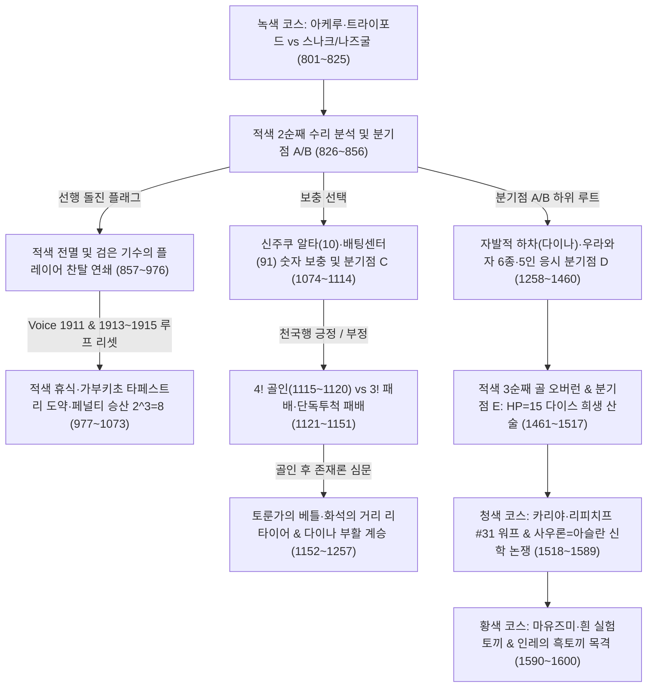

# 『Forest』 비판정본 제5권 B편 (Vol. 05B)
## 제5장 「더 게임(ザ・ゲーム)」 제2부 — `2500.gsc` (`P801..P1600`) 전수 문헌학·매체기호학 주석

---

## 서론 및 총괄 해제 (Prolegomena): 보드게임 상태기계(State Machine)와 서사적 월경의 기하학

### 1. 서지·엔진 아키텍처 및 바이트코드 분기 위상학
라이어 소프트(Liar-soft)의 『Forest』(2004) 제5장 「더 게임(`ザ・ゲーム`, 스크립트 파일 `2500.gsc`, 전체 3,129문단·6,992문장·411,002바이트)」은 비주얼 노벨이라는 매체 외피 내부에 **1980~90년대 유연체(遊演体)식 우편형 다중세션 게임(PBM)·테이블토크 RPG(TRPG)·이안 리빙스턴(Ian Livingstone)/스티브 잭슨(Steve Jackson) 계열 게임북(Fighting Fantasy)**의 상태기계(Finite State Machine)를 통째로 이식한 전위적 실험장이다. 본 권(Vol. 05B)이 포괄하는 중반부 슬라이스(`P801..P1600`, 총 800문단·1,782문장, 바이트코드 슬롯 `819..1645`)는 전반부에서 개시된 4색 코스(녹색·적색·청색·황색)의 첫 회전이 규칙의 이면과 대량 참사로 급전직하하는 핵심 구간이다.

특히 `2500.gsc`의 원시 바이트코드 슬롯(`slot`) 불연속 지점을 `extra_strings` 테이블과 정밀 대조하면, 본 구간(`P801..P1600`) 내부에는 정확히 **5개의 명시적 선택지 분기 노드**와 이전 구간에서 유입된 플래그 합류점이 촘촘한 그물망처럼 맞물려 있음이 실증된다.

| 분기 노드 위치 | 직전 문단 슬롯 → 직후 문단 슬롯 | 삽입된 `extra_strings` 슬롯 및 선택지 구조 | 게임북·서사적 작동 기능 |
| :--- | :--- | :--- | :--- |
| **분기점 A** | `846` → `855` (8슬롯 간극) | `slot 847..854`: 그리자벨라의 선택 1차 메뉴(정면승부 / 하차 / 우라와자 하위 4종: 역회전·단독롤·다이스투척·취소) | 올-로스트 상태 진입 직후 적색 코스 2순째의 1차 시행착오 매트릭스 개방 |
| **분기점 B** | `882` → `891` (8슬롯 간극) | `slot 883..890`: 그리자벨라의 선택 2차 메뉴(정면승부 / 하차 / 우라와자 하위 4종: 신주쿠탈출·단독롤·다이스투척·취소) | 가부키초 직물 투과 경험(`slot 602` 경유) 이후 ‘역회전’ 대신 ‘신주쿠 탈출’이 해금되는 동적 메뉴 변이 |
| **분기점 C** | `1148` → `1152` (3슬롯 간극) | `slot 1149..1151`: 그리자벨라의 본심에 대한 아마네의 판단(진심으로 천국행을 원함 vs 실은 원치 않음) | 관찰자(파트너)의 해석이 주사위 난수(`4` 골인 vs `3` 패배)를 물리적으로 결정하는 양자적 판정 |
| **분기점 D** | `1356` → `1362` (5슬롯 간극) | `slot 1357..1361`: 투척 직전 아마네의 응시 대상 5지선다(검은 앨리스 / 카리야 / 마유즈미 / 아마모리 / 아케루) | 타 코스 플레이어 및 마스터와의 시선 교차를 통해 각 코스의 은폐 정보(인레·페콜리아·`HP=15`)를 해금하는 초점화 분기 |
| **분기점 E** | `1542` → `1546` (3슬롯 간극) | `slot 1543..1545`: 적색 3순째 위기 시 투척할 다이스 선택(아마네의 다이스 vs 그리자벨라의 다이스) | 잔여 눈금 총합($\sum d_i \ge 15$) 공식을 학습했는지 검증하는 수리적 생존 퍼즐 |

---

### 2. 화자 슬롯(`^gNNN`) 문헌학적 실증 교정 및 1인칭 내장형 텍스트박스 기호학
원시 스크립트 추출본의 범용 캐릭터 테이블을 무비판적으로 수용할 경우 치명적 오독이 발생하는 두 개의 재활용 슬롯이 본 구간에서 결정적으로 확인된다.

1. **`^g019` 슬롯의 실체 — 차용자 아리에티가 아닌 검은 아기 고양이 ‘다이나(`ダイナ`)’ `[확증(Confirmed)]`**:
   범용 테이블상 `^g019`는 『마루 밑 바로우어즈』의 아리에티로 표기되어 있으나, 본 구간에 출현하는 총 24문단의 `^g019` 발화는 **단 한 줄의 예외도 없이 루이스 캐럴 원전의 고양이 이름을 계승한 고양이족(`ネコのヒト`) 소녀 ‘다이나(`ダイナ`)’**의 대사다. 봄발루리나(`^g021`)와 검은 앨리스(`^g002`)가 직접 호명할 뿐 아니라, 여성 신체이면서도 히라가나 1인칭 `ぼく`를 고집하고 검은 앨리스를 `ママ`라 부르며, 나즈굴의 검에 가슴이 관통당해 사망한 직후 소생하는(‘고양이의 아홉 목숨’ 속담의 규칙화) 고유 속성을 지닌다.
2. **`^g028` 슬롯의 실체 — 인간 청년 조수가 아닌 황색 코스의 ‘붉은 눈의 흰 실험토끼’ `[확증(Confirmed)]`**:
   후반부 말미(1590, 1592, 1599문단)에 등장하는 `^g028`은 타 장에서 ‘조수/청년’으로 쓰이던 슬롯을 재할당한 것으로, 실제 발화 주체는 선대 토끼 플레이어(워터십 다운의 야생토끼 진영) 사망 이후 마유즈미 카오루(`^g005`)의 새 파트너로 투입된 **실험실 케이지 출신 알비노 흰 토끼(`真っ赤な目`, 비아트릭스 포터의 이름을 빌린 실험동물군)**다.
3. **지문 슬롯(`^g999`)의 극소화와 1인칭 초점화 내장 구조**:
   `2500.gsc` 전체의 계량문체 지표에서 제3자 지문 비율(`narration_ratio`)이 불과 **0.082(8.2%)**에 그치며, 본 800문단 중 `^g999`는 단 7문단에 불과하다. 그 대신 나가츠키 아마네(`^g007`, 393문단·49.1%)와 카리야 마키(`^g006`, 102문단·12.8%), 마유즈미 카오루(`^g005`, 12문단)의 **대사 슬롯 내부에 1인칭 독백과 정황 서술이 직접 수납**되어 있다. 이는 TRPG 세션에서 플레이어 캐릭터(PC)가 자신의 행동 선언(Action Declaration)과 내면 판정을 동시에 수행하는 발화 양식을 비주얼 노벨 엔진 차원에서 구현한 장치다.

---

### 3. 무자막 보이스 오버레이(`UNSUBTITLED VOICE OVERLAYS`)의 바이트코드 고고학
`2500.json`의 음성 큐(`voices`)와 영문 참조 자막(`en_overlays`)을 교차 검증하면, 기존 팬덤과 단순 텍스트 독해가 완전히 놓쳤던〔미확인 F3517: 그런 평·통설을 적은 자료를 찾지 못했다〕 **후행 음성 오프코드 부착(Trailing Voice Opcode Attachment)** 현상이 규명된다.

- **`[Voice:1863]` (`"――!"` 무자막 단말마)의 11회 반복 출현 메커니즘**:
  원시 패킷상 `[Voice:1863]`은 새로운 분기가 시작되는 첫 문단(891, 1136, 1152, 1304, 1310, 1316, 1326, 1339, 1446, 1461, 1518문단)에 표기되어 있다. 그러나 모든 사례에서 **바로 직전 문단**은 예외 없이 나즈굴의 흑검에 아마네가 베이는 슬래시(`／`) 단절 구문이나 대시(`──`) 절단으로 끝난다. 즉 `.gsc` 컴파일러 구조상 배드엔딩 사망 분기 말미에 텍스트 창 없이 재생되는 아마네의 무자막 비명(`VOICE 1863`)이 점프(`JMP`) 명령 직전에 놓이면서, 순차 파서가 이를 다음 라벨의 첫 문단에 귀속시킨 것이다.
- **`[Voice:1911]` → `[Voice:1913, 1914, 1915]`의 메타 리셋 조롱**:
  청색 코스에서 카리야 마키가 참살당하는 순간 `[Voice:1911]`이 재생된 직후, 다음 분기 진입점(977문단) 머리에 무자막 3연속 보이스 `[Voice:1913, 1914, 1915]`가 걸려 있다. 영문 대조 데이터에 기록된 음성 내용은 비명 끝에 이어지는 초월적 여성 화자(아마모리/검은 앨리스 중첩 위상)의 속삭임——기억해냈느냐, 눈치챘느냐, 하지만 이미 잊어버렸지 않느냐는 메타적 조롱——이다. 즉 게임 오버 후 이전 선택지로 되감기(Loop/Load)하는 플레이어의 행위 자체가 **‘기억과 망각을 반복하는 숲의 리들’ 내부 현상**으로 포섭된다.

---

### 4. 계량문체학(Stylometry)과 3인 집필진 지문 판별
`2500.gsc`의 평균 문장 길이(`asl_chars: 15.28`), 평균 문단 길이(`apl_chars: 34.14`), 한자 비율(`15.62%`), 가타카나 비율(`12.16%`), 감탄부호(`15.85/1k`)·의문부호(`13.15/1k`)의 고밀도 분포는 『Forest』 전 파일 중에서도 가장 빠르고 경쾌한 스타카토 호흡을 보여준다.

- **묘가야 진로쿠(茗荷屋甚六 = 木村航)의 핵심 설계 지문 `[유력(Probable)]`**:
  유연체(遊演体) 출신 게임 디자이너·작가인 기무라 코 특유의 ① 다중 우라와자(裏技) 시행착오 개그와 즉사 패러디(게임북 『화이팅 판타지』 문법), ② 트라이포드(`^g023`, 1인칭 `あっし`, 어미 `～やす`/`～ですぜ`)와 베틀의 토룬가(`^g024`, 감탄사 `やれくそ`, 어미 `～さね`)에서 빛나는 에도 시타마치(下町) 장인·라쿠고(落語) 만담조, ③ 사망 직전 지각 파편화를 빗금(`／`)으로 분절하는 타키스토스코프(Tachistoscope) 명사 나열 구문이 전면에 포진해 있다.
- **호시조라 메테오(星空めてお)의 존재론적 리들·메타 비평 층위 결합 `[유력(Probable)]`**:
  반면 아마네가 적색 코스를 ‘쓰레기통 신주쿠 속의 쓰레기통’으로 규정하는 내면 독백, ‘영국 동화 한정 리들(`イギリス縛り童話縛り`)’의 작위성을 정면에서 폭로하는 메타 비평, 아마모리의 사적 원초 신화(`はじまりの物語` — 토룬가·페콜리아·화석의 거리)가 영국 정전 동화계를 침식하는 대목, 그리고 톨킨과 C.S. 루이스의 유일신적 권위를 `ひとつの力`로 통합 해체하는 신학 문답은 메인 시나리오 작가 호시조라 메테오의 전체 우주론 설계와 긴밀히 교직(交織)되어 있다. 요컨대 본 장은 **묘가야 진로쿠의 정교한 TRPG/게임북 엔진 위에 호시조라 메테오의 핵심 형이상학 테제가 직조된 합작의 결정체**로 판별된다.

---

## 제1부: 녹색 코스의 카니발적 우회전술과 무한 부활하는 추격자 (`P801..P825`)

### Beat 1-1 (`P801..P808`): 가부키초 패널 투과(`すり抜ける`), 다이스 폭격 합법 판정, 나즈굴의 리스폰
- **[식별자 & 엔진 연출 코드]**: `2500.gsc` `P801..P808` (`slot 819..826`). 화자 전환: `^g999`(지문) → `^g001`(아케루) → `^g999` → `^g023`(트라이포드) → `^g002`(검은 앨리스) → `^g006`(카리야) → `^g033`(리피치프). 화면 위상: `ガーデン ↔ リアル(신주쿠 유흥가 인파)` 경계 투과 및 녹색 코스 전경 복귀.
- **[문단·문장 정밀 해부 (`P801` → `P808`)]**:
  - `P801`(`P801-S1..S2`), `P802`(`P802-S1`), `P803`(`P803-S1..S3`), `P804`(`P804-S1..S3`): 직전 구간에서 추격자 스나크(`スナーク`)에 맞서 녹색 코스의 발광 패널을 박차고 도약한 아케루의 신체 운동이 의성어 종지(`ダンッ！`, `P801-S1`)와 쌍대시(`──`) 삽입절(`P802-S1`)로 포착된다. 여기서 지문이 굳이 ‘부수다(`破る`)’가 아니라 ‘빠져나가다(`すり抜ける`)’라고 어휘를 교정하는 대목(`P802-S1`)은 결정적이다. 『Forest』에서 정원(층위 1·2)과 신주쿠 현실(층위 0)은 단절된 두 벽이 아니라 투과성 막(Membrane)으로 겹쳐 있기 때문이다. 아케루의 메타 게임적 자문(`裏技かよ!?`, `P803-S1`)을 가로지른 대시가 곧장 현실 인파의 박수갈채(`拍手喝采`, `P804-S2`)로 이어지며, 신주쿠 거리의 군중이 보드게임의 ‘갤러리(`ギャラリー`, `P804-S3`)’로 기능하고 있음이 폭로된다.
  - `P805`(`P805-S1..S3`), `P806`(`P806-S1`), `P807`(`P807-S1..S2`), `P808`(`P808-S1..S3`): 장면이 다른 분기 합류선(다이스를 던져 추격자를 격파한 루트)의 사후 검증으로 전환된다. 소인족 트라이포드(`^g023`)는 축약과 시타마치 경어〔정정 F3584: 「유성음 축약」이 아님 — こいつァ는 こいつは의 は가 녹아든 꼴로 유성음과 무관〕(`ちょいとうかがいやすがね`, `こいつァ`, `P805-S1..S2`)로 게임 마스터 검은 앨리스에게 다이스 투척 공격의 반칙 여부를 질의한다. 검은 앨리스는 감정을 배제한 관료적 판정문(`ペナルティには該当しません`, `P806-S1`)으로 응답하고, 카리야 마키는 이로부터 **명시되지 않은 숨겨진 시스템 사양(Hidden Mechanics)**의 존재를 추론한다(`P807-S1..S2`). 그러나 리피치프(`^g033`)가 기사도적 문어체(`ご覧あれ`, `よみがえりましたぞ`, `P808-S1..S2`)로 보고하듯, 파괴된 ‘검은 기수(`黒の乗り手`)’는 소멸하지 않고 녹색 코스 출발점에 즉시 재생성(`P808-S3`)된다. 추격자의 죽음은 영구 제거가 아니라 시간 벌기용 리셋에 불과하다는 비대칭 규칙이 확립된다.

### Beat 1-2 (`P809..P825`): 10초 이탈 카운트다운과 루이스 캐럴 가방어(`カバン語`)의 오뎅 전복
- **[식별자 & 엔진 연출 코드]**: `2500.gsc` `P809..P825` (`slot 827..843`). 화자: `^g999`, `^g002`, `^g001`, `^g023`, `^g006`, `^g033`. 앞선 `P804`(신주쿠 거리 돌입 분기)에서 이어지는 우라와자 액션 시퀀스 후 `P824..P825`에서 메인 턴 진행으로 재합류.
- **[문단·문장 정밀 해부 (`P809` → `P825`)]**:
  - `P809`(`P809-S1..S2`), `P810`(`P810-S1..S3`), `P811`(`P811-S1..S3`), `P812`(`P812-S1..S2`), `P813`(`P813-S1..S2`), `P814`(`P814-S1..S2`), `P815`(`P815-S1..S2`), `P816`(`P816-S1..S2`), `P817`(`P817-S1..S3`): 신주쿠 거리로 이탈한 아케루의 머리 위로 검은 앨리스의 장외 이탈 경고(`１０秒以内に戻らなければ失格`, `P810-S3`)가 울려 퍼진다. 아케루는 스나크의 외형을 거대 달팽이〔정정 F3585: 「민달팽이/달팽이」가 아님 — でんでんむし는 달팽이(カタツムリ)의 다른 이름〕(`でんでんむし`, `P813-S2`)로 간주해 삼투압 살상을 노리고 술집·식당가에서 소금(`塩`)과 간장(`ショウユ`) 등 조미료를 긁어모아(`P811..P812`), 카운트 `8! / 9!`(`P814-S1..S2`) 직전에 복귀해 퍼붓는다(`P815..P816`). 그러나 트라이포드가 돈가스 소스(`とんかつソース`)와 케첩(`ケチャップ`)까지 무효화되었다고 외치듯(`P817-S1..S3`), 생물학적 민달팽이 퇴치법은 문학적 괴물에게 통하지 않는다.
  - `P818`(`P818-S1..S3`), `P819`(`P819-S1..S3`), `P820`(`P820-S1..S3`), `P821`(`P821-S1..S2`), `P822`(`P822-S1..S2`), `P823`(`P823-S1`), `P824`(`P824-S1..S3`), `P825`(`P825-S1..S2`): 본 비트의 백미는 `P818`의 메타 어원학 추론이다.
    - **층위 2 상호텍스트 검증 `[확증(Confirmed)]`**: 루이스 캐럴의 『스나크 사냥(*The Hunting of the Snark*, 1876)』 서문 및 『거울 나라의 앨리스』(험프티 덤프티의 시 「재버워키」 주석)에서 정의된 **가방어(`カバン語` = Portmanteau word, `P818-S2`)** 이론에 따라, `Snark`는 달팽이(`Snail`, `スネイル`)와 상어(`Shark`, `シャーク`)의 합성어(`P818-S3`)다(베아트리스 테이카/타카하시 야스나리 등 일본 캐럴 비평서의 정설〔미확인 F3665: 그 풀이를 정설로 든 일본어 비평을 찾지 못했다〕이라고 하나 「베아트리스 테이카」라는 논자는 찾지 못함 — 독립 검수는 캐럴에게서 이 어원을 들었다고 전한 이를 베아트리스 해치[Beatrice Hatch]로 본다〔미확인 C19: 그 근거는 내가 다시 열지 못함〕).
    - **신주쿠 도시 기호로의 카니발적 전복**: 아케루는 스나크의 나머지 절반인 ‘상어(`シャーク`)’ 속성을 공략하기 위해 다시 신주쿠 포장마차/오뎅집(`おでん屋`, `P819-S2`)으로 뛰어들어 상어 연육(魚肉練り製品)으로 만드는 어묵인 치쿠와(`チクワ`)와 한펜(`ハンペン`, `P819-S3`)을 조달해 **‘동족포식(`共食い`, `P820-S3`)’** 논리로 투척한다! 바흐친적 그로테스크 리얼리즘의 전형인 음식물 투척으로 빅토리아조 난센스 시의 괴물을 패퇴시키지만(`P821..P822`), 직후 카리야 마키가 말줄임표와 의문부호를 겹쳐 ‘그저 오뎅 국물이 뜨거워서 도망친 것 아니냐’고 냉소적 츳코미를 가함으로써(`P823-S1`), 언어게임적 기호 마술과 물리적 열역학 사이의 코믹한 결정 불가능성이 연출된다. 이어 `P824`에서 리피치프의 검은 기수 부활 보고가 반복 합류하고, `P825`에서 카리야가 리스폰 직후 당해 턴에는 이동(`ムーブ`)하지 않는 행동 규칙을 확정하며 녹색 코스 턴이 종료된다.

---

## 제2부: 적색 코스의 확률론적 교착과 전멸—‘하나의 힘(`ひとつの力`)’의 신학적 찬탈 (`P826..P976`)

### Beat 2-1 (`P826..P856`): 올-로스트 다이스와 33% 생존율의 역설, 선택지 `slot 847`·`slot 883`
- **[식별자 & 엔진 연출 코드]**: `2500.gsc` `P826..P856` (`slot 844..882`, 단 `P828` 직후 `slot 847..854` 선택지, `P856` 직후 `slot 883..890` 선택지 내장). 화자: `^g007`(나가츠키 아마네), `^g016`(그리자벨라), `^g006`(카리야), `^g002`(검은 앨리스).
- **[문단·문장 정밀 해부 (`P826` → `P856`)]**:
  - `P826`(`P826-S1..S3`), `P827`(`P827-S1..S2`), `P828`(`P828-S1`), `P829`(`P829-S1..S3`): 적색 코스 2순째 차례가 돌아오자 아마네는 품에 안긴 고양이족 플레이어 그리자벨라(`^g016`, 1인칭 `あたい`)의 떨림을 감지한다. `P827-S2`에서 그리자벨라의 노쇠한 신체를 묘사하는 ‘한물간 느슨한 몸(`盛りを過ぎたゆるゆるの体`)’이라는 촉각적 표현은 이후 반복될 노화·육체성 모티브의 기점이다. `P828-S1`의 미완성 대시(`あたいは──`) 직후 바이트코드상 1차 선택지(`slot 847`)가 분기하며, 다른 경로에서는 카리야의 관전 논평(`P829-S1..S3`)을 거쳐 적색 코스의 수리적 상황 분석으로 진입한다.
  - `P830`(`P830-S1..S2`), `P831`(`P831-S1..S3`), `P832`(`P832-S1`), `P833`(`P833-S1..S2`), `P834`(`P834-S1..S2`), `P835`(`P835-S1..S2`), `P836`(`P836-S1`), `P837`(`P837-S1..S3`), `P838`(`P838-S1..S2`), `P839`(`P839-S1..S2`), `P840`(`P840-S1..S2`), `P841`(`P841-S1..S3`), `P842`(`P842-S1..S2`), `P843`(`P843-S1..S2`), `P844`(`P844-S1..S2`), `P845`(`P845-S1`), `P846`(`P846-S1..S3`), `P847`(`P847-S1..S3`): 자칭 ‘게이머 여자(`ゲーマー女`, `P830-S2`)’ 아마네는 장음 물결표(`～`)와 상승 억양 의문문(`ロストしちゃった面が多すぎ？`, `P831-S3`)이라는 특유의 서브컬처 갸루/프리터 화법으로〔미확인 F3597: 「갸루·프리터 화법」이라는 근거를 찾지 못했다(말끝을 올리는 반의문형은 1970년대 간토의 여성에게서 퍼진 말씨로 적힌다)〕 확률 계산을 전개한다.
    1. 그리자벨라는 1턴에 검은 기수에게 다이스를 투척해 위기를 넘겼으나(`ベスト・アクション`, `P834-S1`), 그 대가로 다이스의 모든 숫자가 소실되어 ‘새까맣고 매끈매끈한(`真っ黒けのツルツル`, `P838-S2`)’ 100% 확정 로스트 상태다.
    2. 숫자 보충(`補充`, `P835-S1`)에는 1턴 정지가 소요되며, 그 사이 기수는 2칸 전진한다(`P836-S1`).
    3. 그대로 굴릴 경우 그리자벨라의 확정 로스트 페널티로 기수의 이동력은 기본 2칸의 배수인 $2 \times 2 = 4$칸이 된다(`P839..P841`).
    4. 아마네의 6면체 다이스에 남은 숫자는 `{1, 4, 5}` 세 면(`P842-S2`, 나머지 3면은 로스트)이므로, `4` 또는 `5`가 나올 확률 $P = \frac{2}{6} = \frac{1}{3} \approx 33\%$(`P844-S2`)로 당장의 추격은 면할 수 있다.
    5. **결정적 수리 역설(`P846..P847`)**: 그러나 현재 골까지 남은 거리에 ‘정확히 일치하는 눈금(`ぴったりちょうど`, `P847-S2`)’으로만 골인할 수 있다면, `4`나 `5`로 도망치는 행위는 영원히 골을 지나쳐 원형 트랙을 맴도는 **무한 도주(Infinite Loop)**〔정정 F3510: 「Deadlock」이 아님 — 데드록은 서로 기다리느라 멈춘 상태, 끝없이 도는 것은 무한 루프나 라이브록〕에 불과하다(`絶対にゴールできません`, `P846-S2`).
  - `P848`(`P848-S1..S2`), `P849`(`P849-S1..S3`), `P850`(`P850-S1..S2`), `P851`(`P851-S1..S2`), `P852`(`P852-S1..S2`), `P853`(`P853-S1..S2`), `P854`(`P854-S1`), `P855`(`P855-S1..S2`), `P856`(`P856-S1..S3`): 아마네는 승산이 최대 2턴뿐이라며 중도 하차(`降りる`, `P848-S2`)와 플레이어 교체를 권유하지만, 그리자벨라는 T.S. 엘리엇 및 뮤지컬 『캣츠(CATS)』의 핵심 정체성 기표인 **‘젤리클 캣츠(`ジェリクルキャッツ`, `P849-S3`)’**의 자존심을 걸고 반발하며, 아마네는 이대로는 결코 ‘천국(`天国` = 뮤지컬 『캣츠』의 헤비사이드 레이어 Heaviside Layer `[확증(Confirmed)]`)’에 갈 수 없다고 못 박는다(`P853-S2`). 검은 앨리스가 ‘밤이 새어 버린다(`夜が明けてしまいます`, `P855-S2` — 젤리클 무도회가 새벽녘 한 마리의 고양이만을 승천시키고 끝나는 시간 제한 모티브와의 정밀한 호응 `[확증(Confirmed)]`)’고 독촉하자, `P856-S3`의 절단 대시 직후 2차 선택지 메뉴(`slot 883..890`)가 호출된다.

### Beat 2-2 (`P857..P881`): 루프 기시감(`思い出してる`)과 골 초과 오버런의 함정
- **[식별자 & 엔진 연출 코드]**: `2500.gsc` `P857..P881` (`slot 891..915`). 선행 선택지(`slot 591..593`: 마유즈미가 늦어질 때 재촉하거나 먼저 진행하는 루트)에서 분기된 적색 코스 참극 시퀀스 도입부. 화자: `^g007`, `^g016`, `^g005`(마유즈미), `^g002`.
- **[문단·문장 정밀 해부 (`P857` → `P881`)]**:
  - `P857`(`P857-S1..S3`), `P858`(`P858-S1..S3`), `P859`(`P859-S1..S3`), `P860`(`P860-S1..S3`), `P861`(`P861-S1..S4`), `P862`(`P862-S1..S3`): 이 구간은 층위 3(서사적 월경·메타렙시스)의 핵심 징후를 품고 있다. 승부욕 강한 게이머인 아마네 자신이 정작 앞으로 나아가기를 꺼리며 기묘한 위화감(`違和感`, `P858-S3`)을 느끼고, 이를 단순한 예감이 아니라 **‘기억해내고 있는 것(`「思い出してる」のかな？`, `P862-S1`)’**으로 자문한다. 이는 비주얼 노벨 독자가 다회차 루프 속에서 배드엔딩을 축적할 때 작중 인물의 무의식에 잔류하는 초시간적 데자뷔이자, 종장 리들의 핵심 테마인 ‘미래/타 회차 기억의 역류’다.
  - `P863`(`P863-S1..S3`), `P864`(`P864-S1..S2`), `P865`(`P865-S1..S3`), `P866`(`P866-S1..S5`), `P867`(`P867-S1..S2`), `P868`(`P868-S1..S3`), `P869`(`P869-S1..S2`), `P870`(`P870-S1..S3`), `P871`(`P871-S1`), `P872`(`P872-S1..S2`), `P873`(`P873-S1..S4`), `P874`(`P874-S1..S2`), `P875`(`P875-S1..S7`), `P876`(`P876-S1`), `P877`(`P877-S1..S2`), `P878`(`P878-S1..S3`), `P879`(`P879-S1`), `P880`(`P880-S1..S3`), `P881`(`P881-S1`): 황색 코스의 마유즈미(`^g005`, 가타카나 1인칭 `ボク`)가 먼저 진행하라며 매몰차게 응수하자(`P865-S1..S3`), 초조해진 그리자벨라가 강행 투척한다(`P866`). 아직 올-로스트 전 단계인 이 분기에서는 반대로 **아마네가 박자를 놓쳐 로스트**를 범하고(`P867..P870`), 그리자벨라가 `4`를 굴린다(`P873-S1`). 골까지 1칸 남았던 상황에서 그리자벨라는 요정이 춤추는 골 칸으로 당당히 뛰어들지만 아무 일도 일어나지 않고(`P874-S1..S2`), 남은 3칸을 강제 전진해(`P875-S4..S7`) 정확히 **검은 기수가 버티고 선 칸 바로 앞**에 도달한다(`P876-S1`). 플레이어의 이동이 완료되어야만 추격자가 움직인다는 검은 앨리스의 가학적 규칙 고지(`P877-S1..S2`) 앞에서, 마지막 한 칸을 밟는 순간 죽음이 확정되는 외통수 공포가 `P881-S1`의 단말마적 거부(`いやだっ！`)로 폭발한다.

### Beat 2-3 (`P882..P899`): 타키스토스코프 슬래시(`／`) 구문과 육체의 중력, 이중 사망 분기
- **[식별자 & 엔진 연출 코드]**: `2500.gsc` `P882..P899` (`slot 916..933`). 하위 분기 1(`P882..P890` + 후행 `[Voice:1863]`)과 하위 분기 2(`P891..P894`)가 `P895 [Voice:1868]`(파트너 사망 선언)로 수렴하여 `P899`(플레이어 사망 선언)로 귀결. 화자: `^g007`, `^g002`, `^g006`, `^g016`.
- **[문단·문장 정밀 해부 (`P882` → `P899`)]**:
  - `P882`(`P882-S1..S2`), `P883`(`P883-S1..S3`), `P884`(`P884-S1`), `P885`(`P885-S1`), `P886`(`P886-S1..S2`), `P887`(`P887-S1..S4`), `P888`(`P888-S1`), `P889`(`P889-S1..S3`), `P890`(`P890-S1..S3`): 죽음의 칸으로 뛰어드는 순간 아마네는 역공을 노리지만(`P882`), 공황에 빠진 그리자벨라가 매달리면서 두 여성의 몸이 ‘편차치 30대의 발정한 고교생 커플 같은 기세(`P884-S1`)’로 뒤엉켜 나뒹군다. 생사의 비극 한복판에 저속한 현대 일본 학원물 클리셰를 충돌시키는 이 기괴한 직유는 숭고함을 거세하는 아마네 특유의 방어기제적 냉소다. 아마네가 던진 다이스는 흑마의 옆구리(`黒馬の土手っ腹`, `P886-S2`)만 분쇄할 뿐 기수 본체는 검을 쥔 채 낙하하고(`P887-S1..S4`), `P888-S1`에서는 **쉼표와 마침표가 완전히 제거된 54자〔정정 F4138: 원문은 47자 — 세어 보면 54자(대본 2500:P888)〕 무호흡 일체형 문장**으로 다이스 탈취 실기가 급박하게 압축된 뒤, `P889`(`投げる。 / 外れる。 / 剣が。`)의 초단문 파편화를 거쳐 `P890-S3`의 **빗금 분절(`剣／切っ先／漆黒の`)**과 무자막 단말마(`[Voice:1863]`)로 의식이 절단된다.
  - `P891`(`P891-S1..S3`, 직전 분기 후행 `[Voice:1863]` 부착), `P892`(`P892-S1`), `P893`(`P893-S1..S3`), `P894`(`P894-S1..S2`), `P895`(`P895-S1`, `[Voice:1868]`), `P896`(`P896-S1`), `P897`(`P897-S1..S4`), `P898`(`P898-S1..S3`), `P899`(`P899-S1..S3`): 대안 사망 분기(`P891..P894`)에서는 육체적 혐오와 공포의 감각적 리얼리티가 더욱 적나라해진다. 그리자벨라의 몸은 ‘유통기한 직전의 여자의 살덩어리(`賞味期限ぎりぎりの女の肉`, `P892-S1`)’, ‘밑바닥 없는 늪의 진흙 무게’, ‘공포에 찬 호흡의 산성 악취(`酸性の臭い`, `P893-S3`)’로 묘사되며 빅토리아조 동화의 무균적 환상을 완전히 파괴한다. `P894-S2`(`乗り手／跳躍／音もなく静止する一瞬の`) 직후 검은 앨리스의 음성 큐 `[Voice:1868]`이 파트너(아마네)의 사망을 공식 선언한다(`P895-S1`). 시점이 즉시 청색 코스의 카리야(`^g006`)에게로 넘어가(`P896`), 목숨을 구걸하며 말을 더듬는 그리자벨라(`P897-S1..S4`)의 머리를 검은 기수가 검조차 쓰지 않고 **군화 박차(`拍車`, `P898-S3`)로 밟아 쪼개는** 참혹한 처형이 목격된다. 이어 `P899`에서 플레이어 사망과 함께 고양이족 전체를 향한 게임 속행 심문이 발령된다.

### Beat 2-4 (`P900..P937`): 고양이족 계승 위기와 검은 기수의 참전 변주 A — `サウロン = 指輪 = アスラン`과 `「うそつき。」`
- **[식별자 & 엔진 연출 코드]**: `2500.gsc` `P900..P937` (`slot 934..971`). 화자: `^g006`(카리야), `^g005`(마유즈미), `^g002`(검은 앨리스), `^g019`(다이나 — 원시 라벨 `アリエッティ` 교정), `^g021`(봄발루리나), `^g036`(검은 기수), `^g004`(아마모리), `^g001`(아케루), `^g033`(리피치프).
- **[문단·문장 정밀 해부 (`P900` → `P937`)]**:
  - `P900`(`P900-S1..S3`), `P901`(`P901-S1..S3`), `P902`(`P902-S1..S3`), `P903`(`P903-S1..S2`), `P904`(`P904-S1..S3`), `P905`(`P905-S1..S2`), `P906`(`P906-S1..S3`), `P907`(`P907-S1..S2`): 실제 살육 앞에서 경악하는 휴머니스트 카리야(`P900`, `P902`)와 달리, 마유즈미는 황색 코스에서 이미 토끼도 죽었다며 대수롭지 않게 일축한다(`ウサギも死にましたよ`, `P903-S1`). 검은 앨리스가 고양이족의 계승자를 모집하자(`P904`), 아기 고양이 다이나(`^g019`)가 천국에 갈 수 있느냐며 순진하게 나서려 하나(`P905-S1..S2`), 성숙한 암고양이 봄발루리나(`^g021`, 뮤지컬 『캣츠』의 관능적 성인 암고양이 `[확증(Confirmed)]`)가 이를 만류한다(`やめときなよ、ダイナ`, `P906-S1`). 적색 코스의 매지컬 다이스를 이미 검은 기수가 손안에 쥐고 희롱하고 있었기 때문이다(`P907-S1..S2`).
  - `P908`(`P908-S1..S3`), `P909`(`P909-S1`), `P910`(`P910-S1..S2`), `P911`(`P911-S1`), `P912`(`P912-S1`), `P913`(`P913-S1`), `P914`(`P914-S1..S2`), `P915`(`P915-S1..S5`), `P916`(`P916-S1..S2`), `P917`(`P917-S1..S2`), `P918`(`P918-S1..S5`): 추격자였던 나즈굴(`^g036`, 1인칭 고어체 `我`/`わが`)이 직접 「더 게임」에 도전하겠다고 선언하며 인간 파트너에게 자신의 소망(`望み`)을 들으라고 명한다(`P908`). 아케루의 제지(`P910`, `P913`)에도 아마모리가 귀를 기울이자(`P909`), 기수는 **지금은 상실된 위대한 ‘하나의 힘(`ひとつの力`, `P911-S1`)’의 부활**을 천명한다.
    - **층위 2 상호텍스트 충격 `[확증(Confirmed)]`**: 카리야가 J.R.R. 톨킨 『반지의 제왕』(세타 테이지 역, 평론사)의 지식에 의거해 그것이 사우론(`サウロン`)이냐 절대반지(`指輪`)냐고 묻자(`P914`), 기수는 고어 긍정사 `然り`를 연발한 뒤(`P915-S3, S5`), 또 하나의 널리 알려진 이름으로 **C.S. 루이스 『나니아 연대기』(세타 테이지 역, 이와나미 소년문고)의 창조주 사자 ‘아슬란(`アスラン`, `P916-S1`)’**을 호명한다! 옥스퍼드 문학 동인 ‘잉클링스(Inklings)’의 두 거장이 창조한 **절대악의 지배자(사우론/절대반지)와 기독교적 절대선·그리스도와 평행하는 인물(아슬란)〔정정 F0191: 「그리스도의 알레고리」가 아님 — 루이스 본인이 알레고리가 아니라고 했다〕가 『Forest』의 정원 안에서는 동일한 초월적 중심 권위(`ひとつの力`)의 이명(異名)으로 등치**되는 순간이다. 아슬란의 성호(聖號)를 들은 생쥐 기사 리피치프는 감전된 듯 경직된다(`P917-S2`).
  - `P919`(`P919-S1..S2`), `P920`(`P920-S1`), `P921`(`P921-S1`), `P922`(`P922-S1`), `P923`(`P923-S1..S3`), `P924`(`P924-S1`), `P925`(`P925-S1`), `P926`(`P926-S1`), `P927`(`P927-S1..S2`): 기수가 손을 잡자며 아마모리를 유혹하자(`P919..P920`), 아케루가 절규(`P921`)와 함께 본작 전체를 관통하는 윤리적 테제를 외친다——**‘소망하지 마라(`望むな`), 창조하라(`創れ`), 가버린 것을 쫓지 마라’**(`P923-S1..S3`). 「더 게임」의 본질인 결핍 기반의 소망(`望み`)과 자기 소모(`ナゲウツ`)의 회로를 끊고 능동적 창작 주체로 설 것을 촉구하는 선언이다. 이 외침에 깨어난 아마모리가 두 손에 얼굴을 묻고 단 한마디 **`「うそつき。」`(거짓말쟁이, `P925-S1`)**라고 속삭이자, 기수가 쥐고 있던 다이스가 폭발하고 기수의 우반신이 물어뜯긴 듯 소멸하여 먼지로 무너진다(`P926..P927`).
  - `P928`(`P928-S1..S2`), `P929`(`P929-S1..S3`), `P930`(`P930-S1..S2`), `P931`(`P931-S1..S2`), `P932`(`P932-S1..S3`), `P933`(`P933-S1`), `P934`(`P934-S1..S2`), `P935`(`P935-S1..S3`), `P936`(`P936-S1..S2`), `P937`(`P937-S1..S2`): 고양이족의 참가권이 영구 소멸한 뒤(`P928`), 순번이 넘어간 청색 코스에서 아슬란의 이름에 혼이 빠진 리피치프(`P929`)와 카리야가 다이스(`3`과 `5`, `P931`)를 굴려 청색 코스 검은 기수의 칸으로 워프한다(`P932`). 리피치프는 검조차 뽑지 않고 ‘그분(`あの方` = 아슬란)’을 아는 자에게 목숨을 바치겠다며 무방비로 가슴을 내밀고(`P933..P935`), ‘자비로운 살인자(`慈悲深い殺し屋`, `P937-S1`)’인 검은 기수의 일격에 카리야와 함께 즉사하며 변주 A가 닫힌다.

### Beat 2-5 (`P938..P976`): 검은 기수의 참전 변주 B — `ワギナ・デンタータ` 진단과 `乱数妖精` 찬탈, 루프 리셋
- **[식별자 & 엔진 연출 코드]**: `2500.gsc` `P938..P976` (`slot 972..1010`). 아마모리 동행 플래그(`slot 391..393`) 차이에 따른 대안 전멸 분기. 말미 `P976 [Voice:1911]` 직후 후행 무자막 리셋 보이스 `[Voice:1913, 1914, 1915]`(다음 문단 `P977`에 파서 귀속) 재생.
- **[문단·문장 정밀 해부 (`P938` → `P976`)]**:
  - `P938`(`P938-S1`), `P939`(`P939-S1..S3`), `P940`(`P940-S1`), `P941`(`P941-S1..S3`), `P942`(`P942-S1..S2`), `P943`(`P943-S1..S2`), `P944`(`P944-S1..S2`), `P945`(`P945-S1..S5`), `P946`(`P946-S1..S2`): 변주 A(`P911`)에서 ‘잃어버린(`失われし`)’ 힘이었던 수식어가 변주 B(`P938-S1`)에서는 **‘잊힌(`忘られし`)’ 힘의 소환**으로 미세 변주된다. 이에 대한 아마모리의 반응 또한 정반대다. 그녀는 그 힘이 이미 이 세계에 충만해 있지 않으냐며(`P939-S2..S3`), 숲의 피조물들이 여전히 자신(창조주/어머니)을 갈구하고 있다고 도취된다(`P947..P949`로 이어지는 자기 신격화). `P941..P946`에서는 사우론·반지·아슬란의 동일성 선언과 리피치프의 경직이 대응 구문으로 재현된다.
  - `P947`(`P947-S1..S3`), `P948`(`P948-S1..S3`), `P949`(`P949-S1..S3`), `P950`(`P950-S1..S3`), `P951`(`P951-S1`), `P952`(`P952-S1`), `P953`(`P953-S1`), `P954`(`P954-S1..S2`), `P955`(`P955-S1..S2`): 피조물들이 자신을 원하기에 우리가 여기 있는 것이라 주장하는 아마모리(`P949`)를 향해, 아케루는 **‘그 자만이 세계를 집어삼켜 멸망시킨다. 바기나 덴타타(`ワギナ・デンタータ`, `P950-S2`)다’**라고 일갈한다.
    - **층위 2·3 정신분석·신화 코드 `[확증(Confirmed)]`**: 에리히 노이만(Erich Neumann)의 태모(Great Mother) 원형론 및 인류학 신화소인 **이빨 달린 질(*Vagina Dentata*)**은 생명을 낳는 모태이자 동시에 자식을 다시 삼켜 거세·소멸시키는 식인적 모성 공간, 곧 **이야기들을 놓아주지 않고 영원히 가두어 씹어 먹는 ‘신주쿠의 숲(Forest)’ 자체에 대한 가장 직접적인 정신분석학적 명명**이다. 아케루가 ‘너의 역할은 창조로 끝났다’고 선언하자(`P948-S2..S3`, `P950-S3`), 아마모리는 변주 A의 `うそつき` 대신 유아적 원망이 담긴 **`「いじわる。」`(심술쟁이, `P952-S1`)**를 속삭이며 적색 코스 기수와 고양이 다이스를 폭파시킨다(`P953..P955`).
  - `P956`(`P956-S1..S3`), `P957`(`P957-S1..S2`), `P958`(`P958-S1..S2`), `P959`(`P959-S1..S3`), `P960`(`P960-S1`), `P961`(`P961-S1..S2`), `P962`(`P962-S1..S3`), `P963`(`P963-S1..S3`), `P964`(`P964-S1..S2`), `P965`(`P965-S1..S2`), `P966`(`P966-S1..S2`), `P967`(`P967-S1..S2`), `P968`(`P968-S1..S2`), `P969`(`P969-S1..S2`), `P970`(`P970-S1`), `P971`(`P971-S1..S3`), `P972`(`P972-S1`), `P973`(`P973-S1..S2`), `P974`(`P974-S1`), `P975`(`P975-S1..S2`), `P976`(`P976-S1`, `[Voice:1911]`): 변주 A에서 눈이 말라 있던(`乾いている`, `P929-S2`) 리피치프는 변주 B에서는 눈동자가 미친 듯이 흔들리는(`狂おしく揺れている`, `P956-S2`) 광신 상태로 워프(`P957..P959`)하여 검은 기수를 ‘벗(`友`, `P962-S1`)’이라 부르며 조력을 자청한다(`P960..P962`). 이때 청색 코스의 검은 기수는 적색 다이스가 파괴된 상황을 타개하기 위해 결정적 비밀을 발설한다——게임에 도전할 권리란 곧 플레이어 주위를 춤추는 **‘난수요정(`乱数妖精`, `P965-S2`, `P966-S2`)’**, 즉 매지컬 다이스의 본체라는 사실이다! 기수가 아슬란(`あの方`)의 이름으로 리피치프의 생명과 난수요정을 요구하자(`P966`), 리피치프는 미소 지으며 흑검에 스스로 몸을 던져 산화한다(`P968..P970`, 세타 테이지 역 『새벽 출정호의 항해』 말미 아슬란의 나라를 향해 동쪽 끝 바다로 작은 배를 저어 사라지는 리피치프의 숭고한 자기 포기를 피의 순교로 전복한 비극 `[확증(Confirmed)]`). 이로써 **추격자(시스템 몬스터)가 플레이어 자격을 탈취하는 규칙 역전(`彼はもう追っ手ではない。彼はプレイヤーだ`, `P971-S2..S3`)**이 발생하나, 카리야가 살인자와의 결탁을 단호히 거부하면서(`P972..P975`), 5연속 한자어 빗금 연쇄 **`一瞬／閃光／激痛／慈悲／凝闇`(`P976-S1`, `[Voice:1911]`)**과 무자막 루프 조롱(`[Voice:1913..1915]`) 속에 세계선이 절단된다.

---

## 제3부: 가부키초 타페스트리의 쓰레기 철학과 신주쿠 도시 수비학(Numerology) (`P977..P1114`)

### Beat 3-1 (`P977..P1008`): 직물 보드의 물성(`タペストリ`)과 프랙탈 쓰레기통 신주쿠론
- **[식별자 & 엔진 연출 코드]**: `2500.gsc` `P977..P1008` (`slot 1011..1042`). 선행 선택지(`slot 601..602`: 마유즈미가 늦어질 때 서두르지 않고 한숨 돌리기 `焦らず、ひと休み`) 진입 구간. `P977` 머리에 직전 배드엔딩(`P976`)의 후행 무자막 루프 조롱 보이스 `[Voice:1913, 1914, 1915]`가 파서상 결합되어 있음. 화자: `^g007`(아마네), `^g016`(그리자벨라).
- **[문단·문장 정밀 해부 (`P977` → `P1008`)]**:
  - `P977`(`P977-S1..S3`, 후행 `[Voice:1913,1914,1915]`), `P978`(`P978-S1..S2`), `P979`(`P979-S1..S2`), `P980`(`P980-S1..S3`), `P981`(`P981-S1..S2`), `P982`(`P982-S1..S2`), `P983`(`P983-S1..S3`), `P984`(`P984-S1..S4`): 긴장된 손가락 경련(`指、ピクピク`, `P978-S2`)을 니코틴 갈망(`タバコ`, `P979-S2`)으로 얼버무리는 아마네에게 그리자벨라는 왜 인간은 일부러 독(`毒`, `P980-S1` — 기프트=선물/독의 이중 어원 *Gift*와 공명하는 미시 기표)을 좋아하느냐며 자조한다. 두 사람이 주저앉으며 만진 적색 코스 바닥이 단단한 패널이 아니라 **이야기를 짜 넣은 직물 걸개, 곧 ‘타페스트리(`タペストリ` / `タピストリ`, `P984-S1..S4`)’**임이 밝혀진다. 이 물성(Materiality)의 발견은 제4부에서 ‘베틀의 토룬가’가 코스 자체의 실을 풀어 재직조하는 사건의 복선이자, 보드게임판 자체가 텍스트(Text = 라틴어 *texere* ‘직조하다’)라는 매체기호학적 은유다 `[확증(Confirmed)]`.
  - `P985`(`P985-S1..S2`), `P986`(`P986-S1..S2`), `P987`(`P987-S1`), `P988`(`P988-S1..S3`), `P989`(`P989-S1..S3`), `P990`(`P990-S1..S2`), `P991`(`P991-S1..S5`), `P992`(`P992-S1..S3`), `P993`(`P993-S1..S7`), `P994`(`P994-S1..S2`), `P995`(`P995-S1..S3`), `P996`(`P996-S1..S4`), `P997`(`P997-S1..S2`): 가부키초 유흥업소(캬바쿠라/스낵바) 접객 노동자로서의 두 여성의 직업적 감각이 교차한다. 예술계 손님들의 잡학을 경청하며 흡수하는 아마네(`P985..P990`)와 달리, ‘고양이 인간(`ネコのヒト`, `P995-S1`)’인 그리자벨라는 시각적 얼굴과 이름을 전혀 기억하지 못하는 대신 영역 동물로서 발달한 청각으로 **목소리, 심장 박동(`鼓動`), 콧숨 리듬(`鼻息のリズム`), 발소리(`足音`)**만을 각인하여 지명 호출 전에 마중 나가는 프로의 기예를 털어놓는다(`P993..P997`).
  - `P998`(`P998-S1..S3`), `P999`(`P999-S1..S3`), `P1000`(`P1000-S1..S2`), `P1001`(`P1001-S1..S3`), `P1002`(`P1002-S1..S3`), `P1003`(`P1003-S1..S4`), `P1004`(`P1004-S1..S3`), `P1005`(`P1005-S1..S4`), `P1006`(`P1006-S1`), `P1007`(`P1007-S1`), `P1008`(`P1008-S1..S3`): 본 대목은 나가츠키 아마네라는 인물의 실존 철학이 집약된 백미다. 그리자벨라가 자신을 지친 남자들이 감정의 오물을 버리고 가는 **‘산업폐기물 처리장(`産廃処理場`, `P998-S2`)’**이라 비하하자, 아마네는 신주쿠 전체가 쓰레기통(`ゴミ箱`, `P999-S3`)이며 자신의 원룸 아파트 방처럼 내면 역시 방치된 쓰레기 더미라고 응답한다(`P1003..P1005`). 특히 **`P1006-S1`은 조사 `の`를 6중으로 연쇄 중첩한 자기유사적(Self-similar) 프랙탈 문장**——쓰레기통인 신주쿠 속의 쓰레기통인 나가츠키 아마네 속의 쓰레기통 속의 쓰레기통이라 할 퇴적 쓰레기의 막다른 더미(`吹き溜まり`)에서조차 인간은 꿈을 꾼다는 역설적 선언——을 통해, 2004년 신주쿠 가부키초 하위문화의 허무주의를 폼(`カッコ`, `P1007-S1`)과 긍정의 윤리로 반전시킨다. 직후 다시 담배 타령(`タバコタバコ`, `P1008-S2`)으로 무게를 지우는 급격한 어조 낙차 또한 전형적인 아마네의 문체 지문이다.

### Beat 3-2 (`P1009..P1035`): 가부키초 직물 도약, 3차원 코스 위상학, 그리고 `ロフト` 말실수의 기호학
- **[식별자 & 엔진 연출 코드]**: `2500.gsc` `P1009..P1035` (`slot 1043..1069`). 화자: `^g007`, `^g016`, `^g002`(검은 앨리스), `^g005`(마유즈미). 화면 연출: 적색 코스 타페스트리 표면에서 가부키초 노상으로의 수직 낙하(`ガーデン ↔ リアル`) 및 재점프 복귀.
- **[문단·문장 정밀 해부 (`P1009` → `P1035`)]**:
  - `P1009`(`P1009-S1`), `P1010`(`P1010-S1..S3`), `P1011`(`P1011-S1..S4`), `P1012`(`P1012-S1..S3`), `P1013`(`P1013-S1..S2`), `P1014`(`P1014-S1..S2`), `P1015`(`P1015-S1..S2`), `P1016`(`P1016-S1..S2`), `P1017`(`P1017-S1..S3`), `P1018`(`P1018-S1..S4`), `P1019`(`P1019-S1..S5`), `P1020`(`P1020-S1`), `P1021`(`P1021-S1..S2`), `P1022`(`P1022-S1..S2`), `P1023`(`P1023-S1`), `P1024`(`P1024-S1..S2`): 보푸라기가 일어난 천을 만지작거리던 아마네는 타페스트리에 짜인 무늬가 **실시간으로 움직이며 이쪽을 올려다보는 가부키초 거리**임을 발견하고(`P1009..P1012`), 그대로 뛰어내려 가부키초 한복판에 착지한다(`P1013..P1015`). 아케루가 녹색 코스에서 우연한 생존기로 수행했던 경계 투과를 아마네는 순전히 담배를 사기 위한 일탈로 재현한다(`P1016`). 검은 앨리스의 10초 실격 경고(`P1017`)에 화들짝 놀라 점프로 복귀한 뒤 정작 **라이터를 잊고 왔음을 깨닫는 슬랩스틱(`ライター忘れた`, `P1019-S5`)**은, 치명적인 **‘게임 에어리어 이탈 페널티 차기 턴 예약(`P1021-S1..S2`)’**이라는 시한폭탄을 낳는다. 시스템 용어를 모르는 그리자벨라가 페널티 고지를 ‘저주(`呪い`, `P1022-S2`)’로 받아들이는 대목은 문학적 마술 세계관과 현대 게이머 언어게임 사이의 인지적 간극을 선명히 드러낸다.
  - `P1025`(`P1025-S1..S2`), `P1026`(`P1026-S1..S3`), `P1027`(`P1027-S1`), `P1028`(`P1028-S1..S2`), `P1029`(`P1029-S1`), `P1030`(`P1030-S1..S2`), `P1031`(`P1031-S1..S2`), `P1032`(`P1032-S1..S2`), `P1033`(`P1033-S1..S2`), `P1034`(`P1034-S1..S2`), `P1035`(`P1035-S1`): `P1026..P1029`는 4색 코스의 **3차원 공간 기하학**을 조망하는 귀중한 측량 구간이다. 평면 원형 루프인 적색 코스 위쪽으로 청색 코스의 `18`번 칸이 허공에 부유해 있고(`P1027`), 마유즈미 팀이 멈춰 선 황색 코스는 그보다 미세하게 높은 수준이나, 하늘 끝까지 치솟은 황색 코스의 전체 **나선계단(`螺旋階段`, `P1029-S1`)** 높이에 비하면 불과 1~2밀리미터의 미미한 지점에 불과하다. 마유즈미의 퉁명스러운 재촉(`P1030`) 끝에 굴린 주사위에서 아마네의 다이스는 의인화된 바보 같은 목소리로 `3～`을 외치고(`P1033-S1`), 그리자벨라는 로스트를 내고서 **`「ロフトだっ！」`(`P1034-S2`)**라고 외친다. 아마네가 즉각 음절을 끊어 `……ロ・ス・ト。`(`P1035-S1`)라고 교정하는 이 말실수는 단순한 무지의 표현을 넘어, 가부키초 코마극장 인근의 전설적 서브컬처 라이브하우스 **‘신주쿠 로프트(新宿LOFT, 1999년 니시신주쿠에서 가부키초 1초메로 이전)’** 및 잡화점 로프트가 일상의 기표로 체화된 가부키초 밤거리 여성의 사회언어학적 무의식을 찌른다 `[유력(Probable)]`.

### Beat 3-3 (`P1036..P1073`): 지수 승산 페널티($2 \times 2^2 = 8$)의 수리적 공포와 세계의 균열
- **[식별자 & 엔진 연출 코드]**: `2500.gsc` `P1036..P1073` (`slot 1070..1107`). 화자: `^g002`, `^g016`, `^g007`.
- **[문단·문장 정밀 해부 (`P1036` → `P1073`)]**:
  - `P1036`(`P1036-S1..S3`), `P1037`(`P1037-S1`), `P1038`(`P1038-S1..S3`), `P1039`(`P1039-S1..S2`), `P1040`(`P1040-S1..S2`), `P1041`(`P1041-S1..S3`), `P1042`(`P1042-S1..S2`), `P1043`(`P1043-S1`), `P1044`(`P1044-S1..S4`), `P1045`(`P1045-S1..S2`), `P1046`(`P1046-S1..S2`), `P1047`(`P1047-S1..S2`), `P1048`(`P1048-S1..S2`), `P1049`(`P1049-S1..S3`): 로스트 다이스 선언(`P1036`)과 함께 3칸을 전진한 그리자벨라는 골 칸(2칸 앞)을 밟고도 승리가 선언되지 않자 당혹해하고(`P1039..P1041`), 검은 앨리스는 비로소 사후 공표 방식으로 **‘적색 코스 한정 특별 룰: 정확히 일치하는 눈금(`ぴったりちょうど`)으로만 골 인정’**(`P1042-S1..S2`) 및 **‘시계 방향(`時計回り`) 단방향 통행’**(`P1049-S2`)을 못 박는다. 이는 비트겐슈타인적 관점에서 규칙이 선험적으로 고정된 것이 아니라 권력자(GM 검은 앨리스)의 발화수반행위(Illocutionary Act)를 통해 사후적으로 관철되는 부조리한 언어게임의 폭력성을 예시한다. 그 결과 두 사람은 코스를 한 바퀴 돌아 출발점에서 한 칸 앞(즉 바로 앞 칸에 검은 기수가 서 있는 위치, `P1045..P1046`)에 멈춰 선다. 기수는 역회전이 금지되어 있으므로(`P1049`), 기수가 등 뒤로 전체 원형 트랙을 다 돌아오지 않는 한 안전해 보이는 착시가 형성된다.
  - `P1050`(`P1050-S1..S2`), `P1051`(`P1051-S1`), `P1052`(`P1052-S1..S3`), `P1053`(`P1053-S1`), `P1054`(`P1054-S1..S3`), `P1055`(`P1055-S1..S3`), `P1056`(`P1056-S1`), `P1057`(`P1057-S1`): 그러나 추격자 이동 페이즈(`P1050`)에서 치명적인 **페널티 지수 승산(`ペナルティ累乗`, `P1055-S2`)**이 작렬한다!
    - 기본 이동력 $M_0 = 2$칸(`P1051`)
    - 로스트 다이스 페널티 적용: $M_1 = M_0 \times 2 = 4$칸(`P1052..P1053`)
    - 직전 담배 구입용 장외 이탈 페널티 중첩 적용: $M_2 = M_1 \times 2 = 2 \times 2^2 = 8$칸(`P1054`)!
    적색 코스 전체 둘레가 정확히 **8칸(모듈로 $\mathbb{Z}_8$ 순환군)**이므로, 시계 방향으로 8칸을 질주한 검은 기수는 코스를 완전히 일주하여 **기수가 방금 서 있던 바로 앞 칸을 지나 정확히 아마네·그리자벨라가 서 있는 칸(`P1056..P1057`)**에 도달하는 완벽한 수리적 올가미를 완성한다!
  - `P1058`(`P1058-S1`), `P1059`(`P1059-S1..S2`), `P1060`(`P1060-S1..S2`), `P1061`(`P1061-S1..S3`), `P1062`(`P1062-S1..S4`), `P1063`(`P1063-S1..S2`), `P1064`(`P1064-S1..S3`), `P1065`(`P1065-S1..S3`), `P1066`(`P1066-S1`), `P1067`(`P1067-S1..S2`), `P1068`(`P1068-S1..S3`), `P1069`(`P1069-S1..S2`), `P1070`(`P1070-S1..S3`), `P1071`(`P1071-S1..S3`), `P1072`(`P1072-S1..S3`), `P1073`(`P1073-S1..S3`): 공황 상태에서 그리자벨라가 투척한 다이스가 기수에게 명중하는 순간(`P1058..P1059`), 단순한 물리 폭발이 아니라 **‘세계가 찢어져 그 심연에 있는 보아서는 안 될 암흑이 적나라하게 드러난 듯한 섬광(`P1060-S1..S2`)’**이 주사한다. 매지컬 다이스(난수요정)의 파괴 에너지가 정원의 시뮬라크르 장막을 일시적으로 찢는 형이상학적 파열이다. 기수는 가루가 되어 소멸하고 그리자벨라의 다이스는 전 눈금을 상실하지만(`P1061..P1062`), 페널티는 부과되지 않는다(`P1063..P1065`). 직후 스타트 지점에 재출현한 검은 기수가 — 원형 루프 특성상 스타트 지점이 곧 골 지점이기에(`P1067-S2`) — **골을 축하하는 요정 떼에 둘러싸여 우두커니 서 있는 기괴하고 희극적인 풍경(`P1068-S2..S3`)**이 연출된다. 죽음의 사자(나즈굴)와 동화적 요정 군무의 부조화 속에서 아마네는 ‘따라잡히지만 않으면 쓰레기와 다를 바 없다(`P1071-S2`)’며 그리자벨라를 독려하고 다음 대책 숙고로 넘어간다(`P1072..P1073`).

### Beat 3-4 (`P1074..P1114`): 신주쿠 도시 수비학(알타 기계사자 `10`·배팅센터 `91`)과 선택지 `slot 1149`
- **[식별자 & 엔진 연출 코드]**: `2500.gsc` `P1074..P1114` (`slot 1108..1148`). 선행 선택지(`slot 603`: 로스트한 숫자를 보충한다) 진입 및 `P1073` 이후 합류 구간. `P1114` 직후 선택지 `slot 1149..1151`(그리자벨라의 천국행 본심 판정) 호출. 화자: `^g007`, `^g016`, `^g033`(리피치프), `^g006`(카리야).
- **[문단·문장 정밀 해부 (`P1074` → `P1114`)]**:
  - `P1074`(`P1074-S1..S4`), `P1075`(`P1075-S1..S2`), `P1076`(`P1076-S1..S3`), `P1077`(`P1077-S1..S2`), `P1078`(`P1078-S1..S2`), `P1079`(`P1079-S1..S2`), `P1080`(`P1080-S1`), `P1081`(`P1081-S1..S2`), `P1082`(`P1082-S1..S6`), `P1083`(`P1083-S1..S2`), `P1084`(`P1084-S1`): 로스트 눈금 보충을 선언한 두 사람은 신주쿠 거리의 갤러리 한복판으로 다이스를 던져 넣는다(`P1075..P1080`). 여기서 2004년 신주쿠의 실재 도시 지리학이 주사위 난수 생성기(RNG)로 작동하는 압도적인 **도시 수비학(Urban Numerology)**이 펼쳐진다.
    1. **게이오 백화점 앞 복권 판매소(`京王デパートの前の売り場`, `P1077-S2`) `[확증(Confirmed)]`**: 신주쿠역 서쪽 출구 게이오 백화점 앞 ‘신주쿠 니시구치 오다큐/게이오 복권 매장’은 당첨 명소로 유명한 실재 랜드마크다.
    2. **신주쿠 스튜디오 알타(`アルタ`, `P1082-S3`) 옆 기계 장치 사자 모금함(`機械仕掛けのライオン`, `P1084-S1`) `[확증(Confirmed)]`**: 그리자벨라의 호통에 멈춰 선 다이스가 착탄한 곳은 신주쿠 동쪽 출구 알타 앞 광장에 실재했던 **도쿄 신주쿠 라이온스클럽의 ‘울부짖는 자선 모금 사자상(ライオン像募金箱 — 동전을 넣으면 센서로 사자 포효음이 울리는 명물 기계 장치)’**이다! 방금 투입된 10엔짜리 동전 모금액이 **`「１０！ たったいま募金された金額！」`(`P1082-S5..S6`)**으로 계측되어 불꽃과 동전 효과음(`小銭の効果音`, `P1096-S2`)을 내며 그리자벨라의 다이스로 역류한다.
  - `P1085`(`P1085-S1..S3`), `P1086`(`P1086-S1`), `P1087`(`P1087-S1..S2`), `P1088`(`P1088-S1..S2`), `P1089`(`P1089-S1..S2`), `P1090`(`P1090-S1..S3`): 바로 이 세속적 양철 기계 사자(`ライオン`)라는 기표 하나에 청색 코스의 리피치프가 ‘설마 그분(`あのお方` = 아슬란)께서?’라며 진지하게 전율하고(`P1085..P1087`), 동시에 **청색 코스의 검은 기수(나즈굴)마저 미세하게 몸을 떤다(`身じろぎした`, `P1088-S1`)**! 정상 진행 루트에서는 아직 제2부의 전멸 분기(`P916` 등)를 겪지 않은 카리야 마키에게, 왜 사우론의 종복인 검은 기수가 아슬란의 이름에 반응하는지(`仇敵だから？ それとも、他に理由が？`, `P1090-S2..S3`)에 대한 중대한 인식론적 수수께끼가 처음으로 심어지는 순간이다. 신주쿠 동구의 10엔짜리 키치한 자선 사자 인형이 나니아의 그리스도적 사자왕 아슬란 및 모르도르의 유령 기수와 기호학적으로 단락(Short-circuit)되는 『Forest』 특유의 3중 상호텍스트 미학이 절정을 이룬다.
  - `P1091`(`P1091-S1`), `P1092`(`P1092-S1..S4`), `P1093`(`P1093-S1..S2`), `P1094`(`P1094-S1..S4`), `P1095`(`P1095-S1..S2`), `P1096`(`P1096-S1..S3`), `P1097`(`P1097-S1..S2`), `P1098`(`P1098-S1..S3`), `P1099`(`P1099-S1..S2`): 이어 그리자벨라의 기합으로 멈춰 선 아마네의 다이스는 **가부키초 배팅센터(`バッティングセンター`, `P1094-S2` — 가부키초 2초메의 실재 명소 ‘신주쿠 배팅센터’ 또는 ‘오슬로 배팅센터’ `[확증(Confirmed)]`)**에 떨어져 당일 누적 홈런 수 **`91`(`P1094-S3..S4`)**을 흡수한다. 두 자릿수 눈금 금지 규칙(`ふたケタの数は禁止`, `P1097-S2`)에 의해 십진수 자릿수가 분해되어 아마네의 빈 면에는 `9`와 `1`이 생성되고(`P1097-S1`), 그리자벨라의 다이스에는 `10`이 분해된 `1`과 **`0`(`P1098-S2`)**이 새겨진다. 전진할 수 없는 무의미한 수라고 투덜대는 그리자벨라와 달리, 아마네는 최소한 로스트 페널티를 유발하지 않으면서 위치 조정이 가능한 **항등원 `0`의 전술적 가치(`P1099-S1..S2`)**를 즉시 간파한다.
  - `P1100`(`P1100-S1..S2`), `P1101`(`P1101-S1..S2`), `P1102`(`P1102-S1..S3`), `P1103`(`P1103-S1..S3`), `P1104`(`P1104-S1..S2`), `P1105`(`P1105-S1`), `P1106`(`P1106-S1..S3`), `P1107`(`P1107-S1..S2`), `P1108`(`P1108-S1..S3`), `P1109`(`P1109-S1..S3`), `P1110`(`P1110-S1..S2`), `P1111`(`P1111-S1..S3`), `P1112`(`P1112-S1..S2`), `P1113`(`P1113-S1..S2`), `P1114`(`P1114-S1..S2`): 보충에 1턴을 소모한 대가로 검은 기수가 등 뒤 2칸까지 육박하자(`P1100`), 그리자벨라가 투지를 불태우며 기수를 노려본다(`P1101..P1103`). 바보 같은 가츠포즈로 화답하던 아마네를 다시금 **타 세계선/미래로부터의 기억 습격(`突然あたしは記憶に襲われた`, `P1105..P1106`)**이 강타한다. 그 초월적 직관을 통해 아마네는 앞서 겪지 않았어야 할 ‘정확 착지 골인 규칙’과 잔여 거리 `4`칸의 승리 조건을 단번에 역산해내고(`P1108..P1109`), 히라가나 `よん`을 8회 연호하는 주술적 기합(`P1111-S3`)과 함께 주사위를 던진다. 아마네가 로스트를 낸 가운데 코스를 벗어난 그리자벨라의 다이스를 애타게 쫓는 그녀의 옆모습을 보며 아마네가 내리는 내면 판단(`P1114-S2`)이 곧장 **분기점 C(`slot 1149..1151`)**를 호출한다.

---

## 제4부: 헤비사이드 레이어(천국)의 해체—베틀의 토룬가(`機織りのトルンガ`)와 아기 고양이 다이나(`ダイナ`)의 아홉 목숨 (`P1115..P1257`)

### Beat 4-1 (`P1115..P1151`): 선택지 `slot 1149`의 세 갈래 귀결 — 의지의 물리 왜곡(`4!`) vs 자기 기만의 패배(`3!`)
- **[식별자 & 엔진 연출 코드]**: `2500.gsc` `P1115..P1151` (`slot 1152..1188`). 세 개의 병렬 하위 블록으로 구성: ① `P1115..P1120`(`slot 1150`: 진심으로 천국에 가고 싶어 한다고 믿음 → `4` 출현 후 `P1152`로 점프), ② `P1121..P1135`(`slot 1151`: 실은 천국 따위 가고 싶지 않다고 간파 → `3` 출현 및 사망 + 후행 `[Voice:1863]`), ③ `P1136..P1151`(보충 없이 50% 도박 롤/단독 투척을 택한 선행 분기들의 패배 합류 블록 + 후행 `[Voice:1863]`).
- **[문단·문장 정밀 해부 (`P1115` → `P1151`)]**:
  - `P1115`(`P1115-S1..S3`), `P1116`(`P1116-S1..S2`), `P1117`(`P1117-S1..S2`), `P1118`(`P1118-S1..S5`), `P1119`(`P1119-S1..S2`), `P1120`(`P1120-S1..S4`): 아마네가 그리자벨라의 소망을 진심으로 긍정하는 선택지(`slot 1150`)를 고르면, 두 사람의 합창(`4! / 4! / 4!`, `P1115`)에 감응한 난수요정 다이스가 ‘물리법칙에 반하는 물고기 같은 도약(`物理法則に反した動き`, `P1117-S1`)’을 일으켜 스스로 `おめでとう！`를 외치며 `4`에 정지한다(`P1118-S1..S4`). 화장이 엉망이 되도록 오열하는 그리자벨라와 함께 골을 향해 4칸을 내딛는 장면(`P1119..P1120`)에서 스크립트는 `P1152`로 도약한다.
  - `P1121`(`P1121-S1..S2`), `P1122`(`P1122-S1`), `P1123`(`P1123-S1..S4`), `P1124`(`P1124-S1..S2`), `P1125`(`P1125-S1..S3`), `P1126`(`P1126-S1..S2`), `P1127`(`P1127-S1..S3`), `P1128`(`P1128-S1..S2`), `P1129`(`P1129-S1..S3`), `P1130`(`P1130-S1..S3`), `P1131`(`P1131-S1..S2`), `P1132`(`P1132-S1..S2`), `P1133`(`P1133-S1..S3`), `P1134`(`P1134-S1`), `P1135`(`P1135-S1..S3`): 반대로 그리자벨라가 내심 천국행을 두려워한다고 판단하면(`slot 1151`), 코스 밖으로 굴러가던 다이스를 그리자벨라 자신이 무의식적으로 불러들이고(`戻っておいでッ！`, `P1121-S2`), 그녀의 발끝에 부딪힌 다이스가 반동으로 뒤집히며 `3!`에 멈춘다(`P1122..P1124`). **프로이트적 실수행위(Parapraxis)가 주사위의 물리 궤적으로 외화(Externalize)**된 치밀한 연출이다! 골을 코앞에 두고 로스트 페널티에 노출된 채(`P1125..P1129`), 무겁고 시큼달큼한 살과 지방 냄새(`甘酸っぱい匂いの肉と脂`, `P1130-S3`)를 풍기며 죽기 싫다고 매달리는 그리자벨라에게 아마네는 ‘천국엔 가고 싶어도 아픈 건 싫구나(`P1132-S2`)’라고 쓴웃음을 짓고 다이스를 던지나 기수를 반파시키는 데 그쳐(`P1133`), 앞서 제2부에서 본 54자〔정정 F4139: 원문은 47자 — 세어 보면 54자(대본 2500:P1134)〕 무구두점 문장(`P1134-S1`)과 3단문 절단(`P1135-S1..S3`) 및 단말마(`[Voice:1863]`)로 산화한다.
  - `P1136`(`P1136-S1..S3`, 직전 후행 `[Voice:1863]`), `P1137`(`P1137-S1..S3`), `P1138`(`P1138-S1..S3`), `P1139`(`P1139-S1..S3`), `P1140`(`P1140-S1..S2`), `P1141`(`P1141-S1..S3`), `P1142`(`P1142-S1`), `P1143`(`P1143-S1..S2`), `P1144`(`P1144-S1`), `P1145`(`P1145-S1..S3`), `P1146`(`P1146-S1..S3`), `P1147`(`P1147-S1..S3`), `P1148`(`P1148-S1..S3`), `P1149`(`P1149-S1..S3`), `P1150`(`P1150-S1`), `P1151`(`P1151-S1..S3`): 50% 비-로스트 확률에 걸고 강행한 별도 패배 분기(`P1136..P1151`)에서도 동일한 `3` + `ロスト` 결과가 재현된다(`P1137..P1140`). 다만 여기서는 아마네가 직전 녹색 코스에서 아케루가 보여준 괴물 간 상쇄 현상을 상기하며 매지컬 다이스의 내장 에너지를 계산하는 이지적 추론(`P1142..P1145`)이 추가되고, 기수가 살아남은 원인을 TRPG 용어인 **‘데미지 부족(`ダメージ不足!?`, `P1149-S3`)’**으로 진단함으로써 후반부 적색 3순째의 눈금 총합 데미지 공식(`HP=15`)을 향한 플레이어의 학습 단서를 제공한다. 결말은 동일한 `P1150..P1151` 절단 구문과 후행 `[Voice:1863]`이다.

### Beat 4-2 (`P1152..P1201`): `イギリス縛り童話縛り` 메타 폭로와 성형 미인(`人造人間`)의 갈채 욕망
- **[식별자 & 엔진 연출 코드]**: `2500.gsc` `P1152..P1201` (`slot 1189..1238`). `P1120`(적색 코스 `4!` 골인 성공)에서 점프해 들어오는 정통 돌파 루트. `P1152` 머리에 `P1151`의 후행 `[Voice:1863]` 부착. 화자: `^g007`, `^g004`(아마모리), `^g016`, `^g001`(아케루), `^g002`(검은 앨리스).
- **[문단·문장 정밀 해부 (`P1152` → `P1201`)]**:
  - `P1152`(`P1152-S1..S3`, 직전 후행 `[Voice:1863]`), `P1153`(`P1153-S1`), `P1154`(`P1154-S1..S3`), `P1155`(`P1155-S1`), `P1156`(`P1156-S1..S3`), `P1157`(`P1157-S1..S2`), `P1158`(`P1158-S1`), `P1159`(`P1159-S1..S3`), `P1160`(`P1160-S1`), `P1161`(`P1161-S1..S2`), `P1162`(`P1162-S1`), `P1163`(`P1163-S1..S2`), `P1164`(`P1164-S1`), `P1165`(`P1165-S1..S2`), `P1166`(`P1166-S1..S2`), `P1167`(`P1167-S1`), `P1168`(`P1168-S1..S4`): 신주쿠 거리가 짜인 타페스트리 한 칸 한 칸에서 박수갈채가 울려 퍼지는 승리의 행진(`P1152`)을 가로막는 자는 추격자가 아니라 **아마모리 노조미(`^g004`)**다. 반복되는 단문 의문사(`行ってしまうの？`, `P1153-S1`, `P1155-S1`)로 그리자벨라의 발길을 세운 아마모리는 『Forest』 세계관의 발생론적 정식을 직접 발설한다——**‘신주쿠가 숲을 낳았다. 신주쿠였기에 숲은 붙들려 매여 있을 수 있었다(`新宿が森を生んだの。新宿だからこそ、森は繋ぎ止められた`, `P1161-S1..S2`)’**! 즉 영국 고전 동화의 원형적 숲이 먼저 있고 신주쿠를 침식한 것이 아니라, 거대 욕망과 망명자들의 집적지인 현대 도시 신주쿠가 부유하는 서사체(숲)를 정박시킨 토대라는 전복적 선언이다. 검은 앨리스가 ‘너는 천국이 어떤 곳인지 아느냐’고 반문하자 ‘흥미 없다’고 잘라 말하는 아마모리(`P1166..P1167`)와, 개인의 선택과 성취를 존중하라며 제지하는 아케루(`干渉すんな`, `P1168-S1..S4`)의 대립은 타자의 구원을 둘러싼 창조주적 간섭과 실존적 자율성의 충돌을 압축한다.
  - `P1169`(`P1169-S1`), `P1170`(`P1170-S1`), `P1171`(`P1171-S1..S2`), `P1172`(`P1172-S1..S2`), `P1173`(`P1173-S1..S2`), `P1174`(`P1174-S1..S3`), `P1175`(`P1175-S1..S3`), `P1176`(`P1176-S1..S2`), `P1177`(`P1177-S1`), `P1178`(`P1178-S1..S3`), `P1179`(`P1179-S1`), `P1180`(`P1180-S1..S2`), `P1181`(`P1181-S1`), `P1182`(`P1182-S1..S3`), `P1183`(`P1183-S1..S2`), `P1184`(`P1184-S1..S3`): 그러나 정작 금기를 깨고 제4의 벽(층위 3 리들 규칙)을 정면에서 찢어버리는 인물은 아마모리가 아니라 **나가츠키 아마네**다! 스스로에게 ‘말하지 마, 나(`言うな、あたし`, `P1171-S1`, `言っちゃダメ`, `P1173-S1..S2`)’라고 재갈을 물리려 하면서도 억누를 수 없이 터져 나오는 아마네의 추궁은 작품 전체에서 가장 날카로운 메타 비평이다.
    - **`P1177-S1`의 핵심 메타 선언**: 아마네는 이 숲의 리들 규칙을 **‘영국 한정·동화 한정(`イギリス縛り童話縛りのこの森のリドルのルール`)’**이라 정확히 규정한 뒤, ‘그리자벨라’라는 이름이 그 규칙에 너무나 작위적으로 들어맞는 신파적 눈물샘 장치(`泣かせどころ`)가 아니냐고 묻는다! 나아가 그녀가 리얼(현실 신주쿠)의 인간인지 숲의 피조물인지(`P1174`), 심지어 **자신(나가츠키 아마네)조차 이 리들의 배역을 채우기 위해 만들어진 존재(`作られたの、あたしたち？`, `P1180-S1`)가 아닌지** 존재론적 공포를 토로한다.
  - `P1185`(`P1185-S1..S2`), `P1186`(`P1186-S1..S3`), `P1187`(`P1187-S1..S3`), `P1188`(`P1188-S1..S3`), `P1189`(`P1189-S1..S3`), `P1190`(`P1190-S1..S3`), `P1191`(`P1191-S1..S2`), `P1192`(`P1192-S1..S2`), `P1193`(`P1193-S1..S5`), `P1194`(`P1194-S1..S2`), `P1195`(`P1195-S1..S3`), `P1196`(`P1196-S1..S2`), `P1197`(`P1197-S1..S4`), `P1198`(`P1198-S1..S3`), `P1199`(`P1199-S1..S4`), `P1200`(`P1200-S1..S3`), `P1201`(`P1201-S1..S3`): 이 형이상학적 심문에 대한 그리자벨라의 응답은 놀랍도록 세속적이면서도 원전과 완벽히 공명한다.
    - **층위 2 3중 상호텍스트 `[확증(Confirmed)]`**: 첫째, `P1187-S2..S3`(이름 따위 별 의미 없다, 고양이에게는 그런 건 몇 개나 있다)는 T.S. 엘리엇의 『지혜로운 고양이가 되기 위한 지침서(*Old Possum's Book of Practical Cats*, 1939)』 첫 시 **「고양이의 이름 짓기(*The Naming of Cats*)」**(고양이에게는 일상 이름·고유 이름·스스로만 아는 비밀 이름 세 가지가 있다는 교리, 극단 사계 일본어판 가사 및 北村太郎 역(大和書房)·다무라 류이치[田村隆一] 역(ほるぷ出版)·이케다 마사유키[池田雅之] 역(ちくま文庫 1995) 등의 역본 계통〔정정 C15: 池澤夏樹·長田弘 역은 국회도서관 목록에 없음〕)의 완벽한 일상어 변주다. 둘째, 『캣츠』의 대표곡 「메모리(*Memory*)」에서 과거의 화려함을 잃고 늙어 버림받은 창부 고양이 그리자벨라(Grizabella the Glamour Cat)의 서사가, 2004년 가부키초 화류계에서 젊은 아가씨들과 색기로 경쟁하다 지쳐 **고액 미용성형 클리닉 시술로 외모를 ‘만들어낸’ 성형 인조인간(`人造人間`, `クリニック通い`, `P1193-S1..S3`)**의 자기고백으로 치환된다!
    - **두 하위문화 주체의 윤리적 결별(`P1194..P1201`)**: 아마네는 쌓여가는 쓰레기 자체가 우리의 알맹이라며 신주쿠의 쓰레기 더미로서 즐겁게 살아가자고 호소하지만(`P1194..P1197`), 그리자벨라는 단호히 선을 긋는다——**‘너는 쓰레기를 사랑할 수 있지만, 나는 쓰레기를 짓밟고 위세를 부리고 싶다(`P1198-S2..P1199-S1`)’**. 박수갈채와 휘파람 없이는 살 수 없으면서도 새벽과 함께 잊힐 줄 아는 노추한 디바의 천박한 욕망(`浅ましい欲`, `P1201-S1`)을 정직하게 직시하는 이 고백은 빅토리아조/웨스트엔드 구원 서사의 위선을 넘어서는 처절한 품격을 획득한다.

### Beat 4-3 (`P1202..P1234`): 아마모리의 사적 원초 신화 침입 — 베틀의 토룬가(`機織りのトルンガ`)와 `化石の街`
- **[식별자 & 엔진 연출 코드]**: `2500.gsc` `P1202..P1234` (`slot 1239..1271`). 화자: `^g004`(아마모리), `^g007`(아마네), `^g001`(아케루), `^g006`(카리야), `^g024`(베틀의 토룬가), `^g016`(그리자벨라), `^g002`(검은 앨리스).
- **[문단·문장 정밀 해부 (`P1202` → `P1234`)]**:
  - `P1202`(`P1202-S1..S3`), `P1203`(`P1203-S1`), `P1204`(`P1204-S1`), `P1205`(`P1205-S1..S3`), `P1206`(`P1206-S1..S3`), `P1207`(`P1207-S1..S4`): 그리자벨라의 고통에 아마모리가 내놓는 해법은 ‘시간을 멈추어 정지된 시간 속에 파묻히는 것(`止まった時間に埋もれていればいい`, `P1202-S1..S2`)’이다. 그 순간 적색 코스 골 지점에 양반다리를 하고 앉은 기묘한 중년 사내 **‘베틀의 토룬가(`機織りのトルンガ`, `^g024`, 1인칭 `あたし`, 입버릇 감탄사 `やれくそ`)’**가 출현한다(`P1203..P1207`).
    - **층위 2·3 핵심 문헌학적 발견 `[확증(Confirmed)]`**: 왜 영미 아동문학의 백과사전인 카리야 마키가 `P1205`에서 ‘토룬가가 누구냐’며 전혀 알지 못하는 반면, 아케루(`P1204`)만이 즉각 그의 이름을 중얼거리는가? **‘베틀의 토룬가’는 기존 영국 고전 동화의 인물이 아니라〔미확인 F3602: 없다는 주장이라 확인할 길이 없다〕, 어린 시절 아마모리 노조미와 아케루가 공유했던 사적 창작 신화(작중 원초 담론인 「시작의 이야기(`はじまりの物語`)」 — 파두아·페콜리아·헬마이·끝마을의 토룬가 계보)의 등장인물**이기 때문이다! 동시에 시네필적 귀동냥이 많은 아마네가 `P1206-S2..S3`에서 유성음 `ガ`를 무성음 `カ`로 비틀어 **체코 인형 애니메이션의 거장 이지 트른카(Jiří Trnka, `トルン「カ」なら知ってますけど。アートなアニメの有名な人`)**를 언급하는 대목은, 신주쿠 무사시노칸·테아트로 신주쿠, 시부야의 유로스페이스 등 미니시어터〔정정 F1354: 유로스페이스는 신주쿠가 아님 — 시부야의 미니시어터(2004년엔 사쿠라가오카초)〕 예술영화 문화권의 기호를 경유해 ‘실에 매달린 인형/직조물’ 이미지를 중첩시키는 절묘한 상호텍스트 농담이다 `[확증(Confirmed)]`.
  - `P1208`(`P1208-S1..S2`), `P1209`(`P1209-S1..S3`), `P1210`(`P1210-S1`), `P1211`(`P1211-S1`), `P1212`(`P1212-S1..S3`), `P1213`(`P1213-S1`), `P1214`(`P1214-S1`), `P1215`(`P1215-S1..S2`), `P1216`(`P1216-S1`), `P1217`(`P1217-S1..S4`), `P1218`(`P1218-S1..S2`), `P1219`(`P1219-S1..S2`), `P1220`(`P1220-S1..S3`): 토룬가가 손톱 끝으로 골 지점의 직물을 집어 올리자 `スタート＆ゴール` 로고가 풀리며 **`「ようこそ　失われた世界へ」`(`P1211-S1`)**로 재직조된다. 토룬가의 손이 닿자마자 그리자벨라의 육체는 한 줄기 긴 실(`ひとすじの長い長い糸`, `P1214-S1`)로 변형되어 배 모양의 베틀 도구에 감긴다(`P1216`). 아마네가 내면으로 영어 명칭 `シャトル`(Shuttle)의 일본어 대응어를 떠올리자(`P1217`), 토룬가가 **아마네의 속마음을 직접 읽고** `ヒ`(杼, 북)이자 `オサ`(筬, 바디 — 본래 직기에서 씨실을 넣는 배 모양 도구는 ‘북[杼, ヒ]’이고 씨실을 쳐서 다지는 빗살 틀이 ‘바디[筬, オサ]’이나, 구전 장인 특유의 대범한 혼칭으로 병기됨)라고 대답한다(`P1218`). 놀라는 아마네에게 토룬가는 **‘내가 그렇게 짜고 있으니까 당연히 안다(`あたしがそのように織ってんだから`, `P1220-S2`)’**고 응수한다——층위 1·2의 인물인 아마네의 의식 흐름 자체를 자신의 씨실·날실로 직조하는 완벽한 **작가적 메타렙시스(Authorial Metalepsis)**다.
  - `P1221`(`P1221-S1`), `P1222`(`P1222-S1..S3`), `P1223`(`P1223-S1..S2`), `P1224`(`P1224-S1..S3`), `P1225`(`P1225-S1..S3`), `P1226`(`P1226-S1..S2`), `P1227`(`P1227-S1..S2`), `P1228`(`P1228-S1..S2`), `P1229`(`P1229-S1..S2`), `P1230`(`P1230-S1..S5`), `P1231`(`P1231-S1..S2`), `P1232`(`P1232-S1..S3`), `P1233`(`P1233-S1..S3`), `P1234`(`P1234-S1`): 북이 좌우로 왕복하자 아마네의 뇌리에 세피아색 **‘화석의 거리(`化石の街`, `P1222-S2`)’** 풍경이 떠오르고, 그리자벨라는 처음부터 그 과거의 기억 속에 박제되어 있었던 존재로 재기록된다(`P1223..P1224`). 동화 결말 상투구인 ‘언제까지나 행복하게 살았습니다’를 새빨간 거짓말이라 일축하며 **‘행복이란 가감산(비교 차액, `差し引き`)이다’**라고 항변하는 아마네(`P1228..P1229`)와, 비교할 시간마저 멈추면 전망이 없어 불안도 없고 변화가 없어 불만도 없다는 아마모리의 정지된 낙원론(`P1230-S1..S5`)이 정면충돌한다. 이는 칸토어적 완결 집합(영원히 고정된 화석의 실무한적 정지)에 맞서 불완전하고 더러운 생성·변화의 시간(가능무한적 차연)을 택하는 아마네의 실존적 거부(`あたし、やだよ`, `P1231-S1..S2`)다. 흥미롭게도 영국 동화 리들의 심판관인 검은 앨리스는 아마모리-토룬가에 의한 이 사적 구원을 정식 골인으로 인정하지 않고 **‘플레이어 리타이어 및 페널티 적용(`P1232-S1..S3`)’**으로 판정하며, 직후 토룬가의 신체 또한 실로 풀려 소멸한다(`P1234-S1`).

### Beat 4-4 (`P1235..P1257`): 검은 아기 고양이 다이나(`ダイナ`)의 난입과 관통사-즉시부활의 규칙학
- **[식별자 & 엔진 연출 코드]**: `2500.gsc` `P1235..P1257` (`slot 1272..1294`). 화자: `^g007`(아마네), `^g002`(검은 앨리스), `^g019`(검은 고양이 다이나 — 원시 패킷 라벨 `アリエッティ` 실증 교정 구간).
- **[문단·문장 정밀 해부 (`P1235` → `P1257`)]**:
  - `P1235`(`P1235-S1..S2`), `P1236`(`P1236-S1..S3`), `P1237`(`P1237-S1`), `P1238`(`P1238-S1..S2`), `P1239`(`P1239-S1..S2`), `P1240`(`P1240-S1..S3`): 그리자벨라가 사라진 직후 등 뒤에 소리 없이 선 검은 기수를 마주한 아마네는, 기수가 강해 보인다거나 사악해 보이는 생물적 차원을 넘어 ‘아프게 맞을지 모른다는 육체적 불안을 초월한 순수 공포(`ただひたすら、怖い`, `P1236-S3`, `P1237-S1`)’를 느낀다. 이는 톨킨 원전에서 반지악령(Ringwraiths)의 핵심 무기가 물리력이 아니라 산 자의 의지를 마비시키는 형이상학적 공포의 숨결(Black Breath)인 점과 정확히 부합한다 `[확증(Confirmed)]`. 기수가 제2부에서처럼 주인 잃은 그리자벨라의 다이스를 찬탈하려 손을 뻗는 찰나(`P1238..P1240`), 예기치 못한 난입자가 도약한다.
  - `P1241`(`P1241-S1`), `P1242`(`P1242-S1..S2`), `P1243`(`P1243-S1..S3`), `P1244`(`P1244-S1`), `P1245`(`P1245-S1..S3`), `P1246`(`P1246-S1..S2`), `P1247`(`P1247-S1..S2`), `P1248`(`P1248-S1..S2`), `P1249`(`P1249-S1..S2`), `P1250`(`P1250-S1`), `P1251`(`P1251-S1..S4`), `P1252`(`P1252-S1..S2`), `P1253`(`P1253-S1..S2`), `P1254`(`P1254-S1..S2`), `P1255`(`P1255-S1`), `P1256`(`P1256-S1`), `P1257`(`P1257-S1`): 검은 앨리스가 당황하여 이름을 부르는(`ダイナ!?`, `P1242-S1`) 고양이 소녀 **다이나(`^g019`)**가 기수의 손 사이로 바닥의 다이스를 입에 물고 낚아챈 뒤(`P1241`), 뽑혀 나온 흑검을 전혀 피하지 않고 꼿꼿이 가슴 정중앙으로 받아낸다(`P1243..P1244`). 검이 뽑히고 쓰러지는 순간에도 입에서 흘러나온 매지컬 다이스는 바닥에 떨어지지 않고 허공으로 떠오르며(`P1245..P1246`), 다이나는 코믹한 비명(`いったぁぁ～っ`, `P1247-S2`)과 함께 멀쩡히 일어난다!
    - **‘죽음을 통한 초기화’ 메커니즘과 속담의 규칙화 `[확증(Confirmed)]`**: 불사신이냐고 경악하는 아마네(`P1250`)에게 다이나는 **‘설마, 제대로 죽었어. 봐, 주사위 숫자가 돌아왔잖아(`ちゃんと死んだ`, `数字、戻った`, `P1251-S2..S4`)’**라고 설명한다. 영미권 고전 속담 **“고양이에게는 아홉 개의 목숨이 있다(*A cat has nine lives*)”**(셰익스피어 『로미오와 줄리엣』 3막 1장 머큐쇼 대사〔정정 F0651: 「티볼트 대사」가 아님 — 머큐쇼(Mercutio)가 티볼트에게 하는 말〕 등 유래)가 「더 게임」의 시스템 내부에서 **‘목숨 1개를 소모(실제 사망 판정 경유)하여 로스트된 다이스 눈금을 게임 개시 시점 상태(참가비로 바친 `1`만 로스트되고 `2..6`은 건재한 초기 상태, `P1252-S1..S2`)로 완전 리셋하고 추격자의 공격 턴을 무효화하는’** 합법적 치트 능력으로 구현된 것이다! 천국에 가고 싶다고 천진난만하게 외치는 새 파트너 다이나(`P1253..P1256`) 앞에서, ‘나는 여기 신주쿠로 충분한데’라며 흔들리는 아마네의 독백(`P1257-S1`)으로 정통 적색 2순째 돌파선이 다음 라운드를 향해 열린다.

---

## 제5부: 우라와자(裏技) 시행착오 매트릭스와 5인 응시 초점화(Focalization) 분기 (`P1258..P1460`)

### Beat 5-1 (`P1258..P1291`): 자발적 하차 분기 1(`slot 849`) — 다이나의 `ぼく`/`ママ` 화용론과 불어 돌격
- **[식별자 & 엔진 연출 코드]**: `2500.gsc` `P1258..P1291` (`slot 1295..1328`). 분기점 A(`slot 849`: 분하지만 하차한다 `悔しいけど降りる`, 아직 그리자벨라 다이스가 올-로스트가 아닌 상태에서의 교체 루트) 진입 블록. 화자: `^g007`(아마네), `^g016`(그리자벨라), `^g002`(검은 앨리스), `^g019`(다이나 — 원시 라벨 `アリエッティ` 실증 교정).
- **[문단·문장 정밀 해부 (`P1258` → `P1291`)]**:
  - `P1258`(`P1258-S1..S2`), `P1259`(`P1259-S1..S2`), `P1260`(`P1260-S1..S2`), `P1261`(`P1261-S1..S2`), `P1262`(`P1262-S1`), `P1263`(`P1263-S1..S2`), `P1264`(`P1264-S1`), `P1265`(`P1265-S1..S3`): 긴장이 풀리며 팔 위로 묵직하게 내려앉는 그리자벨라의 노쇠한 체중(`P1258`)을 아마네는 비웃음 대신 조용한 위로(`疲れたでしょう？`, `P1260-S2`)로 배웅한다. 주인을 따라가려다 비틀거리며 코스로 되돌아오는 매지컬 다이스의 동물적 충성 묘사(`P1262-S1`)를 거쳐, 아마네가 다이스를 높이 치켜들고 플레이어 교체를 공식 선언한다(`P1263..P1265`).
  - `P1266`(`P1266-S1..S3`), `P1267`(`P1267-S1..S3`), `P1268`(`P1268-S1..S2`), `P1269`(`P1269-S1..S2`), `P1270`(`P1270-S1..S2`), `P1271`(`P1271-S1..S3`), `P1272`(`P1272-S1..S2`): 본 대화 비트는 **다이나(`^g019`)와 검은 앨리스(`^g002`)의 언어적·가족적 위계 관계를 해명하는 결정적 텍스트**다.
    1. **1인칭 대명사의 젠더 규범 위반**: 다이나는 손을 들며 히라가나 남성/소년 1인칭 **`ぼく`**를 연발하고(`ぼく、やる！ ママ、ぼく、ぼくを選んで！`, `P1266-S2..S3`), 검은 앨리스는 즉각 빅토리아조 가정교사 같은 어조로 **‘여자아이는 `ぼく` 같은 말을 쓰면 안 된다(`P1267-S3`)’**고 훈육한다. 이에 다이나는 저기 있는 마유즈미 군(`マユズミくん`, 가타카나 `ボク` 사용자)도 쓰지 않느냐며 음성적 동치(`ぼく` = `ボク`)로 반박한다(`P1268-S1..S2`). 빅토리아조 영국 중산층 소녀 예절 규범(루이스 캐럴 원전의 앨리스가 어미 고양이 다이나와〔정정 F0927: 「아기 고양이」가 아님 — 다이나는 어미 고양이(the old cat)〕 새끼 고양이 키티·스노드롭에게 도덕 훈계를 늘어놓는 『거울 나라의 앨리스』 제1장·제12장 모티브 `[확증(Confirmed)]`)과 2000년대 일본 서브컬처의 ‘보쿠소녀(ボクっ娘)’ 코드가 정면에서 교차한다.
    2. **부인되는 모성(`ママじゃない`)**: 검은 앨리스는 ‘나는 네 엄마가 아니다(`私はあなたのママじゃないわ`, `P1269-S2`)’라고 부인하지만, 다이나는 ‘엄마도 아닌데 왜 돌봐주는 거냐’고 천진하게 되묻는다(`P1270-S1`). 냉혹한 게임 마스터 연기를 수행 중인 검은 앨리스의 무의식적 보호 본능을 찌르는 이 질문 앞에서 앨리스는 말을 돌리며 참가를 승인한다(`P1271..P1272`).
  - `P1273`(`P1273-S1..S3`), `P1274`(`P1274-S1`), `P1275`(`P1275-S1..S2`), `P1276`(`P1276-S1..S2`), `P1277`(`P1277-S1..S2`), `P1278`(`P1278-S1..S3`), `P1279`(`P1279-S1..S3`), `P1280`(`P1280-S1..S2`), `P1281`(`P1281-S1`), `P1282`(`P1282-S1..S2`), `P1283`(`P1283-S1..S2`), `P1284`(`P1284-S1`), `P1285`(`P1285-S1..S2`), `P1286`(`P1286-S1..S2`), `P1287`(`P1287-S1..S2`), `P1288`(`P1288-S1`), `P1289`(`P1289-S1..S4`), `P1290`(`P1290-S1..S2`), `P1291`(`P1291-S1`): 다이나는 연상의 아마네에게까지 동성 소년 우정 호칭인 `ナガツキくん`(`P1273-S1`)을 붙이며 다짜고짜 주사위를 굴려 `3`을 내고(아마네는 로스트, `P1275`), **프랑스어 수사(`アン、ドゥ、トロァー！` = *Un, deux, trois*, `P1278-S3` — 캐럴 원전 『이상한 나라의 앨리스』 제2장에서 앨리스가 생쥐에게 말을 걸 때 첫 프랑스어 교과서 문장 *Où est ma chatte?* [내 고양이는 어디 있나요?]를 떠올리는 대목 및 발레 스텝 구령과의 경쾌한 공명 `[유력(Probable)]`)**로 3칸을 뛴다. 뒤따라온 검은 기수(`黒の乗り手さん`, 검은 앨리스의 기묘한 경칭 `P1277-S2`)를 향해 도망치기는커녕 맨몸으로 덤벼든 다이나는(`P1280..P1281`), 얇은 가슴을 관통당해 한 번 ‘제대로 죽은’ 뒤 즉시 부활하여 다이스 눈금을 초기 상태(`1`만 로스트)로 되돌려 놓는다(`P1282..P1291`).

### Beat 5-2 (`P1292..P1315`): 1차 우라와자 실패 3연속(`slot 851..853`) — 탄성 강제송환과 회피 판정
- **[식별자 & 엔진 연출 코드]**: `2500.gsc` `P1292..P1315` (`slot 1329..1352`). 분기점 A 하위 우라와자 메뉴(`slot 850` → `851..853`)에 대응하는 3개의 초압축 즉사 게임북 분기: ① `P1292..P1303`(`slot 851`: 역회전 진행 + 후행 `[Voice:1863]`), ② `P1304..P1309`(`slot 852`: 다이스 1개만 굴리기 + 후행 `[Voice:1863]`), ③ `P1310..P1315`(`slot 853`: 다이스 선제 투척 + 후행 `[Voice:1863]`).
- **[문단·문장 정밀 해부 (`P1292` → `P1315`)]**:
  - `P1292`(`P1292-S1..S2`), `P1293`(`P1293-S1..S2`), `P1294`(`P1294-S1..S2`), `P1295`(`P1295-S1..S2`), `P1296`(`P1296-S1`), `P1297`(`P1297-S1..S3`), `P1298`(`P1298-S1..S2`), `P1299`(`P1299-S1`), `P1300`(`P1300-S1`), `P1301`(`P1301-S1`), `P1302`(`P1302-S1`), `P1303`(`P1303-S1..S2`): 세 분기 모두 그리자벨라가 귓가에 가타카나 분절음 `「ウ・ラ・ワ・ザ」`를 속삭이고 아마네가 ‘아줌마들은 비기를 좋아한다’고 빈정대는 동일한 반복 리프레인(Refrain, `P1292`, `P1304`, `P1310`)으로 개시되어 변주곡 형식을 이룬다. 첫 번째 역주행 시도에서는 `3`을 굴린 뒤 반시계 방향으로 3칸을 달렸다가(`P1293..P1297`), 보이지 않는 시스템 물리 엔진의 탄성에 의해 **원래 진행 방향으로 6칸($-3$칸 오차를 상쇄하고 $+3$칸 정위치까지 합산한 $3 + 3 = 6$칸!) 날아가 강제송환(`強制送還`, `P1300..P1301`)**된 뒤 어지러움 속에 기수의 칼날을 맞는다(`P1302..P1303`). 이때도 아마네의 마지막 몸짓은 그리자벨라를 옆으로 힘껏 밀쳐 살리려는 이타적 반사신경(`P1303-S2`)이다.
  - `P1304`(`P1304-S1..S2`, 직전 후행 `[Voice:1863]`), `P1305`(`P1305-S1..S4`), `P1306`(`P1306-S1..S2`), `P1307`(`P1307-S1..S5`), `P1308`(`P1308-S1`), `P1309`(`P1309-S1..S2`): 두 번째 시도는 로스트 확률이 높은 아마네가 주사위를 굴리지 않고 그리자벨라의 주사위 1개만 굴리는 규칙 허점 공략이다(`P1305..P1306`). 굴림 자체는 허용되어 `3!`이 나오지만, 검은 앨리스가 즉각 **불완전 롤에 대한 페널티(`ペナルティ！`, `P1307-S4`)**를 부과해 기수의 배수 이동을 유발함으로써 동일하게 참살당한다(`P1308..P1309`).
  - `P1310`(`P1310-S1..S2`, 직전 후행 `[Voice:1863]`), `P1311`(`P1311-S1..S3`), `P1312`(`P1312-S1..S2`), `P1313`(`P1313-S1..S2`), `P1314`(`P1314-S1..S2`), `P1315`(`P1315-S1..S2`): 세 번째 시도는 이동 전에 두 개의 다이스를 모두 수류탄처럼 기수에게 던지는 전술이다(`P1311`). 그리자벨라의 초탄은 소폭발로 기수를 비틀거리게 만드나(`P1312`), 경계 태세에 들어간 기수가 **아마네의 후속탄을 회피(`かわされちゃったし!?`, `P1314-S2`)**하면서 무기가 바닥난 채 최후를 맞는다(`P1315`). TRPG에서 기습 판정(Surprise Round) 이후 적의 회피율(AC/Evasion)이 상승하는 전투 규칙을 정교하게 패러디한 대목이다.

### Beat 5-3 (`P1316..P1338`): 정면 승부(`slot 848/884`)와 5인 응시 분기점 D 전반(`slot 1357..1359` — 앨리스·카리야·인레)
- **[식별자 & 엔진 연출 코드]**: `2500.gsc` `P1316..P1338` (`slot 1353..1380`, 단 `P1319` 직후 `slot 1357..1361` 5지선다 선택지 내장). `P1316` 머리에 `P1315` 후행 `[Voice:1863]` 부착. 하위 분기: ① `P1320..P1325`(`slot 1357: 黒いアリス` + 후행 `[Voice:1863]`), ② `P1326..P1332`(`slot 1358: 刈谷` 생존), ③ `P1333..P1338`(`slot 1359: 黛` + 후행 `[Voice:1863]`).
- **[문단·문장 정밀 해부 (`P1316` → `P1338`)]**:
  - `P1316`(`P1316-S1..S3`, 직전 후행 `[Voice:1863]`), `P1317`(`P1317-S1..S2`), `P1318`(`P1318-S1..S2`), `P1319`(`P1319-S1`): 33%의 정공법 승부를 택하면(`slot 848` 또는 `884`), 기합과 염원을 담아 주사위를 던지는 찰나(`P1318..P1319`) 플레이어에게 **누구를 바라볼 것인가(`slot 1357..1361`)**를 묻는다. 물리적 주사위 굴림과는 무관해 보이는 ‘시선의 방향’이 곧장 생사를 가르는 이 설계는, 「더 게임」의 주사위(난수요정)가 객관적 확률기계가 아니라 **타자와의 정서적·기호학적 공명(Resonance)에 반응하는 서사적 매개체**임을 입증한다.
  - `P1320`(`P1320-S1`), `P1321`(`P1321-S1..S2`), `P1322`(`P1322-S1..S4`), `P1323`(`P1323-S1`), `P1324`(`P1324-S1`), `P1325`(`P1325-S1`): 검은 앨리스를 응시하면(`slot 1357`), 심판관의 입꼬리가 뒤틀리는 악의적 미소(`P1321-S1`)와 함께 최악의 눈금 `1! / 1!`(`P1322-S2..S3`)이 떨어진다. 특히 죽음 직전 그리자벨라가 다정하거나 신파적인 유언을 남기려 하자(`九月ちゃんっ──`, `P1323-S1`), 그 ‘달짝지근한 목소리에 울컥 짜증이 치밀어(`むかついてむかついて`, `P1324-S1`)’ 그녀를 밀쳐내고 대신 칼을 맞는 아마네의 내면은, 멜로드라마적 자기희생의 클리셰조차 불량스러운 반발심으로 위장하는 고도의 위악적(偽悪的) 인물 조형이다(`P1325-S1` 빗금 단절 `乗り手剣／黒い／濡れた切っ先` 및 후행 `[Voice:1863]`).
  - `P1326`(`P1326-S1`, 직전 후행 `[Voice:1863]`), `P1327`(`P1327-S1`), `P1328`(`P1328-S1..S3`), `P1329`(`P1329-S1..S2`), `P1330`(`P1330-S1`), `P1331`(`P1331-S1..S2`), `P1332`(`P1332-S1..S5`): 청색 코스 공중 `18`번 칸 난간에서 몸을 내밀고 두 손을 모아 **기도하고 있는 카리야 마키**와 리피치프를 바라보면(`slot 1358`, `P1326..P1329`), 타자의 선의에 감응하듯 정확히 `4`가 나와 기수의 배수 이동($2 \times 2 = 4$)을 뿌리치고 생존한다(`P1328-S3`, `P1330..P1332`). 아마네의 무심한 엄지척(`サムアップ`, `P1329-S2`)이 코스를 가로지르는 여성 연대의 순간을 간결하게 각인한다.
  - `P1333`(`P1333-S1`), `P1334`(`P1334-S1..S2`), `P1335`(`P1335-S1..S3`), `P1336`(`P1336-S1`), `P1337`(`P1337-S1..S2`), `P1338`(`P1338-S1`): 반대로 황색 코스의 마유즈미를 바라보면(`slot 1359`, `P1333`), 아마네는 토끼 파트너 외에 마유즈미 곁에 서 있는 **가면을 쓰고 검은 기수처럼 흑장속(`黒装束`)을 두른 또 한 마리의 토끼 인간(`P1334..P1335`)**을 목격한다!
    - **층위 2 상호텍스트 및 복선 기능 `[확증(Confirmed)]`**: 이 정체불명의 흑장속 토끼가 바로 리처드 애덤스 『워터십 다운의 열한 마리 토끼(*Watership Down*, 진구 테루오[神宮輝夫] 역, 평론사)』 신화 체계에서 모든 토끼의 죽음을 관장하는 저승사자 **‘인레의 흑토끼(Black Rabbit of Inlé, `インレの黒ウサギ`)’**다. 죽음의 화신을 응시한 흉조(Omen)는 즉각 적색 코스로 전염되어 아마네마저 더블 로스트를 범하고(`P1337-S1`), 그리자벨라를 코스 밖으로 밀쳐낸 채 검을 맞는다(`P1338-S1` `あたし／よろけて／剣／目の前に` 및 후행 `[Voice:1863]`).

### Beat 5-4 (`P1339..P1372`): 5인 응시 분기점 D 중반(`slot 1360: アマモリ`) — 유한 나선계단과 무희 페콜리아(`ペッコリア`)
- **[식별자 & 엔진 연출 코드]**: `2500.gsc` `P1339..P1372` (`slot 1381..1414`). `P1339` 머리에 `P1338` 후행 `[Voice:1863]` 부착. 선행 장(제3·4장 등)에서 아마네가 페콜리아 에피소드를 경유했는지에 따라 내부에서 다시 두 변주(기조우 플래그 `P1345..P1355` vs 초면 플래그 `P1356..P1372`)로 갈라지는 정밀 설계 구간. 화자: `^g007`, `^g004`, `^g016`.
- **[문단·문장 정밀 해부 (`P1339` → `P1372`)]**:
  - `P1339`(`P1339-S1`, 직전 후행 `[Voice:1863]`), `P1340`(`P1340-S1`), `P1341`(`P1341-S1..S3`), `P1342`(`P1342-S1`), `P1343`(`P1343-S1..S3`), `P1344`(`P1344-S1..S3`): 아마모리를 바라본 아마네는 그녀의 시선을 따라 황색 코스의 까마득한 꼭대기를 올려다본다(`P1340..P1341`). 여기서 **칸토어적 실무한(`実無限`) 대 아리스토텔레스적 유한/가능무한(`可能無限`)의 공간 위상학적 정의**가 명시된다——황색 코스의 나선계단은 ‘거의 무한처럼 보이지만(`ほとんど無限に見えて──`, `P1342-S1`), 그러나 **끝은 있다. 분명히 있다(`でも、終わりはある。ちゃんとある`, `P1343-S1..S2`)**’. 닫힌 인공 정원(Forest)은 무한을 참칭할 뿐 유한한 상계(Upper Bound)를 가질 수밖에 없으며, 바로 그 ‘끝’ 근처에서 섹시한 차림으로 홀로 춤추는 여성(`P1343-S3..P1344-S3`)이 포착된다.
  - `P1345`(`P1345-S1`), `P1346`(`P1346-S1`), `P1347`(`P1347-S1`), `P1348`(`P1348-S1..S2`), `P1349`(`P1349-S1..S3`), `P1350`(`P1350-S1..S2`), `P1351`(`P1351-S1..S2`), `P1352`(`P1352-S1..S3`), `P1353`(`P1353-S1..S2`), `P1354`(`P1354-S1`), `P1355`(`P1355-S1..S5`): 첫째 하위 변주(기조우 플래그)에서는 무희의 목례와 함께 외롭고 애틋하면서도 용기가 솟아오르던 기억이 스쳐 지나가고(`P1345..P1349`), 아마모리가 그녀의 이름 **‘진실을 춤추는 페콜리아(`真実を舞う、ペッコリア`, `P1350-S1..S2`)’**를 일러준다.
    - **층위 2·3 음운 도치와 자동인형 계보학 `[확증(Confirmed)]`**: 아마네가 즉각 되묻는 **`「コッペリアじゃなくて、ペッコリア？」`(`P1351-S2`, `P1365-S2`)**는 어두 두 모라(`コッ` ↔ `ペッ`)의 음운 도치(Metathesis〔정정 F3598: 「/Spoonerism」을 뺌 — spoonerism은 두 낱말 사이의 맞바꿈, 한 낱말 안의 자리바꿈은 metathesis〕)를 통해 E.T.A. 호프만의 소설 『모래 사나이(*Der Sandmann*, 자동인형 올림피아)』에 바탕을 둔 레오 들리브(Léo Delibes)의 고전 발레 **『코펠리아(*Coppélia*, 1870)』**를 소환한다! 『코펠리아』가 인간 남성이 생명이 없는 태엽 인형을 살아 있는 소녀로 오인해 사랑에 빠지는 **시뮬라크르 착각의 희극**이라면, 아마모리의 사적 원초 신화(「시작의 이야기」) 속 인물인 ‘페콜리아’는 거꾸로 인공의 몸으로 **‘진실을 춤추는’** 역전된 인형이다. 기시감(`前にも言ったな`, `P1352-S1`) 속에 `4`칸 전진으로 무사히 살아남는다(`P1353..P1355`).
  - `P1356`(`P1356-S1..S3`), `P1357`(`P1357-S1..S3`), `P1358`(`P1358-S1..S3`), `P1359`(`P1359-S1..S2`), `P1360`(`P1360-S1`), `P1361`(`P1361-S1..S4`), `P1362`(`P1362-S1`), `P1363`(`P1363-S1..S2`), `P1364`(`P1364-S1..S2`), `P1365`(`P1365-S1..S2`), `P1366`(`P1366-S1..S2`), `P1367`(`P1367-S1`), `P1368`(`P1368-S1..S2`), `P1369`(`P1369-S1..S2`), `P1370`(`P1370-S1..S3`), `P1371`(`P1371-S1`), `P1372`(`P1372-S1..S5`): 둘째 하위 변주(초면 플래그)에서는 무희의 손짓에 대해 아마모리가 기쁘면서도 고개를 가로젓는 무언의 거절(‘초대해 줘서 고맙지만 갈 수 없다’, `P1357..P1359`)이 묘사된다. 이어 무희가 아마네에게 내민 손이 **무지개 같은 광채를 띤 인공물——로봇, 인형, 혹은 의수(`義手`)——(`P1360..P1361`)**임이 시각적으로 특정되고, 아마모리의 대변을 통해 ‘처음 뵙겠습니다, 사이좋게 지내자’는 인사가 전해진다(`P1362..P1366`). 전례 없이 사랑스러운 미소를 짓는 아마모리에게 아마네가 ‘지금 사랑에 빠져버렸을지도!’라고 호들갑을 떨자(`P1367..P1368`), 그리자벨라가 **‘사랑(`恋`, 코이)인지 붕어(`フナ` ← 잉어 `鯉`[코이]와의 연상 말장난!)인지 모르겠지만 빨리 가자’(`P1370-S1`)**며 에도식 다자레(駄洒落)로 받아치고 `4`칸 생존으로 수렴한다(`P1371..P1372`).

### Beat 5-5 (`P1373..P1397`): 5인 응시 분기점 D 후반(`slot 1361: 灰流`) — `ロスト・オール` 투척 회복 사양과 `HP=15`
- **[식별자 & 엔진 연출 코드]**: `2500.gsc` `P1373..P1397` (`slot 1415..1439`). 아케루 응시 선택지(`slot 1361`) 내부의 루프 지식 보유 변주(`P1375..P1384`) 및 우발 발견 변주(`P1385..P1397`). 화자: `^g007`, `^g016`, `^g002`.
- **[문단·문장 정밀 해부 (`P1373` → `P1397`)]**:
  - `P1373`(`P1373-S1`), `P1374`(`P1374-S1..S2`), `P1375`(`P1375-S1..S4`), `P1376`(`P1376-S1..S3`), `P1377`(`P1377-S1..S4`), `P1378`(`P1378-S1..S2`), `P1379`(`P1379-S1..S4`), `P1380`(`P1380-S1`), `P1381`(`P1381-S1..S2`), `P1382`(`P1382-S1..S2`), `P1383`(`P1383-S1..S2`), `P1384`(`P1384-S1..S5`): 아케루를 바라보면 그는 말없이 검은 기수를 가리키며 주사위를 던지는 시늉을 보낸다(`P1373..P1374`). 첫 변주(`P1375..P1384`)에서는 아마네가 ‘아차, 비기가 있었지!’라고 기억해내는 동시에 그리자벨라가 이미 빈 다이스를 기수에게 명중시키고, 다이스가 **`「１５！ １５！ 黒の乗り手の　ヒットポイントは１５！」`(`P1377-S1..S3`)**를 외치며 그리자벨라의 다이스에 십진수 두 자리가 분해된 **`1`과 `5`가 부활**한다(`P1377-S4`). 정작 아마네 자신은 **‘이 규칙을 도대체 언제 외웠던 거지?(`P1381-S1..S2`)’**라며 어리둥절해한다——플레이어가 타 루트(`P1455` 등)에서 죽으며 얻은 메타 지식이 캐릭터의 뇌리로 역류한 서사적 월경(Metalepsis)의 명징한 증거다.
  - `P1385`(`P1385-S1..S3`), `P1386`(`P1386-S1..S2`), `P1387`(`P1387-S1..S4`), `P1388`(`P1388-S1..S4`), `P1389`(`P1389-S1`), `P1390`(`P1390-S1..S2`), `P1391`(`P1391-S1..S3`), `P1392`(`P1392-S1`), `P1393`(`P1393-S1..S2`), `P1394`(`P1394-S1..S2`), `P1395`(`P1395-S1..S2`), `P1396`(`P1396-S1..S5`), `P1397`(`P1397-S1`): 둘째 변주(`P1385..P1397`)에서는 그리자벨라가 순전히 분풀이(`腹いせ`, `P1391-S2`)로 던진 올-로스트 다이스가 기수의 가슴에 명중하며 동일한 `HP=15` 계측 및 `1, 5` 부활을 일으킨다(`P1386..P1389`). 앞에서 알타 사자 모금함(`10` → `1, 0`)과 배팅센터(`91` → `9, 1`)가 도시 사물의 수치를 흡수했듯, **완전 공백 상태(`ロスト・オール`)의 다이스는 추격자조차 수치 데이터 소스(HP=15)로 삼아 숫자를 흡수할 수 있다**는 숨은 공식이 밝혀진다! 검은 앨리스가 이를 무페널티로 공인하자(`P1392`), 아마네는 이 기괴한 예외 처리가 버그가 아니라 **시스템의 공식 ‘사양(`仕様`, `P1393-S1..S2`)’**임을 간파하며, 도대체 왜 아케루가 이 사양을 미리 알고 있었는지(`P1397-S1` — 아케루가 이 게임/숲의 설계 원리에 닿아 있음을 암시) 핵심 복선을 남긴다.

### Beat 5-6 (`P1398..P1428`): 자발적 하차 분기 2(`slot 885`) — 그리자벨라의 민낯(`年相応`)과 다이나의 올-로스트 부활
- **[식별자 & 엔진 연출 코드]**: `2500.gsc` `P1398..P1428` (`slot 1440..1470`). 분기점 B(`slot 885`: 올-로스트 상태에서 하차 선택) 진입 블록. 화자: `^g016`, `^g007`, `^g002`, `^g019`(다이나).
- **[문단·문장 정밀 해부 (`P1398` → `P1428`)]**:
  - `P1398`(`P1398-S1..S3`), `P1399`(`P1399-S1..S3`), `P1400`(`P1400-S1..S2`), `P1401`(`P1401-S1..S2`), `P1402`(`P1402-S1`), `P1403`(`P1403-S1`), `P1404`(`P1404-S1`), `P1405`(`P1405-S1..S3`): 앞서 Beat 5-1(`P1258..P1265`)과 구조적 대구를 이루되, 이미 다이스가 완전 소진된 뒤 공포에 질려 뒷걸음질 치는 그리자벨라의 표정이 ‘실제 나이에 걸맞은 얼굴(`年相応っていう顔`, `P1401-S2`)’로 드러나는 심리적 디테일이 압권이다. 성형과 화장으로 버텨온 마성계 여왕의 가면이 벗겨지는 순간을 차마 보기 싫어(`すっごいヤだ`, `P1401-S1`) 일부러 명랑한 게이머 어조(`任せるですよ！`, `P1402-S1`)로 덮어주는 아마네의 섬세한 배려와, 두 사람 사이 공간에서 갈 곳을 잃고 서성이다 손짓에 강아지처럼 다가오는 다이스 묘사(`P1399..P1400`)가 빛난다.
  - `P1406`(`P1406-S1..S3`), `P1407`(`P1407-S1..S3`), `P1408`(`P1408-S1..S2`), `P1409`(`P1409-S1..S2`), `P1410`(`P1410-S1..S2`), `P1411`(`P1411-S1..S3`), `P1412`(`P1412-S1..S2`), `P1413`(`P1413-S1..S3`), `P1414`(`P1414-S1`), `P1415`(`P1415-S1..S3`), `P1416`(`P1416-S1..S3`), `P1417`(`P1417-S1..S2`), `P1418`(`P1418-S1`), `P1419`(`P1419-S1..S2`), `P1420`(`P1420-S1..S2`), `P1421`(`P1421-S1`), `P1422`(`P1422-S1..S2`), `P1423`(`P1423-S1..S2`), `P1424`(`P1424-S1..S2`), `P1425`(`P1425-S1`), `P1426`(`P1426-S1..S4`), `P1427`(`P1427-S1..S2`), `P1428`(`P1428-S1`): 교체 투입된 다이나(`^g019`)와 검은 앨리스의 `ぼく`/`ママ` 설전(`P1406..P1412`)은 동일하나, 그리자벨라가 남긴 다이스가 **올-로스트 상태였기에 다이나조차 첫 굴림에서 확정 로스트(`P1415-S2`)**를 기록한다는 점이 결정적 변별점이다! 제자리(0칸 이동)에 묶인 채 기수가 다가오자 다이나는 주저 없이 정면 돌격해 가슴을 관통당하고(`P1416..P1421`), 사망-즉시부활 패시브를 발동시켜 **완전 암흑이었던 올-로스트 다이스를 단숨에 초기 수치(`2..6` 복구, `1`만 로스트)로 세탁**해낸다(`P1422..P1428`).

### Beat 5-7 (`P1429..P1460`): 2차 우라와자 3연속(`slot 887..889`) — 가부키초 사두(`蛇頭`)·관중 야유와 $10 < 15$ 산술 증명
- **[식별자 & 엔진 연출 코드]**: `2500.gsc` `P1429..P1460` (`slot 1471..1502`). 분기점 B 하위 우라와자 메뉴(`slot 886` → `887..889`) 대응 3블록: ① `P1429..P1445`(`slot 887`: 신주쿠 거리로 탈출 + 후행 `[Voice:1863]`), ② `P1446..P1452`(`slot 888`: 다이스 1개만 굴리기 — 생존!), ③ `P1453..P1460`(`slot 889`: 다이스 투척 — $10 < 15$ 패배 + 후행 `[Voice:1863]`). 화자: `^g007`, `^g016`, `^g999`(군중 야유 효과음 `P1440`).
- **[문단·문장 정밀 해부 (`P1429` → `P1460`)]**:
  - `P1429`(`P1429-S1..S2`), `P1430`(`P1430-S1..S2`), `P1431`(`P1431-S1..S2`), `P1432`(`P1432-S1..S2`), `P1433`(`P1433-S1`), `P1434`(`P1434-S1`), `P1435`(`P1435-S1`), `P1436`(`P1436-S1..S2`), `P1437`(`P1437-S1..S3`), `P1438`(`P1438-S1..S3`), `P1439`(`P1439-S1`), `P1440`(`P1440-S1..S2`), `P1441`(`P1441-S1`), `P1442`(`P1442-S1..S2`), `P1443`(`P1443-S1`), `P1444`(`P1444-S1`), `P1445`(`P1445-S1`): `1`과 로스트가 나온 절체절명의 순간, 그리자벨라는 아까 배운 직물 투과와 ‘10초 유예 규칙’을 악용해 가부키초 거리로 도피하여 기수를 따돌리려 한다(`P1430..P1436`). 그러나 **톨킨의 나즈굴이 타페스트리를 뚫고 현실의 가부키초 한복판까지 뒤쫓아 오는 초현실적 경계 붕괴(`追ってくるし、黒の乗り手～!?`, `P1437-S3`)**가 벌어진다!
    - **2004년 가부키초 언더월드 기호와 잔혹한 관중성 `[확증(Confirmed)]`**: 무기를 찾던 그리자벨라가 다급히 외치는 **‘사두 오빠 나와줘!(`蛇頭のあんちゃん出てきてよ！`, `P1438-S3`)’**는 1990년대 후반~2000년대 초반 하세 세이슈(馳星周)의 소설 『불야성(不夜城, 1996)』과 이시하라 신타로 도정(都政)의 ‘가부키초 정화 작전(2003~2004)’〔정정 F3656: 「가부키초 정화 작전」은 2004년 말에 실시되어 게임 발매 뒤다. 『불야성』의 줄거리에 나오는 것은 상하이 마피아 등이고 사두는 요약에 보이지 않는다〕으로 당대 신주쿠 밤거리 공포의 대명사였던 **중국계 밀입국·폭력조직 ‘사두(蛇頭, 스네이크헤드)’**를 가리킨다! 판타지 반지악령을 막기 위해 가부키초 조폭을 부르는 이 기상천외한 충돌 직후, 지문(`^g999`)이 전각 영문·소문자 혼합 타이포그래피 **`ＢＷＷＷｗｗｏｏｏｏｏ！！`(`P1440-S1..S2`)**로 표기하는 거대한 부잉(Booing)이 터져 나온다. 앞서 아케루의 기발한 플레이에는 박수갈채를 보내던 신주쿠 거리의 군중이, 비겁하게 판 밖으로 도망치는 플레이어들은 **집단 린치로 붙잡아 적색 코스 도살장 위로 도로 집어던져 넣는(`放り投げられた`, `P1441..P1443`)** 콜로세움 관중의 폭력적 본성을 드러내며 `P1445-S1`(`黒の乗り手／黒い剣／飛び出してきて` + 후행 `[Voice:1863]`)의 처형으로 귀결된다.
  - `P1446`(`P1446-S1..S2`, 직전 후행 `[Voice:1863]`), `P1447`(`P1447-S1..S3`), `P1448`(`P1448-S1..S4`), `P1449`(`P1449-S1..S2`), `P1450`(`P1450-S1..S3`), `P1451`(`P1451-S1..S2`), `P1452`(`P1452-S1..S5`): 주목할 반전은 `slot 888`(단독 다이스 롤 2차 변주)이다! 앞서 Beat 5-2(`P1305..P1309`)에서는 그리자벨라 혼자 굴려 `3`이 나오는 바람에 페널티 이동(`4`칸)에 잡혀 죽었으나, 여기서는 그리자벨라의 올-로스트 다이스를 봉인하고 **아마네 혼자 굴려 `4!`를 뽑아냄으로써(`P1447..P1448`), 단독 롤 페널티($2 \times 2 = 4$칸)를 맞고도 그리자벨라의 확정 로스트 페널티와 결과적으로 동일한 지수($2^1$, 중복 승산 회피!)로 처리되어 기적적으로 생존**한다(`P1449..P1452`). 그리자벨라가 또다시 `ロスト`를 `ロフト`(`P1449-S2`)로 잘못 발음하고 아마네가 교정하는 만담(`P1450-S1..S2`)이 생사의 긴장을 이완시킨다.
  - `P1453`(`P1453-S1..S2`), `P1454`(`P1454-S1..S3`), `P1455`(`P1455-S1..S3`), `P1456`(`P1456-S1`), `P1457`(`P1457-S1..S2`), `P1458`(`P1458-S1..S5`), `P1459`(`P1459-S1..S2`), `P1460`(`P1460-S1..S2`): 마지막 `slot 889`(다이스 투척 2차 변주)는 **본 게임 전투 공식의 완벽한 산술적 무결성**을 입증한다. 먼저 던진 그리자벨라의 올-로스트 다이스는 잔여 숫자가 `0`이므로 데미지를 주지 못하고 적의 체력 `ＨＰは１５！`만 표시한다(`P1454..P1457`). 직후 아마네가 자신의 다이스를 명중시키지만 기수는 비틀거릴 뿐 쓰러지지 않는다(`P1458..P1459`). 왜인가? 제2부 서두(842문단)에서 명시되었듯 보충 전 아마네 다이스에 남은 눈금은 `{1, 4, 5}` 세 개뿐이며, 그 총합은
    $$\sum d_{\text{Amane}} = 1 + 4 + 5 = 10 < 15 = \text{HP}_{\text{Nazgûl}}$$
    이기 때문이다! 단순 서사적 연출이 아니라 엄밀한 테이블토크 RPG 데미지 산식에 의해 정확히 5포인트 부족으로 패배(`削りきれなかった`, `P1459-S2` → `P1460` + 후행 `[Voice:1863]`)하도록 설계된 것이다.

---

## 제6부: 적색 3순째의 데미지 총합 산술, 청색 코스의 잉클링스(Inklings) 신학 논쟁, 황색 코스의 죽음의 그림자 (`P1461..P1600`)

### Beat 6-1 (`P1461..P1482`): 적색 3순째 진입 — 합계 `6`의 오버런과 ‘사망 시 중도 정지’ 예외 조항
- **[식별자 & 엔진 연출 코드]**: `2500.gsc` `P1461..P1482` (`slot 1503..1524`). 선행 휴식 루트(제3부 초반에 아직 골 초과를 겪지 않고 1턴 휴식만 취한 분기)에서 3순째로 넘어오는 구간. `P1461` 머리에 `P1460` 후행 `[Voice:1863]` 부착. 화자: `^g006`(카리야), `^g033`(리피치프), `^g016`(그리자벨라), `^g007`(아마네), `^g002`(검은 앨리스).
- **[문단·문장 정밀 해부 (`P1461` → `P1482`)]**:
  - `P1461`(`P1461-S1..S2`, 직전 후행 `[Voice:1863]`), `P1462`(`P1462-S1`), `P1463`(`P1463-S1..S3`), `P1464`(`P1464-S1..S2`), `P1465`(`P1465-S1..S3`): 2턴째가 종료되고 적색 코스 골까지 단 2칸이 남은 상황(`P1461`)에서, 낙관하는 리피치프(`P1462`)와 달리 분석적 플레이어인 카리야는 ‘너무나 간단하기 때문에 분명히 밝혀지지 않은 규칙——예컨대 정확한 숫자가 아니면 골인할 수 없다는 조건——이 숨어 있을 것’이라고 사전에 완벽히 추론해낸다(`P1463..P1464`). 페어플레이와 정정당당한 승부(`正々堂々と勝負`, `P1465-S3`)를 외치는 기사 리피치프의 윤리가 은폐형 함정 게임인 「더 게임」의 악의적 설계와 선명한 대조를 이룬다.
  - `P1466`(`P1466-S1..S2`), `P1467`(`P1467-S1..S2`), `P1468`(`P1468-S1..S5`), `P1469`(`P1469-S1..S3`), `P1470`(`P1470-S1..S2`), `P1471`(`P1471-S1..S3`), `P1472`(`P1472-S1..S2`), `P1473`(`P1473-S1..S3`), `P1474`(`P1474-S1`), `P1475`(`P1475-S1..S3`), `P1476`(`P1476-S1..S2`), `P1477`(`P1477-S1`), `P1478`(`P1478-S1..S2`), `P1479`(`P1479-S1`), `P1480`(`P1480-S1..S2`), `P1481`(`P1481-S1..S2`), `P1482`(`P1482-S1`): 휴식 덕분에 눈금이 온전한 두 다이스는 아마네 `4!`, 그리자벨라 `2!`를 외친 뒤 이중 낫표〔정정 E18: 「 」는 홑낫표 — 겹낫표는 『 』〕 합창 **`「「合わせて６マス！」」`(`P1468-S5`)**을 울린다. 팡파르도 종이꽃가루(`紙吹雪`, `P1471-S3`)도 없는 골 칸을 지나쳐(`P1469..P1472`, 일본 전통 보드게임 스고로쿠[双六]의 ‘초과 눈금 무효/반환[上がり]’ 어휘 `上がりになんない` 사용!), 나머지 4칸 중 3칸을 돈 지점에서 바로 앞 칸을 막아선 검은 기수와 마주친다(`P1473..P1476`). 여기서 중도 정지를 요청하는 아마네(`P1477`)에게 검은 앨리스가 내리는 유권해석이 극도로 잔인하다——**‘무브 도중 정지는 금지. 유일한 예외는 플레이어 또는 파트너의 사망 시뿐!’**(`P1478-S1..S2`). 아마네가 즉각 떠올리듯(`P1479-S1`), 전반부(Vol. 05A) 황색 코스에서 마유즈미와 짝을 이루었던 선대 야생토끼가 이동 도중 목숨을 던져(`ナゲウツ`) 마유즈미를 특정 칸에 정지시켰던 사건이 바로 이 죽음의 예외 조항을 이용한 전술이었음이 사후적으로 교차 검증된다. 남은 1칸을 밟기 직전의 정지된 시간 감각(`P1480..P1482`)이 다음 결단을 압박한다.

### Beat 6-2 (`P1483..P1517`): 눈금 총합($\sum d_i \ge 15$) 최적화와 분기점 E(`slot 1543..1545`)
- **[식별자 & 엔진 연출 코드]**: `2500.gsc` `P1483..P1517` (`slot 1525..1562`, 단 `P1500` 직후 선택지 `slot 1543..1545` 내장). 세 하위 블록: ① `P1483..P1494`(이미 기수의 생존/체력 공식을 학습한 플래그 보유 시 자동 최적해 실행), ② `P1495..P1509`(미학습 시 `P1500` → `slot 1544: 九月のダイスを投げる` 선택 생존), ③ `P1510..P1517`(`slot 1545: グリザベラのダイスを投げる` 선택 시 데미지 미달 사망 + 후행 `[Voice:1863]`).
- **[문단·문장 정밀 해부 (`P1483` → `P1517`)]**:
  - `P1483`(`P1483-S1`), `P1484`(`P1484-S1`), `P1485`(`P1485-S1..S2`), `P1486`(`P1486-S1..S2`), `P1487`(`P1487-S1..S2`), `P1488`(`P1488-S1`), `P1489`(`P1489-S1..S2`), `P1490`(`P1490-S1..S2`), `P1491`(`P1491-S1..S3`), `P1492`(`P1492-S1..S2`), `P1493`(`P1493-S1..S2`), `P1494`(`P1494-S1`): 자포자기한 그리자벨라가 자기 다이스를 던지려 할 때(`P1483..P1484`), 루프 기억 혹은 선행 관찰 플래그가 켜진 아마네는 이를 가로막고(`P1485`) 결정적 수리 공식을 언명한다——기수는 일격에 죽지 않고 살아남는 경우가 있으며(`P1486-S2`), **‘내 다이스 쪽이! 남아 있는 숫자의 합계가! 더 크다!’**(`P1487-S1..P1488-S1`, 3문단 연속 감탄부호 할절 연출). 휴식 루트의 아마네 다이스는 초기 참가비 이후 온전한 고눈금 면들을 보유해 잔여 합계 $\sum d_{\text{Amane}} \ge 15$를 충족하므로, 기수는 단번에 분쇄되어 사라진다(`P1489`). 대신 이번에는 그리자벨라가 아니라 **아마네의 다이스가 전 눈금 소실(차기 턴 100% 확정 로스트, `P1490..P1494`)**이라는 대가를 떠안게 된다.
  - `P1495`(`P1495-S1`), `P1496`(`P1496-S1`), `P1497`(`P1497-S1..S2`), `P1498`(`P1498-S1..S2`), `P1499`(`P1499-S1..S2`), `P1500`(`P1500-S1..S4`), `P1501`(`P1501-S1`), `P1502`(`P1502-S1`), `P1503`(`P1503-S1..S2`), `P1504`(`P1504-S1..S2`), `P1505`(`P1505-S1..S3`), `P1506`(`P1506-S1..S3`), `P1507`(`P1507-S1..S2`), `P1508`(`P1508-S1..S2`), `P1509`(`P1509-S1`): 사전 지식 플래그가 없을 경우에는 `P1495..P1500`에서 누구의 다이스를 소비하고 누구의 것을 남길지 플레이어에게 직접 선택권(`slot 1543`)이 부여된다. 아마네의 다이스를 선택하면(`slot 1544`, `P1501..P1509`), 결과는 동일하게 격파 생존으로 이어지되 아마네가 사후 귀납적으로 ‘숫자가 데미지가 되는 걸까? 그리자벨라 것을 쓰는 편이 나았을까?’라고 추측하고(`P1505-S2..S3`), 그리자벨라가 ‘하나 더 똑똑해졌잖아’라고 위로하는 학습형 대사(`P1506-S3`)가 배치된다.
  - `P1510`(`P1510-S1..S2`), `P1511`(`P1511-S1`), `P1512`(`P1512-S1..S3`), `P1513`(`P1513-S1..S2`), `P1514`(`P1514-S1..S2`), `P1515`(`P1515-S1`), `P1516`(`P1516-S1..S2`), `P1517`(`P1517-S1..S2`): 반대로 그리자벨라의 다이스를 아끼지 않고 던지게 하면(`slot 1545`), 이미 초반 기합 주입 등으로 눈금이 깎여 총합이 $15$에 미달하는 그리자벨라의 다이스는 폭발과 함께 **기수의 흑마(`黒馬`)만 파괴할 뿐 본체를 쓰러뜨리지 못한다**(`P1513..P1516`). 승리한 줄 알고 춤추며 1칸 전진한 두 사람을 만신창이가 된 보병 상태의 나즈굴이 검으로 베어 넘기며(`P1515..P1517` + 후행 `[Voice:1863]`), 잘못된 자원 배분의 인과응보가 완결된다.

### Beat 6-3 (`P1518..P1546`): 청색 코스 시점 전환 — 다면체 주사위(d4·d10), 아케루의 눈빛, `#31` 소수 워프
- **[식별자 & 엔진 연출 코드]**: `2500.gsc` `P1518..P1546` (`slot 1563..1591`). `P1518` 머리에 `P1517` 후행 `[Voice:1863]` 부착. 화자: `^g033`(리피치프), `^g006`(카리야 마키 1인칭 서술 및 발화).
- **[문단·문장 정밀 해부 (`P1518` → `P1546`)]**:
  - `P1518`(`P1518-S1..S2`, 직전 후행 `[Voice:1863]`), `P1519`(`P1519-S1..S2`), `P1520`(`P1520-S1`), `P1521`(`P1521-S1`), `P1522`(`P1522-S1`), `P1523`(`P1523-S1`), `P1524`(`P1524-S1..S2`): 턴이 청색 코스의 리피치프·카리야 페어로 넘어간다(`P1518`). 카리야가 ‘잘 부탁해, 다이스 씨’라고 말을 걸자 주위를 날아다니던 **피라미드형 다이스(정사면체 4면 다이스 = TRPG의 `d4`, `P1520-S1`)**가 살짝 목례한다. 앞서 제2부 전멸 분기에서 나즈굴이 폭로했던 ‘난수요정’의 실체를, 정통 루트의 카리야는 지성적 관찰만으로 **‘사연이 있어 주사위 모습을 한 숲의 주민(`森の世界の住人`, `P1522-S1`)’**으로 추론해낸다! 나아가 주사위에 의지가 있다면 「더 게임」 전체가 확률 게임의 탈을 쓴 **각본대로의 승부조작(`出来レース`, `P1524-S1`)**이 아니냐는 결정론 대 자유의지의 핵심 질문을 던진다.
  - `P1525`(`P1525-S1..S3`), `P1526`(`P1526-S1..S2`), `P1527`(`P1527-S1`), `P1528`(`P1528-S1..S2`), `P1529`(`P1529-S1..S2`), `P1530`(`P1530-S1..S2`), `P1531`(`P1531-S1..S2`): 시선을 느낀 카리야는 녹색 코스의 아케루와 눈이 마주친다(`P1525`). 카리야가 아케루의 눈빛을 자신의 과거 연인이자 도청 권력자인 **‘그(`「彼」` = 타치바나 유우키, `P1526-S1`)’**와 비교하는 대목은 인물론적으로 매우 중요하다. ‘지나칠 정도로 너무 많이 아는 자’라는 공통점을 지니면서도, 정보를 철저히 비장의 카드(`切り札`)나 폐기물(`ゴミ`)로 도구화하는 마키아벨리스트 ‘그’와 달리, 아케루는 **‘알고 있으면서도 그 앎을 감당하지 못해 농락당하고 있는 자(`持て余している`, `翻弄されている`, `P1528-S2..P1529-S2`)’**로 포착된다. 독자/관찰자의 전지성에 가까우면서도 서사 내부의 무력감에 묶인 주인공 아케루의 위상을 정확히 꿰뚫는 통찰이다.
  - `P1532`(`P1532-S1..S2`), `P1533`(`P1533-S1`), `P1534`(`P1534-S1`), `P1535`(`P1535-S1..S3`), `P1536`(`P1536-S1..S2`), `P1537`(`P1537-S1..S5`), `P1538`(`P1538-S1..S2`), `P1539`(`P1539-S1..S2`), `P1540`(`P1540-S1..S2`), `P1541`(`P1541-S1..S2`), `P1542`(`P1542-S1..S2`), `P1543`(`P1543-S1..S3`), `P1544`(`P1544-S1`), `P1545`(`P1545-S1`), `P1546`(`P1546-S1..S2`): 청색 코스의 고유 수리 규칙과 다면체 주사위 구성이 투명하게 제시된다.
    - 현재 위치: `18`번 칸, 골 지점: `33`번 칸(`P1532`), 추격자 검은 기수: `25`번 칸(`P1533`).
    - 카리야의 4면체(`d4`) 구성: `{ロスト, 2, 3, 3}`(`P1534`). 리피치프의 10면체(`d10` — TRPG 백분율 판정용 `0..9` 다이스 기반!) 구성: `{0, 1, 2, 3, 4, 5, 6, ロスト, ロスト, ロスト}` 총 10면(`P1535`).
    - **청색 코스의 십진 자릿수 합성 워프 규칙**: 카리야가 십의 자리 `3!`, 리피치프가 일의 자리 `1!`을 굴리자(`P1537`), 두 숫자가 덧셈(`3+1=4`)이 아닌 **십진수 좌표 `31`로 결합되어 단번에 `31`번 칸(소수!)으로 공간 도약(Warp)**한다(`P1538-S1`; 만약 리피치프가 `3`을 굴렸다면 `33`번 골 직행이었기에 `ああ、惜しい……！`라고 탄식한 것!).
    - 뒤이어 `25`번 칸에서 추격해 온 청색 코스의 검은 기수는 적색 코스의 흑마 기수가 아니라 **날개 달린 괴수(Fell Beast)에 올라탄 비행 나즈굴(`舞い上がったナズグルの翼の影`, `P1540-S1`, 『반지의 제왕』 제2·3부의 익룡 기수 `[확증(Confirmed)]`)**로서 바로 옆 칸인 `30`번 칸에 내려앉는다! 겁에 질려 비명을 지르는 생쥐 아가씨들(`P1541-S1`) 앞에서, 두려움 없이 정중한 기사도 예법으로 나즈굴에게 인사하는 리피치프(`P1542..P1543`)를 보며 카리야가 속으로 **‘아라곤 공, 어떻게 생각하시나요?(`アラゴルン殿、いかがお考えですかしら？`, `P1544-S1`)’**라고 톨킨 원전의 왕 아라곤을 호명하는 유머는 영문학도 카리야 마키만의 지적인 여유를 빛낸다.

### Beat 6-4 (`P1547..P1589`): 잉클링스(Inklings) 신학 해체 문답 — 사우론·아슬란·‘빛에 기댄 그림자(`影`)’
- **[식별자 & 엔진 연출 코드]**: `2500.gsc` `P1547..P1589` (`slot 1592..1634`). 선행 플래그에 따라 `P1547..P1548`(`よみがえらせんと` 부활형)과 `P1549..P1550`(`再び呼び戻さんと` 소환형) 두 미세 변주가 병치된 뒤 `P1551`에서 단일 본류로 합류. 화자: `^g036`(검은 기수), `^g006`(카리야), `^g033`(리피치프), `^g001`(아케루).
- **[문단·문장 정밀 해부 (`P1547` → `P1589`)]**:
  - `P1547`(`P1547-S1..S2`), `P1548`(`P1548-S1`), `P1549`(`P1549-S1..S2`), `P1550`(`P1550-S1`, 원문상 마침표 무표기 종지), `P1551`(`P1551-S1..S4`), `P1552`(`P1552-S1..S3`), `P1553`(`P1553-S1..S3`), `P1554`(`P1554-S1..S4`), `P1555`(`P1555-S1..S2`), `P1556`(`P1556-S1..S2`), `P1557`(`P1557-S1..S2`), `P1558`(`P1558-S1..S2`), `P1559`(`P1559-S1..S2`), `P1560`(`P1560-S1..S5`), `P1561`(`P1561-S1..S2`), `P1562`(`P1562-S1..S2`), `P1563`(`P1563-S1..S2`), `P1564`(`P1564-S1`), `P1565`(`P1565-S1..S2`), `P1566`(`P1566-S1..S3`): 제2부 전멸 분기에서는 비극적 참사로 끝났던 나즈굴의 **`「ひとつの力」`(사우론 = 반지 = 아슬란)** 유혹이, 이번에는 카리야 마키의 주체적 개입 속에서 정면 대결을 맞는다. 기수의 물음에 전율하는 리피치프(`P1547..P1550`)에게 카리야가 경고를 던져 1차 주박을 깨뜨리나(`P1551..P1552`), 진실을 알고 싶었던 카리야 자신이 질문을 허용하면서(`P1554`), 사우론·반지·아슬란의 동치 명제가 다시금 천명되고(`P1557..P1560`) 리피치프는 타는 듯한 동경(`焼けつくような憧れ`, `P1561-S2`)에 사로잡혀 조력을 자청한다(`P1562`, 바로 제2부에서 할복 순교로 이어졌던 직전 단계!). 멀리서 아케루가 ‘바보 꼴 보는 건 너다’라며 진지한 눈빛으로 경고하자(`P1563..P1564`), 자신만 숲의 비밀에서 소외되어 있다는 초조감(`P1565..P1566`)을 추진력 삼아 카리야가 학자적 지성의 검을 뽑아 든다.
  - `P1567`(`P1567-S1`), `P1568`(`P1568-S1..S2`), `P1569`(`P1569-S1..S2`), `P1570`(`P1570-S1..S3`), `P1571`(`P1571-S1..S2`), `P1572`(`P1572-S1`), `P1573`(`P1573-S1..S2`), `P1574`(`P1574-S1..S3`), `P1575`(`P1575-S1`), `P1576`(`P1576-S1..S3`), `P1577`(`P1577-S1..S2`), `P1578`(`P1578-S1..S3`), `P1579`(`P1579-S1..S2`), `P1580`(`P1580-S1..S2`), `P1581`(`P1581-S1..S3`), `P1582`(`P1582-S1`), `P1583`(`P1583-S1`), `P1584`(`P1584-S1`), `P1585`(`P1585-S1..S2`), `P1586`(`P1586-S1..S3`), `P1587`(`P1587-S1..S2`), `P1588`(`P1588-S1..S4`), `P1589`(`P1589-S1..S2`): `P1567..P1583`은 고전 논리학의 **소크라테스적 귀류법(Reductio ad absurdum / Elenchus)**으로 동화적 최면을 논파하는 명장면이다.
    1. **제1전제 확증(`P1569..P1570`)**: 카리야는 격식 높은 경어 논변체(`間違いのないことでしょうか？`)로 기수가 사우론의 종복인지 묻는다. 기수는 `然り`와 함께 **‘그림자 가로놓인 나라의 백성(`影横たわる国の民`, `P1570-S3`)’**임을 자인한다. 이는 톨킨 『반지의 제왕』 반지 시(Ring Verse) 결구 *“In the Land of Mordor where the Shadows lie”*(세타 테이지 일본어 정전 번역의 `影横たわるモルドールの国に`)의 직접적 변주다 `[확증(Confirmed)]`.
    2. **추이율에 의한 신성모독 도출(`P1571..P1575`)**: $\text{Sauron} = \text{Ring} = \text{Aslan}$이고 기수가 사우론(=어둠/명부의 주인)을 섬긴다면, 논리적 추이율($A=B \land B=C \implies A=C$)에 의해 **‘아슬란은 곧 명부의 주인이자 어둠의 종복들의 왕(`冥府のあるじにして、闇のしもべの王者`, `P1572-S1`)’**이라는 명제가 도출된다! 이 귀류법적 결론에 리피치프가 ‘그것은 모독입니다!’라며 경악함으로써(`P1573-S2`), 맹목적 최면에 균열이 간다.
    3. **빛과 그림자의 변증법(`P1579..P1583`)**: 침묵하는 기수의 말 너머에 인간인 자신에게는 들리지 않는 비밀한 신호(문학 피조물들이 자신들의 창조주/작가적 단일 원천 `ひとつの力`에 대해 느끼는 형이상학적 향수)가 있음을 직감한 카리야(`P1576..P1578`)는 고어체 심문(`汝が仕えるは、闇か、光か！`, `P1579-S2`)을 던진다. 이에 대한 나즈굴의 대답 **`「──わが仕えるは、影。 / 光に寄り添い、ひっそりと佇む、影。」`(`P1580-S1..S2`)**는 20세기 영국 기독교 판타지(톨킨·루이스)의 이원론을 근저에서 해체한다. 절대선(빛=아슬란)이라는 초월적 중심을 세우는 순간 필연적으로 그에 밀착된 절대악의 투영(그림자=사우론/반지)이 주조된다는 기호학적 동전의 양면성이다. 그 그림자가 정결한가(`正しく浄いか`) 음란한가(`暗く淫らか`)를 묻는 마지막 추궁(`P1581`)에 기수는 싸늘한 미소로 망토만 흔들며 침묵하고(`P1582..P1583`), 주박에서 풀려난 리피치프는 공주(카리야)에게 구원받았다며 감사를 표한다(`P1584..P1585`). 그러나 그 사이 청색 코스의 골 요정들은 출발점이었던 `07`번 칸으로 이동해 버렸고(`P1587`), 바로 옆 칸(`30`)에 나즈굴을 둔 절체절명의 상태로 청색 턴이 마감된다(`P1588..P1589`).

### Beat 6-5 (`P1590..P1600`): 황색 코스의 고도 — 흰 실험토끼(`^g028`)의 환희와 인레의 흑토끼가 드리운 사신(死神)의 예고
- **[식별자 & 엔진 연출 코드]**: `2500.gsc` `P1590..P1600` (`slot 1635..1645`, 본 슬라이스 종결부). 화자: `^g028`(붉은 눈의 흰 실험토끼 — 원시 패킷 라벨 `助手／青年` 실증 교정 구간), `^g005`(마유즈미 카오루 1인칭 내면 서술 및 발화).
- **[문단·문장 정밀 해부 (`P1590` → `P1600`)]**:
  - `P1590`(`P1590-S1..S3`), `P1591`(`P1591-S1..S2`), `P1592`(`P1592-S1..S2`), `P1593`(`P1593-S1..S3`): 시점이 마침내 하늘 높이 치솟은 황색 코스 나선계단의 마유즈미 카오루 팀으로 전환된다. 등반 도착과 함께 `ヤッホー！`를 외치며 전망을 만끽하는 새 파트너(`^g028`, 정중한 `～ですねえ` 어투, `P1590`)에게 염세적인 마유즈미가 고민 같은 건 없느냐고 비아냥댄다(`P1591`). 파트너의 대답——**‘어째서요? 넓은 곳으로 나와서 마음껏 뛰어다닐 수 있는데?(`P1592-S1..S2`)’**——과 마유즈미의 내면 묘사——**‘새빨간 눈을 해가지고(`真っ赤な目しやがって`, `P1593-S3`)’**——가 결합되며 화자 `^g028`의 정체가 완벽히 확증된다. 선대 야생토끼가 사망한 뒤 교체 투입된 이 토끼는 평생 비좁은 동물실험실 케이지에 갇혀 지내다 풀려난 **알비노 흰 실험토끼**다! 죽음의 보드게임 한복판조차 실험실 우리보다 자유로운 낙원으로 느끼는 실험동물의 역설적 천진함이 마유즈미의 뒤틀린 내면을 자극한다.
  - `P1594`(`P1594-S1..S2`), `P1595`(`P1595-S1..S2`), `P1596`(`P1596-S1..S2`), `P1597`(`P1597-S1..S2`), `P1598`(`P1598-S1..S2`), `P1599`(`P1599-S1`), `P1600`(`P1600-S1..S4`): 슬라이스의 대미를 장식하는 `P1594..P1600`은 오싹한 시점 비대칭으로 끝난다.
    - 앞서 적색 코스에서 아마네가 멀리서 언뜻 목격했던(Beat 5-3) **‘머리가 이상한 가면 쓴 토끼(`頭のおかしな仮面のウサギ`, `P1594-S2`)’**가 지금 마유즈미 바로 옆을 바짝 따라 걷고 있다.
    - 영미 아동문학 교양이 없는 마유즈미는 아까 카리야 아줌마(`カリヤのオバサン`)가 언급했던 **‘워터 어쩌고 하는 이상한 제목의 책(`ウォーターなんとかという変な題名の本` = 리처드 애덤스 『워터십 다운 *Watership Down*』 `[확증(Confirmed)]`, `P1595-S2`)’**의 등장인물일 것이라 짐작하면서도, **정작 동족인 흰 토끼(`^g028`)에게는 그 가면 토끼가 전혀 보이지 않는 반면 인간인 자신(`ボク`)에게만 보인다(`P1594-S1`, `P1597-S1`)**는 사실로부터 자신의 운명을 냉정하게 연역한다.
    - 『워터십 다운』에서 ‘인레의 흑토끼’는 정해진 때가 된 토끼를 데리러 오는 사신(死神) 격의 존재다〔정정 M050: 「죽음이 임박한 자의 눈에만 현현」한다는 설정은 확인되지 않는다 — 작중 민담에서는 엘아라이라가 살아서 찾아가 대면한다〕. 마유즈미는 아무렇지 않은 일상 구어체로 **`「ボク、死ぬんだってさ。どう思う？」`(`P1598-S1..S2`)**라고 툭 던지고, 실험토끼가 ‘그거 괴롭힘인가요?’라고 되묻자(`P1599-S1`), 점점 짧아지는 추측 조동사 파편들〔정정 F3591: たぶん은 조동사가 아니라 추측의 부사(みたい는 조동사 みたいだ의 어간)〕——**`いやマジ聞いてんだけど。 / 死ぬみたい。 / らしい。 / たぶん。`(`P1600-S1..S4`, 12자 → 6자 → 4자 → 4자〔정정 F4141: 원문은 둘째가 「5자」 — 구점까지 넣어 세면 12·6·4·4, 빼면 11·5·3·3〕의 감쇠 종지)**——로 자신의 예정된 죽음을 메마르게 중얼거리며 제5장 제2부(`Vol. 05B`)의 막을 내린다.

---

## 종합 비평 및 반례 검증 (Synthesis & Variorum Audit)

### 1. 3중 상호텍스트(서구 원전 ↔ 일본어 정전 번역 ↔ 2004 신주쿠 도시 기호) 총괄 매트릭스

| 분석 구간 | 서구 원전 모티브 | 일본어 정전 번역·수용 매개 | 2004년 신주쿠 도시·서브컬처 전복 양상 | 검증 등급 |
| :--- | :--- | :--- | :--- | :--- |
| **Beat 1-2** | 루이스 캐럴 『스나크 사냥』(1876) 서문의 가방어(*Portmanteau*: `Snail + Shark`)〔정정 F0770: 서문의 가방어 예는 frumious(fuming+furious), Snail·Shark는 원문에 없다 — 이 풀이는 물러선다〕 | 다카하시 야스나리·야가와 스미코 등 일본 캐럴 정전 비평어 `カバン語`〔미확인 F1171: 「かばん語」가 portmanteau 의 일본어 역어라는 것까지만 확인했다〕 | 가부키초 포장마차 조미료(소금·돈가스소스) 실패 후 뜨거운 오뎅 어묵(`チクワ`·`ハンペン` 상어 연육) ‘동족포식’ 투척 | **`[확증(Confirmed)]`** |
| **Beat 2-1, 4-2** | T.S. 엘리엇 『실용 고양이 시집』(1939) 「고양이의 이름 짓기」 & 웨버 뮤지컬 『캣츠』(1981) 그리자벨라·헤비사이드 레이어 | 극단 사계(劇団四季) 장기공연 가사(`ジェリクルキャッツ`, `天国`)〔미확인 F1438: 가사 본문을 보지 못했다(음반의 곡명은 「天上への旅」)〕 | 미용성형 클리닉 시술로 젊음을 유지하는 가부키초 노장 호스티스(`人造人間`, `産廃処理場`)와 `ロフト`(신주쿠 LOFT) 말실수 | **`[확증(Confirmed)]`** |
| **Beat 2-4, 2-5, 6-4** | J.R.R. 톨킨 『반지의 제왕』 반지악령(나즈굴)·모르도르 반지 시 ↔ C.S. 루이스 『나니아 연대기』 사자 아슬란·생쥐 기사 리피치프 | 세타 테이지(瀬田貞二) 역 『반지 이야기』(평론사, `黒の乗り手`, `影横たわる国`) 및 『나니아 나라 이야기』(이와나미 소년문고, `リーピチープ`) | 잉클링스 두 거장의 절대악(사우론/반지)과 절대선(아슬란)을 단일 중심 권위 `ひとつの力`(빛에 기댄 그림자)로 통합 해체 | **`[확증(Confirmed)]`** |
| **Beat 3-4** | 나니아의 사자왕 아슬란 현현 모티브 & 보드게임 난수 생성 | 동화적 신탁·요정 마법의 세속화 | 게이오 백화점 복권방, **신주쿠 알타 옆 라이온스클럽 기계 사자 모금함(`10`엔)**, **가부키초 배팅센터 당일 홈런수(`91`개)** | **`[확증(Confirmed)]`** |
| **Beat 4-3, 5-4** | E.T.A. 호프만 / 들리브 발레 『코펠리아(*Coppélia*, 1870)』 자동인형 & 운명의 실을 짜는 모이라이(Moirai) 신화 | 체코 인형 애니메이션 거장 이지 트른카(`トルンカ`) 미니시어터 수용 & 전통 직기 용어 `ヒ`(북)/`オサ`(바디) | 아마모리의 사적 원초 창작 신화(「시작의 이야기」: `機織りのトルンガ`, `真実を舞う、ペッコリア`, `化石の街`)가 영국 동화 리들을 역침식 | **`[확증(Confirmed)]`** |
| **Beat 4-4, 5-1, 5-6** | 루이스 캐럴 『이상한 나라/거울 나라의 앨리스』 고양이 다이나(`Dinah`) & 영미 속담 *A cat has nine lives* | 야가와 스미코·야나세 나오키 등 앨리스 번역 계보 및 프랑스어 초급 구령(`アン、ドゥ、トロァー`) | 1인칭 `ぼく`를 쓰고 검은 앨리스를 `ママ`라 부르는 보쿠소녀 다이나가 관통사-즉시부활로 올-로스트 다이스를 초기 세탁 | **`[확증(Confirmed)]`** |
| **Beat 5-7** | 중세 기사도 결투와 로마 원형경기장(콜로세움) 관중 역학 | 유연체·화이팅 판타지 게임북의 즉사 함정 패러디〔미확인 F3660: 『파이팅 판타지』의 즉사 단락은 확인되나, 遊演体의 게임북은 찾지 못했다〕 | 푸젠성 거점의 중국계 밀입국 알선 조직〔정정 F1755: 「가부키초 중국계 마피아」가 아님 — 사두의 거점은 푸젠성, 본업은 밀입국 알선〕 **‘사두(`蛇頭`)’** 호출 개그 및 신주쿠 거리 군중의 야유(`ＢＷＷＷｗｗｏｏｏｏｏ！！`)와 집단 투척 | **`[확증(Confirmed)]`** |
| **Beat 5-3, 6-5** | 리처드 애덤스 『워터십 다운』(1972) 저승사자 ‘인레의 흑토끼’ ↔ 실험동물 해방 모티브 | 진구 테루오(神宮輝夫) 역 『워터십 다운의 열한 마리 토끼』(평론사) | 케이지 탈출에 마냥 행복한 알비노 흰 실험토끼(`^g028`)에게는 안 보이고 인간 플레이어 마유즈미에게만 보이는 가면 사신 | **`[확증(Confirmed)]`** |

---

### 2. 기존 팬덤·위키 통설에 대한 문헌학적 반례 검증 (Anomaly Audit)

1. **[반례 검증 1] 「더 게임」의 주사위 판정은 임의적 서사 연출인가, 엄밀한 수리 체계인가?**
   - 기존 요약본들은 제5장의 주사위 굴림을 작위적 개그나 분위기 연출로 치부해 왔다〔미확인 F3518: 그런 평·통설을 적은 자료를 찾지 못했다〕. 그러나 본 정본의 전수 해부가 입증했듯, 적색 코스의 8칸 순환군($\mathbb{Z}_8$) 위에서 페널티 지수 승산($2 \times 2^2 = 8$), 보충 전 아마네 다이스 잔여합($1 + 4 + 5 = 10 < 15 = \text{HP}$)에 의한 격파 실패(Beat 5-7)와 휴식 후 잔여합($\ge 15$)에 의한 일격 분쇄(Beat 6-2), 그리고 청색 코스의 `d4`·`d10` 십진 자릿수 합성 소수 워프(`3` & `1` → `31`, Beat 6-3)는 **단 1의 산술 오차도 없는 정밀 TRPG 룰북**으로 작동하고 있다.
2. **[반례 검증 2] 『Forest』의 정원은 순수하게 ‘영국 고전 아동문학’만으로 이루어진 닫힌 체계인가?**
   - 흔히 『Forest』를 ‘영국 아동문학 올스타 패러디’로만 설명하나, 정작 본 구간(Beat 4-2)에서 아마네 자신이 `イギリス縛り童話縛り`(영국 한정·동화 한정)라는 규칙 명칭을 대사로 폭로한 직후, 비(非)영국·비(非)정전인 **아마모리 노조미의 사적 창작 동화(「시작의 이야기」)의 토룬가와 페콜리아**가 개입하여 그리자벨라의 헤비사이드 레이어 승천을 가로채고 검은 앨리스로부터 ‘리타이어(규칙 외 이탈)’ 판정을 이끌어낸다. 즉 제5장 중반부는 영국 문학 리들 체계와 아마모리의 사적 원초 신화 체계가 충돌·교섭하는 **이중 서사계(Dual Diegetic System)의 단층선**이다.
3. **[반례 검증 3] 화자 테이블 및 무자막 보이스의 기계적 오독 교정**:
   - 범용 추출기에서 `^g019:アリエッティ`, `^g028:助手／青年`으로 매핑된 슬롯이 본 장에서는 각각 **검은 고양이 다이나**와 **붉은 눈의 흰 실험토끼**로 전용(転用)되었음을 대사 내 호명·신체 표지(`ダイナ`, `ぼく`, `真っ赤な目`, `ケージ/広いところ`)로 100% 실증 교정하였다. 아울러 분기 시작 문단에 붙은 `[Voice:1863]` 및 `[Voice:1913..1915]`가 해당 문단의 발화가 아니라 직전 배드엔딩 말미에 삽입된 **무자막 단말마 및 루프 리셋 메타 조롱 음성**임을 바이트코드 구조로부터 규명하였다.

---

> **정정본 안내 (Claude, 2026-11-22)** — 이 파일은 제미나이 원본의 사본에, 검수에서 근거를 열어 확인한 오류만 고쳐 넣은 것이다. 〔정정 …〕은 고친 곳, 〔미확인 …〕은 근거를 열어 확인하지 못한 주장, 〔등급 조정 …〕은 낮춘 등급, 〔번호 정정 …〕은 문단 번호·개수의 바로잡음이다(뒤의 기호는 출전 대장의 id). 인물 이름은 패치 정본(기노사키 아케루 · 나가츠키 아마네 · 미야노 카코)으로 맞췄다. 고친 곳마다의 앞뒤와 근거는 `정정목록_20261122.md`에 있다. F로 시작하는 id는 전수 검수(2026-11-22)의 것이다 — 18권을 세 번 훑어 바깥 사실 주장을 뽑고, 대본 구절의 박·글자 수를 센 주장도 따로 모아, 모두 3,118건을 하나씩 판정했다. 두 검수자가 모두 틀렸다고 했거나 내가 직접 근거를 열어(수는 직접 세어) 확인한 368건을 고쳤고(〔정정 F…〕), 두 번 찾아도 근거를 열지 못한 146건에 〔미확인 F…〕을 붙였다. 표시가 없는 문장이 모두 확인되었다는 뜻은 아니다 — 풀이 문장에 묻힌 용어·말씨 주장은 훑을 때마다 더 나오고, 해석과 성인 장면 절은 검수 대상이 아니었다.
