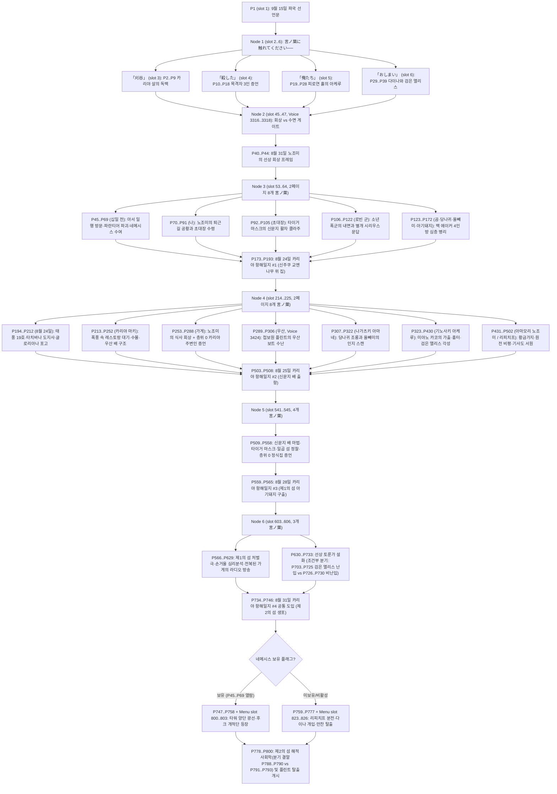

# 『Forest』 비판정본 제6권 A편 (Vol. 06A)
## Stage 10 나뭇잎 군집 (`3101.gsc` ~ `3104.gsc`) 및 제6장 「傘びらき丸航海記」 제1부 (`2600.gsc` `P1..P800`)

---

## 0. 서론: 에르고딕 항해기(Ergodic Periplus)로의 매체적 전환과 계량문체 총람

제5장까지의 『Forest』가 시간축을 따라 전진하거나 보드게임형 선택지로 분기하는 비주얼 노벨의 관습적 통사(Syntax) 위에서 작동했다면, Stage 10 나뭇잎 군집(`1100` 클러스터 산하 `3101.gsc`~`3104.gsc`)을 거쳐 진입하는 제6장 「傘びらき丸航海記」(`2600.gsc`)는 텍스트 자체의 공간적·비선형적 직조 방식을 근본부터 재설계한다. 에스펜 오르세스(Espen Aarseth)가 정의한 **에르고딕 문학(Ergodic Literature)**—독자가 텍스트를 횡단하기 위해 비자명한(non-trivial) 경로 선택과 조합 노동을 수행해야 하는 매체 양식—이 `2600.gsc`에서 **`言ノ葉に触れてください──`**라는 메타-인터페이스를 통해 전면화되는 것이다.

수몰되어 거대한 대해(大海)로 변모한 2004년 8월 말~9월 중순의 신주쿠는 고대 그리스의 항해지(Periplus)이자 영국 아동문학·해양문학 정전들의 다성적 충돌장이다. 본 권역(Vol. 06A)은 이 거대한 해양 리들의 전사(前史)이자 형이상학적 원형으로 기능하는 Stage 10 나뭇잎 4편(`3101.gsc` `P1..P60`, `3102.gsc` `P1..P54`, `3103.gsc` `P1..P44`, `3104.gsc` `P1..P8`)과, 9월 15일의 파국적 살인 선언에서 출발하여 열흘 전의 기원, 태풍 상륙과 수몰, 신문지 배 출항, 제1의 섬(스튜디오 알타 이면) 및 제2의 섬(신주쿠 아일랜드 타워) 사건으로 이어지는 `2600.gsc` 제1부(`P1..P800`) 전체를 무누락 정순으로 해부한다.

### 표 1. Vol. 06A 수록 스크립트 계량문체 지표 및 집필자 지문 대조

| 파일명 | 분석 범위 | 문단 / 문장 / 글자 수 | 지문 비율 (`Narr`) | 평균 문장 길이 (`ASL`) | 한자 / 히라가나 / 카타카나 (%) | 대시 / 말줄임 / 물음표 (‰) | 1인칭 대명사 분포 | 주 집필자 지문 판별 |
| :--- | :--- | :---: | :---: | :---: | :---: | :---: | :--- | :--- |
| `3101.gsc` | `P1..P60` (전 구간) | 60 / 119 / 1,506 | 1.000 | 12.66자 | 17.86 / 55.51 / 13.21 | 1.99 / 11.95 / 23.24 | `俺`(3), `あたし`(3) | **茗荷屋甚六**[木村航] 원안·초고 + **星空めてお** 윤문 `[유력(Probable)]` |
| `3102.gsc` | `P1..P54` (전 구간) | 54 / 90 / 1,077 | 1.000 | 11.97자 | 15.13 / 58.12 / 10.12 | 5.57 / 22.28 / 19.50 | `あたし`(7) | **茗荷屋甚六**[木村航] + **星空めてお** `[유력(Probable)]` |
| `3103.gsc` | `P1..P44` (전 구간) | 44 / 89 / 1,020 | 1.000 | 11.46자 | 16.08 / 64.31 / 5.20 | 0.00 / 14.71 / 33.33 | `あたし`(1) | **星空めてお** 주도 철학 문답 + **茗荷屋甚六** 설정 `[유력(Probable)]` |
| `3104.gsc` | `P1..P8` (전 구간) | 8 / 22 / 319 | 1.000 | 14.50자 | 12.23 / 64.58 / 4.08 | 0.00 / 18.81 / 21.94 | 무표지 구어 증언 | **星空めてお** (층위 0 다큐멘터리 콜라주) `[확증(Confirmed)]` |
| `2600.gsc` | `P1..P800` (총 2,415 중 제1부) | 800 / 1,826 (전체 2,415 / 5,242 / 90,298) | 0.424 (전체) | 17.23자 (전체) | 20.07 / 59.31 / 8.26 | 4.53 / 6.01 / 8.62 | `私`(472), `あたし`(148), `ぼく`(72), `俺`(60), `わし`(29), `わらわ`(4) | **星空めてお**(총괄 아키텍처·일기·층위 0 증언) × **茗荷屋甚六**(`トルンガ`·기사도·해적 활극) × **高尾登山**(내면 병리 독백 일부) 협업 `[확증(Confirmed)]` |

> [!IMPORTANT]
> **문헌학적 핵심 발견**: `3101.gsc`~`3104.gsc`는 엔진상 화자 코드가 전부 `^g999`(지문/해설)로 단일화(`narration_ratio: 1.0`)되어 스탠딩 CG와 화자 이름표를 철저히 소거하지만, 통사적으로는 극도로 밀도 높은 의문부호 비율(`3103.gsc`에서 무려 `33.33‰`, 약 30자당 1회 질문)을 보이는 **무표지 2인 대화체**(`3101`~`3103`)와 **다성적 참고인 청취록**(`3104`)으로 구성된다. 이 익명적 구술 구조는 직후 `2600.gsc` 내부의 두 축—선상에서 구연되는 `トルンガ` 신화(`P630..P730`)와 현실 층위(층위 0)에서 수집된 익명 인터뷰 파편군(`P281..P288`, `P553..P558`)—으로 정확히 수렴한다.

---

## 제1부. Stage 10 나뭇잎 군집 (`1100`: `3101.gsc` ~ `3104.gsc`) 심층 주석

### 1.1. `3101.gsc` (`P1..P60`): 추악한 광대 구혼자 `トルンガ`와 자동인형 무희의 기원 신화

- **[식별자 & 엔진 연출 코드]**: `3101.gsc` | 범위: `P1..P60` (총 60문단, 119문장) | 화자 코드: 전 구간 `^g999` (음성 큐 없음, 선택지 없음, 흑배경 나뭇잎 텍스트 모드). 세부 서사 단락은 **`P1..P23`**(이야기 개시와 1인칭 대명사 협상), **`P24..P38`**(노예 소녀이자 인형 무희인 여주인공의 명명과 세계 멸망의 망각), **`P39..P60`**(세계수의 숲 우주론과 뱀의 눈을 가진 마법 상인 헬마이의 등장 및 차주 기약)의 3단 구성을 취한다.
- **[층위 1: 미시 문체·수사·통사·집필자 지문]**:
  - 모든 문단이 `^g999`에 할당되어 있음에도 여성 종조사 계열 발화자(어린 소녀 청자 겸 공동 창작자)와 남성 종조사 계열 발화자(연상의 방문자 겸 서사 교정자)가 한 문단씩 엄격한 스타카토 턴테이킹(`ASL 12.66자`)을 주고받는다.
  - 특히 `P12..P23` 구간에서 소녀가 추악하고 불결한 중년 남성 주인공에게 거친 남성 1인칭(`俺`)을 부여하려 하자, 남성 화자가 이를 제지하며 에도 서민·어릿광대 어감의 1인칭(`あたし`)과 고풍스러운 구혼 어투로 교정하는 메타-문법 협상이 벌어진다. 이 대명사 교정은 단순한 말장난이 아니라, 이후 `2600.gsc`(`P640..P727`)에서 아케루의 입을 빌려 발화되는 베틀 장인 `トルンガ`의 고유 문체 지문(서민적 해학 + 운율적 익살)이 탄생하는 발생학적 현장을 기록한다. 계량문체상 고전 설화풍 의태와 메타적 캐릭터 비평 어휘가 교차하는 방식은 기무라 고(`茗荷屋甚六`) 특유의 환상 설화 조형 위에 호시조라 메테오(`星空めてお`)의 메타픽션 대화술이 겹쳐진 지문이다 `[유력(Probable)]`.
- **[층위 2: 3중 상호텍스트 및 철학·도시 코드]**:
  - **호프만 『모래사나이』(1816) / 레오 들리브 발레 『코펠리아(Coppélia)』(1870)의 음운 도치(Metathesis)** `[확증(Confirmed)]`: `P24..P27`에서 남성 화자가 인형 무희의 이름을 듣고 발레 정전 『코펠리아』와의 음운 전도를 직접 지적한다. 자음 위치를 뒤바꾼 극중 이름(페코리아)은 이탈리아어·라틴어 어근 *peccatum*(죄·결함) 및 *pecora*(양)〔정정 F0557: 「길 잃은 양」이 아님 — 이탈리아어 pecora는 그냥 「양」(라틴어 pecus의 중성 복수에서)〕와 음향적으로 공명하며 `[구조적 공명(Structural Echo)]`, 완벽한 기계 인형이 인간적 결함과 파멸을 떠안는 역설을 함축한다.
  - **프리드리히 니체 『도덕의 계보』(1887)의 르상티망(Ressentiment)** `[확증(Confirmed)]`: `P6..P11`에서 남성 화자는 주인공의 신체적 추악함과 열등감을 니체 철학의 개념어로 요약하고, 아직 어휘력이 미숙한 소녀가 이를 더듬으며 되묻는다. 이는 소녀가 성인의 서재에서 주워들은 개념과 남성 방문자의 인문학적 어휘가 비대칭적으로 접촉하는 언어게임의 낙차를 드러낸다.
  - **트로이 신화의 불화의 황금사과(에리스) & 창세기 뱀 모티브 × 북유럽 위그드라실 다중우주론** `[확증(Confirmed)]`: `P28..P38`의 사과 투척에 의한 세계 멸망 암시는 파리스의 심판을 호출하며, `P35..P57`에 등장하는 아름다운 청년이나 눈동자만 뱀인 방랑 상인 헬마이(그리스 전령·상업·도둑의 신 헤르메스의 변주 `[유력(Probable)]`)는 수명이 짧은 생물 노예 대신 노화하지 않는 마법 인형의 반영구적 상품 가치에 주목하는 냉혹한 자본 논리를 체현한다. 또한 `P39..P40`에서 제시되는 ‘무수한 세계수가 우거진 깊은 숲(각 나무가 독립된 세계를 이루는 공방 세계)’은 『Forest』 전체의 서사 우주론을 압축한 미장아빔(Mise-en-abyme)이다.
- **[층위 3 & 4: 서사적 월경·매체 기호학 및 반례 검증]**:
  - `P19..P22`에서 제시되는 핵심 역설—구혼 선물인 ‘진주의 팔과 황동의 다리’가 실재하는지조차 불분명하며 오직 주인공 자신이 지어낸 이야기나 여행자의 소문 속에만 존재한다는 설정—은 층위 3(극중 창작 신화)이 층위 1·2(가든과 리들)를 움직이는 동력과 정확히 동형이다.
  - 마지막 `P58..P60`에서 시간이 늦었음을 이유로 ‘다음 주’를 기약하는 결말은, 이 대화가 초자연적 공간이 아니라 층위 0(현실)에서 정기적으로 이루어지던 가정 방문(유년기 아마모리 노조미와 가정교사/방문자 역할의 인물 간 만남)의 기억 파편임을 시사한다 `[유력(Probable)]`.

---

### 1.2. `3102.gsc` (`P1..P54`): 『`ペッコリアが世界を滅ぼす話`』—선물/독(Pharmakon)〔정정 F3168: 파르마콘은 「약(치료제)/독」의 양의성 — 「선물/독」은 독일어 Gift 쪽의 양의성〕의 변증법과 청자의 마녀화

- **[식별자 & 엔진 연출 코드]**: `3102.gsc` | 범위: `P1..P54` (총 54문단, 90문장) | 화자 코드: 전 구간 `^g999`. 세부 단락은 **`P1..P8`**(전주 요약 및 소녀의 비밀 메모 언급), **`P9..P25`**(헬마이의 공방 잠입과 마법 과일 헌정 연설), **`P26..P42`**(인간이 된 인형의 무책임한 직설과 구혼 전쟁에 의한 멸망), **`P43..P54`**(소녀 청자의 갑작스러운 서사 찬탈과 자기 마녀화 선언)로 전개된다.
- **[층위 1: 미시 문체·수사·통사·집필자 지문]**:
  - 전반부(`P16..P19`)에서 남성 화자가 헬마이의 대사를 연기할 때, 문체는 돌연 고전 문어체 조동사와 도치법, 7·5조에 근접하는 시적 호흡을 구사하는 **번역극풍 운문 독백**으로 도약한다(셰익스피어 번역극인 쓰보우치 쇼요·후쿠다 쓰네아리 문체의 패스티시 `[유력(Probable)]`).
  - 반면 후반부(`P43..P54`)에서 소녀가 1인칭 `あたし`를 7회 연타하며 서사에 난입할 때, 말줄임표(`22.28‰`)와 느낌표(`18.57‰`), 파열적 의성어가 급증하며 정서적 과부하와 피로 호소(`P53`)로 급락한다.
- **[층위 2: 3중 상호텍스트 및 철학·도시 코드]**:
  - **백설공주 독사과의 전복과 오렌지로의 기호 대체** `[확증(Confirmed)]`: `P11..P15`에서 소녀가 관습적 동화 문법에 따라 ‘독이 든 사과’를 예측하자, 남성 화자는 사과가 진부하다는 이유로 즉석에서 ‘독이 없는 진짜 보물 오렌지’로 기표를 교체한다. 한 방울의 과즙이 피와 살을 데워 인형을 따뜻한 인간 소녀로 육화시킨다는 화소는 피노키오·피그말리온 신화의 변주다 `[확증(Confirmed)]`.
  - **비트겐슈타인 언어게임론과 사회적 화용론의 결여**: `P26..P38`에서 인형이었던 여주인공이 인간이 된 직후 여러 세계 왕들의 구혼을 거절하며 외모와 빈곤을 노골적으로 모욕해 대전쟁을 촉발하는 과정은, 비트겐슈타인 『철학적 탐구』가 말한 ‘삶의 형식(Lebensform)’에 내장된 완곡어법·외교적 언어게임 규칙을 습득하지 못한 순수 기표 발화(‘정직함, 일명 바보’)가 공동체를 어떻게 파멸시키는지를 예증한다.
- **[층위 3 & 4: 서사적 월경·매체 기호학 및 반례 검증]**:
  - **기프트(Gift = 선물/독)의 원형적 메커니즘**: 헬마이의 복수는 저주나 독살이 아니라 **가장 순수한 축복(인간화라는 선물)을 부여함으로써 수혜자의 내재적 결함이 스스로 파국을 낳게 만드는 자기잠식 구조**다. 이는 『Forest』 전체를 관통하는 ‘기프트(영어 Gift[선물] = 독일어 Gift[독])’의 작동 원리를 가장 투명하게 요약한다.
  - **메탈렙시스(서사적 월경)**: `P43..P52`에서 청자였던 소녀는 여주인공의 망각이라는 빈틈을 비집고 들어가, 세계를 벼락 마법으로 멸망시킨 범인이 바로 증오로 일그러진 ‘마녀인 자기 자신’이라고 선언한다. 아름다운 인형이 행복해질 것이라는 예정조화적 동화 문법에 대한 소녀의 격렬한 질투와 자기혐오는, 직후 제6장 본편에서 성인이 된 아마모리 노조미(`^g004`)가 스스로를 ‘오리지널인 마녀’(`2600.gsc` `P446`)로 규정하는 심층 트라우마의 기원이다.

---

### 1.3. `3103.gsc` (`P1..P44`): 가능무한의 저주와 ‘행복’ 개념의 언어철학적 해체

- **[식별자 & 엔진 연출 코드]**: `3103.gsc` | 범위: `P1..P44` (총 44문단, 89문장) | 화자 코드: 전 구간 `^g999`. 세부 단락은 **`P1..P10`**(보물의 실재 여부와 보편적 행복론을 둘러싼 ‘위선’ 논박), **`P11..P22`**(아버지의 서재·마녀의 고립·`リアル` 대 마법의 숲 비교), **`P23..P35`**(무리 동물의 서열 비교 대 단독 포식자의 만인에 대한 투쟁 및 ‘행복’ 정의의 불확정성), **`P36..P44`**(팔다리를 잃은 인형의 모델 케이스와 ‘이루어질 수 없는 꿈=저주’의 폭발적 결렬)로 구성된다.
- **[층위 1: 미시 문체·수사·통사·집필자 지문]**:
  - 대시(`0.00‰`)와 외래어 카타카나(`5.20%`)가 극단적으로 억제되고 히라가나 비율이 `64.31%`로 치솟는 가운데, 의문부호가 `33.33‰`에 달하는 전형적인 **호시조라 메테오식 소크라테스 산파술 문답체**다 `[추정]`.
  - 특히 `P20`에서 소녀가 자신이 남들과 다른지, 추하고 냄새나고 기분 나쁜 존재인지를 5연속 단문 의문문으로 몰아붙이는 호흡은 `3101.gsc` `P6`에서 주인공 `トルンガ`에게 투사했던 추악함의 형용사들을 고스란히 자기 자신에게 되돌리는 수미상관 구문이다.
- **[층위 2: 3중 상호텍스트 및 철학·도시 코드]**:
  - **홉스적 자연상태 대 사회적 서열 비교**: `P23..P32`에서 남성 화자가 전개하는 강약의 4대 척도(완력·화폐·마법·외모)와 무리 생활의 비교 지옥 대 단독 생물의 살육전(타자=적 또는 도구) 대비는 토머스 홉스의 『리바이어던』 및 쇼펜하우어·니체적 힘에의 의지를 아동 눈높이의 우화로 압축한 것이다 `[구조적 공명(Structural Echo)]`.
  - **아리스토텔레스 가능무한(`可能無限`)으로서의 탐색과 희망=저주 테제**: `P1..P7` 및 `P36..P44`에서 전쟁 끝에 팔과 다리가 마비된 노예 인형에게 `トルンガ`가 들려주는 ‘진주의 손(마음과 진실의 현현)과 황동의 다리(자유로운 여행)’ 이야기는, 종결된 집합으로서의 칸토어적 실무한(`実無限`)에 도달하지 못한 채 영원히 유예되는 **가능무한(`可能無限`)의 탐색**이다. 소녀는 도달 불가능한 구원을 약속하는 행위야말로 희망이 아니라 **‘저주’**라고 간파하며(`P38..P42`), 이 통찰은 `2600.gsc` `P690`에서 성인 노조미가 선상의 아케루에게 내뱉는 단 한 마디의 판정과 정확히 조응한다.
- **[층위 3 & 4: 서사적 월경·매체 기호학 및 반례 검증]**:
  - `P12`에서 소녀가 아버지의 책장에서 읽을 수 있는 부분만 골라 읽는다고 밝히는 대목과 `P18`에서 `リアル` 세계와 마법의 숲을 대조하는 대목은, 이미 유년기 시점부터 소녀의 내면에서 현실(`リアル`)과 숲의 이중 존재론이 작동하고 있었음을 입증한다. 마지막 `P42..P44`에서 보물은 어디에도 없다고 단언하며 남성 방문자를 쫓아내는 파열음은 유년기 대화의 단절이자 성인기 재회 전까지의 공백을 설명한다.

---

### 1.4. `3104.gsc` (`P1..P8`): 층위 0의 복자(伏字) 진술조서 파편 (`××さんですか？`)

- **[식별자 & 엔진 연출 코드]**: `3104.gsc` | 범위: `P1..P8` (총 8문단, 22문장) | 화자 코드: 전 구간 `^g999`. 전 문단이 낫표〔정정 E18: 「 」는 홑낫표 — 겹낫표는 『 』〕로 묶인 8개의 독립된 참고인 구술 응답 파편으로 구성된다.
- **[층위 1: 미시 문체·수사·통사·집필자 지문]**:
  - 첫 문단 벽두에 놓인 실명 복자 처리 질문 반복(`××さんですか？`)은 보이지 않는 취재자 혹은 수사관의 질문을 피질문자가 되받아 발화하는 다큐멘터리 몽타주 기법이다(호시조라 메테오 고유의 모큐멘터리 문체 `[추정]`).
  - `P1..P5`는 직장 동료들의 방어적·냉소적 성인 여성/남성 경어체(말끝을 올리는 반문형 억양, 책임 회피성 완곡어법)로 쓰인 반면, `P6..P8`은 갑자기 거친 초등학생 남아 구어(`P6..P7`)와 유아적 여아 구어(`P8`)로 급변한다.
- **[층위 2 & 층위 3·4: 상호텍스트·도시 코드 및 반례 검증]**:
  - **팬덤 통설 교정 및 반례 검증** `[확증(Confirmed)]`: 일부 독해에서는 `3104.gsc`의 복자 대상(`××`)을 미야노 카코나 카리야 마키로 혼동하곤 한다〔미확인 F3524: 그런 평·통설을 적은 자료를 찾지 못했다〕. 그러나 ① 직장 생활의 부적응과 대인 거리감 조절 실패(`P1..P4`), ② 부유한 본가 출신이라 굳이 일하지 않고 부모에게 얹혀살아도 된다는 소문(`P5`, 이는 `2600.gsc` `P83`, `P259`의 아마모리 노조미 배경과 100% 일치), ③ 길고양이를 모으고 얼굴을 바짝 들이밀며 중얼거리는 ‘마녀’라는 동네 아이들의 증언(`P6..P8`, `3103.gsc` `P16..P20`과 직결)을 교차 검증하면, 복자 `××`는 **아마모리 노조미**임이 문헌학적으로 확증된다.
  - 또한 이 파일은 단독 파편이 아니라 `2600.gsc` 내부에 삽입된 카리야 마키 주변인 청취록(`P281..P288`) 및 아기돼지 현실 모델 주변인 청취록(`P553..P558`)과 동일한 **층위 0(현실 신주쿠) 실종·괴사건 사후 탐문 시리즈**를 형성한다. 환상 층위에서 장엄하게 펼쳐지는 마녀와 마법사의 서사가 현실 층위 타자들의 시선 속에서는 ‘사회성 결여 직장인’이나 ‘동네의 기묘한 인물’이라는 납작한 가십으로 환원되는 잔혹한 매체적 아이러니가 여기서 완성된다.

---

## 제2부. 제6장 「傘びらき丸航海記」 제1부 (`2600.gsc` `P1..P800`) 심층 주석

### 2.0. `2600.gsc` 제1부(`P1..P800`) 에르고딕 하이퍼텍스트(`言ノ葉`) 아키텍처 도해

`2600.gsc`는 텍스트를 수동적으로 읽는 대신, 중심 일기/독백 문단에 박힌 핵심 어휘(**`言ノ葉`**)를 플레이어가 직접 터치(`言ノ葉に触れてください──`)하여 숨겨진 다성적 기억과 이면 시점을 발굴하는 하이퍼텍스트 그물망으로 설계되어 있다. `2600.json`의 바이트코드 슬롯(`slot`)과 문단 번호(`P1..P800`)를 전수 대조한 실제 분기 토폴로지는 아래와 같다.

---

### 2.1. `P1..P39` (Node 1 `slot 2..6`): 9월 15일의 선취적 파국(Prolepsis)과 트라토레아 궁전 결혼식의 살인 다성악

- **[식별자 & 엔진 연출 코드]**: `2600.gsc` `P1..P39` | 하이퍼텍스트 프롬프트 `slot 2` (`言ノ葉に触れてください──`) 및 4개 어휘 슬롯:
  - **`P1`** (`^g999`): 제6장 전체의 서두를 여는 3문장 일기 파편 (`９月１５日` / `刈谷が、人を殺した。` / `俺たちはおしまいだ。`).
  - **`P2..P9`** (`slot 3` `「刈谷」`, 화자 `^g006` 카리야 마키): 살해 당사자의 내면 고백.
  - **`P10..P18`** (`slot 4` `「殺した」`, 화자 `^g018` 바스토퍼 존스 `P10..P12` → `^g021` 봄발루리나 `P13..P15` → `^g039` 하얀 여왕 `P16..P18`): 결혼식 하객 3인의 목격담.
  - **`P19..P28`** (`slot 5` `「俺たち」`, 화자 `^g999` 아케루 시점): 트라토레아 궁전 메인 홀 군중 속에 갇힌 일행의 시점.
  - **`P29..P39`** (`slot 6` `「おしまい」`, 화자 `^g019` 다이나 & `^g002` 검은 앨리스): 시신 앞의 신랑·신부 만찬 대화와 승패 선언.
- **[층위 1: 미시 문체·수사·통사·집필자 지문]**:
  - `P1`은 일체의 수식어를 거세한 25자 남짓의 단정적 과거형·현재형 선언으로 독자의 호흡을 절단한다. 직후 이어지는 4개 분기는 동일한 살인 사건을 아쿠타가와 류노스케의 『덤불 속(藪の中)』처럼 4개의 상이한 인칭과 문체 레지스터로 해체한다.
  - `P2..P9`의 카리야(`私`)는 차가운 자기객관화 명사 종지와 연쇄 비유(성숙시킨 독으로 발끝부터 집어삼키는 뱀)를 구사하고, `P10..P18`에서는 정중한 노신사 경어체(`^g018`), 가벼운 갸루풍 구어와 촉각적 자상(刺傷) 의성어(`^g021`), 고압적인 제왕의 1인칭 `わらわ`와 도치 구문(`^g039`)이 충돌한다. 이어 `P19..P28`의 아케루(`俺`)는 대시(`──`)를 연쇄적으로 사용해 인파 속에서 시야가 차단된 혼란을 구현하며, `P29..P39`에서는 보이시한 암컷 아기고양이 다이나(`^g019`, 1인칭 `ぼく`, 검은 앨리스를 `ママ`로 호칭)의 천진난만한 감탄사와 검은 앨리스(`^g002`)의 냉혹한 소유 선언이 기괴한 불협화음을 빚어낸다(호시조라 메테오의 정교한 다성적 연출 `[추정]`).
- **[층위 2: 3중 상호텍스트 및 철학·도시 코드]**:
  - **T. S. 엘리엇 『지혜로운 고양이가 되기 위한 지침서』(1939) / 뮤지컬 『캣츠』 × 루이스 캐럴 『거울 나라의 앨리스』(1871)** `[확증(Confirmed)]`: 사교계 미식가 고양이 바스토퍼 존스(`^g018`)와 관능적 암고양이 봄발루리나(`^g021`)가 고급 이탈리안 레스토랑의 가든 변이체인 ‘트라토레아 궁전’ 피로연의 관전자로 등장하고, 야가와 스미코(矢川澄子)·야나세 나오키 역본 전통을 잇는 하얀 여왕(`^g039`)이 캐럴 원전 제5장의 핵심 모티브인 **‘미래의 기억(거꾸로 흐르는 시간 속의 선험적 예지)’**을 내세워 살인극을 결혼식 최고의 여흥으로 찬미한다.
  - **지배와 광신으로서의 에로스**: `P2..P9`와 `P34..P35`는 현실 신주쿠의 고급 레스토랑 오너(‘그’)와 지배인 카리야 마키의 착취적 관계를 독사에 물리면서도 잃기를 두려워하는 ‘광신’으로 규정한다. 생선 해체용 칼로 복부를 찌르고 올라타 난자하는 카리야의 행위는 가부장적·자본적 착취자에 대한 해방인 동시에, 살인을 통해 영원한 소유를 완성하려는 자기파괴이며, 그 즉시 카리야를 ‘숲의 소유물’로 귀속시키는 덫이 된다(`P37..P39`).
- **[층위 3 & 4: 서사적 월경·매체 기호학 및 반례 검증]**:
  - **선행 권역 교정 사항의 서사적 작동 확증**: `P29..P33`에서 `^g019`(다이나)는 1인칭 `ぼく`를 쓰면서도 자신이 **새끼까지 딸린 암컷(여자아이)**이기 때문에 `ママ`(검은 앨리스)의 신랑 노릇을 하는 것은 무리라고 항변한다. 이는 다이나의 젠더 표지(`ぼく` 화자이나 생물학적·서사적 암컷 어미 고양이)와 모녀/부부 역할극의 전복성을 결정적으로 못 박는다.
  - 또한 `P38..P39`에서 검은 앨리스가 ‘다섯 명 중 두 명을 취했으므로 승부는 결정되었다’고 미소 짓는 대목은(제5장에서 이미 탈락한 마유즈미에 이어 카리야 마키까지 상실됨을 의미), 텍스트를 읽고 있는 플레이어/아케루를 향한 직접적 2인칭 월경 선고다.

---

### 2.2. `P40..P172` (Nodes 2–3 `slot 45..47`, `slot 53..64`): 무자막 보이스 게이트, 열흘 전의 기원, 그리고 백 에이커의 숲 4인방 심층 병리학

- **[식별자 & 엔진 연출 코드]**: `2600.gsc` `P40..P172` | 음성 오버레이 및 다중 페이지 선택지:
  - **`P40..P44`** (`^g999`, `[Voice:3316,3317,3318]`, `slot 45..47`): 8월 31일 선상에서 열흘 전(8월 21일)의 생일 파티를 회상하는 아마모리 노조미(`あたし`)의 프레임 문단. 일본어 원판에서는 자막 없이 재생되는 보이스 오버레이 3건(`3316`: 회상할지 잠들지 묻는 속삭임 / `3317`: 무의미해 보이지만 해보라는 냉소 / `3318`: 달콤한 잠으로 유도하는 배드엔딩/이탈 분기 음성)이 `slot 46`(기억하기) 및 `slot 47`(잠들기) 선택지와 결합한다.
  - 이어지는 Node 3(`slot 53..64`)는 `次の選択肢`/`前の選択肢`로 페이지를 넘기는 **8개 키워드 병렬 탐색 구조**다:
    1. **`P45..P69`** (`slot 54`, `^g999` & `^g001`): 열흘 전 술집의 아케루와 노쇠한 아서 기사단 8인의 방문, `パランティア` 휴대전화 파손 및 기프트 ‘네메시스’ 이식.
    2. **`P70..P91`** (`slot 55`, `^g004` & `^g006`): 퇴근 타임카드 앞 노조미의 휴대전화 착신 소동, 거리에서의 강박적 자기비하 나선, 타이거 마스크의 초대장 전달.
    3. **`P92..P105`** (`slot 56`, `^g999`): 신주쿠 명물 배달원 타이거 마스크의 신문지 종이눈보라 활자 조합 연출.
    4. **`P106..P122`** (`slot 57`, `^g999`, `^g034`, `^g004`): 크리스토퍼 로빈의 잔혹한 속마음(`^g999`)과 온화한 외면(`^g034`)의 이중주 및 별개 시리우스 문답.
    5. **`P123..P136`** (`slot 60`, `^g999`): 곰(푸)의 지하상가 내면 독백.
    6. **`P137..P153`** (`slot 61`, `^g999` & `^g041` `イーヨー`): 늙은 당나귀의 관음증적 망상 폭발과 자기혐오적 침묵.
    7. **`P154..P161`** (`slot 62`, `^g999`): 올빼미(`地球座`의 현자)의 룰루스 기억술 연산 프로토콜.
    8. **`P162..P172`** (`slot 63`, `^g999`): 아기돼지(`コブタ`)의 태풍 불안과 로빈 숭배·피학적 열망.
- **[층위 1: 미시 문체·수사·통사·집필자 지문]**:
  - 이 구간은 **8개의 완전히 이질적인 의식 흐름(Stream of Consciousness) 문체 실험실**이다.
  - 노조미의 내면(`P73`, `P86..P88`)과 아기돼지의 내면(`P163..P171`), 당나귀의 발작 구간(`P143..P150`)은 쉼표와 마침표를 의도적으로 제거한 **무구두점 장문 폭주(Run-on Syntax)**를 구사하여 강박신경증·불안발작·성적 도착의 숨 막히는 내적 속도를 시각화한다(타카오 토잔 `高尾登山`의 병리적 독백 기법과 메테오의 심리 해부가 결합된 영역 `[유력(Probable)]`).
  - 반대로 곰의 독백(`P123..P136`)은 한자 비율을 낮추고 유아적 연쇄 삼단논법(넓음→추움→외로움→죽고 싶음)을 천진하게 나열하면서 살인 충동을 아무렇지 않게 섞어 넣으며, 올빼미의 독백(`P154..P161`)은 체언 종지(‘치환. 완료.’, ‘검토…… 결론.’)로 이루어진 무감정한 컴퓨터 로그·기억술 매뉴얼 문체를 구사한다.
- **[층위 2: 3중 상호텍스트 및 철학·도시 코드]**:
  - **에드먼드 스펜서 『요정 여왕(The Faerie Queene)』(1590/1596) × 영국 국왕의 로열 터치(Royal Touch) × 톨킨 『반지의 제왕』 `パランティア` × 그리스 복수 여신 네메시스** `[확증(Confirmed)]`: `P49..P69`에서 노쇠하여 은퇴하는 아서와 기사들은 스펜서 서사시 속 글로리아나 여왕의 궁정 기사와 그녀를 찾아 헤매는 아서 왕자다〔정정 F0738: 아서는 수호 기사단원이 아님 — 글로리아나를 사모해 찾아 헤매며 다른 기사들을 돕는 왕자〕. 아케루가 스펜서 원전의 절반가량이 미완성 미간행임을 지적하는 메타 유머(원래 기획된 12권 중 6권만 완간)를 던지자 기사들은 현자라며 감탄한다. 아서가 아케루의 이마에 손을 얹는 연주창 치유 의식(Royal Touch)〔정정 F3186: 「연줄」이 아님 — 왕의 손길로 고친다던 병은 연주창(scrofula, King's Evil)〕을 통해 도지사가 준 감시용 휴대전화(`パランティア`)를 물리적으로 파괴하고 영국 문학 제약조차 벗어난 그리스 복수 여신 ‘네메시스’(양날의 검인 기프트)를 심어 넣은 뒤 호수의 귀부인 니뮤에(죽음과 수몰)에게로 퇴장하는 대목은, 제6장의 장르 규칙 자체가 혼종화되고 있음을 예고한다.
  - **신주쿠 타이거 마스크(하라다 요시로[原田吉郎]〔정정 A1〕 실존 도시전설 모델) × 이시이 모모코 역 『곰돌이 푸』의 `トラー` × 1990~2000년대 신문 헤드라인 콜라주** `[확증(Confirmed)]`: `P92..P105`는 신주쿠 거리를 누비던 실제 신문배달원 타이거 마스크를 가든 내 `トラー`(티거)의 현실 대응물로 결부한다(`P95`에서 다른 이름과 모습으로 뛰어오를 때 노조미를 등에 태웠던 기억 암시). 신문지가 갈기갈기 찢겨 날아들며 조합하는 초대장 글자들은 ‘경영 파탄’, ‘생체 간이식’, ‘김일성’, ‘슈퍼 301조’, ‘대포동’, ‘묻지마 괴한’, ‘유로’, ‘화염병’ 등 세기말~2000년대 초 일본 일간지의 흉흉한 정치·사회면 활자들을 협박 편지처럼 오려 붙여 ‘생일 파티 합니다 로빈 올림’이라는 동심의 문장을 조립하는 강렬한 팝아트적 이화 효과를 낳는다.
  - **올라프 스테이플던 『시리우스(Sirius)』(1944) × 큰개자리 천문 신화** `[구조적 공명(Structural Echo)]`〔등급 조정 B2: 대본은 작품도 작가도 대지 않는다〕: `P107..P118`에서 로빈이 노조미의 개를 지상의 테리어 종으로 단정하자, 노조미는 지상을 떠나 새로운 영웅을 찾아 별의 세계로 여행한 ‘별개(星犬) 시리우스’라고 정정한다. 초지능을 부여받아 인간 사회와 동물적 본능 사이에서 고독하게 방황하는 스테이플던의 SF 고전 『시리우스』와 유년기 반려견 상실 트라우마(`P478..P480`)가 겹쳐진다.
  - **이시이 모모코(石井桃子) 역 『곰돌이 푸』(이와나미 소년문고) 세계관의 그로테스크한 성인 지하도시 전복** `[확증(Confirmed)]`:
    - 밀른의 목가적 ‘백 에이커의숲’은 신주쿠 지하상가 노숙자·기인 공동체로 전복된다(`P114`, `P125`).
    - 로빈(`^g034`)은 순수한 소년의 얼굴 뒤에 여성을 불신하고 복종하지 않으면 언제든 살해하려는 유아적 전능감의 폭군성을 숨기고 있으며(`P106`, `P119..P122`), 곰은 ‘세상에서 가장 머리 나쁜 곰’이라는 원전 구절(원문은 *a Bear of Very Little Brain* — 「세상에서 가장」이라는 최상급은 없다〔정정 M022〕)을 변주해 시나 이야기를 읽는 아름다운 여성을 ‘반쯤 미친 불쌍한 사람’으로 규정하고 편하게 죽여줄까 고민한다(`P123..P136`).
    - `イーヨー`(`^g041`)는 원전의 우울한 비관주의가 여성 직장인의 땀에 젖은 블라우스와 흰 속옷을 성적 도발로 망상하며 처녀성 집착과 극단적 자기멸시 사이를 오가는 노년 남성의 성적 좌절로 치환되고(`P137..P153`), `コブタ`(`^g037`)는 로빈이 ‘모두’라는 집단 명사를 혐오한다는 이유로 언어를 자기검열하며 로빈의 따귀와 학대를 성애적으로 갈망한다(`P162..P172`, 원전의 가상 괴물 Heffalump의 이시이 모모코 번역어인 `ゾゾ` 공포 포함).
  - **프랜시스 예이츠 『기억술(The Art of Memory)』(1966) × 라몬 유이(Ramon Llull) 결합술 × 셰익스피어 글로브 극장(`地球座`) × 고질라** `[확증(Confirmed)]`〔등급 조정 B8: 확증은 대본의 기억술 용어(地球座·ルルスの術·トポス)까지. 예이츠의 책 이름은 대본에 없는 읽기〕: `P154..P161`에서 올빼미(`^g040`)는 로버트 플러드와 줄리오 카밀로의 르네상스 기억 극장·기억술 전통(및 중세 라몬 유이의 결합술)〔정정 F0498: 유이는 르네상스 기억 극장 전통이 아님 — 중세 인물(1232년경~1316)이고 그의 것은 결합술〕에 따라 뇌내 `地球座` 3층 천장석 A021번 여성 관객을 아마모리 노조미로 치환하고, 오페라글라스를 우산과 청우계로 바꾼 뒤, 단순 우천과의 혼동을 막기 위한 기억술적 ‘도약(충격적 심상 결합)’ 규칙에 따라 **노조미의 얼굴을 괴수 고질라로 치환**하여 대형 태풍 접근 기억을 영구 저장한다. 고전 서양 비전(秘傳) 기억술과 전후 일본 특촬 괴수 아이콘(태풍과 함께 상륙하는 고질라!)의 기상천외한 결합이다.
- **[층위 3 & 4: 서사적 월경·매체 기호학 및 반례 검증]**:
  - **숨겨진 에르고딕 인과율 검증**: 플레이어가 Node 3에서 `slot 54`(`P45..P69`)를 터치하여 열람하느냐 건너뛰느냐는 단순한 백스토리 감상에 그치지 않고, 스크립트 후반 `P747..P758`에서 아케루의 기프트 ‘네메시스’ 발동 여부를 가르는 **비가시적 상태 플래그**로 작동한다. 기억을 ‘접촉’해 호출하는 독자의 행위 자체가 주인공의 무장을 현실화하는 에르고딕 메타-기호학이다.

---

### 2.3. `P173..P322` (Node 4 전반부 `slot 214..221`): 신주쿠 교엔 나무 위 방주, 도청의 관전자들, 그리고 카리야 마키의 양면적 초상

- **[식별자 & 엔진 연출 코드]**: `2600.gsc` `P173..P322` | 카리야 항해일지 #1 및 Node 4 전반부 5개 분기:
  - **`P173..P193`** (`^g999`): 8월 24일자 카리야 마키의 첫 기록문(신주쿠 교엔 영국식 정원의 튤립나무 위 로빈의 집, 탑승 인원 9~10인 점호).
  - **`P194..P212`** (`slot 215`, `^g999` 기상 기록 → `^g051` 타치바나 도지사 & `^g052` 비서·참여 → `^g017` 요정여왕 글로리아나): 태풍 19호 상륙 보고, 도청 전망대에서의 해양화 관측과 `パランティア` 두절 보고, 글로리아나의 신세계 치세 포고.
  - **`P213..P252`** (`slot 216`, `^g999` 카리야 1인칭 회상): 8월 23일 폭풍 속 레스토랑 영업 준비, 뉴욕 오너의 국제전화 스카우트 거절, 침수된 홀에서의 고독한 대기와 로빈의 우산 배 구조.
  - **`P253..P288`** (`slot 217`, `^g999`, `^g006`, `^g004`): 노조미 시점에서 본 카리야의 배려와 ‘범인(凡人)’ 고백(`P253..P280`) + **층위 0 카리야 주변인 인터뷰 8문단**(`P281..P288`).
  - **`P289..P306`** (`slot 218`, `^g999`, `[Voice:3424]`): 미스 메리의 앵무새 머리 박쥐우산 플린트의 시점(뒤집힌 우산 보트 항해와 무자막 함성 음성 `3424`).
  - **`P307..P322`** (`slot 221`, `^g007` 나가츠키 아마네): 당나귀에 대한 가학적 유희와 올빼미의 시선에 대한 경계심.
- **[층위 1: 미시 문체·수사·통사·집필자 지문]**:
  - 카리야의 기록문(`P173..P193`)과 주방 회상(`P213..P221`)은 초 단위로 움직이는 주방 동선과 인원 배치(좌측 올빼미·당나귀·아마네, 정면 곰과 로빈, 우측 아케루·노조미, 중앙 리피치프, 천장의 우산 플린트)를 측량하듯 기록하는 명징하고 절제된 관리직 경어·평서체(`私`)다.
  - 그러나 `P281..P288`에 이르면 문체는 다시 `3104.gsc`와 동일한 **층위 0 복수 화자 구술 청취록**으로 절단되어, 전직 직원과 지인들이 카리야를 두고 수군거리는 비속어(약물 루머, 오너에게 착취당하는 ‘충실한 개’라는 여성혐오적 멸칭, 스카우트 은폐 소문)를 날것으로 노출한다.
  - 이어지는 플린트 시점(`P289..P306`)은 오만한 영국 신사 투의 3인칭 자유간접화법과 새의 외마디 울음소리가 교차하는 희극적 과장체이며, 나가츠키 아마네 구간(`P307..P322`)은 가부키초 풍속업 종사자 특유의 경박한 갸루 속어 뒤에 예리한 인간 관찰안을 감춘 반어적 문체다.
- **[층위 2: 3중 상호텍스트 및 철학·도시 코드]**:
  - **신주쿠 교엔(新宿御苑) 영국 풍경식 정원의 튤립나무(ユリノキ) × 밀른 『곰돌이 푸』의 호두나무 집〔정정 F1077: 밀른 원전에 호두나무는 없다 — 호두나무라고 한 것은 대본(2600:P175)〕 × 마더 구스 자장가 × 노아의 방주** `[확증(Confirmed)]`: `P175`에서 카리야 자신이 직접 원전(밀른 작중 너도밤나무 숲〔정정 F1082: 「호두나무」는 원전에 없다 — 호두나무라고 한 것은 대본(2600:P175)〕)과의 수종 차이를 짚어내듯, 실제 신주쿠 교엔 영국 풍경식 정원의 랜드마크인 거대 튤립나무가 수몰된 신주쿠의 방주가 된다. 폭풍에 흔들리는 나무 꼭대기 집에서 카리야가 떠올리는 영미 전래 자장가 *“Hush-a-bye, baby, on the tree top”*(1765년경 『마더 구스의 멜로디』 수록, 나뭇가지가 부러지면 요람째 추락한다는 잔혹한 가사 `[확증(Confirmed)]`)은 방주의 안전성이 언제든 붕괴할 수 있음을 암시한다.
  - **밀른 『곰돌이 푸』 제9장 「피글렛이 온통 물에 둘러싸이다」〔정정 F1073: 「푸가 홍수에 갇히다」가 아님 — 원제 In Which Piglet Is Entirely Surrounded by Water〕의 ‘우산 배(The Brain of Pooh)’ × P. L. 트래버스 『메리 포핀스』(1934, 林容吉 역)의 앵무새 머리 우산 × 스티븐슨 『보물섬』(1883)의 플린트 선장** `[확증(Confirmed)]`: 밀른 원전 제9장에서 대홍수가 나자 크리스토퍼 로빈의 파란 우산을 뒤집어 배로 삼아 피글렛을 구하러 가던 동화적 발상이, 여기서는 미스 메리(메리 포핀스)의 말하는 앵무새 손잡이 우산이자 특무기관 첩보원인 ‘플린트’(『보물섬』 실버의 앵무새 ‘플린트 선장’과 이중 결합!)를 강제로 뒤집어 곰을 포함한 9명을 구겨 태우는 잔혹 슬랩스틱(`P248..P252`, `P289..P306`)으로 재탄생한다.
  - **서신주쿠 도쿄도청 전망대의 파놉티콘과 인식론적 단절**: `P197..P201`에서 도청 고층부에 자리 잡은 타치바나 도지사(`^g051`)와 비서(`^g052`)는 일반 대중매체에는 단순한 태풍 침수 피해로만 보도되는 사태가 가든 인식자들에게는 ‘끝없는 대해로의 붕괴’로 현현하고 있음을 내려다본다. 감시 대상 A(아케루)와의 `パランティア` 교신 두절에도 도지사가 태평하게 메리를 호출하는 태도는 권력자가 리들을 유희적 스펙터클로 소비하는 냉소를 보여준다.
  - **글로리아나의 권력 의지와 판타지 군주들의 몰락 선언**: `P202..P212`에서 글로리아나(`^g017`)는 셰익스피어 『한여름 밤의 꿈』의 참칭왕 오베론, 캐럴의 광대 같은 하얀 여왕, 루이스 『나니아 연대기』의 아슬란이 모두 힘을 잃었다고 선언하며 수몰된 신주쿠 위에 자신의 영원한 치세를 세우려 한다.
  - **이탈리아 식문화 인류학과 살리에리적 ‘범인(凡人)’의 비극**: `P224..P235`에서 시칠리아 출신 뉴욕 오너의 스카우트 전화에 유창한 이탈리아어로 응대하며 기혼/미혼 구분 없는 경칭 대신 가부장적 호칭을 쓴 상대의 마초성을 꿰뚫어 보면서도 ‘무사도(충성심)’가 아닌 ‘프라이드’를 이유로 오너를 통한 협상을 요구하던 완벽주의자 카리야가, 정작 `P253..P280`의 노조미 앞에서는 예술·수학·천문학 같은 ‘무용한 문화’를 창조하는 천재를 동경할 뿐 자신은 이해만 할 줄 아는 ‘범인’이라 고백하는 대목은, 그녀가 왜 무능하고 사악한 오너의 지배에서 벗어나지 못했는지를 해명하는 심리적 열쇠다.
- **[층위 3 & 4: 서사적 월경·매체 기호학 및 반례 검증]**:
  - **층위 0 증언록(`P281..P288`)의 시제적 월경**: 마지막 8번째 증언(`P288`)에서 응답자가 카리야가 ‘말할 수 없는 무슨 짓’을 저질렀는지 되묻는 대목은, 이 청취록이 **9월 15일의 오너 살해 사건(`P1..P18`) 이후 현실 층위에서 진행된 수사/취재 기록**임을 암시한다. 즉 8월 24일의 항해기 한복판에 9월 15일 이후의 사후적 현실 시점이 하이퍼텍스트(`言ノ葉`)를 타고 역침투하는 고도의 시간적 메탈렙시스다.
  - **나가츠키 아마네의 거울 인식(`P311..P320`)**: 아마네는 추악하고 병든 봉제인형 당나귀에게서 거울 속 자기 자신의 현실 그림자를 발견해 연민 섞인 봉사를 베푸는 반면, 올빼미의 눈빛이 성적 흥분도 분석도 아닌 영화 카메라 같은 ‘통째로 스캔하여 뇌내에 복제본을 만드는 시선’임을 직감하고 전율한다. 이는 앞서 `P154..P161`에서 확인된 올빼미의 `地球座` 기억술 메커니즘을 외부 타자의 몸으로 검증하는 정교한 교차 연출이다.

---

### 2.4. `P323..P502` (Node 4 후반부 `slot 222..224`): 테니엘 쿠키 깡통, 소금기 맺힌 흉터, 그리고 미야노 카코에서 검은 앨리스로의 존재론적 탈피

- **[식별자 & 엔진 연출 코드]**: `2600.gsc` `P323..P502` | Node 4 제2페이지 나머지 3개 분기:
  - **`P323..P430`** (`slot 222` 기노사키 아케루):
    - `P323..P341`: 리피치프의 ‘캐릭터성’에 대한 아케루(`^g001`)의 철학적 독백과 카코를 향한 호명 ↔ 검은 앨리스(`^g002`)·다이나(`^g019`)의 결혼식 초대장 준비 막간극.
    - `P342..P400`: 태풍의 밤 미야노 카코(`^g003`)와 부모(‘역할’)의 충돌, 테니엘 삽화 쿠키 깡통 속 옷 발각, 다이나와 함께 발코니를 넘어 폭풍 속으로 도주, 정체성을 찌르는 다이나의 질문과 이탈.
    - `P401..P430`: 수몰된 파출소 지붕 위에서의 탈의, 가슴의 두 흉터와 ‘선생님’과의 과거 입맞춤 회상, 화자 코드가 `^g003`(미야노 카코)에서 **`^g002`(검은 앨리스)**로 영구 전환되는 변신 의례(`P427..P430`).
  - **`P431..P487`** (`slot 223` 아마모리 노조미): 나무 위 집 내부 노조미(`^g004`)의 내면 비평(글로리아나 비판, 프레이저 『황금가지』, 밀른 원전 2부작 대 애니메이션 비교, 로빈의 ‘텐켄대’ 조어와 아기돼지 수색 제안).
  - **`P488..P502`** (`slot 224` 리피치프): 귀부인(카리야)을 향한 궁정풍 사랑과 ‘그분(아슬란)’의 치세 회복 서원 및 ‘검은 기수’ 경계.
- **[층위 1: 미시 문체·수사·통사·집필자 지문]**:
  - `P342..P430`은 제6장 제1부 전체에서 문학적 밀도가 가장 높은 백미(白眉)다. 전반부(`P342..P366`)에서 부모에게 항변하는 카코(`^g003`)의 여리고 히스테릭한 소녀 경어체는, `P367..P380`에서 지문(`^g999`) 속 1인칭 `私`가 ‘미야노 카코’를 3인칭 타자로 분리하고 부모에게 **‘(라는 역할)’**이라는 냉혹한 괄호 주석을 붙이는 순간 서늘하게 해리(Dissociation)된다.
  - 특히 `P390`에서 다이나에게 소유격을 강조할 때 순간적으로 `私`가 아닌 `あたし`가 튀어나오자, 다이나(`^g019`)가 즉각 그 말을 한 주체가 카코인지 앨리스인지 추궁하고(`P392`), 카코라는 존재를 비웃으려던 화자의 코끝이 찡해지는 신체 반응(`P394`)이 뒤따른다. 언어적 대명사 균열과 생리적 통증이 인격 융합의 불완전성을 포착하는 호시조라 메테오 필치의 극치다 `[추정]`.
- **[층위 2: 3중 상호텍스트 및 철학·도시 코드]**:
  - **존 테니엘(John Tenniel) 삽화 앨리스 쿠키 깡통 × 캐럴 『거울 나라의 앨리스』의 키티(Kitty)와 스노드롭(Snowdrop)** `[확증(Confirmed)]`:
    - `P344..P352`에서 침대 뒤 크랭크 틈새에 숨겨져 있던 테니엘 삽화 앨리스 과자 깡통(과거 ‘선생님’이 사다 준 선물로, 아껴 먹다 눅눅해진 과자를 억지로 먹고 열병을 앓은 뒤 빈 깡통 속에 ‘자유로운 숲속 친구=앨리스’의 드레스를 봉인해 둔 성물)은 현실 소녀 카코와 허구 원형 앨리스를 매개하는 물신(Fetish)이다.
    - 한편 `P333..P335` 및 `P395..P397`에서 다이나는 캐럴 『거울 나라의 앨리스』 제1장·제12장에 등장하는 어미 고양이 다이나의 두 새끼 고양이 **키티(검은 아기고양이)**와 **스노드롭(흰 아기고양이)**을 언급하며, 아케루가 인지(認知)해주지 않는 미혼모 신세라고 농담하다가도, 카코/앨리스가 자신을 소유물(`あたしの`)로 취급하자 **‘키티는 키티고 스노드롭도 독립된 개체’**라며 단호히 유희를 거부하고 떠난다. 원전의 애완동물이 주인의 자기중심적 소유욕을 윤리적으로 논박하는 탁월한 전복이다.
  - **짠맛(생명과 결핍된 눈물) 대 단맛(행복 혹은 덫)의 감각 기호학**: `P402..P430`에서 수몰된 파출소 지붕 위에 올라 잠옷과 속옷을 모두 벗어던진 화자는 가슴에 돋아난 두 개의 흉터(심장/흉부 대수술 흔적으로서 죽음의 공포를 각인시킨 외상)를 어루만지며 과거 ‘선생님’(젊은 시절의 아케루 `[확증(Confirmed)]`)과의 밀회를 회상한다. 열흘간 목욕하지 못한 소녀의 흉터에 입을 맞추며 ‘짜고 냄새나는 것은 살아 있다는 증거이며 죽지 않는 표식’이라 긍정한 선생님 자신은 정작 다른 나라(유년기에 경험한 숲/이계)에 영혼과 욕망의 절반을 두고 왔기에 목덜미에서 **아무 맛도 나지 않는 공허한 존재**였다(`P413..P418`). 이 장면은 ① 왜 카코가 ‘죽지 않는 병(불사의 저주)’을 입은 검은 앨리스로 거듭났는지, ② 왜 마지막 `P429`에서 검은 앨리스가 홍수 물을 맛보고 **‘짜다’**고 중얼거리는지(후속 `P671..P672`의 ‘생명의 맛이자 눈물의 바다’와 직결!)를 완벽한 감각적 대위법으로 엮어낸다.
  - **제임스 조지 프레이저 『황금가지(The Golden Bough)』(1890/1922) × A. A. 밀른 원전 2부작(1926/1928) 대 디즈니 애니메이션 비평** `[확증(Confirmed)]`:
    - `P442..P446`에서 인문학적 독서가인 노조미는 시간을 조종하는 ‘요정의 고리(Faerie Ring)’를 지니고도 늙은 기사들을 폐기하고 젊은 기사로 교체하는 글로리아나의 통치를 프레이저 『황금가지』의 **네미 호수 사제왕 살해 및 왕권 갱신 제의**로 읽어낸다.
    - 이어 `P450..P455`에서 노조미는 밀른의 원전 2권(『곰돌이 푸』와 『푸 모퉁이에 있는 집』)이 크리스토퍼 로빈의 성장과 유년의 ‘끝’(제2권 최종장, 마법에 걸린 장소에서의 작별)을 그림으로써 역설적으로 ‘영원’을 포착한 걸작인 반면, 상업 애니메이션(디즈니판 암시)은 ‘꿀과 케첩을 착각한 듯한’ 조악한 각색임에도 **‘끝’을 포기하고 영원히 반복된다는 점에서만은 자신의 이상(변화 없는 영원한 행복)에 가깝다**고 자조한다. 아동문학 정전과 대중매체 번안물의 시간성을 꿰뚫는 날카로운 메타 비평이다.
    - 또한 `P459..P466`에서 로빈이 탐험대(Expedition)를 ‘텐켄대’로 잘못 발음하고 당나귀의 교정을 묵살하자 올빼미가 신규 어휘로 등록하는 희극은, 밀른 원전 제8장의 유명한 유아 오용어 **“Expotition”**(이시이 모모코 역본의 음운 유희)을 정교하게 현지화한 오마주다 `[확증(Confirmed)]`.
  - **C. S. 루이스 『나니아 연대기』의 아슬란 대 J. R. R. 톨킨 『반지의 제왕』의 검은 기수(나즈굴)와 절대반지(‘하나의 힘’)** `[확증(Confirmed)]`: `P488..P502`에서 리피치프(`^g033`)가 섬기는 ‘위대한 그분’(아슬란)의 부재와 ‘검은 기수’(톨킨의 Black Rider) 및 ‘하나의 힘’에 대한 경계는, 옥스퍼드 잉클링스(Inklings) 동인이었던 루이스와 톨킨의 두 신화 체계가 신주쿠의 바다 위에서 뒤섞이고 있음을 보여준다.
- **[층위 3 & 4: 서사적 월경·매체 기호학 및 반례 검증]**:
  - `P324..P329`에서 아케루가 제기하는 질문—부여된 성격대로 단순하게 살아가는 ‘캐릭터’의 특권(리피치프의 명예 추구)과 야생 쥐의 생물학적 본능(번식) 사이에 본질적 가치 차이가 있는가, 그리고 그 가치를 누가 결정하는가—은 비주얼 노벨 속 서브컬처 ‘캐릭터 소비론’(아즈마 히로키의 동물화하는 포스트모던 담론과 동시대적 문제의식 `[구조적 공명(Structural Echo)]`)을 정면으로 겨냥한다.

---

### 2.5. `P503..P558` (Node 5 `slot 541..545`): 신문지 배 『`朝びらき丸`』의 순환 마법, 비유클리드 해양 신주쿠, 그리고 층위 0 정식집 증언

- **[식별자 & 엔진 연출 코드]**: `2600.gsc` `P503..P558` | 카리야 항해일지 #2 및 Node 5 4개 분기:
  - **`P503..P508`** (`^g999`): 8월 25일자 카리야 항해일지 #2(태풍 통과 후 쾌청한 대해, 타이거 마스크의 신문지 다발이 변한 배에 승선하여 동쪽 바다 일곱 섬으로 7인의 기사 탐색 출항).
  - **`P509..P518`** (`slot 542`, `^g999` 아케루 시점): 배의 명명자 폭로, 영국 해양·아동문학 출전의 뒤죽박죽 혼종성 분석, 젖은 신문지 선저(船底)와 돛의 자동 순환 마법 묘사.
  - **`P519..P523`** (`slot 543`, `^g999` 타이거 마스크 시점): 가든 발현 시에도 항상 `トラー`로 변신하지는 않는 유동적 정체성과 결혼식 안내장 배달 업무.
  - **`P524..P552`** (`slot 544`, `^g040` → `^g999` 플린트 시점 → `^g034`/`^g041`/`^g007`/`^g015`): 올빼미의 신주쿠 지형 확대 진단, 상공 정찰에 동원된 플린트의 해적 선조 몽상, 곰의 입김에 의한 신문지 돛 공중분해와 로빈의 추락.
  - **`P553..P558`** (`slot 545`, `^g999`): **층위 0 참고인 청취록 6문단** (과거 스튜디오 알타 이면에 있던 정식집 단골손님으로서의 아기돼지 현실 모델 증언).
- **[층위 1: 미시 문체·수사·통사·집필자 지문]**:
  - `P509..P518`의 아케루는 냉소적 구어체로 이 배의 마법을 ‘빈티 나는 마법’이라 평하며 루이스 선생도 한숨 쉴 것이라 비꼰다. 반면 `P525..P552`의 플린트 시점은 육체노동에 동원된 노신사의 투덜거림과 대해적 몽상 감탄사가 교차하는 기무라 고풍 유머 활극체이며, `P553..P558`은 다시 호시조라 메테오의 건조한 층위 0 술집 탐문 구어체로 전환된다.
- **[층위 2: 3중 상호텍스트 및 철학·도시 코드]**:
  - **세타 테이지(瀬田貞二) 역 C. S. 루이스 『`朝びらき丸東の海へ`(새벽 출정호의 항해〔정정 F3420: 원문은 「새벽 출항호」 — 한국어판 제목은 『새벽 출정호의 항해』. 같은 표기가 남은 다른 줄도 함께 고쳤다(E19)〕)』(1966 岩波書店, 이와나미 소년문고판은 1985)〔정정 F1684: 「1952」는 원서의 출간 연도 — 세타 역은 1966년 8월 岩波書店, 소년문고판 1985년〕 × 스티븐슨 『보물섬』(1883)의 외다리 요리사 실버(‘바비큐’)** `[확증(Confirmed)]`: 캐스피언 왕〔정정 F3224: 「왕자」가 아님 — 이 권에서 캐스피언은 나니아의 왕(즉위 3년째)〕과 리피치프가 동쪽 바다를 항해하며 실종된 일곱 영주를 찾던〔정정 F0878: 「일곱 섬을 순례」는 원문에 없다 — 일곱은 영주의 수, 그렇게 요약한 것은 대본(2600:P507)〕 웅장한 용골 범선이, 여기서는 신문배달원의 폐신문지 뭉치로 격하된다. 배 밑바닥의 젖은 신문지가 저절로 뜯겨 날아올라 돛에 달라붙어 마르고, 다 마르면 다시 선저로 내려가 땜질되는 영구기관식 순환 구조(`P515..P517`)는 정보 매체(신문지=일회용 일상의 기표)가 허구의 항해를 지탱하는 물질적 기반이 됨을 풍자한다. 또한 아케루는 앵무새 플린트로부터 『보물섬』의 외다리 해적 요리사 존 실버의 별명(‘바비큐’)을 연상하며(`P512..P513`), 이미 `3101`~`3103`에서 제시된 ‘외다리/절단된 신체’ 모티브와의 암묵적 연결망이라는 해석의 덫을 경계한다.
  - **밀른 『곰돌이 푸』 제1장 ‘푸(Pooh)’ 이름 기원 유희의 폭발적 재현** `[확증(Confirmed)]`: `P544..P552`에서 조타륜조차 없는 종이배를 움직이겠다며 곰(`^g015`)이 돛을 향해 온 힘으로 입김을 부는 장면은, 밀른 원전 제1장에서 코 위에 앉은 파리를 불어 쫓던〔정정 M032: 백조를 불어 날린 것이 아니다 — 백조 「푸」는 서문에 나오는 다른 내력〕 입김 소리(*“Pooh!”*)에서 곰의 이름이 유래했다는 정전 일화를 거대 괴수의 돌풍으로 물리화하여 신문지 돛 전체와 로빈까지 날려버리는 폭소극으로 뒤집는다.
  - **2004년 신주쿠 동쪽 출구 알타(ALTA) 이면 뒷골목과 프로야구 요미우리 자이언츠 안티 문화**: `P553..P558`의 층위 0 증언은 가든 속 아기돼지(`^g037`)의 현실 정체를 드러낸다. 알타 뒤편 옛 정식집(현재는 이자카야로 폐업·변경)에 잔반을 구걸하러 온 노숙자가 아니라 정식 요금을 내고 다니던 키 작고 통통하며 약간 혀 짧은 단골 중년/청년으로, 프로야구 야간 중계에서 요미우리 자이언츠가 패배할 때마다 다른 취객들 눈치를 보며 **식탁 밑으로 손을 숨겨 박수치던 소심한 일상인**이 현재 ‘행방불명’ 상태임이 밝혀진다.
- **[층위 3 & 4: 서사적 월경·매체 기호학 및 반례 검증]**:
  - **비유클리드적 도시 위상학**: `P524` 및 `P529..P533`에서 올빼미와 플린트가 상공에서 확인하듯, 해양화된 신주쿠는 단순히 물이 찬 것이 아니라 건물 간 거리와 배치가 고무줄처럼 거대하게 **확장·왜곡**되어 있어 도지사와 메리의 시야(플린트의 눈을 공유하는 감시망)조차 정확한 좌표를 잃는다. 이는 유한한 도심 구획 안에 대양 항해 서사의 가능무한적 여정을 수용하기 위한 리들의 공간 팽창 메커니즘이다.

---

### 2.6. `P559..P733` (Node 6 `slot 603..606`): 제1의 섬 처벌극, 동짓날의 손거울, 라디오 전파 월경, 그리고 ‘눈물의 바다’ 조건부 분기

- **[식별자 & 엔진 연출 코드]**: `2600.gsc` `P559..P733` | 카리야 항해일지 #3 및 Node 6 3개 분기:
  - **`P559..P565`** (`^g999`): 8월 28일자 카리야 항해일지 #3(제1의 섬 발견 및 아기돼지 구출, 동쪽 항해 결정, `トルンガ` 설화의 여운, 추기: 검은 앨리스 목격).
  - **`P566..P610`** (`slot 604` 제1의 섬, 화자 `^g007`, `^g034`, `^g037`, `^g040`, `^g033`, `^g006`, `^g015`, `^g002`): 수몰된 알타 뒤편 뒤집힌 집에서의 아기돼지 체포와 통산 33번째 배신 처벌극(`P566..P594`, 곰의 내장 파열 학대와 불사 재생), 리피치프와 아마네의 도덕 논쟁, 아마네의 카리야 심리 해부(전신거울 대 손거울, 동짓날 생일), 먼 부도(浮島) 지붕 위 검은 앨리스(`^g002`)의 경고(`P608..P610`).
  - **`P611..P629`** (`slot 605` 아기돼지, 화자 `^g999`): 구출 직전 뒤집힌 정식집 내부 아기돼지의 단독 시점(고악기 실내악 방송과 ‘전해드립니다’ 뉴스 어조 공포증, 9월 15일 결혼식 의무 참석 고지 방송 및 실시간 위치 중계, 소녀 목소리의 비밀 속삭임).
  - **`P630..P733`** (`slot 606` `トルンガ`, 화자 `^g999`, `^g001`, `^g034`, `^g041`, `^g007`, `^g015`, `^g040`, `^g037`, `^g004`, `^g002`, `^g051`, `^g052`):
    - `P630..P702`: 선상에서 시작된 지하 동굴 왕국과 ‘눈물의 바다’ 설화 문답.
    - **조건부 바이트코드 분기 (`P703..P725` [`slot 744..766`] vs `P726..P730` [`slot 767..771`])**:
      - **분기 α (`P703..P725`)**: 아케루(`^g001`)가 눈물의 연못 속 흉터 입은 소녀의 대사를 읊던 중 기억이 막히자, **검은 앨리스(`^g002`)**가 직접 배 위에 현현하여 서사의 뒷부분(불사의 저주와 방랑)을 가로채며 아케루와 격렬히 설전을 벌이고, 노조미(`^g004`)가 아이 앞에서 부끄럽지 않으냐며 제지하는 고밀도 대면 씬.
      - **분기 β (`P726..P730`)**: 검은 앨리스 난입 조건 미충족 시 `^g999` 지문으로 동일한 소녀의 대사(`P726..P729`)만 반복 출력한 뒤 아케루의 망각 독백(`P730`)으로 조용히 닫히는 대체 경로.
    - `P731..P733` (`^g051` 타치바나 도지사 & `^g052` 비서): 검은 앨리스가 지켜보고 있음을 논평하며 결혼 피로연 복장으로 **‘상복(喪服)’**을 예고하는 막간 커트.
- **[층위 1: 미시 문체·수사·통사·집필자 지문]**:
  - `P595..P607`에서 나가츠키 아마네가 카리야의 가면을 벗겨내는 대사는 호시조라 메테오 문체의 심리학적 예리함을 잘 보여준다. 카리야를 ‘천장까지 닿는 전신거울로 전신 좌우대칭과 고전적 조화만 확인하면 속이 아무리 그로테스크해도 만사 오케이로 넘기는 시골 명문가 타입’으로 진단하며, 손바닥 안에 숨겨 눈동자 심연까지 들여다보는 **작은 손거울**을 선물하겠다는 은유는 `P1..P9`의 살인 파국을 예고하는 정확한 복선이다.
  - `P639..P707`의 선상 설화 구간에서는 기무라 고(`茗荷屋甚六`) 고유의 `トルンガ` 화법—1인칭 `あたし`/`あたしゃ`와 경쾌한 감탄사, 황금 북(杼)을 자랑하는 유랑 직조공의 가부키·라쿠고풍 칠오조 리듬—이 전면에 복귀하여 `3101.gsc`의 대명사 교정(`P13`, `P23`)을 완벽히 회수한다 `[확증(Confirmed)]`.
- **[층위 2: 3중 상호텍스트 및 철학·도시 코드]**:
  - **루이스 캐럴 『이상한 나라의 앨리스』(1865) 서시 「황금빛 오후(All in the golden afternoon)」 및 제2장 「눈물의 연못(The Pool of Tears)」** `[확증(Confirmed)]`:
    - `P632`의 지문은 1862년 7월 4일 옥스퍼드 템스강(아이시스강)을 내려가던 보트 위에서 찰스 도지슨이 리델 세 자매에게 앨리스 이야기를 처음 들려주었던 역사적 기원(‘황금빛 오후’)을 직접 환기하며, 신문지 배 위에서 구연되는 `トルンガ` 설화를 캐럴의 보트 구연과 겹쳐 놓는다.
    - 나아가 `P668..P707`은 수몰된 신주쿠의 바다가 진짜 바다가 아니라, 지하 동굴 가장 깊은 연못에 알몸으로 떠서 가슴의 흉터 때문에 곧 죽을 것이라 믿으며 끝없이 흘린 소녀의 눈물이 바다와 연결된 **‘눈물의 바다’**임을 폭로한다. 이는 캐럴 원전 제2장의 ‘눈물의 연못’과 앞서 `P403..P430`에서 파출소 지붕 위 미야노 카코의 가슴 흉터·짠 홍수 물 모티브를 하나의 거대한 신화적 인과로 통합한다.
  - **플라톤 『국가』 제7권 ‘동굴의 비유’의 전복**: `P636..P656`에서 아케루/토룬가는 로빈 일행의 백 에이커 지하 왕국을 ‘어둡지 않고 밝고 쾌적하지만 아무 변화도 없는 방(집)’으로 규정한다. 비행기 창문 너머로 본 바스락거리는 가짜 바다(`P662..P663`, 잡지 화보나 모형 세트의 은유)밖에 모르는 지하의 왕자가 권태를 이기지 못해 항해에 나섰다는 우화는, 자기완결적 동화 세계의 폐쇄성을 비판한다.
- **[층위 3 & 4: 서사적 월경·매체 기호학 및 반례 검증]**:
  - **라디오 전파를 통한 서사 층위 침범(`P617..P629`)**: 전복된 정식집의 침수된 방 안에서 아기돼지가 듣는 라디오는 현실의 야구 중계 대신 트라토레아 궁전 결혼식 공지(입장 무료, 초대장 수령자 참석 의무)와 아기돼지의 실시간 피포위 상황을 중계한다. 특히 `P609`와 `P628`에서 검은 앨리스가 동시에 발신하는 역설적 전언—**운명을 거스르고 싶다면 자기 자신을 잊으라는 경고**—은 검은 앨리스조차 ‘숲의 의지’가 짜놓은 결혼식 파국(`P1..P39`)을 내심 흔들고자 하는 분열적 욕망(미야노 카코의 잔여 의식)을 품고 있음을 증명하는 핵심 반례다 `[확증(Confirmed)]`.
  - **선상 대면(`P710..P725`)의 메타-서사 투쟁**: 아케루가 소녀는 숲 밖으로 나간 적이 없어 진짜 바다를 모른다고 찌르자(`P716..P718`), 검은 앨리스가 소녀는 모든 것을 안다며 격앙되고, 노조미가 두 사람을 아이 앞의 부부싸움처럼 말리자 로빈이 즉각 자신은 아이가 아니라고 부정하는(`P722`) 연쇄 반응은 본작의 주제의식(무지·성장 거부·숲 외부로의 탈출 가능성)이 한 점에 응축된 명장면이다.

---

### 2.7. `P734..P800` (Node 7 이중 메뉴 `slot 800..803` / `slot 823..826`): 제2의 섬(신주쿠 아일랜드 타워)의 이중 바이트코드 분기와 해적 사회학

- **[식별자 & 엔진 연출 코드]**: `2600.gsc` `P734..P800` | 카리야 항해일지 #4 및 **이중 조건부 슬롯 분기**:
  - **`P734..P746`** (`^g999`, `slot 775..787`): 8월 31일자 카리야 항해일지 #4 공통 도입부(제2의 섬=아일랜드 타워 상륙 및 생포, 신문지 배 해체, 로빈 일행·노조미 석방, 아마네·플린트 비행 도주, 잔류 3인을 둘러싼 북해적 대 남해적의 ‘마마 소유권’ 분쟁).
  - **조건부 분기 A (`P747..P758`, `slot 788..799` → 전용 하이퍼텍스트 메뉴 `slot 800..803`)**:
    - 앞서 Node 3에서 `P45..P69`를 통해 아케루가 기프트 **‘네메시스’**를 활성화한 상태일 때 진입. 아케루가 전신에서 광선(빔)을 방출해 **아일랜드 타워를 세로로 정확히 두 동강** 내고, 후크 선장의 ‘개적(改賊)’ 일당이 수리 하청을 받아 등장하며, 카리야가 ‘마마’ 권위로 헬멧 조각배를 요구해 탈출한다. 이어지는 메뉴(`slot 800..803`)는 제2의 섬 / 플린트 / 네메시스 3개 키워드를 제시한다.
  - **조건부 분기 B (`P759..P777`, `slot 804..822` → 전용 하이퍼텍스트 메뉴 `slot 823..826`)**:
    - 네메시스 미발동 시 진입. 리피치프가 신기에 가까운 레이피어 검술로 해적 증원군을 압도하나 아케루가 인질로 잡히자 검을 버리고, 바닥을 미끄러져 간 검을 **다이나(`^g019`)**가 주워 들어 결혼식 초대객 3인을 대접하라고 명령함으로써 홋카이도 요리·발리 요리로 환대받은 뒤 날것(생쥐인 리피치프!)을 노리는 다이나의 추격을 피해 조각배로 도주한다. 이어지는 메뉴(`slot 823..826`)는 제3 키워드가 네메시스 대신 ‘마마’로 교체된다.
  - **`P778..P793`** (`slot 801`/`824` 제2의 섬, `^g999`): 신주쿠 아일랜드 타워의 해적 입주 현황 보고서. 말미 역시 조건부로 갈라져, **`P788..P790`**(네메시스 분기: 타워 양단 사태에 대한 질책과 후크 개적단의 긴급 복구 공사) 대 **`P791..P793`**(비네메시스 분기: 결혼식 축하 준비 소동과 해적 독신주의 설파)로 분기한다.
  - **`P794..P800`** (`slot 802`/`825` 플린트 도입부, 화자 `^g007` 나가츠키 아마네 & `^g026` 괴조 울음): 엉터리 마법 주문을 외치며 플린트를 타고 단독 탈출한 아마네가 ‘희생자 제1호’ 농담 끝에 **마유즈미**의 빈자리를 떠올리며 침잠하고, 플린트에게 동료인지 묻는 질문과 새의 외마디 응답(`P800`)으로 Vol. 06A 범위가 마무리된다.
- **[층위 1: 미시 문체·수사·통사·집필자 지문]**:
  - 카리야 일지(`P734..P777`)에서의 건조하고 유머러스한 지식인 페미니즘 비평 어조(해적들에게 페미니즘 교육이 필요하다는 한탄, ‘개적’의 한자 변환 유희)와, `P778..P793`의 주간지 르포르타주 패러디 문체(‘북해적 A씨의 증언’, 홋카이도 방언 어미 인용, 마이홈 출퇴근 해적 세태 개탄), 그리고 `P794..P799`에서 하이텐션 도주극 도중 단 네 문장(`P798`) 만에 서늘한 애도로 급강하하는 아마네의 호흡 전환이 정교하게 맞물린다.
- **[층위 2: 3중 상호텍스트 및 철학·도시 코드]**:
  - **서신주쿠 ‘신주쿠 아일랜드 타워(新宿アイランドタワー, 1995년 준공, 지상 44층)’의 실제 테넌트 지리학** `[확증(Confirmed)]`:
    - 건물 명칭 자체에 ‘섬(I-Land)’이 들어간 서신주쿠 초고층 복합빌딩이 수몰된 신주쿠의 ‘제2의 섬’으로 직유된다.
    - 더욱 놀라운 것은 `P773` 및 `P781..P782`의 디테일이다. 2004년 당시 실제 신주쿠 아일랜드 타워 최상층부(44층 스카이 레스토랑 플로어)에는 홋카이도 게 요리·향토 요리 전문점이 입점해 있었고, 지하 아일랜드 파티오(Patio) 식당가에는 인도네시아 발리섬 전통 요리 레스토랑이 성업 중이었다! 시나리오진은 이 실제 오피스 빌딩 층별 맛집 지도를 ‘게잡이 도산코 북해적(44층)’ 대 ‘무슬림 다수 발리 출신 남해적(지하 파티오)’, 그리고 교외 마이홈에서 통근하는 샐러리맨 해적이라는 절묘한 도시 민속학 개그로 치환했다.
  - **J. M. 배리 『피터 팬(Peter and Wendy)』(1911)의 후크 선장·해적 모성 콤플렉스 × 마더 구스 「고담의 세 현자(Three Wise Men of Gotham)」 × 영화 『메리 포핀스』(1964) 주문 패러디** `[확증(Confirmed)]`:
    - 해적들이 포로로 잡은 성인 여성 카리야를 두고 ‘마마’ 소유권 다툼을 벌이고 후크 선장마저 ‘마마’의 명령에 복종하는 설정(`P736..P737`, `P745`, `P753..P755`)은 배리 원전에서 해적들과 미아들 모두가 웬디에게 ‘어머니’ 역할을 갈구하던 모성 집착의 정통 패러디다(단, 이 세계의 후크 일당은 앞선 장에서 갱생하여 건설·보수 하청을 뛰는 **‘개적[改賊]’**이 되어 있다!).
    - `P756`에서 세 사람이 타고 떠나는 ‘헬멧 조각배’는 대야(사발)를 배 삼아 바다로 나갔다가 침몰한 마더 구스 전래동요 *“Three Wise Men of Gotham”*(및 에드워드 리어의 넌센스 시)을 호출하며 `[확증(Confirmed)]`, `P794`에서 아마네가 플린트를 날리기 위해 대충 얼버무리는 긴 주문은 영화 『메리 포핀스』(셔먼 형제 작곡)의 대표 주문 *“Supercalifragilisticexpialidocious”*의 음운 왜곡 패러디다 `[확증(Confirmed)]`.
- **[층위 3 & 4: 서사적 월경·매체 기호학 및 반례 검증]**:
  - **시간선의 원환적 봉합**: 카리야의 제4차 항해일지 날짜인 **8월 31일(`P734`)**은 제6장 회상부를 열었던 노조미의 선상 독백 날짜(**8월 31일**, `P40`)와 정확히 일치한다! 즉 `P40`부터 `P800`에 이르는 방대한 하이퍼텍스트 여정은 8월 31일 현재 시점에서 열흘 전(8월 21일)으로 거슬러 올라가 태풍 상륙(8월 23~24일) → 출항(8월 25일) → 제1의 섬(8월 28일) → 제2의 섬(8월 31일)으로 다시 현재를 따라잡는 치밀한 나선형 시간 구조를 이룬다.
  - **결락된 조각(Missing Piece)의 윤리학**: `P798`에서 아마네가 마유즈미를 ‘빠져버린 하나의 조각’으로 호명하는 문장은, 앞서 `P479..P480`에서 노조미가 잃어버린 가족 시리우스를 ‘빠져버린 소중한 조각’이라 부르며 결락이 전체를 압도한다고 독백했던 구절과 정확히 공명한다. 모든 인물이 흩어지고 신문지 배마저 불쏘시개로 찢긴 제2의 섬 이후(제2부 `P801`~), 이 파편화된 항해자들이 어떻게 코커스 레이스와 라퓨타를 거쳐 9월 15일의 트라토레아 궁전(`P1`)으로 수렴해 가는지가 다음 권역(Vol. 06B)의 핵심 과제가 된다.

---

## 부록: Vol. 06A 전 파일·전 문단(`P#`) 연속 커버리지 검증표

| 순서 | 파일명 | 문단 범위 (`P#`) | 누락 여부 | 대응 서사·하이퍼텍스트 단위 요약 |
| :---: | :--- | :---: | :---: | :--- |
| 1 | `3101.gsc` | `P1..P60` | 무누락 (60/60) | Stage 10 나뭇잎 #1: `トルンガ`의 구혼 여행, 1인칭 교정, 인형 무희와 뱀 눈의 상인 헬마이 도입 |
| 2 | `3102.gsc` | `P1..P54` | 무누락 (54/54) | Stage 10 나뭇잎 #2: 『`ペッコリアが世界を滅ぼす話`』, 마법 오렌지 증여, 구혼 전쟁과 청자의 마녀 투사 |
| 3 | `3103.gsc` | `P1..P44` | 무누락 (44/44) | Stage 10 나뭇잎 #3: 위선과 행복 문답, 강약 서열론, 가능무한의 희망=저주 테제와 대화 결렬 |
| 4 | `3104.gsc` | `P1..P8` | 무누락 (8/8) | Stage 10 나뭇잎 #4: 층위 0 복자(`××さんですか？`) 참고인 진술조서 파편 (아마모리 노조미 특정) |
| 5 | `2600.gsc` | `P1..P39` | 무누락 | 9월 15일 살인 선언(`P1`) 및 Node 1(`slot 2..6`): 카리야(`P2..P9`), 목격자 3인(`P10..P18`), 아케루(`P19..P28`), 다이나·검은 앨리스(`P29..P39`) |
| 6 | `2600.gsc` | `P40..P172` | 무누락 | 8월 31일 노조미 프레임(`P40..P44`, `Voice:3316..3318`) 및 Node 3(`slot 53..64`): 아서·네메시스(`P45..P69`), 노조미 퇴근길(`P70..P91`), 타이거 마스크 초대장(`P92..P105`), 로빈(`P106..P122`), 백 에이커 4인방(`P123..P172`) |
| 7 | `2600.gsc` | `P173..P322` | 무누락 | 8월 24일 일지 #1(`P173..P193`) 및 Node 4 전반부: 태풍·도지사·글로리아나(`P194..P212`), 카리야 침수 회상(`P213..P252`), 가게·층위 0 증언(`P253..P288`), 플린트 우산 배(`P289..P306`, `Voice:3424`), 아마네(`P307..P322`) |
| 8 | `2600.gsc` | `P323..P502` | 무누락 | Node 4 후반부: 아케루 독백 및 미야노 카코→검은 앨리스 변신(`P323..P430`), 노조미의 원전·황금가지 비평(`P431..P487`), 리피치프의 기사도 서원(`P488..P502`) |
| 9 | `2600.gsc` | `P503..P558` | 무누락 | 8월 25일 일지 #2(`P503..P508`) 및 Node 5(`slot 541..545`): 신문지 배 마법(`P509..P518`), 타이거 마스크(`P519..P523`), 상공 정찰과 곰의 입김(`P524..P552`), 층위 0 정식집 증언(`P553..P558`) |
| 10 | `2600.gsc` | `P559..P733` | 무누락 | 8월 28일 일지 #3(`P559..P565`) 및 Node 6(`slot 603..606`): 제1의 섬 처벌·손거울 분석(`P566..P610`), 전복된 가게 라디오(`P611..P629`), 선상 `トルンガ` 설화 및 조건부 분기(`P630..P730`) + 도지사 상복 예고(`P731..P733`) |
| 11 | `2600.gsc` | `P734..P800` | 무누락 | 8월 31일 일지 #4 공통(`P734..P746`), 이중 분기(네메시스 타워 양단 `P747..P758` vs 다이나 개입 `P759..P777`), 제2의 섬 해적 사회학(`P778..P793`), 아마네·플린트 탈출 개시(`P794..P800`) |

---

> **정정본 안내 (Claude, 2026-11-22)** — 이 파일은 제미나이 원본의 사본에, 검수에서 근거를 열어 확인한 오류만 고쳐 넣은 것이다. 〔정정 …〕은 고친 곳, 〔미확인 …〕은 근거를 열어 확인하지 못한 주장, 〔등급 조정 …〕은 낮춘 등급, 〔번호 정정 …〕은 문단 번호·개수의 바로잡음이다(뒤의 기호는 출전 대장의 id). 인물 이름은 패치 정본(기노사키 아케루 · 나가츠키 아마네 · 미야노 카코)으로 맞췄다. 고친 곳마다의 앞뒤와 근거는 `정정목록_20261122.md`에 있다. F로 시작하는 id는 전수 검수(2026-11-22)의 것이다 — 18권을 세 번 훑어 바깥 사실 주장을 뽑고, 대본 구절의 박·글자 수를 센 주장도 따로 모아, 모두 3,118건을 하나씩 판정했다. 두 검수자가 모두 틀렸다고 했거나 내가 직접 근거를 열어(수는 직접 세어) 확인한 368건을 고쳤고(〔정정 F…〕), 두 번 찾아도 근거를 열지 못한 146건에 〔미확인 F…〕을 붙였다. 표시가 없는 문장이 모두 확인되었다는 뜻은 아니다 — 풀이 문장에 묻힌 용어·말씨 주장은 훑을 때마다 더 나오고, 해석과 성인 장면 절은 검수 대상이 아니었다.
