# 『Forest』 비판정본 제7권 A편 (Vol. 07A)
## Stages 11~12 나뭇잎 군집 (`1110`·`1120`: `3111.gsc`~`3112.gsc`, `3121.gsc`~`3123.gsc`) 및 제7장 「たからもの」 제1부 (`2700.gsc` `P1..P550`)

---

## 0. 서론: 초월적 화자의 증발(`Narr: 1.000 → 0.000`)과 반(半)현실 침윤 리들의 매체기호학

제6장 「傘びらき丸航海記」(`2600.gsc`)가 수몰된 신주쿠라는 거대한 해양 위에서 `言ノ葉` 하이퍼텍스트를 통해 다성적 기억을 인양하는 **공간적 에르고딕 항해기(Ergodic Periplus)**였다면, Stage 11(`1110.gsc`)과 Stage 12(`1120.gsc`)의 나뭇잎 다섯 편(`3111.gsc`, `3112.gsc`, `3121.gsc`, `3122.gsc`, `3123.gsc`)을 통과하여 진입하는 제7장 「たからもの(보물)」 제1부(`2700.gsc` `P1..P550`)는 『Forest』 전 코퍼스에서 가장 급진적인 **서사 심급(Narrative Instance)의 위상 반전**을 감행한다.

수치 데이터가 이 전복의 진폭을 즉각 증명한다. Stage 11~12의 흑배경 창작 신화 단편 세 편(`3112.gsc`, `3122.gsc`, `3123.gsc`)은 엔진 화자 코드가 전 문단 `^g999`(지문/해설)로 단일화되어 **지문 비율 `Narr = 1.000`(100%)**을 기록한다. 그런데 `3123.gsc`의 마지막 문단(`P15`)에서 어린 마녀가 방문자를 향해 최초로 `先生`이라 부르며 ‘이름을 찾는 마녀의 이야기’가 개시되는 바로 다음 순간, 제7장 본편 `2700.gsc`의 전반부(`P1..P550`, 총 550문단·1,198문장·17,821자)에서는 `^g999` 문단이 **단 한 줄도 존재하지 않는 `Narr = 0.000`(0.0%, `2700.gsc` 전체 1,217문단 통산으로도 전편 최저인 `0.044`)**으로 수직 낙하한다. `3122.gsc` `P96-S2..S3`에서 남성 화자가 선언한 명제—이야기꾼(`語り手`)은 소멸하고 오직 이야기만이 남는다는 창작 윤리—가 단순한 수사적 비유에 그치지 않고, **`.gsc` 바이트코드 상에서 객관적 제3자 해설 심급(`^g999`)을 문자 그대로 거세해 버리는 매체적 사건**으로 집행된 것이다.

초월적 서술자가 증발한 자리에서 세계의 경계 또한 붕괴한다. 제5~6장까지 비교적 선명하게 구획되던 층위 0(`リアル`, 2004년 신주쿠의 물리적 일상)과 층위 1~2(`ガーデン` 및 `リドル`)의 이원론은, 10월 말의 한기가 스며든 제7장에 이르러 **‘반쯤 리얼한 세계에서 진행되는 리들(`半ばリアルの世界で進行している`, `2700.gsc` `P254-S3`)’**이라는 기괴한 혼종 상태로 치닫는다. 건물의 외피는 가든화되지 않은 채 이탈리안 레스토랑과 주차장, 택시 뒷좌석의 물리적 질감을 유지하는데, 그 안으로 무장 해적단과 기동대 두랄루민 방패를 덧댄 종이 트럼프 병사, 중국산 권총을 난사하는 솔로몬 일당, 그리고 제13차 수도권유사조례를 선포하는 타치바나 도지사(`^g051`)의 비상 법정이 무차별 난입한다.

### 표 1. Vol. 07A 수록 스크립트 계량문체 지표·보이스 아키텍처 및 집필자 지문 총람

| 파일명 | 분석 범위 | 문단 / 문장 / 글자 수 | 지문 비율 (`Narr`) | 평균 문장 길이 (`ASL`) | 한자 / 히라가나 / 카타카나 (%) | 대시 / 말줄임 / 물음표 (‰) | 보이스 아키텍처 (`0x51 a[1]` + `0x42`) | 1인칭 대명사 분포 | 주 집필자 지문 판별 |
| :--- | :--- | :---: | :---: | :---: | :---: | :---: | :--- | :--- | :--- |
| `3111.gsc` | `P1..P126` (전 구간) | 126 / 169 / 2,818 | 0.571 | 16.67자 | 22.04 / 56.14 / 7.49 | 1.06 / **86.59** / 3.90 | 유성 42문단 (`a[1]: 8101..8142`, `0x42: 8112..8139`) + 후행 `8143` | `俺`(22), `あたし`(2), `わし`(1) | **高尾登山**(신체·호흡·담배 디테일) + **星空めてお**(도시 존재론 감수) `[유력(Probable)]` |
| `3112.gsc` | `P1..P83` (전 구간) | 83 / 177 / 2,642 | **1.000** | 14.93자 | 15.78 / 58.78 / 10.41 | 5.30 / 20.44 / 12.11 | 유성 60문단 (`a[1]: 7247..7306` 소녀 단독) / 무성 23문단 (`a[1]=0` 남성) | `わし`(2), `あたし`(1) (+ 극중 `僕`) | **星空めてお**(메타 문답) × **茗荷屋甚六**(`トルンガ`·`黄金の杼` 설화) `[확증(Confirmed)]` |
| `3121.gsc` | `P1..P172` (전 구간) | 172 / 213 / 3,977 | 0.587 | 18.67자 | 21.15 / 57.61 / 8.30 | 1.26 / **77.19** / 3.02 | 유성 49문단 (`a[1]: 8201..8251`, `0x42: 8230..8249`) + 후행 무자막 `8250` | `俺`(30), `ボク`(6), `わし`(2) | **高尾登山**(음주·숙소·성애 묘사) + **星空めてお**(아틀라스·기프트 기호학) `[유력(Probable)]` |
| `3122.gsc` | `P1..P147` (전 구간) | 147 / 306 / 3,567 | **1.000** | **11.66자** | 15.28 / 55.37 / **15.36** | 4.49 / 10.09 / 15.42 | 유성 75문단 (`a[1]: 7307..7381` 소녀 단독) / 무성 72문단 (`a[1]=0` 남성) | `あたし`(2) | **星空めてお**(파두아·무한·무명 진실론 주도) × **茗荷屋甚六** `[확증(Confirmed)]` |
| `3123.gsc` | `P1..P15` (전 구간) | 15 / 22 / 211 | **1.000** | **9.59자** | 11.37 / 54.98 / 7.11 | 0.00 / **85.31** / **23.70** | 유성 7문단 (`a[1]: 7382..7388` `『』` 소녀 단독) / 무성 8문단 (`a[1]=0`) | `あたし`(1) | **星空めてお** (제7장 진입 경첩 독점 집필) `[확증(Confirmed)]` |
| `2700.gsc` | `P1..P550` *(전체 `P1..P1217`)* | 550 / 1,198 / 17,821 *(1,217 / 2,699 / 37,152)* | **0.000** *(0.044)* | 14.88자 *(13.77자)* | 19.19 / 58.87 / 9.16 *(19.08 / 59.10 / 7.82)* | 2.75 / 15.32 / 13.64 *(3.80 / 15.50 / 14.62)* | 오프닝 무자막 8트랙(`0x42: 4901..4908`) + 유성 296문단(`a[1]: 4909..5156`, 인간 히로인 5인 전담) / 무성 254문단 | `私`(90/191), `俺`(65/79), `あたし`(23/57), `ボク`(9/27), `わらわ`(2/6) | **星空めてお**(1인칭 모노드라마·다중 분기·부조리 재판 총괄) + **茗荷屋甚六**(`宝島` 사역·활극 일부) `[확증(Confirmed)]` |

### 0.1. Stages 11~12 및 `2700.gsc` 제1부(`P1..P550`) 바이트코드 실행 위상도

원시 `.gsc` 명령어 스트림(`0110.gsc`, `1110.gsc`, `1120.gsc`, `3111.gsc`, `3121.gsc`, `2700.gsc` 오프셋 `A..B`)을 역어셈블하여 확증한 본 권역 전체의 상태 기계(Finite-State Machine)〔정정 F3515: 「Finite-State Topology」는 쓰이는 용어가 아님 — 원어는 (finite-)state machine〕는 아래와 같다.

```mermaid
flowchart TD
    S0110["0110.gsc (off=408, 414): Stage 10 종료 직후 1110 → 1120 순차 호출"] --> S1110["1110.gsc: Stage 11 나뭇잎 2매 클러스터 (@3501, @3502)"]
    S1110 --> L3111["3111.gsc (P1..P126, flag 0x0c27/0x1faf): 우시고메 아파트·나가츠키 내방·교살 미수"]
    S1110 --> L3112["3112.gsc (P1..P83, flag 0x0c28/0x1fb0): 황금 북(黄金の杼)·파두아 거래·화자 도주"]
    L3111 & L3112 --> S1120["1120.gsc: Stage 12 단조 폭포수 4매 클러스터 (@3501..@3504)"]

    S1120 -->|"선택 열람 (@3501)"| L3121["3121.gsc (P1..P93): 미쓰코시 아틀라스상·음주·2,000엔 여인숙"]
    L3121 --> CH3121{"선택지 (off=3868, slot 94)<br/>「そういうことなら──」"}
    CH3121 -->|"slot 95: 俺は寝る"| L3121A["3121.gsc P94..P114: 이불·뜨거운 물·수면 (off=4708 → END)"]
    CH3121 -->|"slot 96: 遊びにつきあってみるか"| L3121B["3121.gsc P115..P172: 성애·무자막 오버레이(Voice 8248..8250)"]

    S1120 & L3121A & L3121B -->|"강제 연쇄 (@3502 → @3503 → @3504)"| L3122["3122.gsc (P1..P147): 파두아의 중량·베틀 투신·이름 없는 진실의 춤"]
    L3122 --> L3123["3123.gsc (P1..P15): 겹낫표(『』) 너머의 재회·『이름을 찾는 마녀』·先生 호명"]
    L3123 --> P2700_1["2700.gsc P1..P43 (오프닝 Voice 4901..4908 + 본문 4909..4951): 좌식감옥 독백·보물섬 야습·택시 탈출"]

    P2700_1 --> P44["2700.gsc P44: 카리야의 가게 방문 도입"]
    P44 --> F511{"flag 0x0511 (카리야 상실 여부, off=2118)"}
    F511 -->|"SET (카리야 상실)"| B1A["분기 1A (P45..P119): 폐점 노상 추모 라이브·메리 우산 비행·구두 굽 파손"]
    F511 -->|"CLEAR (카리야 생존)"| P120["공통 만찬 도입 (P120..P135): 5석 세팅·휴대폰 오프 만담"]
    P120 --> F50F{"flag 0x050f (마유즈미 꿈 잔류 여부, off=6084)"}
    F50F -->|"CLEAR (마유즈미 합류)"| B1B["분기 1B (P136..P192): 해적 목격 난입·메리 나침반 텔레포트·만찬 해산"]
    F50F -->|"SET (비버 가게 꿈 잔류)"| B1C["분기 1C (P193..P249): 빈 좌석 추념·^g009(オッホン!) 출현·만찬 해산"]

    B1A & B1B & B1C --> P250["합류 (P250..P262): 해적 택시 속 카코·일본시리즈 대화·짐 호킨스 선언"]
    P250 --> F511_2{"flag 0x0511 재판정 (off=11874)"}
    F511_2 -->|"SET → flag 0x0518=1"| B2A["분기 2A (P263..P315): 무주 점포 잠입·다이나 목걸이·쿠키 캔 회수·냉장고 은신·주차장 총격"]
    F511_2 -->|"CLEAR"| B2B["분기 2B (P316..P355): 카리야(^g006) 1인칭 교차·마마 위압·쿠키 캔 발견·원조교제 오인 통화"]

    B2A & B2B --> P356["합류 (P356..P358): 메리의 플린트 파견·타치바나 도지사(^g051) 치안출동요청"]
    P356 --> F518{"flag 0x0518 판정 (off=16308)"}
    F518 -->|"SET (외부 은폐)"| B3A["분기 3A (P359..P391): 점두 캐릭터 은폐·마마/알타 고백·포획 네트 연행"]
    F518 -->|"CLEAR (점내 돌입)"| P392["공통 시가전 (P392..P404): 두랄루민 방패 트럼프병 vs 중국 권총·네메시스 발검"]
    P392 --> F50F_2{"flag 0x050f 판정 (off=18464)"}
    F50F_2 -->|"CLEAR → flag 0x051d=1"| B3B1["분기 3B-1 (P405..P439): 흉부 피격·시리우스/페코리아 분출·사자(^g032)·유니콘(^g031) 순결 치유"]
    F50F_2 -->|"SET"| B3B2["분기 3B-2 (P440..P463): 테이블 뒤 카리야·점내 마마/알타 대화 변주"]
    B3B1 & B3B2 --> P464["점내 합류 (P464..P468): 트럼프병 틈새의 카코 포박"]

    B3A & P464 --> P469["대합류 (P469..P550): 제13차 수도권유사조례 임시법정·^g010(被告A/××××)·몽환 코러스(P496..P507)·외/중(外/中) 심문·글로리아나(^g017) 증언(flag 0x0403 분기 직전)"]
```

> [!IMPORTANT]
> **비판정본 핵심 문헌학·매체기호학 발견 요약 (Vol. 07A 4대 특이점)**
> 1. **`0x51` 인라인 보이스 인자(`a[1]`) 역추적을 통한 암전 단편(`3112`·`3122`·`3123`)의 완전한 화자 복원 `[확증(Confirmed)]`**: 세 스크립트는 `0x42`(외부 보이스 오프코드)가 0건이고 전 문단이 `^g999`로 표기되어 텍스트 덤프만으로는 무음 지문처럼 보이나, `0x51` 메시지 출력 명령어의 두 번째 정수 인자 `a[1]`을 추출하면 `3112.gsc` 60문단(`Voice 7247..7306`), `3122.gsc` 75문단(`Voice 7307..7381`), `3123.gsc` 7문단(`Voice 7382..7388`)에 **유년기 소녀(어린 아마모리 노조미)의 보이스가 100% 수록**되어 있고 상대 남성 화자(‘이야기꾼/선생’)의 발화(`3112` 23문단, `3122` 72문단, `3123` 8문단)는 전부 `a[1]=0`(무음)으로 처리되어 있음이 드러난다. 이로써 인용부호 없는 연속 발화 구간(`3112.gsc` `P11..P12`, `3122.gsc` `P66..P68`, `P71..P73`, `P121..P122`)의 화자 귀속이 한 치의 오차도 없이 확정된다.
> 2. **무지문(`Narr = 0.000`) 1인칭 오디오 모노드라마와 음향적 위계 분리 `[확증(Confirmed)]`**: `2700.gsc` `P1..P550`에서는 현실 층위의 인간 여성 5인(`^g003` 카코 131문단, `^g004` 아마모리 64문단, `^g007` 나가츠키 38문단, `^g006` 카리야 26문단, `^g005` 마유즈미 16문단 + `^g010` 21문단 = 총 296문단)의 대사와 **내면 지문 전체가 100% 풀보이스(`Voice 4909..5156`)**로 낭독되는 반면, 아케루(`^g001` 193문단) 및 가든·도청 권력자 전원(`^g009`, `^g017`, `^g026`, `^g030`, `^g031`, `^g032`, `^g051`, `^g052` 합계 61문단)은 **단 한 줄의 예외도 없이 무음(`a[1]=0`)**이다. 즉 제7장의 청각 공간은 오직 ‘현실 신주쿠를 살아가는 다섯 여성의 육성’만으로 직조된다.
> 3. **화자 슬롯 `^g009` 및 `^g010`(`2700.gsc` 단독 58회)의 기호학적 실체 확증 `[확증(Confirmed)]`**: 분기 1C의 `P206`(`^g009`: `オッホン！`)은 아케루가 시각적으로 인지(`P207`)하기 직전 메리 포핀스(`^g030`)의 정체를 가리는 익명 음향 슬롯이다. 나아가 전 코퍼스 38개 스크립트 중 오직 `2700.gsc`에만 등장하는 `^g010`은 별개의 메리 계열 소녀가 아니라, 타치바나 도지사가 소년법·방송 심의 패러디(`被告Ａ`, 음성 모자이크 이펙트)로 고유명(`宮乃伽子`)과 가든 칭호(`アリス`)를 동시에 박탈한 **파자마 차림 민낯의 미야노 카코**다. `P485`(`××××`)와 `P487`(`××××` → `××` + `××`)의 복자 글자 수 분할(`4 = 2 + 2`)이 성(`宮乃`)과 이름(`伽子`)의 음절 구조〔정정 F4219: 맞는 것은 한자 글자 수(2+2)다 — 읽기로는 みやの 3박 · かこ 2박〕와 수학적으로 일치함을 입증한다.
> 4. **기각된 배드엔딩 세계선(`2302.gsc`)과 가든 성애(`2101.gsc`)의 초세계적 잔상 기억(Trans-branch Phantom Memory) `[확증(Confirmed)]`**: 유니콘(`^g031`)이 아마모리의 총상을 치유하며 그녀가 여전히 육체적 처녀(`純潔`, `P424`)임을 일깨우는 장면과, 법정에서 피고 카코(`^g010`)가 5월 연휴 사건을 체외(`外`, 정사 경로 `2301.gsc`)가 아닌 **체내(`中`, 즉 게임 오버 루프 리셋 분기였던 `2302.gsc`!)**로 기억하며 절규하는 장면(`P535..P543`)은, 『Forest』 엔진이 가지치기한 데드엔드 분기들이 무화(無化)되지 않고 ‘숲의 의지에 부합하지 못해 꿈으로 격하된 실재’로서 인물의 심층 기억에 잔류함을 폭로하는 전율적 메탈렙시스다.

---

## 제1부. Stage 11 나뭇잎 군집 (`1110.gsc`: `3111.gsc` ~ `3112.gsc`) 심층 주석

### 1.0. `1110.gsc` 나뭇잎 클러스터 제어 구조
Stage 10(제6장 `2600.gsc`·`2601.gsc`)이 종료되면 마스터 제어 스크립트 `0110.gsc`(오프셋 `408`)는 즉시 `1110.gsc`(`723 bytes`)를 호출한다. `1110.gsc`는 두 장의 나뭇잎 스프라이트(`<@3501>` → `3111.gsc` [열람 플래그 `0x0c27`, 회상 해금 `0x1faf`], `<@3502>` → `3112.gsc` [열람 플래그 `0x0c28`, 회상 해금 `0x1fb0`])를 화면에 띄우며, 두 단편을 모두 읽어야만 Stage 12(`1120.gsc`)로 이행하도록 설계되어 있다. 한 편(`3111.gsc`)이 신주쿠 바깥 경계 지대인 우시고메(`牛込`)에서 벌어지는 나가츠키 아마네와의 육체적·정치적 충돌을 다룬다면, 다른 한 편(`3112.gsc`)은 암전 속에서 창작 신화의 파국적 거래를 다루어 **‘신주쿠를 만든 숲(`3111` `P80`)’과 ‘끝의 마을을 지탱하던 파두아(`3112` `P76`)’를 등가 관계로 묶어낸다.**

---

### 1.1. `3111.gsc` (`P1..P126`): 우시고메(`牛込`) 4층 아파트의 역외(域外) 기호학, 쇼와 연초(煙草) 대위법, 그리고 ‘도시 살해’를 둘러싼 에로스와 교살 미수

#### [Beat 1: `3111.gsc` `P1..P26` — 신주쿠 인접 우시고메 경계 공간과 『골든배트』 대 『체리』의 세대·계급 기호학]
- **[식별자 & 엔진 연출 코드]**: `3111.gsc` | 범위: `P1..P26` (26문단, 38문장) | 화자: `^g999`(지문 13문단), `^g007` 나가츠키 아마네(8문단, `0x51 a[1]: Voice 8101..8109`), `^g001` 기노사키 아케루(5문단, 무음).
- **[층위 1: 미시 문체·수사·통사·집필자 지문]**:
  - 첫 문단 `P1-S1..S2`는 두 어절 명사구 종지(`新宿の隣。`)로 단호하게 좌표를 찍은 뒤, `牛込`에 위치한 4층짜리 기묘한 아파트라는 주거 공간을 제시한다. 엘리베이터 없는 쇼와풍 중층 집합주택의 스산한 복도 풍경 위에서, 나가츠키(`^g007`)는 `P3-S1..S3`에서 서구권 외국인 아내의 서툰 일본어 억양을 과장되게 흉내 내는 전(全) 카타카나 표기(`オウ、アケル` / `オカーエリ！` / `ハヤカタネー`)로 침입의 긴장을 희화화한다.
  - 한 번도 가르쳐 준 적 없는 자택 주소를 알아내 찾아온 정보력(`P7..P8` — 도청·뒷골목 정보망과 연결된 나가츠키의 정찰 능력을 암시)을 담배 구걸이라는 사소한 구실로 덮는 대화에서, `P12..P13`의 손가락 위 담배 돌리기 묘사와 영탄 반복(`ああ、ああ、葉が散る`)은 값싼 양절연초(両切りタバコ, 필터 없는 담배)의 마른 담뱃잎이 부서져 흩날리는 촉각적·시각적 디테일을 포착한다. 말줄임표 밀도가 `86.59‰`에 달하고 생활 소품의 물성을 집요하게 건져 올리는 문체는 **타카오 토잔(`高尾登山`)**의 일상·성애 파트 초고 위에 **호시조라 메테오(`星空めてお`)**의 경쾌한 만담 리듬이 덧입혀진 전형적 지문이다 `[유력(Probable)]`.
- **[층위 2: 3중 상호텍스트 및 철학·도시 코드]**:
  - **우시고메(`牛込`)의 지정학적 위상 `[확증(Confirmed)]`**: 구(旧) 도쿄시 우시고메구(현 신주쿠구 동북부 가구라자카·와세다·야라이초 일대)는 행정구역상 신주쿠구에 속하면서도, 야마노테선 신주쿠역 주변 부도심(알타·가부키초·도청·신주쿠 교엔)이 형성하는 **‘환상 삼림(森)의 자기장’ 바로 바깥쪽 사면(斜面)**에 놓여 있다. 오자키 고요·이즈미 교카·나쓰메 소세키가 거주했던 근대 문인 마을 우시고메에 ‘이름 없는 현자/가정교사’ 아케루의 서고 겸 침실(`P45`)을 배치한 것은 치밀한 문학지리학적 포석이다 `[유력(Probable)]`.
  - **구 전매공사(현 JT) 쇼와 담배 브랜드 기호학 (`ゴールデンバット` vs `チェリー`) `[확증(Confirmed)]`**:
    - 아케루의 담배 **`ゴールデンバット`(골든배트, `P14-S1`)**: 1906년(메이지 39년) 출시되어 다자이 오사무·아쿠타가와 류노스케·나카하라 추야 등 빈궁한 데카당스 문인들의 상징이었던 일본 최고령 저가 무필터 담배다. 서양 박쥐(Bat)와 동양 복(蝠)의 이중 도상을 지닌 이 담배는 건조 상태에 따라 한 갑 안에서도 맛의 편차가 심해〔미확인 F1222: 습도와 제조 로트에 따른 맛의 편차까지만 확인된다. 「뽑기 운 속설」은 대본의 말(3111:P20) 밖에서 찾지 못했다〕 애연가들 사이에 ‘뽑기 운(`アタリハズレ`, `P19..P20`)’ 속설이 실재했으며, 2004년 당시 일반 편의점에서는 자취를 감추고〔미확인 C0: 당시 유통 사정〕 **신주쿠역 오다큐선(`小田急`) 개찰구 안쪽 구식 매점(`P21..P24`)** 같은 특정 역구내 키오스크에서만 구할 수 있던 당대 도쿄 흡연자들의 극사실적 로컬 정보다.
    - 나가츠키의 담배 **`チェリー`(체리, `P15-S2`)**: 1970년 재출시(원조 1904년)된 일본 첫 아메리칸 블렌드 담배(이름·도안은 벚꽃)로〔정정 F1261: 「체리향 블렌드」가 아님 — 2대 체리(1970)는 일본 첫 아메리칸 블렌드, 이름은 벚꽃〕, 아케루가 `昭和ひとケタか`(`P15-S3`, 쇼와 한 자릿수 출생 노인이냐)라고 받아치듯 20대 초반의 패션 걸(`ギャル`) 외양을 한 나가츠키의 내면에 깃든 조로(早老)한 쇼와적 정서와 기묘한 불균형을 폭로한다.

#### [Beat 2: `3111.gsc` `P27..P42` — 복도 난간의 연기 동조와 비대해지는 마천루 『빅벤(`ビッグベン`)』]
- **[식별자 & 엔진 연출 코드]**: `3111.gsc` | 범위: `P27..P42` (16문단, 22문장) | 화자: `^g999`(11문단), `^g007`(2문단, `Voice 8110..8111`), `^g001`(3문단).
- **[층위 1~4 통합 해부]**:
  - 여자를 단 한 번도 들인 적 없는 방(`P29`) 앞에서 둘이 나란히 복도 난간에 팔꿈치를 괴고 **‘같은 색깔의 연기(`同じ色の煙`, `P28-S1`)’**를 흘려보내는 정경은, 서로 다른 담배 브랜드의 계급·취향 차이를 무화시키는 무언의 공범 의식을 형성한다.
  - 그러나 이 정적은 나가츠키의 외마디 지시 대명사 `アレ……`(`P35-S1`, `Voice 8110`)에 의해 찢긴다. 시선 끝에 솟아오른 마천루 **`ビッグベン`(`P36-S3`)**은 현실의 **NTT 도코모 요요기 빌딩(2000년 완공, 높이 240m 시계탑 형태 마천루)**이 가든의 영국 정전 코드(피터 팬이 날아오르는 런던 웨스트민스터 시계탑 빅벤〔정정 F0579: 원작의 피터 팬은 아이들 방 창문에서 날아오름, 빅벤은 원작에 없음 — 이 대목의 풀이는 그만큼 물러선다〕)와 결합해 변이된 거대 기호다 `[확증(Confirmed)]`.
  - 결정적 이상 징후는 `P39..P40`의 물리 법칙 위반이다. 이전에는 다른 건물에 가려 우시고메 4층 복도에서는 보이지 않던 탑이 **‘날이 갈수록 커진다(`日に日に大きくなる`, `P40-S2`)’**는 진술은, 제6장의 수몰 이후에도 숲의 공간 왜곡이 멈추지 않고 현실 도쿄의 원근법과 스카이라인을 잠식하며 팽창 중임을 알린다. 나가츠키의 눈동자에 반사되어 깜빡이는 적색 항공장애등(`チカチカ点滅する警告灯`, `P42-S1`)은 곧 터져 나올 파국의 시각적 경보음이다.

#### [Beat 3: `3111.gsc` `P43..P64` — 다다미 서고의 제1차 정사, 안경 페티시 해체, 그리고 ‘비(非)신주쿠 역외 공간의 기프트 불발’]
- **[식별자 & 엔진 연출 코드]**: `3111.gsc` | 범위: `P43..P64` (22문단, 29문장) | 화자: `^g999`(17문단, `0x42` 보이스 오버레이 `[Voice:8112, 8115, 8116, 8118]`), `^g007`(3문단, `a[1]: 8113, 8114, 8117`), `^g001`(2문단).
- **[층위 1 & 매체 기호학]**:
  - 본 구간에서 엔진은 특이한 이중 음향 기법을 구사한다. 나가츠키의 대사창(`^g007`, `P48, P49, P60`)에는 `0x51` 인라인 보이스(`8113, 8114, 8117`)를 걸고, 아케루의 1인칭 행위 묘사 지문(`^g999`, `P43, P51, P55, P61`)에는 독립 보이스 오프코드 `0x42`(`8112, 8115, 8116, 8118`)를 중첩시켜 텍스트 지문 위로 나가츠키의 숨결이 비언어적 사운드트랙처럼 깔리게 만든다.
  - 다다미방에 책이 쌓인 침실 겸 서고의 삐걱거리는 파이프 침대(`P45, P52`) 위에서, 예비 단계를 생략한 채 기승위로 탐닉하는 나가츠키의 육체성은 경박한 유혹이 아니라 ‘빅벤’의 팽창을 목격한 직후의 **종말론적 불안과 실존적 기아(`飢える彼女`, `P44-S1`)**에서 비롯된다.
  - 한편 안경을 벗지 않느냐는 질문(`P47`)에 오히려 아케루에게 안경을 씌워주겠다며 웃는 나가츠키(`P48..P49`)를 향해 아케루가 `ＡＶかっつの`(`P50-S1`)라고 일축하는 대목은, 성인 비주얼 노벨 장르의 상투적 ‘안경 속성(メガネっ娘) 클리셰’를 당사자들이 스스로 비웃어 넘기는 자기반영적 이화(異化) 장치다.
- **[층위 3 & 4: 기프트 메커니즘의 경계 조건 검증 `[확증(Confirmed)]`]**:
  - 절정 직후 `P62..P64`는 『Forest』의 세계관 규칙을 해명하는 결정적 반례(Anomaly)를 기록한다. 제3~5장에서 성적 결합이나 강렬한 정서적 교감은 어김없이 ‘기프트(Gift)의 양도·교환’을 수반했으나, 이곳에서는 **기프트의 이양이 전혀 감지되지 않는다(`なぜかギフトの移譲は感じられなかった`, `P62-S1`)**.
  - 아케루는 세 가지 가설을 세운다: ① 지리적 경계(`ここは新宿とは違う`, `P62-S2` — 우시고메는 ‘숲=신주쿠’의 관할권 바깥이다), ② 내면적 의도의 부재(`P63`), ③ 규칙 자체의 은밀한 변경(`P64`). 이 세 가설은 상호 배타적이지 않으며, 뒤이어 Stage 12 `3121.gsc` `P103`(`リアル`에서도 기프트가 교환되는가?) 및 `2700.gsc` `P424`(알타에서의 결합에도 불구하고 보존된 아마모리의 육체적 순결)와 연결되어 **기프트란 생물학적 체액 교환에 귀속된 물리 현상이 아니라 ‘신주쿠-숲’이라는 언어게임 장(場) 내부에서만 유효한 기호학적 화폐**임을 확증한다.

#### [Beat 4: `3111.gsc` `P65..P90` — 본명 호명(`灰流`)과 도시 창세 신화의 역전: “숲이 신주쿠를 만들어냈다”]
- **[식별자 & 엔진 연출 코드]**: `3111.gsc` | 범위: `P65..P90` (26문단, 39문장) | 화자: `^g999`(14문단), `^g007`(9문단, `Voice 8119..8128`), `^g001`(3문단).
- **[층위 1 & 층위 2·3 심층 분석]**:
  - 사후의 정적 속에서 셔츠를 건네받은 나가츠키가 평소 쓰던 카타카나 별명(`アケル`, `P3-S1`)이나 2인칭(`あんた`, `P11-S2`) 대신 한자 본명 **`灰流`(`P68-S1`, `Voice 8119`)**를 부르는 순간, 가면극의 톤이 벗겨진다(그럼에도 아케루의 내면 독백 `P70`은 그것조차 그녀의 ‘진짜 모습’은 아닐 것이라 경계한다).
  - 아마모리에 대한 아케루의 진심(`本気`, `P72`)을 짚어낸 직후, 시트에 시선을 떨군 나가츠키가 내뱉는 `P79..P80`(`Voice 8123..8124`)은 **작중 도시-환상 인과율을 180도 뒤집는 코페르니쿠스적 명제**다. 지금까지 등장인물들과 플레이어는 ‘거대 욕망 도시 신주쿠라는 토양이 초자연적 숲을 끌어당겼다(`新宿が森を引き寄せた`)’고 전제해 왔다. 그러나 나가츠키는 반대로 **‘숲이 신주쿠를 만들어냈다(`森が……新宿を作りあげた`, `P80-S1`)’**는 결론에 도달한다.
  - 이어지는 `P82..P84`의 4단 점층 호명—`神様だ` → `創造主だ` → `大地主だ` → `ねえ、オリジナル`—은 형이상학적 신학 어휘(‘신’, ‘창조주’)를 도쿄 부동산 자본주의 어휘(**‘대지주(`大地主`)’** — 에도 시대 막부 직속 토지 이후 신주쿠 역세권 거대 지주 자본에 대한 블랙유머 `[확증(Confirmed)]`)와 등치시키며, 아케루와 아마모리 두 사람을 신주쿠의 공동 창세주(`オリジナル`)로 못 박는다.

#### [Beat 5: `3111.gsc` `P91..P126` (+ 후행 `Voice 8143`) — ‘영업 모드’에서 교살 미수로의 급전직하와 피조물 도시의 생존권 선언]
- **[식별자 & 엔진 연출 코드]**: `3111.gsc` | 범위: `P91..P126` (36문단, 41문장) | 화자: `^g999`(20문단, `0x42: [Voice:8129, 8131, 8139]`), `^g007`(10문단, `a[1]: 8130, 8132..8138, 8140..8142`), `^g001`(6문단) + 메시지 종료 직후 페이드아웃 구간 미부착 후행 보이스 `Voice 8143`.
- **[층위 1: 통사적 질식 연출과 스타카토 분절]**:
  - `P87..P97`에서 나가츠키가 이불 속으로 기어들어가 구강 애무와 유방 유희를 펼치는 이른바 **‘영업 모드(`営業モード`, `P92-S1`)’**는 가부키초 유흥업소 화법을 모방한(`きれいきれいなりましたよー`, `P95-S1`) 카니발적 이완이다. 그러나 바로 그 무방비한 쾌락의 한복판(`P98..P99`)에서 그녀는 돌연 비명(`───う、うあああっ！`)과 함께 아케루의 목을 조른다.
  - 목에 실린 체중으로 시야가 흐려지는 아케루의 무성 발화를 표기한 **`P108-S1..S3`(`む。` / `り。` / `だ。`)**는 한 음절마다 마침표(`.`)를 찍어 세 문장으로 쪼개 놓음으로써, 기도가 막힌 상태에서 입술 근육만으로 간신히 조음되는 **생리적 질식 시간(Asphyxiation Tempo)**을 구두점만으로 조형한 탁월한 통사 연출이다.
- **[층위 2 & 3·4: 피그말리온/프랑켄슈타인 윤리와 젠더화된 책임론 비판]**:
  - 나가츠키의 살의(`P101..P103`)는 치정이 아니라 **‘도시 생태학적 정당방위’**다. 창조주(오리지널)인 아케루가 아마모리 한 사람을 구하기 위해 피조물인 ‘숲=신주쿠’를 해체·살해하려 한다면, 그 도시의 거주민인 자신이 창조주를 먼저 죽이겠다는 피조물의 반역이다(메리 셸리 『프랑켄슈타인』 이래 창조주의 책임 방기에 맞서는 피조물의 저항 구조 `[구조적 공명(Structural Echo)]`).
  - 그러나 아케루는 자신 역시 이미 신주쿠의 일부가 되었으며, 너무 상냥한 나가츠키는 생명을 빼앗는 손을 갖지 못했다고 독순(讀脣)으로 타이른다(`P109..P113`). 기침 끝에 내뱉은 아케루의 변명(`俺なりに、責任を取ろうとしてる`, `P116-S1`)을 나가츠키는 단 한 문장으로 격파한다: **`それはッ……男のやり方じゃん！`(`P117-S1`, `Voice 8136`)** — 자신이 만든 세계를 자기 손으로 부수고 끝장내는 식의 영웅주의적 ‘결자해지’야말로 타자와 공동체의 지속성을 묵살하는 남성적 나르시시즘이라는 뼈아픈 젠더 비평이다.
  - `P119-S1..S2`(`この街は生きてんだ！` / `誰のものでもないんだッ！`)는 직후 `3122.gsc` `P63-S2`(`パドゥアは、誰の物でもない`)와 문자 그대로 공명하며, 창조주로부터 독립한 도시·이야기의 자율적 생명권을 천명한다. 힘없는 주먹질과 오열(`P120..P125`), 욕설(`バカヤロウ`, `P126`), 그리고 텍스트가 사라진 암전 위로 흐르는 마지막 훌쩍임(`Voice 8143`)으로 Stage 11의 현실 파트가 닫힌다.

---

### 1.2. `3112.gsc` (`P1..P83`): 『황금 북(`黄金の杼`)과 파두아 매각』 — 가능무한의 파산, 창작 도구의 파르마콘, 그리고 ‘도주한 화자’

#### [식별자 & `0x51` 인라인 보이스 화자 복원 총괄 (`3112.gsc`)]
- **파일 및 분량**: `3112.gsc` | 범위: `P1..P83` (전 83문단, 177문장, 2,642자) | 엔진 화자 코드: 전 구간 `^g999` (`Narr = 1.000`, 스탠딩 CG 없음, 흑배경 나뭇잎 텍스트 모드).
- **`0x51` 인라인 보이스(`a[1]`) 전수 복원 결과 `[확증(Confirmed)]`**:
  - **유년기 소녀(어린 아마모리 노조미, 유성 60문단 `Voice 7247..7306`)**: `P1`, `P3`, `P5..P6`, `P8`, `P10`, `P13`, `P16`, `P18`, `P20`, `P22..P23`, `P25..P28`, `P30..P38`, `P40`, `P42`, `P44..P66`, `P68`, `P70`, `P72`, `P74`, `P76`, `P78`, `P80..P83`.
  - **연상 남성 방문자(선생/이야기꾼, 무성 23문단 `a[1]=0`)**: `P2`, `P4`, `P7`, `P9`, `P11..P12`, `P14..P15`, `P17`, `P19`, `P21`, `P24`, `P29`, `P39`, `P41`, `P43`, `P67`, `P69`, `P71`, `P73`, `P75`, `P77`, `P79`.
  - Stage 10의 `3101`~`3103.gsc`에서 시작된 토룬가·페코리아·헬마이 창작 신화 연작의 제4막이다. 특히 `P11..P12`가 둘 다 `a[1]=0`임이 바이트코드로 확인됨으로써, 보물의 부재를 인정한 뒤 곧바로 ‘그렇다면 만들면 되지 않느냐’고 반전시키는 주체가 남성 화자임이 실증적으로 확정된다.

#### [Beat 1: `3112.gsc` `P1..P24` — 탐색형 가능무한의 종언과 ‘베틀(`機織り機`) 마법’의 진부함 논쟁]
- **[층위 1 & 2: 문체·철학 분석]**:
  - 소녀(`P1, P3, P5..P6, P8, P10`)는 지난 대화(`3103.gsc`) 이후 혼자 숙고한 결론을 가져온다: 토룬가는 거짓말쟁이가 아니라 진심이었으나, 진주의 팔(`真珠の腕`)도 황동의 다리(`真鍮の脚`)도 실재하지 않으며, 이루어지지 않을 꿈을 타인에게 믿게 하는 행위는 ‘잔혹하다(`残酷よ`, `P10-S1`)’는 판정이다. 이는 영원히 도달할 수 없는 목표를 향해 선형적 여정을 연장하는 **아리스토텔레스적 가능무한(`可能無限`)의 윤리적 파산 선고**다.
  - 이에 남성 화자는 `P11..P12`(`a[1]=0` 연속)에서 탐색(Discovery)의 패러다임을 **제작(Poiesis)**의 패러다임으로 전환한다: `なら、創れば？`(`P12-S1`). ‘끝의 마을(`おしまいの村`)’에서 종말을 맞이하러 온 나그네들로부터 무수한 ‘끝의 이야기(`おしまいの物語`)’를 주입받아 자란 토룬가라면(`P14`, 세 어절에서 `おしまい`를 3회 반복하는 두운·각운 대구), 역으로 **‘시작의 이야기(`はじまりの物語`, `P15-S3`)’**를 짤 수 있다는 논리다.
  - 남성이 제안한 ‘짠 태피스트리의 그림이 현실이 되는 베틀 마법’(`P17..P19` — 그리스 신화 아라크네·필로멜라 및 테니슨 경의 시 『샬롯의 아가씨[*The Lady of Shalott*, 1832]』의 거울/베틀 모티브 `[구조적 공명(Structural Echo)]`)을 소녀는 `ありがちな魔法だわ`(`P20-S1`, 흔해 빠진 마법)라고 일축한다. 남성이 ‘흔하다는 건 모두가 바라는 보편적 원형(Archetype)이라는 뜻’(`P21`)이라며 융 심리학적·대중서사론적 변호를 펴자, 소녀는 ‘누구나 떠올릴 법한 낡고 진부해 코웃음 치며 넘겨 버릴 이야기’(`P22..P23`)라며 모더니즘적 독창성 강박으로 맞받아친다. 남성의 도발(`じゃ、おまえが語ってみせろ！`, `P24-S1`)과 함께 서사의 지휘봉이 소녀에게 넘어간다.

#### [Beat 2: `3112.gsc` `P25..P43` — 소녀의 구연 독점과 직조 도구 명칭(`杼`·`筬`·`シャトル`)의 메타 어휘 수업]
- **[층위 1 & 2: 구연 호흡과 한자 자형 풀이]**:
  - `P25..P38`(`Voice 7259..7271`, 14문단 연속 유성)에서 소녀는 지친 토룬가가 죽을 자리를 꿈꾸다 뱀의 눈(`蛇の眼`)을 가진 미청년 여행자 `ヘルマイ`(`P28`)와 조우해 속내를 털어놓는 과정을 막힘없이 구연한다. 특히 `P36..P37`에서 소녀 성우가 겹낫표 없이 일반 낫표(`「」`)로 헬마이의 정중하고 교활한 남성 경어(`トルンガさん` / `僕`, `P37`)를 1인 2역으로 연기하는 대목은, 유년기 방 안에서 벌어지는 구술 역할극의 현장감을 생생하게 전달한다.
  - 그러나 `P38-S2`에서 소녀의 어휘력이 물리적 한계에 부딪힌다: 배낭(`ザック`)에서 꺼낸 황금 도구의 이름을 몰라 의성어(`シュッ、シュッ`, `P40-S1`)와 손짓 묘사로 도움을 청하는 것이다. 남성 화자는 즉시 한자 파자(破字) 교육으로 응답한다:
    1. 나무 목 변(`木へん`)에 예정할 때의 예(`予`)를 쓴 **`杼`(`ヒ`, 북, `P41-S1..S2`)**.
    2. 대나무 죽 머리(`竹かんむり`)에 이룰 성(`成`)을 쓴 **`筬`(`オサ`, 바디, `P43-S1..S2`)** 및 영어 대응어 **`シャトル`(*Shuttle*, `P43-S3`)**.
    *(문헌학 주: 엄밀한 직조 공학에서 날실 사이로 씨실을 좌우 왕복시키는 배 모양 도구는 `杼`[북/Shuttle]이고, 씨실을 쳐서 촘촘히 다지는 빗 모양 부품은 `筬`[바디/Reed]로 기능이 다르나, 남성 화자가 일상적 유사 범주로 병기해 설명하자 소녀가 `変な名前`[`P42-S2`]이라 투덜거린 뒤 음감이 간결한 `黄金の杼`[`P44-S2`]를 채택한다. 이는 `3061.gsc` `P3`에서 `パドゥア`를 두고 `変な名前`이라 했던 반응의 정확한 반복이다 `[확증(Confirmed)]`.)*

#### [Beat 3: `3112.gsc` `P44..P66` — 23문단 단독 구연: ‘팔다 남은 마법 도구’와 파우스티안 등가교환의 덫]
- **[층위 1~3 통합 해부]**:
  - `P44..P66`(`Voice 7274..7296`)은 나뭇잎 연작 중 최장 기록인 **23문단 연속 소녀 단독 유성 구연**이다. 헬마이는 황금 북을 ‘어차피 팔다 남은 물건(`売れ残った品物`, `P49-S1`)’이라며 무상 양도하는 듯 꾸민다. 토룬가는 처음에 저주를 의심(`P50-S4`)하면서도 ‘이 도구를 다룰 기량을 가진 직조공이 없어서 남았을 것’(`P51-S2`)이라는 **장인적 오만(Hubris)**에 빠져 미끼를 문다.
  - 꿈이 극대화된 타이밍을 노려(`P55-S2`) 헬마이가 꺼내는 조건은 일견 사소해 보이는 ‘끝의 마을로의 길 안내’(`P57`)이나, 곧바로 마을의 ‘두 가지 보물’—희대의 직조공 토룬가 자신(`P60`)과 팔다리가 마비된 무희 페코리아(`手萎え脚萎え`, `P61-S2`)—을 감정하듯 호명하며 본색을 드러낸다. 이는 괴테 『파우스트』의 메피스토펠레스나 로버트 루이스 스티븐슨의 단편 『병 속의 작은 악마(*The Bottle Imp*, 1891)』, 발자크 『나귀 가죽(*La Peau de chagrin*, 1831)』으로 이어지는 서구 문학의 **악마적 계약·저주받은 소원 성취 도구(파르마콘)** 계보를 정통으로 계승한다 `[유력(Probable)]`.
  - 자기 자신도, 사랑하는 페코리아도 빼앗길 수 없다는 절박함 속에서 소녀가 창안한 토룬가는 마침내 금단의 카드를 꺼낸다: ‘끝의 마을에는 보물이 하나 더 있다’(`P66-S2`).

#### [Beat 4: `3112.gsc` `P67..P83` — 금기어 `パドゥア`의 폭로, 화자의 침묵 퇴장(`P79`), 그리고 마녀의 자폐적 승리 선언]
- **[식별자 & 미시 리듬]**: `P67`부터 `P80`까지 14문단은 단 한 번의 어긋남도 없이 **홀수 번호=남성 무성(`a[1]=0`) / 짝수 번호=소녀 유성(`Voice 7297..7303`)**의 1대1 검격(Stichomythia)으로 맞붙는다.
- **[층위 1~4 심층 해부]**:
  - 남성 화자는 자신이 창안했던 선량한 토룬가의 성격 파탄을 막으려 `そんなことは言わない`(`P67`) → `言わない`(`P69`) → `やめろ`(`P73`) → `やめろ！`(`P75`)로 제지의 강도를 높인다. 그러나 소녀는 ‘혼자를 위해서가 아니라 두 사람의 사랑을 위해서라면 무엇이든 팔아넘긴다’(`P72, P74`)는 낭만적 이기주의의 극단으로 밀어붙인 끝에, 마침내 **`それがパドゥアでも！`(`P76-S1`, `Voice 7301`)**를 터뜨린다.
  - Stage 5~7(`3042`~`3044`, `3061`, `3074`)에서 모든 여행자의 끝난 이야기를 기억하며 잠들어 있던 마지막 세계수의 화석 씨앗 `パドゥア`(공동체의 총체적 기억 보관소 = `3111.gsc`의 ‘숲/신주쿠’)를 연인 한 사람을 구하기 위해 외래 약탈자 헬마이에게 매각한다는 이 플롯은, **바로 직전 `3111.gsc` `P101`에서 나가츠키가 아케루에게 퍼부었던 비난(“이 거리를 죽여서라도 아마모리를 구하겠다면!”)의 완벽한 신화적 동형 사상(Isomorphism)**이다 `[확증(Confirmed)]`! 다만 놀랍게도, 현실(`3111`)에서는 아케루가 아마모리를 위해 숲을 끝장내려 하는 ‘토룬가’ 입장인 반면, 유년기 암전 대화(`3112`)에서는 **어린 아마모리 자신이 ‘사랑을 위해 파두아를 팔아넘기는 토룬가’를 대변하고 어린 시절의 선생(아케루)이 이를 결사반대**하고 있다! 두 사람의 윤리적 입장이 과거와 현재 사이에서 거울처럼 교차(Chiasmus)된 것이다.
  - 충격에 빠진 남성이 `P79-S1`(`……。`)의 무언 침묵과 함께 방을 나가 버리자, 홀로 남은 소녀는 3연속 유성 독백(`P81..P83`, `Voice 7304..7306`)에서 광소(`キャハハハハハハハ！`)를 터뜨리며 `語り手が逃げた！` / `魔女の勝ちだわ！`(`P81-S3..S4`)라고 외친다. 그러나 마지막 문단 `P83-S1..S5`에서 촉음(`っ`)과 느낌표를 남발하며 `あたし、幸せ！` / `ここがいいのっ！` / `ここで！` / `いいのっ！`라고 절규하는 소녀의 목소리는 승리의 환희가 아니라, **유일한 대화 상대에게 버림받은 채 닫힌 방(`ここ`)에 유폐된 어린 마녀의 공포 섞인 자기최면**으로 울려 퍼진다.

---

## 제2부. Stage 12 나뭇잎 군집 (`1120.gsc`: `3121.gsc` ~ `3123.gsc`) 심층 주석

### 2.0. `1120.gsc` 단조 폭포수(Monotonic Waterfall) 4매 클러스터 제어 구조
`1110.gsc`가 종료되면 `0110.gsc`(오프셋 `414`)는 곧바로 Stage 12 래퍼인 `1120.gsc`(`1,719 bytes`)를 호출한다. `1120.gsc`는 네 장의 나뭇잎(`<@3501>` → `3121.gsc` [플래그 `0x0c31` / `0x1fb9`], `<@3502>` → `3122.gsc` [플래그 `0x0c32` / `0x1fba`], `<@3503>` → `3123.gsc` [플래그 `0x0c33` / `0x1fbb`], `<@3504>` → `2700.gsc` [플래그 `0x0c34` / `0x1fbc`])을 제시하는데, 명령어 테이블을 역어셈블하면 매우 정교한 비대칭 전이 규칙이 드러난다:
- 제1엽 `3121.gsc`(마유즈미 카오루와의 과거 조우 및 여인숙 시퀀스)는 플레이어가 `<@3501>`을 누르지 않고 상위 나뭇잎(`<@3502>`~`<@3504>`)을 먼저 클릭할 경우 건너뛸 수 있는 **선택적 에피소드(Optional Leaf)**다.
- 반면 플레이어가 제4엽 `<@3504>`(`2700.gsc`, 제7장 본편)를 바로 클릭하더라도, `1120.gsc` 내부 점프 테이블(오프셋 `532 → 3122`, `606 → 3123`, `694 → 2700`)은 미열람 상태인 **`3122.gsc`와 `3123.gsc`를 강제로 순차 실행한 뒤에야 `2700.gsc`로 진입**시킨다. 즉 파두아의 비상(`3122.gsc`)과 ‘이름을 찾는 마녀’ 선언(`3123.gsc`)은 제7장 본편의 텍스트를 해독하기 위해 엔진 차원에서 강제된 **필수 신화적 전제(Mandatory Prelude)**다 `[확증(Confirmed)]`.

---

### 2.1. `3121.gsc` (`P1..P172`): 신주쿠 미쓰코시 티파니 『아틀라스(`アトラス`)』 청동상, 크로노스/황도 기호학, 그리고 2,000엔 여인숙의 분기된 밤

#### [Beat 1: `3121.gsc` `P1..P25` — 신주쿠 미쓰코시 쇼윈도의 아틀라스 시계상과 ‘역할 중독=마조히즘’의 신화 해부]
- **[식별자 & 엔진 연출 코드]**: `3121.gsc` | 범위: `P1..P25` (25문단, 39문장) | 화자: `^g999`(10문단), `^g001` 아케루(8문단, 무음), `^g005` 마유즈미 카오루(7문단, `0x51 a[1]: Voice 8201..8207`) | 바이트코드 특기사항: 파일 최전단 오프셋 `308`에 회상 갤러리(CG 모드) 진입 시 `P1..P114`를 건너뛰고 오프셋 `4714`(`P115`)로 직행하는 조건 점프가 내장되어 있다.
- **[층위 1: 회상 서두의 기억 비대칭과 건조한 스타카토]**:
  - 첫 두 문단 `P1-S1`(`その日、出会ったきっかけはよく憶えていない。`)과 `P2-S1`(거동이 수상쩍던 그 녀석의 옆얼굴만은 선명히 기억난다)은 표기법상 미세한 한자 변별(`憶えていない`[추억·내면 기억] vs `覚えている`[감각적 각인])을 통해, 인과적 서사(만남의 계기)는 지워지고 시각적 이미지(옆얼굴)만 남는 기억의 사진적 단편성을 구현한다.
  - `P3`(`アトラスだ。`) → `P4`(`アトラス。`, `Voice 8201`)의 1단어 명사 복창으로 시작되는 두 사람의 첫 대화는, 평소 독설과 냉소를 휘두르던 ‘백(白)의 마유즈미’(`P25-S2`)답지 않게 유순하고 단조로운 어미 반복(`罰なんだ` `P11` → `マゾなんだ` `P14`)으로 진행되어 아케루의 페이스를 무너뜨린다(`P24..P25`).
- **[층위 2: 3중 상호텍스트 및 철학·도시 코드]**:
  - **2004년 신주쿠 미쓰코시(`三越`) 티파니 부티크의 『아틀라스 클락(Atlas Clock)』 `[확증(Confirmed)]`**: `P5..P7`에 묘사된 백화점 쇼윈도 위 청동 조각상은 신주쿠 산초메 신주쿠도리 변(알타 맞은편 대각선 블록)에 실재했던 **신주쿠 미쓰코시 백화점 1층 티파니(`ティファニー`) 매장 외벽의 상징물 ‘아틀라스 시계상’**〔미확인 C31: 신주쿠 미쓰코시에 이 상이 있었다는 것은 대본 3121:P6 말고는 확인되지 않음. 뉴욕 본점의 아틀라스상은 사실〕(1853년 뉴욕 브로드웨이 본점에 헨리 프레더릭 메츨러가 설치한 9피트 거인 시계상의 복제 심벌)이다. 고급 보석점의 우아함과는 이질적인 투박하고 고통스러운 거인상(`イカツイ像`, `P7-S1`)이라는 도시 관찰은 2000년대 초반 신주쿠 산초메 보행자들의 실제 시각 경험을 정확히 포착한다.
  - **그리스 티탄 신 아틀라스 × 수난 그리스도상(`キリスト像`) × 역할 정체성의 마조히즘**: 마유즈미가 천구를 짊어진 아틀라스를 십자가를 진 그리스도상(`P12`)으로 오인하자, 아케루는 두 도상 모두 자기 희생적 피학성(`どっちもマゾ`, `P13-S3`)을 공유한다고 논평한 뒤 내면 독백(`P16..P17`)에서 핵심 심리학을 도출한다—짊어지기 싫으면 내던지면 그만인데도 내려놓지 못하는 까닭은 **‘역할(`役割`)을 버린 자기 자신을 잃어버리는 것이 두렵기 때문’**이라는 통찰이다. 이는 제5장에서 하얀 여왕 역할을 짊어지고 보석으로 박제되었던 마유즈미 자신과, ‘책임’이라는 명분으로 숲의 종언을 짊어지려는 아케루(`3111.gsc` `P116`) 모두를 겨누는 양날의 자기진단이다.
  - **크로노스(`クロノス`) 동음이의어 교정과 황도(`黄道`) 해석 `[확증(Confirmed)]`**: 마유즈미가 시계와 거인 신의 결합을 두고 `クロノス`를 떠올리자(`P18`), 아케루는 그리스 신화의 티탄 농경신 **크로노스(*Kronos*, Κρόνος)**와 시간의 의인화 신 **크로노스(*Chronos*, Χρόνος)**가 음운만 비슷할 뿐 본래 무관하다는 고전문헌학적 정정(플로타르코스 이래 혼동되어 온 서구 신화사의 대표적 동음이의어 문제)을 제시하며(`P19`), 아틀라스가 짊어진 시계 문자판을 태양의 궤도인 **황도(`黄道`, Ecliptic, `P20-S1`)**로 치환해 도상학적 정합성을 부여한다. 이에 마유즈미는 신화적 해석 대신 ‘실용성과 광고 효과(시계라면 누구나 쳐다본다)’(`P22`)라는 자본주의 기호학으로 응답하여 두 사람의 사유 방식을 대조시킨다.

#### [Beat 2: `3121.gsc` `P26..P46` — 카벙클(`カーバンクル`)·쿼츠 진동자 비유와 가든 ‘거주자’ 아틀라스의 삐걱거림(`きしみ`)]
- **[식별자 & 엔진 연출 코드]**: `3121.gsc` | 범위: `P26..P46` (21문단, 29문장) | 화자: `^g999`(10문단), `^g001`(6문단), `^g005`(5문단, `Voice 8208..8212`).
- **[층위 2 & 3·4: 광물 기호학과 도시 구조 피로음의 공감각]**:
  - 아케루는 부동의 청동상을 응시하는 마유즈미에게서 제5장 가든의 붉은 결정체로 변했던 그녀의 모습을 겹쳐 보며, 조너선 스위프트 『걸리버 여행기』 제3부(및 미야자키 하야오 『천공의 성 라퓨타』로 변용된 일본 서브컬처 정전)의 비행섬 **`ラピュタ` 동력원 붉은 보석 = `カーバンクル`(*Carbuncle*, 석류석/홍옥, 십자군 병사들의 호부 `P28..P30`)**〔정정 F1366: 원작에서 섬을 띄우는 것은 자석돌, 영화는 푸른 비행석 — 붉은 보석·카벙클은 대본(3121:P28)〕과 현대 전자공학의 **수정 진동자(`クォーツの振動子`, `P31-S1`)**를 연쇄 은유로 엮는다 `[확증(Confirmed)]`. 십자군의 ‘동방 원정(`東征の航海`, `P30-S1` — 제6장 우산열기호 항해에 대한 회고)’과 시계 내부에서 기준 주파수를 발진하는 쿼츠 크리스털의 결합은, 감정에 휩쓸리지 않는 마유즈미의 예리한 지각이 일행의 인식론적 기준점 역할을 하고 있음을 뜻한다.
  - 두 손으로 귀를 감싼 마유즈미(`P35..P45`)는 저 청동상이 기프트가 아니라 말수 적고 수줍음 많은 가든의 **‘거주자(`“住人”`, `P41-S1`)’**임을 간파한다. 그녀에게 들리는 것은 언어가 아니라 거인이 떠받치고 있는 세계 전체의 물리적 **‘삐걱거림(`“きしみ”`, `P43-S1`)’**이다—`ギシギシ、ガリガリ、ゴウゴウ`(`P44-S1`, 마찰음·파쇄음·굉음의 유성 자음 `g` 두운 3연타)로 울리는 뼈·관절·근육·혈관의 비명(`P44..P45`)은, 붕괴 직전에 몰린 신주쿠-숲의 존재론적 과부하를 청각화한 징후다.

#### [Beat 3: `3121.gsc` `P47..P64` — 주종(酒種) 3단 가속과 초고속 두뇌 마라톤, 흙벽 여인숙으로의 퇴각]
- **[식별자 & 엔진 연출 코드]**: `3121.gsc` | 범위: `P47..P64` (18문단, 25문장) | 화자: 전 문단 `^g999`(아케루 1인칭 내면 서술, 무음).
- **[층위 1: 무구두점 접속과 지적 속도차의 수사학]**:
  - `P47-S1`(`そのあとビールが入って焼酎が入って日本酒が入って`)은 쉼표도 마침표도 없이 동사구 `~が入って`를 세 번 연쇄시켜 맥주→소주→일본주로 이어지는 폭음의 시간 압축을 통사적으로 모사한다.
  - 가정교사이자 잡학가로서 성적 농담(`下ネタ`)부터 전문 학술 담론까지 적당히 받아넘기는 데 도가 튼 아케루가 의대생(`医大生`, `P51-S1`) 마유즈미의 지적 사유 속도에 압도당하는 대목(`P50..P58`)은, 그녀가 ‘가벼운 마라톤’을 뛰는 동안 자신은 처음부터 ‘전력질주’를 해야 따라붙을 수 있었다는 스포츠 은유(`P57`)로 요약된다. 밴드 동료들이 왜 그녀 앞에서 비굴해졌는지를 육체적 피로로 납득한 순간, 정작 알코올 분해 효소가 부족한 마유즈미가 급격히 만취해 무너지자(`P59..P61`) 아케루는 유흥가 러브호텔이 아닌 ‘분위기라곤 전혀 없는 낡은 흙벽·둥근 창 숙소’(`P62..P63`)로 그녀를 업고 들어간다.

#### [Beat 4: `3121.gsc` `P65..P93` (+ 선택지 `slot 94..96`) — ‘가든 필드워크’의 상흔, 2,000엔 간이숙박소의 리얼리즘, 그리고 『잠쥐(`冬眠鼠`)』 직유]
- **[식별자 & 엔진 연출 코드]**: `3121.gsc` | 범위: `P65..P93` (29문단, 37문장) + 오프셋 `3868` 2지선다 선택지(`slot 94`: `そういうことなら──` / `slot 95`: `「俺は寝る」` / `slot 96`: `「遊びにつきあってみるか」`) | 화자: `^g999`(9문단), `^g005`(11문단, `Voice 8213..8223`, 1인칭 `ボク` 3회), `^g001`(9문단).
- **[층위 1~3 통합 해부]**:
  - 어둠 속에서 몸을 일으킨 마유즈미의 첫마디 `ボクを強姦しないのか`(`P67-S1`, `Voice 8214`)는 보이시한 1인칭 `ボク`와 폭력적 한자어(`強姦`), 프로이트·플라톤적 외래 개념어(`リビドー`·`エロス`, `P70-S1`)를 정면 충돌시키는 전형적인 마유즈미식 지성주의 방어기제다. 제5장 가든에서 있었던 첫 결합이 욕망이 아니라 단순한 ‘의무·기프트 실험·가든 필드워크(`フィールドワーク`)’에 불과했느냐고 따져 묻는 `P71`(`Voice 8217`)은, 냉철한 관찰자를 자처하던 그녀가 실은 여성으로서의 타자적 승인을 갈구하고 있었음을 역설적으로 노출한다.
  - 아케루는 이를 1박 **2,000엔짜리 간이숙박소**(지친 지방 출장 샐러리맨들이 잠만 자는 도야/여인숙 `P74..P77`)의 퇴실 규칙이라는 극도로 세속적인 핑계로 회피한다. 그러자 마유즈미는 말줄임표가 촘촘히 박힌 단문들(`P80..P84`, `P91..P92`)로 태도를 바꾸어 ‘울부짖지 않겠다’, ‘변태나 로리콘(`ロリコン`)이라 부르지 않겠다’, ‘이제는 그다지 아프지 않을 것이다’라며 유아적 순종을 자청한다.
  - 이때 아케루가 골똘히 그를 올려다보는 마유즈미를 묘사한 직유 **`冬眠鼠のようだ`(`P86-S1`)**는 루이스 캐럴 『이상한 나라의 앨리스』 제7장 「미친 다과회(*A Mad Tea-Party*)」에 등장하는 **잠쥐(*Dormouse*, 야가와 스미코·이시이 모모코 역 `眠りネズミ`〔미확인 F1707: 石井桃子가 옮긴 『앨리스』는 국회도서관에서 찾지 못했다〕 / 구역 `冬眠鼠`〔미확인 F0101: 어느 번역인지 특정되지 않는다(1910년 丸山英観 역은 「福鼠」)〕)**의 정교한 상호텍스트다 `[확증(Confirmed)]`. 다과회 식탁에서 조용히 졸다가 엉뚱한 진실을 중얼거리다 찻주전자에 밀어 넣어지려는 잠쥐〔정정 F0100: 「찻주전자에 처박히는」이 아님 — 원문은 둘이 잠쥐를 찻주전자에 넣으려 하고 있었다까지〕의 이미지가 만취 후 이불 속에서 눈만 반짝이는 왜소한 마유즈미 위에 포개진 직후, 플레이어에게 침묵 수면(`slot 95`)과 성적 유희 동참(`slot 96`)의 분기점이 제시된다.

#### [Beat 5: `3121.gsc` `P94..P114` — 제1선택지 `「俺は寝る」` 분기: 『고지엔(`広辞苑`)』〔정정 F3626: 「광사전」이 아님 — 苑의 음은 「원」(광사원)이고 흔히 「고지엔」으로 적는다〕의 냉소, `リアル` 기프트 회의론, 그리고 『에비앙』 대 『끓인 물』]
- **[식별자 & 엔진 연출 코드]**: `3121.gsc` | 범위: `P94..P114` (21문단, 29문장, 오프셋 `3952..4708` → 파일 종료 점프) | 화자: `^g999`(10문단, `P114`에 `0x42: [Voice:8230]` 수면 숨소리), `^g005`(6문단, `Voice 8224..8229`), `^g001`(5문단).
- **[층위 1~4 심층 해부]**:
  - 이불을 억지로 뒤집어씌우며 잠이나 자라고 일축하자(`P97..P98`), 성난 얼굴을 내민 마유즈미가 ‘책임진다(`責任とる`)는 말 아느냐’고 묻는다(`P100`). 아케루가 이를 ‘처녀막(`処女膜`)의 사전적 뜻풀이냐, 내 『고지엔〔정정 F3627: 「광사전」이 아님 — 苑의 음은 「원」(광사원)이고 흔히 「고지엔」으로 적는다〕(`広辞苑`, 이와나미 서점 간행 일본 대표 국어사전 `[확증(Confirmed)]`)』에는 안 실려 있더라’(`P101-S1..S2`)라는 시니컬한 농담으로 받아넘기는 대목은, `3111.gsc` `P116`에서 아마모리에 대해서만은 무겁게 짊어지려 했던 ‘책임’이라는 단어를 마유즈미 앞에서는 의도적으로 경량화하여 그녀를 파국적 운명 바깥으로 밀어내려는 보호적 거리두기다.
  - 이어지는 내면 독백 `P103..P105`는 `3111.gsc` `P62`의 논의를 한 걸음 더 밀고 나간다: **‘그러고 보니 `リアル`에서도 기프트는 교환되는 것일까?’(`P103-S1`)**. 호기심은 일었지만 서로 장난삼아 교환하기에는 너무나 처치 곤란한 것을 안고 있다는 자각(`P105`)이 절제의 근거가 된다.
  - 마지막 `P107..P114`에서 물을 찾는 마유즈미가 녹차는 싫다며 프랑스산 고급 생수 **`エビアン`(`P109-S1`, `Voice 8228`)**을 중얼거리자 아케루가 ‘시끄러워, 그냥 뜨거운 물(`お湯`)로 참아’(`P110`)라며 찻잔을 안겨 주는 디테일은, 유복한 의대생 소녀의 부르주아적 생활 습관과 2,000엔 여인숙의 궁핍한 물성을 유머러스하게 봉합하며 평온한 잠숨(`[Voice:8230]`)으로 분기를 마무리한다.

#### [Beat 6: `3121.gsc` `P115..P172` (+ 후행 무자막 `Voice 8250`) — 제2선택지 `「遊びにつきあってみるか」` 분기: 『크랑케』 농담 차단, 마스킹 구간의 권력 역학, 그리고 3연속 무자막 보이스 오버레이]
- **[식별자 & 엔진 연출 코드]**: `3121.gsc` | 범위: `P115..P172` (58문단, 54문장, 오프셋 `4714..7092`) | 화자: `^g999`(44문단, `0x42: [Voice:8234, 8235, 8236, 8237, 8238, 8239, 8242, 8245, 8247]`, `P145` 안전 마스킹 포함), `^g005`(9문단, `a[1]: Voice 8231..8233, 8251, 8240..8241, 8243..8244, 8246`), `^g001`(5문단, `P172`에 `0x42: [Voice:8248, 8249]`) + 텍스트 종료 후 미부착 후행 보이스 `Voice 8250`.
- **[층위 1 & 안전 학술 분석 (`P115..P170`)]**:
  - 본 분기의 심리적 동인은 색욕이 아니라 **`間近なカタストロフィーの予感`(`P118-S1`, 코앞으로 다가온 파국의 예감 — 곧 닥칠 제7~8장의 최종 붕괴)**이 두 사람 모두에게 드리운 신경증적 긴장이다.
  - 옷을 벗기려 하자 마유즈미가 돌연 콘돔(`ゴム`)을 끼워 주겠다며 ‘내가 말이지, 맹장염 환자(`盲腸のクランケ`, 독일어 *Kranke*에서 유래한 일본 의대·병원 은어 `[확증(Confirmed)]`)한테—’(`P130-S2..S3`)라고 임상 실습 에피소드를 꺼내 분위기를 깨려 드는 순간, 아케루가 입맞춤으로 말을 막아 버리는(`P131..P132`, `Voice 8251` — 추가 녹음 번호대인 `8251`이 삽입된 바이트코드 흔적!) 연출은 지성적 수다를 육체적 감각으로 전환하는 분수령이다.
  - 패킷 내 `<성인 신체묘사·교성문(39자, 한자10/히라27/카타0)>`으로 마스킹된 `P145`(`Voice 8238`)를 포함한 `P133..P170` 구간의 서사학적 핵심은 **‘유예된 성인화(`娘` → `女`, `P129, P148`)와 대등한 주체성의 탈환’**에 있다. 아케루가 처음에 배려심 어린 완만한 리듬을 유지하자(`P150`), 마유즈미는 **`優しすぎるのって、よくない……そんなの、ボク……ダメになる……`(`P153-S1`, `Voice 8241`)**라며 과잉 보호적 친절을 정면 거부하고 스스로 움직이겠다(`P158`)고 주도권을 요구한다. `3111.gsc` `P111`에서 나가츠키의 살의를 무력화했던 ‘지나친 상냥함(`優しすぎる`)’이 여기서는 상대를 어린아이로 박제하는 위계적 시혜로 간파되어 거부당하는 것이다. 빅토리아조 아동문학(『앨리스』·『거울 나라』)이 소녀 신체 위에 강제했던 무성적(Asexual) 결정화를 깨뜨리고, 파국 직전의 두 인간이 옆방 출장객들의 기척조차 잊은 채(`P163-S2`) 대등한 생물학적 실존을 확인하는 카니발적 위반이 이 구간의 본질이다.
- **[층위 3 & 4: 일본어 원판 무자막 보이스 오버레이(`Voice 8248..8250`) 매체 비교 분석 `[확증(Confirmed)]`]**:
  - 여운 속에 누운 `P171`(`마유즈미가 중얼거렸다`) 직후, 마지막 문단 `P172`는 화자 코드가 `^g001`(아케루)로 찍힌 채 텍스트창에는 오직 **30칸의 침묵 말줄임표(`……………………………………`)**만 출력된다. 그런데 바로 이 무문자 텍스트창 위에서 `0x42` 보이스 두 개(`Voice 8248`, `Voice 8249`)가 연속 재생되고, 클릭 후 화면이 암전되면서 미부착 후행 보이스 `Voice 8250`이 터져 나온다(영문 팬패치 전사 대조: `8248` “저기, 하나 물어봐도 돼?” → `8249` “아케루, 너 역시…… 로리콘이지?” → `8250` “우와! 뭐야!? 너어어, 또 하려고? 캬하하하하하!”).
  - `P84`에서 “나중에 로리콘이라 안 부르겠다”고 맹세했던 마유즈미가 사후에 곧바로 약속을 뒤집어 놀리고, 기가 막힌 아케루가 무언의 점선(`P172`) 끝에 보복성 재돌격으로 응수하는 이 결말은, **문자 텍스트(아케루의 어이없는 침묵)와 음성 트랙(마유즈미의 장난스러운 배신과 폭소)을 완전히 분리해 불협화음적 희극성을 극대화한 라이어 소프트 특유의 시청각 폴리포니**다.

---

### 2.2. `3122.gsc` (`P1..P147`): 『이름 없는 진실의 춤과 파두아(`パドゥア`)의 비상』 — 실무한 서사체, 저자의 소멸, 그리고 자기절단(Auto-mutilation)의 미학

#### [식별자 & `0x51` 인라인 보이스 화자 복원 총괄 (`3122.gsc`)]
- **파일 및 분량**: `3122.gsc` | 범위: `P1..P147` (전 147문단, 306문장, 3,567자) | 엔진 화자 코드: 전 구간 `^g999` (`Narr = 1.000`, 평균 문장 길이 `ASL 11.66자`의 초고속 문답극, 고유명사 집중으로 카타카나 비율 `15.36%` 기록: `ペッコリア` 34회, `パドゥア` 33회, `トルンガ` 28회, `ヘルマイ` 17회).
- **`0x51` 인라인 보이스(`a[1]`) 전수 복원 결과 `[확증(Confirmed)]`**:
  - **유년기 소녀(유성 75문단 `Voice 7307..7381`)**: `P1`, `P3`, `P5`, `P7`, `P9`, `P11`, `P13`, `P15`, `P17`, `P19`, `P21`, `P23`, `P25`, `P28`, `P30`, `P32`, `P35`, `P37`, `P41..P43`, `P45..P47`, `P49..P52`, `P54..P58`, `P60`, `P62`, `P64`, `P66..P68`, `P70`, `P74`, `P76`, `P78`, `P80`, `P83`, `P85`, `P87`, `P89`, `P91..P92`, `P95`, `P97`, `P99`, `P101`, `P105`, `P110`, `P112`, `P114`, `P116`, `P118`, `P120`, `P123`, `P125`, `P127`, `P129`, `P131`, `P133`, `P135..P136`, `P138..P139`, `P141`, `P143`, `P145`, `P147`.
  - **연상 남성 방문자(무성 72문단 `a[1]=0`)**: `P2`, `P4`, `P6`, `P8`, `P10`, `P12`, `P14`, `P16`, `P18`, `P20`, `P22`, `P24`, `P26..P27`, `P29`, `P31`, `P33..P34`, `P36`, `P38..P40`, `P44`, `P48`, `P53`, `P59`, `P61`, `P63`, `P65`, `P69`, `P71..P73`, `P75`, `P77`, `P79`, `P81..P82`, `P84`, `P86`, `P88`, `P90`, `P93..P94`, `P96`, `P98`, `P100`, `P102..P104`, `P106..P109`, `P111`, `P113`, `P115`, `P117`, `P119`, `P121..P122`, `P124`, `P126`, `P128`, `P130`, `P132`, `P134`, `P137`, `P140`, `P142`, `P144`, `P146`.
  - `3101`부터 이어져 온 극중 창작 신화가 마침내 대단원에 도달하는 **『Forest』 전체 메타-신화학의 최고봉**이다. 특히 텍스트만으로는 화자 식별이 극히 까다로운 중반부 논쟁(`P66..P75`)에서 `P66..P68` 3문단 연속이 소녀(`Voice 7343..7345`)이고 `P71..P73` 3문단 연속이 남성(`a[1]=0`)임이 바이트코드로 확증됨으로써 두 창작 주체의 사상적 대립선이 완벽히 복원된다.

#### [Beat 1: `3122.gsc` `P1..P40` — 세계보다 무거운 실무한(`実無限`) 서사체 `パドゥア`와 약탈자의 포획]
- **[층위 1 & 2: 소크라테스적 논박과 칸토어 실무한의 물성화]**:
  - 지난번(`3112.gsc` `P79`) 도망쳤던 남성 화자가 뒷이야기를 들으러 다시 찾아오자(`P1..P2`), 소녀는 이미 이야기는 끝났다며 ‘헬마이가 파두아를 손에 넣었고 끝의 마을은 멸망했다’(`P3`)고 선언한다. 그러나 남성은 즉각 두 개의 논리적 쐐기를 박는다:
    1. **생사(生死)의 이율배반(`P6..P14`)**: 파두아가 싹트지 않는 죽은 돌덩이 세계수(`P7`)라면 그것을 가져갔다고 마을이 망할 리 없고, 반대로 마을을 지탱하고 있었다면 죽은 것이 아니다. 남성은 파두아의 본질을 **‘모든 나그네의 여정의 끝을 떠맡아 잊지 않고 모든 꿈을 계속 꾸는 총체적 기억체’(`P10, P12, P14`)**로 재정의한다.
    2. **운반 불가능성의 사고실험(`P16..P34`)**: 배낭(`ザック`, `P19`) → 마차(`馬車`, `P21`) → 수천 명의 병사(`兵隊`, `P23..P24`)로 규모를 키우는 소녀의 물리적 해법을 차례로 기각한 남성은 `P27-S1..S2`에서 결정적 존재론 명제를 발화한다: **`パドゥアは物語でできている。` / `無数の、無限の、物語の塊だ。`** — 파두아는 물질이 아니라 **완결되어 축적된 무수·무한(`無限`)한 이야기들의 집합체(칸토어적 실무한 `実無限`)**이기에 그 존재론적 중량은 ‘세계와 같거나 세계보다 무겁다’(`P29-S1`). 설령 깃털처럼 가볍고 아기 장난감보다 작더라도(`P34`), 이야기를 상품이나 소유물로 환원하려는 외래 약탈자 헬마이만은 결코 그것을 움직일 수 없다.
  - 그리하여 `P38-S1..S2`(`違う。` / `ヘルマイが、取られた。`)에서 주객(主客)이 완전히 전도된다. 파두아를 빼앗은 줄 알았던 헬마이는 파두아의 무한한 서사 중력에 사로잡혀 끝의 마을을 영원히 떠나지 못하는 포로가 되어 버린 것이다(`P39..P40`). 이는 아카이브를 독점하려는 자가 아카이브의 매혹에 유폐되는 보르헤스적 『바벨의 도서관』·『알레프』의 역설과 정확히 공명한다 `[구조적 공명(Structural Echo)]`.

#### [Beat 2: `3122.gsc` `P41..P58` — 발화 현재시(`いま`)의 메탈렙시스와 ‘단일 세계 발아’의 거부]
- **[층위 1~3 통합 해부]**:
  - 남성이 무심코 내뱉은 시간 부사 `いまでも`(`P40-S2`, 지금도 거기서—)를 소녀(`P41..P47`, `Voice 7325..7330`)가 번개같이 낚아챈다: **`「いま」って、いつのこと？` / `たったいまのこと？`(`P41-S1..S2`)**. 만약 헬마이가 ‘바로 지금 이 순간’에도 골똘히 생각에 잠겨 있다면, 이 이야기는 과거에 종결되어 파두아가 전해 들은 옛날이야기(`昔話`)가 아니라 **‘지금 말해지고 있기에 끝(`おしまい`)이 없는 이야기’(`P46-S1..S2`), 즉 파두아로부터 태어난 ‘시작의 이야기(`はじまりの物語`)’(`P47-S2..S3`)**라는 전율적인 시제 월경(Temporal Metalepsis)이다!
  - 남성이 ‘그렇다면 마지막 세계수의 씨앗이 마침내 싹을 틔운(`芽吹いた`) 것이냐’고 묻자(`P48`), 소녀는 오히려 단호히 고개를 젓는다(`P49..P52`): 만약 씨앗이 싹터 하나의 나무가 되어 버리면 그것은 무수한 세계 중 ‘단 하나의 세계(`たったひとつ`, `P49-S1`)’로 고정·축소될 뿐이다. **파두아는 영원히 화석 같은 돌덩이이자 무덤(`化石のような、お墓のような`, `P50-S3`)으로 남아 스스로 발아하지 않기 때문에, 역설적으로 그 둘레에서 무수한 새로운 이야기들을 끝없이 산출할 수 있다(`P51`)**. 셰익스피어 『말괄량이 길들이기』·『베니스의 상인』의 학예 도시(이 연결은 대본에 근거 문장이 없는 읽기〔등급 조정 B1〕)이자 세계 최고(最古)의 대학 식물원(1545년 창설 파도바 식물원, 괴테가 『식물 변태론』의 영감을 얻은 ‘근원식물’의 정원)을 품은 지명 `パドゥア`가, 왜 『Forest』에서 단일 식물로 자라나지 않는 ‘근원적 화석 종자’로 명명되었는지를 철학적으로 완성하는 대목이다 `[구조적 공명(Structural Echo)]`.

#### [Beat 3: `3122.gsc` `P59..P80` — 사랑=자기애의 냉소적 해부와 ‘방 안에 인물을 감금한 독점적 히로인’ 탄핵]
- **[층위 1~4 심층 해부]**:
  - 황금 북으로 진주의 팔과 황동의 다리를 짜 내려가는 토룬가의 태피스트리 중앙에서 페코리아가 춤추지만(`P54..P58`), 남성 화자는 ‘페코리아는 기뻐하지 않고 슬퍼한다’(`P59`)고 반박한다. 누구의 소유물도 되어서는 안 될 파두아(`パドゥアは、誰の物でもない`, `P63-S2` — `3111.gsc` `P119-S2` `誰のものでもないんだッ！`와의 완벽한 쌍둥이 명제!)를 토룬가가 배신하고 팔아넘겼기 때문이다.
  - 이에 소녀(`P66..P68`, `Voice 7343..7345` 3연속 유성)는 인간관계 전반에 대한 지독한 냉소를 쏟아낸다: 토룬가가 페코리아를 사랑한 것도 결국 자기애일 뿐이며(`P67`), 페코리아에게도 토룬가는 자기 보물을 찾아다 주는 **‘편리하고 추악한 광대(`便利な醜い道化者`, `P68-S2`)’**에 지나지 않았을 것이라는 환멸이다.
  - 순간 남성 화자(`P69, P71..P73, P75`, `a[1]=0`)가 격노하며 극중극의 제4의 벽을 정면으로 부숴 버린다: **`トルンガも！` / `ペッコリアも！` / `おまえの部屋に閉じ込められてる！`(`P72-S1..S3`)** → **`縛ってるのは、おまえだ！` / `たったひとつの世界に縛りつけてるのは！`(`P73-S1..S2`)** → **`おまえだけがヒロインのつもりか！`(`P75-S1`)**.
  - 이 탄핵은 두 층위를 동시에 관통한다. 첫째, 유년기 병실/독방에 갇힌 소녀가 자신의 고립된 내면(`狭い狭い世界`)에 맞추어 타자의 사랑과 연대 가능성을 냉소적으로 재단·유폐하고 있다는 심리 비평이다. 둘째, 제5장 `2500.gsc` `P2976`에서 밝혀진 숲의 정전 규칙—영국 문학 한정(`イギリス縛り`)이 아니라 창조주 소녀의 **‘내 책장 한정(`あたしの本棚` / `本棚縛り`)’**—과 직결되어, `だって、これはあたしの物語よ！`(`P74-S1`, `Voice 7347`)라고 항변하는 창조주(오리지널)의 독아론적 소유욕을 ‘이름 없는 현자’가 해체하는 사상적 결투다 `[확증(Confirmed)]`.

#### [Beat 4: `3122.gsc` `P81..P109` — 황금 북의 망각 저주(=저자의 죽음)와 베틀 속으로 투신한 무희의 사지 절단·부활]
- **[층위 1: 의성어 기계 리듬과 잔혹 동화의 신체 변성]**:
  - 목소리도 몸짓도 잃은 채 애벌레처럼(`芋虫みたいに`, `P79-S2`) 바닥을 기어 토룬가의 무릎까지 기어오르는 페코리아(`P81..P84`)를 토룬가가 끝내 돌아보지 못하는 이유를, 소녀는 **황금 북의 저주(`魔法よ！` / `呪いなの！` / `黄金の杼の！`, `P89`)**로 규명한다. `シュッ、シュッ、ぱたん`(`P91-S2`) 하고 태피스트리를 한 단 짤 때마다, 직조공 토룬가는 페코리아를 포함한 자신의 모든 기억과 존재를 한 단씩 잊어버리는 것이다(`P92`).
  - 그러나 남성 화자는 이 망각의 저주를 창작의 숭고한 본질로 재전유한다(`P93..P96`): 그것은 잊는 것이 아니라 **남기는(`遺している`, `P93-S2`)** 것이며, 완성된 태피스트리 속에 작가인 토룬가의 자리가 없다(`P95`) 해도 **`語り手は消える。` / `物語は残る。` / `あるべき姿じゃないか！`(`P96-S2..S4`)**라고 선언한다. 롤랑 바르트의 「저자의 죽음(*La mort de l'auteur*, 1967)」 및 말라르메의 비인격적 시학을 동화 직조공의 자기소멸 신화로 주조해 낸 명구다 `[구조적 공명(Structural Echo)]`.
  - 소녀가 ‘이제 토룬가를 멈출 수 없으니 내 승리’라며 광소(`P97..P99`)하는 찰나, 남성 화자는 아무도 예상치 못한 파격적 신체 투신을 감행시킨다(`P100..P109`, `a[1]=0` 연속 구연, 중간에 소녀의 경악 `P101` `えっ……？`와 비명 `P105` `やめて、やめて！`만 개입):
    - 페코리아가 멈추지 않는 베틀의 기계 장치(`からくり`) 속으로 자기 몸을 내던지자, 육중한 바디 충격음 **`ぎーっ、ばたん！`** 3연타(`P102-S2`, `P103-S1`, `P104-S1`)와 함께 **오른팔 → 왼팔 → 두 다리가 차례로 절단**된다.
    - 그리고 피범벅(`血みどろ`, `P106-S3`)이 된 태피스트리 그림 속에서 피에 젖어 번들거리며 굴러나온 진주의 팔과 황동의 다리가 절단된 페코리아의 사지에 접합되어, 마침내 **‘진실을 춤추는 희대의 무희 페코리아(`真実を舞うペッコリア`, `P109-S4`)’**로 되살아난다!
- **[층위 2: 안데르센 『빨간 구두』 × 발레 『코펠리아』 × 예이츠 무용 시학]**:
  - 사지 절단을 통한 구원과 무용의 모티브는 한스 크리스티안 안데르센의 잔혹 동화 『빨간 구두(*De røde sko*, 1845)』에서 멈추지 않는 춤의 저주를 끊기 위해 망나니의 도끼로 두 발을 잘라내고 나무 의족을 짚게 되는 카렌의 수난을 정면으로 뒤집는다 `[유력(Probable)]`. 안데르센의 절단이 여성의 미적 욕망과 오만을 징벌하는 기독교적 속죄였다면, `3122.gsc`의 페코리아는 마비된 불구의 육신을 스스로 창작 기계(베틀)의 칼날에 갈아 넣음으로써 타자(토룬가)의 일방적 환상 그림을 피의 실재로 수육(受肉)시키고 진정한 예술적 신체를 쟁취한다.

#### [Beat 5: `3122.gsc` `P110..P147` — ‘이름 없는 진실’이 띄워 올린 파두아, 불타는 헬마이, 그리고 버려진 태피스트리]
- **[층위 1~4 심층 해부]**:
  - 파두아 꼭대기에 사뿐히 올라선 페코리아의 춤이 수천 명의 병사로도 꿈쩍 않던 화석 거석 파두아를 마침내 움직여 하늘로 부양시킨다(`P111..P124`). ‘대체 무엇을 춤추었기에 파두아가 움직이느냐’는 소녀의 다그침(`P118`)에 남성 화자가 내놓는 해답 `P119..P122`는 제7장 후반부(`Vol. 07B`)의 핵심 철학을 선취하는 결정적 테제다:
    - 페코리아가 춤춘 것은 오직 **‘진실(`真実`)’**이며(`P119-S1`), **그 진실에는 ‘이름(`名前`)’이 없었다(`なかったんだ。` / `「名前」が。`, `P122-S1..S2`)**!
  - 어슐러 르 귄 『어스시의 마법사(게드전기)』식 언어 마술에서 ‘이름(`名前` / `真の名`)’을 붙인다는 것은 대상을 개념적 경계 안에 고정·지배·종결시키는 행위다(바로 뒤 `2700.gsc` `P354..P355`에서 아마모리가 “너에게 이름이 붙을 거야—단순한 시체라고!”라며 협박하는 대목과 직결!). 반면 언어로 명명될 수 없는 것—루트비히 비트겐슈타인이 『논리-철학 논고』 명제 6.522~7에서 “말할 수 없는 것”이라 부른 신비적 영역(`das Mystische`)—은 명제적 기표(`名前`)가 아니라 오직 **무언의 신체적 현현(페코리아의 춤, 수인 `印を結ぶ` `P128-S2`)**을 통해서만 ‘보여질(zeigen)’ 수 있으며, 바로 그 비명명성(Unnamability)이 완결된 죽은 아카이브 파두아를 다시 미지의 허공으로 여행 떠나게(`旅立ったんだ`, `P132-S2`) 만든다 `[확증(Confirmed)]`.
  - 소총과 대포 사격을 튕겨내며 빛에 싸여 비상하는 파두아를 날아서 추격한 헬마이가 파두아에 손을 대자마자 불타오르는 결말(`触れたとたんにヘルマイは燃え上がる`, `P130-S3` — 언약궤에 손을 댔다 즉사한 구약 사무엘하 6장의 웃사[Uzzah] 및 태양에 접근한 이카로스 화소의 변주 `[구조적 공명(Structural Echo)]`) 뒤, 소녀 자신이 토룬가의 최후를 매듭짓는다(`P135..P138`, `Voice 7374..7376`): 토룬가는 태피스트리를 끝까지 다 짰으나, **‘끝나 버렸기 때문에(`終わってしまったから`, `P138-S1`)’ 그것을 버렸다**. 다 올라간 사다리를 버리듯(비트겐슈타인 『논고』 6.54), 살아 움직이는 페코리아와 파두아가 이미 하늘로 떠난 이상 고정된 표상물(태피스트리)은 더 이상 집착할 보물이 아니기 때문이다.
  - 여운 속에서 하늘을 보면 아직 파두아가 날고 있느냐고 묻는 소녀(`P139`)에게 남성은 ‘아니, 이제 어디에도 보이지 않는다’(`P140`)고 답하고, **‘늦었다. 다음 예정이 있다(`次の予定がある`, `P144-S2`)’**며 일어난다(현실의 가정교사가 다음 학생 집으로 이동해야 하는 시간 제약!). 다시 와도 되느냐는 물음(`P146`)에 `……知らない。` / `行って。` / `早く行って。`(`P147-S1..S3`, `Voice 7381`)라며 등 떠미는 소녀의 새침하고도 애틋한 작별은 `3112.gsc` 말미의 발작적 고립(`P83`)이 마침내 치유적 대화로 건너왔음을 보여준다.

---

### 2.3. `3123.gsc` (`P1..P15`): 침묵(`……。`) 너머의 겹낫표(`『……』`)와 『이름을 찾는 마녀의 이야기』 — `先生` 호명의 탄생

- **[식별자 & 엔진 연출 코드]**: `3123.gsc` | 범위: `P1..P15` (전 15문단, 22문장, 총 211자 — 평균 문장 길이 `ASL 9.59자`, 한자 비율 `11.37%`, 말줄임표 `85.31‰`, 물음표 `23.70‰`) | 엔진 화자 코드: 전 구간 `^g999` (`Narr = 1.000`).
- **`0x51` 인라인 보이스(`a[1]`) 및 전 문단(`P1..P15`) 문장 구조 완전 해부 `[확증(Confirmed)]`**:
  - 홀수 문단(`P1` 제외 `P3, P5, P7, P9, P11, P13, P15` = 7문단)은 **전부 겹낫표(`『……』`)로 감싸인 소녀의 유성 발화(`Voice 7382..7388`)**이고, `P1` 및 짝수 문단(`P2, P4, P6, P8, P10, P12, P14` = 8문단)은 **전부 괄호 없는 남성의 무성 발화(`a[1]=0`)**다.
  - **전 15문단 미시 진행 구조**:
    - **`P1`(`P1-S1`) ~ `P4`(`P4-S1..S2`)**: 무음의 정적 `……。`(`P1-S1`) 위에 남성의 짧은 응답 `はい？`(`P2-S1` — 전화 수화기를 들거나 닫힌 문/경계 너머에서 부름을 받는 응답어!)가 놓이고, 수화기/경계 너머에서 소녀의 무언 숨결 `『……』`(`P3-S1`, `Voice 7382`)이 들려오자 남성이 ‘듣고 싶은 거냐, 들려주려는 거냐’(`P4-S1..S2`)고 다정하게 묻는다.
    - **`P5`(`P5-S1..S3`) ~ `P8`(`P8-S1`)**: 소녀(`Voice 7383..7384`)는 꿈속에서 춤추는 페코리아를 보았으며(`P5`), 말로는 잘 설명할 수 없지만 페코리아의 마음을 비로소 이해한 것 같다(`ペッコリアのこと、わかったみたい`, `P7-S3`)고 고백한다. `3122.gsc` `P80`에서 기어가는 페코리아를 보고 `気持ち悪い`라며 혐오했던 소녀가, 꿈의 내면화를 거쳐 무언의 무희와 화해한 것이다. 남성은 `きっと喜ぶだろうな`(`P8-S1`)라고 짧게 격려한다.
    - **`P9`(`P9-S1`) ~ `P13`(`P13-S1`)**: 소녀가 이야기를 들려달라고 조르며(`P9`, `Voice 7385`), ‘지금부터?’(`P10`) → `『いまから』`(`P11`, `Voice 7386` — 한밤중의 돌발 통화 혹은 제7장 개막 직전의 심야 대면임을 암시!)의 즉각적 복창이 오간 뒤, 남성이 기억을 더듬자(`P12`) 소녀는 또 페코리아 이야기냐고 묻는다(`P13`, `Voice 7387`).
    - **`P14`(`P14-S1..S2`) ~ `P15`(`P15-S1..S2`)**: 남성이 발화하는 `P14-S1..S2`—**`いや、今度は、きみの話だ。` / `名前を捜す、魔女の話だ。`**—는 극중극 신화(`トルンガ`·`ペッコリア`)를 종결짓고, 창작 주체였던 소녀 마녀 자신을 제7~8장의 주인공으로 호명하는 **서사 층위의 대통합 선언**이다. 그리고 이에 응답하는 마지막 문장 `P15-S2`(`Voice 7388`)에서 나뭇잎 연작 사상 처음으로 **`先生`**이라는 호칭(`ありがとう、先生`)이 발화된다!
- **[층위 3 & 4: 왜 `3123.gsc`에서만 소녀의 대사에 겹낫표(`『』`)가 씌워졌는가? — 이중 정체성 교차의 기호학]**:
  - `3112`와 `3122`에서 아무런 인용부호 없이 직접 공기를 울리던 소녀의 목소리가 유독 `3123`에서만 **`『』`**(일본어 인쇄 규범상 전화 통화·문 너머의 음성·환청/텔레파시·극중 인용에 쓰이는 간접 매체 부호) 안에 갇혀 있다는 사실은 두 가지 결정적 해석을 동시에 열어젖힌다:
    1. 물리적으로는 더 이상 같은 방에 마주 앉아 있지 않은 두 사람(성인이 되어 헤어진 후의 꿈/전화 채널, 혹은 방 안에 유폐된 상태에서의 원격 공명)의 **매개된 거리감**이다.
    2. 서사 구조적으로는 바로 다음 파일 `2700.gsc` `P1`에서 시작되는 **‘선생(`先生`)을 부르는 두 소녀/여성’—좌식감옥에 갇힌 제자 미야노 카코(`^g003`)와 숲의 오리지널인 마녀 아마모리 노조미(`^g004`)—의 중첩 효과**다 `[확증(Confirmed)]`. `3123.gsc` `P15`의 `ありがとう、先生`(`Voice 7388`)가 끝나자마자 0.1초의 쉼도 없이 `2700.gsc` 오프닝 무자막 보이스(`Voice 4901..4908`: 마녀 아마모리와 선생에 대해 독백하며 “저기, 선생님, 가르쳐 주세요”라고 호소하는 미야노 카코의 음성!)로 직결되도록 설계함으로써, 플레이어는 ‘이름을 찾는 마녀’가 아마모리 노조미인지, 아니면 ‘앨리스’라는 이름을 잃어버릴 위기에 처한 미야노 카코인지 경계가 흐려지는 현기증 속에서 제7장의 막을 열게 된다.

---

## 제3부. 제7장 「たからもの(보물)」 제1부 (`2700.gsc` `P1..P550`) 심층 주석

### 3.0. `2700.gsc` 제1부(`P1..P550`)의 무지문(`Narr = 0.000`) 1인칭 오디오 모노드라마 구조와 『보물섬』 거시 설계

`2700.gsc` 전반부(`P1..P550`, 1,198문장)에 진입하는 순간 독자·플레이어가 맞닥뜨리는 가장 충격적인 형식적 사건은 **`^g999`(객관 지문)의 완전한 소멸(`0 / 550문단`)**이다. 기존 비주얼 노벨에서 인물 외부의 카메라 역할을 수행하던 `^g999`가 증발한 자리를 세 명의 1인칭 화자—**미야노 카코(`^g003`, 131문단)**, **기노사키 아케루(`^g001`, 193문단)**, **카리야 마키(`^g006`, 분기 2B의 `P316..P329` 등 26문단)**—가 교대로 점유하여 행동 묘사와 풍경 서술까지 모두 자기의 화자 태그 안에서 발화한다.

특히 바이트코드 `0x51` 인라인 보이스 인자 `a[1]`을 전수 조사하면 이 형식 실험의 진정한 매체적 의도가 드러난다:
- 카코(`^g003`, `Voice 4909..5119`)와 카리야(`^g006`, `Voice 4984..5142`)가 서술 주체로 나서는 구간에서는 **내면 독백과 상황 묘사 지문 전체가 한 줄도 빠짐없이 성우의 육성으로 낭독**된다. 심지어 카코가 창밖 해적들의 합창(`P14..P15`)이나 아버지의 노크 소리(`P32`), 고양이 다이나의 옛 대사(`P285, P345`)를 인용할 때조차 해당 인물들의 성우가 아니라 **카코 성우 혼자서 모든 타자의 목소리를 자기 내면의 메아리처럼 대독(代讀)**한다.
- 반대로 아케루(`^g001`) 및 숲·도청의 초인적 심급들(`^g009`, `^g017` 글로리아나, `^g026` 플린트, `^g030` 메리 포핀스, `^g031` 숲의 창조주/유니콘, `^g032` 사자, `^g051` 타치바나 도지사, `^g052` 비서)은 총 254문단 전량이 무음(`a[1]=0`)이다. 오직 현실 층위의 다섯 인간 여성(`^g003`~`^g007`, 및 가명 상태의 카코 `^g010`)만이 음향적 실재성을 부여받는 이 비대칭 구조는, 제7장이 초월적 신화들의 대리전이 아니라 **다섯 여성의 분열된 주관성이 부딪히는 성우 모노드라마(Auditory Psychodrama)**임을 선언한다 `[확증(Confirmed)]`.

또한 제7장 전체(`2700.gsc` `P1..P1217`)를 관통하는 로버트 루이스 스티븐슨 『보물섬(*Treasure Island*, 1883)』 상호텍스트의 배치 역시 치밀한 2부 구성을 취한다. 본 권역이 다루는 **전반부(`P1..P550`)**는 『보물섬』 제1부(제1~6장 「노해적 빌리 본즈」 편: 뱃노래 *Fifteen men on the dead man's chest* → 제독 벤보 여관[미야노 저택] 야습 → 짐 호킨스의 보물 탐색 합류 → 보물지도 선언)〔정정 F0986: 「선장 플린트의 앵무새」는 제1부에 없음 — 앵무새는 제2부(제10장 무렵 실버의 주방)에서 처음 나옴〕를 변주하고 법정 심문을 통해 **`永遠`(`P502`)·`限りなく続く`(`P499`)·`名前`/`××××`(`P255, P354, P417, P482..P487`)** 논변의 도화선에 불을 붙이며, 원전에서 선장 탄핵과 죽음의 선고로 기능하는 핵심 기표 **`黒丸`(*The Black Spot*, 검은 동그라미)** 및 40회에 달하는 **`無限`·`永遠`** 철학 논쟁의 본류는 **후반부(`Vol. 07B`, `2700.gsc` `P551..P1217` — `黒丸`은 `P744`에서 최초 출현)**에서 폭발하도록 정교하게 지연(Retardation)되어 있다 `[확증(Confirmed)]`.

---

### 3.1. 제1장막 (`2700.gsc` `P1..P43`): 좌식감옥(`座敷牢`)의 미야노 카코와 『보물섬』 사역(私訳) 뱃노래의 침투

#### [Beat 1: `2700.gsc` `P1..P12` (+ 오프닝 무자막 오버레이 `Voice 4901..4908`) — 두 오리지널의 이율배반과 10월 말 좌식감옥 독백]
- **[식별자 & 엔진 연출 코드]**: `2700.gsc` | 범위: `P1..P12` (12문단, 32문장) | 화자: 전 문단 `^g003` 미야노 카코 (`0x42` 오프닝 무자막 보이스 8트랙 `[Voice:4901..4908]` 선행 재생 직후 `0x51 a[1]: Voice 4909..4920` 순차 출력).
- **[매체 기호학: 무자막 오프닝 8트랙(`Voice 4901..4908`)의 변증법적 프롤로그 `[확증(Confirmed)]`]**:
  - `P1`의 문자 텍스트가 화면에 뜨기 전, 제7장 타이틀 시퀀스 위에서 카코의 무자막 독백 8트랙(`4901`~`4908`)이 먼저 흘러나온다(영문 패치 전사 대조):
    - **정립(Thesis, `4901..4902`, `4904`)**: 숲을 낳은 오리지널인 ‘마녀 아마모리’는 **완벽한 이야기(`A perfect story`)**를 원했으며, 숲에는 고유한 의지(`will`)가 있고 모든 사건에는 필연적 의미와 이상적 결말이 있다고 믿었다.
    - **반정립(Antithesis, `4903`, `4905`)**: 또 한 명의 오리지널인 ‘이름 없는 현자(`名無しの賢者`)’ 선생(아케루)은 이를 전면 부정하며 **모든 것은 우연(`coincidence`)이고 배후의 의미나 의지 따위는 없다**고 단언했다.
    - **아포리아(`4906..4908`)**: 두 오리지널이 정반대의 말을 하는 상황에서 어느 쪽이 옳은지, 혹은 둘 다 틀렸는지 길을 잃은 카코가 “저기, 선생님, 가르쳐 주세요. 난 어떻게 해야 하나요?”라고 호소하며 본문 `P1`(`Voice 4909`)로 접속된다.
  - 이 무자막 서곡은 제7장 전체를 지배할 철학적 대립축—**목적론적 완결성(실무한/운명론) 대 급진적 우발성(우연론)**—을 청각 채널만으로 각인시키는 고도의 매체 연출이다.
- **[층위 1 & 2: 표기 미세 변이(`ウェデイング` vs `ウェディング`)와 근대 일본 『좌식감옥(`座敷牢`)』의 제도사]**:
  - 제6장 결말의 폭풍우 치던 결혼식 밤(9월 중순)으로부터 **1개월 이상이 경과한 10월 말(`１０月の終わり`, `P7-S3`)**, 유독 머리가 맑아져 장기 기억을 유지하게 된 카코(`P2` — 기프트/질병 상태의 역설적 각성)는 흠뻑 젖은 웨딩드레스 차림으로 귀가했던 자신의 참담한 몰골을 회상한다(`P4..P5`). *(원문 교감 주: `P4-S1`에는 요음 아닌 큰 글자 `イ`를 쓴 `ウェデイングドレス`로, `P12-S1`에는 표준 표기 `ウェディングドレス`로 수록되어 있다. 초기 타이핑 흔적이자 감각이 마비된 귀가 직후의 어눌한 발음을 연상시키는 원전 표기 특이점이다.)*
  - 샤워도 환복도 없이 드레스를 박탈당한 채 침대 위에서 무릎을 끌어안고 **돌아오지 않는 검은 고양이 `ダイナ`(`P6..P7, P12`, 제6장 파국 속에서 상실된 반려이자 분신)**의 온기를 그리워하는 카코에게서 부모는 전화와 웹 접속을 압수하고 창문 바깥에서 셔터를 내려 버린다(`P9`).
  - 카코가 이를 자각하며 발화하는 단어 **`座敷牢`(`P10-S1`)**는 1900년(메이지 33년) 제정된 「정신병자감호법(精神病者監護法)」〔정정 A27f: 한자 표기〕에 의해 사설 감치가 합법화되어 1950년 폐지될 때까지 부유층 가문이 ‘가문의 수치’인 광인을 저택 구석 방에 가두던 일본 근대 정신의학사의 대표적 억압 기제이자, 유메노 큐사쿠 『도구라 마구라』·에도가와 란포 이래 일본 고딕 문학의 핵심 공간 기호다 `[확증(Confirmed)]`. 의사(`お医者さま`)와 부모만 출입하고 가정교사 `先生`조차 발길이 끊긴(`P8`) 이 공간에서, 카코는 자신이 미쳤을 가능성을 냉정하게 수긍한다(`確かに私は狂っている可能性が高い`, `P11-S1`).

#### [Beat 2: `2700.gsc` `P13..P28` — 『보물섬』 뱃노래의 독자 사역(`１５匹`) 검증과 게임마스터 ‘앨리스’의 실존 공포]
- **[식별자 & 엔진 연출 코드]**: `2700.gsc` | 범위: `P13..P28` (16문단, 49문장) | 화자: 전 문단 `^g003` (`Voice 4921..4936`).
- **[층위 2: 3중 번역학·상호텍스트 대조 (`Treasure Island` Ch. 1 ↔ 일본어 정전 번역본 ↔ 아케루의 독자 사역) `[확증(Confirmed)]`]**:
  - 셔터 너머 밤거리에서 들려오는 쉰 목소리의 합창 `P14..P15`는 로버트 루이스 스티븐슨 『보물섬(*Treasure Island*, 1883)』 제1장 벽두에서 늙은 해적 빌리 본즈가 부르는 뱃노래 *"Fifteen men on the dead man's chest— / Yo-ho-ho, and a bottle of rum! / Drink and the devil had done for the rest— / Yo-ho-ho, and a bottle of rum!"*의 일본어 변주다.
  - 여기서 놀라운 문헌학적 단서가 포착된다. 사사키 나오지로(佐々木直次郎, 이와나미 문고)·아베 토모지(阿部知二, 이와나미 소년문고)·마에다 아키라(前田晁)〔미확인 C12b: 前田晁 역 『宝島』은 국회도서관 목록에 없음〕 등 일본 근현대 『보물섬』 정전 번역본들은 예외 없이〔미확인: 확인한 것은 佐々木 역의 「十五人」뿐〕 *fifteen men*을 인간 수사(数詞)인 **`十五人`**으로 옮기고 관/상자 ‘위에 앉아 있다’고 정적으로 번역한다〔미확인 F3618: 佐々木 역의 첫 행에는 「앉아 있다」에 해당하는 말이 없다. 다른 역본은 보지 못했다〕. 반면 `P14-S1`과 `P15-S1`에 울려 퍼지는 가사는 인간을 짐승·벌레 단위로 세는 조수사 **`１５匹`(`亡者の箱まで　もがき上るは１５匹`)**와 역동적 합성동사(`もがき上る`, 발버둥 치며 기어오르다), 그리고 에도 서민 주당들의 호기로운 추임새(`いっちょうグイッと` / `もいっちょグイッと`)〔미확인 F3577: 「에도 서민 주당의 추임새」라는 근거를 찾지 못했다(いっちょう는 일을 시작할 때 쓰는 일반 구어)〕를 구사한다(해적 활극과 고전 번안에 능한 **기무라 고[`茗荷屋甚六`]**의 운문 감각이 빛나는 사역풍 7·5 변격조 `[유력(Probable)]`).
  - 바로 다음 문단 `P17-S1..S2`에서 카코는 결정적 사실을 증언한다: **이 번역 가사를 아는 사람은 번역자 본인인 `先生`(아케루)을 제외하면 전 세계에서 오직 자기 자신뿐**이라는 것이다! 이는 제5장 `2500.gsc` `P2976`에서 확증된 ‘책장 한정(`本棚縛り`)’ 법칙을 한 단계 더 심화시킨다—숲이 구동하는 리들의 원천 텍스트는 공적 출판 시장의 영국 정전이 아니라, **우시고메 서고에서 아케루가 병약한 제자 카코만을 위해 직접 번역해 읽어 주었던 사적(私的) 필사본·구술 텍스트**까지 포괄한다 `[확증(Confirmed)]`.
- **[층위 1 & 3: 2인칭 자기호명과 역할 상실=죽음의 등식]**:
  - 환청이 아님을 깨달은 카코는 `P18`에서 스스로를 3인칭 고유명과 2인칭 대명사로 타자화해 호명한다(`宮乃伽子。` / `気の触れた小娘。` / `あなたはたぶん狂っているけど──`). 미친 것은 자신만이 아니라 신주쿠도, 숲도, 리들도 전부 미쳐 있다는 선언(`P19`) 뒤, 그녀를 덮치는 진짜 공포는 해적의 폭력이 아니라 **서사적 위상 강등(Demotion)**이다(`P20..P25`).
  - 지금까지 리들의 공주이자 게임마스터(`ゲームマスター`, `P21-S3`)인 ‘검은 앨리스’로서 판을 짜던 자신이 이제 리들의 **‘바깥(`外`, `P22-S1`)’**으로 밀려나 피동적 피해자로 말려들고 있다는 전율—`もしもアリスじゃなくなったんなら、私、死ななきゃならない`(`P24-S2`)라는 명제는 비유가 아니라, 선천성 심장 질환을 앓는 현실의 육체(`宮乃伽子`)가 ‘앨리스’라는 환상적 주권(기프트)을 잃는 순간 생물학적 죽음에 직면한다는 절박한 생존 조건을 가리킨다. 카코는 곧바로 새 리들의 배역표 속에서 자신의 위치를 보물지도를 숨긴 채 옛 동료들에게 쫓기는 **`ビリー・ボーンズ船長`(`P28-S2`)**으로 추론해 낸다.

#### [Beat 3: `2700.gsc` `P29..P43` — 원전 플롯의 시간 오차, 부르주아 가족의 부인(否認) 기제, 그리고 택시 탈출극]
- **[식별자 & 엔진 연출 코드]**: `2700.gsc` | 범위: `P29..P43` (15문단, 46문장) | 화자: 전 문단 `^g003` (`Voice 4937..4951`).
- **[층위 1~4 심층 해부]**:
  - 현관 초인종과 거친 문 두드림(`夜討ちだ！ 出典どおりに！`, `P29`) 속에서 카코는 예리한 문헌비평가처럼 원전과의 어긋남을 짚어낸다(`P30`): 스티븐슨의 『보물섬』 제5장〔정정 F0991: 「제3~4장」이 아님 — 습격은 제5장, 제3장은 검은 동그라미와 선장의 죽음, 제4장은 상자를 여는 장〕에서 눈먼 퓨 일당이 여관을 습격해 상자를 뒤지는 것은 빌리 본즈 선장이 ‘검은 동그라미(`黒丸`)’를 받고 뇌졸중으로 **죽은 뒤**의 일인데, 지금 해적들은 자신이 살아 있는 상태에서 밀고 들어오고 있다. 이 시간적 어긋남은 숲의 리들이 고전 플롯을 기계적으로 복제하지 않고 오작동·변주하고 있음을 뜻한다.
  - 압권의 블랙코미디는 `P32..P34`에 나타난 카코 아버지의 반응이다. 흉포한 몰골의 해적 무리가 2층까지 우르르 몰려왔는데도 아버지는 방문을 노크하며 평온한 중산층 가장의 어투로 **`お友達がいらしてるよ。貸した物を返して欲しいそうなんだが`(`P32-S4..S5`)**라고 말한다. 딸의 광기(웨딩드레스 귀가)를 좌식감옥 감금으로 은폐했던 상류 부르주아 가문의 **심리적 부인(Disavowal) 방어기제**가, 눈앞의 초현실적 침입자들조차 ‘물건 돌려받으러 온 딸의 친구들’이라는 일상적 각본으로 왜곡해 인지하는 것이다(동시에 해적들 역시 현실 층위의 불량배·채권 추심원 같은 이중 외피를 걸치고 있음을 암시).
  - 방을 폭탄 테러 현장처럼 뒤진 해적들이 정작 눈앞에 서 있는 진짜 앨리스(카코)를 알아보지 못한 채 `アリスはどこだ？`(`P35-S1`)라고 다그치자(`P36..P38`), 카코는 즉시 **`いいわ。案内してあげる`(`P39-S1..S2`)**라며 ‘앨리스가 앨리스를 찾으러 안내하는’ 기호학적 위장술로 좌식감옥을 탈출한다. 파자마 위에 겉옷만 걸친 채 해적들에게 걷기 싫으니 **택시(`タクシー`)를 잡으라 명령**하고(`P42-S1..S2`), 창백해진 부모에게 단 한 마디 `さよなら`(`P43-S1`, `Voice 4951`)를 남기는 결말에서 ‘병약한 수인 소녀’는 다시 도도한 여왕의 어조를 되찾는다.

---

### 3.2. 제2장막 (`2700.gsc` `P44..P249`): 카리야의 가게 3중 평행 세계선 — ‘동료(`仲間`)’ 혐오, 미스 메리의 「보물찾기」 선포, 그리고 2004 윤년(`366페이지`) 메타 계량

`P44`에서 시점은 기노사키 아케루(`^g001`, 무음 1인칭 화자)로 전환되며, 오프셋 `2118`의 플래그 `0x0511`(제6장에서 카리야 마키를 잃었는가 여부)과 오프셋 `6084`의 플래그 `0x050f`(마유즈미 카오루가 비버 씨 가게의 꿈속에 남았는가 여부)의 조합에 따라 **세 개의 상호 배타적인 평행 분기(분기 1A: `P45..P119`, 분기 1B: `P120..P192`, 분기 1C: `P193..P249`)**가 펼쳐진다. 세 분기는 인물의 생사·부재라는 비극적 편차에도 불구하고 미스 메리의 보물찾기 선언과 아마모리의 구두 굽 파손, 그리고 해적 택시와의 교차(`P119` / `P192` / `P249` → `P250`)라는 동일한 거시 인력장으로 수렴한다.

#### [Beat 1: `2700.gsc` `P44..P75` — 공유 도입(`P44`) 및 분기 1A 전반(`flag 0x0511=1`): 노상 추모 라이브와 아케루의 ‘동료’ 알레르기]
- **[식별자 & 엔진 연출 코드]**: `2700.gsc` | 범위: `P44..P75` (32문단, 72문장) | 화자: `^g001` 아케루(22문단, 무음), `^g004` 아마모리(2문단, `Voice 4952..4953`), `^g007` 나가츠키(6문단, `Voice 4954, 4956..4960`), `^g005` 마유즈미(1문단, `Voice 4955`).
- **[층위 1~3 통합 해부]**:
  - 카리야가 사라져 주인 잃은 가게가 곧 남의 손에 넘어갈 예정인 분기 1A(`P45`)에서, 아케루·아마모리·나가츠키·마유즈미 4인이 모인다. 평생 어울려 놀기는 해도 끈적한 **‘동료(`仲間`)’** 따위는 결코 만들지 않는 것을 자부심으로 삼아 온 아케루가 이 기묘한 조합을 뭐라 불러야 할지 투덜거리자(`P47..P48`), 아마모리가 표정만 읽고 즉답한다: **`……戦友`(`P49-S1`, `Voice 4952`)**. 정서적 유착이 아니라 재난 현장을 함께 통과한 실존적 ‘전우’라는 명명이 두 사람의 건조한 유대를 압축한다.
  - 나가츠키의 야단스러운 호객 구호(`ご用とお急ぎでない方は~`, 에도 거리 약장수·다이도게이[大道芸] 구상 패러디 `P52`)에 이어 마유즈미가 잃어버린 동료를 위해 부르는 노래(`P53, P58..P62`)는 그녀의 내면적 변모를 음악적으로 증언한다. 과거 아케루가 들었던 그녀의 스트리트 퍼포먼스가 ‘골반과 무릎이 생명’인 공격적 리듬·가사 중심 록/랩이었다면(`P61`), 부활 이후의 노래는 **가사조차 없는 켈트풍(`ケルトふう`)의 아련한 허밍**으로, 머릿속이 이공간(`異空間`)과 연결되어 그곳에서 바람이 불어오는 듯한 탈자적 울림을 띤다(`P58, P62`). 언어를 버린 무언의 선율은 `3122.gsc` `P122`의 ‘이름 없는 진실의 춤’과 정확히 동형이다.
  - 앙숙이었던 카리야를 그리워하는 나가츠키의 여린 속내를 간파하면서도(`P65..P68, P74`), 아케루는 `P69..P73`에서 맹렬한 냉소를 쏟아낸다—멍청하고 둔하고 생각 없는 자들은 금방 무수한 ‘동료’를 만들어 서로 기대어 뭉개진 채 `「がんばろう！」` 따위로 위로하며 동화 결말 상투구 **`「いつまでも幸せに暮らしました」`(*"And they lived happily ever after"*, `P73-S2`)**로 도피하지만, 타인의 인생을 어설프게 짊어질 수 없는 자신에게는 절대 불가능하다는 고독한 개인주의의 윤리 선언이다.

#### [Beat 2: `2700.gsc` `P76..P119` — 분기 1A 후반: 미스 메리의 우산 비상, 『2004 윤년=366페이지』 메타 계산, 그리고 부러진 하이힐]
- **[식별자 & 엔진 연출 코드]**: `2700.gsc` | 범위: `P76..P119` (44문단, 96문장, 종료 직후 오프셋 `5410 → P250` 점프) | 화자: `^g001`(18문단), `^g004`(7문단, `Voice 4961, 4966, 4968..4969, 4976..4978`), `^g007`(8문단, `Voice 4962, 4965, 4967, 4970, 4972, 4974, 4979..4980`), `^g005`(6문단, `Voice 4963..4964, 4971, 4973, 4975, 4981`), `^g030` 메리 포핀스(5문단, 무음).
- **[층위 2: P.L. 트래버스 『메리 포핀스』 정전 코드와 『366페이지 책』의 연대기적 암호 해독]**:
  - 구경꾼 틈에 섞여 있던 **`ミス・メアリー`(`^g030`, 메리 포핀스)**가 박수갈채 속에서 다가와 이미 한참 전부터 새 리들이 시작되었음을 알린다(`P76..P79`). 갱생한 모범생처럼 `城之崎さん！`이라 부르며 정중히 감사 인사를 건네는 마유즈미의 변화에 아케루가 구토 시늉(`うぅえぇぇ～`, `P54, P82`)으로 기겁하는 만담(`P81..P86`)을, 미스 메리는 영문 일갈 **`シャラップ！`(`P87-S1`)**으로 잠재운 뒤 선언한다: **`今度のリドルは、宝探しです`(`P87-S3`)** → **`森の最後の宝を示す、地図をね……！`(`P92-S3`)**.
  - P.L. 트래버스 원작 『메리 포핀스(*Mary Poppins*, 1934; 하야시 요키치 林容吉 역 『風にのってきたメアリー・ポピンズ』, 이와나미 소년문고)』에서 제인·마이클 남매의 질문을 코웃음(`フン！`, `P91-S1`)으로 자르며 훈육하는 엄격한 영국 유모의 화법(`森は教室で、リドルは授業とお思いか？`, `P91-S4`), 그리고 우산을 펼쳐 밤하늘로 날아오르는(`傘を広げて夜空へ舞い上がっていった`, `P93-S1`) 아이코닉한 퇴장 연출이 스티븐슨 『보물섬』의 앵무새 플린트 울음소리(`P93-S2`)와 이종교배된다 `[확증(Confirmed)]`.
  - 직후 나가츠키가 ‘마지막(`最後`)이라는 네이밍이 나왔으니 드디어 클라이맥스냐’고 묻자(`P95`), 아케루가 내놓는 대답 **`これが３６６ページの本だとすれば、あと６０ページちょっとは残ってる。クライマックスは、まだ先だろうな`(`P96-S1..S2`, 분기 1B `P157`·분기 1C `P221`에서도 동일 반복!)**는 『Forest』 전편에서 가장 정교한 **연대기적·매체적 이중 암호**다 `[확증(Confirmed)]`:
    1. 왜 하필 365페이지가 아니라 **`３６６ページ`**인가? 발매 연도인(작품의 배경 연도라는 것은 읽기〔등급 조정 B10〕) **2004년은 2월 29일이 존재하는 윤년(Leap Year = 1년 366일)**이기 때문이다!
    2. 작중 현재 시점은 `P7-S3`에서 명시된 **10월 말(`１０月の終わり`)**이다. 366일 달력에서 10월 말 이후 연말(12월 31일)까지 남은 일수는 11월(30일) + 12월(31일) = **정확히 61~62일(`あと６０ページちょっと`)**이다! 나아가 실제 게임 전체 스크립트 분량(총 약 11,000여 문단) 기준으로도 현재 지점 이후 엔딩(`2900.gsc`)까지 남은 텍스트 비율이 약 16.5%($60.4 / 366$)로 소수점 단위까지 일치한다. 호시조라 메테오가 달력 시간과 물리적 코퍼스 분량을 하나의 ‘366쪽짜리 책’ 메타포로 겹쳐 놓은 경이로운 설계다.
- **[층위 1 & 3: 해방된 마유즈미와 구두 굽 부러진 마녀의 걸음걸이]**:
  - 보물 따위엔 관심 없다며 **`縛られるの、懲りましたから`(`P102-S1`, 구속당하는 건 질렸으니까요)**라고 미소 짓는 마유즈미에게서 아케루는 산전수전을 겪고 여유를 얻은 성숙한 여인의 얼굴을 본다(`P103` — `3121.gsc`의 여인숙 밤을 통과한 후일담적 공명).
  - 반면 씩씩하게 발을 떼자마자 세 걸음 만에 정면으로 나동그라진 아마모리(`P105`)는 안 어울리게 신은 하이힐 굽이 떨어져 나간 상태다(`P107`). 아케루가 이를 ‘죽마(`竹馬`) 타고 통근하는 격’이라 놀리며 택시 승강장까지 어깨를 빌려주자(`P108..P110`), 두 사람이 어린 시절부터 집까지 아는 사이(`ガキの頃からのつきあいだ`, `P112-S2`)임을 엿들은 나가츠키는 침묵(`P115`) 끝에 저주 같은 혼잣말을 중얼거리며 돌아간다(`P117` — `3111.gsc`의 패배감과 직결). 어색하게 서로 어깨를 기대고 아장아장(`よちよちと`) 걸어가는 두 오리지널 옆을 한 대의 택시가 스쳐 카리야의 가게로 들어간다(`P118..P119`).

#### [Beat 3: `2700.gsc` `P120..P192` — 분기 1B(`flag 0x0511=0, 0x050f=0`): 5인 고별 이탈리안 만찬과 나침반(`コンパス`) 텔레포트]
- **[식별자 & 엔진 연출 코드]**: `2700.gsc` | 범위: `P120..P192` (73문단, 165문장, 종료 직후 오프셋 `8758 → P250` 점프) | 화자: `^g001`(32문단), `^g006` 카리야(7문단, `Voice 4984..4995`), `^g004`(13문단, `Voice 4985..5005`), `^g007`(10문단, `Voice 4983..5006`), `^g005`(5문단, `Voice 4992..5001`), `^g030`(5문단), `^g026`(인용 내 `ケケー！`).
- **[층위 1~3: 카리야 생존 세계선의 변주 역학과 트래버스 『나쁜 화요일』 나침반]**:
  - 카리야 마키(`^g006`)가 생존해 가게 이전을 앞두고 마지막 이탈리안 만찬(`イタメシ`)을 대접하는 본 분기(`P120..P135`)에서는 식탁 위의 일상적 소동이 한층 유머러스하게 펼쳐진다. 카리야가 휴대폰 착신을 꺼 달라 요청하자 아마모리가 마치 **권총(`ピストル`)을 들이밀듯** 아케루에게 자기 휴대폰을 내밀고(`P127` — 기계치 속성과 응석의 결합), 아케루가 직접 하라며 튕기자 `いじわる`(`P131`)라고 토라져 나가츠키의 야유(`ラァ～ブラブでっすねい？ ケッ！`, `P133`)를 사는 핑퐁 대화는 폭풍 전야의 따스한 소강상태를 연출한다.
  - 뒤늦게 뛰어든 마유즈미가 ‘방금 이 근처에서 해적을 보았다!’(`P141`)고 급보를 전하나 건물이 가든화되지 않아 나가츠키는 코스프레 취급한다(`P144`). 그 순간 비어 있던 다섯 번째 좌석(마유즈미의 지정석)에 이미 앵무새 플린트를 대동한 미스 메리가 앉아 있다가(`P145..P146`), 분기 1A와 동일한 보물찾기 선언(`P147..P152`)을 마친 뒤 이번에는 우산이 아니라 **손안의 나침반 바늘을 움직여 공간 이동(`手の中のコンパスの針を動かして、テレポートして消えた`, `P153-S1`)**한다!
  - 이 소품 변주는 P.L. 트래버스 『메리 포핀스』 제6장 「나쁜 화요일(*Bad Tuesday*)」에서 메리 포핀스가 거대한 나침반 바늘을 돌려 동서남북 세계 끝으로 순식간에 공간 이동하는 정전 에피소드의 정확한 인용이다 `[확증(Confirmed)]`. 야외 노상(분기 1A)에서는 ‘동풍을 타는 우산 비행’을, 실내 레스토랑(분기 1B·1C)에서는 천장에 막히지 않는 ‘나침반 텔레포트’를 배정한 연출가의 세밀한 공간 정합성이 돋보인다.
  - 만찬으로 배를 가득 채워 두뇌 회전이 둔해진 일행이 해산할 때(`P165..P174`), 분기 1B에서는 아마모리가 와인에 취해 비틀거리다 `ワインなんかで酔うのは子どもです`(`P172-S2`)라고 큰소리친 직후 세 걸음 만에 넘어져 아케루에게 장음 조롱(`子ーどーもー`, `P174-S1`)을 당하고, 배웅 나온 카리야 앞에서 구두를 벗으라는 조언에 발끈하다 발목까지 접질리는(`P186..P190`) 로맨틱 코미디 비트가 추가된 뒤 택시 교차(`P192`)로 이어진다.

#### [Beat 4: `2700.gsc` `P193..P249` — 분기 1C(`flag 0x0511=0, 0x050f=1`): 비버 씨 가게의 빈 좌석과 익명 슬롯 `^g009`(`オッホン！`)의 음향 트릭]
- **[식별자 & 엔진 연출 코드]**: `2700.gsc` | 범위: `P193..P249` (57문단, 128문장, 종료 직후 `P250` 연속 진행) | 화자: `^g001`(27문단), `^g007`(10문단, `Voice 5008..5021`), `^g004`(9문단, `Voice 5009..5020`), `^g006`(5문단, `Voice 5010..5019`), **`^g009`(1문단 `P206`, 무음)**, `^g030`(5문단, 무음).
- **[층위 1~4: 부재하는 동료를 위한 5번째 의자와 `^g009` 화자 식별 검증 `[확증(Confirmed)]`]**:
  - 선행 챕터에서 마유즈미 카오루를 구출하지 못해 그녀가 C.S. 루이스 『나니아 연대기(사자와 마녀와 옷장)』 모티브인 **‘비버 씨의 가게(`ビーバーさんのお店`, `P201-S2`)’**에 남게 된 세계선이다. 카리야가 굳이 4석이 아닌 **5석**을 세팅한 이유를 나가츠키가 묻자(`P193`), 카리야는 마유즈미가 ‘그녀 자신의 꿈속에만 있는 것 같다’(`P202-S2`)면서도 ‘일단은 동료’냐는 질문에 **`「いちおう」じゃないわ。「パーフェクト」に仲間`(`P204-S1..S2`)**라고 단언한다.
  - 바로 그 빈 다섯 번째 의자에서 **`P206`(`^g009`: `オッホン！`)**이 울린다. 패킷의 자동 매핑표는 `^g009`의 첫 용례를 따라 관성적으로 `老ウサギ` 라벨을 붙였으나, 직후 `P207-S1..S2`(`わざとらしい咳払いが聞こえた。` / `ミス・メアリーだった。`)가 확증하듯 이 `^g009`는 **화자가 누구인지 아케루가 돌아보기 직전 1문단 동안 이름표 노출을 막기 위해 사용된 공용 익명 슬롯(Silhouette/Off-screen Mask)**이며, 실제 발화 주체는 **미스 메리(`^g030`)**다 `[확증(Confirmed)]`.
  - 미스 메리가 나침반으로 사라진 뒤(`P217`), 분기 1B에서는 `P159..P164`(마유즈미의 해방 선언과 미소)가 놓여 있던 자리가 분기 1C에서는 통째로 도려내져 `P222`(아마모리의 독백 `最後の宝って、なんだろう？`)에서 곧장 `P223`(카리야의 화제 전환 `とにかく、食事にしましょう`)으로 점프한다. 텍스트의 물리적 결락(Lacuna) 자체가 식탁 위의 빈 의자를 구조적으로 체감케 하는 서늘한 편집 기법이다.

---

### 3.3. 제3장막 (`2700.gsc` `P250..P358`): 반(半)현실 택시 도주, 『일본시리즈』〔정정 D1: 대본에 연도가 없음〕와 짐 호킨스 역할 찬탈, 그리고 냉장고 속 『죽지 않는 표식』

#### [Beat 1: `2700.gsc` `P250..P262` — 전 분기 합류: 차창 밖의 질투, 일본시리즈 한담, 그리고 짐 호킨스로의 자기 서임]
- **[식별자 & 엔진 연출 코드]**: `2700.gsc` | 범위: `P250..P262` (13문단, 36문장) | 화자: 전 문단 `^g003` 미야노 카코 (`Voice 5022..5034`).
- **[층위 1~3: 시점 교차 몽타주와 2004년 10월 하순의 초정밀 현실 좌표〔정정 F3523: 2004년 일본시리즈(10/16~25)는 발매(2004-02-13) 뒤 — 현실 사건과의 정밀 대응은 성립하지 않는다(정정 D1과 같은 뿌리)〕]**:
  - 제2장막의 세 분기 말미(`P119` / `P192` / `P249`)에서 아케루와 아마모리 옆을 스쳐 지나갔던 바로 그 택시 안쪽으로 카메라가 단숨에 뒤집힌다(`P250-S1..S3`: `いまのは先生だ。` / `女のヒトと歩いてた。` / `肩を貸してた。`). 한 달 넘게 좌식감옥에서 선생을 기다리던 카코의 망막에 ‘낯선 여자를 부축하는 선생’의 잔상이 칼날처럼 각인된다(`P251`).
  - 이어지는 `P252..P255`는 제7장의 세계 존재론을 가장 명징하게 규정하는 대목이다. 뒷좌석 양옆과 조수석에 앉은 세 해적은 강철처럼 단단한 팔과 문신, 만곡 단도(`反り身の短刀`, 커틀러스 `P258`)로 무장하고 있는데, 택시 기사는 태연한 얼굴로 **‘일본시리즈 결과(`日本シリーズの結果`, `P253-S1`)’**에 대해 말을 걸고 해적들도 멀쩡히 맞장구를 친다!
    - **연대기 `[구조적 공명(Structural Echo)]`**〔정정 D1〕: 대본 `P253`은 「日本シリーズの結果」라고만 하고 연도도 팀도 말하지 않는다. 2004년 일본시리즈(10월 16일 제1차전, 10월 25일 제7차전)는 게임 발매(2004년 2월 13일)보다 여덟 달 뒤의 일이므로 재료가 될 수 없다. 대본에 있는 것은 `P7-S3`의 시간 배경(`１０月の終わり`) 및 `P96`의 남은 일수 계산(`あと６０ページちょっと`)이며, 여기에 맞물리는 것은 「일본시리즈가 끝나는 10월 말」이라는 해마다 되풀이되는 계절감이다.
  - 카코는 이 기이한 풍경에서 이번 리들의 본질을 꿰뚫어 본다: **`半ばリアルの世界で進行している`(`P254-S3`)** — 해적들은 외형만 가든의 복장을 걸쳤을 뿐 현실의 얼굴·이름(`名前`)·생활 의식을 질질 끌고 있는 반수면 상태다(`P255, P268`). 심지어 해적들에게 `ジム・ホーキンズ`를 아느냐고 떠보자 『보물섬』의 주인공 이름조차 모른다(`P260..P261`). 원전 지식이 결여된 졸개들을 확인한 카코는 빌리 본즈(피해자) 배역을 벗어던지고 **`だったら、私──ジムになってやるわ！`(`P261-S3`, `Voice 5033`)**라며 모험의 능동적 주역 자리를 스스로 찬탈한다(`P262-S3`에서 순간적으로 검은 앨리스 특유의 건방진 1인칭 `あたし`가 튀어나오는 대명사 변이에 주목!).

#### [Beat 2: `2700.gsc` `P263..P315` — 분기 2A(`flag 0x0511=1 → 0x0518=1`): 무주(無主) 레스토랑 침투, 쿠키 캔 속 검은 성유물, 그리고 냉장고 안의 흉터 촉지]
- **[식별자 & 엔진 연출 코드]**: `2700.gsc` | 범위: `P263..P315` (53문단, 152문장, 진입 시 로컬 플래그 `0x0518=1` 세팅 후 오프셋 `14202 → P356` 점프) | 화자: 전 문단 `^g003` (`Voice 5035..5087`).
- **[층위 1~4: 기억의 공간 재기동(`私の夢を立ち上げなさい`)과 『在る / いる』의 존재론]**:
  - 주인 카리야가 없는 레스토랑에 해적들을 앞세워 난입한 카코(`P263..P264`)는 이 가게가 제6장 가든에서 검은 앨리스의 결혼식이 열렸던 **`トラットレア宮殿`**(이탈리아어 *Trattoria*[대중 식당]를 왕궁 이름으로 비튼 언어유희 `[확증(Confirmed)]`)이었다는 사실조차 해적들이 망각하고 있음을 확인한다(`P265..P269`).
  - 해적들을 밖에서 대기시키고 홀로 잠입한 직원 로커룸(`P270..P272`)은 살풍경한 현실의 탈의실이지만, 카코는 눈을 감고 자기 최면 주문을 외운다: **`想像するのよ……。私の夢を立ち上げなさい……。ここは宮殿、控えの間……`(`P273-S1..S3`)**. 컴퓨터 OS를 부팅하듯(`立ち上げなさい`) 상상력으로 현실 공간 위에 가든의 위상을 겹쳐 올리자 전자식 카드락(`カードロック`, `P276-S2`)이 숲의 마법에 무력하게 열린다.
  - 첫 번째 로커에서 발견된 카탈로그 주문품 **목걸이(`首輪`, `P277` — 다이나를 위해 골랐던 유품)**와 다이나의 서툰 손길에 대한 애틋한 회상(`P278..P280`)을 지나, 눈을 뜬 카코가 로커 꼭대기 짐 더미에서 찾아낸 결정적 오브제는 **선생이 가져다주었던 낡은 쿠키 캔(`古びた缶。クッキーの`, `P283..P285`)**이다. 제6장 신주쿠 바다의 소용돌이에 버렸으나 다이나가 주워 와 “여기에 넣어 두면 딱 맞는다”며 **검은 앨리스의 드레스(`黒い布`, `P292-S1`)**를 접어 넣어 둔 성유물함(Reliquary)이다.
  - 키가 닿지 않는 로커 위 캔을 내리기 위해 비명(`キャーッ！`, `P288`)으로 해적들을 유인해 로커를 쓰러뜨리고(`P289..P291` — 캔에서 삐져나온 검은 천을 보고도 알아보지 못하는 해적의 기억상실 재확인 `P292`), 주방 점원들에게 `爆弾よ！ 逃げて！`(`P295`)라고 쿠키 캔을 들이밀어 뒷문을 열어젖히게 만든 뒤 정작 자신은 **업소용 대형 냉장고 속으로 숨어드는(`P297`)** 기지(機智)는 짐 호킨스가 사과통(`apple barrel`) 속에 숨어 해적들의 음모를 엿듣던 『보물섬』 제11장의 현대 도시 스릴러적 변주다 `[확증(Confirmed)]`.
  - 생선·치즈·육류·마늘 악취와 암흑, 살을 에듯 얼어붙는 냉기 속에서 심장이 터질 듯 고동치자(`P298..P303`), 카코는 파자마 밑단 안으로 오른손을 넣어 가슴 아래 **두 개의 흉터(`ふたつの傷跡`, `P304-S1`)**를 손끝으로 더듬는다: **`「死なないしるし」だって先生は！`** — 제3장(`2301.gsc`)과 제6장(`2600.gsc`)에서 아케루가 병약한 소녀의 수술 자국에 부여해 주었던 구원의 기표가 극한의 공포 속에서 생존 주문으로 호출된다.
  - 냉장고 문을 두 발로 걷어차 깨진 술병 냄새를 뚫고 주차장으로 뛰어나간 순간(`P305..P308`), 외곽을 포위한 **솔로몬 일당(`ソロモンの一味`, `P312-S1`)**의 기습 총격에 해적이 쓰러지고 카코도 차 밑으로 기어든다(`P309..P312`). 품속의 쿠키 캔이 열기를 띠기 시작하자 카코가 던지는 문장 **`アリス。` / `この中に「在る」のか「いる」のか`(`P313-S2..S3`)**는 일본어 존재 동사의 이분법—무생물·사물 존재(`在る`: 천 조각으로서의 의상) 대 유정물·인격 존재(`いる`: 살아 숨 쉬는 마법 인격체)—을 대립시켜, 과연 ‘앨리스’가 자신(`私`)인지 아니면 캔 속의 드레스 자체인지 분열되는 정체성의 심연을 드러낸다.

#### [Beat 3: `2700.gsc` `P316..P358` — 분기 2B(`flag 0x0511=0`): 카리야(`^g006`) 시점 교차, 『납치된 웬디』와 해적 『마마』, 그리고 치안출동 포고 합류]
- **[식별자 & 엔진 연출 코드]**: `2700.gsc` | 범위: `P316..P358` (43문단, 125문장: `P316..P355` 분기 2B 전용 + `P356..P358` 전 분기 합류) | 화자: `^g006` 카리야(10문단 `P316..P329` 중 지문·대사 겸임, `Voice 5088..5098`), `^g003` 카코(21문단 `P320, P322, P327, P330..P346`, `Voice 5091..5114`), `^g001`(5문단 `P347..P353`), `^g004`(4문단 `P350..P355`, `Voice 5115..5118`), `^g030`(1문단 `P356`), `^g026`(1문단 `P357`), `^g051`(1문단 `P358`).
- **[층위 1~3: 『피터 팬』의 웬디·마마 상호텍스트와 『드래곤 퀘스트』 시체 명명 패러디]**:
  - 카리야가 가게를 지키고 있던 세계선(`P316..P329`)에서는 서술 주체가 돌연 **카리야 마키(`^g006`)의 1인칭 풀보이스 독백**으로 교체된다! 파자마 위에 얇은 카디건을 걸친 채 해적들과 들어선 소녀를 본 카리야의 첫인상 **`さらわれてきたウェンディみたいだ`(`P318-S2`, 납치되어 온 웬디 같다)**는 제임스 매슈 배리 『피터와 웬디(*Peter and Wendy*, 1911)』 제14장 「해적선」(Chapter XIV. The Pirate Ship)〔정정 A22c〕에서 잠옷 차림으로 후크 선장의 해적선에 끌려온 웬디 달링의 도상을 정확히 소환한다 `[확증(Confirmed)]`.
  - 무심코 ‘앨리스’라 부르려던 카리야의 입을 눈빛으로 제지한 카코가 본명 `宮乃伽子`와 함께 ‘기노사키 선생님(`城ノ崎先生`)께 가정교사 수업을 받고 있다’고 자기소개를 건네자(`P319..P322`), 카리야는 비로소 검은 앨리스가 아케루를 불렀던 호칭 `先生`의 현실 기원을 깨닫는다(`P323..P324`). 이어 카리야가 세 해적을 향해 **`あんたがたの「ママ」に、ごあいさつは？`(`P325-S3`)**라고 한마디 던지자 해적들이 일제히 얼어붙어 고분고분해지는 장면(`P326`)은, 제6장 항해기에서 해적선 선원들의 모성적 지배자(‘마마’ = 『피터 팬』에서 잃어버린 소년들과 해적들 모두가 갈망하는 어머니 원형)로 군림했던 카리야의 가든 권위가 반(半)현실 상태의 해적들에게도 조건반사처럼 작동함을 보여주는 유쾌한 콜백이다.
  - 카리야가 해적들에게 술을 권하며 시간을 끄는 사이(`P328..P330`), 로커룸에 들어간 카코는 숨어 있던 겁먹은 점원들에게 ‘가게 안에 보물이 숨겨져 있다더라’는 미끼를 던져 시선을 분산시킨 뒤(`P331..P333` — 인간의 탐욕에 대한 냉소), 분기 2A와 마찬가지로 로커 위의 낡은 과자 캔을 발견한다(`P334..P346`).
  - 한편 택시를 막 잡은 아케루에게 카리야의 긴급 전화가 걸려 온다(`P347..P351`). 카리야가 파자마 소녀와의 관계를 원조교제(**`エンコー`**, 1990년대 후반~2000년대 초반 신주쿠·시부야 사회면 핵심 시사 은어 `[확증(Confirmed)]`)로 의심해 추궁하자 아케루가 발끈하며 **`宮乃伽子は、俺の生徒だ`(`P351-S2`)**라고 정식 실명을 밝히고, 옆에서 듣고 있던 아마모리(`P350, P352..P355`) 역시 ‘마녀 아마모리’의 위엄으로 동행을 강행하며 으름장을 놓는다: **`あんたに名前がつくわ。` / `名無しの賢者じゃなくて！` / `ただの屍ってね！`(`P354-S3..P355-S2`)** — 에닉스 『드래곤 퀘스트』 시리즈의 전설적 조사 메시지(`へんじがない。ただのしかばねのようだ`)를 ‘무명(無名)의 현자에게 죽음이라는 고정된 이름을 부여한다’는 제7장의 언어 마술 코드와 결합시킨 재기 발랄한 서브컬처 패러디다 `[확증(Confirmed)]`.
  - 두 분기가 재합류하는 `P356..P358`에서 미스 메리가 정찰조 앵무새 플린트(`^g026`: `ケケー！`)를 날려 보내자마자, **타치바나 도지사(`^g051`)**가 1인칭 `あたし`와 특유의 경박한 어미(`~ちゃったんだな、これが` / `つーわけでまあ、がんばれ。以上！`)로 **치안출동요청(`治安出動要請`, `P358-S3`)** 발령을 선포하며 국가 비상권력의 무력 개입을 개시한다.

---

### 3.4. 제4장막 (`2700.gsc` `P359..P468`): 총격전의 세 갈래 운명 — ‘실패한 세계의 마마’, 「네메시스」 발검과 흉부 총상에서 분출하는 창작 신화, 그리고 사자(`^g032`)·유니콘(`^g031`)의 현현

오프셋 `16308`의 로컬 플래그 `0x0518`(무주 점포 잠입 여부)과 오프셋 `18464`의 플래그 `0x050f`(마유즈미 상태)에 의해 제4장막은 세 갈래로 갈라진다: ① 가게 밖 점두 캐릭터 뒤에 숨는 **분기 3A(`P359..P391`)**, ② 가게 안 트럼프 병사 시가전 중 아마모리가 총에 맞아 창작 신화와 유니콘이 현현하는 **분기 3B-1(`P392..P439` → `P464..P468`)**, ③ 가게 안 테이블 뒤에서 카리야의 시선을 의식하며 대화를 나누는 **분기 3B-2(`P392..P404` 공유 후 `P440..P468`)**.

#### [Beat 1: `2700.gsc` `P359..P391` — 분기 3A(`flag 0x0518=1`): ‘산출에 실패한 마마’의 유령 세계관과 무너지는 나무블록(`積み木`)의 직유]
- **[식별자 & 엔진 연출 코드]**: `2700.gsc` | 범위: `P359..P391` (33문단, 83문장, 진입 시 플래그 `0x051b=1` 세팅 후 오프셋 `17730 → P469` 점프) | 화자: `^g001` 아케루(24문단, 무음), `^g004` 아마모리(8문단, `Voice 5120..5125` 등), `^g003` 카코(1문단 `P388`, `Voice 5119`).
- **[층위 1~3: 사산(死産)된 창세 신화와 신주쿠 2초메 까마귀족]**:
  - 가부키초(`歌舞伎町`)라면 모를까 이탈리안 레스토랑 일대에서 벌어진 총격전을 피해 점두 광고용 마스코트 인형 뒤에 몸을 숨긴 아케루와 아마모리(`P359..P362`) 사이에서, 제7장의 가장 내밀한 창조주 고백이 터져 나온다(`P364..P375`).
  - 마녀 아마모리도 이름 없는 현자도 불사신(`不死身`)이 아니라며 아케루가 죽으려 들까 봐 매달리는 아마모리(`P364..P366`)는, 지금 숲이 있어 즐겁다면서도 자신의 창조를 **‘실패한 출산’**으로 규정한다: **`だってあたしオリジナルだもの。` / `この世界のママだもの。` / `でも、あたし、やり損なっちゃった`(`P370-S1..S3`)** → **`あたし産めなかったんだもの。` / `この世界、幽霊なの？`(`P372-S1..S2`)**. 완전한 독립 세계로 낳아 주지 못해 유령처럼 반(半)현실에 떠도는 숲에 대한 모성적 죄책감이자, 칼데론 데 라 바르카 『인생은 꿈』이나 장자 호접몽의 명제(`この世界が誰かの夢なら、あたしたちだって夢かも知れないわ`, `P374-S2`)로의 퇴행이다. 아케루는 이를 `月並みなこと言うんじゃねーよ`(`P375-S1`, 진부한 소리 하지 마라 — `3112.gsc` `P22`에서 어린 아마모리가 아케루에게 던졌던 비평의 통렬한 역반사!)라고 일축한다.
  - 품 안에서 떨고 있는 아마모리를 묘사하는 아케루의 독백 `P378..P381`은 호시조라 메테오 서정 산문의 백미다. 적당히 탄력 있고 서늘하고 매끄러운 살결의 촉각(`P378`)에서 곧바로 **‘쌓아 올려도 쌓아 올려도 무너져 내려 형태를 이루지 못하는 나무블록(`積み木`) 같지만, 믿을 수 없을 만큼 아름다운 마음’(`P379-S1`)**으로 도약하는 직유는 조현적·자폐적 파편화 속에서도 결코 오염되지 않는 아마모리의 내면 구조를 단 한 문장으로 형상화한다. 반년 전(`半年前`, 4월 스튜디오 알타 사건 `2101.gsc`) 처음으로 그 몸을 안은 이래 ‘이루어질 리 없는 꿈(행복하게 해 주고 싶다는 소망)’에 미쳐 버렸다는 아케루의 자조(`P380..P381`) 직후, 하늘로 날아 도주하는 **신주쿠 2초메의 까마귀족(`２丁目のカラス族` = 솔로몬 일당, `P385`)** 사이로 포획 네트(`捕獲ネット`)에 엉켜 끌려가는 미야노 카코(`P387..P389`)가 포착된다. 반사적으로 뛰어나가려는 아케루를 온몸으로 붙잡은 아마모리가 내뱉는 질타 **`同じこと繰り返してるのね？ 全然、懲りてないのね？ 最低だわっ、先生！`(`P391-S1..S3`)**는 ‘눈앞의 불쌍한 소녀를 구하겠다며 앞뒤 안 가리고 뛰어드는 구원자 콤플렉스’에 대한 분노 어린 제동이다.

#### [Beat 2: `2700.gsc` `P392..P439` — 분기 3B-1(`flag 0x0518=0, 0x050f=0 → 0x051d=1`): 기동대 방패 트럼프병, 총상에서 쏟아지는 『시(詩)』, 그리고 사자(`^g032`)와 유니콘(`^g031`)의 순결 판정]
- **[식별자 & 엔진 연출 코드]**: `2700.gsc` | 범위: `P392..P439` (48문단, 118문장, `P405` 진입 시 플래그 `0x051d=1` 세팅 후 오프셋 `19968 → P464` 점프) | 화자: `^g001`(39문단), `^g004`(4문단), **`^g032` 사자(1문단 `P417`, 무음)**, **`^g031` 숲의 창조주/유니콘(3문단 `P422, P424, P428`, 무음)**.
- **[층위 2: 기동대 방패 트럼프병 vs 중국 밀수 권총의 포스트모던 시가전]**:
  - 가게 안으로 돌입한 아케루·아마모리 눈앞에서 펼쳐지는 난전(`P392..P398`)은 제7장의 ‘반(半)현실 혼종성’을 시각적 극치로 밀어붙인다. 루이스 캐럴 『이상한 나라의 앨리스』의 고풍스러운 종이 **트럼프 병사(`トランプ兵`)**들이 몰려들어 오는데, 상대편(솔로몬/야쿠자계 총격범)의 무기는 **중국 경유 밀수 권총(`中国経由のピストル`, `P393-S1` — 1990~2000년대 초반 가부키초 중국계 마피아·폭력단 항쟁에서 악명 높았던 흑성[토카레프] 권총 밀수 사건의 당대 범죄 코드 `[확증(Confirmed)]`)**이다! 종이 몸체에 총구멍이 뚫려도 다시 일어나는 트럼프 병사들의 앞면에는 심지어 **경시청 기동대의 두랄루민 방패(`機動隊のジュラルミンの盾`, `P395-S2`, `P358` 타치바나 도지사의 치안출동요청으로 투입된 경찰 기동대가 가든의 트럼프 병사와 반쯤 융합된 상태!)**가 덧대어져 있다.
- **[층위 3 & 4: 총상에서 분출하는 창작 신화(`P405..P414`)와 사자·유니콘의 신학적 대면(`P415..P439`)]**:
  - 무고한 사망자가 속출하자(`しなかったやつはみんな死んだ`, `P396-S3`) 마침내 폭발한 아마모리가 제6장(`2600.gsc`)에서 부여받은 마검 **「네메시스(`ネメシス`)」**를 뽑아 들고 일갈하지만(`P399..P404`), 직후 날아온 유탄에 가슴을 맞고 무너진다(`あうっ`, `P405..P407`).
  - 바로 다음 순간 펼쳐지는 `P408..P412`는 **전 코퍼스를 통틀어 가장 압도적인 초서사적 월경(Metalepsis) 장면**이다:
    - 가슴의 총상(`銃創`)에서 핏물이 아니라 눈부신 **빛(`光`)**이 터져 나오며, **성견 시리우스(`星犬シリウス`)가 총알을 입에 문 채 상처 밖으로 튀어나온다(`P408-S2..S3`)**!
    - 이어서 멈추지 않는 빛줄기 속으로 **무희 페코리아(`ペッコリア`)가 뛰쳐나와 춤추기 시작하고, 토룬가(`トルンガ`)의 악담과 헬마이(`ヘルマイ`)의 숨죽인 웃음소리가 흘러나온다(`P410-S1..S3`)**!
    - 상처를 손으로 틀어막은 아케루의 독백 **`押さえても押さえても詩は止まらない`(`P412-S3`, 아무리 눌러 막아도 시[詩]는 멈추지 않는다)**는, 유년기부터 아마모리의 내면(`あたしの本棚` 및 암전 단편 `3042`~`3122`) 속에 응축되어 있던 모든 창작 설화들이 창조주의 육체가 찢어지는 순간 물리적 공간으로 출혈하듯 현현함을 선언한다.
  - 이 위기 앞에서 공기를 찢고 두 마리의 영수(靈獸)가 연이어 강림한다. 루이스 캐럴 『거울 나라의 앨리스』 제7장 **「사자와 유니콘(*The Lion and the Unicorn*)」**(영국 왕실 문장[Coat of Arms]의 두 서수이자 왕관을 두고 싸우는 영원한 라이벌)의 구도를 바닥에 깔고, 각기 다른 정전의 신학적 무게가 겹쳐진다 `[확증(Confirmed)]`:
    1. **사자(`^g032`, 아슬란 계열, `P415..P418`)**: 아케루가 C.S. 루이스 『나니아 연대기』(세타 테이지 瀬田貞二 역, 이와나미 소년문고)의 창조주 사자 **‘아슬란(*Aslan*)’**을 떠올리며 `あんた、まさか……？`(`P416-S2`)라고 경악하자, 사자는 **`きみが思っている名前は、私には大きい。いまや、私にできるのは、この程度だ`(`P417-S1..S2`)**라고 답한 뒤 포효하며 가게 밖 총격전 속으로 뛰어나가 적들을 소탕한다. 어린 소녀의 개인 책장(`本棚縛り`)에서 파생된 이 유한한 숲에서는 기독교적 절대 구원자 ‘아슬란’이라는 고유명(`名前`)의 신학적 크기를 온전히 감당할 수 없다는 겸허하고도 씁쓸한 자기 한계 고백이다.
    2. **유니콘 = 숲의 창조주(`^g031`, `P419..P431`)**: 사자의 라이벌(`あんたのライバル`, `P421-S1`)인 유니콘이 다가와 만병통치의 뿔(중세 동물지 *Physiologus* 및 유럽 약학 전승의 알리콘 해독 전설 `[확증(Confirmed)]`)을 아마모리의 가슴 총상에 댄다. 이때 아케루가 서양 유니콘 전승의 핵심 조건—**‘유니콘은 오직 순결한 처녀(乙女, Virgin)에게만 곁을 내어준다’**—을 떠올리고 `乙女じゃないぜ？`(`P423-S2`, 처녀가 아닌데?)라고 지적하자, 유니콘의 형상을 빌린 숲의 창조주(`^g031`)가 반문한다: **`それでは貴殿は、彼女が純潔でないと？ その程度のことにも気づかないのかね？`(`P424-S1..S2`)**!
  - 아케루는 망치로 얻어맞은 듯 말을 잃는다(`P425..P427`): 반년 전 스튜디오 알타(`2101.gsc`)에서 나눴던 첫 결합은 꿈(`夢`)이었단 말인가? 그렇기에 숲도 가든도 ‘완전(`完全`)’해지지 못했던 것인가? 그러나 창조주(`^g031`)의 도도한 반문(`P428`) 앞에서 아케루는 형이상학적 ‘완전성’에 무릎 꿇는 대신 **`あいにく俺は「完全」とはほど遠いんだ`(`P429-S1`)**라며 불완전하고 무지한 인간의 실존을 긍정하고, **`考える頭と楽しむ心があれば。さあ、行っちまえ。古くさい童話の国へ！`(`P430-S3..S5`)**라고 일갈해 유니콘과 페코리아·시리우스를 동화의 나라로 돌려보낸다(`P431`).
  - 총알 구멍 뚫린 비싼 정장(`スーツ`, `P433`)만 남긴 채 멀쩡히 아문 아마모리를 끌어안고 아케루는 `P437`에서 단호히 재선언한다: **`俺は確かにこの体を抱き、貫いた。夢だったなんて思わない`** — 생물학적 처녀막의 유무(층위 0의 해부학적 사실)와 무관하게, 두 주체가 전존재를 걸고 관통했던 사건의 현상학적 진실성만큼은 어떤 신학적 심급도 ‘꿈’으로 격하할 수 없다는 저항이다.

#### [Beat 3: `2700.gsc` `P440..P468` — 분기 3B-2(`flag 0x0518=0, 0x050f=1`) 및 점내 합류(`P464..P468`): 테이블 뒤 카리야의 목격과 포박된 카코]
- **[식별자 & 엔진 연출 코드]**: `2700.gsc` | 범위: `P440..P468` (29문단, 74문장: `P440..P463`은 분기 3B-2 전용, `P464..P468`은 3B-1·3B-2 공통 합류부) | 화자: `^g001`(21문단), `^g004`(7문단), `^g003`(1문단 `P465`, `Voice 5119`).
- **[층위 1~3 비교 해부]**:
  - 마유즈미가 꿈속에 잔류한 플래그 경로(`0x050f=1`)에서는 아마모리의 피격·유니콘 치유 이벤트가 발생하지 않는 대신, 가게 안쪽 뒤집힌 테이블 그늘에서 걱정스럽게 지켜보는 카리야 마키(`P441, P457`)의 시선 아래 분기 3A와 동일한 ‘실패한 세계의 마마 / 나무블록 마음’ 대화(`P442..P463`)가 실내 버전으로 변주된다. 아케루가 카리야를 향해 눈웃음으로 안심시키며 아마모리가 예전(먹지도 깜빡이지도 않고 꿈으로 도망치던 시절 `P458`)보다 강해졌음을 재확인한 직후, 점내를 장악한 트럼프 병사들의 틈새로 포박당한 카코의 시선(`P464..P468`)이 마주치며 전 분기가 대법정 막(`P469`)으로 단일 합류한다.

---

### 3.5. 제5장막 (`2700.gsc` `P469..P550`): 제13차 수도권유사조례 임시법정 — 『이상한 나라』의 부조리 재판, `××××` 이름 말소, 그리고 기각된 배드엔딩(`中へ`)의 유령 증언

#### [Beat 1: `2700.gsc` `P469..P495` — 타치바나 도지사의 예외상태(`第１３次首都圏有事条例`), `^g010`(`被告Ａ`)의 `××××` 검열, 그리고 하트 여왕의 법정]
- **[식별자 & 엔진 연출 코드]**: `2700.gsc` | 범위: `P469..P495` (27문단, 64문장) | 화자: `^g051` 타치바나 도지사(14문단, 무음), **`^g010` 피고 소녀=미야노 카코(8문단 `P474..P487`, `Voice 5126..5132`)**, `^g001` 아케루(5문단).
- **[층위 2: 2003년 일본 『유사법제(有事法制)』 정치 풍자〔정정 D3: 2004년 6월의 7법은 발매 뒤〕 × 아감벤 ‘예외상태’ × 캐럴 『앨리스』 제11~12장 `[확증(Confirmed)]`]**:
  - 타치바나 도지사(`^g051`)의 개정 선언 `P469..P472`는 지극히 관료적인 법률 한자어(`第１３次首都圏有事条例`·`非公開策定方針`·`基準法`, `P470`)로 시작해 **‘일본국헌법 및 도쿄도 조례 등 통상 법규가 적용될지 여부는 임기응변(`臨機応変`)이다’(`P471-S1`)** → **‘귀찮으니 이하 생략!’(`P472-S2..S3`)**으로 급전직하한다.
  - 이는 『Forest』 집필·발매 당시 일본 열도를 달구었던 최대 헌법 쟁점—**고이즈미 준이치로 내각의 유사법제 관련 3법(2003년 6월 성립)**(국민보호법 등 유사 관련 7법은 2004년 6월 14일 성립 — 게임 발매 넉 달 뒤라 재료가 될 수 없다〔정정 D3〕)과, 우익 포퓰리스트 도지사 **이시하라 신타로(타치바나 도지사의 현실 모델 `[확증(Confirmed)]`)가 자위대 장갑차를 신주쿠·긴자에 투입해 강행했던 수도 방재훈련 ‘빅레스큐 도쿄’**—에 대한 신랄한 정치적 패러디다. 동시에 주권자란 “예외상태(*Ausnahmezustand*)를 결정하는 자”이며 법의 효력을 정지시킴으로써 법질서를 독점한다는 카를 슈미트·조르조 아감벤(『예외상태』, 2003)의 주권 역설이, 루이스 캐럴 『이상한 나라의 앨리스』 제11~12장의 폭군 **하트 여왕(*Queen of Hearts*)**의 부조리 재판(`騒ぐと首はねるぞー` [*“Off with his head!”*], `P490-S2`; 아케루 자신이 `P493-S2`에서 `『不思議の国』のクライマックスだ`라고 명시!)과 완벽하게 포개진다 `[구조적 공명(Structural Echo)]`.
- **[문헌학 실증: 화자 슬롯 `^g010`의 정체와 `××××`(`4 = 2 + 2`) 복자 암호 해독 `[확증(Confirmed)]`]**:
  - 타치바나는 피고인이 미성년자이므로 가명 **`被告Ａ`**를 부여하고 ‘음성에도 이펙트(변조/모자이크 처리)를 걸 수 있는데 해 볼까?’(`P473-S2..S3` — 1997년 고베 연속 아동 살상 사건[‘소년 A’] 이후 일본 와이드쇼 뉴스의 미성년 피의자 익명 보도 관행 패러디!)라며 조롱한다. 바로 다음 문단 `P474`부터 카코의 화자 코드가 `^g003`에서 전 코퍼스 유일 슬롯인 **`^g010`**으로 강제 전환된다.
  - 시대극 죄인 취급(`下手人`, `P475..P476`)과 일방적 ‘배신자’ 낙인(`P478..P481`) 끝에, 타치바나가 ‘너 같은 계집애는 숲에서 본 적 없으니 이름을 대 보라’고 도발한다(`P482`). 미성년자라더니 말해도 되느냐고 되물은 피고(`P483`)가 본명을 발화하는 순간 텍스트창에 찍히는 복자 배열을 보라:
    - **`P485-S1`**: `……私は××××。` (**4글자**)
    - **`P487-S1..S4`**: `××××ですっ！` (**4글자**) / `××！` (**2글자**) / `××！` (**2글자**) / `このエフェクト外してください！`
  - **4글자 전체 성명(`宮乃伽子`) = 2글자 성(`宮乃`) + 2글자 이름(`伽子`)**! 타치바나가 걸어 놓은 법정 검열 이펙트가 피고의 입에서 발화되는 현실 고유명 `宮乃伽子`를 실시간으로 지워 버리고 있는 것이다. 이로써 `^g010`은 제3의 인물이 아니라 **‘현실의 이름(`宮乃伽子`)은 검열로 거세당하고, 가든의 이름(`アリス`)은 법정으로부터 부인당한 채 파자마 차림으로 피고석에 선 미야노 카코’**임이 100% 확증된다.

#### [Beat 2: `2700.gsc` `P496..P507` — 법정 시간 정지와 4인 히로인의 몽환 폴리포니 코러스(`夢の外も夢` · `完璧` · `永遠`)]
- **[식별자 & 엔진 연출 코드]**: `2700.gsc` | 범위: `P496..P507` (12문단, 32문장, 오프셋 `22240`에서 플래그 `0x050f`·`0x0511`·`0x051d`를 순차 검사하여 해당 세계선에 현존하는 히로인들의 발화만 조합 출력) | 화자: `^g004` 아마모리(3문단, `Voice 5133, 5139, 5141`), `^g005` 마유즈미(2문단, `Voice 5134, 5136`), `^g007` 나가츠키(3문단, `Voice 5135, 5138` 등), `^g006` 카리야(3문단, `Voice 5137, 5140, 5142`), `^g051`(1문단 `P505`).
- **[층위 2 & 3: 무한퇴행하는 꿈과 유니콘 분기 전용 『완벽·영원』 긍정]**:
  - 아케루가 ‘이것은 『이상한 나라』의 클라이맥스 재판이다’(`P493` — 원전 『이상한 나라의 앨리스』 제12장 말미에서 앨리스가 “당신들은 그저 트럼프 한 벌에 불과해!”라고 외치며 **꿈에서 깨어나는 결말**을 암시!)라고 입을 떼자 타치바나가 `静粛に！`(`P494`)로 가로막고, 순간 법정의 시공간이 몽환적 코러스로 부유한다:
    1. **아마모리(`P496`)**: ‘우리, 꿈에서 깨어나는 거야?’라며 캐럴 원전의 각성 결말을 두려움 섞인 질문으로 받는다.
    2. **마유즈미(`P497, P499`)**: ‘그래, 나는 꿈에서 깨어났어. 하지만 여기는 꿈? **꿈의 바깥도 꿈(`夢の外も夢`). 끝없이 계속되는 거야(`限りなく続くの`)?**’ — 각성했다고 믿은 층위 0조차 또 다른 상위 꿈의 내부일지 모른다는 **인식론적 가능무한(`可能無限`)의 무한퇴행**을 제기한다.
    3. **나가츠키(`P498, P501, P507`)**: ‘싫어, 끝나 버리는 건. 난 계속 춤추고 싶어(`あたし、踊っていたいよ`)’ — 신주쿠라는 도시-무대 위에서 멈추지 않는 무희 페코리아(`3122.gsc`)의 욕망을 대변한다.
    4. **카리야(`P500, P506`)**: ‘끝은 반드시 찾아와. 예고도 없이 갑작스레 찾아오는 것이 오히려 진짜 끝일지 몰라’ — 가게 폐점과 이별을 수용한 성숙한 유한성(Finitude)의 윤리다.
    5. **유니콘 치유 분기(`flag 0x051d=1`) 전용 대화(`P502..P505`)**: 오직 분기 3B-1에서 총상을 입고 숲의 창조주(`^g031`)와 접촉했던 세계선에서만 아마모리가 **`この森になら。完璧も。永遠も。きっと……！`(`P502-S1..S4`, `Voice 5139`)**라고 외치며, 그것을 알고 있는 것이냐 찾고 있는 것이냐는 카리야의 질문(`P503`)에 **`答えは、イエス。両方とも、イエス`(`P504-S1..S2`, `Voice 5141`)**라고 단언한다! 플라톤 『메논』의 상기설 역설(이미 아는 것과 아직 찾는 것의 동시 긍정)이자, 곧이어 제7권 B편(`P700..P901`)에서 전면화될 **칸토어적 실무한·영원(`永遠`) 신학의 출사표**다 `[확증(Confirmed)]`.

#### [Beat 3: `2700.gsc` `P508..P523` — “앨리스가 바로 숲의 마지막 보물이다!”와 쿠키 캔 속 드레스 검증]
- **[식별자 & 엔진 연출 코드]**: `2700.gsc` | 범위: `P508..P523` (16문단, 40문장) | 화자: `^g051`(9문단), `^g010` 카코(7문단, `Voice 5143..5149`).
- **[층위 1~3 통합 해부]**:
  - 재개된 심리에서 피고 A(`^g010`)가 ‘숲의 종복’인 증거로 자신이 바로 ‘검은 앨리스’이며 화장(`お化粧`)만 하면 똑같지 않으냐고 호소하자(`P510..P512`), 타치바나 도지사가 제7장 「보물찾기」 리들의 숨겨진 정답을 만천하에 폭로한다: **`この森じゅうが！ いま、アリスを捜している！ アリスは、森の、最後の、宝だからだ！`(`P513-S1..S3`)**!
  - 왜 해적들도, 솔로몬도, 트럼프 병사도 미친 듯이 앨리스의 행방을 뒤쫓았는가? 금화나 보석이 아니라 **실종된 게임마스터 ‘앨리스’라는 주권적 위상 그 자체가 ‘숲의 마지막 보물’**이었기 때문이다! 정작 당사자인 카코는 그 사실을 모른 채 ‘그럼 내가 보물이란 소리잖아, 더 소중히 다뤄 달라’(`P515`)고 항변하고, 물증으로 제출한 쿠키 캔 속 검은 드레스를 타치바나가 빼 들어 ‘이런 건 나라도 입을 수 있다!’(`P518`)고 우기자 **`だってサイズが違うでしょう？`(`P521-S1`, 사이즈가 다르잖아요?)**라고 되받아쳐 성인 여성 도지사의 체격을 공개 저격하는 만담적 카타르시스를 터뜨린다.

#### [Beat 4: `2700.gsc` `P524..P550` — 국회 증인환문·『파란티어』 감시망, 기각된 배드엔딩(`中へ`)의 초세계적 충돌, 그리고 글로리아나의 절단된 선고]
- **[식별자 & 엔진 연출 코드]**: `2700.gsc` | 범위: `P524..P550` (27문단, 66문장) | 화자: `^g051`(9문단), `^g001`(7문단), `^g052` 도지사 비서·참여(1문단 `P528`, 무음), `^g010` 카코(7문단, `Voice 5150..5156`), **`^g017` 요정여왕 글로리아나(3문단 `P547, P549..P550`, 무음, 1인칭 `わらわ` 2회)** | 바이트코드 특기사항: `P548` 직후 오프셋 `25000`에서 플래그 `0x0403`(선행 장 글로리아나 동맹 플래그)을 읽어 `P549`(적대 증언)와 `P565`(우호 증언, Vol. 07B 수록)로 분기한다.
- **[층위 2: 국회 증인환문 패러디와 톨킨 『반지의 제왕』의 천리안 수정구 『파란티어(`パランティア`)』]**:
  - 타치바나가 첫 증인으로 아케루를 호명하며 붙인 호칭 `証人喚問！ 城之崎灰流くん！`(`P524-S1..S2`)에 아케루는 즉각 ‘군(`くん`)이라니, 국회랑 뒤섞고 있잖아?’(`P525` — 일본 중의원·참의원 예산위원회 증인환문에서 의장이 모든 의원·증인을 `~君`으로 호명하는 의회 관습 패러디 `[확증(Confirmed)]`)라고 딴지를 건다.
  - 비서(`^g052`, `P528`)가 5월 골든위크 연휴 중 피고 자택 앞 노상에서 아케루가 ‘강간당했다(`レイプされた`, `P526-S3`)’는 조사 결과를 낭독하자 어떻게 알았느냐고 경악하는 아케루에게 타치바나가 내놓는 답은 **`パランティア持ってたろ`(`P530-S1`)**다! J.R.R. 톨킨 『반지의 제왕(*The Lord of the Rings*, 세타 테이지 瀬田貞二 역 『指輪物語』, 효론샤)』에 등장하는 천리안 수정구 **파란티어(*Palantír*)**가 도청 권력의 전방위 감시 카메라(CCTV·도청망)로 기능하여 제3장의 은밀한 노상 정사까지 전부 녹화·채증하고 있었다는 폭로다 `[확증(Confirmed)]`.
- **[층위 3 & 4: 『바깥인가, 안인가(`外か、中か`)』 — 기각된 배드엔딩 분기(`2302.gsc`)의 망령과 서사 선택론 `[확증(Confirmed)]`]**:
  - 뒤이어 벌어지는 `P532..P543`의 설전은 단순한 성희롱성 소동(`セクハラだぞ`, `P533`)의 외피 아래 **비주얼 노벨이라는 분기 매체의 존재론적 심연**을 해부한다.
  - 제3장(`Stage 6`, `2300.gsc`) 첫 번째 선택지(`あなたは──`)에서 플레이어 앞에는 두 갈래 길이 놓여 있었다:
    - **`slot 132: 外へ`(`2301.gsc`)**: 체외 방출 후 정상적으로 서사가 진행되어 제7장(`2700.gsc`)에 도달하는 **유일한 정사(Canonical) 세계선**.
    - **`slot 131: 中へ`(`2302.gsc`)**: 석상 신체·드레스 자궁 속으로 용해되며 체내 사정 직후 엔진이 초기 루프로 강제 리셋되는 **데드엔드 배드엔딩(Pruned Bad End)**.
  - 따라서 현재 제7장 법정에 도달한 물리적 세계선의 객관적 사실(아케루의 증언 `P536` 및 파란티어 기록에 기초한 타치바나의 판정 `P541`)은 당연히 **`外(체외)`**다. 그런데 피고석의 카코(`^g010`)는 온몸으로 절규하며 **`中でした` → `先生の熱いものが、コアまで達して……` → `中だったの！ 中だったのよ！`(`P535, P537, P542`, `Voice 5151..5154`)**라고 증언한다!
  - 왜 카코의 기억은 현재 세계선의 사실과 정면으로 모순되는가? 바로 다음 문단 **`P543-S1..S3`(`Voice 5155`)**에서 카코 자신이 전율스러운 진실에 도달한다:
    - **`それとも……あれは夢だったの？` / `夢ってことにされちゃったの？` / `森の「意志」に添えなかったから？`**
  - 즉 게임 오버로 폐기된 `2302.gsc`(`中へ`) 분기는 애초에 일어나지 않은 무(無)가 아니었다! 두 사람이 실제로 도달했던 그 합일의 기억은 **‘숲의 목적론적 의지(`森の「意志」` — 오프닝 무자막 보이스 `4902`에서 마녀 아마모리가 믿었던 바로 그 의지!)에 부합하지 못했기 때문에 사후적으로 꿈(`夢`)으로 강등·말소당한 평행 실재**였던 것이다! `2700.gsc` `P424..P425`에서 스튜디오 알타의 정사(`2101.gsc`)가 ‘꿈’으로 판정되어 아마모리의 처녀성이 보존되었던 현상과 이 `P543`의 절규가 정확히 하나의 법칙으로 통합된다—**숲은 자신의 서사적 완결성에 어긋나는 육체적 사건들을 끊임없이 ‘꿈(비실재)’으로 편집·삭제하며, 그 가위질당한 배드엔딩의 환상통(Phantom Pain)만이 카코의 기억 속에 피 흘리고 있는 것이다.**
- **[결말 경첩 (`P544..P550`): 제2증인 요정여왕 글로리아나(`^g017`)의 출정과 절단된 조건문]**:
  - 충격에 얼어붙은 카코 위로 타치바나가 제2증인 **요정여왕 글로리아나 폐하(`妖精女王グロリアーナ陛下`, `^g017`, 에드먼드 스펜서 『선녀여왕[*The Faerie Queene*, 1590]』의 엘리자베스 1세 알레고리 군주 `[확증(Confirmed)]`)**를 소환한다(`P544..P546`).
  - 고풍스러운 궁정 최고 경어(`言語道断、と申すほかはございませんね`, `P547`)와 1인칭 대명사 **`わらわ`(`P549..P550`)**를 구사하는 글로리아나는(플래그 `0x0403` 적대 경로인 `P549..P550`에서) 검은 앨리스를 숲의 왕권 쟁탈전에 개입한 방해자로 규정하며 무자비한 양도논법(Dilemma)의 칼날을 치켜든다: 이 소녀가 진짜 앨리스라면 실각과 몰락이 마땅하고(`P550-S1`), **`また、もしアリスではないならば──`(`P550-S2`, 또한 만약 앨리스가 아니라면──)**!
  - 바로 이 대시(`──`)의 절벽 너머에서 이어질 참수·탄핵의 판결과, 해적들이 내미는 스티븐슨 『보물섬』의 죽음의 소환장 **`黒丸`(*The Black Spot*, `P744`)**, 그리고 두 오리지널과 앨리스가 벌이는 **`無限`·`永遠`·`名前`**의 최종 형이상학 결전은 본 비판정본 **제7권 B편(`Vol. 07B`: `2700.gsc` `P551..P1217` 및 `2701.gsc` `P1..P70`)**으로 직결된다.

---

> **정정본 안내 (Claude, 2026-11-22)** — 이 파일은 제미나이 원본의 사본에, 검수에서 근거를 열어 확인한 오류만 고쳐 넣은 것이다. 〔정정 …〕은 고친 곳, 〔미확인 …〕은 근거를 열어 확인하지 못한 주장, 〔등급 조정 …〕은 낮춘 등급, 〔번호 정정 …〕은 문단 번호·개수의 바로잡음이다(뒤의 기호는 출전 대장의 id). 인물 이름은 패치 정본(기노사키 아케루 · 나가츠키 아마네 · 미야노 카코)으로 맞췄다. 고친 곳마다의 앞뒤와 근거는 `정정목록_20261122.md`에 있다. F로 시작하는 id는 전수 검수(2026-11-22)의 것이다 — 18권을 세 번 훑어 바깥 사실 주장을 뽑고, 대본 구절의 박·글자 수를 센 주장도 따로 모아, 모두 3,118건을 하나씩 판정했다. 두 검수자가 모두 틀렸다고 했거나 내가 직접 근거를 열어(수는 직접 세어) 확인한 368건을 고쳤고(〔정정 F…〕), 두 번 찾아도 근거를 열지 못한 146건에 〔미확인 F…〕을 붙였다. 표시가 없는 문장이 모두 확인되었다는 뜻은 아니다 — 풀이 문장에 묻힌 용어·말씨 주장은 훑을 때마다 더 나오고, 해석과 성인 장면 절은 검수 대상이 아니었다.
