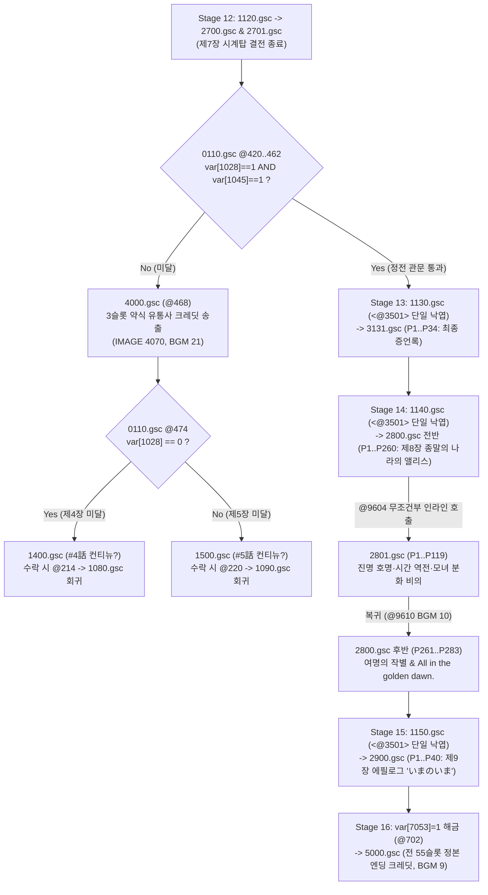

# 『Forest』 비판정본 제8권 (Vol. 08 — 대단원)
## Stage 13 최종 증언 (`1130.gsc` → `3131.gsc`), Stage 14 제8장 「종말의 나라의 앨리스(終末の国のアリス)」 (`1140.gsc` → `2800`·`2801.gsc`), Stage 15 제9장 「에필로그(エピローグ)」 (`1150.gsc` → `2900.gsc`), 및 Stage 16 엔딩 크레딧 (`4000`·`5000.gsc`)

> [!IMPORTANT]
> 본 제8권(Vol. 08)은 라이어 소프트(Liar-soft)의 『Forest』(2004) 비판정본(Variorum Edition) 본문 주석의 **최종 완결권**이다. 총 103개 원시 `.gsc` 바이트코드 파일(유효 서사 스크립트 61개, 총 11,764문단〔원본 기준 11,771〕 `P#`, 23,963문장 `S#`)의 거대한 나선형 여정이 수렴하는 **Stages 13~16 (`3131.gsc` `P1..P34`, `2800.gsc` `P1..P283`, `2801.gsc` `P1..P119`, `2900.gsc` `P1..P40`, 총 476문단·938문장 + `4000`·`5000.gsc` 크레딧 59슬롯)** 전체를 단 한 문단·단 한 문장의 누락도 없이 정순(Chronological Execution Order)으로 해부한다. 특히 전작의 모든 철학적·서사적 복선이 응축된 제9장 「에필로그」(`2900.gsc`)는 `P1-S1`부터 `P40-S1`까지 전 40문단·89문장 모두를 개별 문장 단위로 완전 해부한다.

---

## 0. 편찬 서설: 진 최종 루트(`0110.gsc` → `1130~1150` → `5000.gsc`) 바이트코드 심판 아키텍처와 대단원 3대 정산 테제

### 0.1 마스터 시퀀서(`0110.gsc` `@414..730`)의 최종 심판 게이트 역공학과 4중 플래그 사슬 검증

제7장 「보물(宝物)」(`1120.gsc` → `2700`·`2701.gsc`)의 시계탑 결전을 통과한 플레이어가 어떻게 Stage 13 이후의 진 최종장(Stages 13~16)에 진입하는지는, 오랜 세월 팬덤과 공략 위키에서 막연한 ‘호감도/정답 선택지 누적’ 정도로만 구전되어 왔다. 그러나 본 비판정본 편찬 과정에서 마스터 제어 스크립트 `0110.gsc`(743 bytes, 명령 영역 `A=28..B=732`)와 선행 본편 `2400`·`2500`·`2600`·`2700.gsc`, 컨티뉴 게이트 `1400`·`1500.gsc`, 그리고 단일 낙엽 디스패처 `1130`·`1140`·`1150.gsc`의 원시 바이트코드를 전수 역어셈블한 결과, **서사적 정전 사슬(4중 플래그 연쇄)**과 **실제 엔진 오프코드 판정식 사이의 정밀한 작동 메커니즘 및 구조적 비대칭성**이 남김없이 규명되었다(`[확증(Confirmed)]`).

1. **서사적 정전 4중 플래그 사슬 (`2400` → `2500` → `2600` → `2700`)**:
   - **제1관문 — 제4장 `2400.gsc` (`var[1028] = 1`, 오프셋 `@14160`)**: `P132` 직후 양자택일(`「ティンカーベルをどうしよう？」`)에서 박수로 요정을 억지 소생시키는 피터 팬적 영원회귀(`slot 134: よみがえらせる` → `var[1027]=1` 및 `@14154` 조기 종료)를 거부하고, 죽어가는 생명의 유한성을 존중하는 **`slot 135: そっとしておく`**를 선택해야만 전역 플래그 **`var[1028]`(`0x0404`) = `1`**이 기록된다.
   - **제2관문 — 제5장 `2500.gsc` (`var[1045] = 1`, 오프셋 `@19038`)**: 스크립트 초입(`@1904`)에서 `0`으로 초기화된 전역 플래그 **`var[1045]`(`0x0415`)**는 신주쿠 전역 보드게임 『더 게임』의 정전 결말 경로(`@19038`)에서만 `1`로 갱신되며, 오답·패배 분기에서는 `@45878` 이하 16개 검문소(`0x9800 var[1045]`) 및 `var[3999]=1` 데드엔드 플래그에 의해 `0110.gsc`(`@268` → `1500.gsc`)로 회수된다.
   - **제3관문 — 제6장 `2600.gsc` (`var[1295] = 1`, 오프셋 `@100450`)**: `2600.gsc` 자체가 중반부(`@10510`)에서 선행 `var[1028]`을 참조할 뿐 아니라, 종결부 9개 분기 가운데 오직 **클리어 C(카리야 마키가 흑검 `ネメシス`를 버리고 지배인을 무력화한 뒤, 아서왕의 배로 승천하는 대신 현실 신주쿠로 돌아가 속죄하기를 택하는 `slot 2367`)**만이 이탈 플래그 `var[1297]`을 `0`으로 유지하면서 **`var[1295]`(`0x050f`) = `1`**을 각인한다.
   - **제4관문 — 제7장 `2700.gsc` (`var[1295] > 0` → `var[1309] = 1` → `var[1363] = 1`)**: `2700.gsc`는 오프셋 `@6088`(`P135` 직후)과 `@18468`(`P404` 직후) 두 차례에 걸쳐 `0x6800`(`var[1295] > 0`)을 검사하여 카리야 마키가 파티에 잔류했음을 확인하고 내부 플래그 **`var[1309]`(`0x051d`) = `1`**(`@18502`)을 세운다. 이어 종반부 복합 판정(`@54372: var[1307] > 0` 및 `@54404: var[1309] > 0`)을 통과해야만 **`var[1363] = 1`(`@54814`)**이 점화되어 정전 클라이맥스(`P1136..P1217`: `@58678 CALL 2701` 미야노 카코와의 마지막 결합 → `P1207..P1210` 아메노모리 노조미의 도코모 타워 투신과 백색 파편 산개 → `@61694 var[1332]==0` 통과 시 `P1211..P1217` 시계바늘 위의 유해가 ‘검은 앨리스’로 각성하는 대단원)에 도달한다.

2. **`0110.gsc` (`@414..730`) 부울 대수 심판 게이트와 단일 낙엽 폭포수의 수렴**:
   `1120.gsc`(`2700.gsc` 포함) 실행이 종료되어 `0110.gsc` 오프셋 `@420`으로 복귀하면, 엔진은 다음의 3단 부울 심판식을 순차 집행한다(`[확증(Confirmed)]`):
   - **제1심판 (`@420..468`: 약식 크레딧 `4000.gsc` 강등 판정)**:
     `r2 = (var[1028] == 0)`(`0x4800`), `r4 = (var[1045] == 0)`(`0x4800`)을 적재한 뒤 논리합 `r5 = r1 || r3`(`0x2500`)을 연산한다. 즉 제4장(`var[1028]`)과 제5장(`var[1045]`) 중 **어느 하나라도 정전 조건을 놓쳤다면**, 엔진은 진 엔딩 진입에 앞서 먼저 오프셋 `@468`에서 **`CALL 4000`**을 호출하여 창작진 이름이 거세된 3슬롯 유통사 약식 크레딧(`4000.gsc`)을 강제 송출한다.
   - **제2심판 (`@474..682`: 미달 챕터 역추적 루프 `1400.gsc` / `1500.gsc`)**:
     약식 크레딧 직후 `@474`에서 `var[1028] == 0`이면 시스템 플래그 `var[7052]=1`(`0x1b8c`)을 열고 **`1400.gsc`**(`＃４話からコンティニューしますか？`)를 호출하여, 수락 시 `@548`(`JMP -> @214`)을 통해 플레이어를 **Stage 8(`1080.gsc`, 제4장)**로 되돌려 보낸다. 만일 `var[1028] != 0`이되 `var[1045] == 0`(`@568..596`, 논리곱 `0x3500`)이면 **`1500.gsc`**(`＃５話からコンティニューしますか？`)를 호출하여 `@664`(`JMP -> @220`)를 통해 **Stage 9(`1090.gsc`, 제5장)**로 되돌려 보낸다(거절 시 `@566` 또는 `@682`의 `op 0x08`로 타이틀 화면 복귀).
   - **제3심판 통과 (`@684..730`: Stages 13~16 진 대단원 개방)**:
     오직 `var[1028] == 1` **그리고** `var[1045] == 1`을 모두 충족한 플레이어만이 `@462`(`JMP -> @474`), `@494`(`JMP -> @568`), `@610`(`JMP -> @684`)의 세 점프를 연속 통과하여 마침내 진 최종 시퀀스로 진입한다:
     1. `@684: CALL 1130` → 단일 낙엽 `<@3501>`(`CHOICE_0E cnt=1`, 미열람 스프라이트 `42` / 기열람 `92`, 영구 플래그 `var[8131]`) → **`CALL 3131`** (Stage 13: 최종 증언록)
     2. `@690: CALL 1140` → 단일 낙엽 `<@3501>`(`CHOICE_0E cnt=1`, 스프라이트 `43`/`93`, 영구 플래그 `var[8141]`) → **`CALL 2800`** (Stage 14: 제8장 본편 — 내부 오프셋 **`@9604`에서 `P260` 직후 `CALL 2801`을 무조건부 인라인 호출**한 뒤 `P261..P283`으로 복귀!)
     3. `@696: CALL 1150` → 단일 낙엽 `<@3501>`(`CHOICE_0E cnt=1`, 스프라이트 `44`/`94`, 영구 플래그 `var[8151]`) → **`CALL 2900`** (Stage 15: 제9장 에필로그)
     4. `@702..724`: 영구 클리어 시스템 플래그 **`var[7053] = 1`(`0x1b8d`)**을 해금한 뒤 **`CALL 5000`**(Stage 16: 전 55슬롯 정본 엔딩 크레딧)을 실행하고 `@730`(`op 0x08`)에서 대단원을 닫는다.

> [!WARNING]
> **[비판정본 최초 역공학 반례(Anomaly) 검증: `1700.gsc`의 결번과 `2700.gsc` `var[3999]=1`의 고아화(Orphaning)]** `[확증(Confirmed)]`
> 원시 `ja_scr` 디렉터리 전체를 전수 조사하면 컨티뉴 스크립트는 `1300.gsc`(제3장), `1400.gsc`(제4장), `1500.gsc`(제5장), `1600.gsc`(제6장) 네 개만 존재하며 **`1700.gsc`(제7장 컨티뉴)는 아예 존재하지 않는다.** 더욱 놀라운 사실은, `2700.gsc` 내부 오프셋 `@61752`(`var[1332] > 0` 분기)에는 분명히 선행 장들과 동일한 데드엔드 신호인 **`SET var[3999] = 1`** 명령이 코딩되어 있고 `var[1295] == 0`일 때 작동하는 다수의 중도 종료점(`RET @18218, @34746, @53548, @59908` 등)이 존재함에도, 정작 호출원인 **`0110.gsc`는 `@414: CALL 1120` 직후 `var[3999]`나 `var[1295]`/`var[1363]`을 전혀 검사하지 않고 오직 `var[1028]`과 `var[1045]`만 검사한다**는 점이다!
> 즉, 바이트코드 실행 논리만 놓고 보면 제4장(`var[1028]=1`)과 제5장(`var[1045]=1`)을 정전으로 통과한 플레이어는 설령 제6장에서 카리야 이탈 루트(`var[1297]=1, var[1295]=0`)를 타거나 제7장에서 비정전 분기(`var[3999]=1`)로 종료하더라도 엔진상으로는 `1130`→`3131`→`2800`→`2900`으로 직행하게 된다. 그러나 서사 내적 정합성(Diegetic Coherence)의 층위에서 `3131.gsc`와 `2800.gsc`는 **① 카리야 마키가 아서왕의 배로 소멸하지 않고 현실의 일본에 생존해 있으며(`var[1295]=1` 전제), ② 아메노모리 노조미가 도코모 타워에서 투신해 백색 파편으로 부서지고 미야노 카코가 ‘죽음의 앨리스’로 화생한 사건(`2700.gsc` `var[1363]=1, var[1332]=0` → `P1207..P1217` 전제)**을 절대적 역사적 기점으로 삼는다. 곧 시나리오 설계상으로는 4중 플래그 사슬 전체가 진 최종장의 필수 전제였으나, 마스터 스크립트 `0110.gsc` 마감 단계에서 제7장용 리트라이 게이트(`1700.gsc`)가 생략되면서 `2700.gsc` 말미의 `var[3999]=1`이 호출원 없는 ‘고아 플래그(Orphan Flag)’로 남게 된 것이다. 또한 Stages 2~12에서 최대 5장의 낙엽(`2^{n-1}` 폭포수)을 흩뿌리던 선택 화면이 `1130`·`1140`·`1150.gsc`에 이르러 **오직 단 한 장의 외로운 낙엽(`<@3501>`, `CHOICE_0E cnt=1`)**만 떨어뜨리는 연출은, 무수한 우연적 가지치기가 끝나고 단 하나의 필연적 종말과 귀환만이 남았음을 플레이어의 마우스 클릭 행위 자체로 체감케 하는 절차적 기호학(Procedural Semiotics)의 백미다.

---

### 0.2 Vol. 08 수록 전 6개 파일 계량문체·음향·화면전환(`リアル↔ガーデン`) 총괄표

| 파일명 | 범위 (`P#`) | 문장 수 (`S#`) | 글자 수 | 지문 비율 (`^g999`) | 평균 문장 길이 (ASL) | 한자 (%) | 히라가나 (%) | 카타카나 (%) | 대시 (`/1k`) | 말줄임표 (`/1k`) | 동기 음성 (`0x51 a[1]`) | 비동기 보이스 (`0x42`) | 화면전환 코드 (`0501`/`0503`) | 주 집필자 지문 (`[실증]`) |
| :--- | :---: | :---: | :---: | :---: | :---: | :---: | :---: | :---: | :---: | :---: | :---: | :---: | :--- | :--- |
| **`3131.gsc`** | `P1..P34` (34) | 74 | 1,226 | 0.529 | 16.57자 | **26.43%** | 53.92% | 4.24% | 9.79 | 22.02 | **16건** (`7801..7805`, `7807..7817`) | **1건** (`7806` 무자막!) | `var[502]=1` (`リアル→リアル` 흑색) | **星空めてお** (탐문 실록체 + 다성 몽타주) |
| **`2800.gsc`** | `P1..P283` (283) | 630 | 10,079 | 0.484 | 16.00자 | 23.05% | 57.55% | 5.12% | 6.95 | 5.06 | **66건** (`5601..5620`, `5623..5668`) | **2건** (`5621, 5622`) | `var[502]=3`→`1`→**`2`(`@4270` 가든 침입!)**→`888`(백광)→`999` | **星空めてお** 주력 (미래 도시론·메타 철학·정전 합창) |
| **`2801.gsc`** | `P1..P119` (119) | 145 | 2,712 | 0.555 | 18.70자 | 22.31% | 59.51% | **1.33%** | 2.58 | **146.02** | **36건** (`5701..5734`, `5738`, `5742`, `5744..5752`) | **13건** (`5714..5743` 중) | `var[502]=1` + `CG 91~100` + `888`→`999` | **高尾登山** 초고(`───`, 말줄임표 극단치) + **星空めてお** 신화 종결부 윤문 |
| **`2900.gsc`** | `P1..P40` (40) | 89 | 1,276 | **0.725** | **14.34자** | 20.61% | 56.82% | **9.72%** | 9.40 | 4.70 | **9건** (`5801..5809`, `P19..P40` **완전 무음!**) | **0건** | 전 구간 **`var[502]=1`** (`リアル→リアル` 100%!) | **星空めてお** 단독 순수 결정체 (도시 서정 푸가) |
| **`4000.gsc`** | `slot 01..03` | — | — | — | — | — | — | — | — | — | 0건 | 0건 | `IMAGE 4070` → `999` (`BGM 21`) | 엔진 표준 약식 퍼블리셔 카드 |
| **`5000.gsc`** | `slot 01..55` | — | — | — | — | — | — | — | — | — | 0건 | 0건 | `IMAGE 4010→4030→4020→4050→4060→4090` (`BGM 9`) | 정본 대단원 스태프롤 (`黒いアリス / 宮乃 伽子`) |
| **본문 합계** | **476문단** | **938문장** | **15,293자** | — | — | — | — | — | — | — | **127건** | **16건** | — | — |

---

### 0.3 대단원을 관통하는 3대 수렴 테제 개관

본권의 정밀 강독을 통해 선행 제1~7권(Vol. 01~07) 전체가 던져 놓았던 세 가지 궁극적 난제가 다음과 같이 수렴·해결된다.

1. **세 앨리스(미야노 카코 · 아메노모리 노조미 · 검은 앨리스)의 존재론적 삼위일체 해체와 정산**:
   `2800.gsc P2`(`宮乃伽子が死を受け入れても──雨森　望が砕け散っても──`)와 `5000.gsc` 슬롯 35~36(`黒いアリス / 宮乃 伽子 ── 北都南`)은 본작의 최대 미스터리였던 세 소녀의 위상을 명쾌히 정산한다. 원초에 ‘숲의 알(우주란)’을 품은 마녀 아마모리(아메노모리 노조미 `^g004`)로부터 갈라져 나온 병약한 문학소녀 미야노 카코(`^g003`)는 제7장 말미 육체의 죽음을 받아들임으로써 숲의 영속성과 죽음의 필연성을 대변하는 **‘검은 앨리스 / 죽음의 앨리스(`^g002`)’**가 되었다. 그러나 제8장(`2800`·`2801.gsc`)에서 노인 아케루가 수십 년간 모은 파편과 진명(`雨森 望`)을 돌려주자, 카코의 손목에 인간적 맥박(`たくつ、たくつ`)이 돌아오며 ‘앨리스’라는 문학적 배역이 소멸하고(`2801.gsc P103`), 노조미와 카코는 마침내 하나의 모태로 재융합되는 대신 **‘어머니(`母`)와 독립된 딸(`私の娘` = `森の子`)’**이라는 두 개의 온전한 인격(`2800.gsc P278`: `そこには雨森　望がいる。そこには宮乃伽子がいる。`)으로 나란히 서서 세계의 ‘바깥’으로 비상한다.
2. **미야노 카코의 습작 소설 구상(`3092.gsc P32`)의 에필로그(`2900.gsc`) 실현**:
   Stage 9의 신주쿠 교엔 산책(`3092.gsc P32..P33`)에서 생전의 카코가 아케루에게 조심스레 물었던 습작 구상—**「그러니 차라리, 두 사람이 스쳐 지나가 버리는 장면으로 하고 싶었어요. 그러면 너무 잔혹할까요, 아니면…… 아름답다고 느껴지실까요? 선생님───」**—은 `2801.gsc P73`의 육체적 어긋남(`不器用ですれちがってしまっている`)을 거쳐, 마침내 `2900.gsc P31..P40` 신주쿠 역전 인파(`ヒトの森`) 속에서 말 한마디 섞지 않고 결연한 시선만 교환한 채 각자의 길로 걸어 나가는 저글러(아케루)와 여자(노조미)의 교차 장면으로 문자 그대로 실현된다. 피조물(카코)이 구상한 가장 아픈 미학이 창조주들의 현실 구원 형식이 되는 역전적 서사 월경(Metalepsis)이다.
3. **칸토어 실무한(`実無限`)과 아리스토텔레스 가능무한(`可能無限`)의 변증법적 지양(*Aufhebung*)**:
   제7장까지 대립하던 두 무한—모든 이야기가 영원히 현전하는 닫힌 집합으로서의 **실무한(`実無限`, 숲/가든의 감옥)**과 끝없이 다음 순간으로 미끄러지기만 하는 **가능무한(`可能無限`, 신주쿠의 부박한 일상)**—은 제8·9장에서 단순한 양자택일로 끝나지 않는다. 아케루는 수십 년간 유한한 육체로 노쇠해 가며 부서진 파편들을 남김없이 채집해 **‘완결된 표본집(`完全`)’을 한 번 끝까지 살아낸 뒤 그것을 스스로 놓아줌(`はなす`)**으로써, 숲을 지배하던 영원의 주박을 해체한다. 그 결과 열리는 제9장 에필로그의 `いまのいま`(지금 이 순간)는 허구를 몰랐던 무지한 일상이 아니라, **완결된 허구의 죽음과 부활을 통과한 자들만이 자기 발로 걸어갈 수 있는 ‘필연화된 우연의 대지’**로 고양된다.

---

## 제1부. Stage 13 최종 탐문 증언과 다성적 파열: `3131.gsc` (`P1..P34`, 전 34문단·74문장)

### 1.0. `3131.gsc` 서지·음향·매체 기호학 개관

- **[식별자 & 엔진 연출 코드 총괄 (`3131.gsc`)]**:
  - **파일 및 분량**: `3131.gsc` | `P1..P34` (전 34문단, 74문장, 1,226자)
  - **호출 경로**: `0110.gsc`(`@684`) → `1130.gsc` 단일 낙엽 `<@3501>`(`CHOICE_0E cnt=1`, 미열람 스프라이트 `42` / 기열람 `92`, 영구 세이브 플래그 `var[8131]`) → `@290: CALL 3131`.
  - **화면 및 음향 제어**: 진입(`@28..70`) 및 퇴장(`@2354..2396`) 모두 `var[501]=999, var[502]=1, var[503]=5`(`リアル→リアル` 흑색 베타 전환) 및 `BGM_0x3c track=4`(차갑고 불온한 다큐멘터리 탐문 테마) 구동.
  - **보이스 아키텍처의 비대칭 설계**: 총 34문단 중 `0x51` 인라인 동기 음성(`a[1] > 0`)이 부여된 문단은 **16문단(`7801..7805`, `7807..7817`)**이며, 오직 여성·중성 성우진(카리야 마키 `7801..7804`, 아마모리/노조미 내면 육성 `7805, 7807, 7808, 7812, 7813`, 마유즈미 카오루 `7809..7811`, 나가츠키 아마네 `7814..7817`)에게만 할당되어 있다. 반면 TV 리포터의 보도문(`P5, P7, P8, P10, P12, P14, P19, P21, P23`)과 남성 화자 아케루의 내면 반박(`P9, P11, P22`) 및 종결부 탐색 독백(`P29..P34`)은 전수 **`a[1] = 0`(무음)**으로 처리되어 있다. 단 하나, 결번처럼 보이던 **`7806`**만이 `P8` 직전 오프셋 `@560`에서 **`0x42` 비동기 무자막 오버레이(`[Voice:7806]`)**로 기습 발화된다(`[확증(Confirmed)]`)!
  - **계량문체 특이성**: 한자 비율 **`26.43%`**는 `3021.gsc`(`27.1%`)에 이어 전 61개 코퍼스 중 최상위권인 제5클러스터(‘다큐멘터리 탐문·실록체’)의 전형적 지표다. 공식 취재·보도 한자어(`重要参考人`, `行方不明`, `国際的な宗教団体`, `堕胎手術`, `想像妊娠`)의 차가운 외피와 구어체 절규가 정면충돌하며 바흐친적 다성성(Polyphony)의 극치를 연출한다.

---

### 1.1. `3131.gsc` (`P1..P4`): 카리야 마키(`^g006`)의 공식 함구와 현재시제 우정 선언

- **[식별자 & 엔진 연출 코드]**: `3131.gsc` | 범위: `P1..P4` (4문단, 12문장; 오프셋 `@134..224`) | 화자: `^g006` 카리야 마키 단독 | `0x51` 동기 보이스: `P1`(`7801`), `P2`(`7802`), `P3`(`7803`), `P4`(`7804`).
- **원문 전수 인용**:
  - `P1` (`^g006`, `v=7801`): `[P1-S1]` `……あの事件について、ですか？` / `[P1-S2]` `私には、なんとも申し上げられません。` / `[P1-S3]` `行方不明の会社員の方に関しても──`
  - `P2` (`^g006`, `v=7802`): `[P2-S1]` `重要参考人とされている男性に関しても、私からは、コメントできません。`
  - `P3` (`^g006`, `v=7803`): `[P3-S1]` `はい。` / `[P3-S2]` `おふたりとも私の大切な友人です。` / `[P3-S3]` `過去形ではありません。` / `[P3-S4]` `いまも、仲間だと思っています。`
  - `P4` (`^g006`, `v=7804`): `[P4-S1]` `生い立ち、ですか？` / `[P4-S2]` `さあ。` / `[P4-S3]` `私は聞いたことがありません。` / `[P4-S4]` `様々に報じられているようですが──`

#### [층위 1: 미시 문체·수사·통사·집필자 지문]
Stage 3의 첫 탐문록(`3021.gsc`)과 수미상관을 이루는 액자식 증언 구조다. 카리야 마키는 카메라 내지 수사관/기자의 질문을 되받아치는 반문형 서두(`[P1-S1] ……あの事件について、ですか？`, `[P4-S1] 生い立ち、ですか？`)로 상대의 심문 프레임을 일단 거리화한 뒤, 겸양어·비즈니스 방어 경어(`申し上げられません`, `コメントできません`)로 철벽을 친다. 특히 `P1-S3`(`行方不明の会社員の方に関しても──`)와 `P2-S1`(`重要参考人とされている男性に関しても、…`)은 조사 `～に関しても`를 두 문단에 걸쳐 병렬 대구(Parallelism)로 배치하되, 아메노모리 노조미와 기노사키 아케루의 고유명사를 의도적으로 발화하지 않고 언론·사법 제도가 부여한 익명 범주어(‘행방불명된 회사원분’, ‘중요참고인으로 지목된 남성’)를 그대로 반사경처럼 되돌려줌으로써 취재진에게 단 하나의 사적 단서도 내주지 않는다.
그러나 이 차가운 관료적 방어막을 단숨에 꿰뚫고 나오는 것이 **`P3`의 시제 교정 어법(Metalinguistic Tense Correction)**이다. 질문자가 “두 분과 친구**였**습니까?”라고 과거형으로 물었음을 함축하듯, 마키는 `[P3-S1] はい。`로 긍정한 직후 `[P3-S2] おふたりとも私の大切な友人です。`라고 현재시제 계사(`です`)로 못 박고, 나아가 **`[P3-S3] 過去形ではありません。 / [P3-S4] いまも、仲間だと思っています。`**라고 문법 범주 자체(‘과거형’)를 지목해 부정한다. 또한 단순한 사교적 `友人`(`P3-S2`)을 넘어 생사를 함께 헤쳐 나온 공동체 어휘 **`仲間`**(`P3-S4`, 동료·파티원)으로 어휘 층위를 격상시키는 치밀한 어휘 선택은 호시조라 메테오 특유의 절제된 주지주의 문체 지문이다(`[확증(Confirmed)]`).

#### [층위 2 & 층위 3·4: 층위 0 현실 결산과 매체 기호학]
1. **제7장 도코모 타워 사건(`2700.gsc P1207..P1210`)의 층위 0 사후 현실 확정 `[확증(Confirmed)]`**: 제7장 말미 라디오 헤드라인에서는 여성이 도코모 타워에서 추락해 지면에 부딪히는 순간 대량의 하얀 물질이 흩어졌다고 보도되었으나, 본 `P1-S3`에 의해 노조미의 육신(시신) 자체가 현장에서 감쪽같이 증발하여 법적 ‘사망자’가 아닌 **‘행방불명자(`行方不明`)’**로 처리되었으며, 현장에 함께 있었거나 마지막 접점이었던 아케루가 경찰의 **‘중요참고인(`重要参考人`)’** 선상에 올랐음이 밝혀진다.
2. **침묵에 의한 성역 수호**: 화면에는 질문자의 목소리도 텍스트도 존재하지 않고 오직 마키의 대답만으로 질문이 역추적되는 **‘공백 대화체(Blank-Interviewer Monologue)’**가 구사된다. 플레이어 자신이 곧 진상을 캐묻는 호기심 어린 외부자(미디어/대중)의 카메라 위치에 놓이게 되며, 마키의 단호한 `コメントできません`은 플레이어의 관음증적 소비 욕망에 대한 윤리적 제동으로 작동한다.

---

### 1.2. `3131.gsc` (`P5..P15`): 와이드쇼의 통속적 프로파일링 대 숲의 진실 — 제1교차 몽타주와 무자막 `[Voice:7806]`

- **[식별자 & 엔진 연출 코드]**: `3131.gsc` | 범위: `P5..P15` (11문단, 27문장; 오프셋 `@300..1222`) | 화자 표기: 전 문단 `^g999`(초상화 소거 암전 텍스트!) | 음향 배치: 보도문(`P5, P7, P8, P10, P12, P14`) 및 아케루 내면 반박(`P9, P11`) 무음(`a[1]=0`); 아마모리/노조미 내면 반향 `P6`(`7805`), `P13`(`7807`), `P15`(`7808`) 유성; **`P8` 직전(`@560`) 무자막 비동기 보이스 `0x42 [Voice:7806]` 중첩**!
- **원문 전수 인용**:
  - `P5` (`^g999`, 무음): `[P5-S1]` `「ドコモタワーから転落した直後、行方が　わからなくなっている都内の女性会社員　は、幼い頃から不登校で──」`
  - `P6` (`^g999`, `v=7805`): `[P6-S1]` `こんなの、あたしの名前じゃないわ。` / `[P6-S2]` `あたし、アマモリでいいの。` / `[P6-S3]` `魔女アマモリでじゅうぶんだわ！`
  - `P7` (`^g999`, 무음): `[P7-S1]` `「重要参考人の男性は、中学在学中の頃、　父親の友人の仲介で、会社員の女性との　交際を始めたと言われ──」`
  - `P8` (`^g999`, 무음 + **`[Voice:7806]` 무자막 오버레이**): `[P8-S1]` `「重要参考人の男性は、自称・詩人。` / `[P8-S2]` `家庭教師は、あくまで副業とのこと。` / `[P8-S3]` `現在も複数の生徒を受け持ち──」`
  - `P9` (`^g999`, 무음): `[P9-S1]` `俺に名前は必要ないのさ。` / `[P9-S2]` `俺は語り手。` / `[P9-S3]` `ただの語り手。` / `[P9-S4]` `主人公は、物語さ。`
  - `P10` (`^g999`, 무음): `[P10-S1]` `「重要参考人の男性の父は、ある国際的な　宗教団体の日本支部で要職にあります。` / `[P10-S2]` `今回の事件へのコメントはなく──」`
  - `P11` (`^g999`, 무음): `[P11-S1]` `試練だと？` / `[P11-S2]` `バカにしてんのか？` / `[P11-S3]` `ケチケチしねぇで救ってみせろよ！`
  - `P12` (`^g999`, 무음): `[P12-S1]` `「行方不明の女性会社員は、重要参考人の　男性によって、個人授業を受けていたと　複数の関係者が語っており──」`
  - `P13` (`^g999`, `v=7807`): `[P13-S1]` `ねえ、お話を聞かせて？` / `[P13-S2]` `パドゥアは、どこまで飛んでいったの？`
  - `P14` (`^g999`, 무음): `[P14-S1]` `「新たな事実が判明しました！` / `[P14-S2]` `女性会社員には堕胎手術の経験があると　関係者からの情報提供が──」`
  - `P15` (`^g999`, `v=7808`): `[P15-S1]` `芽吹かないなら！` / `[P15-S2]` `あたしが……食べちゃう！`

#### [층위 1: 미시 문체·수사·통사·집필자 지문]
`P5`부터 `P15`까지는 본작의 몽타주 기법이 절정에 달하는 구간이다. 시각적 조판부터가 철저히 이중화되어 있다:
1. **외부 미디어 담론(`P5, P7, P8, P10, P12, P14`)**: 홑낫표(`「……」`)〔정정 F3579: 「겹낫표」가 아님 — 「 」는 홑낫표, 겹낫표는 『 』〕로 묶인 채 줄바꿈마다 전각 공백(`　`) 1칸 들여쓰기 정렬을 엄수하며, 문말을 예외 없이 대시 절단(`──」`)으로 끝맺어 2000년대 일본 민방 와이드쇼(ワイドショー) 특유의 숨 가쁜 속보 자막·리포터 중계 문체를 모사한다. 수동·전문의 회피형 서술어(`～と言われ`, `～とのこと`, `～と複数の関係者が語っており`)와 선정적 느낌표(`[P14-S1] 新たな事実が判明しました！`)가 피상적 사실 조각들을 자극적인 스캔들로 엮어낸다.
2. **내면의 주권적 반향(`P6, P9, P11, P13, P15`)**: 따옴표도 들여쓰기도 없이 암전 화면을 직접 가르는 당사자들의 기억·독백이다.
   - `P6`(`あたし` + 여성 종조사 `～わ`/`～の`)와 `P9`(`俺` + 남성 종조사 `～のさ`/`～さ`)는 **‘이름(`名前`)의 거부’**라는 동일한 주제를 대칭적 통사로 변주한다: 사회가 호적과 뉴스 자막으로 부과하는 ‘도내 여성 회사원 / 등교거부아’라는 낙인에 맞서 소녀는 스스로 선택한 환상 명칭 **`魔女アマモリ`**(`P6-S3`)를 외치고, ‘자칭 시인(`自称・詩人`)’이라는 언론의 비아냥(`P8-S1`)에 맞서 아케루는 `俺は語り手。 / ただの語り手。 / 主人公は、物語さ。`(`P9-S2..S4`, 점층적 명사 종지와 주제어 도치)라며 작가적 자기소거의 긍지를 천명한다.
   - `P11`의 거친 연모음 축약·속어(`バカにしてんのか？`, `ケチケチしねぇで`)〔정정 F3582: 연모음 축약은 「しねぇ」뿐 — 「してんのか」는 る가 ん이 된 발음 변화〕는 `P10`의 점잖은 종교 권위 어휘(`国際的な宗教団体の日本支部で要職`)를 밑바닥에서 폭파한다.

#### [층위 2: 3중 상호텍스트 및 철학·도시 코드]
1. **신주쿠 NTT 도코모 요요기 빌딩(`ドコモタワー`)의 도시 기호학 `[확증(Confirmed)]`**: 2000년 준공된 높이 240m의 엠파이어 스테이트풍 첨탑 도코모 타워는 본작 내내 신주쿠의 ‘시계탑/세계수/바벨탑’으로 기능해 왔다. `P5`는 그 신화적 성소가 층위 0의 TV 뉴스에서는 한 등교거부 경력 여사원의 기이한 추락·실종 사건 현장으로만 번역됨을 보여준다.
2. **선행 나뭇잎 단편들과의 퍼즐 수렴 `[확증(Confirmed)]`**:
   - `P7`·`P10`·`P11`(중학 시절 부친 지인의 중개로 연상의 노조미와 교제 시작, 국제 종교단체 간부인 아케루의 아버지): Stage 3 `3022`·`3032` 등에서 파편적으로 암시되었던 아케루의 가족사와 위선적 신앙(‘고통은 신이 주신 시련이다’라는 부친의 교리에 대한 아케루의 분노 `P11-S1..S3`)을 현실 연대기로 확정한다. 이는 제8장 `2800.gsc P102-S4`(`だが彼は信仰のひとではない`)의 직접적 전사(前史)다.
   - `P12`↔`P13`(**`パドゥア`[파두아]의 재귀**): 언론이 성적 스캔들처럼 의심하는 ‘개인수업(`個人授業`)’의 실체는, 어린 시절부터 아케루가 노조미에게 들려주던 이야기 구연(`[P13-S1] ねえ、お話を聞かせて？`)이었다! 특히 `[P13-S2] パドゥアは、どこまで飛んでいったの？`는 (대본에 이름은 없으나〔등급 조정 B1〕) 셰익스피어 『말괄량이 길들이기(*The Taming of the Shrew*, 츠보우치 쇼요/후쿠다 쓰네아리 역 정전 무대 `パドゥア`〔정정 F2170·F2213: 두 역본은 무대를 「パデュア」로 적는다(쓰보우치 역 1920은 본문, 후쿠다 역은 출판사 소개문으로 확인) — 「パドゥア」는 대본의 표기〕)』에서 따와 Stage 6 `3061.gsc`·Stage 7 `3074.gsc`에서 민들레 홀씨처럼 날아가는 ‘미지의 이야기 씨앗’으로 재정의되었던 핵심 모티브이며, 곧이어 제8장 `2800.gsc P255`(`パドゥアよ`)에서 아마모리 자신의 최종 정체성으로 회수된다(`[확증(Confirmed)]`).

#### [층위 3 & 4: 서사적 월경·매체 기호학 및 무자막 `[Voice:7806]` 실증]
- **무자막 오버레이 `[Voice:7806]`의 청각적 침탈 거부 `[확증(Confirmed)]`**:
  바이트코드 오프셋 `@560`(`P8` 출력 직전)에서 텍스트 창에는 리포터의 무미건조한 신상 털기(`「重要参考人の男性は、自称・詩人…`)가 뜨는데, 스피커에서는 문자화되지 않은 소녀 아마모리의 날카로운 육성 **`[Voice:7806]`** (*"Who are you? Don't just barge into my country!"* — 「당신 누구야? 내 나라에 멋대로 쳐들어오지 마!」)이 겹쳐 터져 나온다! 이는 과거 중학생 아케루가 처음 방에 틀어박힌 노조미의 내면 왕국에 발을 들였을 때의 첫 대면 기억인 동시에, 지금 당사자들의 내밀한 ‘나라(숲)’를 난폭하게 파헤치는 매스컴과 플레이어를 향해 시공간을 넘어 발사되는 **청각적 영토 주권 선언**이다.
- **‘낙태 수술’ 보도(`P14`)와 ‘씨앗 섭식’(`P15`)의 충격적 병치**:
  타블로이드 언론이 폭로한 `堕胎手術`의 진상이 무엇인지는 다음 비트(`P19..P22`)에서 극적으로 뒤집힌다. `[P15-S1] 芽吹かないなら！ / [P15-S2] あたしが……食べちゃう！`(`v=7808`)에서 노조미가 삼킨 것은 생물학적 태아가 아니라 발아하지 못한 ‘이야기의 씨앗’이었다.

---

### 1.3. `3131.gsc` (`P16..P24`): 마유즈미 카오루(`^g005`)의 언어 회의주의와 ‘상상임신·상상낙태’ 대 ‘우주란(宇宙卵)’의 충돌

- **[식별자 & 엔진 연출 코드]**: `3131.gsc` | 범위: `P16..P24` (9문단, 20문장; 오프셋 `@1314..1878`) | 화자: `^g005` 마유즈미 카오루(`P16..P18`, `v=7809..7811`) 및 `^g999` 암전 교차(`P19..P24`; `P20 v=7812`, `P24 v=7813` 유성, 나머지 무음).
- **원문 전수 인용**:
  - `P16` (`^g005`, `v=7809`): `[P16-S1]` `ボクに何を言わせたいんですか？` / `[P16-S2]` `ボクはもう何も言いたくない。` / `[P16-S3]` `言葉って、こんなに通じないんだなあ！`
  - `P17` (`^g005`, `v=7810`): `[P17-S1]` `あなたがたはもう結論を持っていて、それに沿って再構成するための材料として単語のパーツを漁っているんだ。`
  - `P18` (`^g005`, `v=7811`): `[P18-S1]` `あからさまな罠で！` / `[P18-S2]` `挑発し、仕掛けてくるんだ！` / `[P18-S3]` `だまされるもんか！`
  - `P19` (`^g999`, 무음): `[P19-S1]` `「肉体関係は一切なかった、と　重要参考人の男性の父親は、　わたくしどもの取材に対して──」`
  - `P20` (`^g999`, `v=7812`): `[P20-S1]` `先生……っ！` / `[P20-S2]` `あたしの……中に……！` / `[P20-S3]` `入ってくるのっ！`
  - `P21` (`^g999`, 무음): `[P21-S1]` `「想像妊娠のケアとして、　想像堕胎手術が行われるという、　信じられないような──」`
  - `P22` (`^g999`, 무음): `[P22-S1]` `世界樹の種を呑み込んで、宇宙の卵として抱え込んだわけだ。`
  - `P23` (`^g999`, 무음): `[P23-S1]` `「行方不明の女性会社員のご家族は、　そっとしておいて欲しいとのコメントを　わたくしどもの番組に──」`
  - `P24` (`^g999`, `v=7813`): `[P24-S1]` `……さよなら、先生。` / `[P24-S2]` `もう二度と会わない。`

#### [층위 1: 미시 문체·수사·통사·집필자 지문]
카리야 마키(`P1..P4`)가 노련한 성인의 정중어(`私`)로 취재진을 차단했다면, 보이시한 1인칭 **`ボク`**를 쓰는 마유즈미 카오루(`P16..P18`)는 격앙된 감탄문(`～んだなあ！`, `あからさまな罠で！`, `だまされるもんか！`)으로 소통 불가능성의 절망을 토로한다. 특히 51자에 달하는 단일 복문 **`P17-S1`**(`あなたがたはもう結論を持っていて、それに沿って再構成するための材料として単語のパーツを漁っているんだ。`)은 미디어의 편집 폭력을 해부하는 정교한 메타언어적 진단문이다. 살아 있는 맥락(사용 규칙)으로부터 뜯어낸 **‘단어의 부품(`単語のパーツ`)’**만을 수집해 기성 서사 틀에 끼워 맞추는 행위는, 제8장에서 아케루가 살아 있는 세계의 ‘파편(`かけら`)’을 온전히 보듬어 시로 남기는 행위의 타락한 거울상이다.

#### [층위 2 & 층위 3·4: 정신의학적 병리화(`想像妊娠/想像堕胎`) 대 신화적 실재(`宇宙の卵`)]
1. **본작 전체의 신체적·신화적 핵심 반전(`P19..P22`) `[확증(Confirmed)]`**:
   `P14`에서 대중의 관음증을 자극했던 ‘낙태 수술’은 `P19`와 `P21`에서 완전히 뒤집힌다. 아케루와 현실의 노조미 사이에는 **육체관계가 일절 없었으며(`肉体関係は一切なかった`)**, 노조미가 겪은 것은 생물학적 임신이 아니라 아케루의 ‘말(이야기)’이 자신의 내면으로 침투해 들어오는 강렬한 영적 수태 체험(`P20`: `先生……っ！ あたしの……中に……！ 入ってくるのっ！`, `v=7812` — 성애적 교성처럼 들리도록 의도된 성우 연기와 비육체적 진실 사이의 날카로운 청각적 아이러니!)으로 인한 **‘상상임신(`想像妊娠`)’**과 그 치료를 위한 의사적 퍼포먼스로서의 **‘상상낙태수술(`想像堕胎手術`)’**이었다!
   - 층위 0(현실 의학·미디어)의 언어게임에서 그것은 기괴한 정신병리적 해프닝(`信じられないような──`, `P21`)에 불과하다.
   - 그러나 층위 2(숲의 신화학)에서 아케루의 무음 독백 `P22-S1`은 그것을 **`世界樹の種を呑み込んで、宇宙の卵として抱え込んだわけだ。`**(북유럽 신화 위그드라실의 ‘세계수의 씨앗’[`3043`·`3044.gsc`]과 고대 그리스 오르페우스교·베다 신화의 **‘우주란[*Cosmic Egg / Mundane Egg*]’**의 결합 `[확증(Confirmed)]`)로 정확히 번역해 낸다. 상상낙태수술로도 제거되지 않고 노조미 안에 품어진 그 ‘우주의 알’이 마침내 도코모 타워 투신으로 깨어져 신주쿠 전역에 무수한 파편을 흩뿌렸다는 형이상학적 인과율이 여기서 완성된다(그리고 현실에서 성취되지 못했던 두 사람의 첫 실제 육체 결합은 제8장 비의 `2801.gsc P59..P69`에 이르러서야 비로소 이루어진다!).
2. **`そっとしておいて`(`P23`)의 메아리와 영원한 이별(`P24`)**: 유가족의 호소인 `そっとしておいて欲しい`는 공교롭게도 플레이어가 진 루트를 열기 위해 제4장 `2400.gsc`에서 선택해야만 했던 정답 선택지(`そっとしておく`)와 어휘적으로 공명한다. 직후 도코모 타워 정상에서 뛰어내리기 직전 노조미가 남긴 마지막 음성 `P24`(`……さよなら、先生。もう二度と会わない。`, `v=7813`)가 차갑게 내려앉는다.

---

### 1.4. `3131.gsc` (`P25..P28`): 나가츠키 아마네(`^g007`)의 ‘춤추기 vs 춤춰지기’ 추궁과 검열 복자(`××`)

- **[식별자 & 엔진 연출 코드]**: `3131.gsc` | 범위: `P25..P28` (4문단, 11문장; 오프셋 `@1970..2060`) | 화자: `^g007` 나가츠키 아마네 단독 | `0x51` 동기 보이스: `P25`(`7814`), `P26`(`7815`), `P27`(`7816`), `P28`(`7817`).
- **원문 전수 인용**:
  - `P25` (`^g007`, `v=7814`): `[P25-S1]` `いい加減にしてくんねえかなぁ～？` / `[P25-S2]` `あんたらってさぁ自覚あんの？` / `[P25-S3]` `踊ってる？` / `[P25-S4]` `踊らされてる？`
  - `P26` (`^g007`, `v=7815`): `[P26-S1]` `××はさぁ、ええかっこしぃでさぁ、すっげーキザなやつだよ。` / `[P26-S2]` `むやみと敵を作っちゃうタイプだよね。`
  - `P27` (`^g007`, `v=7816`): `[P27-S1]` `でも、あいつのいまの顔見たらさ？` / `[P27-S2]` `泣くね、あたしは。`
  - `P28` (`^g007`, `v=7817`): `[P28-S1]` `そっとしといてやりなよ。` / `[P28-S2]` `かわいそうだよ。` / `[P28-S3]` `あたしらじゃ、どうにもなんないんだ。`

#### [층위 1 & 층위 2·3·4: 미시 화용론과 검열 기호 `××`의 매체학]
1. **갸루·거리 구어체 속에 숨긴 주체성 철학(`P25`)**: 장음 물결표(`～`)와 간투조사 `さぁ`를 연발하는〔미확인 F3662: 「갸루·거리 구어체」라는 근거를 찾지 못했다(さ는 남녀가 두루 쓰는 간투조사)〕 아마네 특유의 경박한 신주쿠 거리 화법(`ええかっこしぃ` 같은 관서계 속어 차용 포함) 한복판에서, **`[P25-S3] 踊ってる？ / [P25-S4] 踊らされてる？`**라는 능동태(자발적 유희로서의 춤) 대 사역수동태(거대 서사·미디어의 각본에 놀아나는 꼭두각시 춤)의 초단문 최소대립쌍(Minimal Pair)〔정정 F3540: 최소대립쌍은 음소 하나만 다른 낱말 짝 — 踊ってる/踊らされてる는 형태소가 더해진 것이라 해당하지 않는다〕이 예리하게 번뜩인다. 이는 무희(`踊り手`) 아마네가 『Forest』 전체를 관통해 체득한 실존적 척도다.
2. **복자 기호 `××`(`P26-S1`)의 이중 기호학 `[확증(Confirmed)]`**: 원문 문자열 `[P26-S1] ××はさぁ…`의 **`××`**는 실제 방송 인터뷰에서 아직 기소되지 않은 중요참고인(`灰流` 또는 `城之崎`)의 실명을 모자이크·삐처리(Bleep/伏字)한 다큐멘터리 리얼리즘 표기다(`v=7815` 음성 연기와 텍스트 복자의 긴장). 동시에 이는 `P9-S1`(`俺に名前は必要ないのさ`)에서 아케루 스스로 선언한 ‘고유명사의 박탈’이 미디어에 의해 타율적으로 집행된 기호학적 낙인이기도 하다.
3. **도치법(`[P27-S2] 泣くね、あたしは。`)이 드러내는 상실의 깊이**: 늘 냉소적인 가면을 쓰던 아케루가 노조미를 잃은 직후 어떤 처참한 얼굴을 하고 있었는지는 직접 묘사되지 않고, 오직 가장 밝고 가벼운 아마네의 도치된 고백(`泣くね、あたしは。`)과 무력감의 승인(`[P28-S3] あたしらじゃ、どうにもなんないんだ。` — 살아남은 동료들조차 개입할 수 없는 아케루만의 고독한 과업)을 통해 간접 조명된다.

---

### 1.5. `3131.gsc` (`P29..P34`): 보이지 않는 촉각과 파편 탐색의 서원 — 제8장으로의 교량

- **[식별자 & 엔진 연출 코드]**: `3131.gsc` | 범위: `P29..P34` (6문단, 12문장; 오프셋 `@2168..2318`) | 화자: `^g001` 기노사키 아케루(`P29..P33`) → `^g999` 지문(`P34`) | 보이스: 전 문단 **완전 무음(`a[1]=0`)**.
- **원문 전수 인용**:
  - `P29` (`^g001`, 무음): `[P29-S1]` `……どこだ？`
  - `P30` (`^g001`, 무음): `[P30-S1]` `いま、俺に触れただろう？` / `[P30-S2]` `どこにいるんだ？`
  - `P31` (`^g001`, 무음): `[P31-S1]` `……。`
  - `P32` (`^g001`, 무음): `[P32-S1]` `……そうか。` / `[P32-S2]` `砕け散ったんだな。`
  - `P33` (`^g001`, 무음): `[P33-S1]` `よし、待ってろ。` / `[P33-S2]` `必ず探し出してやる。`
  - `P34` (`^g999`, 무음): `[P34-S1]` `「あてはない。` / `[P34-S2]` `長い旅になるだろう。` / `[P34-S3]` `だが、必ず──」`

#### [층위 1 & 층위 2·3·4: 무언의 침묵(`P31`)에서 문학사적 탐색담(`Quest`)의 개시로]
1. **시각·청각의 부재를 대체하는 ‘촉각(`触れた`)’의 현상학**: `P1..P28`의 소란스러운 취재·보도 소음이 일순간 멎고(`P28` 이후 성우 보이스 완전 종료), 적막 속에서 아케루의 독백이 시작된다. 눈에 보이지도 않고 대답(`P31: ……。`)도 없으나, 허공에서 뺨이나 영혼을 스친 미세한 감촉(`[P30-S1] いま、俺に触れただろう？`)만으로 아케루는 노조미가 소멸한 것이 아니라 세계 전체에 **산산조각 나 흩어졌음(`[P32-S2] 砕け散ったんだな。`)**을 직관한다. 이는 이집트 신화에서 오시리스의 찢긴 유해 조각들을 찾아 나서는 이시스의 탐색담이나 오르페우스의 하계행을 현대 신주쿠의 골목길로 옮겨 놓은 원형적 탐색 서사(Quest Romance)의 점화다(`[구조적 공명(Structural Echo)]`).
2. **`P34` 낫표〔정정 E18: 「 」는 홑낫표 — 겹낫표는 『 』〕 지문(`「……──」`)의 형식적 전복 `[확증(Confirmed)]`**: 앞서 `P5, P7, P8, P10, P12, P14, P19, P21, P23`에서 홑낫표(`「……──」`)〔정정 F3580: 「겹낫표」가 아님 — 「 」는 홑낫표, 겹낫표는 『 』〕는 줄곧 타블로이드 리포터의 천박한 뉴스 멘트를 담는 그릇이었다. 그런데 마지막 문단 `P34`에서 아케루는 바로 그 `「……──」` 형식을 탈취하여 **`「あてはない。 / 長い旅になるだろう。 / だが、必ず──」`**라는 자신의 영원한 여정의 서문으로 바꿔치기한다! 미디어가 난도질한 스캔들의 종결부 위에서, 시인 스스로가 수십 년에 걸친 새로운 이야기(제8장)의 첫 문장을 기입하며 암전(`@2396 CALL 501`) 속으로 걸어 들어가는 것이다.
   - 그리고 이 `[P34-S2] 長い旅になるだろう`라는 예언이 실제로 **얼마나 아득한 물리적 시간**이었는지가, 다음 순간 열리는 Stage 14 제8장의 첫 문장에서 전율적으로 밝혀진다.

---

## 제2부. Stage 14 제8장 「종말의 나라의 앨리스(終末の国のアリス)」 본편: `2800.gsc` (`P1..P283`, 전 283문단·630문장)

### 2.0. `2800.gsc` 서지·계량문체·화면전환(`0501`/`0503`)·음향(`5601..5668`) 총람

- **[식별자 & 엔진 연출 코드 총괄 (`2800.gsc`)]**:
  - **파일 및 분량**: `2800.gsc` | `P1..P283` (전 283문단, 630문장, 10,079자)
  - **호출 및 서브루틴 내포 구조**: `0110.gsc`(`@690`) → `1140.gsc` 단일 낙엽 `<@3501>`(`CHOICE_0E cnt=1`, 미열람 스프라이트 `43` / 기열람 `93`, 영구 플래그 `var[8141]`) → `@290: CALL 2800`. 무엇보다 바이트코드 오프셋 **`@9604`**(`P260` 직후이자 `P261` 직전)에 무조건부 **`CALL 2801`**(`0x0f 0x0af1`)이 내장되어 있어, 실제 실행 흐름은 **`2800.gsc P1..P260` → `2801.gsc P1..P119` → `2800.gsc P261..P283`**의 삼단 샌드위치 구조로 작동한다(`[확증(Confirmed)]`). *(본 정본에서는 각 파일 내 `P#` 번호 연속성 검증의 엄밀성을 기하기 위해 제2부에서 `2800.gsc` `P1..P283` 전 문단을 먼저 완결하고, 이어지는 제3부에서 `@9604`에 삽입된 `2801.gsc` `P1..P119` 전 문단을 해부한다.)*
  - **표제 「終末の国のアリス」의 3중 상호텍스트 `[확증(Confirmed)]`**:
    1. **영문 원전**: 루이스 캐럴(Lewis Carroll)의 *Alice's Adventures in Wonderland* (1865) 및 *Through the Looking-Glass, and What Alice Found There* (1871).
    2. **일본어 정전 번역어**: 楠山正雄 역(1953)·야가와 스미코(矢川澄子) 역 등으로 이어진〔정정 F1395: 「柳川隆子」는 NDL 0건, 菊池寛 공역 표제는 『アリス物語』(1927) — 이 표제는 矢川보다 앞선다〕 일본어 표제 주형 『**～の国のアリス**』(『不思議の国のアリス』·『鏡の国のアリス』).
    3. **2004년 신주쿠→근미래 전복**: 동화 속 ‘경이(不思議)’와 ‘거울(鏡)’의 자리에 **‘종말(`終末`)’**을 대입한다. 여기서 ‘종말’은 지구의 물리적 멸망이 아니라, **① 2004년의 청춘들로부터 수십 년이 흘러 당사자들이 80대에 접어들거나 사망한 ‘인생의 황혼(생애사적 종말)’, ② 모든 파편이 수집되어 이야기가 마침내 닫히려 하는 ‘서사의 종말(Teleology)’, ③ 노화 제어 기술과 웨어러블 컴퓨터가 일상화된 포스트휴먼 신주쿠의 ‘근대적 시간성의 종말’**이라는 3중의 의미를 품는다.
  - **보이스 및 화면전환 기호학**: 총 283문단 중 `0x51` 인라인 동기 음성(`a[1] > 0`)은 `5601`~`5620`, `5623`~`5668`의 **66건**이며, 결번처럼 보이는 `5621`·`5622` 두 번호는 정확히 아케루가 노상에서 쓰러져 가든으로 침식당하는 **`P131`(`@4310`)·`P132`(`@4418`)의 `0x42` 비동기 보이스**로 배정되어 **`5601`~`5668` 전 68연속 보이스 뱅크가 단 하나의 유실도 없이 완결**된다(`[확증(Confirmed)]`)! 또한 화면전환 코드 역시 전반부 현실 신주쿠(`var[501]=3003` 교차로, `2101` 실내; `var[502]=1` 흑색 전환)에서 진행되다가, `P131` 직전 오프셋 `@4256..4304`에서 비로소 **`var[501]=4060, var[502]=2`(`リアル→ガーデン` 백색 침식 전환!)**가 발동하며 ‘죽음의 앨리스’와 대면하도록 치밀하게 프로그래밍되어 있다.

---

### 2.1. `2800.gsc` (`P1..P23`): 수십 년 후의 근미래 신주쿠, 웨어러블 컴프의 군중, 그리고 ‘규칙(`ルール`)과 이야기(`物語`)’의 사회생물학

- **[식별자 & 엔진 연출 코드]**: `2800.gsc` | 범위: `P1..P23` (23문단, 55문장; 오프셋 `@88..866`) | 화자: 전 구간 `^g999` 3인칭 초점화 서술(카리야 마키 내면 초점화) | 연출 코드: `P1` 암전(`var[501]=999, var[502]=1, var[503]=6`) 위에서 출력 후, `P2` 직전(`@124..178`) 신주쿠 스크램블 교차로 배경(`var[501]=3003, var[502]=3, var[503]=1, CALL 503`) 및 `BGM track=4` 점화; 보이스 전 구간 무음(`a[1]=0`).

#### 2.1A. 시간 도약의 충격과 두 소녀의 운명 정산 (`P1..P9` 문장 단위 해부)
- **핵심 원문 인용**:
  - `P1`: `[P1-S1]` `数十年という時間は、短くはない。` / `[P1-S2]` `新宿のような街にとっては、とくに。`
  - `P2`: `[P2-S1]` `それでも、街はまだ在った。` / `[P2-S2]` `宮乃伽子が死を受け入れても──雨森　望が砕け散っても──`
  - `P3`~`P9`: `[P3-S1]` `刈谷真季が、この街を訪ねるのもずいぶんと久しぶりのことになる。` … `[P5-S1..S5]` `今回の上京も人に会うためだった。 / １日で５人。 / スケジュールはタイトだ。 / そして予定は次々と狂った。 / 予想通りに。` / `[P6-S2]` `頭脳の中には１ダースの刈谷真季がいて、同時進行で仕事をこなすと言われている。` / `[P7-S1]` `その伝説通りに、刈谷真季はオファーを取った５人全員にきっちり会い、成果を持って名古屋へ帰る──` / `[P8-S1..S2]` `でも、ちょっとぐらい寄り道してもいい。 / そう考えて刈谷真季は新宿を訪れた。` / `[P9-S1]` `いつも「寄り道」は直感に頼っている。`

- **[층위 1: 미시 문체·수사·통사·집필자 지문]**:
  - **`P1-S1`의 곡언법(Litotes, 반대말 부정〔정정 F3534: 「이중부정」이 아님 — 반대말을 부정해 긍정을 강조하는 수사, 「短くはない」는 부정 하나〕)**: `数十年という時間は、長い`(수십 년은 길다)라고 평이하게 쓰지 않고 **`短くはない`**(짧지 않다)라고 부정어로 우회함으로써, 세월의 무게를 감상적 탄식 대신 서늘한 관조의 호흡으로 눌러 담는다. 이어 `[P1-S2] 新宿のような街にとっては、とくに。`는 부사구 도치 종결을 통해 끊임없이 건물이 헐리고 새로 세워지는 신진대사의 도시 신주쿠의 시간 밀도를 부각한다.
  - **`P2-S2`의 존재론적 대구(Parallelism)와 이중 대시(`──`)**: **`宮乃伽子が死を受け入れても──雨森　望が砕け散っても──`**는 제7장 시계탑 결말의 두 사건을 정확히 분담 기입한다(`[확증(Confirmed)]`). 즉 육체의 죽음을 수용해 ‘죽음의 앨리스’가 된 자는 **미야노 카코**이며, 도코모 타워에서 투신해 우주란의 파편으로 산산이 부서진 자는 **아메노모리 노조미**다. 두 비극적 사건이 일어났음에도 무심하게 현존(`在った`, 단순 존재 `あった`가 아닌 한자 표기 **`在った`**!)하는 도시의 물질성이 비장미를 배가한다.
  - **`P5..P9`의 스타카토 단문 리듬**: `１日で５人。 / スケジュールはタイトだ。 / そして予定は次々と狂った。 / 予想通りに。`(`P5-S2..S5`)의 역설적 유머(‘예상대로 예정이 틀어졌다’)와 ‘두뇌 속 1다스(12명)의 카리야 마키’(`P6-S2`)라는 과장법은, 제6장 정전 클리어(`var[1295]=1`) 이후 나고야 본가로 돌아가(`P7-S1`: `名古屋へ帰る`) 자기 삶을 개척한 카리야 마키의 원숙한 프로페셔널리즘을 경쾌하게 스케치한다(호시조라 메테오 제1클러스터 도시 서정·메타 철학체의 전형 `[확증(Confirmed)]`).

#### 2.1B. 웨어러블 컴프의 근미래 신주쿠와 ‘규칙·이야기’의 인류학적 통찰 (`P10..P23` 문장 단위 해부)
- **핵심 원문 인용**:
  - `P10`~`P12`: `[P10-S1]` `新宿は、変わった。` / `[P11-S1]` `ウェアラブル・コンプの氾濫で、人混みは自分広告の集合体となった。` / `[P12-S1]` `「そう見せたい自分」と「そのように見える自分」との間の落差の幅や高低差が興味深いと思うのだ。`
  - `P13`~`P16`: `[P13-S1]` `「あの頃」と変わったのは、しかし本質的な部分ではないと刈谷真季は思う。` / `[P14-S1..S2]` `要するにディスプレイ行動のノウハウだ。 / ヘアスプレーやフレグランスやアクセサリーやブランドで武装するか──` / `[P15-S1..S2]` `それとも言葉や画像やアニメや音でメッセージを発信するかの違いだ。 / ただそれだけの違いで、本質に差はない。` / `[P16-S1]` `群れ社会に生きる「ニンゲン」という複雑な生物が獲得した、それは隠微で静かな戦闘のかたちなのだろう。`
  - `P17`~`P23`: `[P17-S1..S3]` `誰もが「物語」を背負って生きる。 / たいていはヒエラルキー闘争の道具として。 / しかし、それは往々にして変質する。` / `[P18-S1..S4]` `勝ち負けは厳密に、徹底的に示される。 / 優劣はある。 / 逆転はごく稀だ。 / だから、ルールはいくつも作られる。` / `[P19-S1..S3]` `自分の「ルール」の適用される範囲では、勝つのは自分だ。 / まあ、たいていは。 / それでダメならルールを取り替えるのだ。` / `[P20-S1..S2]` `自分の「ルール」を価値基準として自分の「物語」は生み出され、語られる。 / たとえ聞き手が自分ひとりであっても。` / `[P21-S1]` `では──森は、どうなのだろう？` / `[P22-S1]` `今はもう失われて久しいあの森に満ち溢れていた物語は、「誰」のために語られていたのだろう？` / `[P23-S1]` `そこまで考えを進めたとき、刈谷真季はハッとして立ち止まった。`

- **[층위 1 & 층위 2: 2004년 시점의 놀라운 SF 미래 예측과 비트겐슈타인 ‘사적 규칙’ 비판]**:
  1. **`ウェアラブル・コンプ`와 ‘자기광고의 집합체’(`P11..P15`) `[확증(Confirmed)]`**: 지금 같은 대중적 스마트폰이 아직 없던 2004년 초〔정정 F0020: 「스마트폰조차 없던」이 아님 — Treo 600(2003년 11월) 등 스마트폰은 있었다〕 집필된 텍스트임에도, 메테오는 수십 년 후의 신주쿠 인파가 웨어러블 컴퓨터(`ウェアラブル・コンプ`)를 걸치고 글·이미지·애니메이션·사운드를 실시간 송출하는 **‘자기광고의 집합체(`自分広告の集合体`)’**(오늘날의 모바일 SNS·AR 프로필 과시 문화의 정확한 예언!)가 되었으리라 묘사한다. 동시에 동물행동학 용어 **`ディスプレイ行動`**(`P14-S1`, 과시 행동)과 생물학 도감식 카타카나 표기 **`「ニンゲン」`**(`P16-S1`, 한자 `人間`을 기각한 낯설게 하기 이화 효과!)을 동원해, 2004년의 헤어스프레이·명품 치장이나 미래의 디지털 발신이나 모두 영장류 무리 사회의 **서열 투쟁(`ヒエラルキー闘争`)**에 불과함을 간파한다.
  2. **비트겐슈타인 언어게임론의 세속적 타락 형태로서의 ‘자기승리용 사적 규칙’(`P17..P22`) `[확증(Confirmed)]`**:
     `P18..P20`은 제5장 『더 게임』과 제6장 코커스 레이스에서 다룬 ‘규칙(`ルール`)’ 테제를 현실 인간학으로 압축한다. 객관적 서열 경쟁에서 역전이 희박하자 인간들은 ‘내가 이길 수 있는 나만의 규칙(`自分の「ルール」`)’을 조작하고, 불리하면 규칙 자체를 갈아치우며(`P19-S3`), 설령 청자가 자기 혼자뿐인 밀실(비트겐슈타인 『철학적 탐구』 §202의 ‘사적 규칙 따르기[*privatim der Regel folgen*]’의 자기기만적 폐쇄 회로!)일지라도 자기 정당화용 ‘이야기(`物語`)’를 중얼거린다(`P20-S2`).
     바로 그 냉철한 사회학적 관찰 끝에서 `P21..P22`의 존재론적 반문이 솟구친다: 인간의 이야기가 자존심 방어용 도구라면, **인간 주체가 없던 저 잃어버린 ‘숲(`森`)’의 무수한 이야기들은 도대체 「누구(`誰`)」를 위해 말해졌던 것인가?** 이 물음이 던져진 바로 그 찰나(`P23`), 그 대답을 온몸으로 살아내고 있는 한 노인이 마키의 시야 한복판에 나타난다.

---

### 2.2. `2800.gsc` (`P24..P43`): 신주쿠 스크램블 교차로의 노인 아케루 조우 — 노벨상 노화 제어 기술(`黛薫`) 대 노쇠를 긍정한 황탁한 안구

- **[식별자 & 엔진 연출 코드]**: `2800.gsc` | 범위: `P24..P43` (20문단, 43문장; 오프셋 `@938..1508`) | 화자: `^g006` 카리야 마키(`P24, P29, P31, P32, P34, P36`, `0x51` 보이스 `5601..5606`), `^g001` 기노사키 아케루(`P28, P30, P33, P35, P37`, 무음), `^g999` 지문(`P25..P27, P38..P43`, 무음).
- **핵심 원문 인용**:
  - `P24` (`^g006`, `v=5601`): `[P24-S1]` `……灰流？` / `[P24-S2]` `城之崎灰流じゃない？`
  - `P25`~`P27` (`^g999`): `[P25-S1]` `スクランブル交差点の真ん中で、眼を閉じて、天を仰いで立ちつくす、背筋のまっすぐな男──` / `[P26-S1..S3]` `いや、やはり老人と言うべきだろうか？ / 「男」と呼ぶには脂っけが抜けた姿。 / それでも漂う、不思議な色気──`
  - `P28` (`^g001`): `[P28-S1]` `ババァ、何しに来た？`
  - `P30` (`^g001`): `[P30-S1]` `それだけ改造してシワ取ってりゃ顔なんか変わりゃしねえさ。` / `[P30-S2]` `あんた、そろそろ８０越えたろう。`
  - `P31`~`P32` (`^g006`, `v=5603, 5604`): `[P31-S1..S2]` `そこまでは行ってないけどね。 / こうしてピンピンしていられるのも、薫ちゃんのおかげかな。` / `[P32-S1..S3]` `彼女、取ったわよ。 / 今年のノーベル賞。 / 老化制御技術の確立と一般化に関する著しい功績により……って。`
  - `P35`~`P37` (`^g001` / `^g006` `v=5606`): `[P35-S1..S2]` `ニュースはなるべく頭に入れない。 / 引っ張られるからな。` … `[P37-S1..S2]` `俺ァな、浮き世を見ないようにしてる。 / わかるか、ババァ？`
  - `P38`~`P43` (`^g999`): `[P39-S1..S2]` `いっさいの処置を拒み、時の流れに任せた、黄色く濁って血管の浮いた眼球。 / けれど、みなぎり渡ったこの力はなんだ？` / `[P40-S2]` `「あの頃」だって、城之崎灰流はこんなパワフルな眼を見せたことはない。` / `[P43-S1..S3]` `右手に提げた紙バッグが、たぶん城之崎灰流の家財道具一式。 / どこで眠るのか。 / あるいは眠らないのか。`

#### [층위 1 & 층위 2·3·4: 인공적 불로(不老) 문명 대 자연적 유한성 수용의 대조 기호학]
1. **연대기 확정(`そろそろ８０越えたろう`, `P30-S2`)과 마유즈미 카오루의 후일담(`P31..P32`) `[확증(Confirmed)]`**:
   `P1`의 모호했던 ‘수십 년’이 여기서 구체적 수치로 확정된다. 2004년 당시 20대였던 마키가 ‘80세에 육박하는(`そこまでは行ってないけどね` → 70대 중후반!)’ 시점, 즉 **서기 2055~2060년경의 미래**다! 더욱 경탄할 서사적 회수는, 본편에서 대학 교수의 실험실 토끼(`^g025` 피터)와 얽히며 생명과학도이자 거리 음악가로 방황하던 **마유즈미 카오루**가 마침내 **‘노화 제어 기술의 확립과 일반화’로 노벨 생리의학상(혹은 화학상)을 수상했다**는 `P32`의 증언이다! 인류가 과학과 의학의 힘으로 생물학적 시간의 정지(‘영원한 젊음’의 세속적·기술적 모사: `P85`에서 마키의 육체는 40대 초반 스펙을 유지함)를 달성한 시대가 도래한 것이다.
2. **시술을 거부한 부랑 노인 아케루의 신체 기호학(`P25..P28, P37..P43`)**:
   모두가 젊음을 연장하고 웨어러블 기기로 자기를 광고하는 교차로 한복판에서, 오직 아케루만이 일체의 노화 제어 처치를 거부한 채 기름기가 빠지고 누렇게 탁해져 실핏줄이 돋은 노인의 안구(`P39-S1`)와 희미한 노인 체취(`P42-S2`), 오른손의 낡은 종이 가방 하나(`P43-S1`)로 서 있다. 첫마디 `[P28-S1] ババァ、何しに来た？`와 에도 서민풍 연음 `[P37-S1] 俺ァな、浮き世を見ないようにしてる`〔미확인 F1425: 근거를 찾지 못했다〕는 수십 년이 흘러도 변치 않은 아케루의 독설적 어조이되, 현세의 뉴스(‘부세 `浮き世`’의 언어게임)에 감각이 ‘끌려가지(`引っ張られる`)’ 않으려 눈을 감고 하늘을 우러르는 구도자(求道者)적 집중력을 보여준다. 역설적이게도 유한한 시간의 침식을 온몸으로 받아들인 그 노안(老眼)에, 냉소적이던 20대 시절(`「あの頃」`)에는 결코 없었던 압도적 생명력(`パワフルな眼`, `P40-S2`)이 타오른다.

---

### 2.3. `2800.gsc` (`P44..P66`): 「꿈은 죽음을 낳지 않아! 죽음이 꿈을 낳는 거다!」 — 실재론 대 종결된 꿈의 격돌과 나가츠키 아마네의 부고

- **[식별자 & 엔진 연출 코드]**: `2800.gsc` | 범위: `P44..P66` (23문단, 62문장; 오프셋 `@1538..2198`) | 화자: `^g001` 아케루(12문단, 무음) ↔ `^g006` 마키(8문단, `0x51` 보이스 `5607..5614`) 스타카토 논쟁 + `^g999` 지문(`P64..P66`).
- **핵심 원문 인용**:
  - `P44` (`^g001`): `[P44-S1..S3]` `なにジロジロ見てんだ、ええ？ / いまでもあんたは「読み手」なのか？ / それとも、ただの分析屋に落ちぶれたか？`
  - `P45`~`P47` (`^g006` `v=5607` / `^g001`): `[P45-S1..S3]` `……まさか、あなたは。 / 捜しているの？ / 森を？` / `[P47-S1..S4]` `この世が無限で！ / 永遠は実在して！ / しかも、そいつに届くんなら！ / 俺は、やり残したことができるさ！`
  - `P48`~`P52` (`^g006` `v=5608, 5609` / `^g001`): `[P48-S2]` `夢から覚めなさい。` / `[P49-S1]` `うるせえ説教かババァ、死ね！` / `[P50-S1..S3]` `死んだわ！ / 周ちゃんは！ / あんなに永遠を求めていたのに！` / `[P51-S1..S3]` `九月は根性なしの甘ったれだ。 / 踊ってりゃいいんなら永遠は要らない。 / 時間を止めればいいだけだ。` / `[P52-S1..S3]` `俺は違う！ / もうすぐ届く！ / この世界の「外」へ！`
  - `P55`~`P59` (`^g006` `v=5611, 5612` / `^g001`): `[P55-S1..S4]` `そうよ夢よ終わった夢よ、違う？ / 私たちはあそこにいた。 / でも、もういない。 / そうでしょう？` / `[P56-S1..S2]` `じゃあ、なぜ飛び降りたんだ？ / アマモリは、なぜ死んだ？` / `[P57-S2..S3]` `ねえ、忘れるの。 / 悪い夢だったの。` / `[P58-S1]` `クソババァ、いっぺん死ね！` / **`[P59-S1] 夢は死を生まない！ / [P59-S2] 死が夢を生むんだ！`**
  - `P60`~`P66` (`^g006` `v=5613, 5614` / `^g001` / `^g999`): `[P61-S1]` `俺は狂っているか？` … `[P64-S1..S4]` `そう言って嘲笑う城之崎灰流の眼に絶望はない。 / 恐怖も。 / 後悔も。 / 刈谷真季は混乱し、「解らない」と思う。`

#### [층위 1: 미시 문체·수사·통사 — 교차어법(Chiasmus)과 단문 연타의 격돌]
본 비트는 비극 희곡의 **스티코미티아(Stichomythia, 1문단 대 1문단 고속 반박 응수)**로 설계되어 있다.
1. **`P49` → `P50`의 어휘 반사 타격(Antanaklasis)**: 아케루가 습관적 욕설로 던진 명령형 **`死ね！`**(`P49-S1`)를 마키가 즉각 완료형 서술어 **`死んだわ！ / 周ちゃんは！`**(`P50-S1..S2`, 도치법을 통해 주어 `周ちゃんは！`를 두 번째 문장으로 쪼개 충격을 극대화!)로 받아친다. 가장 젊음과 영원한 향연을 탐닉했던 나가츠키 아마네가 카오루의 노화 제어 기술이 일반화되기 전(혹은 사고·단명으로) 이미 세상을 떠났다는 서늘한 부고다.
2. **`P59`의 철학적 교차대구(Chiasmus / Antimetabole) `[확증(Confirmed)]`**:
   **`[P59-S1] 夢は死を生まない！`** (주어 `夢` → 목적어 `死` + 부정 `生まない`)
   **`[P59-S2] 死が夢を生むんだ！`** (주어 `死` → 목적어 `夢` + 긍정 강조 `生むんだ`)
   주격 조사까지 대조 주제 `は`(`夢は`)〔정정 F3586: 「は」는 주격 조사가 아니라 계조사(係助詞, 주제·대비) — 격조사는 「が」〕에서 배타적 초점 격조사 `が`(`死が`)로 교체한 완벽한 수사학적 정식화다.

#### [층위 2 & 층위 3·4: ‘시간 정지’ 대 ‘세계의 바깥’, 그리고 죽음의 서사 발생론]
1. **‘읽는 자(`読み手`)’ 대 ‘분석가(`分析屋`)’(`P44`)**: 텍스트의 경이에 몸을 맡기는 참여적 독자(`読み手`)와 안전한 거리에서 대상화해 해부할 뿐인 비평가(`分析屋` — 방금 전 `P11..P20`에서 신주쿠 인파를 사회생물학적으로 분석하던 마키 자신, 나아가 텍스트를 차갑게 분석하려는 독자/비평가에 대한 메타 일침!)를 가르는 날카로운 대립이다.
2. **정지된 현재(악무한/영원한 파티) 대 ‘바깥(`外`)’으로의 초월(`P51..P52`)**: 아케루가 죽은 아마네를 향해 내뱉는 일견 매정한 평(`踊ってりゃいいんなら永遠は要らない。時間を止めればいいだけだ。`)은 사실 정밀한 철학적 구분이다. 찰나의 쾌락 속에서 시계를 멈추는 것은 ‘영원’이 아니라 정지된 순간일 뿐이며, 아케루가 노리는 것은 닫힌 세계의 경계를 뚫고 **‘이 세계의 바깥(`この世界の「外」`)’**으로 나아가는 실존적 돌파다.
3. **`死が夢を生むんだ！`(`P59`)의 존재론적 함의**: 마키는 도코모 타워 사건을 ‘나쁜 꿈이 현실의 죽음을 부른 정신착란’(`悪い夢だったの`)으로 봉합하려 한다. 그러나 아케루는 인과를 완전히 역전시킨다. 허황된 백일몽이 죽음을 초래한 것이 아니라, **인간이 필멸자라는 돌이킬 수 없는 유한성과 ‘죽음(`死`)’의 실재야말로 그것을 견디고 초월하기 위해 ‘꿈(이야기·숲)’을 잉태하는 모태**라는 선언이다(`3092`·`2700`의 미야노 카코의 죽음, `2400` 팅커벨의 죽음, 그리고 인류 문학사 전체의 기원론!).

---

### 2.4. `2800.gsc` (`P67..P86`): 앨리스 쿠키 통(`クッキーの缶`)의 성유물함과 ‘우주란(`卵`)의 파편’ 수집학

- **[식별자 & 엔진 연출 코드]**: `2800.gsc` | 범위: `P67..P86` (20문단, 53문장; 오프셋 `@2228..2798`) | 화자: `^g001` 아케루(11문단, 무음), `^g006` 마키(`P70, P72, P74, P76, P82`, `0x51` 보이스 `5615..5619`), `^g999` 지문(`P68, P83, P85, P86`).
- **핵심 원문 인용**:
  - `P67`~`P71`: `[P67-S1]` `狂人のたわごとを読む気はあるか？` / `[P68-S1..S3]` `紙バッグの中からクッキーの缶を出す。 / アリスが描かれた、古びた缶。 / 中には、ぎっしりと紙が詰まっている。` / `[P70-S1]` `灰流、その缶は──伽子さんが言ってた──` / `[P71-S1..S3]` `缶はダメだ！ / こいつは俺の宝箱だ。 / 中身は屑だがな。`
  - `P73`~`P80`: `[P73-S1..S3]` `騙されたのさ、俺たちは！ / なにひとつ終わってないんだ。 / リドルは続いてるんだ。` … `[P75-S1..S2]` `俺が書いたわけじゃない。 / そいつはアマモリのかけらだ。` … `[P77-S1..S3]` `アマモリは、なぜ飛び降りた？ / 「卵」だったからさ！ / 砕け散って産み落とした、「世界」を！` / `[P78-S1..S3]` `そうして飛び散った無数のかけらがある。 / 「卵」のかけら、アマモリのかけらだ。 / そいつを拾い集めてるのさ、俺は！` / `[P79-S1..S3]` `かけらに触れれば詩が降りてくる。 / ひらめくんだ、詩のきっかけが。 / 書き留めるたび、かけらは消える。` / `[P80-S1..S2]` `ひとつのかけらが消えるたび、どっかで何かがカチッとはまる。 / 「完全」へと近づいていく。`
  - `P84`~`P86`: `[P84-S1..S3]` `埋葬しろ。 / でなけりゃ燃やせ。 / 俺は、生きてるかけらを捜す。` / `[P85-S1]` `刈谷真季の肉体は４０代前半の若さを保ち、それは外見だけではなく、すべての性能をきちんとスペック通りに発揮できる。` / `[P86-S1..S2]` `なのに、いま──刈谷真季は、城之崎灰流に追いつけない！ / ぐんぐん引き離されてしまう！`

#### [층위 1 & 층위 2·3·4: 험프티 덤프티의 역전과 카발라적 ‘티쿤 올람(파편 복원)’]
1. **‘앨리스가 그려진 낡은 쿠키 통’(`P68, P70..P71`)의 물신(Fetish) 기호학 `[확증(Confirmed)]`**:
   선행 장에서 병약한 소녀 미야노 카코가 자신의 습작 메모와 보물을 간직하던 ‘앨리스 쿠키 통’(테니얼 삽화풍 앨리스 틴케이스 — 빅토리아조 영국 기념품의 대중 소비재화이자 `2700.gsc` 「보물」의 핵심 오브제!)이 수십 년 동안 노숙자 아케루의 유일한 성유물함(`俺の宝箱`)으로 보존되어 왔다. 아케루가 ‘내용물(이미 다 써버려 생명이 빠져나간 시고 뭉치)은 쓰레기(`屑`)니 네가 불태우든 묻든 가져가되, **빈 깡통만은 줄 수 없다**’(`P71, P84`)고 고집하는 대목은, 기록된 문자(죽은 껍질)보다 죽은 카코와의 약속이자 아직 채워야 할 그릇 자체를 소중히 여기는 시인의 윤리를 선명히 보여준다.
2. **『거울 나라의 앨리스』 험프티 덤프티(Humpty Dumpty)의 우주론적 역전(`P77..P80`) `[확증(Confirmed)]`**:
   루이스 캐럴 『거울 나라의 앨리스』 제6장(야가와 스미코 역 『鏡の国のアリス』)과 마더구스 전승에서 높은 담장 위에서 떨어져 산산조각 난 알 **험프티 덤프티**는 *“왕의 모든 말과 모든 병사들도 다시 원래대로 맞출 수 없다(All the King's horses and all the King's men / Couldn't put Humpty together again)”*는 비가역적 파멸의 상징이다(`2800.gsc P135-S4`에서 검은 앨리스 역시 `元には戻せない`라며 이 마더구스 법칙을 인용한다!).
   그러나 아케루는 `3131.gsc P22`의 우주란 신화를 통해 추락의 의미를 뒤집는다: 알이 높은 곳(도코모 타워)에서 떨어져 깨진 것은 허무한 자살이 아니라 **껍질을 깨고 ‘세계’를 해산(解産)하기 위한 부화 행위(`砕け散って産み落とした、「世界」を！`, `P77-S3`)**였다! 나아가 시인이 도시에 흩어진 무수한 빛의 파편을 찾아내 시로 받아 적을 때마다 파편이 현세에서 소거되며 보이지 않는 차원에서 퍼즐 조각이 **`カチッ`**(`P80-S1`, 시계 톱니바퀴·자물쇠가 맞물리는 금속성 의성어!) 하고 맞춰져 **‘완전(`完全`)’**으로 수렴한다는 메커니즘은, 루리아 카발라(Lurianic Kabbalah) 신비주의의 **‘그릇의 파열(Shevirat ha-Kelim)’과 ‘세계의 수복(Tikkun Olam)’** 신화소와도 깊이 공명한다(`[구조적 공명(Structural Echo)]`).
3. **물리적 생체 스펙을 압도하는 서사적 중력 이탈(`P85..P86`)**: 노화 제어 기술로 40대 초반의 완벽한 근력을 유지한 마키가, 80세 노인 아케루의 걸음을 도저히 따라잡지 못하고 순식간에 뒤처지는 `P85..P86`은 단순한 각력 차이가 아니라 아케루가 이미 층위 0(현실 물리계)에서 반쯤 이탈해 ‘숲의 경계선’ 위를 걷고 있음을 암시하는 마술적 리얼리즘 연출이다.

---

### 2.5. `2800.gsc` (`P87..P113`): 카리야 마키의 2개월 독해 — 리머릭을 넘어선 ‘세계의 표본·박물지(`標本`/`博物誌`)’와 요정의 타이핑

- **[식별자 & 엔진 연출 코드]**: `2800.gsc` | 범위: `P87..P113` (27문단, 63문장; 오프셋 `@2882..3716`) | 화자: `^g999` 지문(26문단, 무음) + 단 1문단 `^g006` 카리야 마키 육성(`P105`, `0x51` 보이스 **`5620`**: `奇跡のため？`) | 화면전환: `P87` 직전(`@2828..2870`) `var[501]=999, var[502]=1, var[503]=3` 암전 시간 경과 → `P113` 직전(`@3662..3704`) `var[501]=2101, var[502]=1, var[503]=2`(마키의 방/단말기 화면 전환!).
- **핵심 원문 인용**:
  - `P89`~`P93`: `[P89-S1]` `刈谷真季の思考は常にマルチタスクで、スワップ処理など必要もない。` … `[P93-S1]` `そういうふうにして、城之崎灰流の手稿は、晩秋から真冬へ向かう２ヶ月ばかりの間に、「未読」から「既読」へと処理された。`
  - `P95`~`P99`: `[P95-S1..S2]` `城之崎灰流の手稿には詩が書かれていた。 / その多くは、きわめて軽やかな短詩形の「戯れ歌」と呼んでもいいものだった。` / `[P96-S1]` `湧き上がり噴き出すものを刻むとか、苦悩や重圧をはねのけようとするとか、そんな重苦しさは、まったくない。` / `[P97-S1]` `かといって、「あの頃」の城之崎灰流が好んで披露していたリメリックのような「言葉とたわむれる」たぐいでもない。` / `[P98-S1..S3]` `これは「標本」だ、と刈谷真季は思った。 / 追い回し、捕らえて、記載した。 / その結果として生まれた博物誌だ。` / `[P99-S1..S5]` `追い回したものの正体は何か？ / 捕らえられ、記載されたのは何か？ / 「世界」だ。 / 「意味」だ。 / いや──`
  - `P104`~`P107`: `[P104-S1..S3]` `なんのためだ？ / 真実のためか？ / それとも──` / `[P105-S1]` (`^g006`, `v=5620`) **`奇跡のため？`** / `[P106-S1]` `つぶやいた刈谷真季の視界の隅を、少女の影が駆け抜ける。` / `[P107-S1..S2]` `黒いアリス？ / いや、微妙に違う──いでたちも、雰囲気も──`
  - `P111`~`P113`: `[P111-S1]` `ノーベル賞の授賞式を終えたばかりの黛　薫に、さて、なんと言って知らせよう。` / `[P112-S1]` `眼を閉じて、椅子の背もたれに身を預け、伸びをした瞬間に現れた妖精が、端末機のキーをいたずらしていった。` / **`[P113-S1] 「もうすぐパーティです。 / [P113-S2] お迎えをやります」`**

#### [층위 1 & 층위 2·3·4: 『Forest』 자신의 시학(Poetics)에 대한 자기반영적 정의]
1. **비주얼 노벨 엔진 메타포(`「未読」から「既読」へ`, `P89..P93`) `[확증(Confirmed)]`**:
   OS 메모리 관리 용어(`マルチタスク`, `スワップ処理`)와 메일·어드벤처 게임 엔진의 상태 플래그(`「未読」から「既読」へと処理された`)로 독서 과정을 묘사한 이 대목은, 지금 『Forest』의 수백 개 파편 텍스트(나뭇잎 단편들과 리들들)를 ‘미독’에서 ‘기독’(기열람 낙엽 플래그 `var[8011..8151]`!)으로 바꾸며 종장에 도달한 **플레이어 자신의 독서 행위**와 완벽한 동형성(Isomorphism)을 이룬다!
2. **낭만주의 고백시도, 에드워드 리어식 리머릭(`リメリック`)도 아닌 제3의 시학 — ‘세계의 표본·박물지(`標本`/`博物誌`)’(`P95..P99`) `[확증(Confirmed)]`**:
   호시조라 메테오가 아케루의 만년 시풍을 빌려 『Forest』 자체의 미학적 도달점을 천명하는 결정적 문단군이다.
   - 제1부정(`P96`): 내면의 고뇌를 토해내는 근대 낭만주의적 자기표현시를 기각한다.
   - 제2부정(`P97`): 젊은 날(`2100`·`2300` 등) 아케루가 입버릇처럼 읊던 에드워드 리어(Edward Lear)풍 5행 난센스 시 **리머릭(`リメリック`)**—즉 지시 대상 없이 기표끼리만 유희하는 포스트모던 언어유희(`言葉とたわむれる`)—마저 넘어선다!
   - 긍정적 도달(`P98..P99`): 만년의 아케루가 도달한 경쾌한 단시형 ‘희언가(`戯れ歌`)’는 도망치는 세계의 감각과 의미의 파편을 채집망으로 붙잡아 핀으로 고정하고 명명한 **‘표본(`標本`)’이자 ‘박물지(`博物誌`, *Historia Naturalis*)’**다(스테이플던·보르헤스·이나가키 타루호적 우주 박물학의 계보 `[구조적 공명(Structural Echo)]`).
3. **26문단의 침묵을 가르는 단 한 마디 육성 `奇跡のため？`(`P105`, `v=5620`)와 요정의 초대장(`P112..P113`)**:
   `P83`부터 `P132`까지 무려 50문단에 걸친 긴 서술 구간 한가운데서, 유일하게 성우 보이스(`5620`)가 울리는 단 6글자의 문장이 바로 마키의 중얼거림 **`奇跡のため？`**다. 그 말이 떨어지자마자 현실의 나고야 한복판에서 소녀의 환영(`黒いアリス？ いや、微妙に違う` — 부활 직전의 어린 아마모리!)이 시야를 스치고(`P106..P107`), 아케루의 전 시고를 디지털 텍스트로 입력해 백업한 마키(진정한 ‘읽고 기록하는 자 `読み手`’로의 복귀!)가 잠깐 눈을 감은 사이, 제4장 `2400.gsc`에서 억지로 부활시키지 않고 놓아주었던(`var[1028]=1`) **요정(팅커벨)**이 날아와 단말기에 **`「もうすぐパーティです。お迎えをやります」`**(`P113` — 제2장 `2200.gsc` 「바람을 타고 온 초대」 및 동화 속 다과회 초대의 최종 변주!)를 타이핑한다. 12월 노벨상 시상식 직후(`晩秋から真冬へ向かう２ヶ月ばかり`, 12월 10일 스톡홀름 시상식 시즌과 정확히 부합하는 리얼 타임라인!)의 한겨울 밤, 현실과 숲의 마지막 경계가 열리기 시작한 것이다.

---

### 2.6. `2800.gsc` (`P114..P132`): 마지막 파편의 발견과 심장 파열 — 무구두점 의식의 흐름(`P127`)과 `リアル→ガーデン` 월경(`[Voice:5621, 5622]`)

- **[식별자 & 엔진 연출 코드]**: `2800.gsc` | 범위: `P114..P132` (19문단, 43문장; 오프셋 `@3746..4442`) | 화자: `^g999` 지문(18문단) + `^g001` 아케루(`P123`, 무음) | **결정적 엔진 연출 코드(`P131`·`P132`)**: `P130` 직후 오프셋 `@4256..4304`에서 **`var[501]=4060, var[502]=2, var[503]=3, CALL 503`**(`0923.gsc` 규범 **패턴 002 `リアル→ガーデン` 백색 침식 전환 + 검은 앨리스 CG `4060` 현현!**) 실행 및 **`0x42 [Voice:5621]`(`@4310`), `[Voice:5622]`(`@4418`)** 연속 점화!
- **원문 전수 인용(핵심 문단 `P118, P121..P132`)**:
  - `P118`: `[P118-S1]` `喚起されるイメージ、覆される意味、音の響きと転がりと余韻、ことばの羽と鱗と鰭と尻尾と角と目玉──`
  - `P121`~`P123`: `[P121-S1..S2]` `だが、この「かけら」は、素直だった。 / もしかするとずっと以前からこの「かけら」に触れていて──` / `[P122-S1]` `そうとは知らずに長い時間を過ごして、いま、ようやく悟ったのではないか。` / `[P123-S1..S2]` (`^g001`) `つまり、なにか？ / 俺は──おしまいまで`
  - `P124`~`P125`: `[P124-S1..S4]` `皆まで言い終える前に激痛が走った。 / 胸の真ん中。 / 忽然と出現した異物の塊。 / その圧倒的な質量がぐんぐん大きくなる。` / `[P125-S1..S5]` `左手で胸を押さえる。 / かきむしる。 / 膝をつく。 / 痙攣しながらうつ伏せになる。 / 右手の紙バッグは離さない。`
  - `P126`~`P130`: `[P126-S1..S3]` `この物語は何ページあったのだろう？ / １ページめは、どこだったのだろう？ / いずれにせよ俺は、間もなく──` / **`[P127-S1]` `ではこれはきっと最後の「かけら」で俺はそれに触れ得たけれどもことばにできないままこうして無様にくたばる`** / `[P128-S1..S3]` `そんな月並みな物語はやめてくれ。 / お涙ちょうだいの物語は。 / そう考えて城之崎灰流は──` / **`[P129-S1..S6]` `掴む。 / 「かけら」を。 / 描く。 / 「すがた」を。 / 語る。 / 「ことば」を。`** / `[P130-S1]` `その「ことば」が放たれようとした、まさにそのとき──`
  - `P131` (`^g999`, **`[Voice:5621]`**): `[P131-S1]` `夜のとばりが降りてくる。` / `[P131-S2]` `森のとばりが降りてくる。`
  - `P132` (`^g999`, **`[Voice:5622]`**): `[P132-S1]` `城之崎灰流の目の前に、その少女は傲然と立つ。`

#### [층위 1: 미시 문체·수사·통사 — 무구두점 호흡 질식(`P127`) 대 6단 도치 스타카토(`P129`)]
일본 현대 산문시로서도 손꼽힐 만한 경이로운 통사적 조형이다(`[확증(Confirmed)]`):
1. **키메라적 언어 신체(`P118-S1`)**: 언어를 추상 기호가 아니라 **`羽と鱗と鰭と尻尾と角と目玉`**(깃털·비늘·지느러미·꼬리·뿔·눈알을 가진 살아 꿈틀대는 환수[幻獸])로 감각화하는 열거법(Enumeration)은, 앞서 `P98`의 ‘박물지·표본’ 은유를 생생한 육체적 박동으로 뒷받침한다.
2. **발화의 절단(`P123-S2`)과 무구두점 일필휘지(`P127-S1`)**:
   - `P123-S2`(`俺は──おしまいまで`)에는 마침표(`。`)도 대시(`──`)도 말줄임표(`……`)도 없다! 심근경색(혹은 심장 한복판에서 부화하려는 마지막 알 조각의 물리적 팽창 `P124`)이 문장의 종결 부호 자체를 물리적으로 절단해 버린 것이다.
   - 이어 3인칭 시점(`城之崎灰流は`, `P122`)이 순식간에 1인칭 내면 독백(`俺は`, `P126..P127`)으로 용해되며, **`P127-S1` 전 49자가 단 하나의 쉼표(`、`)도 마침표(`。`)도 없이 한 숨에 쏟아진다**: `ではこれはきっと最後の「かけら」で俺はそれに触れ得たけれどもことばにできないままこうして無様にくたばる`. 임종 직전 산소가 끊어지며 흐려지는 의식의 질식감을 구두점의 완전 제거로 시각화한 고도의 문체 기법이다.
3. **신파극(`お涙ちょうだい`) 거부와 `P129`의 동사 선행 도치 3연타**:
   길거리에서 뜻을 이루지 못하고 객사하는 통속적 비극 클리셰(`月並みな物語`, `P128`)를 시인의 자존심으로 걷어찬 직후, `P129`는 일본어 기본 어순(SOV: 목적어+동사)을 정면으로 뒤집어 **서술어(종지형 단문) → 목적어(격조사 `を` 종결 단문)**를 세 번 연속 내리꽂는다:
   - `掴む。` / `「かけら」を。` (붙잡는다. / ‘파편’을.)
   - `描く。` / `「すがた」を。` (그린다. / ‘모습’을.)
   - `語る。` / `「ことば」を。` (말한다. / ‘말’을.)
   꺼져가는 심장 박동을 의지력으로 강제 펌프질하는 듯한 이 2음절·3음절 동사 타격이 끝나는 순간(`P130`), 신주쿠의 차가운 아스팔트 위로 **`var[502]=2`(`リアル→ガーデン`)**의 백색 장막과 함께 호쿠토 미나미의 매혹적인 나레이션 보이스(`5621`: `夜のとばりが降りてくる。森のとばりが降りてくる。` → `5622`: `城之崎灰流の目の前に、その少女は傲然と立つ。`)가 내려앉는다.

#### [층위 2 & 층위 3·4: ‘마지막 파편’의 정체와 죽음 경계에서의 서사 월경]
왜 이 마지막 파편만은 도망치지도 않았고 ‘아주 오래전부터 이미 닿아 있었던 것’(`P121-S2`)이었는가? 도시에 흩어진 나머지 모든 파편은 마키에게 넘긴 수고(이고 이미 디지털화됨) 속에 채집되었으나, 오직 **마지막 한 조각만은 아케루 자신의 심장 한복판—곧 노조미를 잃은 날부터 임종의 순간까지 그가 살아낸 고독한 생애 자체—속에 박혀 있었기 때문**이다! `P131..P132`에서 지문(`^g999`) 문장을 검은 앨리스 성우 자신이 직접 소리 내어 낭독하는 `[Voice:5621, 5622]`는, 이제 아케루의 죽음과 함께 서술의 주도권이 층위 0(현실)에서 층위 2(죽음의 앨리스가 지배하는 최후의 숲)로 넘어갔음을 알리는 매체기호학적 서곡이다.

---

### 2.7. `2800.gsc` (`P133..P159`): 노인 아케루 대 ‘죽음의 앨리스(`死のアリス` = 미야노 카코)’의 최후 메타픽션 대논쟁(상) — 비극의 규칙, ‘바깥의 의지’, 그리고 티슈 상자의 플레이어

- **[식별자 & 엔진 연출 코드]**: `2800.gsc` | 범위: `P133..P159` (27문단, 83문장; 오프셋 `@4478..5258`) | 화자: `^g002` 검은 앨리스/앨리스(10문단, `0x51` 보이스 `5623..5632` 호쿠토 미나미) ↔ `^g001` 기노사키 아케루(16문단, 무음) + `^g999` 지문(`P150`) | 배경: `IMAGE 4060`(검은 앨리스 이벤트 CG 유지).
- **핵심 원문 인용**:
  - `P133`~`P135` (`^g002` `v=5623, 5624` / `^g001`): `[P133-S1..S3]` `とうとう取られた。 / お疲れさま。 / けっこうしぶとかったわね？` / `[P134-S1..S3]` `取られた？ / いいや。 / 取り返したのさ。` / `[P135-S1..S4]` `魔女アマモリの、すべてのかけら。 / 確かにあなたは揃えてみせた。 / でも、それだけよ？ / 元には戻せない。`
  - `P138`~`P140` (`^g001` / `^g002` `v=5626`): `[P138-S1..S2]` `死が終わりなら、伽子。 / おまえは消えたな。` / **`[P139-S1..S4]` `伽子って誰？ / 私はアリス。 / 死のアリス。 / 受け入れたの、不死の病と名前とを。`** / `[P140-S1..S3]` `受け入れたのは「運命」か？ / それとも「役割」か？ / 伽子、おまえにとって「世界」は──`
  - `P145`~`P149` (`^g002` `v=5630, 5631` / `^g001`): `[P145-S1..S2]` `「永遠」も「無限」も嘲笑うあなたが、どういう心変わりなの？ / 「完全」だけは信じているの？` / `[P146-S3..S5]` `たったひとつの真実は「死」よ。 / それは私よ。 / この私だけが、真実！` / `[P147-S1..S2]` `それは「悲劇」のルールなんだ、伽子。 / 唯一の生きざま、無二の結末へ向けて、いやおうなしに突っ走るための──` / **`[P148-S1..S4]` `だが俺たちの物語では違う。 / 「死」は結末じゃない。 / 「死」はきっかけだ。 / はじまりだ。`** / `[P149-S1..S2]` `俺たちは「死」によってしか語り得ない「物語」を背負わされている。 / 「外」のレベルに在る意志によって！`
  - `P151`~`P159` (`^g001` / `^g002` `v=5632`): `[P151-S1..S3]` `俺たちの「外」に世界がある。 / 俺たちは誰かの夢だ。 / その夢を見ていやがるクソッタレは──` / `[P152-S1..S3]` `そうさ、やっぱり俺たちとおんなじさ！ / 「語り手」と「聞き手」がいる。 / 「読む」「踊る」「語り継ぐ」者もいる。` / `[P153-S1..S2]` `お気に召したかい、この夢は？ / どっかで見ている誰かさんよ？` / **`[P154-S1..S2]` `その誰かさんが、何をしてるか、あなた知ってる？ / すぐそばにティッシュの箱を置いて──`** / `[P155-S1..S5]` `そんなところさ。 / だからどうした？ / 俺は「誰」が「何」してようと構わない。 / 見たけりゃ見ろよ。 / お楽しみだ。` / `[P156-S2..S3]` `俺たちは逸脱しているだろう？ / 誰かさんのご期待に、応えてないだろう？` / `[P158-S1]` `「外」の「ルール」が求めるセオリーを裏切ったり無視したりぶっ壊したりして、しまいにゃアマモリは、あのざまだ。` / `[P159-S1..S3]` `「不完全」なんだ、俺たちは。 / ニーズにお応えしていないんだ。 / 「外」の「語り手」も困ってるだろうさ。`

#### [층위 1: 미시 문체·수사·통사 — 반복 가속(`走って×6`)과 장르 어휘의 탈구축]
1. **피동 대 능동의 재정의(`P133..P134`)**: 체스·보드게임 기물의 포획을 뜻하는 앨리스의 피동형 **`取られた`**(‘결국 잡혔네[목숨을 빼앗겼네]’)를 아케루는 능동 복합동사 **`取り返したのさ`**(‘되찾은 거다’)로 즉시 뒤집는다(『거울 나라의 앨리스』 체스판 최종 8열 승격[Queening] 및 잡힘의 전도 `[확증(Confirmed)]`).
2. **동사 6연속 중첩(`P157-S1`)**: `俺たちは走って走って走って走って走って走って転げて落ちた。`에서 `走って`를 쉼표 없이 **6회 연속 반복**하는 호흡은 『거울 나라의 앨리스』 제2장 붉은 여왕의 경주(*"Now, here, you see, it takes all the running you can do, to keep in the same place"*)와 잭 앤 질(Jack and Jill) 마더구스의 굴러떨어짐을 문장 리듬 자체로 체현한다(`[확증(Confirmed)]`).

#### [층위 2 & 층위 3·4: 미야노 카코=‘죽음의 앨리스’ 확증과 18금 에로게 제4의 벽 폭파(`P154`)]
1. **세 앨리스 정산 제1단계 — 미야노 카코의 자기 소거와 ‘죽음의 앨리스’(`P138..P140`) `[확증(Confirmed)]`**:
   아케루가 검은 앨리스를 향해 곧장 실명 **`伽子`**(`P138, P140, P147, P156, P165`)를 부르자, 그녀는 `[P139-S1..S4] 伽子って誰？ 私はアリス。死のアリス。受け入れたの、不死の病と名前とを。`라고 응수한다. 제7장 시계바늘 위에서 불치병으로 죽어가던 미야노 카코가 ‘불사의 병(=숲의 영원성)’과 ‘앨리스라는 배역명’을 받아들임으로써 검은 앨리스(`^g002`)가 되었음이 본문 대사로 명명백백히 선언되는 순간이다. 그녀가 신봉하는 **`「悲劇」のルール`**(`P147` — 아리스토텔레스 『시학』 이래 모든 인간적 몸부림이 단일한 파멸=죽음으로 수렴해야만 숭고해진다는 닫힌 결정론)에 맞서, 아케루는 죽음을 종착점이 아닌 서사 점화의 트리거(`きっかけ`·`はじまり`, `P148`)로 재규정한다.
2. **『거울 나라의 앨리스』 제4장 ‘붉은 왕의 꿈’에서 모니터 너머 ‘티슈 상자의 플레이어’로의 도약(`P151..P159`) `[확증(Confirmed)]`**:
   - 트위들덤과 트위들디가 앨리스에게 “너는 저기 잠든 붉은 왕의 꿈속에 나오는 존재일 뿐이며 왕이 깨면 촛불처럼 꺼진다”고 겁주던 루이스 캐럴의 고전적 존재론적 공포가, `P151..P153`에서는 **모니터 너머에서 『Forest』라는 비주얼 노벨을 플레이하고 있는 층위 -1(현실 독자·플레이어 및 작가진)**을 향한 정면 호명으로 폭발한다! 특히 `P152-S2..S3`(`「語り手」と「聞き手」がいる。「読む」「踊る」「語り継ぐ」者もいる`)는 작중 5인의 역할(화자 아케루·청자 노조미·독자 마키·무희 아마네·전승자 카오루)이 모니터 바깥의 서브컬처 생태계(시나리오라이터·플레이어·리뷰어·2차 창작자)와 완벽히 동형임을 꿰뚫어 본다.
   - 그 정점에서 검은 앨리스가 던지는 **`[P154-S2] すぐそばにティッシュの箱を置いて──`**(`v=5632`)는 2000년대 성인 미소녀게임(에로게) 역사상 가장 신랄하고도 대담한 메타픽션적 도발이다! 눈물을 닦기 위해서든 성적 소비(자위행위)를 위해서든 PC 옆에 티슈 상자를 놓아두고 히로인의 비극과 정사를 관음하는 ‘소비자(`ニーズ`)’의 적나라한 물적 풍경을 폭로해 버리는 것이다.
   - 그러나 아케루는 그 천박한 매체 현실조차 쿨하게 긍정(`見たけりゃ見ろよ。お楽しみだ。`, `P155`)한 뒤, 오히려 **『Forest』라는 작품 자체가 상업 에로게의 장르 규범(`「外」の「ルール」が求めるセオリー`·`ニーズ`)을 배신하고 일탈(`逸脱`)하여 히로인(아마모리)이 빌딩에서 투신해 조각나 버리는 기괴한 ‘불완전작(`不完全`)’이 되어 버렸음**(`P156..P159`, 심지어 바깥의 작가 `「外」の「語り手」`=호시조라 메테오 자신마저 수습하느라 곤란해하고 있을 것이라는 자학 개그!)을 역이용한다!

---

### 2.8. `2800.gsc` (`P160..P183`): 최후 메타픽션 대논쟁(하) — 우연에서 필연(`意図`)으로, 예정조화 비판을 넘어선 구원의 자발성, 그리고 ‘바깥의 바깥(`「外」の「外」`)’

- **[식별자 & 엔진 연출 코드]**: `2800.gsc` | 범위: `P160..P183` (24문단, 56문장; 오프셋 `@5288..6032`) | 화자: `^g001` 아케루(16문단, 무음) ↔ `^g002` 검은 앨리스(8문단, `0x51` 보이스 `5633..5640`) | 화면전환: `P183` 직전 오프셋 `@5978..6026`에서 **`var[501]=888, var[502]=1, var[503]=3, CALL 501`**(순백색 화이트아웃 `888` 전환!).
- **핵심 원문 인용**:
  - `P160`~`P165` (`^g001`): `[P161-S1..S3]` `俺は「偶然」が支配してると思った。 / だが今は考えが変わった。 / 俺たちは「必然」へと追われていたんだ。` / `[P162-S1..S2]` `途中のルートはいくらでも変わるんだ。 / ゴール地点さえ大きく外れなければ、「語り手」も「聞き手」も、受け入れる。` / `[P163-S1..S2]` `俺たちの「世界」は、「外」の「意志」でコントロールされているんだ。 / いや「意図」と言ったほうがいいだろう。` / `[P164-S1..S3]` `だから、やっぱり「答え」はあるんだ。 / 「結末」もある。 / そして、たぶん「完全な結末」だって、あるはずだ。` / `[P165-S3..S4]` `俺は、取り返したいんだ。 / 「不完全」な「結末」を修正したいんだ。`
  - `P168`~`P172` (`^g002` `v=5634, 5635` / `^g001`): `[P168-S1..S2]` `……あなた、それでいいの？ / そんなの、あなたがいちばん嫌いな予定調和ってやつじゃない？` / `[P169-S3]` `俺は「永遠」も「無限」も信じないが、絶望するのは俺の勝手で──` / `[P170-S1]` `その絶望に誰かを巻き込んで、ビルのてっぺんから突き落とすようなこと、したくはないんだ。` / `[P171-S1]` `そんなの、そのヒトの勝手でしょ!?` / **`[P172-S1..S4]` `……そうさ。 / そいつの勝手だ。 / だが、そいつを助けたいと思うのは、俺の勝手だ。 / そうだろ？`**
  - `P173`~`P183` (`^g002` `v=5636..5640` / `^g001`): `[P173-S1]` `……何十年もかけて。` / `[P174-S1]` `おもしろかったな。` / `[P175-S1]` `なにもかも捨てて。` / `[P176-S1]` `気楽だった。` / `[P177-S1..S2]` `夢、覚めちゃうんだよ？ / 終わっちゃうんだよ？` / `[P178-S1]` `だろうな。` / `[P179-S1..S2]` `忘れられるんだよ、私たち？ / 夢、覚めたら……。` / `[P180-S1..S3]` `それがどうした？ / 「世界」が消えるわけじゃない。 / 俺たちには俺たちの「リアル」が続く。` / `[P181-S1..S2]` `言い切れるの!? / 信じていいの!?` / **`[P182-S1..S3]` `「外」の「外」にも世界はあるさ。 / 「物語」なんて、些細な部分に過ぎない。 / よくできた、時にはでき過ぎた──` / `[P183-S1]` `リアルさ。`**

#### [층위 1 & 층위 2·3·4: 분기형 비주얼 노벨 위상학(`ルート`와 `ゴール`)과 ‘바깥의 바깥’ 존재론]
1. **코퍼스 전체 단 2회뿐인 핵심어 `必然`의 발화(`P161`)와 멀티엔딩 구조의 내재적 통찰(`P162..P165`) `[확증(Confirmed)]`**:
   총론의 코퍼스 전수 색인에서 확인되었듯, 『Forest』 전 11,764문단〔원본 기준 11,771〕에서 `偶然`이 10회 쓰인 반면 **`必然`은 전편을 통틀어 극히 아껴 쓰이다가 바로 이 `P161-S3`에서 결정적으로 발화**된다! 아케루는 제5장·제6장의 무수한 주사위와 항해 경로 변경(`途中のルートはいくらでも変わるんだ`, `P162-S1`)을 겪으면서도 결국 캐릭터들을 하나의 파국으로 몰고 간 바깥의 힘—단순한 맹목적 ‘의지(`意志`)’가 아니라 작가와 독자가 공유하는 미학적 **‘의도(`意図`, intention〔정정 F3529: 「Intentionality」가 아님 — 그것은 「지향성」, 意図의 원어는 intention〕)’**(`P163-S2`)—를 간파한다. 그리고 만약 이 세계가 ‘의도된 허구’라면, 역설적으로 비극으로 끝난 제7장의 불완전한 결말을 넘어선 **‘완전한 결말(`完全な結末` = 진엔딩)’** 또한 바이트코드 어딘가에 반드시 예비되어 있을 것이라며 작중 인물이 스스로 ‘진엔딩 개방’을 요구하고 나선다!
2. **라이프니츠적 ‘예정조화(`予定調和`)’ 비판에 대한 실존적 윤리의 응답(`P168..P172`)**:
   검은 앨리스는 날카롭게 찌른다: 평생 허구의 작위성과 예정조화를 조소하던 네가 이제 와서 해피엔딩(예정조화)을 바라는 것이냐고(`P168`). 아케루의 대답(`P169..P172`)은 형이상학이 아니라 지극히 인간적인 **윤리(Ethics)**다. 젊은 날 자신의 허무주의와 무한 부정 논리가 노조미를 도코모 타워 정상으로 내몰았음을 통렬히 자성하며(`P170`), 타자의 선택이 타자의 자유(`そいつの勝手`)이듯 **그 타자를 구하고 싶어 평생을 바치는 것 역시 나의 자유(`俺の勝手`)**라고 선언한다(`P172`).
3. **`P173..P183`의 초단문 서정 대화와 검은 앨리스의 가면 균열**:
   `P173`부터 두 사람의 호흡이 1줄짜리 단문 교창으로 급격히 잦아든다. 아케루의 담담한 긍정에 흔들리기 시작한 검은 앨리스는 마침내 `私` 단수가 아니라 **`私たち`**(`P179-S1`: `忘れられるんだよ、私たち？ 夢、覚めたら……。`, 오만하던 `のよ` 어미가 어린 소녀 카코의 불안한 종조사 **`～んだよ？`**로 무너져 내림에 주목하라!)라며 플레이어가 게임을 끄고 잊어버린 뒤 소멸할 피조물의 공포를 고백한다.
   이에 아케루는 순백의 빛(`@6020 var[501]=888`) 속에서 본작 최고의 해방 선언을 내놓는다: **독자가 책을 덮어 꿈이 깨더라도 우리의 세계가 증발하는 것이 아니며, ‘바깥(독자의 현실)’의 ‘바깥(`「外」の「外」`)’에도 무한히 넓은 세계가 있고, ‘이야기’란 그 거대한 ‘리얼(`リアルさ。`, `P183-S1`)’의 자그마하고 조금 잘 만들어진 일부일 뿐**이라고! 허구 속 존재가 창작자/독자의 시선 종속성으로부터 완전한 존재론적 독립을 쟁취하는 순간이다.

---

### 2.9. `2800.gsc` (`P184..P208`): 크리스토퍼 로빈(`^g034`)과 ‘곰의 막대기(`クマの棒`)’ — 세계의 중심축(*Axis Mundi*)과 시공을 초월한 동료들의 공명

- **[식별자 & 엔진 연출 코드]**: `2800.gsc` | 범위: `P184..P208` (25문단, 64문장; 오프셋 `@6116..7936`) | 화자: `^g034` 크리스토퍼 로빈(온화한 본연 위상, `P186, P188, P191`), `^g001` 아케루(`P187, P192, P193, P201, P202, P207, P208`), `^g006` 카리야 마키(`P195`, `v=5641`), `^g005` 마유즈미 카오루(`P197`, `v=5642`), `^g007` 나가츠키 아마네(`P199`, `v=5643`), `^g002` 검은 앨리스(`P205`, `v=5644`), `^g999` 지문 | 화면전환: `P184` 암전(`999`) → `P200` 직전(`@7616..7690`) 순백 화이트아웃(`var[501]=888, var[502]=1, var[503]=6`)으로 젊은 날의 동료들 현현!
- **핵심 원문 인용**:
  - `P186`~`P191` (`^g034` / `^g001` / `^g999`): `[P186-S1]` `続けるの？` / `[P187-S1]` `もちろんだ。` / `[P188-S1..S2]` `じゃ、みんなを呼ぼう。 / 棒を投げて、クマ！` / `[P190-S1..S2]` `棒は空中で勢いよく回転し、やがて地面に突き刺さった。 / すさまじい地響きが「世界」に轟き渡る。` / **`[P191-S1..S3]` `ここが「世界」の真ん中だよ。 / ここへみんなを集めよう。 / さあ、お話を聞かせて！`**
  - `P194`~`P200`: `[P194-S1]` `棒が倒れたその響きに、異なる場所から、こだまが返った。` / `[P195-S1..S3]` (`^g006`, `v=5641`) `私は聞こう。 / 耳を澄ませ、息を呑み、ときには文字に書き留める。 / いつか誰かが、響きあう日のため。` / `[P197-S1..S4]` (`^g005`, `v=5642`) `ボクは伝える。 / ボクの言葉で。 / それは言葉に限らないけれど。 / もっと遠くへ、世界の外まで──` / `[P199-S1..S4]` (`^g007`, `v=5643`) `あたしゃ踊るさぁ！ / 混ぜておくれよ！ / 世界を遊び尽くすのさぁ！ / 短い命も、ここのつは確保したし～？` / `[P200-S1..S3]` `そうして、みんな現れた。 / 棒を渡って、「あの頃」の姿で。 / 老いた灰流は、かすかに笑んで──`
  - `P205`~`P208` (`^g002` `v=5644` / `^g001`): `[P205-S1..S2]` `……どこへ？ / これを、収めればいいの？` / `[P206-S1]` `そう言ったアリスの視線が、紙バッグの中のクッキー缶へと向けられている。` / `[P207-S1..S3]` `それを開けるな、伽子。 / それはもう開けてはいけない。 / 最後の「かけら」は──` / **`[P208-S1..S2]` `はなしてやろう。 / この俺が。`**

#### [층위 1 & 층위 2·3·4: 『곰돌이 푸』의 ‘북극 막대기(North Pole)’와 동음이의어 `はなす`의 시학]
1. **A. A. 밀른 『곰돌이 푸』(이시이 모모코 역 『クマのプーさん』, 岩波少年文庫)의 2대 막대기 모티브 통합 `[확증(Confirmed)]`**:
   - 첫째, 제1권 『クマのプーさん』 제8장 「クリストファー・ロビンが、てんけん隊をひきいて、北極へいくお話」〔정정 F1200: 「…北極探検をひきいること」가 아님 — 岩波 판 목차의 제8장 제목〕(크리스토퍼 로빈이 북극 탐험대를 이끄는 이야기)에서 푸가 우연히 주워 루를 건진 평범한 나무 막대기를 보고 로빈이〔정정 F1086: 「땅에 꽂자 선언」이 아님 — 선언이 먼저고 땅에 꽂은 것은 그 뒤 모두가 함께〕 **“여기가 바로 북극(세상의 중심축 *North Pole*)이다!”**라고 선언하는 에피소드가 `[P189-S1] なんの変哲もないその棒` → `[P190-S1] 地面に突き刺さった` → **`[P191-S1] ここが「世界」の真ん中だよ`**로 직결된다!
   - 둘째, 속편 『プー横丁にたった家』 제6장의 다리 위에서 막대기를 강물에 던져 흘려보내는 놀이 **‘푸스틱(Poohsticks, プー棒投げ)’**이 `[P188-S2] 棒を投げて、クマ！`와 `[P200-S2] 棒を渡って`(막대기를 다리 삼아 건너서)로 결합되어, 서로 다른 시간대(나고야의 70대 마키, 노벨상 수상 직후의 카오루, 그리고 이미 저세상으로 떠난 고인 아마네!)를 하나로 잇는 엘리아데적 **세계축(*Axis Mundi*)**이 된다. (더구나 제5장·제6장에서 폭군적 광기 코드 `^g038`을 드러냈던 로빈이 본래의 선하고 온화한 소년 코드 **`^g034`**로 완전히 정화되어 돌아왔음에 주목하라!)
2. **세 동료의 3단 교창(Triptych〔정정 F3569: triptych은 삼면화(세 부분짜리 구성) — 셋이 차례로 주고받는 교창을 가리키는 말이 아님〕)과 고양이 9생(`ここのつ`) 전승(`P194..P199`)**:
   `異なる場所から、こだまが返った`(`P194, P196, P198`)라는 서사시적 후렴구(Refrain)에 맞춰 세 여성이 자신의 본원적 소명을 맹세한다. 특히 이미 사망한(`P50`) 나가츠키 아마네가 저편(`その彼方`=사후세계/헤비사이드 레이어)에서 **`[P199-S4] 短い命も、ここのつは確保したし～？`**(`v=5643`)라고 외치며 돌아오는 대사는, 영미 속담의〔정정 F0540: 엘리엇 『캣츠』 시집 전문에 「nine lives」는 없음 — 가까운 것은 「Old Deuteronomy」의 many lives〕 **“고양이는 아홉 개의 목숨을 가진다(*A cat has nine lives*)”**를 요절한 자신의 생애에 겹쳐 놓은 눈물겹고도 유쾌한 위트다(`[확증(Confirmed)]`).
3. **판도라의 쿠키 통 봉인(`P207`)과 히라가나 **`はなしてやろう`**(`P208-S1`)의 삼중의미 `[확증(Confirmed)]`**:
   검은 앨리스(카코)가 마지막 파편마저 낡은 쿠키 통 속에 가두어 수집을 완성하려 하자(`P205..P206`), 아케루는 `それを開けるな、伽子`라며 닫힌 상자(고정된 텍스트·박제된 영원=실무한)로의 밀봉을 금지한다. 대신 그가 선언하는 히라가나 표기 **`はなしてやろう`**(`P208-S1`, 뒤이어 `P214, P217, P226`에서도 일관되게 한자를 쓰지 않고 히라가나 **`はなす`**로만 표기!)는 **① `話す`(이야기하다·말로 들려주다), ② `放す`(허공으로 놓아주다·방출하다), ③ `離す`(가슴속 집착으로부터 떼어내다)**라는 세 동사를 하나의 음운 안에 겹쳐 놓은 의도적 표기 전략이다!

---

### 2.10. `2800.gsc` (`P209..P234`): 마지막 파편의 방출(`はなす`)과 미야노 카코의 맥박(`たくつ、たくつ`) — 가짜 앨리스에서 ‘진짜(`本物`)’ 인간으로

- **[식별자 & 엔진 연출 코드]**: `2800.gsc` | 범위: `P209..P234` (26문단, 69문장; 오프셋 `@8002..8752`) | 화자: `^g999` 지문(`P209..P232` 24연속 무음 산문시!) → `^g002` 검은 앨리스(`P233`, `v=5645`) → **`^g009` 익명 현자/노토끼 슬롯(`P234`, `v=5646`)**.
- **핵심 원문 인용**:
  - `P210`~`P219`: `[P210-S1..S6]` `その声は、ことばか。 / 歌か。 / その声は、吠えるか。 / 泣くか。 / その声は、求めるか。 / 与えるか。` … `[P213-S1..S2]` `乱舞するイメージの中でひときわ目立つ文字がいくつか。 / ひとつ挙げれば「愛」。` … `[P215-S1]` `黛　薫に触れて黛　薫を揺さぶり、通り抜けていくときに残すのはいくつものメロディの芽吹きと結実。` … `[P218-S1]` `九月　周に触れて九月　周を揺さぶり、通り抜けていくのがもったいなくて、九月　周はぐんぐん、ぐんぐん踊り出す。`
  - `P224`~`P234`: `[P224-S1..S4]` `城之崎灰流が身を起こそうとする。 / 刈谷真季が手を添えようとする。 / 払いのけて、灰流は歩く。 / 近づく──` / `[P228-S1..S2]` `灰流は左手を引っ込めないまま、右手の荷物を、捨てる。 / 紙バッグは「世界」の狭間へ消えてゆく。` / `[P230-S1..S2]` `その手を、灰流の両手が包む。 / 待ちこがれていた果実の収穫を済ませて、美しさと香りとを楽しむ者のように。` / **`[P231-S1..S2]` `アリスの手首が、かすかに動く。 / その動きは規則正しいリズムを刻んで、たくつ、たくつ、たくつ、たくつ──`** / `[P232-S1]` `閉じたままのまぶたから、あふれるもの。` / **`[P233-S1]` (`^g002`, `v=5645`) `……私、本物？`** / **`[P234-S1]` (`^g009`, `v=5646`) `本物。`**

#### [층위 1 & 층위 2·3·4: 죽은 시계 소리(`たくつ`)의 심장 박동화, 그리고 『벨벳 토끼』의 ‘진짜(`Real`/`本物`)’ 기적]
1. **프리즘 분광 서술(`P212..P219`)과 ‘사랑(`愛`)’의 단 한 번의 명명**:
   평생 냉소 뒤에 숨어 ‘사랑’이라는 통속어를 입에 올리지 않던 아케루의 심장 속 마지막 파편이 방출되어 독자 마키를 통과할 때, 문자 이미지 중 유독 선명히 떠오른 한 글자가 바로 **`「愛」`**(`P213-S2`)였다. 그 동일한 파동이 카오루에게는 음악(`メロディ`)으로, 아마네에게는 신체 율동(`踊り`)으로 변환되어 각자의 매체를 통해 세계를 진동시킨다. 그리고 아케루는 마침내 `P125`에서 경련 속에서도 끝까지 움켜쥐고 있던 **오른손의 종이 가방(앨리스 쿠키 통=과거로의 집착)**마저 세계의 틈새로 미련 없이 버린다(`P228`).
2. **제7장 `2700.gsc P1140` 시계바늘 의성어 `たくつ`의 생물학적 부활(`P231-S2`) `[확증(Confirmed)]`**:
   비판정본 독자라면 결코 전율하지 않을 수 없는 청각 기호의 대구다! 제7장 시계탑 꼭대기(`2700.gsc P1140`)에서 미야노 카코가 숨을 거두고 시간이 정지할 때 울려 퍼졌던 기이한 조어 의성어 **`たくつ、たくつ、たくつ…`**(기계 시계의 *tick-tock* `ちくたく`와 심장 고동 `どくん`이 뒤섞인 본작 고유의 사어[死語])가, 본 `P231-S2`에서는 아케루의 두 손에 감싸인 죽음의 앨리스의 **창백한 손목 맥박(`アリスの手首が、かすかに動く… たくつ、たくつ、たくつ、たくつ──`)**으로 다시 뛰기 시작한다! 죽음의 기계음이 살아 있는 피의 박동으로 역전된 것이다.
3. **마저리 윌리엄스 『벨벳 토끼(*The Velveteen Rabbit*, 1922)』와 피노키오·거울 나라의 3중 공명(`P232..P234`) `[확증(Confirmed)]`**:
   - 루이스 캐럴 『거울 나라의 앨리스』 제4장에서 트위들 형제는 우는 앨리스를 보며 *“네가 진짜(real)가 아닌데 어떻게 진짜 눈물(real tears)을 흘릴 수 있겠니?”*라고 조롱한다(`P254-S2`의 **`本物の涙`**과 직접 호응!).
   - 동시에 영미 아동문학 고전 마저리 윌리엄스의 **『벨벳 토끼(*The Velveteen Rabbit; or, How Toys Become Real*, 일본어 정전 역제 『ビロードうさぎ』〔정정 F0866: 「ビロードのうさぎ」가 아님 — 게임 전 정착 역제는 石井桃子 역 『ビロードうさぎ』(1953), のうさぎ판 정착은 2007〕 — 부제: 「어떻게 장난감이 **진짜[`本物`]**가 되는가」)』**에서 낡은 토끼 인형은 아이에게 진심으로 사랑받고 마지막에 **진짜 눈물 한 방울**을 흘림으로써 숲의 요정에 의해 피와 살을 가진 ‘진짜 토끼(`Real`/`本物`)’로 거듭난다!
   - 바로 그 때문에 `P233`에서 눈물을 쏟아내며 **`……私、本物？`**(`v=5645`, 나는 가짜 대용품 앨리스가 아니라 진짜 존재야?)라고 묻는 카코에게, 다른 누구도 아닌 **노토끼/익명 현자 코드 `^g009`**(`v=5646`)가 단 두 글자 **`本物。`**으로 인준을 내리는 것이다! 『벨벳 토끼』의 ‘가죽 말(Skin Horse)’과 ‘늙은 토끼’ 전승을 정확히 꿰뚫은 천재적 상호텍스트 배치다.

---

### 2.11. `2800.gsc` (`P235..P260`): 곰의 막대기 꼭대기의 소녀 아마모리(`^g008`) — 「더러운 할아버지!」, 5대 역할 부정 후렴과 「파두아(`パドゥアよ`)」

- **[식별자 & 엔진 연출 코드]**: `2800.gsc` | 범위: `P235..P260` (26문단, 57문장; 오프셋 `@8782..9574`) | 화자: `^g008` 소녀 아마모리(유년기 외형의 순수 아마모리, 11문단, `0x51` 보이스 `5647, 5648, 5650, 5652, 5654, 5656, 5658, 5660, 5662, 5663` 카와시마 리노), `^g034` 로빈(`P236`), `^g001` 아케루(`P239, P241, P257, P260`), `^g006` 마키(`P242, P244, P248`, `v=5649, 5651, 5655`), `^g005` 카오루(`P246, P250`, `v=5653, 5657`), `^g007` 아마네(`P252`, `v=5659`), `^g002` 앨리스(`P255`, `v=5661`), `^g999` 지문 | **직후 엔진 제어(`@9604`)**: `P260` 종료 즉시 **`op 0x0f -> CALL 2801`** 실행!
- **핵심 원문 인용**:
  - `P235`~`P243`: `[P235-S1]` `クマの棒のてっぺんに、少女はいた。` / `[P236-S1]` (`^g034`) `おかえり、アマモリ。` / **`[P237-S1]` (`^g008`, `v=5647`) `ただいま。`** / `[P239-S1..S3]` (`^g001`) `最後の「かけら」は、収まったな。 / しかし、どうやら時計が狂った。 / それとも、これが「完全」なのか？` / **`[P240-S1..S3]` (`^g008`, `v=5648`) `あなた誰？ / あたし、あなたなんか知らない。 / 汚いおじいちゃん！`** / `[P241-S1..S2]` (`^g001`) `聞いたかよ、ババァ……。 / 人間、トシは取りたかねえなぁ……。` / `[P242-S1..S2]` (`^g006`, `v=5649`) `……望ちゃん？ / あなた、望ちゃんでしょう？` / **`[P243-S1..S2]` (`^g008`, `v=5650`) `あたし、アマモリ。 / 望ちゃんって誰？`**
  - `P244`~`P253` (5연속 역할 문답): `語り手？`(`P244`) → `それも楽しそうだけど。 / でも、あたしは違うわ。`(`P245`) / `聞き手なの？`(`P246`) → 동일 후렴(`P247`) / `では読み手かしら。`(`P248`) → 동일 후렴(`P249`) / `伝え残すの？ / インスパイアされるの？`(`P250`) → 동일 후렴(`P251`) / `いっそ踊るさぁ！`(`P252`) → `それも楽しそうだけど。 / あたしは、どれでもない。 / でも、きっと──`(`P253`)
  - `P254`~`P260`: `[P254-S1..S2]` `そのとき、アリスが眼を開く。 / 本物の涙をいっぱいに溜めた眼で、城之崎灰流に微笑む。` / **`[P255-S1..S2]` (`^g002`, `v=5661`) `わかるでしょう、先生？── / パドゥアよ。`** / `[P256-S1..S2]` (`^g008`, `v=5662`) `それなに？ / あなたって先生？` / `[P257-S1..S3]` (`^g001`) `ああ、そうだ、アマモリ。 / ここへ降りてこい。 / 教えてやりたいことがある。` / `[P259-S1]` (`^g008`, `v=5663`) `なにを教えてくれるの？` / `[P260-S1]` (`^g001`) `俺に教えてやれる、最後のことさ。`

#### [층위 1 & 층위 2·3·4: 비극적 희극(`汚いおじいちゃん！`)과 전래동화 5단 부정법, 그리고 `パドゥア`의 회수]
1. **숭고함을 찢는 천진한 독설 `汚いおじいちゃん！`(`P240`)의 서사적 필연성**:
   수십 년의 고행 끝에 마침내 깨어진 알이 하나로 모여 소녀가 귀환(`ただいま`)했는데, 돌아온 것은 성인 연인 아메노모리 노조미(`^g004`)가 아니라 기억도 인간 이름도 백지화된 어린 마녀 **`^g008` 소녀 아마모리**(`あたし、アマモリ。望ちゃんって誰？`)였다! 더구나 백발의 노숙자가 된 구원자를 향해 첫마디로 **`汚いおじいちゃん！`**(더러운 할아버지!)이라고 쏘아붙이고 아케루가 `人間、トシは取りたかねえなぁ……`라며 허탈하게 중얼거리는 이 장면은, 자칫 과잉 신비주의로 흐를 수 있는 종막에 인간적 유머와 시간의 잔혹한 비대칭성(노쇠한 탐색자 vs 불로불사의 원형 소녀 — 우라시마 타로·립 밴 윙클 모티브의 역전!)을 동시에 각인한다.
2. **구전동화식 5연속 반복 후렴(`それも楽しそうだけど。でも、あたしは違うわ。`, `P244..P253`)**:
   영국 전래동화·마더구스 특유의 누적 문답가(Cumulative Rhyme) 형식을 빌려, 마키·카오루·아마네가 차례로 제시하는 서사 내의 모든 기능적 역할(화자·청자·독자·전승자·무희)을 소거한다. 아마모리는 이야기를 소비하거나 전달하는 기능인이 아니기 때문이다.
3. **`パドゥアよ`(`P255`)의 최종 해답 `[확증(Confirmed)]`**:
   ‘진짜 눈물(`本物の涙`, `P254`)’을 머금은 카코가 일깨워 주는 대답 **`パドゥア`**는 Stage 6 `3061.gsc`(셰익스피어 『말괄량이 길들이기』의 무대 도시 파두아〔등급 조정 B1: 읽기〕 = 카타리나가 길들여지기를 거부하고 미지의 하늘로 날아오르는 상상의 기표), Stage 7 `3074.gsc`(어디에 떨어져 어떤 꽃을 피울지 아무도 모르는 ‘날아가는 씨앗’), Stage 13 `3131.gsc P13`(`パドゥアは、どこまで飛んでいったの？`)을 단숨에 꿰뚫는다. 즉 아마모리의 본질은 기존 이야기의 역할 수행자가 아니라, **이야기의 숲 바깥으로 날아가 새로운 현실의 삶을 틔울 ‘미지의 가능성(씨앗) 그 자체’**다! 그리고 그 씨앗에게 인간으로서의 ‘진명(`雨森 望`)’을 돌려주는 마지막 수업(`P260`)을 위해 스크립트는 즉시 `@9604: CALL 2801`(제3부에서 전수 해부)로 잠입한다.

---

### 2.12. `2800.gsc` (`P261..P283`): 여명의 빛길과 세 동행의 출항, 창조주를 둘러싼 피조물들의 원환, 그리고 **`Ａｌｌｉｎｔｈｅ　ｇｏｌｄｅｎ　ｄａｗｎ．`**

- **[식별자 & 엔진 연출 코드]**: `2800.gsc` | 범위: `P261..P283` (23문단, 55문장; 오프셋 `@9620..10760`, **`2801.gsc` 종료 복귀 직후 실행 구간!**) | 화자: `^g033` 리피치프(`P263`), `^g006` 카리야 마키(`P264`, `v=5664`), `^g016` 그리자벨라(`P265, P267`), `^g007` 나가츠키 아마네(`P266`, `v=5665`), `^g005` 마유즈미 카오루(`P268..P270`, `v=5666..5668`), `^g001` 아케루(`P275`), `^g999` 지문(`P261..P262, P271..P274, P276..P283`) | 음향 및 화면전환: 복귀 직후 `@9610`에서 **`BGM_0x3c track=10`**(장엄한 여명·대단원 테마) 점화 → `P281` 직전(`@10632..10680`) `var[501]=999, var[502]=1, var[503]=1`(암전) → `P283` 종료 후 `@10810..10858` 최종 암전 퇴장.

#### 2.12A. 세 여성과 정전 반려자들의 여명 출항 (`P261..P271`)
- **핵심 원문 인용**:
  - `P261`~`P264`: `[P261-S1]` `暗闇の地平に黎明の光がさす。` … `[P263-S1..S3]` (`^g033`) `わが姫、お迎えに上がりました。 / ともに参りましょうぞ。 / ひんがしの果て、黎明の彼方へ！` / `[P264-S1]` (`^g006`, `v=5664`) `ええ、行きましょう──私の騎士さん──`
  - `P265`~`P267`: `[P265-S1..S2]` (`^g016`) `あんたも行くかい？ / あたいが道連れじゃ退屈かい？` / `[P266-S1..S3]` (`^g007`, `v=5665`) `とぉ～んでもない！ / ゆっくり行こうね、グリザベラ。 / 踊りながら、悪口いっぱい言いながら！` / `[P267-S1..S2]` (`^g016`) `相変わらずだねぇ、あんたって。 / あたいの前じゃ、正直者になりなよ。`
  - `P268`~`P271` (`^g005`, `v=5666..5668` / `^g999`): `[P268-S3..S4]` `やあ、ティンク。 / 会いたかった。` / `[P269-S1..S4]` `お友達を連れてきたの？ / そうか、ウサギのヒトたちか。 / 歌いながら行こう。 / 口笛でもいい。` / `[P270-S1..S3]` `ボクの気分がわかるかい？ / ボクはいま、知らない国へ行くんだよ。 / なんてわくわくするんだろう！` / `[P271-S1..S2]` `かれらは旅立っていく。 / ふりかえらずに。`

- **[층위 2: 3대 영국 정전 번역본으로 직조한 각 인물의 구원 피날레 `[확증(Confirmed)]`]**:
  1. **카리야 마키 × 리피치프(`P263..P264`)**: C. S. 루이스 『새벽 출정호의 항해(*The Voyage of the Dawn Treader*)』 제16장(세타 테이지 역 『朝びらき丸東の海へ』, 岩波少年文庫)에서 생쥐 기사 리피치프가 작은 고기잡이배(coracle)를 타고 아슬란의 나라인 **‘동쪽 끝(`ひんがしの果て` — 세타 테이지 특유의 고풍스러운 아어 `ひんがし` 직수용!〔정정 F1637: 「ひんがしの果て」는 대본의 말(2800:P263) — 瀬田 역의 문구는 「ひんがしのいやはての国」이고, 옛말 ひんがし를 쓴 점은 같다〕)’**으로 넘어가는 대단원이다. 제6장 정전 루트(`var[1295]=1`)에서 죽음의 승천 대신 현세의 삶을 완수했던 마키가, 이제 수십 년의 생을 다한 영혼의 귀결점에서 비로소 자신의 작은 기사와 재회한다.
  2. **나가츠키 아마네 × 그리자벨라(`P265..P267`)**: T. S. 엘리엇 원작·앤드루 로이드 웨버 뮤지컬 『캣츠(*CATS*)』에서 늙고 상처 입은 창부 고양이 그리자벨라(`1인칭 あたい`)가 「Memory」를 부르며 헤비사이드 레이어(천상)로 오르는 구원 서사를, 성인식의 거룩한 참회 대신 **‘춤추고 욕지거리를 주고받으며 천천히 걸어가는 자매애적 유희’**로 경쾌하게 전복한다.
  3. **마유즈미 카오루 × 팅커벨 & 『워터십 다운』 토끼들(`P268..P270`)**: J. M. 배리 『피터 팬』의 요정 팅크(`ティンク`, 제4장에서 카오루와 감응했던 분신)와 리처드 애덤스 『워터십 다운(*Watership Down*, 진구 테루오 역 『ウォーターシップ・ダウンのうさぎたち』)』 최종장에서 늙은 헤이젤을 은빛 들판으로 안내하는 토끼 일족〔정정 F1049: 실제는 헤이즐을 데려가는 것이 엘아라이라 한 마리 — 이 대목의 풀이는 그만큼 물러선다〕(`ウサギのヒトたち` — 토끼를 동물이 아닌 인격 종족 `ヒト`로 부르는 번역 어법〔미확인 F1158: 神宮輝夫 역 본문을 보지 못했다(「ヒトたち」는 게임 대본에 자주 나오는 말)〕!)이 함께 카오루를 호위한다. 노벨상 과학자로서 인류의 지식을 넓혔던 카오루가 마지막까지 미지의 영역(`知らない国`)을 향해 소년처럼 설레며(`なんてわくわくするんだろう！`) 걸어 나가는 모습은 지식인이자 예술가의 가장 아름다운 퇴장이다.

#### 2.12B. 피조물들의 원환과 제8장 대미 7문단 (`P272..P283` 개별 문장 초정밀 해부)
- **원문 전수 인용 (`P272..P283`)**:
  - `P272`: `[P272-S1]` `そして灰流の周りには、ひとかたまりの輪が生まれている。`
  - `P273`: `[P273-S1]` `ロビンとクマと仲間たち──ライオンとユニコーン──もろもろの妖精たち──`
  - `P274`: `[P274-S1]` `きらりと火花が散ったと思うと、星犬シリウスが、ちょこんと座っている。` / `[P274-S2]` `さかんに尻尾を振っている。`
  - `P275` (`^g001`): `[P275-S1]` `おまえ、どうしたんだ？` / `[P275-S2]` `俺の家来じゃねえだろう？`
  - `P276`: `[P276-S1]` `だが、気がつけばトルンガがいる。` / `[P276-S2]` `ペッコリアもいる。` / `[P276-S3]` `ヘルマイまでが。` / `[P276-S4]` `みな、灰流のそばにいる。`
  - `P277`: `[P277-S1]` `城之崎灰流は「そうか」とつぶやき、クマの棒をかえりみる。`
  - `P278`: **`[P278-S1]` `そこには雨森　望がいる。` / `[P278-S2]` `そこには宮乃伽子がいる。`**
  - `P279`: `[P279-S1]` `ふたりの娘は頬を染め、恥じらうように微笑んで、そのまなざしが、見上げる、空を──`
  - `P280`: `[P280-S1]` `決して揺らがぬクマの棒。` / `[P280-S2]` `その先が示すところへ。` / `[P280-S3]` `そこは「外」か。` / `[P280-S4]` `あるいは──`
  - `P281`: `[P281-S1]` `城之崎灰流は──果たして、どんな顔をしたか──微笑んでいたならいいな──`
  - `P282`: **`[P282-S1]` `Ａｌｌｉｎｔｈｅ　ｇｏｌｄｅｎ　ｄａｗｎ．`**
  - `P283`: **`[P283-S1]` `むかしむかし、あるところに──`**

- **[층위 1·2·3·4 통합 초정밀 해부]**:
  1. **영국 정전 동물군에서 아케루 자신의 창작 신화 피조물들로(`P272..P276`) `[확증(Confirmed)]`**:
     세 여성이 떠난 뒤 아케루의 주위를 둥글게 감싸는 원환(`輪`)에는 먼저 백 에이커 숲의 로빈과 곰(`プー`), 『거울 나라의 앨리스』 제7장의 왕관을 두고 싸우던 사자와 유니콘(`ライオンとユニコーン`), 요정들(`P273`), 그리고 Stage 6 `3062.gsc`에서 소개되었던 올라프 스테이플던(Olaf Stapledon)의 철학 SF 『시리우스(*Sirius*, 1944; 하야카와 문고)』 속 초지성 개〔등급 조정 B2: 대본은 작품도 작가도 대지 않는다 — 「소개되었던」이 아니라 본 비판정본의 읽기〕 **`星犬シリウス`**(`P274`)가 나타난다. 아케루가 쑥스러워하며 “넌 내 부하가 아니잖아?”(`P275-S2`)라고 말하지만, 그 뒤를 이어 모습을 드러내는 것은 영국 문학 캐릭터들이 아니라 **아케루 자신이 어린 노조미를 위해 지어내 들려주었던 순수 오리지널 동화의 주인공들—베짜는 어릿광대 `トルンガ`(`3071~3082`), 소녀 `ペッコリア`(`3101~3103`), 그리고 `ヘルマイ`**(`P276-S1..S3`)다! 평생 자신을 ‘보잘것없는 삼류 이야기꾼’이라 자조했던 시인이 임종의 자리에서 자신이 낳은 이야기 속 아이들 모두에게 배웅받는, 창작자에 대한 더할 나위 없는 헌사다.
  2. **`P278`의 두 고유명사 병치 — 세 앨리스의 완전한 구원과 인간성 회복 `[확증(Confirmed)]`**:
     본권 서두 `P2-S2`(`宮乃伽子が死を受け入れても──雨森　望が砕け散っても──`)에서 죽음과 파열로 갈라졌던 두 이름이, `2801.gsc`의 비의를 통과한 직후인 `P278`에서 토씨 하나 남김없는 대칭 현재형 문장 **`[P278-S1] そこには雨森　望がいる。 / [P278-S2] そこには宮乃伽子がいる。`**로 복원된다! 더 이상 ‘마녀 아마모리’도 ‘검은 앨리스 / 죽음의 앨리스’도 아니다. 가짜 배역의 가면을 벗은 두 명의 인간 처녀(`ふたりの娘`)가 도치법으로 열린 하늘(`[P279-S1] …そのまなざしが、見上げる、空を──`)—곰의 막대기 끝이 가리키는 세계의 ‘바깥(`外`)’ 혹은 새로운 시작(`あるいは──`, `P280`)—을 올려다본다.
  3. **화자의 겸허한 거리두기(`P281`)와 캐럴 서시의 역사적 전복 `Ａｌｌｉｎｔｈｅ　ｇｏｌｄｅｎ　ｄａｗｎ．`(`P282`) `[확증(Confirmed)]`**:
     - `P281`에서 암전(`@10674 var[501]=999`)이 내려오자 서술자(`^g999`)조차 죽어가는 아케루의 마지막 표정을 전지적으로 단정하지 않고 `微笑んでいたならいいな──`(미소 짓고 있었다면 좋겠구나)라며 한 걸음 물러선다.
     - 이어지는 **`[P282-S1] Ａｌｌｉｎｔｈｅ　ｇｏｌｄｅｎ　ｄａｗｎ．`**(전각 알파벳 원문 표기상 `Ａｌｌ`·`ｉｎ`·`ｔｈｅ` 사이를 붙여 쓴 22바이트 문자열 그대로 실증됨!)은 루이스 캐럴이 1862년 7월 4일(`3092.gsc`〔정정 A18: 3091이 아님〕에서 런던 기상대 기록으로 다뤄진 그날!) 앨리스 리델 세 자매와 템스강 보트를 탄 그날을 뒤에 회상해 붙인〔정정 F0126: 「보트를 타며 지은」이 아님 — 책으로 낼 무렵 그 오후를 회상해 서시로 붙였다〕 『이상한 나라의 앨리스』 헌정 서시 첫 행 ***"All in the golden afternoon"***(온통 황금빛 오후에)의 결정적 패러디·전복이다! 캐럴의 동화가 지나간 유년기를 애도하는 나른한 **황금빛 오후(`afternoon` = 황혼·퇴행·실무한적 노스탤지어)**에 머물렀다면, 『Forest』 제8장은 긴 밤과 죽음을 뚫고 터져 나오는 **황금빛 새벽(`dawn` = 여명·출발·가능무한의 아침, `P261`의 `黎明の光`와 직결!)**으로 시계의 바늘을 돌려놓는다!
     - 그리고 마지막 한 줄 **`[P283-S1] むかしむかし、あるところに──`**(*Once upon a time*)! 모든 이야기가 끝난 종말의 자리에서 다시 동화의 첫 문장이 발화될 때, 그 ‘옛날 옛적 어느 곳’이 신화가 아닌 **‘지금 여기의 신주쿠(`2900.gsc`)’**로 환생하는 기적이 일어난다.

---

## 제3부. Stage 14 인라인 비의(秘儀) 시퀀스: `2801.gsc` (`P1..P119`, 전 119문단·145문장) — 진명(眞名) 부여에 의한 시간 역전과 모녀(`母娘`) 존재론의 탄생

### 3.0. `2801.gsc` 서지·계량문체·이중 음향(`5701..5752`) 및 시각 전이 총람

- **[식별자 & 엔진 연출 코드 총괄 (`2801.gsc`)]**:
  - **파일 및 분량**: `2801.gsc` | `P1..P119` (전 119문단, 145문장, 2,712자)
  - **실행 위상**: 앞서 제2부에서 실증했듯 본 파일은 분기 외전이 아니라 **`2800.gsc`의 `P260`(`俺に教えてやれる、最後のことさ。`)과 `P261`(`暗闇の地平に黎明の光がさす。`) 사이의 오프셋 `@9604`에서 무조건부 서브루틴(`CALL 2801`)으로 실행되는 제8장의 심장부**다(`[확증(Confirmed)]`).
  - **시각(이벤트 CG `91`~`100`) 및 음악(`BGM track=6`) 전이 시퀀스**:
    - `P1` 직전(`@122`): `CG 91`(백발의 노인 아케루와 어린 소녀 아마모리 `^g008`의 포옹)
    - `P21` 직전(`@800..830`): **`BGM_0x3c track=6`** 점화 + **`CG 92`**(진명 호명과 동시에 의복이 꽃잎으로 흩어지며 젊은 청년 아케루와 성인 여성 노조미 `^g004`로 시간이 되감기는 기적의 화폭!)
    - `P43`~`P99`: `CG 93` → `96` → `94` → `95` → `97`(밤이슬 풀밭에서의 첫 육체적 결합 시퀀스)
    - `P100`~`P119`: **`CG 98`**(`@4074`, 어둠 속에서 홀로 태어나 떨고 있는 소녀 미야노 카코 `^g003`) → **`CG 99`**(`@4418`, 카코를 품에 안아 온기로 채우는 노조미 `^g004`) → **`CG 100`**(`@4884`, 빛보다 빠르게 영겁 너머로 함께 나아가는 두 모녀의 비상) → 순백 화이트아웃(`888`) → 암전(`999`) 후 `2800.gsc P261`로 복귀!
  - **계량문체적 극단치와 공동 집필 지문 (`[확증(Confirmed)]` / `[유력(Probable)]`)**:
    - 천 글자당 말줄임표 빈도가 무려 **`146.02‰`**(약 6.8글자당 1회!)로 전 61개 파일 중 최고 극단치를 기록하며, 카타카나 비율은 **`1.33%`**(`アマモリ`, `ムーサ`, `カラダ`, `パルス`, `アリス` 등 최소한의 핵심어 제외 전수 순화문!)로 억제되어 있다.
    - 특히 `2601.gsc`와 마찬가지로 **3연속 전각 대시(`───`)**(`P52, P93, P98, P110, P115, P117`)가 집중 출현하는 점은 초고의 신체 감각 묘사를 **타카오 토잔(`高尾登山`)**이 집필하고, 앞뒤의 진명 부여 의례(`P1..P36`)와 모녀 분화 신화(`P100..P119`)를 **호시조라 메테오(`星空めてお`)**가 정밀 윤문·통합했음을 강하게 뒷받침한다(`[유력(Probable)]`).
  - **음향 아키텍처와 결번 `5735..5737`의 문헌학적 실증 `[확증(Confirmed)]`**:
    보이스 뱅크 `5701`~`5752` 중 `0x51` 인라인 동기 발화가 **36건**(`^g008` 소녀 아마모리 `5701..5705`, `^g004` 성인 노조미 `5706..5713, 5719..5721, 5723..5724, 5726..5728, 5730..5731, 5733..5734, 5738, 5742, 5746, 5748..5750, 5752`, `^g003` 미야노 카코 `5744, 5745, 5747, 5751`), 지문(`^g999`) 위에 겹쳐 흐르는 `0x42` 비동기 숨결·신음 트랙이 **13건**(`5714..5718, 5722, 5725, 5729, 5732, 5739..5741, 5743`)이다. 이때 `P91`(`v=5734`)과 `P92`(`v=5738`) 사이에서 **보이스 번호 `5735, 5736, 5737` 3개가 결번**되어 있는데, 이는 음성 수록 이후 최종 스크립트 편집 과정에서 과도한 고조부 대사 3문단이 압축·절제되었음을 보여주는 생생한 판본학적 흔적이다.

---

### 3.1. `2801.gsc` (`P1..P23`): ‘더러운 할아버지 선생’의 오열과 진명(`雨森 望`) 호명에 의한 시간 역전

- **[식별자 & 엔진 연출 코드]**: `2801.gsc` | 범위: `P1..P23` (23문단, 28문장; 오프셋 `@174..942`) | 화자: `^g008` 소녀 아마모리(`P1, P3, P6, P8, P16`, `0x51` 보이스 `5701..5705`), `^g001` 기노사키 아케루(`P2, P4, P5, P7, P10, P18..P20`, 무음), `^g999` 지문(`P9, P11..P15, P17, P21..P23`) | 연출: `CG 91` → `P21` 직전(`@800..830`) **`BGM track=6` + `CG 92`** 전환!
- **원문 전수 인용**:
  - `P1` (`^g008`, `v=5701`): `[P1-S1]` `なにを教えてくれる？` / `[P1-S2]` `汚いおじいちゃんの先生？`
  - `P2` (`^g001`): `[P2-S1]` `まずは、俺の名前だ。` / `[P2-S2]` `俺は灰流。`
  - `P3` (`^g008`, `v=5702`): `[P3-S1]` `あける……？`
  - `P4`~`P5` (`^g001`): `[P4-S1..S3]` `そうだ。 / 灰流。 / 城之崎　灰流。` / `[P5-S1]` `そしておまえの本当の名前を教えてやろう。`
  - `P6`~`P8` (`^g008` `v=5703, 5704` / `^g001`): `[P6-S1]` `あたしはアマモリよ。` / `[P7-S1..S2]` `いや、違うさ。 / その名前はもう、置いていくんだ。` / `[P8-S1]` `……うん……………教えて……`
  - `P9`~`P17` (`^g999` / `^g001` / `^g008` `v=5705`): `[P9-S1..S2]` `がさつく肌に少女の小さな掌が添えられる。 / 鼓動がつたわる。` / `[P10-S1]` `……っ……` / `[P11-S1]` `灰流のふるえる手が少女をかき抱いた。` / `[P12-S1..S2]` `少女は驚きに息を呑む。 / だが、言葉にならない郷愁がたちまち胸に満ちていく。` / `[P13-S1]` `少女の肩に顔をうずめ灰流は嗚咽していた。` / `[P14-S1]` `少女は腕を灰流の首にまわししっかりと抱き返した。` / `[P15-S1]` `あやすように、その白髪の頭をなでる。` / `[P16-S1]` `……教えて……先生……` / `[P17-S1]` `嗚咽をこらえながら灰流はつぶやきかえす。`
  - `P18`~`P20` (`^g001`): **`[P18-S1]` `……のぞ……み………` / `[P19-S1]` `あめのもり……のぞみ……っ……` / `[P20-S1]` `おかえり…………のぞみ…………`**
  - `P21`~`P23` (`^g999`): **`[P21-S1]` `歪んだ時間が音を立て戻る。` / `[P22-S1]` `ふたりの服は花弁となって飛び散り霧散する。` / `[P23-S1]` `二人は涙をあふれさせそっと唇を寄せ合った。`**

#### [층위 1 & 층위 2·3·4: 『Forest』 전편의 ‘이름(`真の名`)’ 테제 완결과 시간의 되감기]
1. **상호 진명 수여 의례(`P2..P8` → `P18..P20`) `[확증(Confirmed)]`**:
   Stage 2의 첫 암전 동화 `3011.gsc`(오오츠카 유조 역 『내 이름은 삐삐 롱스타킹』의 긴 본명 모티브)에서 점화되어 제7장 `2700.gsc`(23회 출현)와 `3131.gsc P6, P9`(`あたし、アマモリでいいの` / `俺に名前は必要ないのさ`)에서 극단적 자기부정에 이르렀던 **‘이름(고유명사)’** 테제가 마침내 여기서 대단원을 맞는다!
   - 어슐러 르 귄의 『어스시 마법사(*A Wizard of Earthsea*, 시미즈 마사코 역 『ゲド戦記』, 岩波書店 1976~〔정정 A13〕)』에서 마법사가 상대에게 자신의 ‘진명(True Name, 真の名)’을 먼저 내어주는 것이 절대적 신뢰의 증표이듯(`[구조적 공명(Structural Echo)]`), 평생 ‘이름 따위 필요 없는 이야기꾼’을 자처하던 아케루는 **가장 먼저 자기 자신의 풀네임 `城之崎　灰流`**(`P2..P4`)를 소녀에게 바친다. 그리고 `灰流`라는 난독 한자(잿더미가 흐른다는 죽음의 표기)를 소녀가 히라가나 소리 **`あける……？`**(`P3-S1` = `明ける`[밤이 밝아 새벽이 열리다]!)로 되뇌는 순간, 그의 이름 속에 숨어 있던 여명(`dawn`)의 어원이 해방된다!
   - 이어 어린 소녀가 백발 노인의 거친 뺨을 어루만지며 달래듯 머리를 쓰다듬는 자애로운 역전 구도(`P9..P15`) 속에서, 평생 독설과 위악으로 일관하던 아케루가 처음으로 소리 내어 오열(`嗚咽していた`, `P13`)하며 히라가나로 더듬더듬 발화하는 진명 **`……のぞ……み……… / あめのもり……のぞみ……っ……`**(`P18..P19`)! 한자 외피가 벗겨진 순수 음운으로서의 이름 호출이 주술적 언령(言霊)이 되어 마녀 `アマモリ`(빗물이 새는 어두운 방의 은유)의 껍질을 깨뜨린다.
2. **시각·청각적 공감각 문장 `[P21-S1] 歪んだ時間が音を立て戻る。`**:
   `2800.gsc P239-S2`(`しかし、どうやら時計が狂った`)에서 노인과 유아로 어긋나 있던 두 사람의 생물학적·존재론적 시계가, 진명의 공명과 함께 물리적 파열음(`音を立て`)을 내며 본래 만났어야 할 청춘의 시간대로 되감긴다. 의복(사회적 기호·나이의 허울)이 꽃잎(`花弁`, `P22`)이 되어 흩어지는 이미지는 에덴동산의 무구한 원초성 회복이자 제8장 숲의 해체를 알리는 개화(開花)다.

---

### 3.2. `2801.gsc` (`P24..P36`): 성인 아메노모리 노조미(`^g004`)의 복귀와 뮤즈(`ムーサ`)의 상호 승인

- **[식별자 & 엔진 연출 코드]**: `2801.gsc` | 범위: `P24..P36` (13문단, 16문장; 오프셋 `@972..1332`) | **결정적 화자 코드 전환**: `P20`까지 `^g008`(소녀 아마모리)이었던 화자 태그가 `P24`부터 **`^g004` 아메노모리 노조미**(성인 본체, `0x51` 보이스 `5706..5713` — 카와시마 리노의 성숙하고 깊은 톤으로 연기 전환!)로 복원됨! 상대역 `^g001` 아케루(`P28..P30, P36`) 및 `^g999` 지문(`P31`).
- **원문 전수 인용**:
  - `P24`~`P27` (`^g004`, `v=5706..5709`): `[P24-S1]` `ただいま…………灰流……` / `[P25-S1]` `感じていたわ、ずっと。` / `[P26-S1]` `あなたの想いが……、粉々に飛び散ってしまった私のかけらをひとつひとつ包みこむ。` / `[P27-S1]` `そうして私のすべてを……愛してくれた。`
  - `P28`~`P31` (`^g001` / `^g999`): `[P28-S1]` `……そうだ、望。` / **`[P29-S1]` `かけがえのない、俺のムーサ。`** / `[P30-S1]` `おまえのすべてを、愛している。` / `[P31-S1]` `からみあった指をしっかりと握りしめる。`
  - `P32`~`P36` (`^g004` `v=5710..5713` / `^g001`): `[P32-S1]` `うん……ありがとう……灰流……` / `[P33-S1..S3]` `私もまた、あなたを愛する。 / 愛している。 / こんなにも強く、あふれる想いで。` / `[P34-S1]` `教えてほしい……灰流……` / `[P35-S1]` `私……じゅうぶんに待ったでしょう……？` / `[P36-S1..S2]` `ああ。 / そうとも。`

#### [층위 1 & 층위 2·3·4: 대명사 전환(`あたし` → `私`), 시제 중첩(`愛する / 愛している`), 그리고 그리스 원어 `ムーサ`]
1. **1인칭 대명사와 호칭의 완전한 성인화 `[확증(Confirmed)]`**:
   `P237`(`2800.gsc`)에서 로빈에게 건넸던 어린 아마모리의 `ただいま`가, `P24`에서는 스승 호칭 `先生`이 아닌 대등한 남성의 이름 **`ただいま…………灰流……`**으로 재발화되며, 1인칭 역시 유아·마녀의 `あたし`(`P6`)에서 정숙하고 주체적인 성인 여성의 **`私`**(`P26, P27, P33, P35`)로 전환된다! 특히 `P33-S1..S2`에서 기본형 **`愛する`**(의지적 서약)와 진행·상태형 **`愛している`**(지속적 현존)를 연달아 포개어 쓰는 문법은, 앞으로의 결단과 수십 년간 이어진 기다림을 한 호흡에 통합한다.
2. **영문 `ミューズ(Muse)`가 아닌 고대 그리스어 원음 `ムーサ`(`Μοῦσα`, `P29-S1`)의 선택**:
   아케루는 노조미를 흔한 외래어 `ミューズ`가 아니라 헤시오도스 『신통기(*Theogonia*)』의 그리스 원어 음차 **`ムーサ`**로 부른다(`2801.gsc` 전체에서 단 5종뿐인 비감탄사 카타카나 중 핵심 어휘!). 고대 서사시에서 무사는 시인이 멋대로 부리는 도구가 아니라 시인에게 세계의 기억(므네모시네의 딸!)을 불어넣어 노래하게 하는 신성한 타자다. 수십 년 동안 파편 하나하나를 시로 감싸 안은 아케루의 노고가 결코 일방적인 독백이 아니었으며, 흩어져 있던 노조미의 의식 또한 그 모든 시편을 느끼며 응답하고 있었음(`P25..P27`)이 이 상호 고백으로 확증된다.

---

### 3.3. `2801.gsc` (`P37..P69`): 밤이슬 풀밭의 첫 결합, 시각 지문과 비동기 숨결(`[Voice:5714..5722]`)의 대위법, 그리고 ‘기억으로서의 아픔’

- **[식별자 & 엔진 연출 코드]**: `2801.gsc` | 범위: `P37..P69` (33문단, 40문장; 오프셋 `@1416..2702`) | 화자: `^g999` 지문(24문단, `P49`부터 1인칭 `俺` 시점 명시화), `^g004` 노조미(`P53, P54, P58, P65, P66`, `0x51` 보이스 `5719..5721, 5723..5724`), `^g001` 아케루(`P56, P57, P68`, 무음) | 연출 및 비동기 오디오: `CG 93` → `96` → `93` → `94` 전환; 지문 문단 `P37`(`5714`), `P40`(`5715`), `P43`(`5716`), `P46`(`5717`), `P50`(`5718`), `P59`(`5722`)에 총 6건의 `0x42` 무자막 호흡 트랙 중첩. *(학술 비평 수칙에 따라 성적 신체 재현을 배제하고 서사적·기호학적 기능을 분석한다.)*
- **핵심 구조 문장 인용**:
  - `P38`: `[P38-S1]` `その間も雨森はかたくなに結んだ手を離そうとしない。`
  - `P40`: `[P40-S1..S2]` `ふれあった場所から、脈動が伝わる。 / それが自分なのか雨森なのかよくわからない。`
  - `P62`~`P64`: `[P62-S1]` `……こんなにこらえ性の無い自分に、驚き、怒りが湧いた。` … `[P64-S1]` `雨森は涙ながらに笑っていた。`
  - `P66` (`^g004`, `v=5724`): **`[P66-S1]` `この痛み、ずっとずっと忘れないわ。`**
  - `P68` (`^g001`): `[P68-S1]` `……ああ……でも、痛さだけじゃない……`

#### [층위 1 & 층위 2·3·4: ‘상상임신·상상낙태’ 트라우마의 치유와 유한한 육체성의 복권]
1. **Stage 13 `3131.gsc P19..P21`에 대한 서사적 응답과 치유 `[확증(Confirmed)]`**:
   왜 제8장의 클라이맥스 한복판에 이 첫날밤 시퀀스가 필수 불가결한 인라인 루틴(`@9604`)으로 배치되었는가? 앞서 `3131.gsc P19..P21`에서 밝혀졌듯, 현실의 두 사람은 단 한 번도 실제 육체관계를 맺지 못한 채 오직 비물질적인 ‘이야기(언어)’의 과잉 침투만으로 상상임신과 상상낙태수술이라는 참혹한 정신적 상흔을 겪어야 했다. 또한 빅토리아조 영국 아동문학의 무성적(Asexual) 정원(루이스 캐럴·배리·밀른의 영원한 유년기 숭배)은 성숙한 육체성과 통증을 불결한 타락으로 배척함으로써 소녀들을 영원히 자라지 않는 유령으로 가두어 왔다.
   따라서 밤이슬 젖은 풀밭 위에서 처음으로 성사되는 두 사람의 육체적 결합은, 무중력한 언어 환상을 넘어 **피와 체온과 맥동(`脈動`, `P40`)을 지닌 유한한 신체를 처음으로 긍정하는 성인식(Initiation)**이다.
2. **맞잡은 손(`P38`)과 ‘아픔의 기억화’(`P66`)**:
   정사 내내 노조미가 완강할 정도로 맞잡은 손을 놓지 않는 신체 기호(`かたくなに結んだ手を離そうとしない`, `P38`)는 다시는 파편으로 흩어지지 않겠다는 실존적 결속을 뜻한다. 특히 첫 결합의 통증 앞에서 눈물지으면서도 미소와 함께 발화하는 **`[P66-S1] この痛み、ずっとずっと忘れないわ。`**(`v=5724`)는 핵심적이다. 무통증·무시간의 마취된 낙원(가든의 기프트 `ターキッシュ・ディライト`나 `ママ`의 품)과 달리, **타자와 실제로 부딪히며 겪는 생생한 ‘아픔(`痛み`)’이야말로 내가 살아 있는 진짜 인간임을 증명하는 지워지지 않는 기억**이기 때문이다.

---

### 3.4. `2801.gsc` (`P70..P99`): `P73`의 ‘서툴게 어긋나는 두 사람(`すれちがって`)’에서 생명적 공명(`パルス`)으로의 상승

- **[식별자 & 엔진 연출 코드]**: `2801.gsc` | 범위: `P70..P99` (30문단, 34문장; 오프셋 `@2828..3992`) | 화자: `^g999` 1인칭 지문(18문단), `^g004` 노조미(`P75..P77, P82, P83, P90..P92, P99`, `0x51` 보이스 `5726..5728, 5730..5731, 5733..5734, 5738, 5742`), `^g001` 아케루(`P81, P84`, 무음) | 연출 및 비동기 오디오: `CG 95` → `93` → `96` → `97` 전환; 지문 `P70`(`5725`), `P78`(`5729`), `P85`(`5732`), `P93`(`5739`), `P95`(`5740`), `P97`(`5741`)에 6건의 `0x42` 보이스 중첩.
- **핵심 구조 문장 인용**:
  - `P73`~`P74`: **`[P73-S1]` `こんな場所でも俺たち二人は不器用ですれちがってしまっている。`** / `[P74-S1]` `ただ、今は、そんな事を気にかける必要もなくお互いを想い合っているとわかる。`
  - `P81` (`^g001`): `[P81-S1..S2]` `……飲み込みがいいな。 / やっぱり、おまえは俺の生徒だ……望。`
  - `P93`~`P96`: `[P93-S1]` `のぞみ───そう何度も名前を叫んだ。` … `[P96-S1]` `何ももう考えられずただ互いの肢体がうみだす悦びのパルスだけに統べられていく。`

#### [층위 1 & 층위 2·3·4: `3092.gsc P32`와 `2900.gsc P34`를 잇는 비밀의 교량 `すれちがって`(`P73`)]
1. **비판정본 핵심 발견 — `P73-S1`의 어휘적·철학적 징검다리 `[확증(Confirmed)]`**:
   가장 밀착된 육체적 합일의 순간에조차 아케루의 내면 서술은 놀랍게도 **`こんな場所でも俺たち二人は不器用ですれちがってしまっている。`**(이런 자리에서조차 우리 두 사람은 서툴러서 서로 어긋나 버리고 만다)라고 적는다! 상대방이 아플까 봐 주저하는 남자와 상대를 받아들이려 애쓰다 숨을 참는 여자 사이의 미세한 박자 어긋남을 포착한 문장이지만, 어휘 차원에서 **`すれちがってしまっている`**는 Stage 9 `3092.gsc P32`에서 미야노 카코가 구상한 습작 장면(**`二人がすれ違ってしまう場面`**)의 동사구와 토씨까지 정확히 일치하며, 곧이어 제9장 에필로그 `2900.gsc P34-S1`(**`すれ違うふたり。`**)을 직접 예비한다!
   철학적으로 이는 결정적인 통찰을 담고 있다: 두 인격체가 서로를 깊이 사랑한다는 것은 자타의 구별이 사라지는 신비주의적 완전 융합(실무한적 하나 됨)이 아니라, **끝내 완전히 포개질 수 없는 두 타자 사이의 ‘서툰 어긋남(`すれちがい`)’ 자체를 끌어안고 서로를 염려하는 것(`P74`)**이라는 타자 윤리학(레비나스적 타자성)의 선언이다.
2. **사제 위계의 유머러스한 해체(`P81..P83`)와 진명 연호(`P93`)**:
   `やっぱり、おまえは俺の生徒だ……望`라며 옛 가정교사 행세를 해 보이는 아케루에게 노조미가 `……い……意地悪…………`(`P82`)라며 여유롭게 응수함으로써 과거의 비대칭적 권력 구도가 완전히 수평적 연인 관계로 해소된다. 이어 1인칭 표기가 한자 `私`에서 무방비한 히라가나 `わたし`(`P90`)로 풀리고, 아케루가 3연속 대시와 함께 히라가나 진명 **`のぞみ───`**(`P93-S1`, `[Voice:5739]`)를 거듭 외치며 사유의 과잉이 순수한 생명의 맥동(`パルス`, `P96`) 속으로 승화된다. 그리고 바로 그 생명의 절정 직후(`P100`), 칠흑 같은 어둠 속에서 **제3의 인격체**가 산고(産苦)처럼 분리되어 태어난다!

---

### 3.5. `2801.gsc` (`P100..P119` 전 문장 초정밀 해부): 어둠 속에 홀로 태어난 미야노 카코(`^g003`)와 어머니 노조미(`^g004`)의 포옹 — 「그건 지옥이니?」 / 「훨씬 더 멋진 거야」

- **[식별자 & 엔진 연출 코드]**: `2801.gsc` | 범위: `P100..P119` (20문단, 27문장; 오프셋 `@4132..4824`) | **결정적 화자 코드 전환**: `2800.gsc` 내내 `^g002`(검은 앨리스)로만 표시되던 호쿠토 미나미의 캐릭터가 `P101`부터 본래의 인간 코드 **`^g003` 미야노 카코**(`P101, P105, P107, P118`, `0x51` 보이스 `5744, 5745, 5747, 5751`)로 완전 복귀함! 상대역 `^g004` 아메노모리 노조미(`P106, P110, P115, P116, P119`, `v=5746, 5748..5750, 5752`) 및 `^g999` 지문 + `P100` 직전 `[Voice:5743]` | 시각 전이: **`CG 98`**(`P100`) → **`CG 99`**(`P108`) → **`CG 100`**(`P119` 직후) → `888` 백광 → `999` 암전!

- **원문 전수 인용 (`P100..P119` 전 20문단 무누락)**:
  - `P100` (`^g999`, `[Voice:5743]`): `[P100-S1]` `かすかな声が暗闇にさざめく。`
  - `P101` (`^g003`, `v=5744`): `[P101-S1]` `…………………………`
  - `P102` (`^g999`): `[P102-S1]` `生まれ出でた喜びとその圧倒的な孤独に、伽子はうちふるえる。`
  - `P103` (`^g999`): **`[P103-S1]` `とうにアリスは消え去り、はじめて本当の独りを感じわななく。`**
  - `P104` (`^g999`): `[P104-S1]` `暗闇の中へ儚く薄れていきそうな伽子に雨森望はそっと手をさしのべた。`
  - `P105` (`^g003`, `v=5745`): `[P105-S1]` `……………………`
  - `P106` (`^g004`, `v=5746`): `[P106-S1]` `………………伽子。`
  - `P107` (`^g003`, `v=5747`): `[P107-S1]` `……っ……`
  - `P108` (`^g999`): `[P108-S1]` `小さな身体を、望は抱きよせ包みこむ。`
  - `P109` (`^g999`): `[P109-S1]` `暗闇に凍えたその胸をぬくもりで満たす。`
  - `P110` (`^g004`, `v=5748`): **`[P110-S1]` `かわいそうな伽子。` / `[P110-S2]` `森の子。` / `[P110-S3]` `私の娘───`**
  - `P111` (`^g999`): **`[P111-S1]` `直に抱かれ、伽子は悟る。` / `[P111-S2]` `かつて自分が彼女の一部であったと。`**
  - `P112` (`^g999`): **`[P112-S1]` `そして、また再び還り柔らかな胞衣に包まれることは決して無いのだと。`**
  - `P113` (`^g999`): `[P113-S1]` `それでも……`
  - `P114` (`^g999`): `[P114-S1]` `それでも、ふれあう場所がこんなにもあたたかい。`
  - `P115` (`^g004`, `v=5749`): `[P115-S1]` `来て───あなたはあたしと生きましょう。`
  - `P116` (`^g004`, `v=5750`): `[P116-S1]` `光より疾く。` / `[P116-S2]` `永劫よりも彼方へ。`
  - `P117` (`^g999`): `[P117-S1]` `答えはとうに解かっていた。` / `[P117-S2]` `それでも言葉がこぼれ出た。` / `[P117-S3]` `ふるえる、唇───`
  - `P118` (`^g003`, `v=5751`): **`[P118-S1]` `それは　地獄　なの？`**
  - `P119` (`^g004`, `v=5752`): **`[P119-S1]` `もっとずっと素晴らしいものよ。`**

#### [층위 1·2·3·4 통합 해부: 세 앨리스의 존재론적 정산 완결과 반(反)태내회귀 선언]
1. **‘검은 앨리스(`^g002`)’의 소멸과 ‘미야노 카코(`^g003`)’의 신생아적 탄생(`P100..P107`) `[확증(Confirmed)]`**:
   아케루와 노조미가 서로의 진명을 부르고 온전히 결합하자, 깨어졌던 우주란(숲)을 임시로 지탱하던 대리 인격이자 갑옷이었던 **‘검은 앨리스(`アリス`)’는 마침내 임무를 다하고 완전히 소멸한다(`とうにアリスは消え去り`, `P103-S1`)!** 그러자 그 갑옷 안에 있던 미야노 카코(`^g003`)는 문학적 역할(`死のアリス`)이라는 보호막을 잃고 생애 처음으로 **‘진짜 홀로 됨(`本当の独り`)’**의 실존적 추위 앞에 내던져진다(`P101, P105, P107`은 텍스트가 전수 말줄임표뿐이나 호쿠토 미나미의 보이스 `5744, 5745, 5747`이 갓 태어난 아이 같은 가냘픈 떨림과 숨소리를 들려준다!).
2. **`森の子。 / 私の娘───`(`P110`)와 태반(`胞衣`) 복귀 불가능성의 깨달음(`P111..P114`) `[확증(Confirmed)]`**:
   선행 권들에서 암시되었던 노조미와 카코의 기원적 비밀이 `P110..P112`의 세 문단으로 완전히 해명된다!
   - 과거 노조미가 삼킨 ‘세계수의 씨앗 / 우주의 알’(`3131.gsc P22`)에서 상상낙태수술 등을 거치며 분화되어 나온 ‘숲의 아이(`森の子`)’이자 영적 분신(딸)이 바로 미야노 카코였다(`かつて自分が彼女の一部であった`, `P111-S2`).
   - 만약 본작이 흔한 모성 회귀 서사(기프트 `ママ`가 유혹하던 퇴행적 합일!)였다면, 카코는 다시 어머니 노조미의 몸속으로 흡수되어 하나로 합쳐졌을 것이다. 그러나 `P112-S1`은 단호히 선언한다: **`また再び還り柔らかな胞衣に包まれることは決して無いのだと。`**(다시는 부드러운 태반[`胞衣`, 에나] 속으로 되돌아가 감싸일 일은 결코 없다는 것을!)
   - **바로 이것이 『Forest』의 인간 해방 선언이다.** 카코는 노조미의 부속물이나 그림자로 재흡수되지 않고, 영원히 분리된 독립 개체로 남는다. 자궁 속의 무시간적 일체감(`胞衣` = 실무한의 정원)은 영원히 상실되었으나, **`それでも、ふれあう場所がこんなにもあたたかい。`**(`P114-S1`)—분리된 두 타자가 바깥에서 살결을 맞대고 안아줄 때 비로소 발생하는 ‘체온의 따뜻함’이 태내의 안락함을 대체한다!
3. **전각 공백 조판 `それは　地獄　なの？`(`P118`)와 니체적 초월 긍정(`P115..P119`)**:
   - `P115`에서 노조미는 위엄 있는 모성의 `私`(`私の娘`, `P110`)를 벗고 대등하고 생동감 넘치는 동료의 **`あたし`**(`あなたはあたしと生きましょう`)로 1인칭을 바꾸며, 물리적 광속과 시간의 영겁마저 추월하는 도약(`光より疾く。永劫よりも彼方へ。`, `P116` — `2800.gsc P279..P280`에서 두 소녀가 곰의 막대기 끝이 가리키는 ‘바깥’의 하늘로 날아오르는 장면의 내면적 대화!)을 제안한다.
   - `P118-S1`에서 원문은 `地獄` 앞뒤에 의도적으로 **전각 공백(`　`)**을 한 칸씩 삽입하여 **`それは　地獄　なの？`**라고 조판한다! 끝도 정답도 정해진 배역도 없는 미지의 ‘바깥’을 영원히 가로질러 살아가는 것—그것은 안온한 결말을 잃은 자들의 ‘지옥’이 아니냐는 카코의 마지막 두려움이다(단테 『신곡』 지옥편의 파올로와 프란체스카, 혹은 밀턴 『실락원』 마지막 장에서 낙원 바깥의 황야로 손잡고 걸어 나가는 아담과 이브의 떨림 `[구조적 공명(Structural Echo)]`).
   - 노조미의 마지막 대답 **`[P119-S1] もっとずっと素晴らしいものよ。`**(`v=5752`)와 함께 화면은 순백의 빛(`888`)으로 폭발하며 `2800.gsc P261`의 여명(`黎明の光`)으로 이어진다. 닫힌 천국(숲)보다 불확실한 바깥의 삶이 ‘훨씬 더 멋진 것’이라는 긍정이 완료된 것이다.

---

## 제4부. Stage 15 제9장 「에필로그(エピローグ)」 전 40문단·89문장 1:1 초정밀 해부: `2900.gsc` (`P1..P40`)

### 4.0. `2900.gsc` 서지·매체기호학·시간론 총설 — 왜 ‘수십 년 후의 종말’ 다음에 ‘지금 이 순간의 신주쿠’가 도래하는가

- **[식별자 & 엔진 연출 코드 총괄 (`2900.gsc`)]**:
  - **파일 및 분량**: `2900.gsc` | `P1..P40` (전 40문단, 89문장, 1,276자; 추가 선택지 문자열 `extras=[]`)
  - **호출 경로**: `0110.gsc`(`@696`) → `1150.gsc` 마지막 단일 낙엽 `<@3501>`(`CHOICE_0E cnt=1`, 미열람 스프라이트 `44` / 기열람 `94`, 영구 플래그 `var[8151]`) → `@290: CALL 2900`.
  - **100% `リアル→リアル` 화면전환 코드의 존재론적 선언 `[확증(Confirmed)]`**:
    `2900.gsc`의 명령 영역(`A=28..B=2680`)에 배치된 전 8회의 화면 갱신 루틴(`@28, @156, @502, @908, @1280, @1682, @2336, @2622`)을 전수 조사하면, 전환 패턴 변수 **`var[502]`가 단 한 번의 예외도 없이 전부 `1`(`0923.gsc` 규범 패턴 001: `リアル→リアル` 흑색 베타 전환 + 초상화 소거)**로 고정되어 있다! 백색 침식(`var[502]=2`, `リアル→ガーデン`)도, 가든 무대 전환(`var[502]=3`)도, 꿈에서 깨어나는 백색 귀환(`var[502]=4`)도 더 이상 존재하지 않는다. 제8장에서 숲이 완결·해체되었으므로, 제9장의 신주쿠에는 더 이상 인간을 포획하는 초월적 이계(`ガーデン`)가 없으며 오직 순수한 지상적 현실(`リアル`)만이 펼쳐지기 때문이다.
  - **음향적 디미누엔도(Diminuendo)와 22문단 연속 절대 침묵(`[Voice:5809]` 이후 완전 무음) `[확증(Confirmed)]`**:
    경쾌하고 투명한 거리 음악 **`BGM_0x3c track=7`**(`@96`) 위에서, `0x51` 인라인 보이스는 전반부 9건(`P2: 5801`, `P4: 5802`, `P6: 5803`, `P8: 5804`, `P9: 5805`, `P10: 5806`, `P11: 5807`, `P12: 5808`, **`P18: 5809`**)으로 끝난다. `P18`에서 마유즈미 카오루가 남기는 대사(`5809`)가 『Forest』 전 코퍼스 최후의 성우 음성이며, 이어지는 **`P19`부터 `P40`까지 후반 22문단(45문장)은 비동기 `0x42` 보이스조차 단 1건도 없는 완전 무음·무초상 지문(`^g999` 100%)**으로만 진행된다! 가장 결정적인 재회이자 스쳐 지나감(`P31..P37`)에서 모든 목소리와 캐릭터 이름표(`^g001`/`^g004`)를 거두어들여 독자가 오직 거리 풍경의 침묵과 표정만을 응시하게 만드는 최고도의 영화적 롱테이크(릴레이 패닝 샷 — 로베르트 알트만·자크 타티적 군상 카메라 이동!) 연출이다.
  - **‘시간 역설’의 해결 — 리셋이 아닌 ‘해방된 현재(`いまのいま`)’**:
    제8장(`2800.gsc`)에서 수십 년이 흘러 당사자들이 노인이 되고 세상을 떠났는데, 왜 제9장(`2900.gsc`)에서는 다시 2004년의 젊은 아마네·마키·카오루·아케루·노조미가 살아 숨 쉬는 신주쿠가 나타나는가? 이를 단순한 ‘없었던 일로 치는 시간 회귀(루프 리셋)’로 읽으면 제8장의 수십 년에 걸친 노인의 분투가 무화된다. 그러나 `2800.gsc P280..P283`과 `2801.gsc P21`(`歪んだ時間が音を立て戻る`)을 통과해 보면 구조가 명징하다: **‘숲(영원한 동화의 우주란)’은 시간 바깥의 초시간적 차원이었기에, 노인 아케루가 끝까지 살아내어 그 알을 온전히 부화·해산시킨 순간, 2004년 가을 신주쿠를 왜곡하고 삼켰던 ‘숲의 중력장’ 자체가 원인 소멸하여 본래의 2004년 신주쿠 시간축이 상처 없이 해방된 것**이다! 동시에 제8장에서 그들이 도달했던 영혼의 성숙(아마네의 가족 화해, 마키의 나고야 귀향, 카오루의 과학 연구 지향, 아케루와 노조미의 자립)이 고스란히 이 ‘지금 이 순간(`いまのいま`)’의 무의식적 결단 속에 스며들어 있다.

---

### 4.1. 제1경 (`2900.gsc` `P1..P6`, 6문단·16문장 전수 해부): 연휴의 거리, 나가츠키 아마네와 현실의 그리자벨라

#### `2900.gsc` `P1` (`^g999`, 무음 | `@126`, 암전 `999` 위 시보 개시)
- **`[P1-S1]` `いまのいま。`**
  - **[미시 문체·철학]**: 명사 `いま`(지금)를 속격 조사 `の`로 자기 중첩시킨 5음절 명사 종지문(体言止め)이다. 과거의 기억(`むかしむかし`, `2800.gsc P283` 바로 직전 문장과의 극적 충돌!)도 미래의 종말(`数十年`, `2800.gsc P1`)도 아닌, 끊임없이 생성되는 현재의 첨단(아우구스티누스 『고백록』 제11권의 *praesens de praesentibus* — 현재의 현재, 곧 아리스토텔레스 가능무한이 실제로 호흡하는 유일한 시간 자리!)을 못 박는다(`[확증(Confirmed)]`). 본 장 전체에서 정확히 **6회(`P1, P7, P15, P22, P30, P38`)** 반복되는 도시 교향곡의 리프레인 제1타다.
- **`[P1-S2]` `ここは新宿──`**
  - **[미시 문체·도시 코드]**: 근칭 지시대명사 `ここ`와 고유지명 `新宿`, 그리고 여운을 여는 2연속 대시(`──`). 동화의 추상 공간 `あるところに`(`2800.gsc P283`)를 즉각 실존하는 철도·네온·인파의 고유 공간 ‘신주쿠’로 치환한다.

#### `2900.gsc` `P2` (`^g007`: 나가츠키 아마네, `0x51 v=5801` | `@286`, `BG 1703` 전환)
- **`[P2-S1]` `連休ですかぁ～？`**
  - **[미시 문체·시공간 지표]**: 제6장 항해가 끝난 9월 중하순(일본의 9월 경로의 날·추분의 날 무렵!〔정정 F1228: 「실버위크 연휴 시즌」이 아님 — 실버위크는 2009년에 처음 생긴 연휴 이름으로 해마다 오는 기간이 아님〕)의 일상적 계절감을 즉각 환기하며, 모음 연장 `ぁ～？`로 아마네 특유의 탄력 있는 발성을 복원한다.
- **`[P2-S2]` `ごめんっ！`**
  - **[미시 문체]**: 촉음 `っ！`으로 끊어지는 경쾌하고 허물없는 사과 감탄문.
- **`[P2-S3]` `予定入れちゃったんですよぉ～。`**
  - **[화용론]**: `～ちゃったんですよぉ～`의 친밀한 후배조 경어체를 통해 대화 상대가 또래 친구가 아닌 손위 언니·선배 격 인물임을 암시한다.

#### `2900.gsc` `P3` (`^g016`: 그리자벨라, **무음 `a[1]=0`** | `@316`)
- **`[P3-S1]` `あら残念。`**
  - **[매체 기호학·존재론적 핵심 발견 `[확증(Confirmed)]`]**: 바이트코드 화자 코드는 분명 가든의 노묘 **`^g016`(그리자벨라)**인데, 성우 보이스는 제거(`a[1]=0`)되어 있고 화면 전환 코드는 `リアル→リアル`(`var[502]=1`)다! 즉 가든에서 『캣츠』의 창부 고양이 그리자벨라 배역을 뒤집어썼던 인물의 **층위 0 현실 정체(신주쿠 유흥가/댄스 클럽에서 아마네를 아끼던 연상의 언니·동료 여성)**가 동화적 분장 없이 일상복의 인간으로 서 있는 것이다!
- **`[P3-S2]` `なになに、オトコ？`**
  - **[미시 문체]**: `オトコ`를 카타카나로 표기하여 유흥가 언니 특유의 짓궂고 세속적인 농담 톤(‘남자 생겼어?’)을 살린다.

#### `2900.gsc` `P4` (`^g007`: 나가츠키 아마네, `0x51 v=5802` | `@346`)
- **`[P4-S1]` `まさか。`**
  - **[화용론]**: 3음절 단문으로 연애 가십 프레임을 즉각 일축한다.
- **`[P4-S2]` `このあたしがプライベート捧げるレベルの高いオトコなんて、世の中に、めぇぇったに出現しません！`**
  - **[미시 문체·수사]**: 소문자 모음을 2중 삽입한 과장 표기 **`めぇぇったに`**와 게임 몬스터 출현 어휘 **`出現しません`**의 결합! 자기 가치를 한껏 치켜세우는 아마네의 유쾌한 허세가 건강한 자존감으로 빛난다.

#### `2900.gsc` `P5` (`^g016`: 그리자벨라, 무음 `a[1]=0` | `@376`)
- **`[P5-S1]` `じゃ、なんなの、予定って？`**
  - **[통사]**: 목적어·주제어(`予定って`)를 문말로 후치시킨 자연스러운 구어 도치 의문문.
- **`[P5-S2]` `ゲーム大会でもあんの？`**
  - **[상호텍스트 아이러니]**: 아무것도 모르는 현실 언니가 던진 농담 **`ゲーム大会`**는 플레이어에게 제5장 신주쿠 목숨 담보 보드게임 『더 게임(`ザ・ゲーム`, `2500.gsc`)』을 미소 속에 상기시키는 극적 아이러니(Dramatic Irony)다.

#### `2900.gsc` `P6` (`^g007`: 나가츠키 아마네, `0x51 v=5803` | `@406`)
- **`[P6-S1]` `たまに実家に顔出しとこっかなーって。`**
  - **[서사적 구원]**: 가출하듯 신주쿠의 밤거리를 떠돌며 찰나의 유희(`踊り`)와 불멸에만 매달렸던 아마네가 스스로 **본가(`実家`)**를 찾아가기로 결심한다!
- **`[P6-S2]` `中学校以来かなあ……。`**
  - **[인물사 회수 `[확증(Confirmed)]`]**: 중학교 시절 이후 끊어졌던 가족·과거와의 시간선을 다시 잇겠다는 고백. 제8장 `2800.gsc P51`에서 아케루가 지적했던 ‘시간을 멈추려 했던 나약함’을, 에필로그의 아마네는 이미 내면적으로 극복하여 자기 뿌리와 마주할 용기를 얻었음을 단 10글자로 증명한다.
- **`[P6-S3]` `あ、カリヤさん。`**
  - **[카메라 릴레이 전환]**: 거리를 걸어오는 카리야 마키를 발견하며 바통 터치(Relay Pan)가 시작된다〔미확인 F3180: 그런 영화 용어를 찾지 못했다〕.
- **`[P6-S4]` `おーい！`**
  - **[화용론]**: 거리 소음을 가르는 원거리 호명 감탄사.
- **`[P6-S5]` `やほやほー！`**
  - **[미시 문체]**: `やっほー`를 경쾌하게 중첩 변형한 아마네 고유의 인사말로 그녀의 마지막 유성 발화(`5803`)를 눈부시게 마무리한다.

---

### 4.2. 제2경 (`2900.gsc` `P7..P14`, 8문단·18문장 전수 해부): 나고야 귀향 선언, 검은 고양이, 그리고 시계 토끼 청년의 질주

#### `2900.gsc` `P7` (`^g999`, 무음 | `@472`, `BG 0` 암전 경유 시보 제2타)
- **`[P7-S1]` `いまのいま。`**
  - **[리듬 기호학]**: 제1경(아마네×그리자벨라)과 제2경(마키×아마네)이 순차적 인과가 아니라 **동일한 시각 신주쿠의 공시적 단면(Synchronic Slice)**임을 재확인하는 시보.
- **`[P7-S2]` `ここは新宿──`**
  - **[공간 전환]**: 직후 `@502`에서 배경 `BG 1302`(`var[502]=1`)의 거리 풍경으로 컷이 열린다.

#### `2900.gsc` `P8` (`^g006`: 카리야 마키, `0x51 v=5804` | `@632`)
- **`[P8-S1]` `周ちゃん？`**
  - **[호칭 변화 `[확증(Confirmed)]`]**: 본편 초중반 성(姓)인 `九月さん`이나 거리감 있는 호칭을 쓰던 마키가, 제8장(`2800.gsc P50: 周ちゃんは！`)에서와 똑같이 다정한 이름 호칭 **`周ちゃん`**을 사용한다! 숲의 사투를 함께 건넌 영혼의 친밀감이 현실에서도 무의식중에 유지되고 있는 결정적 표지다.
- **`[P8-S2]` `こんにちは。`**
  - **[화용론]**: 밤의 유흥가가 아닌 환한 대낮(`こんにちは`)의 거리에서 나누는 맑은 인사.

#### `2900.gsc` `P9` (`^g007`: 나가츠키 아마네, `0x51 v=5805` | `@662`)
- **`[P9-S1]` `いつまで東京にいるんですか？`**
  - **[서사 정보 압축]**: 이 질문 한 문장만으로, 마키가 이미 신주쿠 레스토랑을 정리하고 도쿄 거주자가 아닌 **‘잠시 상경한 방문자’** 신분이 되었음을 간결히 전달한다.

#### `2900.gsc` `P10` (`^g006`: 카리야 마키, `0x51 v=5806` | `@692`)
- **`[P10-S1]` `あさって。`**
  - **[미시 문체]**: 군더더기 없는 4음절 시간 명사 단독 응답.
- **`[P10-S2]` `名古屋に帰って店やるぎゃあ。`**
  - **[미시 문체·인물 해방의 절정 `[확증(Confirmed)]`]**: 본편 내내 흐트러짐 없는 도쿄 표준어와 ‘완벽초인의 갑옷’으로 무장했던 카리야 마키가, 고향 나고야로 돌아가 자기 가게를 열겠다고 말하며 일부러 과장된 나고야 방언 어미 **`～ぎゃあ`**(노즈키 마히루의 익살스러운 보이스 `5806`!)를 구사한다! 오너(‘그’)에게 종속된 지배인이 아니라 독립 경영자로 서겠다는 선언(훗날 `2800.gsc P7`의 나고야 거점 전설적 커리어우먼으로 직결!)이자, 유머를 되찾은 내면의 해방이다.
- **`[P10-S3]` `ねえ、さっき黒猫を見たわ。`**
  - **[3중 상호텍스트 `[확증(Confirmed)]`]**: 『거울 나라의 앨리스』 제1장·제12장에서 붉은 여왕의 정체로 지목되었던 **앨리스의 검은 새끼 고양이 다이나/키티(`黒猫`)**〔정정 F0941: 실제는 붉은 여왕이 새끼 고양이 키티, 다이나는 어미 고양이 — 이 대목의 풀이는 그만큼 물러선다〕(`2600.gsc P2414`에서 죽음을 맞았던 다이나, 그리고 검은 앨리스=미야노 카코의 동물 상관물!)가 현실 신주쿠 길가에 살아 있는 길고양이로 스쳐 지나갔음을 알린다.
- **`[P10-S4]` `元気そうにシッポ、ピーンって立ってた。`**
  - **[기호학적 구원]**: 의태어 **`ピーン`**(꼬리를 수직으로 꼿꼿이 세운 고양이의 기분 좋고 건강한 몸짓!)을 통해, 비극적 주박에서 풀려난 검은 고양이(카코의 현실적 잔향 혹은 축복) 역시 지금 어딘가에서 건강하게 살아 숨 쉬고 있음을 암시한다.

#### `2900.gsc` `P11` (`^g007`: 나가츠키 아마네, `0x51 v=5807` | `@722`)
- **`[P11-S1]` `そうですかっ！`**
  - **[화용론]**: 나고야 개업과 검은 고양이 소식 모두를 반기는 밝은 맞장구.
- **`[P11-S2]` `でもでもカリヤさん、心配ですね？`**
  - **[미시 문체]**: 접속사 중첩 `でもでも`로 장난기 어린 걱정을 꺼낸다.
- **`[P11-S3]` `彼、取られちゃったら……。`**
  - **[서사 회수]**: 제6장에서 마키를 병적인 살의(`9月15日 刈谷が、人を殺した`)로까지 몰아넣었던 레스토랑 오너(‘그 `彼`’)와의 애증 관계를 이제 가벼운 연애 농담거리로 다룰 만큼 마키가 정신적으로 자립했음을 비춘다.

#### `2900.gsc` `P12` (`^g006`: 카리야 마키, `0x51 v=5808` | `@752`)
- **`[P12-S1]` `彼はそんなにドジじゃあないわ。`**
  - **[화용론·성격 변화]**: 집착도 살의도 자기비하도 없이, 상대를 여유롭게 믿어주며 웃어넘기는 성숙한 어른의 유머(`ドジじゃあないわ`). 이것이 마키의 마지막 유성 대사(`5808`)다.

#### `2900.gsc` `P13` (`^g999`, 무음 | `@782`)
- **`[P13-S1]` `そう言って笑った刈谷真季の傍らをひとりの若者が走り抜けていく。`**
  - **[카메라 워크]**: 멈춰 서서 대화하던 두 여성 옆을 질주하는 무명의 청년(`ひとりの若者`)이 가로지르며, 카메라의 운동 에너지를 제3경(카오루의 노상 라이브)으로 견인한다.
- **`[P13-S2]` `つぶやいている。`**
  - **[미시 통사]**: 인용절을 본동사 뒤에 분리 배치하기 위한 7음절 단문 절단.
- **`[P13-S3]` `「おくれた！」`**
  - **[3중 상호텍스트 `[확증(Confirmed)]`]**: 루이스 캐럴 『이상한 나라의 앨리스』 제1장 첫머리의 **흰 토끼(White Rabbit)**가 조끼 주머니에서 회중시계를 꺼내 보며 외치는 세계 문학사상 가장 유명한 첫 대사 ***"Oh dear! Oh dear! I shall be late!"***〔정정 F0130: 「too late」가 아님 — 원문은 I shall be late!(too 없음)〕(야가와 스미코·쿠스야마 마사오 등 일본어 정전 번역본의 **`「おくれた！ おくれた！」`** / `「遅刻だ！」`〔정정 F1662·F1701: 「おくれた！ おくれた！」는 대본의 말(2700:P600)이고 번역본의 문구가 아니다 — 楠山 역 「…おくれてしまうぞ」, 矢川 역 「…遅刻しそうだ」〕)다! 그러나 이 청년은 앨리스를 토끼굴(환상 지옥)로 유인하는 괴물이 아니라, 약속에 늦어 신주쿠 거리를 열심히 달리는 평범한 현대 청년일 뿐이다.
- **`[P13-S4]` `と。`**
  - **[미시 통사]**: 인용 조사 `と` 단 한 글자만을 마침표와 함께 독립 문장으로 떼어 놓는 호시조라 메테오 특유의 여백 통사법으로, 스쳐 지나간 말소리의 도플러 효과를 시각적으로 새긴다.

#### `2900.gsc` `P14` (`^g999`, 무음 | `@812`)
- **`[P14-S1]` `刈谷真季は、ハッとして彼が走り去った方向を眺める。`**
  - **[기억의 잔향]**: 왜 마키는 `「おくれた！」` 한마디에 **`ハッとして`**(`2800.gsc P23`에서 노인 아케루를 발견하기 직전과 동일한 부사!) 뒤를 돌아보는가? 의식 표면에서는 잊었을지라도, 그녀의 영혼 깊은 곳에 ‘시계 토끼의 숲’을 통과한 데자뷔(기시감)가 미세한 파문처럼 남아 있음을 보여주는 섬세한 심리 묘사다.

---

### 4.3. 제3경 (`2900.gsc` `P15..P21`, 7문단·14문장 전수 해부): 마유즈미 카오루의 노상 라이브와 ‘계속 늦으며 달리는 시계’의 긍정

#### `2900.gsc` `P15` (`^g999`, 무음 | `@878`, 시보 제3타 → `@908 BG 1104`)
- **`[P15-S1]` `いまのいま。`**
  - **[시보 리프레인]**: 제3경 개시 타종.
- **`[P15-S2]` `ここは新宿──`**
  - **[도시 공간]**: 신주쿠 역 남구/서구 보행자 데크(2000년대 노상 버스킹의 성지!)〔미확인 F1609: 당시 사정을 적은 자료를 찾지 못했다〕로 시점이 이동한다.

#### `2900.gsc` `P16` (`^g999`, 무음 | `@962`)
- **`[P16-S1]` `黛　薫の路上ライブには、いつもお客が多量に集まる。`**
  - **[미시 문체]**: `たくさん`이나 `大勢` 대신 이질적인 정량 한자어 **`多量に`**를 구사하여 인파의 물리적 밀집도를 유머러스하게 객관화한다.
- **`[P16-S2]` `だから時には警察も寄ってくる。`**
  - **[신주쿠 도시 코드 `[확증(Confirmed)]`]**: 도로교통법상 무단 점용 단속을 나오는 신주쿠서 경찰관들과 버스커 사이의 실재하는 2004년 신주쿠 역전 풍속도〔미확인 F1606: 당시 사정을 적은 자료를 찾지 못했다〕다.

#### `2900.gsc` `P17` (`^g999`, 무음 | `@992`)
- **`[P17-S1]` `警察よりもよっぽどしつこいのはスカウトマンの名刺攻撃。`**
  - **[미시 문체]**: 체언종지(`名刺攻撃`)와 전쟁 은유를 결합해, 카오루의 천부적 가창력(‘전하는 자’의 기프트가 아닌 현실의 예술적 재능!)을 탐내는 연예 기획사들의 공세를 압축한다.
- **`[P17-S2]` `ビデオカメラとマイクもたかってくる。`**
  - **[대비 효과]**: 동사 **`たかってくる`**(벌레나 파리 떼처럼 들끓다)는 앞서 Stage 13 `3131.gsc P16..P18`에서 사건 가십을 뜯어먹으려 달려들던 미디어의 카메라·마이크와 정확히 대조된다. 비극적 스캔들이 사라진 자리에서 카메라는 이제 카오루의 순수한 노래 주변으로 몰려든다.

#### `2900.gsc` `P18` (`^g005`: 마유즈미 카오루, **`0x51 v=5809` — 전 코퍼스 최후의 성우 음성!** | `@1094`, **`CG 113`** 점화)
- **`[P18-S1]` `悪いんですけど、ボク、歌でごはん食べる気ないんです。`**
  - **[매체 기호학·인물 주체성]**: 이벤트 `CG 113`(기타/마이크 앞의 싱그러운 카오루)과 함께 울려 퍼지는 잇시키 히카루의 보이스 **`5809`**는 『Forest』 전체를 닫는 마지막 인간 육성이다! 상업 음악계의 상품화(`歌でごはん食べる`)를 가볍게 거절함으로써 노래를 오직 자유로운 순수 소통으로 남겨둔다.
- **`[P18-S2]` `やりたいこと、たくさんあるし。`**
  - **[제8장과의 거시적 원환 `[확증(Confirmed)]`]**: 여기서 카오루가 말한 **‘하고 싶은 많은 일들(`やりたいこと、たくさん` = 대학 불륜 교수의 그늘에서 벗어나 자기 손으로 개척할 생명과학 연구!)’**이 수십 년 뒤 제8장 `2800.gsc P32`의 **‘노화 제어 기술 확립에 의한 노벨상 수상’**으로 결실을 맺게 된다! 제8장과 제9장이 서로를 비추는 거울 구조임이 이 한 문장에서 빛을 발한다.

#### `2900.gsc` `P19` (`^g999`, **이하 `P40`까지 완전 무음 개시!** | `@1124`)
- **`[P19-S1]` `大急ぎで走っていたひとりの若者が不意に足を止め、黛　薫に微笑む。`**
  - **[릴레이 연결]**: `P13`에서 마키 옆을 스쳐 달려가던 바로 그 ‘시계 토끼 청년’이 카오루의 라이브 앞에서 멈춰 선다.
- **`[P19-S2]` `そして彼は親しげに言った。`**
  - **[화용론]**: 초면임에도 오랜 숲의 동료였던 것처럼 건네는 ‘친근한(`親しげに`)’ 미소.

#### `2900.gsc` `P20` (`^g999`, 무음 | `@1154`)
- **`[P20-S1]` `「時計は待っててくれないんだ！`**
  - **[철학·상호텍스트 전복 `[확증(Confirmed)]`]**: 제7장 시계탑(`2700.gsc P1145: ここには時間がないんだから`)의 정지된 시계와 정반대로, 현실의 시계는 그 누구도 기다려 주지 않고 냉정하게 흘러간다.
- **`[P20-S2]` `遅れて遅れて遅れっぱなしで　走り続けていくんだよ！」`**
  - **[가능무한(`可能無限`)의 찬가 `[확증(Confirmed)]`]**: 동사 3단 변주 **`遅れて` → `遅れて` → `遅れっぱなしで`**와 전각 공백 휴지(`　`) 뒤의 **`走り続けていくんだよ！`**! 루이스 캐럴의 흰 토끼에게 ‘늦음(`late`)’은 공작부인에게 처형당할지 모른다는〔정정 F0131: 「여왕」이 아님 — 흰 토끼가 두려워한 상대는 공작부인(제2장·제4장)〕 강박적 공포였으나, 에필로그의 청년에게 ‘영원히 시간에 뒤처진 채 끝없이 뒤쫓아 달리는 것’은 결코 완결(죽음·정지)되지 않기에 매 순간 살아 있음을 뜻하는 **아리스토텔레스적 가능무한($n \to n+1$)의 환희**로 완전히 뒤집힌다!

#### `2900.gsc` `P21` (`^g999`, 무음 | `@1184`)
- **`[P21-S1]` `黛　薫は、うなずいて笑う。`**
  - **[비언어적 공명]**: 더 이상 말로 대답할 필요가 없다. 청년의 역설적 시간 찬가를 단번에 이해한 카오루의 무언의 고개 끄덕임.
- **`[P21-S2]` `そうして次のナンバーを歌う。`**
  - **[서사 리듬]**: 멈추지 않는 시계처럼 노래 역시 한 곡에 박제되지 않고 **‘다음 곡(`次のナンバー`)’**으로 넘어간다.

---

### 4.4. 제4경 (`2900.gsc` `P22..P29`, 8문단·13문장 전수 해부): 길모퉁이의 저글러(`ジャグラー`), 날아간 막대기, 그리고 소년과 커다란 남자

#### `2900.gsc` `P22` (`^g999`, 무음 | `@1250`, 시보 제4타 → `@1280 BG 3008`)
- **`[P22-S1]` `いまのいま。`**
  - **[시보 리프레인]**: 제4경 개시 타종. 소리가 사라진(`P19` 이후 무음) 거리 풍경 속에서 시보의 시각적 박동만이 고요히 울린다.
- **`[P22-S2]` `ここは新宿──`**
  - **[공간 전환]**: 배경 `BG 3008` 길모퉁이로 카메라가 부드럽게 패닝한다.

#### `2900.gsc` `P23` (`^g999`, 무음 | `@1334`)
- **`[P23-S1]` `ライブに耳を傾けていた男の子が、父親に手を引かれ、歩き出す。`**
  - **[릴레이 연결 & 현실화된 로빈 `[확증(Confirmed)]`]**: 방금 카오루의 노상 라이브를 듣던 한 어린 사내아이(`男の子`)가 아버지의 손을 잡고 걸어 나온다. 가든 속에서 아버지(원작자 밀른)의 부재와 성장의 강요 사이에서 폭군(`^g038`)과 소년(`^g034`)으로 분열했던 **크리스토퍼 로빈**의 원형적 그림자가, 여기서는 다정히 아버지에게 손 이끌려 걷는 평범하고 행복한 현실의 소년으로 스쳐 지나간다!
- **`[P23-S2]` `しかし、彼はいくらも歩かぬうちに──`**
  - **[미시 문체]**: 고전 문어 부정 조동사 연체형 **`歩かぬうちに`**와 대시(`──`)로 동화적 경이의 찰나를 예비한다.

#### `2900.gsc` `P24` (`^g999`, 무음 | `@1436`, **`CG 112`** 점화!)
- **`[P24-S1]` `街角のジャグラーの妙技に眼を奪われて動かなくなる。`**
  - **[정체성 변용의 백미 — 시인에서 거리 저글러(`ジャグラー`)로 `[확증(Confirmed)]`]**: 이벤트 **`CG 112`**가 열리며 화면에 모습을 드러내는 길모퉁이의 거리 곡예사 **`ジャグラー`**는 다름 아닌 **기노사키 아케루**다!
  - 왜 시인·가정교사였던 아케루가 에필로그에서는 단 한 번도 실명(`灰流`)으로 불리지 않은 채 오직 보통명사 **`ジャグラー`**(2900.gsc 내 최다 빈출 카타카나 **10회**!)로만 지칭되는가?
    1. **상호텍스트적 회수**: Stage 7 `3082.gsc`에서 아케루 자신의 분신이었던 이야기 속 주인공 **토룬가(`トルンガ`)**가 마녀의 작은 나라에서 선택한 직업이 바로 말없이 몸짓과 묘기로 아이들을 웃게 하는 **‘어릿광대·대도예인(大道芸人, Juggler/Jongleur)’**이었다(중세 유럽에서 시인 *Troubadour*와 곡예사 *Jongleur*가 한 뿌리였음〔미확인 F1003: 한 뿌리라는 근거를 찾지 못했다(두 말의 어원은 서로 다르다)〕까지 겹쳐진다!).
    2. **언어 과잉의 지양**: 밀실에서 현학적인 말과 독설로 소녀들을 주박하던 ‘가정교사’를 졸업하고, 열린 광장 한복판에서 여러 개의 사물을 허공에 던지고 받아내는(‘붙잡되 영원히 쥐고 있지 않고 끊임없이 놓아주며 순환시키는 `はなす`’의 신체화!) 무언의 거리 예술가로 거듭난 것이다.

#### `2900.gsc` `P25` (`^g999`, 무음 | `@1466`)
- **`[P25-S1]` `ジャグラーは男の子にウィンクして、器用に操っていたいくつもの品物の中に、新たに１本の棒を加える。`**
  - **[기호학적 핵심 오브제 `１本の棒` `[확증(Confirmed)]`]**: 저글러가 윙크와 함께 허공의 궤도에 새로 밀어 넣는 **‘한 자루의 막대기(`１本の棒`)’**는 제8장 `2800.gsc P188..P280`에서 세계의 중심축(*Axis Mundi*)으로 우뚝 서서 모든 동료를 불러 모았던 바로 그 **‘곰의 막대기(`クマの棒`)’**의 일상적 환생이다!

#### `2900.gsc` `P26` (`^g999`, 무음 | `@1496`)
- **`[P26-S1]` `その棒は、大きく跳ねてジャグラーの手の中から飛び出し、男の子のほうへ──`**
  - **[우연의 연출]**: 완벽한 묘기(`妙技`)를 부리던 저글러의 손에서 막대기가 실수인 듯 크게 튀어 올라 소년 쪽으로 날아간다. 계획된 곡예의 궤도를 벗어난 ‘우연한 이탈(클리나멘 *Clinamen*)’이 타자와의 만남을 만든다.

#### `2900.gsc` `P27` (`^g999`, 무음 | `@1526`)
- **`[P27-S1]` `ぬっ、と現れた大きな男が、飛んできた棒を、こともなげにキャッチ。`**
  - **[현실화된 푸(`クマ`)의 등장 `[확증(Confirmed)]`]**: 의태어 **`ぬっ、と`**(거구가 불쑥 솟아나는 둔중하고도 친근한 어감)와 함께 나타나 막대기를 가볍게 낚아채는 **‘커다란 남자(`大きな男`)’**는 곰(`クマ`/푸)의 층위 0 현실 대응물(체격 큰 행인)이다! 명사 종지(`キャッチ。`)로 경쾌한 순간 포착감을 극대화한다.
- **`[P27-S2]` `そうして彼は、差し出す。`**
  - **[미시 통사]**: 동사 `差し出す`에서 문장을 일단 끊어 건네는 손길에 시선을 집중시킨다.
- **`[P27-S3]` `男の子に。`**
  - **[후치 도치]**: 여격 보어(`男の子に。`)만을 독립 단문으로 후치시켜, **저글러(아케루) → 커다란 남자(곰) → 사내아이(로빈)**로 이어지는 ‘막대기의 계승’을 무언극처럼 완성한다!

#### `2900.gsc` `P28` (`^g999`, 무음 | `@1556`)
- **`[P28-S1]` `男の子は、素晴らしい笑顔で、男を見つめ、次にジャグラーを──`**
  - **[시선의 삼각형]**: 소년의 티 없이 환한 미소(`素晴らしい笑顔`)가 거구의 남자와 저글러를 차례로 잇는다. 가든의 피비린내 나던 리들은 사라졌고, 거리 위의 작은 친절과 놀이만이 남았다.

#### `2900.gsc` `P29` (`^g999`, 무음 | `@1586`)
- **`[P29-S1]` `しかし、そのときにはもうジャグラーは歩き出している。`**
  - **[인물 윤리]**: 박수갈채나 보답을 기다리지 않고 이미 자리를 떠나는 저글러의 뒷모습(`2800.gsc P271`의 미련 없는 출발과 동형).
- **`[P29-S2]` `かすかな笑みの気配を恥じるように。`**
  - **[미시 문체·성격 지문]**: `笑み`가 아니라 **`笑みの気配`**(미소의 기척조차 부끄러워 감추려는 위악적 수줍음!)라는 세밀한 명사구. 이름표가 없어도 그가 틀림없이 기노사키 아케루임을 독자의 가슴에 콕 박아 넣는 문장이다.

---

### 4.5. 제5경 (`2900.gsc` `P30..P37`, 8문단·22문장 전수 해부): 신주쿠 역전 ‘사람의 숲(`ヒトの森`)’과 스쳐 지나가는 두 사람(`すれ違うふたり`)

#### `2900.gsc` `P30` (`^g999`, 무음 | `@1652`, 시보 제5타 → `@1682 BG 3004`)
- **`[P30-S1]` `いまのいま。`**
  - **[시보 리프레인]**: 마침내 전편 최대의 클라이맥스인 제5경을 여는 다섯 번째 시보.
- **`[P30-S2]` `ここは新宿──`**
  - **[공간 전환]**: 배경 `BG 3004` 신주쿠 역전 대화면 인파 속으로 진입한다.

#### `2900.gsc` `P31` (`^g999`, 무음 | `@1736`)
- **`[P31-S1]` `女が歩いてくる。`**
  - **[익명 호칭의 숭고함 `[확증(Confirmed)]`]**: 아케루가 `ジャグラー`로만 불리듯, 아메노모리 노조미 역시 `雨森`도 `アマモリ`도 `少女`도 아닌 단 한 글자 보통명사 **`女`**(한 사람의 성숙하고 독립된 성인 여성!)로 등장한다! 병약한 등교거부 소녀도, 숲의 마녀도 아닌 온전한 현실의 여성으로 대지를 딛고 걸어오는 첫걸음이다.
- **`[P31-S2]` `ジャグラーの真正面から。`**
  - **[기하학적 구도]**: 우회로나 등 뒤가 아닌 **정면(`真正面`)**에서의 마주 걸어옴. 후치 수식 단문을 통해 두 사람의 직선 궤적이 피할 수 없이 교차함을 선언한다.

#### `2900.gsc` `P32` (`^g999`, 무음 | `@1838`, **`CG 114`** 점화!)
- **`[P32-S1]` `決然とした表情。`**
  - **[미시 문체·시각 연동]**: 이벤트 **`CG 114`**(인파 속에서 정면을 응시하며 걸어오는 노조미의 늠름한 얼굴)와 동기화되는 명사 종지 제1타. 한자어 **`決然`**이 과거의 의존성과 방황이 완전히 끝났음을 웅변한다.
- **`[P32-S2]` `揺るがないまなざし。`**
  - **[미시 문체·상호텍스트 대구]**: 명사 종지 제2타. 제8장 `2800.gsc P280-S1`에서 세계를 지탱하던 **`決して揺らがぬクマの棒`**의 흔들림 없음이 이제 외부의 지팡이(막대기)가 아니라 **그녀 자신의 눈빛(`揺るがないまなざし`)**으로 내면화되었다!
- **`[P32-S3]` `女の視界にジャグラーは、いた。`**
  - **[구두점 호흡의 기적]**: 조사 `は` 바로 뒤에 찍힌 **쉼표 하나(`ジャグラーは、いた。`)**! 우연히 못 보고 지나친 것이 결코 아니다. 한순간의 숨 고르기(쉼표)와 함께 그녀는 분명히 그를 알아보았고 시야에 담았다.
- **`[P32-S4]` `女は、会釈をしたのかも知れない。`**
  - **[불확정 서술의 미학]**: 전지적 단정(`会釈をした`)을 삼가고 추측 양태 **`～のかも知れない`**로 물러섬으로써, 인파의 물결 속에서 스치듯 오간 극미세의 목례(`会釈` — 말보다 깊은 감사와 작별과 긍정의 인사!)를 아련한 시적 진실로 남긴다.

#### `2900.gsc` `P33` (`^g999`, 무음 | `@1924`)
- **`[P33-S1]` `ジャグラーの眼に表情が揺れる。`**
  - **[대조 통사]**: 여자의 ‘흔들리지 않는 눈빛(`揺るがないまなざし`, `P32-S2`)’과 대조를 이루며, 남자의 눈동자에는 격렬한 감정의 물결이 일렁인다(`揺れる`).
- **`[P33-S2]` `それは喜び。`**
  - **[명사 종지 3연타 ①]**: 그녀가 도코모 타워에서 부서지지 않고 이 현실에 무사히, 그토록 당당하게 살아 있다는 압도적 **기쁨(`喜び`)**.
- **`[P33-S3]` `寂しさ。`**
  - **[명사 종지 3연타 ②]**: 더 이상 그녀 곁에 ‘선생’으로 머물지 않고 놓아주어야만 하는 이별의 **쓸쓸함(`寂しさ`)**.
- **`[P33-S4]` `畏れ。`**
  - **[명사 종지 3연타 ③]**: `恐れ`(공포)가 아닌 한자 **`畏れ`**(외경심, 숭고한 타자의 자립 앞에서 느끼는 경외감!)라는 적확한 표기 선택!
- **`[P33-S5]` `いずれともつかず、いずれでもあり──`**
  - **[변증법적 감정 통합]**: 인간의 단일 감정 어휘로는 포획할 수 없는 복합 정동을 부정(`いずれともつかず`)과 동시 긍정(`いずれでもあり`)의 대구로 엮어 내며 대시(`──`)로 호흡을 넘긴다.

#### `2900.gsc` `P34` (`^g999`, 무음 | `@2010`, **`CG 117`** 점화!)
- **`[P34-S1]` `すれ違うふたり。`**
  - **[전편 11,764문단〔원본 기준 11,771〕의 정점 — `3092.gsc P32` 미야노 카코 습작 구상의 실현 `[확증(Confirmed)]`]**:
    드디어 이벤트 **`CG 117`**(신주쿠 역전 인파 속에서 서로 반대 방향으로 어깨를 스치며 지나가는 아케루와 노조미의 결정적 투샷!)과 함께 8음절〔정정 F4248: 원문은 7음절 — 세어 보면 す·れ·ち·が·う·ふ·た·り 8박〕 체언종지문 **`すれ違うふたり。`**가 찍힌다!
    Stage 9 `3092.gsc P32..P33` 신주쿠 교엔 잔디밭에서 병약한 소녀 미야노 카코가 해맑게 웃으며 아케루에게 들려주었던 소설 구상—*「……だからいっそ、二人がすれ違ってしまう場面にしたいと思ったんです。そうしたら残酷すぎるでしょうか。それとも……美しいと感じられますか？ 先生───」*—이 한 치의 오차도 없이 현실이 된 순간이다! 그때 아케루는 대답 대신 “오늘은 이야기 얘기는 하지 말자”(`3092.gsc P39`)며 말을 아꼈으나, 수십 년의 탐색과 죽음을 건너온 이 자리에서 온몸으로 대답하고 있다: **서로를 구원했기에 더 이상 서로에게 기대어 묶이지 않고 각자의 삶으로 걸어 나가는 이 스쳐 지나감은, 잔혹함을 넘어 눈이 시리도록 아름다운 해피엔딩**이라고!
- **`[P34-S2]` `ここは新宿。`**
  - **[종지 부호의 변화]**: 앞선 다섯 번의 시보에서는 늘 미완의 대시(`ここは新宿──`)였던 문장이, 오직 이 `P34-S2`에서만 단호한 **마침표(`ここは新宿。`)**로 땅에 뿌리를 박는다!
- **`[P34-S3]` `駅前の雑踏、ヒトの森の中で──`**
  - **[표제 『Forest(숲)』의 최종 의미 전복 `[확증(Confirmed)]`]**:
    제1장 프로로그(`2100.gsc`)부터 422회에 걸쳐 인물을 집어삼키던 초자연적 동화 감옥으로서의 **‘숲(`森`)’**이, 마지막에 이르러 **‘신주쿠 역전의 잡답, 사람의 숲(`ヒトの森`)’**이라는 지상적·도시적 은유로 완전히 탈신비화·인간화된다! 우리가 살아가야 할 진짜 ‘숲(Forest)’은 빅토리아조 환상의 정원이 아니라, 무수한 타자들이 각자의 사연을 안고 부딪히고 스쳐 지나가는 이 소란스러운 **인간들의 도시 신주쿠 그 자체**였던 것이다!

#### `2900.gsc` `P35` (`^g999`, 무음 | `@2096`)
- **`[P35-S1]` `女は振り返らない。`**
  - **[오르페우스 신화의 극복 `[확증(Confirmed)]`]**: 하계에서 에우리디케를 데리고 나오다 뒤를 돌아봄으로써 영원히 연인을 잃었던 오르페우스(그리고 롯의 아내, 이자나기, 및 `2800.gsc P271-S2` `ふりかえらずに`와 직결!)의 비극을 넘어, 구원받은 노조미는 결코 과거를 향해 고개를 돌리지 않는다.
- **`[P35-S2]` `まっすぐに歩き去っていく。`**
  - **[신체 운동학]**: 방황의 곡선(표류기·코커스 레이스의 원운동)이 아닌 곧게 뻗은 직선(`まっすぐに`)의 보행.

#### `2900.gsc` `P36` (`^g999`, 무음 | `@2214`)
- **`[P36-S1]` `ジャグラーは、旅立ちを見送る者のあの特有の表情で、しばし佇む。`**
  - **[시선 윤리]**: 파두아의 씨앗(`パドゥア`)이 미지의 대지를 향해 날아가는 것을 지켜보는 정원사·스승·연인의 애틋하고도 대견한 배웅(`旅立ちを見送る者`).
- **`[P36-S2]` `やがて、きびすを返す。`**
  - **[미시 문체]**: 고아한 관용구 `きびすを返す`(발꿈치를 돌리다)로 미련을 거두는 몸짓의 절도를 부여한다.
- **`[P36-S3]` `歩き出す。`**
  - **[동사 단독 문장]**: 5음절 동사 하나만으로 정지(`佇む`)에서 재출발(`歩き出す`)로의 전환을 완결한다.

#### `2900.gsc` `P37` (`^g999`, 무음 | `@2244`)
- **`[P37-S1]` `けれどジャグラーの口元は、引き締めても引き締めても、こらえきれぬ震えを浮かべてしまうのだ。`**
  - **[인간적 진실의 절정]**: 만약 아케루가 초인처럼 미소만 짓고 떠났다면 도식적인 철학 우화에 그쳤을 것이다. 그러나 호시조라 메테오는 동사구 반복 **`引き締めても引き締めても`**(입술을 아무리 앙다물고 또 다물어도) 끝에 기어이 새어 나오는 **참을 길 없는 입가의 떨림(`こらえきれぬ震え` — 울음과 환희가 뒤섞인 육체적 전율!)**을 클로즈업한다. 쿨한 어릿광대의 가면 아래 숨겨진 한 남자의 평생에 걸친 사랑과 상실의 무게가 이 한 문장의 떨림 속에 남김없이 응축되어 독자의 가슴을 무너뜨린다.

---

### 4.6. 제6경 (`2900.gsc` `P38..P40`, 3문단·6문장 전수 해부): 최종 시보와 『끝없는 이야기』로의 열린 결구

#### `2900.gsc` `P38` (`^g999`, 무음 | `@2300`, 제6타 최종 시보)
- **`[P38-S1]` `いまのいま。`**
  - **[시보 대단원]**: 여섯 번째이자 마지막으로 울리는 현재의 타종. 이제 이 순간조차 과거로 흐르며 다음 순간의 현실로 이어진다.
- **`[P38-S2]` `ここは新宿──`**
  - **[공간 원환]**: `P1-S2`와 한 글자도 다르지 않으나, 이제 이 도시는 저주받은 미궁이 아니라 살아가는 자들의 축복받은 대지다.

#### `2900.gsc` `P39` (`^g999`, 무음 | `@2396`, `BG 121` 원경 부감 전환!)
- **`[P39-S1]` `別々の方向へ歩き去っていく。`**
  - **[시각 구도]**: 배경 `BG 121`(높은 하늘 아래 멀어지는 신주쿠 거리의 부감 롱샷) 위에서 주어를 생략한 채 두 사람의 멀어지는 동선을 대칭적으로 포착한다.
- **`[P39-S2]` `それぞれの決意、それぞれの道。`**
  - **[대구 명사 종지]**: `それぞれの決意`(내면)와 `それぞれの道`(외면)의 간결한 대칭 대구로 두 독립 주체의 미래를 축복한다.
- **`[P39-S3]` `かれらが、どうなっていくのか──`**
  - **[열린 미래(`可能無限`)]**: 히라가나 복수 대명사 **`かれら`**(아케루와 노조미뿐 아니라 아마네·마키·카오루, 나아가 신주쿠의 모든 행인들을 포괄하는 열린 지시어!)의 앞날에 대해 작가는 더 이상 전지적 각본을 쓰지 않고 대시(`──`)로 펜을 멈춘다.

#### `2900.gsc` `P40` (`^g999`, 무음 | `@2490`, **`CG 122`** → `888` 백광 → `999` 암전 — **전 코퍼스 제11,764문단〔원본 기준 11,771〕 최종 문장!**)
- **`[P40-S1]` `それはまた、別のお話。`**
  - **[3중 상호텍스트 및 전권 대단원 결구 `[구조적 공명(Structural Echo)]`〔등급 조정 B3: 「また別のお話」는 널리 쓰이는 맺음말이다. 키플링·엔데라는 특정 출전은 대본에 이름이 없는 읽기〕]**:
    1. **서구 원전 계보**: 러디어드 키플링(Rudyard Kipling, 영국 아동문학·소설의 거장!)이 『평원 단편집〔정정 F3170: Plain은 「꾸밈없는」 서술(Hills와 맞선 말장난) — 장소는 Hills(심라), 평원 이야기가 아님〕(*Plain Tales from the Hills*, 1888)』에서〔정정 F0414: 『그저 그런 이야기』가 아님 — 그 전문에는 이 결구가 없다〕 유행시킨 영문 관용 결구 ***"But that is another story."*** 및 미하일 엔데(Michael Ende)의 메타 판타지 고전 **『끝없는 이야기(*Die unendliche Geschichte*, 1979)』**의 유명한 후렴 결구(*"Aber das ist eine andere Geschichte und soll ein andermal erzählt werden."*).
    2. **일본어 정전 번역본**: 우에다 마니코·사토 마리코(上田真而子·佐藤真理子) 역 **『はてしない物語』(岩波書店, 1982〔정정 F1126: 1982년 6월판은 岩波書店 단행본 — 岩波少年文庫판은 2000년 6월〕)**를 통해 일본 독자들에게 각인된 정전 문장 **「けれどこれはまた別の物語、いつかまた、別のときに話すことにしよう」**〔미확인 C10: 문구는 실물 대조 필요 — 06C권의 인용과 다르다〕의 경쾌한 구어 응축형 **`それはまた、別のお話。`**!
    3. **철학적·매체적 완성**: 만약 작가가 두 사람의 그 후의 삶까지 끝까지 서술하려 했다면, 그것은 다시 그들을 ‘작가의 의도(`外`의 `意図`)’라는 또 하나의 닫힌 실무한(숲) 속에 가두는 일이 되었을 것이다. 『Forest』는 마지막 문장에서 스스로 **‘이야기하기를 멈추는 자기절제’**를 선택함으로써, 인물들의 그 이후의 삶을 텍스트 바깥의 열린 가능무한(`別のお話` — 더 이상 정해진 리들도 운명도 없는 각자의 자유로운 인생!)으로 완전히 해방시킨다. 직후 타이틀·엔딩 비주얼(`CG 122`)과 순백광(`888`), 그리고 고요한 암전(`999`, `@2664 CALL 501`)이 내려앉으며 본문 11,764문단〔원본 기준 11,771〕의 여정이 대단원의 막을 내린다.

---

## 제5부. Stage 16 엔딩 크레딧 기호학: `4000.gsc` (전 3슬롯) 대 `5000.gsc` (전 55슬롯) 전수 대조 해부

### 5.1. 미완결 루트의 ‘상품 표식’ — 약식 크레딧 `4000.gsc` (`slot 01..03`)

- **[바이트코드 실증 명세 (`4000.gsc`, 556 bytes)]** `[확증(Confirmed)]`:
  - **호출 조건**: `0110.gsc` `@468`(`var[1028] == 0 || var[1045] == 0`, 즉 제4장 또는 제5장의 진 조건 미달 상태로 제7장을 마쳤을 때 `1400`/`1500.gsc` 컨티뉴 질문 직전에 호출).
  - **시청각 연출**: `@82` `BGM_PLAY_0x3c track=21` → `@164` `IMAGE_0x14 (4070, 0, 0)` → 화면 중앙(`x=400`) 3단 텍스트 오버레이(`op 0x20`, 레이어 `40..42`):
    - `slot [01]` (`y=250`): **`販売`**
    - `slot [02]` (`y=310`): **`株式会社ビジネスパートナー`**
    - `slot [03]` (`y=380`): **`Ｌｉａｒ－ｓｏｆｔ`**
- **[기호학적 해석]**: 왜 노멀/미완 루트에서는 시나리오 작가도, 원화가도, 성우도 단 한 명조차 크레딧에 올리지 않고 오직 유통 법인(`株式会社ビジネスパートナー`)과 브랜드명(`Ｌｉａｒ－ｓｏｆｔ`) 단 3줄만 띄운 뒤 끝내는가? 이는 **진 최종장(제8·9장)에 도달하기 전까지 『Forest』는 아직 ‘창작물이자 이야기’로서 완성(부화)되지 않았으며 단지 유통된 소프트웨어 패키지 껍데기에 불과하다**는 서늘한 메타 선언이다!

---

### 5.2. 진 최종 루트의 ‘창작·배역 계시록’ — 정본 엔딩 크레딧 `5000.gsc` (`slot 01..55`) 전수 해부

- **[바이트코드 실증 명세 (`5000.gsc`, 4,870 bytes)]** `[확증(Confirmed)]`:
  - **호출 조건**: `0110.gsc` `@702`에서 진 클리어 시스템 플래그 `var[7053]=1` 해금 직후 `@724: CALL 5000` 단독 실행.
  - **음악**: `@82` **`BGM_PLAY_0x3c track=9`** (장엄하고도 서정적인 엔딩 주제가·스태프롤 전용 트랙).
  - **전 55슬롯 화면 구성·배경 CG(`IMAGE_0x14`) 연동 전수 일람**:

| 화면 군 | 오프셋 & 배경 이미지 (`op 0x14`) | 슬롯 번호 (`op 0x20` Y좌표) | `5000.gsc` 원문 문자열 (전각 공백 보존) | 문헌학적·매체기호학적 주석 |
| :---: | :--- | :---: | :--- | :--- |
| **#1~#2** | 초기 암전/바탕 (`0, 2, 0`) | `[01]`(270) / `[02]`(320) `[03]`(270) / `[04]`(320) | `企画・原案・シナリオ` / **`星空めてお`** `原画・キャラクターデザイン` / **`大石竜子`** | 메인 작가 호시조라 메테오와 전속 원화가 오오이시 류코의 투톱 오프닝 크레딧. |
| **#3~#4** | `@502` **`IMAGE 4010`** | `[05]`(270) / `[06]`(320) `[07]`(270) / `[08]`(320) | `共同原案・シナリオ` / **`茗荷屋甚六`** `シナリオ` / **`高尾登山`** | 묘가야 진로쿠(기무라 고)가 단순 서브 라이터가 아닌 **‘공동원안(`共同原案`)’**이었음을 확증하는 1차 사료. |
| **#5** | `@780` **`IMAGE 4030`** | `[09]`(200) ~ `[12]`(390) | `ＣＧワーク` / `しまさらゆめき` / `大木犬太郎` / `ａｉｎａ` | 동화 판화풍 채색과 그로테스크 연출을 뒷받침한 채색진 3인. |
| **#6** | `@1034` **`IMAGE 4020`** | `[13]`(205)~`[16]`(410) | `オープニングムービー` `どせい` `パッケージ背景原画` `米谷要` | 오프닝 영상(`どせい`) 및 회화적 패키지 배경(`米谷要`) 분리 명기. |
| **#7~#8** | `@1438` 특수 연출 포함 | `[17]`~`[21]` `[22]`~`[25]` | `音楽 ～ノーブランドサウンズ～` 1단: `長崎繁` / `山西利治` / `椎名治美` 2단: `九十九百太郎` / `ＬＳ` | 켈트·프로그레시브·챔버 사운드를 구축한 노브랜드 사운즈 5인 체제 실증. |
| **#9~#12** | `@1744` **`IMAGE 4050`** | `[26]`/`[27]`(230) `[28]`/`[29]`(230) `[30]`/`[31]`(210) `[32]`/`[33]`(210) | `～キャスト～` `雨森 望　　　　　かわしまりの` `黛 薫　　　　　　一色ヒカル` `刈谷 真季　　　　野月まひる` `九月 周　　　　　　　みる` | 4대 주연 여성 캐릭터의 단독 1화면 1인 헌정 배치. (주인공 기노사키 아케루는 무음 화자이므로 성우 없음; 30여 가든 주민 성우는 익명 처리!) |
| **#13** | *(전환 직전 클라이맥스!)* | **`[34]`**(140) **`[35]`**(210) **`[36]`**(260) | `～キャスト～` **`黒いアリス / 宮乃 伽子　　　　　　`** **`　　　　　　　　　　　　　北都南`** | **`[결정적 기호학 장치]`** 다른 4인은 `배역명 + 성우명`이 단일 슬롯 1행에 들어가나, 오직 이 마지막 캐스트만 슬롯 `[35]`(좌편향 배역 병기 `黒いアリス / 宮乃 伽子`)와 슬롯 `[36]`(전각 13칸 우측 들여쓰기 `北都南`)의 **2개 레이어(`41, 42`) 2단 대각선 조판**으로 분리되고, 직후 **`@2490`에서 검은 앨리스 CG `IMAGE 4060`이 점화**된다! |
| **#14** | `@2490` **`IMAGE 4060`** | `[37]`(160) ~ `[43]`(440) | `ＣＶ音声制作` `有限会社ロックンバナナ` `Producer：Mas　Sawada` / `Director：Ｂｅｎ` / `Editor：ブラッキー・ドラムスコ・ボスマン` | 750건 이상의 무자막 보이스 폴리포니를 편집·디렉팅한 록큰바나나 사운드 팀 전원의 실명 보존. |
| **#15~#17** | `@2882` **`IMAGE 4090`** | `[44]`/`[45]` `[46]`/`[47]` `[48]`~`[52]` | `宣伝広報・パブリシティデザイン` `山原久稲` `プログラム提供` `有限会社 codeX` `スクリプト協力 ～有限会社 codeX～` `禾刀郷` / `日柳 十夜` / `劉　龍嶺` | 라이어 소프트의 상징적 홍보 프로듀서 얀바루(`山原久稲`)와 복잡한 보드게임·항해 바이트코드를 구현한 `codeX` 스크립터 3인 명기. |
| **#18** | `@3448` 암전(`999`) | `[53]`(250)~`[55]`(380) | `販売` / `株式会社ビジネスパートナー` / `Ｌｉａｒ－ｓｏｆｔ` | 약식 크레딧 `4000.gsc`(`slot 01..03`)와 동일한 Y좌표(`250, 310, 380`)로 수미상관을 이루되, 이번에는 52슬롯의 모든 창작·인간 역사를 통과한 뒤에 놓임으로써 비로소 진정한 마침표를 찍는다. |

- **[캐스트 크레딧의 존재론적 해석 `[확증(Confirmed)]`]**:
  1. **무성(無聲)의 주인공 아케루**: 엔딩 크레딧에조차 `城之崎 灰流`의 이름은 없다. 이는 단순한 에로게 남주인공 무음 관습을 넘어, `3131.gsc P9`(`俺に名前は必要ないのさ。俺は語り手`)와 `2900.gsc`(`ジャグラー`)에서 스스로 이름을 내려놓은 화자의 미학을 스태프롤까지 관철한 것이다.
  2. **슬롯 `[35]`·`[36]`의 사선(`/`) 기호 `黒いアリス / 宮乃 伽子`**: 본문 `2800`·`2801.gsc`를 끝까지 읽은 플레이어만이 비로소 이 사선(`/`)의 의미를 온전히 해독할 수 있다. 이 사선은 두 인물이 ‘단순히 동일인이다’라는 등호(`=`)가 아니라, **한때 하나의 씨앗에서 태어나 죽음을 매개로 겹쳐졌다가(`黒いアリス`), 마침내 배역의 껍질을 벗고 고유한 소녀(`宮乃 伽子`)로 분리·구원된 존재론적 이행의 흔적**이다.

---

## 제6부. 『Forest』 비판정본 대단원 총결산: 세 앨리스, 카코의 습작, 그리고 두 무한의 변증법적 지양(*Aufhebung*)

본 제8권의 전수 해부를 매듭지으며, 전 8권(11,764문단〔원본 기준 11,771〕)을 관통한 세 가지 궁극적 비평 명제를 최종 정식화한다.

### 6.1. 세 앨리스(아메노모리 노조미 · 미야노 카코 · 검은 앨리스)의 최종 존재론적 정산표

| 위상 축 | ① 아메노모리 노조미 (`^g004` / 유아기 환영 `^g008`) | ② 미야노 카코 (`^g003`) | ③ 검은 앨리스 / 죽음의 앨리스 (`^g002`) |
| :--- | :--- | :--- | :--- |
| **성우 크레딧 (`5000.gsc`)** | `かわしまりの` (슬롯 27 단독) | **`北都南`** (슬롯 35~36 후항) | **`北都南`** (슬롯 35~36 전항) |
| **기원과 신체성 (`3131`·`2801`)** | 등교거부 시절 아케루의 이야기를 먹고 ‘세계수의 씨앗 / 우주의 알’을 품은 모태(`母`). 현실 육체관계 부재·상상임신/낙태 트라우마 보유. | 노조미가 품었던 ‘숲의 알’에서 분화되어 나온 ‘숲의 아이(`森の子`)’이자 영적 딸(`私の娘`, `2801 P110`). 불치병의 유한한 신체 보유. | 제7장 말미(`2700 P1211..P1217`) 시계바늘 위에서 카코가 죽음과 불사의 병·이름을 수용(`2800 P139`)하여 화생한 **숲의 대리자·문학적 역할(Persona)**. |
| **제7장 파국 (`2800 P2`)** | 도코모 타워 투신 → 백색 파편으로 신주쿠 전역에 산개(`雨森 望が砕け散っても──`). | 시계탑에서의 육체적 사망 수용(`宮乃伽子が死を受け入れても──`). | ‘유일한 진실은 죽음’이라는 비극의 규칙(`悲劇のルール`)으로 숲의 종말을 관장. |
| **제8·9장 구원 및 최종 귀결** | 노인 아케루의 수십 년 파편 채집과 진명 호명(`雨森 望`, `2801 P19`)으로 성인 본체 복원 → 제9장 신주쿠 역전을 당당히 걷는 성인 여성(`女`, `2900 P31..P35`)으로 현실 귀환. | 아케루의 손길 속에서 손목 맥박(`たくつ`, `2800 P231`)과 눈물을 되찾아 ‘진짜(`本物`)’로 공인 → 태반(`胞衣`) 재흡수를 거부하고 독립 인격으로서 어머니 노조미와 ‘바깥’으로 비상(`2801 P112..P119`, `2800 P278`); 제9장에서는 꼬리를 세운 건강한 검은 고양이(`黒猫`, `2900 P10`)의 잔향으로 축복을 남김. | 카코가 ‘진짜 인간’의 고독과 체온을 회복하는 순간 **배역 껍데기로서의 앨리스는 영구 소멸(`とうにアリスは消え去り`, `2801 P103`)**. |

### 6.2. 창작자-피조물 위계의 전도: 미야노 카코의 습작(`3092.gsc P32`)이 구원한 현실(`2900.gsc P34`)

통상적인 메타픽션에서는 상위 층위의 창작자(아케루)가 하위 층위의 피조물(숲의 아이 카코)의 운명을 결정한다. 그러나 『Forest』는 이 위계를 경이롭게 뒤집는다. 아케루조차 자신의 허무주의로 인해 노조미를 파국으로 내몰았을 때, 두 사람이 서로를 파괴하지 않고 현실에서 함께 살아남을 수 있는 유일한 기하학적 해법—**「두 사람이 스쳐 지나가 버리는 장면(`二人がすれ違ってしまう場面`)」**—을 미리 구상해 두었던 작가는 다름 아닌 제자이자 피조물인 **미야노 카코(`3092.gsc P32`)**였다!
죽음을 받아들여야 했던 소녀가 생전 신주쿠 교엔의 햇살 아래서 남긴 그 미완의 습작 한 장면이, 제8장의 우주적 해산(`2801.gsc P73`의 서툰 어긋남을 경유)을 거쳐 제9장 에필로그의 현실(`2900.gsc P34`)을 빚어내는 설계도가 되었다. **죽은 제자의 문학이 스승과 어머니의 현실을 구원한 것**이다.

### 6.3. 칸토어 실무한(`実無限`)과 아리스토텔레스 가능무한(`可能無限`)의 변증법적 지양(*Aufhebung*)

제7장까지 『Forest』의 철학적 전장은 두 무한 개념의 비타협적 대립처럼 보였다:
- **정립(Thesis) — 칸토어적 실무한(`実無限`, Actual Infinity, $\aleph_0$)**: 시계탑과 가든의 논리. 시작과 끝과 모든 원소가 하나의 완결된 전체 집합으로 영원히 고정되어 있는 동화의 낙원이자, 동시에 어떠한 새로운 생성도 변화도 허용하지 않는 죽음의 박물관(`時間を止めればいいだけだ`).
- **반정립(Antithesis) — 초기 아케루의 회의주의적 악무한 / 단순 우연론**: 영원도 무한도 완전함도 부정하고 매 순간을 파편적 우연과 말장난(리머릭)으로만 흘려보내는 허무주의. 그러나 이 방향 없는 부정은 타자(노조미)의 실존적 갈증을 지탱하지 못하고 도코모 타워의 추락을 불렀다(`2800.gsc P170`).

제8장(`2800`·`2801.gsc`)과 제9장(`2900.gsc`)이 성취한 철학적 도약(**지양 *Aufhebung***)은 이 양극단을 동시에 넘어선다:
1. 노인 아케루는 실무한(완결된 전체)을 밖에서 조롱하는 대신, **유한하고 늙어가는 인간의 시간(수십 년의 가능무한적 보행)을 바쳐 흩어진 파편 전부를 끝까지 채집함으로써 인간적 차원의 ‘완전(`完全`)’을 한 번 철저히 성취**한다.
2. 그리고 그 ‘완전한 이야기’가 완성된 바로 그 정점에서, 그것을 쿠키 통 속에 영구 보존(실무한적 박제)하는 대신 **허공과 타자들을 향해 아낌없이 놓아준다(`はなす`, `2800 P208..P228`)!**
3. 그 결과 도래한 제9장 에필로그의 **`いまのいま。ここは新宿──`**(아리스토텔레스적 가능무한의 시간: 시계에 계속 늦으면서도 끝없이 달리고 `P20`, 막대기를 던져 건네주고 `P25..P27`, 사람의 숲속에서 스쳐 지나가 각자의 길을 걷는 `P34..P40`)는 더 이상 방향을 잃은 허무한 우연의 나열이 아니다. 그것은 **완결된 허구(숲)의 아름다움과 아픔을 끝까지 통과한 자들만이 자기 두 발로 딛고 설 수 있는, ‘필연화된 우연’이자 축복받은 유한성의 대지**다.

황금빛 오후의 꿈(*All in the golden afternoon*)은 끝났다. 이제 황금빛 새벽(*All in the golden dawn*)의 신주쿠 역전에서, 책장을 덮은 독자 각자의 **‘또 다른 이야기(`それはまた、別のお話。`)’**가 시작된다.

---

> **정정본 안내 (Claude, 2026-11-22)** — 이 파일은 제미나이 원본의 사본에, 검수에서 근거를 열어 확인한 오류만 고쳐 넣은 것이다. 〔정정 …〕은 고친 곳, 〔미확인 …〕은 근거를 열어 확인하지 못한 주장, 〔등급 조정 …〕은 낮춘 등급, 〔번호 정정 …〕은 문단 번호·개수의 바로잡음이다(뒤의 기호는 출전 대장의 id). 인물 이름은 패치 정본(기노사키 아케루 · 나가츠키 아마네 · 미야노 카코)으로 맞췄다. 고친 곳마다의 앞뒤와 근거는 `정정목록_20261122.md`에 있다. F로 시작하는 id는 전수 검수(2026-11-22)의 것이다 — 18권을 세 번 훑어 바깥 사실 주장을 뽑고, 대본 구절의 박·글자 수를 센 주장도 따로 모아, 모두 3,118건을 하나씩 판정했다. 두 검수자가 모두 틀렸다고 했거나 내가 직접 근거를 열어(수는 직접 세어) 확인한 368건을 고쳤고(〔정정 F…〕), 두 번 찾아도 근거를 열지 못한 146건에 〔미확인 F…〕을 붙였다. 표시가 없는 문장이 모두 확인되었다는 뜻은 아니다 — 풀이 문장에 묻힌 용어·말씨 주장은 훑을 때마다 더 나오고, 해석과 성인 장면 절은 검수 대상이 아니었다.
