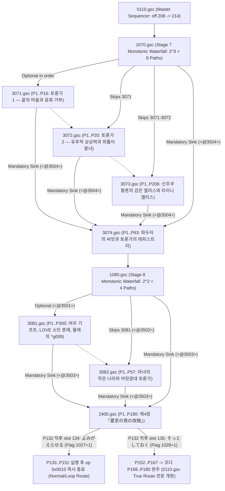

# 『Forest』 비판정본 제4권 (Vol. 04)
## Stage 7 나뭇잎 군집 (`1070.gsc`: `3071`–`3074.gsc`), Stage 8 나뭇잎 군집 (`1080.gsc`: `3081`–`3082.gsc`) 및 제4장 「하지 밤의 개적(夏至の夜の改賊)」 (`2400.gsc`)

---

## 0. 편찬 서설: Stage 7–8 (`1070.gsc` → `1080.gsc`) 단방향 폭포수 상태 기계 실증과 다중 대위법 음향 아키텍처 총람

### 0.1 마스터 시퀀서(`0110.gsc`)와 ‘단조 증가 부분수열($2^{n-1}$)’ 낙엽 디스패처의 바이트코드 증명

제3장 「표류기(漂流記)」(`1060.gsc` → `2300`–`2302.gsc`)의 보드게임형 해양 표류를 통과한 플레이어는 마스터 진행 스크립트 `0110.gsc`의 오프셋 `208`(`0x0f 1070`)과 `214`(`0x0f 1080`)에 의해 연속 호출되는 두 개의 중반부 분수령, 곧 **Stage 7 나뭇잎 군집(`1070.gsc`)**과 **Stage 8 나뭇잎 군집 겸 제4장 본편(`1080.gsc` → `2400.gsc`)**으로 진입한다.

정원(`ガーデン`) 화면 위로 흩날리는 낙엽 선택지(`<@3501>`~`<@3504>`)는 외견상 클릭 순서만 자유로울 뿐 모든 단편을 비복원 추출로 전수 열람하게 하는 순열 선택기($n!$ 경로)처럼 보이기 쉽다. 그러나 본 비판정본 편찬 과정에서 `1070.gsc`(1,719 bytes, 명령 영역 `A=28..B=1544`)와 `1080.gsc`(1,171 bytes, 명령 영역 `A=28..B=1044`)의 원시 바이트코드를 전수 역어셈블한 결과, 이 엔진은 $n!$ 순열이 아니라 **시간순 단방향 폭포수(Temporal Monotonic Waterfall, 엄밀히는 종착 원소 $n$을 반드시 포함하는 $\{1, \dots, n\}$의 순증가 부분수열 $2^{n-1}$개 경로)**로 작동한다는 중대한 매체기호학적 사실이 확증되었다(`[확증(Confirmed)]`).

1. **Stage 7 디스패처 `1070.gsc`의 스킵 플래그(`3072`–`3074`)와 다회차 기열람 표지(`8071`–`8074`)**:
   - 스크립트 진입 직후(`0x000a`–`0x00e2`), 엔진은 영구 시스템 세이브 영역의 기열람 변수 `8071`(`0x1f87`)~`8074`(`0x1f8a`)가 `0`인지 검사하여, 미열람 단편에는 낙엽 스프라이트 번호 `20`~`23`을, 이전 회차에서 이미 읽은 단편에는 변색된 기열람 낙엽 스프라이트 `70`~`73`을 `<@3501>`~`<@3504>`에 각각 할당한다.
   - 제1상태(`CHOICE cnt=4`, 오프셋 `0x0158`)에서 플레이어가 첫 번째 낙엽(`<@3501>` → `3071.gsc`)을 클릭하면 로컬 진행 변수 변경 없이 제2상태(`CHOICE cnt=3`: `3072`, `3073`, `3074`)로 이행한다. 그러나 만일 제1상태에서 **두 번째 낙엽(`<@3502>` → `3072.gsc`)**을 먼저 클릭하면 엔진은 `SET var=3072 = 1`(`0x01ce`)을 기록한 뒤 `3072.gsc`를 실행하고 제2상태 검문소(`CMP var=3072 == 0`, `0x02ae`)로 점프하므로, 조건 분기(`JMP_03 -> 0x0406`)에 의해 **`3071.gsc`는 이번 회차에서 영구히 유실된 채 곧바로 제3상태(`CHOICE cnt=2`: `3073`, `3074`)로 직행**한다! 마찬가지로 제1상태에서 `<@3503>`(`3073.gsc`)을 고르면 `3071`·`3072`가 동시에 소거되어 마지막 한 장 남은 `3074.gsc` 단독 선택지로 직행하며, `<@3504>`(`3074.gsc`)를 곧장 집어 들면 앞선 세 단편(`3071`~`3073`)을 모두 흘려보내고 즉시 `1070.gsc`가 종료된다.
   - 결과적으로 `1070.gsc`에서 허용되는 열람 경로는 $\{3071, 3072, 3073\}$의 부분집합($2^3 = 8$가지) 뒤에 **반드시 종착 싱크 노드(Sink Node)인 `3074.gsc`가 결합된 8개 경로**뿐이다.

2. **Stage 8 디스패처 `1080.gsc`의 비대칭 내장 구조와 제4장 `2400.gsc` 내 진엔딩 분기 플래그(`1028`)**:
   - 제2장(`1040` → `1050` → `2200`)과 달리 Stage 8에서는 별도의 챕터 호출 스크립트 없이 **제4장 본편 `2400.gsc` 자체가 `1080.gsc`의 제3낙엽(`<@3503>`, 기열람 변수 `8083`[`0x1f93`], 스프라이트 `26`/`76`)으로 직접 편입**되어 있다(`[확증(Confirmed)]`). 따라서 `{3081, 3082}`의 부분집합($2^2 = 4$가지: `3081→3082→2400`, `3081→2400`, `3082→2400`, `2400`) 모두가 필연적으로 `2400.gsc`에서 수렴한다.
   - 나아가 `2400.gsc` 후반부(`P132` 직후 오프셋 `12376`, 프롬프트 슬롯 `133`: `「ティンカーベルをどうしよう？」`)의 양자택일은 본작 전체의 엔딩 위상을 가르는 결정적 분기점이다.
     - **제1선택지(`slot 134`: `「よみがえらせる」`)**: 전역 플래그 **`1027`(`0x0403`) = `1`**을 기록하고 `P133..P151`을 실행한 직후, 오프셋 `14154`의 **`op 0x0010`(`RET`) 명령으로 스크립트를 강제 종료**시켜 대단원 코다(`P168..P180`)조차 보여주지 않고 Stage 8을 닫는다.
     - **제2선택지(`slot 135`: `「そっとしておく」`)**: 전역 플래그 **`1028`(`0x0404`) = `1`**을 기록하고 `P152..P167`을 거쳐 코다 `P168..P180`까지 완주한다. 전체 코퍼스 전수 조사 결과, 이 **플래그 `1028`(`0x0404`)**은 제6장 `2600.gsc`(오프셋 `10512`)와 마스터 시퀀서 `0110.gsc`(오프셋 `422`, `476`, `570`)에서 `TEST_0x02`로 직접 검증되는 **후반부 진엔딩(True Route: Stages 13–15 개방) 필수 관문 플래그**임이 확인된다(`[확증(Confirmed)]`).

이 폭포수 메커니즘은 제4장의 핵심 주제인 ‘불가역적 시간의 흐름(`時間の流れ`)’과 정교한 구조적 동형성(Isomorphism)을 이룬다. 플레이어가 성급히 아래쪽(미래) 낙엽을 움켜쥐면 위쪽(과거) 낙엽들은 시간의 여울 속으로 흘러가 버리며, 오직 숲의 윤회를 다시 도는 재독(再讀) 회차에서만 기열람 낙엽 색채(`70`~`76`)를 이정표 삼아 놓쳤던 기억의 파편을 건져 올릴 수 있도록 설계된 것이다.

---

### 0.2 Vol. 04 수록 전 7개 파일(842문단·1,503문장·22,628자) 계량문체 및 이중 음향 지표 총괄표

| 파일명 | 문단 수 (`P#`) | 문장 수 (`S#`) | 글자 수 | 지문 비율 (`^g999`) | 평균 문장 길이 (ASL) | 한자 (%) | 히라가나 (%) | 카타카나 (%) | 대시 (`/1k`) | 말줄임표 (`/1k`) | 감탄부호 (`/1k`) | 물음표 (`/1k`) | 동기 음성 (`0x51`) | 비동기 오버레이 (`0x42`) | 추정 주 집필자 지문 |
| :--- | :---: | :---: | :---: | :---: | :---: | :---: | :---: | :---: | :---: | :---: | :---: | :---: | :---: | :---: | :--- |
| **`3071.gsc`** | `P1..P16` (16) | 28 | 323 | 1.000 | **11.54자** | 12.69% | 66.25% | 4.33% | 0.00 | 37.15 | 6.19 | **34.06** | **9건** (`7057..7065`) | 0건 | **星空めてお** (토룬가 신화·윤회 부정) |
| **`3072.gsc`** | `P1..P20` (20) | 43 | 522 | 1.000 | 12.14자 | 13.79% | **68.77%** | 4.79% | 3.83 | 5.75 | 3.83 | 13.41 | **11건** (`7066..7076`) | 0건 | **星空めてお** (유추적 상상력·외톨이 왕녀) |
| **`3073.gsc`** | `P1..P206` (206) | 266 | 4,478 | 0.621 | 16.83자 | **21.71%** | 52.95% | 11.26% | 3.35 | 27.47 | 2.46 | 8.04 | **38건** (`8402..8439`) | **1건** (`8401` / EN 1건) | **茗荷屋甚六 + 星空めてお** (신주쿠 박물학·`Alice in Black` 테제) |
| **`3074.gsc`** | `P1..P63` (63) | 116 | 1,687 | 1.000 | 14.54자 | 16.12% | 65.32% | 5.69% | 2.37 | 24.90 | 1.19 | 23.12 | **31건** (`7077..7107`) | 0건 | **星空めてお** (파두아 씨앗·태피스트리 수용미학) |
| **`3081.gsc`** | `P1..P300` (300) | 395 | 7,426 | 0.493 | **18.80자** | 20.19% | 59.08% | 5.16% | **3.91** | **65.58** | 2.56 | 8.21 | **99건** (`7901..8012` 중) | **13건** (`7967..8000`) | **高尾登山** 주력 + **星空めてお** 감수 (심리 회상·에로티시즘·정전 심판) |
| **`3082.gsc`** | `P1..P57` (57) | 134 | 1,741 | 1.000 | 12.99자 | 13.04% | 66.05% | **3.27%** | 1.15 | 15.51 | 16.08 | 17.81 | **27건** (`7108..7134`) | **1건** (`7135`: 무언 호흡) | **星空めてお** (어릿광대 토룬가·`フツー/変` 언어철학) |
| **`2400.gsc`** | `P1..P180` (180) | 521 | 6,451 | 0.739 | 12.38자 | **12.06%** | 47.00% | **20.65%** | 0.62 | 14.88 | **46.04** | 11.01 | **9건** (`1107, 1194..1260`) | **174건** (`1101..1275` 중 / EN 228건) | **茗荷屋甚六** 주력 + **星空めてお** 분기 설계 (7·5조 가극·대위법 폴리포니) |
| **총계** | **842문단** | **1,503문장** | **22,628자** | — | — | — | — | — | — | — | — | — | **224건** | **189건 (EN 229항목)** | — |

> [!IMPORTANT]
> **제4권(Vol. 04) 4대 핵심 문헌학·음향학 실증 발견 (Variorum Critical Discoveries)**
> 1. **토룬가 연작 4편(`3071`·`3072`·`3074`·`3082`)의 무결번 79연속 보이스 뱅크(`7057`–`7135`) 해독**: 네 파일은 표면 텍스트상 전 문단이 `^g999`(지문)로 마스킹되어 화자 표지가 소거되어 있으나, `0x51` 인라인 음성 슬롯(`7057`~`7134`, 78건)과 `3082.gsc` 대미 `P57`의 유일한 `0x42` 비동기 호흡음(`7135`, 1건)이 단 하나의 결번도 없이 직결된다. 이를 통해 **유성(有聲) 여성 화자(어린 마녀=유년기 아마모리 위상)**와 **무성(無聲) 남성 대답자(아케루/시리우스/예인 토룬가 위상)**의 치밀한 2인 교창(Antiphony) 구도가 100% 복원된다.
> 2. **`3073.gsc`의 무결번 39연속 보이스 뱅크(`8401`–`8439`)와 `P2` 선취적 월경(Proleptic Metalepsis)**: 아케루가 숙취 속에 야스쿠니 거리를 걷는 독백 `P1`(`こんな午後もあるか。`) 직후, 아직 검은 앨리스를 조우하기 14문단 전인 `P2` 지문 위에서 이미 검은 앨리스의 무자막 비동기 보이스 `8401`(*"Yes, there are some afternoons like this."*)이 울려 퍼진다. 이는 현실(`リアル`)의 신주쿠 산책조차 이미 앨리스의 공명권 안에 포섭되어 있음을 알리는 청각적 서사 월경이다.
> 3. **`3081.gsc`의 익명 실루엣 얼굴창 슬롯 `^g009` 오기 교정 및 무결번 112연속 보이스 뱅크(`7901`–`8012`)**: 초기 추출 사전에서 `老ウサギ(ピーター系)`로 잠정 표기되었던 `^g009`(`P108, P114, P115, P120`)는 토끼가 아니라 **‘정체 미공개 익명 실루엣 전용 슬롯’**임이 전 코퍼스 33건 대조로 실증되었다. 특히 `3081.gsc`의 `^g009`는 물레(`紡ぎ車`)를 돌리며 『닥터 두리틀』과 『패딩턴 베어』를 자격 미달로 내던지는 **‘숲의 창조주(`森の創り主`, 고유 슬롯 `^g031`)’의 익명 현현**이다. 또한 오프셋 `120`의 `CMP var=399 == 1` 점프(`-> P153`)를 통해 갤러리 회상 모드의 정확한 분기점이 규명되었다.
> 4. **제4장 `2400.gsc`의 ‘2중 대위법 가극(Operatic Counterpoint)’ 음향 구조**: 총 180문단 중 화면 대사와 성우 음성이 일치하는 `0x51` 동기 발화는 **단 9문단**(`P6` 검은 앨리스 `1107` 및 `P61, P127, P131, P133, P136..P138, P152` 마유즈미 카오루 `1194..1260`)뿐이다! 나머지 **174건의 `0x42` 비동기 오디오 큐(영문 팬패치 채록 기준 228개 대사 세그먼트)**는 화면에 출력되는 7·5조 가극 지문(`^g999`)·아케루 대사(`^g001`)·괴수 음운 해체시(`^g029`)와는 **전혀 다른 별개의 현실측 상황극·내면 독백·오스티나토 루프(`1112`/`1181` 째깍악어 시계음 24회, `1187` 해적 요호 비트박스 13회, `1132`/`1175` 마마 합창 10회)**를 겹쳐 연주함으로써, 비주얼 노벨 매체사상 유례없는 시청각 이중 나선(Double Helix)을 구축한다.

---

## 1. `3071.gsc` (`P1..P16`, 전 16문단 28문장) 심층 해부: 버려진 아이 토룬가(1) — ‘끝의 마을’의 열역학과 영원회귀 거부

### [식별자 & 엔진 연출 코드 총괄 (`3071.gsc`)]
- **파일 및 분량**: `3071.gsc` | `P1..P16` (전 16문단, 28문장, 323자)
- **엔진 호출 및 연출**: `1070.gsc` 제1낙엽(`<@3501>`, 미열람 스프라이트 `20` / 기열람 `70`, 영구 플래그 `8071`). 배경 그래픽 `999`(암전/숲 여백) 및 BGM 트랙 `13`(`0x3c 0x0d`) 기동. 전 문단이 `^g999`로 표기되나 `0x51` 인라인 보이스 **9건(`7057`–`7065`)**이 여성 화자 발화에만 선택적으로 부여된다.

---

### 1.1 Beat 1 (`3071.gsc` `P1..P4`): 탄생의 부정과 표착·부패·변화의 물질론

- **대상 범위**: `3071.gsc` `P1..P4` (4문단, 6문장)
- **원문 전수 인용 및 음성 대조**:
  - `P1` (`^g999`, `0x51_v=7057` [유성·女]): `[P1-S1]` `トルンガはね、生まれたんじゃないわ。` / `[P1-S2]` `捨てられた子どもなの。`
  - `P2` (`^g999`, 무음 [男]): `[P2-S1]` `どうして？`
  - `P3` (`^g999`, `0x51_v=7058` [유성·女]): `[P3-S1]` `だって、おしまいの村でしょう？` / `[P3-S2]` `新しく生まれるものなんて、ないんだわ。`
  - `P4` (`^g999`, `0x51_v=7059` [유성·女]): `[P4-S1]` `捨てられたものが流れ着いたり、壊れて、腐って、変化したりはするの。`

#### [층위 1: 미시 문체·수사·통사·집필자 지문]
Stage 5의 `3042.gsc`에서 처음 호명되었던 ‘끝의 마을(`おしまいの村`)의 아이 토룬가’ 신화가 이제 화자 역전 구도로 재개된다. `3042.gsc`에서는 남성 구연자가 이야기를 들려주고 여성 청자가 물었으나, `3071.gsc`의 `[P1-S1]`에서는 여성 화자(`7057`)가 종조사 `～ね`, `～わ`, `～なの`의 부드러운 유아·소녀 구연체로 서두를 연다. 수사학적으로 `[P1-S1]`(`生まれたんじゃないわ`)과 `[P1-S2]`(`捨てられた子どもなの`)는 생물학적 ‘출생(탄생)’과 존재론적 ‘유기(버려짐)’를 상호배타적 대립항으로 세우는 역설법(Paradox)이다(통상 버려지기 위해서도 먼저 태어나야 하지만, 이 세계관에서는 ‘버려짐’ 자체가 기원을 대체한다). 이어 `[P4-S1]`은 `流れ着いたり` → `壊れて` → `腐って` → `変化したりはするの`라는 4단계 동사 연쇄를 통해 무(無)로부터의 창조(creatio ex nihilo)를 부정하고 표류물의 퇴적과 엔트로피적 해체·변성만을 허용하는 종말론적 물질계를 규정한다. 평균 문장 길이 11.54자, 히라가나 비율 66.25%, 외래어 카타카나 최소화라는 지표는 메인 시나리오 작가 **星空めてお**의 순수 구연동화 문체 지문과 완벽히 일치한다(`[확증(Confirmed)]`).

#### [층위 2: 3중 상호텍스트 및 철학·도시 코드]
1. **종말 해안·쓰레기장 우주론과 동화 정전의 침전물 은유 `[구조적 공명(Structural Echo)]`**: ‘새로 태어나는 것 없이 버려진 것들만 흘러들어 부패·변화하는 끝의 마을’은 미하일 엔데의 『끝없는 이야기』 속 망각된 옛 꿈들의 퇴적지와 구조적으로 공명하는 동시에, 『Forest』 내적으로는 **19세기~20세기 초 영국 아동문학 고전들이 약 70~140년의 시간을 거치며(1865년 『앨리스』부터 1934년 『메리 포핀스』까지) 원작자의 손을 떠나 흘러들어와 변질된 ‘신주쿠의 숲(`森`)’ 자체에 대한 알레고리**다(`[확증(Confirmed)]`).
2. **생성 없는 변화(아리스토텔레스 『생성소멸론』의 전도)**: 순수한 발생(genesis)이 정지된 닫힌 계 안에서 오직 기존 기호들의 파손(`壊れて`)과 부패(`腐って`)를 통해서만 변용(`変化`)이 일어난다는 `[P4-S1]`의 명제는 본작의 ‘기프트·리들 변주 메커니즘’을 정확히 요약한다.

#### [층위 3 & 4: 서사적 월경·매체 기호학 및 반례 검증]
텍스트 창에는 따옴표도 화자 이름도 없는 `^g999`만 출력되지만, `P1`(`7057`) → `P2`(무음) → `P3`(`7058`)·`P4`(`7059`)의 음향 교차는 여성 화자가 토룬가라는 3인칭 가면을 빌려 **자기 자신(‘버려진 이야기/아이’로서의 아마모리·숲의 핵)**의 기원을 투사(Projection)하고 있음을 폭로한다. 특히 `P3`와 `P4`가 무음 추임새 없이 연속 유성 발화(`7058`→`7059`)로 이어지는 호흡은 청자의 반문을 허용하지 않는 단호한 세계 인식을 드러낸다.

---

### 1.2 Beat 2 (`3071.gsc` `P5..P10`): 윤회(`生まれ変わり`)의 악무한 거부 vs 끝나지 않는 생일 파티

- **대상 범위**: `3071.gsc` `P5..P10` (6문단, 10문장)
- **원문 전수 인용 및 음성 대조**:
  - `P5` (`^g999`, 무음 [男]): `[P5-S1]` `ふうん？` / `[P5-S2]` `きみ、生まれ変わりって信じないの？`
  - `P6` (`^g999`, `0x51_v=7060` [유성·女]): `[P6-S1]` `信じたくない。`
  - `P7` (`^g999`, 무음 [男]): `[P7-S1]` `どうして？`
  - `P8` (`^g999`, `0x51_v=7061` [유성·女]): `[P8-S1]` `だって、終わりがないでしょう？` / `[P8-S2]` `ずーっと、ずーっと、何度も何度も、いつまでも繰り返すなんて、絶対いや。`
  - `P9` (`^g999`, 무음 [男]): `[P9-S1]` `楽しかったら？` / `[P9-S2]` `そうだな、たとえば誕生日のパーティだ。` / `[P9-S3]` `いつまでも続いたら、いいだろ？`
  - `P10` (`^g999`, `0x51_v=7062` [유성·女]): `[P10-S1]` `……あたし、独りだもん。`

#### [층위 1: 미시 문체·수사·통사·집필자 지문]
`[P5-S2]`의 인식론적 질문(`信じないの？`: 믿지 않는가?)에 대해 여성 화자는 `[P6-S1]`에서 의지적 거부형 **`信じたくない。`**(믿고 싶지 않다)로 응수한다. 진리값의 문제가 아니라 실존적 혐오의 문제로 논점을 이동시킨 것이다. `[P8-S2]`에서는 장음 부사 첩어 `ずーっと、ずーっと` + 빈도 첩어 `何度も何度も` + 무기한 부사 `いつまでも`를 3중 중첩한 뒤 한자어 강조 `絶対いや。`로 끊어버림으로써 무한 반복의 질식감을 구문 길이 자체로 체현한다. 그러자 `[P10-S1]`에서 처음으로 3인칭 `トルンガ`의 가면이 벗겨지며 1인칭 대명사 **`あたし`**(`……あたし、独りだもん。`)가 말줄임표 뒤에서 불쑥 튀어나온다!

#### [층위 2: 3중 상호텍스트 및 철학·도시 코드]
1. **가능무한적 반복(윤회·리들 루프)에 대한 존재론적 피로 `[확증(Confirmed)]`**: `[P8-S1]`~`[P8-S2]`의 ‘끝없이 되풀이되는 반복에 대한 혐오’는 제4장 `2400.gsc`(`P130`~`P132`)에서 늙은 피터 팬이 토로할 ‘멈춘 시간과 영원한 놀이의 공포’를 정면으로 예고한다. 아리스토텔레스적 가능무한(`可能無限`: 끝없이 다음 항이 이어지는 미완의 연쇄)은 구원이 아니라 종결(`終わり`)을 박탈당한 형벌로 체험된다.
2. **루이스 캐럴 『거울 나라의 앨리스』의 ‘비생일(*Un-birthday*) 선물’(디즈니 1951년 영화판에서는 ‘비생일 파티’) 및 해롤드 핀터 『생일 파티』와의 대조 `[유력(Probable)]`**: `[P9-S2]`~`[P9-S3]`에서 남성 화자가 예시로 드는 ‘언제까지고 계속되는 생일 파티(`誕生日のパーティ` — `3071.gsc`에서 `トルンガ` 외 유일한 카타카나어 `パーティ` 2회 출현)’는 『거울 나라의 앨리스』 제6장 험프티 덤프티의 364일 비생일 선물 담론 및 제1장 `2100.gsc`의 끝나지 않는 미친 다과회(*Mad Tea-Party*)를 변주한다. 그러나 ‘태어나지 않고 버려진 아이’(`[P1-S1]`)에게 ‘생일(탄생일)’ 파티란 기호학적으로 성립 불가능한 공집합이며, 설령 열린다 해도 `[P10-S1]`처럼 하객 없는 독방에 불과하다.

#### [층위 3 & 4: 서사적 월경·매체 기호학 및 반례 검증]
`P1`~`P8`까지 유지되던 ‘토룬가에 관한 객관적 문답’이라는 층위 2(극중 동화)의 경계가 `[P10-S1]`의 `……あたし、独りだもん。` 한 문장에 의해 층위 1(정원에서 대화하는 소녀 자신의 고독)로 단락(Short-circuit)된다. 바로 이 무방비한 1인칭 노출이 다음 비트의 관계적 개입을 가능케 한다.

---

### 1.3 Beat 3 (`3071.gsc` `P11..P16`): 부재하는 군중에서 현전하는 ‘단 한 사람(`ここに、ひとり。`)’으로의 전환

- **대상 범위**: `3071.gsc` `P11..P16` (6문단, 12문장)
- **원문 전수 인용 및 음성 대조**:
  - `P11` (`^g999`, 무음 [男]): `[P11-S1]` `友達がいるんだ。` / `[P11-S2]` `いっぱい集まってるんだ。` / `[P11-S3]` `おめでとう！` / `[P11-S4]` `パーティだ！`
  - `P12` (`^g999`, `0x51_v=7063` [유성·女]): `[P12-S1]` `どこにいるの？` / `[P12-S2]` `いないでしょ？`
  - `P13` (`^g999`, 무음 [男]): `[P13-S1]` `ここに、ひとり。`
  - `P14` (`^g999`, `0x51_v=7064` [유성·女]): `[P14-S1]` `……友達？`
  - `P15` (`^g999`, 무음 [男]): `[P15-S1]` `そう、友達。` / `[P15-S2]` `きみさえよければ。`
  - `P16` (`^g999`, `0x51_v=7065` [유성·女]): `[P16-S1]` `……友達。……` / `[P16-S2]` `ふうん。`

#### [층위 1: 미시 문체·수사·통사·집필자 지문]
`P11`에서 남성 화자는 먼저 동화적 과장법(`いっぱい集まってるんだ。` / `おめでとう！` / `パーティだ！`)으로 가상의 축제를 연출해 보지만, 소녀는 `[P12-S1]`~`[P12-S2]`의 차가운 직시(`どこにいるの？` / `いないでしょ？`)로 허구를 기각한다. 바로 그 순간 `[P13-S1]`은 모든 수식어와 서술어를 탈락시킨 6모라(부호 제외 6자) 명사 종지 직시문 **`ここに、ひとり。`**로 응답한다. `P10`의 고립된 한자 표기 `独り`(*hitori*: 홀로 있음)를 `P13`이 히라가나 수사 **`ひとり`**(*hitori*: 한 사람의 타자)로 받아치며 동음이의적 의미 전환을 일으키는 대목이 백미다! 이어지는 `P14`(`……友達？`) → `P15`(`そう、友達。` / `きみさえよければ。`) → `P16`(`……友達。……` / `ふうん。`)은 명사 `友達` 하나를 세 차례 주고받으며 말줄임표의 위치만으로 의심(`……友達？`)에서 음미(`……友達。……`)와 유보적 수락(`ふうん。`)으로 이동하는 극도로 절제된 시적 대화다.

#### [층위 2: 3중 상호텍스트 및 철학·도시 코드]
- **직시어(Deixis) `ここ`를 통한 비트겐슈타인적 언어게임 개시 `[확증(Confirmed)]`**: 허구의 군중(`いっぱい`)이 실패한 자리에서 ‘지금 여기(`ここ`)’에서 말을 걸고 들어주는 단 한 명의 대화 상대(`ひとり`)가 실존적 증거로 제시된다. 조건절 `[P15-S2]`(`きみさえよければ`)는 우정이 일방적 시혜가 아니라 상호 승인에 의해 성립하는 계약임을 명시한다.

#### [층위 3 & 4: 서사적 월경·매체 기호학 및 반례 검증]
남성 대답자의 텍스트에 성우 음성이 배정되지 않은 무음 설계(`P13`, `P15`)는 매체기호학적으로 이중의 효과를 낳는다. 서사 내적으로는 아케루(혹은 시리우스)의 조용한 현전을 뜻하는 동시에, 화면 앞의 **플레이어(독자) 자신이 ‘지금 여기(`ここに、ひとり`)’에서 텍스트를 읽으며 외로운 소녀의 이야기를 들어주는 단 한 사람의 친구 자리**에 직접 겹쳐지도록 유도하는 2인칭 월경 장치로 작동한다.

---

## 2. `3072.gsc` (`P1..P20`, 전 20문단 43문장) 심층 해부: 버려진 아이 토룬가(2) — 일방적 발화의 고독과 유추적 상상력(`想像`)

### [식별자 & 엔진 연출 코드 총괄 (`3072.gsc`)]
- **파일 및 분량**: `3072.gsc` | `P1..P20` (전 20문단, 43문장, 522자)
- **엔진 호출 및 연출**: `1070.gsc` 제2낙엽(`<@3502>`, 미열람 스프라이트 `21` / 기열람 `71`, 스킵 플래그 `3072`, 영구 플래그 `8072`). 배경 `999` 및 BGM 트랙 `10`(`0x3c 0x0a`). 전 문단 `^g999` 표기, `0x51` 인라인 보이스 **11건(`7066`–`7076`)**이 직전 파일(`7065`)에 바로 이어져 여성 화자 턴을 표지한다.

---

### 2.1 Beat 1 (`3072.gsc` `P1..P6`): 유기(遺棄)의 결정론과 반문

- **대상 범위**: `3072.gsc` `P1..P6` (6문단, 9문장)
- **원문 전수 인용 및 음성 대조**:
  - `P1` (`^g999`, `0x51_v=7066` [유성·女]): `[P1-S1]` `トルンガには、友達はいないの。` / `[P1-S2]` `独りっきりなの。`
  - `P2` (`^g999`, 무음 [男]): `[P2-S1]` `そうなの？` / `[P2-S2]` `どうして？`
  - `P3` (`^g999`, `0x51_v=7067` [유성·女]): `[P3-S1]` `捨てられたから。`
  - `P4` (`^g999`, 무음 [男]): `[P4-S1]` `捨てられたって友達はできるさ。`
  - `P5` (`^g999`, `0x51_v=7068` [유성·女]): `[P5-S1]` `できないわ。` / `[P5-S2]` `独りぼっちは、ずーっと独りなの。` / `[P5-S3]` `そういうふうに生まれついたの。`
  - `P6` (`^g999`, 무음 [男]): `[P6-S1]` `そうかな？`

#### [층위 1: 미시 문체·수사·통사·집필자 지문]
`3071.gsc` 말미(`P16`)에서 잠시 흔들렸던 소녀는 `3072.gsc` 서두에서 다시 3인칭 `トルンガ`의 방벽 뒤로 후퇴하여 고독의 항구성을 재천명한다. 특히 주목할 화행적 자기모순(Self-contradiction)은 `[P5-S3]`의 **`そういうふうに生まれついたの。`**(그렇게 타고난 거야)다! 바로 직전 단편 `3071.gsc` `[P1-S1]`에서 “토룬가는 태어난 게 아니라 버려진 아이”라고 선언했음에도, 고독의 숙명을 정당화할 때는 무의식중에 관용구 `生まれついた`(타고났다)를 동원하는 자기모순이 발생한다. 남성 화자의 짧은 회의적 반문 `[P6-S1]` `そうかな？`는 이 결정론의 균열을 정확히 찌른다.

#### [층위 2: 3중 상호텍스트 및 철학·도시 코드]
- **동화적 본질주의(Essentialism) 대 관계적 생성론 `[확증(Confirmed)]`**: 고전 동화의 등장인물은 자신의 배역과 성격이 ‘처음 쓰인 그대로(`そういうふうに生まれついた`)’ 영구 고정되어 있다고 믿는다. 소녀의 항변은 자기 역할 밖으로 벗어날 수 없는 정전(Canon) 캐릭터의 구조적 운명을 대변한다.

#### [층위 3 & 4: 서사적 월경·매체 기호학 및 반례 검증]
만일 플레이어가 `1070.gsc` 제1상태에서 `<@3501>`을 건너뛰고 `<@3502>`(`3072.gsc`)를 먼저 클릭했다면 `3071.gsc`의 ‘친구 제안’을 듣지 못한 채 곧장 `P1`(`トルンガには、友達はいないの`)을 읽게 되고, 순서대로 읽었다면 `3071` 말미의 유화적 여운을 소녀가 짐짓 부정하며 되받아치는 심리적 되물림으로 읽히게 된다. 단방향 폭포수 엔진에서도 각 단편이 자족적 응집력과 연쇄적 심화를 동시에 갖추도록 치밀하게 조율되어 있다.

---

### 2.2 Beat 2 (`3072.gsc` `P7..P12`): ‘끝의 마을’의 일방통행 발화 — 소통 없는 서사 과잉

- **대상 범위**: `3072.gsc` `P7..P12` (6문단, 15문장)
- **원문 전수 인용 및 음성 대조**:
  - `P7` (`^g999`, `0x51_v=7069` [유성·女]): `[P7-S1]` `トルンガが住んでいるのは、おしまいの村でしょう？`
  - `P8` (`^g999`, `0x51_v=7070` [유성·女]): `[P8-S1]` `歩けなくなった旅人が、たくさんいるわ。` / `[P8-S2]` `いろんなものを見たり聞いたりして、最後に、この村へ流れ着いた人たち──`
  - `P9` (`^g999`, `0x51_v=7071` [유성·女]): `[P9-S1]` `お話を、たくさん知ってる。` / `[P9-S2]` `トルンガは、たくさん聞かされる。` / `[P9-S3]` `でも、それだけなの。`
  - `P10` (`^g999`, `0x51_v=7072` [유성·女]): `[P10-S1]` `言いたいことを言うばっかり。` / `[P10-S2]` `聞かされたら聞いたっきり。` / `[P10-S3]` `そして独りぼっちなの。` / `[P10-S4]` `みんな、みんな。`
  - `P11` (`^g999`, 무음 [男]): `[P11-S1]` `そうじゃない。` / `[P11-S2]` `トルンガは違う。`
  - `P12` (`^g999`, `0x51_v=7073` [유성·女]): `[P12-S1]` `おんなじよ。` / `[P12-S2]` `みんな、みんな、独りぼっちよ。`

#### [층위 1: 미시 문체·수사·통사·집필자 지문]
`P7`~`P10`은 남성 화자의 개입 없이 여성 보이스 4개(`7069`~`7072`)가 연달아 이어지는 독백 구간이다. 특히 `P9`~`P10`의 형태통사적 대칭과 운율이 탁월하다:
- `[P9-S2]`의 사역수동형 **`聞かされる`**(억지로 듣게 되다): 능동적 경청(`聞く`)이 아니라 타인의 기억 배설을 수동적으로 뒤집어쓰는 피로감을 문법화한다.
- `[P10-S1]` `言いたいことを言うばっかり。` (4·3·2·4 = 13모라, `～ばっかり` 각운) ↔ `[P10-S2]` `聞かされたら聞いたっきり。` (6·6 = 12모라, 촉음 `っ` + `～っきり` 각운)! 한정 부사조사 `ばっかり`와 완결·단절 조사 `っきり`가 청각적 대구(Parallelism)를 이루며 ‘말의 일방적 방출과 단절’을 리듬으로 각인한다. 그리고 `[P10-S4]`와 `[P12-S2]`에서 반복되는 `みんな、みんな`는 군집 속의 절대 고독을 후렴처럼 봉인한다.

#### [층위 2: 3중 상호텍스트 및 철학·도시 코드]
1. **Stage 5 `3042.gsc`와의 상호텍스트적 직결 `[확증(Confirmed)]`**: `3042.gsc`에서 다리를 저는 노쇠한 여행자가 어린 토룬가에게 자기 모험담만 쏟아내고 잠들었던 장면을 이제 토룬가(및 소녀) 측의 내면 시점에서 재해석한다.
2. **대화(Dialogue)로 이행하지 못하는 독백(Monologue)들의 무덤 — 신주쿠 및 ‘숲’의 병리학 `[확증(Confirmed)]`**: 각자 하고 싶은 자기 이야기만 일방적으로 외칠 뿐 상호 응답이 일어나지 않는 ‘끝의 마을’은 바흐친(M. Bakhtin)이 비판한 닫힌 독백적 담론 공간이자, 2004년 신주쿠 군중의 고립, 그리고 각자의 원전 서사만 고집하는 리들 게스트들의 자폐성을 동시에 겨냥한다.

#### [층위 3 & 4: 서사적 월경·매체 기호학 및 반례 검증]
만일 텍스트만 읽으면 `P7`~`P10` 중간에 화자 교체가 있는지 모호할 수 있으나, 바이트코드의 `0x51` 보이스(`7069`, `7070`, `7071`, `7072`)가 4문단 연속으로 울리고 `P11`에서 무음(`0`)으로 끊어짐으로써, `P7`~`P10` 전체가 소녀의 단일 호흡 호소이고 `P11`이 남성의 단호한 제지임이 음향적으로 확정된다.

---

### 2.3 Beat 3 (`3072.gsc` `P13..P20`): 유추적 상상력(`想像`)의 찬가와 ‘외톨이 세계의 왕녀님’의 방어적 축출

- **대상 범위**: `3072.gsc` `P13..P20` (8문단, 19문장)
- **원문 전수 인용 및 음성 대조**:
  - `P13` (`^g999`, 무음 [男]): `[P13-S1]` `だからどうした？` / `[P13-S2]` `独りが、そんなに寂しいか？` / `[P13-S3]` `トルンガは違う！`
  - `P14` (`^g999`, 무음 [男]): `[P14-S1]` `トルンガは考えることを知ってる。` / `[P14-S2]` `知ってることを深く考え、知らないことに当てはめて──`
  - `P15` (`^g999`, 무음 [男]): `[P15-S1]` `そうして、想像できるんだ。` / `[P15-S2]` `知らないことを。` / `[P15-S3]` `まだ見ぬ世界を。`
  - `P16` (`^g999`, `0x51_v=7074` [유성·女]): `[P16-S1]` `でも、独りだわ。`
  - `P17` (`^g999`, 무음 [男]): `[P17-S1]` `あたりまえだ。` / `[P17-S2]` `ひとりぼっちの世界の王女さま。` / `[P17-S3]` `広い世界を見ようともせずに。`
  - `P18` (`^g999`, `0x51_v=7075` [유성·女]): `[P18-S1]` `知ってるわ、あたし。` / `[P18-S2]` `世界は、怖いところだって。` / `[P18-S3]` `安心できないところだって。`
  - `P19` (`^g999`, 무음 [男]): `[P19-S1]` `きみが知ってる世界だろ？` / `[P19-S2]` `まだ知らない世界は、いくらでもある。`
  - `P20` (`^g999`, `0x51_v=7076` [유성·女]): `[P20-S1]` `帰ってよ……。` / `[P20-S2]` `もう帰ってよっ！`

#### [층위 1: 미시 문체·수사·통사·집필자 지문]
앞선 Beat 2에서 소녀가 4문단 연속 발화했다면, 이번에는 남성 화자가 `P13`~`P15`의 **3문단 연속 무음 발화**로 역공을 펼친다! `[P14-S2]`의 2연 대시(`──`)로 고양된 인식 과정이 `[P15-S1]`(`そうして、想像できるんだ。`)의 본동사 선언 이후 `[P15-S2]`(`知らないことを。`)와 `[P15-S3]`(`まだ見ぬ世界を。`)라는 **목적어 후치 도치(Right-dislocation / 도치법[倒置法])**로 뻗어 나간다. 이어지는 `P17`에서 남성 화자는 3인칭 `トルンガ`에 대한 논평에서 갑자기 호격 명사구 `[P17-S2]` **`ひとりぼっちの世界の王女さま。`**로 대상을 전환하여, 지금 눈앞의 소녀 자신을 직접 지목한다! 정곡을 찔린 소녀는 `[P18-S1]`에서 다시 1인칭 후치 도치(`知ってるわ、あたし。`)로 자기방어를 시도하다가, 마침내 `P20`에서 말줄임표 애원(`[P20-S1]` `帰ってよ……。`)이 촉음 감탄 절규(`[P20-S2]` `もう帰ってよっ！`)로 폭발하며 대화를 강제 종료한다.

#### [층위 2: 3중 상호텍스트 및 철학·도시 코드]
1. **칸트·흄적 상상력(칸트의 *Einbildungskraft* / 흄의 *imagination*)과 외삽적 추론의 정의 `[확증(Confirmed)]`**: `[P14-S2]`~`[P15-S3]`(“아는 것을 깊이 생각하여 모르는 것에 대입함으로써 아직 보지 못한 세계를 상상한다”)은 단순한 공상이 아니라 기지(旣知)의 서사 단편들로부터 미지(未知)의 외부 세계를 구성해 내는 **유추적·창조적 상상력**의 철학적 정식화다. 이는 닫힌 정원(`ガーデン`) 안에서 수집한 이야기 조각들로 바깥 세계(`リアル`)를 추론하려는 토룬가의 능동적 지성을 소녀의 퇴행적 폐쇄성과 대비시킨다.
2. **유한 경험의 부당한 보편화 비판 (`[P18]` vs `[P19]`) `[확증(Confirmed)]`**: 과거의 트라우마적 경험(`きみが知ってる世界` — 병실·학대·상실의 기억)을 세계 전체의 본질(`世界は、怖いところ`)로 일반화하는 소녀의 귀납적 오류를, 남성 화자는 `[P19-S2]`(`まだ知らない世界は、いくらでもある`)의 개방된 외연으로 논파한다.

#### [층위 3 & 4: 서사적 월경·매체 기호학 및 반례 검증]
`[P17-S2]`의 `ひとりぼっちの世界の王女さま`는 층위 2의 동화 주인공 토룬가(후일 `3082.gsc`에서 남성 나그네로 밝혀짐!)가 아니라 층위 1에서 이야기를 나누고 있는 여성 청자(어린 아마모리 노조미의 심층 자아)를 가리킨다. 즉 소녀는 토룬가를 자기 분신처럼 외로운 피해자로 가두려 했으나, 남성 화자가 토룬가를 ‘상상하며 나아가는 자’로 구출해 내자, 홀로 남겨진 소녀의 자폐적 왕국(`ひとりぼっちの世界`)이 백일하에 드러나며 발작적 거절(`もう帰ってよっ！`)을 부르는 것이다.

---

## 3. `3073.gsc` (`P1..P206`, 전 206문단 266문장) 심층 해부: 황혼의 신주쿠 ‘리얼(`リアル`)’을 걷는 검은 앨리스(`Alice in Black`)와 소극장 ‘타이니 앨리스’의 해프닝

### [식별자 & 엔진 연출 코드 총괄 (`3073.gsc`)]
- **파일 및 분량**: `3073.gsc` | `P1..P206` (전 206문단, 266문장, 4,478자)
- **엔진 호출 및 연출**: `1070.gsc` 제3낙엽(`<@3503>`, 미열람 스프라이트 `22` / 기열람 `72`, 스킵 플래그 `3073`, 영구 플래그 `8073`). `P2` 직후 배경 그래픽 `1205`(`0x04b5`: 황혼의 신주쿠 거리) 및 BGM 트랙 `18`(`0x3c 0x12`) 기동, 장면 전환마다 효과/페이드 연산 `op 0x40 (1, 81)` 6회(`off=2094, 2364, 4766, 5490, 6114, 6450, 7436`) 배치.
- **등장 화자 및 무결번 보이스 뱅크(`8401`–`8439`, 총 39건)**:
  - `^g999`: 地の文／語り手 (128문단 — 아케루 1인칭 `俺` 시점 하드보일드 지문 및 거리 행인·남색 뚜쟁이·영국인 가족·연극배우들의 인용 대사 포함)
  - `^g001`: 城之崎灰流(アケル) (40문단, 전 문단 무음)
  - `^g002`: 黒いアリス／アリス (38문단, 전 문단 `0x51` 동기 보이스 **`8402`–`8439`** 완비 + 서두 `P2` 위의 `0x42` 무자막 비동기 보이스 **`8401`** 1건 = 총 39개 무결번 전용 뱅크)

---

### 3.1 Beat 1 (`3073.gsc` `P1..P18`): 야스쿠니 거리와 후생연금회관 앞 — 비추지 않는 거울 오브제 위의 검은 앨리스와 `P2` 선취적 월경

- **대상 범위**: `3073.gsc` `P1..P18` (18문단, 21문장)
- **핵심 원문 인용 및 무자막 보이스 대조**:
  - `P1` (`^g999`): `[P1-S1]` `こんな午後もあるか。`
  - `P2` (`^g999`, **`0x42` [Voice:8401]** — EN 팬패치 채록: *"Yes, there are some afternoons like this."*): `[P2-S1]` `昨夜から後頭部に噛みついたままの酔いっ気を振りほどこうと、靖国通りをぶらりと流す。`
  - `P3`–`P4` (`^g999`): `[P3-S1]` `水炊き料理屋の前にかかる。` / `[P4-S1]` `暑苦しげなボクシング漫画のモデルになってたか、ここ。`
  - `P5` (`^g001`): `[P5-S1]` `…………っと。` / `P6`–`P13` (`^g999`): `[P7-S1]` `人々の熱気は、目と鼻の先の、厚生年金会館ホールの興奮を濃く伝えていた。` / `[P10-S2]` `俺がここに立ってると、決まってダフ屋と間違われる。` / `[P12-S1]` `怖い兄さんがたにニラマれたり、殴られたりは御免こうむる。`
  - `P14`–`P18` (`^g999`): `[P14-S1]` `───そう思った矢先だ。` / `[P15-S1]` `ホール前にしつこくたむろする人ごみに、あいつがいた。` / `[P16-S1]` `黒い───アリスが。` / `[P17-S1]` `決してのぞき込む者を映さない鏡面のオブジェの、そのてっぺんで膝をかかえて座っている。` / `[P18-S1..S2]` `俺は少女をにらみつけた。` / `無意識に顎をひいてそんな風になった。`

#### [층위 1: 미시 문체·수사·통사·집필자 지문]
`3071`·`3072`의 히라가나 동화 구연체(한자율 12~13%)에서 단숨에 한자율 **21.71%**, 카타카나율 **11.26%**, 1인칭 `俺` 21회의 하드보일드 도시 산문으로 문체가 급전환된다. `[P2-S1]`의 감각적 은유 `後頭部に噛みついたままの酔いっ気`(뒤통수에 들러붙어 물어뜯고 있는 숙취), `[P12-S1]`에서 동사 어간만 카타카나로 떼어낸 시각적 속어 표기 `ニラマれたり`, 그리고 `P14`~`P16`에서 3연 대시(`───`)를 두 차례 사용하여 군중 속에서 검은 앨리스를 줌인(Zoom-in)하는 영화적 커팅(`黒い───アリスが。`)은 **茗荷屋甚六** 특유의 신주쿠 풍속 산문 지문을 선명히 보여준다(후반부 `P135`~`P147`의 메타 존재론 단락에서는 **星空めてお**의 비평적 문장이 합류하는 공동 조율 양상을 띤다 `[유력(Probable)]`).

#### [층위 2: 3중 상호텍스트 및 철학·도시 코드]
1. **2004년 신주쿠 야스쿠니 거리(`靖国通り`) 동진(東進) 동선과 실재 도시 랜드마크 3연속 고증 `[확증(Confirmed)]`**:
   - **미즈타키 요리집과 복싱 만화 언급(`[P3-S1]`~`[P4-S1]`)**: 신주쿠 야스쿠니 거리변(신주쿠 5초메~후생연금회관 서편)에 실재했던 전통 미즈타키(닭백숙) 노포(‘현해[玄海]’ 신주쿠 본점 등)를 연상시키는 거리 풍경으로, 대본은 이를 어딘가의 열혈 복싱 만화(`暑苦しげなボクシング漫画`)에 나왔던 가게라는 아케루 특유의 시니컬한 눈길로 스쳐 지나간다(`[추정]`).
   - **신주쿠 후생연금회관 대홀(`新宿厚生年金会館ホール`, 신주쿠 5초메, 1961 개관~2010 폐관)과 암표상 풍속(`[P7-S1]`~`[P12-S2]`)**: 2004년 당시 약 2,000석 규모의 록·비주얼계 밴드 공연 명소였던 실재 공연장이다. 대본은 공연장 앞 보도에서 암표상(`[P12-S1]`의 `怖い兄さんがた`)들이 진을 치고 영역 침범자를 경계하던 도심 대형 홀 주변의 실제 풍속을 생생히 반영한다(`[확증(Confirmed)]`).
   - **‘결코 들여다보는 자를 비추지 않는 경면(鏡面) 오브제’(`[P17-S1]`)**: 대본이 후생연금회관 앞 광장에 놓은 이 오브제는 루이스 캐럴 『거울 나라의 앨리스(*Through the Looking-Glass*)』의 **‘거울’을 반사 불능의 불투명한 금속 곡면으로 전복한 기호학적 오브제**로 읽힌다(`[구조적 공명(Structural Echo)]`). 거울이 관찰자의 자아를 되비추기를 거부하는 그 꼭대기에 ‘검은 앨리스’가 무릎을 안고 앉아 있다.

#### [층위 3 & 4: 서사적 월경·매체 기호학 및 반례 검증]
> [!TIP]
> **바이트코드 음향 대조로 포착된 `P2` 선취적 서사 월경(`0x42` Voice `8401`)**:
> 일본어 원판에서 플레이어가 `P1`(`こんな午後もあるか。`: 이런 오후도 있는 법인가)을 클릭해 `P2`(암전 상태에서 야스쿠니 거리 배경 `1205`가 열리기 직전 지문)로 넘어가는 순간, 화면에는 아무런 대사 자막이 없는데 스피커에서 검은 앨리스의 나지막한 음성(`8401`: 「そうね、こんな午後もあるわ。」 — 영문 오버레이 전사 *"Yes, there are some afternoons like this."*)이 울린다! 서사 내 시간선에서 아케루는 `P15`에 이르러서야 비로소 군중 속의 앨리스를 발견하지만, 음향 층위에서는 **검은 앨리스가 아케루의 내면 독백(`P1`)을 실시간으로 도청하고 맞장구치고 있었음**이 `P2`에서 이미 노출된다. 현실(`リアル`)과 리들 외부를 자처하는 이 에피소드(`P66`~`P67`)가 실은 처음부터 앨리스의 메타서사적 손바닥 위에 있음을 증명하는 결정적 반례다.

---

### 3.2 Beat 2 (`3073.gsc` `P19..P40`): 비주얼계 대 ‘쓰쿠바계(`ツクバ系`)’ 명화전기 퀴즈와 고스로리 바퀴벌레 비유

- **대상 범위**: `3073.gsc` `P19..P40` (22문단, 32문장)
- **핵심 원문 인용 및 음성 색인**:
  - `P19` (`^g001`): `[P19-S1]` `……今夜の演し物は何だ？` / `P21` (`^g002`, `8402`): `[P21-S1]` `こんばんは、灰流。`
  - `P23`–`P29` (`^g002` `8403`–`8406` / `^g001`): `[P25-S1]` `そうね……ラルク、プラ木、ピエロ、明和電気。` / `[P27-S1]` `───さあ、正解は？` / `[P28-S1]` `おしまいのはビジュアル系じゃなくて「ツクバ系」だ。` / `[P29-S1..S2]` `そうなの。` / `知らない。`
  - `P30`–`P34` (`^g999`): `[P31-S1]` `待てども、あのチリチリとするリドルの焦燥感は襲ってこなかった。` / `[P32-S1]` `黒と白と───十字架と髑髏と香水の───` / `[P33-S1]` `ゴシックロリータ衣装に身をかためた連中が、俺たちをいぶかしげに眺めながら行き過ぎる。`
  - `P35`–`P40` (`^g002` `8407`–`8409` / `^g001`): `[P35-S1]` `ゴスロリはお嫌い？` / `[P37-S1]` `１匹見かけたら３０匹いると思え、ってところか。` / `[P38-S1..S2]` `ひどい。` / `それは侮辱だわ。` / `[P39-S1]` `でも……語呂は合ってるわね。` / `[P40-S1]` `…………ん？`

#### [층위 1: 미시 문체·수사·통사·집필자 지문]
아케루가 리들 개시 신호로 오인해 던진 경계어 `[P19-S1]`(`今夜の演し物`: 오늘 밤의 상연 종목)을 앨리스는 문자 그대로 ‘후생연금회관의 콘서트 출연진 4지선다 퀴즈’(`[P25-S1]`~`[P27-S1]`)로 비틀어 받는다. 이어지는 `[P39-S1]`(`でも……語呂は合ってるわね`)은 아케루의 독설(`ゴスロリ`를 바퀴벌레 `ゴキブリ` 격언 `１匹見かけたら３０匹いると思え`에 대입한 야유)에서 분노하는 대신 **`ゴスロリ`(Go-su-ro-ri, 4모라, 어두 `ゴ` + 어말 `リ`)와 `ゴキブリ`(Go-ki-bu-ri, 4모라, 어두 `ゴ` + 어말 `リ`)의 음운적 각운·모라 동형성(`語呂`)**을 즉시 감식해 내는 캐럴적 언어유희(Pun) 감각을 과시한다!

#### [층위 2: 3중 상호텍스트 및 철학·도시 코드]
1. **2000년대 초 일본 비주얼계 록 밴드 3대 기호와 ‘쓰쿠바계(`ツクバ系`)’ 명화전기(`明和電機`) 고증 `[확증(Confirmed)]`**:
   - `[P25-S1]`의 네 고유명사는 당대 실제 아티스트들의 약칭·정식명이다: ① **`ラルク`** = *L'Arc~en~Ciel*(라르크 앙 시엘), ② **`プラ木`** = **Plastic Tree**(プラスティック・トゥリー: 영어 `Plastic`의 `プラ`에 `Tree`의 훈독 한자 `木`를 결합한 대본 특유의 약칭 조어), ③ **`ピエロ`** = **PIERROT**(1990년대 말~2000년대 초 후생연금회관·부도칸을 휩쓴 대표적 비주얼계 밴드), ④ **`明和電気`**(정식 표기 `明和電機`, 도사 노부미치·마사미치 형제의 중소기업 작업복 컨셉 전자악기 예술 유닛).
   - 아케루가 `[P28-S1]`에서 짚어낸 **`「ツクバ系」`**는 도사 형제 중 동생 노부미치(土佐信道)가 **쓰쿠바 대학(筑波大学) 예술전문학군** 출신(형 마사미치[正道]는 히로시마경제대학 출신)으로서 1990년대 소니 뮤직 아티스트 오디션 이후 ‘아키바계’와 구별되는 공학·키치 미디어아트 조류 **‘쓰쿠바계(ツクバ系)’**의 기수로 불렸던 실제 일본 서브컬처 비평 용어다(`[확증(Confirmed)]`).
2. **고딕 로리타(`ゴシックロリータ`) 서브컬처와 원조 검은 앨리스의 아이러니 `[확증(Confirmed)]`**: 흑백 레이스·십자가·해골·향수(`[P32-S1]`)로 무장한 2004년 신주쿠의 고스로리 소녀들은 역설적이게도 19세기 빅토리아조 앨리스 드레스 도상을 어둡게 복제한 후예들이다. 정작 그 복제물들의 무리가 ‘진짜 원형인 검은 앨리스’와 아케루를 수상쩍게 쳐다보며 지나가는(`[P33-S1]`) 장면은 시뮬라크르(복제)가 원본을 낯설어하는 보드리야르적 도시 풍경을 연출한다.

#### [층위 3 & 4: 서사적 월경·매체 기호학 및 반례 검증]
`[P31-S1]`에서 아케루가 확인하듯 피부를 태우는 듯한 리들의 초조감(`チリチリとするリドルの焦燥感`)이 전혀 발생하지 않는다. ‘치명적 수수께끼(`リドル`)’가 거세된 자리에 일상의 시시껄렁한 ‘삼류 퀴즈(`正解は？`)’가 들어섬으로써, 제3장의 생사 표류 직후 기묘한 휴지기(Intermezzo)가 열린다.

---

### 3.3 Beat 3 (`3073.gsc` `P41..P65`): 리들 밖의 산책과 신주쿠 도시 고고학 트리비아 — 노면전차·마쓰다 유사쿠·초수 자이곤

- **대상 범위**: `3073.gsc` `P41..P65` (25문단, 32문장)
- **핵심 원문 인용 및 음성 색인**:
  - `P41`–`P53`: `[P42-S1]` `少女はしなやかな動作で音もなくアスファルトへ降り立った。` / `P45` (`8410`), `P47` (`8411`), `P49` (`8412`), `P50` (`8413`: `[P50-S1]` `一度は肌を重ねた身というのに、つれないのね。`), `P51` (`^g001`: `[P51-S1]` `リドルは？`), `P52` (`8414`: `[P52-S1..S2]` `ヒマじゃないの。` / `少女はいつだって多忙なんだもの！`)
  - `P54`–`P62` (`^g999`): `[P58-S1]` `ガーデンで通じる知識じゃない、うろんでリアルなウンチクを。` / `[P59-S1]` `この遊歩道は元は都電の路線跡で───そのくらいは俺も知ってる───` / `[P60-S1]` `初登場のジーパン刑事こと松田優作が犯人を蹴り倒した場所だとか、───だったのか───` / `[P61-S1]` `京王プラザは、一角超獣ザイゴンの頭の角で串刺しにされたとか。` / `[P62-S1]` `超獣ってことは、あれか、ウルトラマンＡか。`
  - `P63` (`^g002`, `8415`): `[P63-S1]` `ねえ、灰流のよく行く場所に連れていってよ。` / `P64` (`^g001`): `[P64-S1]` `バーカ。` / `P65` (`^g999`)

#### [층위 1: 미시 문체·수사·통사·집필자 지문]
`P59`~`P60`의 문장 내부 삽입 대시 구문(`───そのくらいは俺も知ってる───`, `───だったのか───`)이 압권이다. 앨리스의 수다스러운 트리비아를 간접화법(`～だとか`)으로 요약하면서, 그 문장 한복판에 3연 대시 괄호를 뚫고 아케루의 실시간 내면 딴지(자존심 방어 → 뜻밖의 감탄)를 끼워 넣는 이중 성부(Dual-voiced) 통사법이다. 또한 `[P62-S1]`에서 ‘괴수(怪獣)’가 아니라 **‘초수(超獣)’**라는 명칭 하나만 듣고 즉각 `ウルトラマンＡ`(1972년작 『울트라맨 에이스』에서 야풀의 생체 병기를 가리키는 호칭으로 처음 도입됨; 이후 『울트라맨 타로』 제1화 등에도 재등장)를 역추론해 내는 대목은 1970년대 쇼와 서브컬처 세대 코드에 정통한 **茗荷屋甚六**의 뚜렷한 인장이다(`[추정]` — 문체·취향 귀속).

#### [층위 2: 3중 상호텍스트 및 철학·도시 코드]
`P59`~`P61`에 나열된 세 가지 신주쿠 도시 박물학(Urban Trivia)은 단 하나도 지어낸 것이 없는 100% 역사적·영상사적 실증 사실이다(`[확증(Confirmed)]`):
1. **신주쿠 유보도 `四季の路`(시키노미치)와 도쿄 도덴(`都電`) 노선터(`[P59-S1]`)**: 야스쿠니 거리(가부키초 입구 부근)에서 골든가이 옆을 지나 신주쿠 구청·후생연금회관 방면으로 이어지는 보행자 전용 녹도 ‘시키노미치’는 1970년 폐선된 **도쿄 도덴 제13계통(신주쿠역전~스이텐구마에) 전용 궤도 부지**를 그대로 산책로로 조성한 길이다.
2. **『태양에 외쳐라!(`太陽にほえろ!`)』 제53화 마쓰다 유사쿠(청바지 형사) 첫 등장 로케이션(`[P60-S1]`)**: 1973년 7월 20일 방영된 『태양에 외쳐라!』 제53화 「청바지 형사 등장!(ジーパン刑事登場!)」에서 신임 형사 시바타 준(마쓰다 유사쿠 분)이 신주쿠 거리를 질주하며 긴 다리로 범인을 날려 차 쓰러뜨리던 전설적 데뷔 신의 무대다(추격이 골든가이 옆 옛 도덴 선로 터에서 끝난다고 보는 해설이 있다)(이 도덴 폐선 터가 산책로 공원 「사계의 길[四季の路]」로 개원한 것은 1974년 6월 24일이므로 1973년 촬영 당시에는 폐선 부지였다).
3. **『울트라맨 A(`ウルトラマンＡ`)』 제10화 일각초수 자이곤과 게이오 플라자 호텔(`[P61-S1]`)**: 1972년 6월 9일 방영된 『울트라맨 A』 제10화 「결전! 에이스 대 고 히데키(決戦！エース対郷秀樹)」에 등장한 **일각초수 자이곤(一角超獣ザイゴン)**의 괴수 설정(1971년 3월 준공·6월 5일 개업하여 당시 본관 높이 178m로 일본 최고층 마천루의 상징이었던 니시신주쿠 **게이오 플라자 호텔[京王プラザホテル]**을 뿔로 꿰뚫을 만한 위력을 지녔다는 공식 문구, `「京王プラザホテルを串刺しにする威力」`)을 정확히 호출한 특촬물 트리비아다!

#### [층위 3 & 4: 서사적 월경·매체 기호학 및 반례 검증]
- **과거 성적 접촉의 기정사실화(`[P50-S1]`)**: `一度は肌を重ねた身というのに`(한 번은 살을 섞은 사이건만)라는 앨리스의 대사는 제1장 `2101.gsc`(다락방/저택에서 검은 앨리스와의 첫 정사)가 아케루의 꿈이나 환각이 아니라 두 사람 사이에 공유된 연속적 사건이었음을 못 박는다.
- **영국 빅토리아조 소녀가 왜 쇼와 특촬물·형사 드라마 트리비아를 꿰고 있는가?**: `[P58-S1]`이 짚듯 이것은 정원(`ガーデン`)의 영국 동화 지식이 아니라 ‘수상쩍고 리얼한 잡학(`うろんでリアルなウンチク`)’이다. 이는 신주쿠라는 도시 자체가 겹겹의 대중매체 이미지(만화·록·드라마·특촬물)가 현실 아스팔트 위에 퇴적된 거대한 ‘현실 측의 숲’이며, 만인의 표상 집합체인 검은 앨리스가 그 도시 기억층까지 흡수하고 있음을 예비한다.

---

### 3.4 Beat 4 (`3073.gsc` `P66..P99`): 병약한 제자와의 신체 괴리, 2초메 뚜쟁이(`男衒`) 조우와 카니발적 폭탄 발언

- **대상 범위**: `3073.gsc` `P66..P99` (34문단, 49문장)
- **핵심 원문 인용 및 음성 색인**:
  - `P66`–`P70` (`^g999`): `[P67-S1..S2]` `つまり、リアルだ。` / `新宿そのものだ。` / `[P69-S1]` `俺の病弱な教え子は、階段の１段飛ばしもできない。` / `[P70-S1]` `オブジェから飛び降りる真似なんて、とても無理だ。`
  - `P71`–`P85`: `[P75-S1]` `「アケルじゃない？」` / `[P77-S1]` `……っ２丁目の男衒か……！` / `[P81-S1..S2]` `最悪だ。` / `リドルよりむごい罠だ。` / `[P83-S1..S2]` (`^g001`) `教え子だ。` / `喰っちゃいねえよ。`
  - `P86`–`P99`: `P86` (`^g002`, `8416`: `[P86-S1]` `嘘だわ？`), `P87` (`^g002`, `8417`: `[P87-S1]` `先生ったら、中出ししてくれないんです。`), `P88` (`^g001`: `[P88-S1]` `（ぶぅッ───）`), `P89`–`P90` (`^g999`: `[P89-S1]` `「あら、アタシもなの」`), `P91` (`^g002`, `8418`), `P94` (`^g001`: `[P94-S2]` `元カノっぽい空気作ってんじゃねえ！`), `P96` (`^g999`: `[P96-S2]` `オトナじゃない方のケータイを取り出し遠慮なくレンズを向けてくる。`), `P97` (`^g002`, `8419`: `[P97-S2]` `撮られるのは慣れてるわ。`), `P98` (`^g001`), `P99` (`^g999`: `[P99-S1..S2]` `くそ、目線隠しちまった。` / `フーゾク嬢かよ。`)

#### [층위 1: 미시 문체·수사·통사·집필자 지문]
신주쿠 2초메의 남성 뚜쟁이(`男衒` — 사전 등재어인 에도 유곽의 여성 인신매매 중개인 `女衒[ぜげん]`에서 `女`를 `男`으로 바꾼 대본의 풍자적 조어)의 대사는 원문 줄바꿈(`RAW_LINES`)에서 반각/전각 공백으로 호흡을 끊어 읽는 오네에 코토바(オネエ言葉: 여성형 게이 화법 `「あーらららぁ、　イイところで会っちゃった？」`, 1인칭 `アタシ`, 종조사 `～なの`, `～のよ`, `～よねえ`)로 조형된다. 무엇보다 `P86`~`P88`의 코믹 타이밍은 고상한 아가씨 말투(`嘘だわ？` / `先生ったら、～してくれないんです`) 속에 가장 노골적인 성인물 은어(`中出し`)를 정면 충돌시키는 **문체적 낙차(Bathos)**로 아케루의 담배 연기를 뿜어내게(`（ぶぅッ───）`) 만든다.

#### [층위 2: 3중 상호텍스트 및 철학·도시 코드]
1. **빅토리아조 무성적 유년 신화에 대한 카니발적 모독과 포르노그래피적 전유 비판 `[확증(Confirmed)]`**: 순결한 동화 소녀의 아이콘인 앨리스가 대낮 신주쿠 한복판에서 성인용 에로게 어휘를 천연덕스럽게 발화하는 이 충격 요법은 단순한 개그가 아니라, 후술할 `[P139-S1]`(`大人向けのエロ童話として語られたものも、数知れない`)과 직결된다. 루이스 캐럴 사후 근현대 성인 문화가 ‘앨리스’라는 기표 위에 투사해 온 관음증과 로리타 콤플렉스의 ‘손때(`手垢`)’를 앨리스 자신이 거울처럼 되받아쳐 성인 남성(아케루)을 당혹케 하는 전복적 패러디다.
2. **2003~2004년 카메라폰 여명기 코드 — `オトナじゃない方のケータイ`(`[P96-S2]`) `[확증(Confirmed)]`**: 2000년대 초 어른용 비즈니스 단말기와 대비되던 젊은 층·아동 타깃의 컬러풀한 카메라 부착 보급형·완구풍 휴대전화를 가리키는 당대 생활사 기호다. 이에 대한 앨리스의 대꾸 `[P97-S2]` `撮られるのは慣れてるわ`(찍히는 건 익숙해)는 **실제 모델 앨리스 리델(Alice Liddell)이 옥스퍼드에서 찰스 도지슨(루이스 캐럴)의 습판 사진기 렌즈 앞에 수십 차례 피사체로 섰던 역사적 사실**을 2004년 신주쿠 파파라치 카메라폰 위로 겹쳐 놓는 소름 끼치는 이중 어법이다(`[확증(Confirmed)]`)!

#### [층위 3 & 4: 서사적 월경·매체 기호학 및 반례 검증]
`P68`~`P70`은 독자가 흔히 빠지기 쉬운 오독(“검은 앨리스는 가정교사 아케루가 가르치는 병약한 소녀 미야노 가코—혹은 과거의 아마모리—가 코스프레를 하고 나온 현실 인간이 아닐까?”)을 물리적 신체 능력 대조(`階段の１段飛ばしもできない` vs `オブジェから飛び降りる`)로 원천 차단한다. 현실 공간(`リアル`) 한복판에 명백한 비현실 신체(`黒いアリス`)가 그림자도 소리도 없이(`[P42-S1]` `音もなく`) 실체화되어 있으며, 그 부조리가 카메라 렌즈에까지 찍히는 현상학적 기괴함이 희극적 소동 밑바닥에 깔려 있다.

---

### 3.5 Beat 5 (`3073.gsc` `P100..P117`): 영국인 여행객 아이들의 세 가지 질문 — 다이나·손때·이상한 나라의 입구

- **대상 범위**: `3073.gsc` `P100..P117` (18문단, 28문장)
- **핵심 원문 인용 색인**:
  - `P100`–`P108` (`^g999`): `[P101-S1..S2]` `「See!` / `She is Alice!」` / `[P102-S2]` `Ｌの発音に特徴がある。` / `[P106-S1]` `「Excuse me,　May I take a photograph?」` / `[P108-S2]` `几帳面なイギリス英語。`
  - `P109`–`P117` (`^g999`):
    - `[P111-S1]` `ダイナはどこ？` / `[P111-S2]` `どうして黒いの？` / `[P111-S3]` `不思議の国の入り口はどこ？`
    - `[P112-S1]` `───今夜は遊びに行っているわ。───` / `[P112-S2]` `手垢にまみれているせい。───` / `[P112-S3]` `ここよ。`
    - `[P114-S1..S2]` `……そうか。` / `子供には、わかるんだな。`

#### [층위 1: 미시 문체·수사·통사·집필자 지문]
`P111`과 `P112`는 영어 대화를 아케루의 청취 요약을 거쳐 3문(三問)·3답(三答)의 대칭 구문으로 압축한 명절(名節)이다. 특히 `P112`는 `^g002` 대사창과 성우 보이스를 쓰지 않고 지문(`^g999`) 안에서 3연 대시(`───`)로 세 개의 대답을 분절한다. 왜 성우 보이스를 뺐는가? 지금 앨리스는 일본어가 아니라 완벽한 **영국 상류층 영어(Queen's English, `P135-S1`)**로 아이들에게 대답하고 있기 때문이다! 일본어 성우의 육성을 고의로 침묵시킴으로써 오히려 아케루의 귀에 들려온 낯선 유창한 영국 영어의 이질감을 간접화하는 고단수 음향 생략 기법이다(`[확증(Confirmed)]`).

#### [층위 2: 3중 상호텍스트 및 철학·도시 코드]
1. **고양이 ‘다이나(`ダイナ`, Dinah)’의 부재와 고유 슬롯 `^g019` 연결고리 `[확증(Confirmed)]`**: 캐럴의 『이상한 나라의 앨리스』 제1장에서 앨리스가 토끼굴을 떨어지며 가장 먼저 그리워하는 집고양이 다이나(본작에서는 검은 암컷 고양이 `^g019:ダイナ`, 1인칭 `ぼく`로 독자 활동)가 `[P112-S1]`에서 “오늘 밤은 놀러 나갔다”고 언급되며 세계관 내 실재 캐릭터임이 재확인된다.
2. **세 대답이 응축한 『Forest』의 핵심 테제 `[확증(Confirmed)]`**:
   - 왜 검은가? → **`手垢にまみれているせい`**(수많은 독자와 개작자들의 손때에 절었기 때문).
   - 이상한 나라의 입구는 어디인가? → **`ここよ`**(영국 옥스퍼드가 아니라 **지금 발 딛고 서 있는 2004년 신주쿠 서구 버스 터미널 한복판**!).
   - 어른인 뚜쟁이는 앨리스를 ‘인기 많은 코스프레 소녀’(`[P115]`)로밖에 보지 못하지만, 본고장 영국의 아이들은 첫눈에 `She is Alice!`(코스프레가 아니라 **앨리스 그 자체**!)를 직관한다(`[P114-S2]`).

#### [층위 3 & 4: 서사적 월경·매체 기호학 및 반례 검증]
영국인 아버지의 정중한 촬영 허가 요청(`[P106-S1]` `Excuse me, May I take a photograph?`)은 직전 문단(`P95`~`P96`)에서 다짜고짜 카메라폰을 들이밀던 신주쿠 뚜쟁이의 무례함과 날카로운 문화적 대조를 이루며, 앨리스라는 기호가 ‘신주쿠 뒷골목의 저속한 소비’와 ‘영국 정전의 품격’ 양극단을 동시에 가로지르고 있음을 보여준다.

---

### 3.6 Beat 6 (`3073.gsc` `P118..P133`): 계란요리점 ‘라케루(`ラケル`)’와 ‘베트남 앨리스’ — 불임의 라헬·합환채·앨리스 그림 식기의 기호학

- **대상 범위**: `3073.gsc` `P118..P133` (16문단, 25문장)
- **핵심 원문 인용 및 음성 색인**:
  - `P118` (`^g002`, `8420`): `[P118-S1..S3]` `卵料理屋「ラケル」。` / `意味シンね。` / `うん、ここにしましょ？`
  - `P119`–`P122`: `[P119-S1]` `電気街の裏手の地下へと降りる階段の前でアリスは言った。` / `P120` (`^g001`: `……悪趣味だ。`) / `P121` (`^g002`, `8421`: `[P121-S1..S2]` `「ラケル」と「アケル」。` / `似てるわ。`)
  - `P123`–`P128`: `P123` (`^g002`, `8422`: `[P123-S2..S3]` `ラケルとは、すなわちレイチェル。` / `ギリシャ神話の幸せの女神だそうよ。`) / `P125`–`P126` (`^g001`: `[P125-S1..S2]` `俺にとっちゃむしろラケルは創世記のヤコブの妻だ。` / `石女（うまずめ）の嫉妬深い女だ。` // `[P126-S1..S2]` `マンドラゴラなんかが関わる例によってグロテスクな話だが？` / `卵料理とは恐れ入ったね。`) / `P127` (`^g002`, `8423`: `……悪趣味だわ。`) / `P128` (`^g999`: `[P128-S1]` `ついでに、トランプのダイヤの女王の名でもあるがそれはどうでもいい話だ。`)
  - `P129`–`P133` (`^g999`): `[P130-S1]` `やがてテーブルに並べられた料理が『不思議の国のアリス』の柄の器に鎮座していたのには閉口した。` / `[P133-S1]` `ルミネの上にあるヴェトナム・アリスという店に寄り、アーティチョーク茶を頼んだ。`

#### [층위 1: 미시 문체·수사·통사·집필자 지문]
`P120`(`^g001`: `……悪趣味だ。`)으로 시작된 지하 계단 앞 문답이 `P127`(`^g002`: `……悪趣味だわ。`)의 정확한 성별 종조사 변주 수미상관(inclusio)으로 닫힌다! 처음에 아케루는 가게 컨셉이 앨리스 취향이라 ‘악취미’라 했고, 끝에서 앨리스는 아케루의 구약성서 해석이 그로테스크하다며 ‘악취미’라 되돌려준다. 또한 `[P121-S1]`의 최소대립쌍(Minimal Pair)에 가까운 각운 유희 **`「ラケル」(Rakeru)` ↔ `「アケル」(Akeru)`**는 단순한 말장난을 넘어 후술할 성서적 의미망으로 아케루의 본질과 공명한다.

#### [층위 2: 3중 상호텍스트 및 철학·도시 코드]
이 16문단은 **2004년 신주쿠 실재 상업 지리학**과 **성서·카드 도상학·영국 동화**가 4중으로 맞물리는 경이로운 상호텍스트 결정체다(`[확증(Confirmed)]`):
1. **실재 오므라이스 전문점 ‘라케루 신주쿠 니시구치점(`ラケル 新宿西口店`)’의 완벽한 현장 고증 `[확증(Confirmed)]`**: 1963년 창업한 일본의 유명 오므라이스·계란요리 전문 체인 **RAKERU(ラケル)**는 실제로 니시신주쿠 요도바시 카메라 전자상가 뒷골목 지하(`電気街の裏手の地下へと降りる階段`, 니시신주쿠 1초메)에 매장을 운영했으며, 더욱 놀랍게도 **실제 라케루 매장은 영국 호수지방 농가의 다이닝룸을 공식 컨셉으로 삼아 체크 앞치마 차림의 웨이트리스가 피터 래빗이나 『이상한 나라의 앨리스』 그림이 그려진 식기류(`[P130-S1]`!)에 오므라이스를 담아내고, 공식 안내에 상호 ‘라케루’의 유래(‘그리스 신화의 여신 이름, 영어 읽기로 레이첼[Rachel]’)를 소개하고 있었다**(2004년 4월 보존 공식 페이지 기준)! 작가는 실제 신주쿠 니시구치 라케루 지하 매장에서 관찰한 공간·식기·상호 유래 디테일을 서사적 필연으로 승화시킨 것으로 보인다(`[추정]`).
2. **창세기 30장의 불임녀(`石女`) 라헬과 합환채(`マンドラゴラ`) — ‘계란(난자·출산) 요리점’의 블랙 유머 `[확증(Confirmed)]`**: 아케루가 `[P125]`~`[P126]`에서 끄집어내는 성서 고증은 『구약성서』 「창세기」 29~30장이다. 야곱의 사랑받는 아내 라헬(`ラケル`)은 오랫동안 아이를 낳지 못하는 불임녀(`石女[うまずめ]`)로서 언니 레아를 질투하여, 레아의 아들 르우벤이 들에서 캐온 최음·임신 약초 **합환채(`マンドラゴラ`, Mandrake)**를 얻는 대가로 남편 야곱과의 동침권을 언니에게 하룻밤 팔아넘긴다(창세기 30:14–16). 아케루는 **‘아이를 못 낳는 불임 여인(라헬)’의 이름을 내걸고 ‘알/계란(`卵`) 요리’를 파는 가게**의 역설적 그로테스크함을 비꼰 것이다! 나아가 이 ‘불임의 모성’ 모티브는 바로 다음 Stage 8 제4장(`2400.gsc`)의 ‘가짜 마마 놀이’ 및 본편 종장 아마모리의 ‘불임/상실된 모성’과 소름 끼치도록 직결된다(`[확증(Confirmed)]`).
3. **프랑스식 플레잉카드 ‘다이아몬드의 여왕 = 라헬(`Rachel`)’(`[P128-S1]`) `[확증(Confirmed)]`**: 1780년 무렵부터 프랑스 표준이 된 트럼프 패(Portrait officiel, 파리 패턴)에서 네 장의 여왕 카드에는 인물 이름이 붙어 있는데(그 유래·정체는 불확실), 스페이드 여왕은 팔라스(Pallas), 하트 여왕은 유딧(Judith), 클로버 여왕은 아르긴(Argine), 그리고 **다이아몬드의 여왕(Queen of Diamonds)이 바로 성서의 ‘라헬(Rachel)’**이다! 『이상한 나라의 앨리스』의 트럼프 병정·하트 여왕 세계관과 구약성서 라헬을 ‘트럼프 카드 도상학’ 하나로 꿰어내는 현학적 각주(`[P128-S1]`)다.
4. **신주쿠 루미네(`ルミネ`) 상층 ‘베트남 앨리스(`ヴェトナム・アリス`)’와 아티초크 차(`[P133-S1]`) `[확증(Confirmed)]`**: 프렌치 거장 이시나베 유타카(石鍋裕)의 ‘퀸 앨리스(Queen Alice)’ 그룹이 신주쿠 역 빌딩 **루미네 1(LUMINE 1) 식당가 상층**에서 실제 운영하던 베트남 카페 레스토랑 **‘베트남 앨리스(`ヴェトナム・アリス`)’**와 대본이 그곳의 음료로 제시한 건강차 **아티초크 허브티(`アーティチョーク茶`)**다! ‘검은 앨리스’가 신주쿠에 실재하는 두 곳의 ‘앨리스 연관 식음 공간’(앨리스 식기를 쓰는 ‘라케루’ → 상호에 앨리스를 내건 ‘베트남 앨리스’)을 순례하며 성찬을 즐기는 정교한 지리적 동선이다.

#### [층위 3 & 4: 서사적 월경·매체 기호학 및 반례 검증]
지하로 내려가는 계단(`[P119-S1]` `地下へと降りる階段`, 그리고 후속 `[P180-S1]` `またもや地下への階段だ`)의 반복은 캐럴 원전 제1장의 ‘토끼굴 하강(*Down the Rabbit-Hole*)’을 신주쿠 역세권의 지하 상가·지하 소극장 건축 구조로 번안한 공간적 기호다.

---

### 3.7 Beat 7 (`3073.gsc` `P134..P166`): `Black Alice` 대 `Alice in Black` — ‘시간의 검댕(`時間のスス`)’ 테제와 자본주의 현실 원칙

- **대상 범위**: `3073.gsc` `P134..P166` (33문단, 44문장 — **핵심 메타 선언 `P135..P147` 전 문장 해부**)
- **핵심 원문 전수 인용 (`P135..P147`) 및 음성 색인**:
  - `P135` (`^g999`): `[P135-S1]` `……彼女が英語を、それもクイーンズ・イングリッシュをあんなに流暢に操れるはずは無い。`
  - `P136` (`^g999`): `[P136-S1]` `アリスは、確かにアリスだった。`
  - `P137` (`^g999`): `[P137-S1]` `おそらくは『不思議の国のアリス』が翻訳された、あらゆる国の言葉を操るのだ。`
  - `P138` (`^g999`): `[P138-S1]` `原典の小説が発表されて以来、彼女は劇にされ映画にされ漫画にされ、あらゆるパロディの対象となった。`
  - `P139` (`^g999`): `[P139-S1]` `大人向けのエロ童話として語られたものも、数知れない。`
  - `P140` (`^g999`): `[P140-S1]` `アフリカで出版された絵本には確か、黒い肌のアリスなんてのもあったはずだ。`
  - `P141` (`^g999`): `[P141-S1]` `そう、黒いアリス。` / `[P141-S2]` `「Black Alice」。`
  - `P142` (`^g999`): `[P142-S1]` `ただし向かいの籐製の椅子で静かにお茶を飲んでいるアリスはちがう。`
  - `P143` (`^g999`): `[P143-S1]` `黒いアリス。` / `[P143-S2]` `「Alice in Black」`
  - `P144` (`^g999`): `[P144-S1]` `彼女が口にしたように万人のイメージの手垢にまみれたアリスだ。`
  - `P145` (`^g999`): `[P145-S1]` `未来に向けて落ちていく洞穴をくぐるうちに、時間のススが降り積もって、いつしか真っ黒になってしまったアリスだ。`
  - `P146` (`^g999`): `[P146-S1]` `だが、その核となる少女アリスの印象は、おそらく、当時からいささかも損なわれてはいない。`
  - `P147` (`^g999`): `[P147-S1]` `とても純粋で強いキャラクターだ。`
  - `P148`–`P166`: `P148` (`8424`), `P151` (`8425`), `P153` (`[P153-S1]` `正確には宮乃家へと向かうわけだが。`), `P154` (`8426`), `P156` (`8427`: `ホテルに誘ってくれないの？`), `P157`–`P158` (`^g001`: `少女買春なんかでお縄につきたくはないからな`), `P159` (`8428`), `P160` (`8429`: `パーク・ハイアットとか。` / `ヒルトンでもいいわ。`), `P162` (`^g001`: `[P162-S1]` `リアルでは何をするにも金がかかるんだよ。`), `P163`–`P164` (`8430`–`8431`), `P165`–`P166` (`^g999`)

#### [층위 1: 미시 문체·수사·통사·집필자 지문]
`P135`~`P147`은 『Forest』 전편을 통틀어 ‘검은 앨리스’라는 타이틀 히로인의 존재론을 가장 명징하게 정의하는 비평적 에세이 단락이다. 특히 `P141`과 `P143`의 영문 병치 대조가 압권이다:
- `P141`: `そう、黒いアリス。` / **`「Black Alice」。`** (형용사 수식구: 인종적·피부색 변주로서의 검은 앨리스)
- `P143`: `黒いアリス。` / **`「Alice in Black」`** (전치사구 상태 표지: 마침표조차 찍지 않은 독립 명명 — 상복[喪服]이자 ‘시간의 검댕’을 뒤집어쓴 문화사적 아우라로서의 앨리스!)
일본어로는 똑같이 `黒いアリス`로 번역될 두 개념을 로마자 영문 통사 구조(`Adj + N` vs `N + PrepP`)로 분화시킨 뒤, `[P145-S1]`의 시적 은유 **`未来に向けて落ちていく洞穴をくぐるうちに、時間のススが降り積もって、いつしか真っ黒になってしまったアリスだ`**(미래를 향해 떨어져 내려가는 동굴을 지나는 동안, 시간의 검댕이 내려쌓여 어느덧 새까맣게 변해버린 앨리스다)로 수렴시키는 문장력은 **星空めてお**의 대표적 미학 지문이다(`[확증(Confirmed)]`).

#### [층위 2: 3중 상호텍스트 및 철학·도시 코드]
1. **1865년 원전 출간 이래 140년 수용사(Reception History)의 물질화 `[확증(Confirmed)]`**:
   - `[P137-S1]`(전 세계 170여 개 언어로 번역된 세계문학 정전 — 일본어만 해도 쿠스야마 마사오[楠山正雄], 야가와 스미코[矢川澄子], 야마가타 히로오[山形浩生] 등 무수한 역본이 존재)과 `[P140-S1]`(대본이 제시하는 흑인 소녀 앨리스 번안·로컬라이제이션 상상력)을 아우른다.
   - 캐럴의 토끼굴을 ‘지구 중심을 향한 수직 굴’이 아니라 **‘1865년에서 2004년의 미래를 향해 뚫린 통시적 굴뚝(Chimney/Tunnel)’**로 재해석하여, 굴뚝 속을 낙하하는 동안 인류의 욕망·패러디·포르노그래피(`エロ童話`)의 매연, 즉 **‘시간의 검댕(`時間のスス`)’**이 파란 드레스 위에 내려쌓여 칠흑의 고딕 드레스가 되었다는 독창적 문학사 신화를 정립한다. 그러면서도 `[P146-S1]`~`[P147-S1]`은 발터 벤야민적 ‘핵(Kern)’으로서 빅토리아조 소녀 앨리스 특유의 당당하고 호기심 넘치며 권위에 굴하지 않는 순수한 강인함이 전혀 훼손되지 않았음을 변호한다.
2. **니시신주쿠 초특급 호텔 지리학과 화폐 경제의 ‘리얼’(`[P156]`~`[P162]`) `[확증(Confirmed)]`**: 가부키초 러브호텔 출입을 둘러싼 미성년 단속 우려(`[P157]`~`[P158]`, 작중 인물의 통념적 언급)를 피하자며 앨리스가 대안으로 툭 던지는 **`パーク・ハイアット`**(니시신주쿠 3초메 신주쿠 파크타워 상층부 ‘파크 하얏트 도쿄’, 소피아 코폴라 감독 영화 『사랑도 통역이 되나요[*Lost in Translation*, 2003]』의 바로 그 배경 호텔!)와 **`ヒルトン`**(니시신주쿠 6초메 ‘힐튼 도쿄’)은 신주쿠 서구의 최상류 자본주의 공간이다. 무전취식과 마법이 통하는 정원(`ガーデン`)과 달리 `[P162-S1]` `リアルでは何をするにも金がかかるんだよ`(리얼에서는 뭘 하든 돈이 든다고)라는 아케루의 탄식은 두 층위의 경제학적 경계선을 긋는다.

#### [층위 3 & 4: 서사적 월경·매체 기호학 및 반례 검증]
`[P153-S1]`(`正確には宮乃家へと向かうわけだが`)에서 아케루가 ‘너희 집’을 무의식중에 ‘미야노 가(宮乃家: 현실의 제자 미야노 가코의 저택)’와 동일시하는 대목은, 검은 앨리스가 머무는 정원 저택과 현실 미야노 가 저택 사이의 위상학적 중첩(Topological Superposition)을 시사한다.

---

### 3.8 Beat 8 (`3073.gsc` `P167..P206`): 신주쿠 2초메 소극장 ‘타이니 앨리스(`タイニイ・アリス`)’ 난입 — 제4의 벽 돌파와 커튼콜 증발

- **대상 범위**: `3073.gsc` `P167..P206` (40문단, 61문장)
- **핵심 원문 인용 및 음성 색인**:
  - `P167`–`P178`: `[P176-S1..S2]` (`^g001`) `……客じゃない。……` / `家をおん出て、一番食い詰めてた時にこの辺りで働いてたんだよ。` / `P177` (`^g002`, `8434`: `へえ？` / `へえ～！`)
  - `P179`–`P185`: `[P181-S1..S2]` (`^g001`) `「タヴン・タヴロウ」か。` / `あと３０分で終演だって？` / `P182` (`^g002`, `8435`: `……アングラ劇場？` / `灰流らしい趣味ね。`) / `P184` (`^g002`, `8436`: `[P184-S1]` `「タイニイ・アリス」…………皮肉なの？`)
  - `P186`–`P199`: `[P189-S2]` `練習で、リハーサルで、昨夜の公演で──幾たびも繰り返したラストシーンへ。` / `[P192-S1]` `制する間もなく、少女はドレスをひるがえしステージに駆け上がった。` / `P193` (`^g002`, `8437`: `[P193-S1]` `私、アリスよ！`) / `[P194-S1]` `ハプニング！` / `[P197-S1..S2]` `「いやいや、　彼女が本当のアリスなら　落ちてきたのさ。` / `この穴の底へ」` / `P198`–`P199` (`^g002`, `8438`–`8439`: `[P198-S1..S2]` `ええ、もちろん？` / `舞台と客席、その境界を、自在に往き来するのが、この私。` // `[P199-S1]` `アリス！`)
  - `P200`–`P206`: `[P201-S1]` `並んで頭を下げる役者たちの中央で、` / `[P202-S1]` `何くわぬ顔でアリスが手を振る。` / `P204` (`^g001`: `…………アリス？`) / `[P206-S1]` `いつのまにか少女の姿は消えてしまっていた。`

#### [층위 1: 미시 문체·수사·통사·집필자 지문]
`[P189-S2]`에서 연극의 예정된 결말을 묘사하는 3중 처소격 병렬(`練習で、リハーサルで、昨夜の公演で──幾たびも繰り返したラストシーンへ`)은 `3071.gsc`의 ‘되풀이되는 각본’과 호응한다. 그 닫힌 반복을 한 단어로 격파하는 감탄 명사 독립문 **`[P194-S1]` `ハプニング！`**과, 검은 앨리스의 절정 선언 `[P198-S2]`(`舞台と客席、その境界を、自在に往き来するのが、この私。`) → `[P199-S1]`(`アリス！`)의 1단어 독립 문단 배치(성우 보이스도 `8438`과 `8439` 두 개로 쪼개어 극적 포즈를 부여함!)가 완벽한 연극적 클라이맥스를 빚어낸다.

#### [층위 2: 3중 상호텍스트 및 철학·도시 코드]
1. **신주쿠 2초메의 실재 전설적 지하 소극장 ‘타이니 앨리스(`タイニイ・アリス`, Tiny Alice, 1983–2015)’ `[확증(Confirmed)]`**:
   - `[P180-S1]`~`[P184-S1]`에 묘사된 붉은 간판의 지하 소극장 **‘타이니 앨리스(タイニイアリス)’**는 가상의 극장이 아니라 **1983년 신주쿠 3초메 잡거 빌딩 2층에 개관한 뒤 1995년 신주쿠 2초메로 옮겨(2015년 4월 5일 폐관) ‘앨리스 페스티벌’ 등 일본 현대 언더그라운드(`アングラ`) 소극장 운동의 거점으로 활약했던 실재 극장**이다!
   - 나아가 이 극장의 명칭 **‘타이니 앨리스(Tiny Alice)’**는 미국 부조리극 작가 **에드워드 올비(Edward Albee)의 1964년 동명 희곡 『타이니 앨리스(*Tiny Alice*)』**와도 기호학적으로 공명한다(`[구조적 공명(Structural Echo)]`)! 올비의 희곡 『타이니 앨리스』는 거대한 성(城) 한가운데 놓인 정교한 ‘모형 성(Castle within a castle)’ 속에 신적 존재 ‘작은 앨리스(Tiny Alice)’가 산다는 **무한 미장아빔(Mise en abyme: 세계 속의 모형 세계)**에 관한 형이상학적 연극이다. 즉 신주쿠라는 도시(`リアル`) 속 지하 소극장 ‘타이니 앨리스’ 무대 위로 ‘검은 앨리스’가 뛰어오르는 장면은 캐럴의 『앨리스』와 2004년 신주쿠 2초메 언더그라운드 연극사(`[확증(Confirmed)]`), 그리고 올비적 모형 세계의 은유를 중층적으로 교차시킨다!
2. **아케루의 가출·빈곤기 과거사(`[P176-S2]`)와 아방가르드 ‘해프닝(`ハプニング`)’ 복선 `[확증(Confirmed)]`**:
   - 유복한 본가(죠노사키 가문)를 뛰쳐나와 가장 굶주리던 시절 신주쿠 2초메 게이바·극장가 일대에서 일했다는 `[P176-S2]`의 고백은 아케루의 뒷골목 인맥과 생활력을 설명하는 핵심 전기적 정보(Biographical lore)다.
   - `[P194-S1]`의 `ハプニング！`은 앨런 캐프로(Allan Kaprow)와 1960~70년대 신주쿠 아방가르드 연극(테라야마 슈지 ‘천정잔시키’, 카라 주로 ‘상황극장’)의 핵심 미학인 **‘우발적 관객 개입 퍼포먼스(Happening)’**이자, 바로 다음 파일인 Stage 8 `3081.gsc`(`P60`)에서 밝혀질 **나가츠키 아마네의 소유 기프트 명칭 `ハプニング`**의 선행 기호다!

#### [층위 3 & 4: 서사적 월경(Metalepsis)·매체 기호학 및 반례 검증]
`[P198-S2]` **「舞台と客席、その境界を、自在に往き来するのが、この私。」**(무대와 객석, 그 경계를 자유자재로 오가는 것이 바로 이 나, 앨리스!)는 제라르 주네트(Gérard Genette)가 정의한 **서사적 월경(Narrative Metalepsis — 허구 층위와 수용자 층위, 곧 제4의 벽을 위반하며 넘나드는 행위)**에 대한 작중 캐릭터 자신의 명시적 자기정의(Self-definition)다! 배우가 `[P197]`에서 “그녀가 진짜 앨리스라면 이 구덩이 바닥(지하 소극장 = 토끼굴 바닥)으로 떨어져 내려온 것”이라 애드리브로 봉합하는 순간, 허구 연극과 현실 침입자의 경계가 지워지고, 커튼콜의 기립박수 속에서 앨리스는 다시 객석과 무대 사이 어딘가로 흔적 없이 증발(`[P206-S1]`)한다. 이로써 `3073.gsc` 전체가 ‘하루 오후 동안 현실 신주쿠라는 객석으로 내려왔다가 무대 너머로 돌아간 앨리스의 월경극’이었음이 완벽한 원환으로 증명된다.

---

## 4. `3074.gsc` (`P1..P63`, 전 63문단 116문장) 심층 해부: 잊혀지는 옛이야기들과 반석화된 씨앗 ‘파두아(`パドゥア`)’, 토룬가의 태피스트리 수용미학

### [식별자 & 엔진 연출 코드 총괄 (`3074.gsc`)]
- **파일 및 분량**: `3074.gsc` | `P1..P63` (전 63문단, 116문장, 1,687자)
- **엔진 호출 및 위상**: `1070.gsc` 제4낙엽(`<@3504>`, 미열람 스프라이트 `23` / 기열람 `73`, 스킵 플래그 `3074`, 영구 플래그 `8074`). **Stage 7의 모든 가능 경로($2^3 = 8$경로)가 반드시 수렴하는 종착 싱크 노드(Mandatory Sink Node)**다. 전 문단이 `^g999`로 마스킹되어 있으나 `0x51` 인라인 보이스 **31건(`7077`–`7107`)**이 여성 청자 발화에만 결번 없이 배치되어 2인 교창 구조를 이룬다.

---

### 4.1 Beat 1 (`3074.gsc` `P1..P12`): 낡은 이야기의 망각과 기억 리셋 윤회의 무의미성

- **대상 범위**: `3074.gsc` `P1..P12` (12문단, 28문장 — 핵심 메타 도입부 전 문장 해부)
- **원문 전수 인용 및 음성 대조**:
  - `P1` (`^g999`, `0x51_v=7077` [유성·女]): `[P1-S1]` `……ねえ、古くなったお話は、どうなっちゃうのかな？` / `[P1-S2]` `忘れられちゃうの？`
  - `P2` (`^g999`, 무음 [男]): `[P2-S1]` `そういうこともあるだろうね。`
  - `P3` (`^g999`, `0x51_v=7078` [유성·女]): `[P3-S1]` `かわいそうだな……。`
  - `P4`–`P5` (`^g999`, 무음 [男]): `[P4-S1]` `珍しいことではないさ。` / `[P4-S2]` `時間は流れる。` / `[P4-S3]` `世界は変わる。` / `[P4-S4]` `ヒトの心も移っていく。` // `[P5-S1]` `受け入れられることも、受け入れられないことも、いくらでも変わっていくのさ。`
  - `P6`–`P7` (`^g999`, `7079`–`7080` [유성·女]): `[P6-S1]` `生まれ変わりが、もしもこの世にあるとしたら──きっと困るね？` // `[P7-S1]` `昔の魂が、昔のままのつもりで、変わってしまった世界に放り出されたら、すごく、すっごく寂しいね？`
  - `P8` (`^g999`, 무음 [男]): `[P8-S1]` `そうだろうね。` / `[P8-S2]` `でも魂は、忘れるかも知れない。` / `[P8-S3]` `昔のことは、きれいさっぱり。`
  - `P9`–`P10` (`^g999`, `7081`–`7082` [유성·女]): `[P9-S1]` `そんなことない！` / `[P9-S2]` `忘れていたって思い出すわ。` / `[P9-S3]` `思い出せなかったら、ないと同じだもん。` // `[P10-S1]` `死んじゃうたびに記憶がリセットされて、何もかもやり直しになってしまうんなら、そんなの生まれ変わる意味がないよ。`
  - `P11` (`^g999`, 무음 [男]): `[P11-S1]` `だから、いやだ。` / `[P11-S2]` `そう言ってたよね、前に？`
  - `P12` (`^g999`, `7083` [유성·女]): `[P12-S1]` `そう……。` / `[P12-S2]` `そうなんだけど……。`

#### [층위 1: 미시 문체·수사·통사·집필자 지문]
`[P1-S1]`~`[P1-S2]`의 서두 질문은 『Forest』 전체의 기획 의도를 단 두 문장으로 압축한 명구다. 이에 응하는 남성 화자의 `P4`는 `[P4-S2]` `時間は流れる。`(8모라) / `[P4-S3]` `世界は変わる。`(7모라) / `[P4-S4]` `ヒトの心も移っていく。`(13모라: 7·6박)의 헤라클레이토스적 유전(流轉) 명제를 정연한 삼단 대구로 제시한다(여기서도 인류 보편 범주를 한자 `人`이 아닌 카타카나 `ヒト`로 표기하는 **星空めてお**의 일관된 이화 표기법이 관철된다). 반면 소녀는 `[P7-S1]`에서 촉음 첨가 강조 반복(`すごく、すっごく寂しいね？`)으로 시대착오적 영혼의 고립감을 호소하고, `[P10-S1]`에서 본 단편 유일의 컴퓨터·게임 세대 외래어 **`リセット`**(Reset)를 동원하여 ‘기억 연속성 없는 환생’의 논리적 공허를 격파한다.

#### [층위 2: 3중 상호텍스트 및 철학·도시 코드]
1. **문학 정전(Canon)의 도태사와 시대착오적 게스트들의 비극 `[확증(Confirmed)]`**: `[P5-S1]`(“받아들여지는 것도 받아들여지지 않는 것도 얼마든지 변해간다”)과 `[P7-S1]`(“옛 영혼이 옛날 그대로인 줄 알고 변해버린 세계에 내던져진다면 너무나 쓸쓸하다”)은 **19~20세기 초 영국 동화의 존재들이 2004년 신주쿠라는 이질적 현대 도시에 내던져져 겪는 존재론적 멀미**를 정확히 설명한다(바로 다음 Stage 8 `3081.gsc`에서 『패딩턴』·『두리틀』이 내던져지고, `2400.gsc`에서 피터 팬과 웬디의 시대착오적 성역할이 현대 여성성 앞에서 파열하는 사태의 이론적 서설이다).
2. **존 로크(John Locke)적 인격 동일성(기억 연속성) 테제와 플라톤 『파이돈』/레테의 강 반박 `[확증(Confirmed)]`**: `[P8-S2]`가 그리스 신화의 망각의 강(Lethe) 전통(“환생할 때 전생 기억을 깨끗이 잊는다”)을 제시하자, 소녀는 `[P9-S3]`(`思い出せなかったら、ないと同じだもん`)과 `[P10-S1]`로 반박한다. 기억의 연속성이 절단된 영혼의 재활용은 동일 인격의 존속이 아니라 타자의 신규 생성과 다를 바 없다는 근대 철학의 인격 동일성 논변을 유아어로 명쾌히 수행한다.

#### [층위 3 & 4: 서사적 월경·매체 기호학 및 반례 검증]
`[P11-S2]`(`そう言ってたよね、前に？`: 전에 그렇게 말했었지?)는 `3071.gsc` `P6`~`P8`의 대화를 직접 지시하는 내적 상호참조다. 흥미롭게도 플레이어가 `1070.gsc`에서 `3071`을 스킵하고 곧장 `3074`로 진입했더라도, 이 대사는 플레이어 바깥에서 두 화자가 이미 수없이 대화를 나누어 온 지속적 시간층이 존재함을 암시하며 다회차 재탐색 동기를 부여한다.

---

### 4.2 Beat 2 (`3074.gsc` `P13..P19`): ‘잊고 싶지 않은 것’의 발생과 언표불가능성(`言葉にできない`)

- **대상 범위**: `3074.gsc` `P13..P19` (7문단, 10문장)
- **원문 전수 인용 및 음성 대조**:
  - `P13` (`^g999`, `7084` [유성·女]): `[P13-S1]` `……忘れたくないこと、できちゃったら。` / `[P13-S2]` `どうしたらいいと思う？`
  - `P14` (`^g999`, 무음 [男]): `[P14-S1]` `誰かに聞かせる。`
  - `P15` (`^g999`, `7085` [유성·女]): `[P15-S1]` `聞いてくれるヒト、いなかったら？`
  - `P16` (`^g999`, 무음 [男]): `[P16-S1]` `書き残す。`
  - `P17` (`^g999`, `7086` [유성·女]): `[P17-S1]` `書けなかったら？`
  - `P18` (`^g999`, 무음 [男]): `[P18-S1]` `書けないのか？` / `[P18-S2]` `言葉にできないことなのか？`
  - `P19` (`^g999`, `7087` [유성·女]): `[P19-S1]` `……そう、言葉にできないの。` / `[P19-S2]` `魔法が消えてしまうから。`

#### [층위 1: 미시 문체·수사·통사·집필자 지문]
`P12`의 주저함(`そうなんだけど……`) 직후 `[P13-S1]`에서 완료 조동사 `～ちゃったら`(`できちゃったら`: 생겨버렸다면)가 쓰인 점이 결정적이다! `3071.gsc`에서 ‘탄생/변화 거부’를 외치던 소녀 내부에 이미 지금 이 대화 상대(`ここに、ひとり`의 친구!)로 인해 **‘잊고 싶지 않은 기억’이 본인의 의지와 무관하게 싹터 버렸음**을 문법적으로 자백하는 것이다. 이어지는 `P14`~`P18`은 부호를 빼면 4~14자(7·14·4·7·6·12자)의 단문 스타카토 문답(구술 전승 `誰かに聞かせる` → 문자 기록 `書き残す` → 언표 한계 `言葉にできないことなのか？`)으로 압축되다가 `[P19-S2]` `魔法が消えてしまうから。`에서 시적 정점을 찍는다.

#### [층위 2: 3중 상호텍스트 및 철학·도시 코드]
- **비트겐슈타인의 ‘말할 수 없는 것(Das Unaussprechliche)’과 동화적 기표 고정화의 역설 `[확증(Confirmed)]`**: 비트겐슈타인이 『논리-철학 논고』(6.522–7)에서 명제적 언어로 분절할 수 없는 신비적 영역(`보여질 뿐 말할 수 없는 것`)을 구분했듯, 소녀에게 살아 있는 정동과 ‘마법(`魔法`)’은 개념적 분절 언어(문자 기표)로 못 박는 순간 박제된 표본처럼 죽어버리는 것이다. 이 딜레마(“기억을 보존하려면 기록해야 하지만, 언어로 기록하면 마법이 죽는다”)가 바로 뒤이은 Beat 4–5에서 토룬가가 발명할 비언어적 매체 ‘태피스트리’의 필연적 전제가 된다.

#### [층위 3 & 4: 서사적 월경·매체 기호학 및 반례 검증]
텍스트 기반 매체인 비주얼 노벨 안에서 캐릭터가 “말로 옮기면 마법이 사라진다”고 발화하는 자기지시적 역설(Self-referential paradox)을 수행한다. 『Forest』가 왜 단순한 산문 서술에 머물지 않고 무자막 다중 음성, 괴음, 회화적 낙엽 UI, 리들 연극이라는 비언어적·다감각적 장치들을 동원하는지에 대한 매체미학적 변론이기도 하다.

---

### 4.3 Beat 3 (`3074.gsc` `P20..P35`): 영웅의 시대와 반석화(半石化)된 세계수의 씨앗 ‘파두아(`パドゥア`)’

- **대상 범위**: `3074.gsc` `P20..P35` (16문단, 38문장)
- **핵심 원문 전수 인용 및 음성 색인**:
  - `P20`–`P22` (`7088`–`7090` [유성·女]): `[P22-S1..S4]` `誰が聞いてくれるの？` / `忘れられてしまうの？` / `そんなのって悲しいよね？` / `ね？`
  - `P23` (무음 [男]): `[P23-S1..S4]` `……聞いてくれる者は、いるさ。` / `種がいる。` / `パドゥアが。` / `すべての旅を引き受けてくれる。`
  - `P24` (`7091` [유성·女]): `[P24-S1..S3]` `パドゥアは生きてるの？` / `石になってしまったのに？` / `それとも、パドゥアはお墓なの？`
  - `P25`–`P30` (무음 [男], `P27`만 `7092` `ユグドラシルとか？`):
    - `[P25-S2..S3]` `だが、パドゥアは種だ。` / `世界に残された、ただひとつの種だ。`
    - `[P29-S1..S2]` `パドゥアは、世界樹の種だ。` / `昔、英雄の時代があって、多くの世界樹が芽吹いたんだけれど──`
    - `[P30-S1]` `その時代から、ただひとつ芽吹かずに半ば石になって、それでも種のままで眠り続けたのが、パドゥアだ。`
  - `P31` (`7093` [女]): `芽吹くの、パドゥアは？` / `P32` (무음 [男]): `わからない。`
  - `P33`–`P34` (`7094`–`7095` [유성·女]): `[P33-S2..S3]` `眠りながら、お話を聞けるの？` / `きっとパドゥアは、夢を見ているのに──` // `[P34-S1]` `自分の夢を見ているときに、誰かのお話を聞くことなんて、できると思う？`
  - `P35` (무음 [男]): `[P35-S1..S3]` `そう……。` / `そうかも知れない。` / `わからない。`

#### [층위 1: 미시 문체·수사·통사·집필자 지문]
`P23`은 `いるさ` → `種がいる` → `パドゥアが` → `すべての旅を引き受けてくれる`로 주어를 점층적으로 구체화(상세화 도치)하며 신화적 고유명사 `パドゥア`를 재도입한다. 그러나 이 구간의 서사적 반전은 남성 해설자의 권위가 흔들리는 `P32`~`P35`에 있다! `P28`~`P30`까지 거침없이 신화 계보를 설명하던 남성 화자가 소녀의 예리한 현상학적 반문(`[P34-S1]`: “자기 꿈을 꾸고 있을 때 남의 이야기를 듣는 게 가능하다고 생각해?”) 앞에서는 `[P35-S1..S3]` `そう……。` / `そうかも知れない。` / `わからない。`라며 말줄임표와 함께 무지(無知)를 시인한다.

#### [층위 2: 3중 상호텍스트 및 철학·도시 코드]
1. **북유럽 신화 위그드라실(`ユグドラシル`) 및 J.R.R. 톨킨 『실마릴리온』 ‘두 나무의 시대’와의 신화학적 공명 `[확증(Confirmed)]` / `[유력(Probable)]`**: `[P27-S1]`에서 직접 호명되는 북유럽 신화의 세계수 위그드라실(`[확증(Confirmed)]`)과 더불어, 태초 ‘영웅의 시대(`英雄の時代`)’에 수많은 세계수들이 싹텄다가 시들고 오직 반쯤 화석화된 씨앗 **‘파두아(`パドゥア`)’** 하나만 남았다는 우주론(`3043`·`3044.gsc`에서 이어짐)은 톨킨 신화의 발리노르의 두 나무(텔페리온과 라우렐린) 몰락 후 남은 최후의 열매/씨앗 모티브 및 파도바 식물원(*Orto botanico di Padova*, 1545년 설립된 세계 최고[最古]의 대학 식물원 — 괴테가 『식물 변태론』의 영감을 얻은 ‘괴테의 야자수’와 태초의 씨앗 보존소!)의 기호와 중층적으로 공명한다(`[유력(Probable)]`).
2. **‘꿈꾸는 씨앗의 자폐성’ — 혼수상태/수면 중인 숙주 자아의 은유 `[확증(Confirmed)]`**: `[P33]`~`[P34]`에서 소녀가 던진 질문(“잠든 채 자기 꿈을 꾸고 있는 파두아가 과연 타자들의 이야기를 들을 수 있을까?”)은 단순한 동화 설정 질문이 아니다. 이는 본작의 최심층 진상, 곧 **잠든 채 ‘숲(정원/리들)’이라는 거대한 자기 꿈을 꾸고 있는 중심 의식(숙주/창조주/아마모리)이 외부 타자의 목소리를 수용하지 못하고 자기 꿈속에만 갇혀 있는 상태**를 소녀 스스로 무의식중에 정확히 진단한 메타 발언이다!

#### [층위 3 & 4: 서사적 월경·매체 기호학 및 반례 검증]
남성 화자가 `P35`에서 `わからない`(모르겠다)고 막힌 바로 그 지점에서, `P36`(`そうか、だからトルンガは現れたんだ。`: 그렇구나, 그래서 토룬가가 나타난 거다!)이라는 즉흥적 변증법적 도약이 일어난다! 즉 토룬가 신화는 미리 완성된 교리가 아니라, **남성 화자와 여성 청자가 대화를 나누며 논리적 공백(`パドゥア`의 불통)을 메우기 위해 실시간으로 공동 창작(Co-authoring)해 나가는 생성 중인 신화**임이 증명된다(`[확증(Confirmed)]`). (바이트코드에서도 `P35`와 `P36` 사이 오프셋 `1102`→`1184`에 82바이트의 긴 웨이트/연출 간격이 삽입되어 남성 화자의 깊은 침잠과 깨달음의 포즈를 구현한다!)

---

### 4.4 Beat 4 (`3074.gsc` `P36..P52`): 다언어 수용자 토룬가와 번역 불가능성 테제

- **대상 범위**: `3074.gsc` `P36..P52` (17문단, 28문장)
- **핵심 원문 인용 및 음성 색인**:
  - `P36` (무음 [男]): `[P36-S1]` `そうか、だからトルンガは現れたんだ。` / `P37` (`7096` [女]): `トルンガ？` / `ひとりぼっちの捨て子の？`
  - `P38`–`P45` (무음 [男] ↔ `7097`–`7100` [女] 교차 스타카토): `聞くだけでしょう？` → `おぼえている。` → `おぼえきれるの？` → `書き残す。` → `どんな文字で？` / `どんな言葉で？` → `そんなもの使わない。` → `じゃ、どうするの？`
  - `P46`–`P52`:
    - `[P46-S1..S3]` (무음 [男]) `おしまいの村には多くの旅人が集まる。` / `あらゆる国のあらゆる言葉も集まる。` / `トルンガは、その言葉が全部わかる。`
    - `[P49-S1..S2]` (무음 [男]) `ひとつの言葉で語られたなら、同じ言葉で残すしかない。` / `それじゃあダメだとトルンガは思った。`
    - `P50` (`7101` [女]): `[P50-S1]` `翻訳すればいいじゃない！`
    - `P51` (무음 [男]): `[P51-S1..S2]` `やってみたのさ、もちろん。` / `でも、こぼれ落ちてしまうものが、あまりにも、あまりにも多いんだ。`
    - `P52` (`7102` [女]): `[P52-S1]` `じゃ、どうしたの？`

#### [층위 1: 미시 문체·수사·통사·집필자 지문]
`P39`~`P45`의 7문단은 1문단 1~2문장의 초고속 연극적 문답(Stichomythia)으로 질주한 뒤, `P46`~`P49`의 4문단 연속 무음 해설로 호흡을 넓힌다. 특히 `[P51-S2]`의 부사구 반복 **`あまりにも、あまりにも多いんだ`**(너무나도, 너무나도 많거든)는 원어에서 타 언어로 옮겨 담을 때 손가락 사이로 빠져나가는 의미의 유실을 애도하는 서정적 강조법이다.

#### [층위 2: 3중 상호텍스트 및 철학·도시 코드]
- **발터 벤야민 「번역가의 과제(*Die Aufgabe des Übersetzers*)」 및 『Forest』 자체의 번역문학사적 자의식 `[확증(Confirmed)]`**:
  『Forest』라는 작품 자체가 영어 원전(*Alice*, *Peter Pan*, *Winnie-the-Pooh*, *Mother Goose*, *Jabberwocky*)을 일본어로 옮길 때 발생하는 **‘번역의 틈새와 흘러내림(`こぼれ落ちてしまうもの`)’** 위에 세워진 메타픽션이다! 캐럴의 영어 말장난(Pun)이나 마더구스의 각운을 일본어로 번역하는 순간 원문의 음운적 마법이 흘러내려 유실되듯(`[P51-S2]`), 단일 자연언어의 문자 기록은 바벨 이후 분열된 모든 나그네들의 이야기를 온전히 보존할 수 없다.

#### [층위 3 & 4: 서사적 월경·매체 기호학 및 반례 검증]
직전 파일 `3073.gsc` `[P137-S1]`에서 검은 앨리스가 “번역된 모든 나라의 말을 구사한다”고 묘사된 것과 똑같이, `3074.gsc` `[P46-S3]`의 토룬가 역시 “모든 나라의 모든 말을 전부 알아듣는다”고 규정된다. 즉 현실 측의 검은 앨리스와 신화 측의 토룬가는 ‘다언어적 서사 매개자’라는 동형적 위상을 공유한다.

---

### 4.5 Beat 5 (`3074.gsc` `P53..P63`): 문자에서 직물 ‘태피스트리(`タペストリ`)’로 — 수용미학 선언과 변화 공포

- **대상 범위**: `3074.gsc` `P53..P63` (11문단, 30문장 — **전 문장 정밀 해부**)
- **원문 전수 인용 및 음성 대조**:
  - `P53` (무음 [男]): `[P53-S1]` `タペストリにしたんだ。`
  - `P54` (`7103` [女]): `[P54-S1]` `タペストリ……？` / `[P54-S2]` `絵を織り込んだ……？`
  - `P55` (무음 [男]): `[P55-S1]` `そう、織物だ。` / `[P55-S2]` `トルンガは、旅人たちの物語を絵にして織り込んだんだ。`
  - `P56` (`7104` [女]): `[P56-S1]` `そんなの変だわ。` / `[P56-S2]` `よけい判りにくくなると思う。`
  - `P57`–`P58` (무음 [男]): `[P57-S1]` `それでいいと思ったのさ。` / `[P57-S2]` `伝えるときには、伝えるヒトの意志が必ず入ってしまうからね。` // `[P58-S1]` `それなら、受け取る側の意志だって、もっとたくさん入ってもいいはずだとトルンガは考えた。`
  - `P59` (`7105` [女]): `[P59-S1]` `受け取る側の、意志……？` / `[P59-S2]` `物語を、聞く側、ってこと？`
  - `P60` (무음 [男]): `[P60-S1]` `そうだ。` / `[P60-S2]` `語る者と聞く者。` / `[P60-S3]` `創る者と受け取る者。`
  - `P61` (`7106` [女]): `[P61-S1]` `……あたし、やだな。` / `[P61-S2]` `だって、変わっていくんでしょう？` / `[P61-S3]` `正しく伝わらないで？`
  - `P62` (무음 [男]): `[P62-S1]` `変わらない物語は、死んだ物語さ。` / `[P62-S2]` `語り継がれるうちには変わっていく。` / `[P62-S3]` `そっちのほうが、自然なんだ。`
  - `P63` (`7107` [女]): `[P63-S1]` `……あたし、やだ。` / `[P63-S2]` `それじゃ安心できないもん。` / `[P63-S3]` `なんか……怖い気、するもん。`

#### [층위 1: 미시 문체·수사·통사·집필자 지문]
`P60`의 2연속 대칭 명사 종지 **`語る者と聞く者。` / `創る者と受け取る者。`**와 `[P62-S1]`의 아포리즘 단정문 **`変わらない物語は、死んだ物語さ。`**(변하지 않는 이야기는 죽은 이야기야)는 본작의 문학철학을 정초하는 기념비적 문장이다. 이에 맞서는 소녀의 마지막 두 발화(`P61`, `P63`)는 논리적 반박을 포기한 채 다시 1인칭 유아어 **`……あたし、やだな`** → **`……あたし、やだ`**(`～もん` 2연속 종결)로 퇴행하며 감정적 거부감을 노출한 채 막을 내린다.

#### [층위 2: 3중 상호텍스트 및 철학·도시 코드]
1. **텍스트(Textus = 직물)의 어원 회귀와 수용미학(Rezeptionsästhetik: 볼프강 이저·움베르토 에코) `[확증(Confirmed)]`**:
   - 서구어 `Text`의 라틴어 어원 *textus* 자체가 곧 **‘짜인 직물(`織物`, 태피스트리)’**이다! 오비디우스 『변신이야기』의 필로멜라(혀가 잘린 뒤 태피스트리를 짜서 진실을 전함) 이래 그림 직물은 언표 불가능한 서사의 원형 매체였다(후반부 본편에서 ‘베 짜는 토룬가 `^g024:機織りのトルンガ`’로 실체화됨!).
   - `[P57-S2]`~`[P60-S3]`은 발신자 중심의 일의적 코드 해독 모델을 거부하고, 텍스트의 ‘빈자리(Leerstellen, 불확정성 `よけい判りにくくなる`)’에 독자·청자의 능동적 해석 의지(`受け取る側の意志`)가 개입함으로써 비로소 이야기가 살아 움직인다는 **볼프강 이저(W. Iser)의 독자반응비평 및 움베르토 에코(U. Eco)의 『열린 예술작품(*Opera aperta*)』 이론**의 완벽한 문학적 구현이다!
2. **정전 근본주의(불변·안전 욕구) 대 구비·변주 생명론의 정면충돌 (`[P61..P63]`) `[확증(Confirmed)]`**:
   소녀가 `[P61-S3]`(`正しく伝わらないで？`: 올바르게 전해지지 않고 변질된다고?)와 `[P63-S2]`(`それじゃ安心できないもん`)에서 두려워하는 바는 바로 **‘숲’이 변화와 오독을 두려워해 시간을 얼려버린 근본 동기**다. 반면 남성 화자의 `[P62-S1]`(“변하지 않는 이야기는 죽은 이야기다”)은 `3073.gsc`의 ‘시간의 검댕을 뒤집어쓰고도 살아 숨 쉬는 검은 앨리스’와 제4장 `2400.gsc`에서 피터 팬의 영원한 정지를 놓아주어야 하는(`そっとしておく`) 이유를 철학적으로 정당화한다.

#### [층위 3 & 4: 서사적 월경·매체 기호학 및 반례 검증]
왜 `1070.gsc`가 앞선 세 낙엽(`3071`~`3073`)의 스킵은 허용하면서도 오직 이 `3074.gsc`만큼은 절대 건너뛸 수 없는 **필수 종착 노드**로 강제했는지가 여기서 완벽히 해명된다. ‘파두아(잠든 세계수 씨앗)’, ‘토룬가의 태피스트리’, 그리고 ‘변화하는 살아 있는 이야기 vs 박제된 죽은 이야기’라는 3대 핵심 개념 없이는 Stage 8 이후의 전개를 결코 해독할 수 없기 때문이다.

---

## 5. `3081.gsc` (`P1..P300`, 전 300문단 395문장) 심층 해부: 사후 회상의 기호학 — 여우 기프트, 찻집 아를의 해프닝, `LOVE` 소인 혼례, 물레의 심판자(`^g009`), 그리고 성교 교환설의 붕괴

### [식별자 & 엔진 연출 코드 총괄 (`3081.gsc`)]
- **파일 및 분량**: `3081.gsc` | `P1..P300` (전 300문단, 395문장, 7,426자 — Vol. 04 최장편 산문 스크립트)
- **엔진 호출 및 리플레이 분기**: `1080.gsc` 제1낙엽(`<@3501>`, 미열람 스프라이트 `24` / 기열람 `74`, 스킵 플래그 `3081`, 영구 플래그 `8081`). 스크립트 시작 오프셋 `96`에서 갤러리 해금 플래그 `var 8505`(`0x2139`) = `1`을 세팅한 직후, 오프셋 `108`에서 **`CMP var=399 (0x018f) == 1`**을 검사하여 갤러리 회상 모드일 경우 `P1..P152`를 건너뛰고 오프셋 `5782`(`P153`: 카리야 자택 샤워 직후 장면)로 직행한다(`[확증(Confirmed)]`).
- **화자 슬롯 실증 교감 및 무결번 보이스 뱅크(`7901`–`8012`, 총 112건)**:
  - `^g999`: 地の文／語り手 (148문단 — 사후 전지적 회상자 시점 + 나가츠키 아마네의 괄호 인용 대사 포함; 성인 묘사 구간 중 7문단에서 카리야의 비동기 교성 오버레이 `0x42` 동반)
  - `^g006`: 刈谷真季 (99문단, **전 99문단 `0x51` 인라인 보이스 완비** + 지문/아케루 턴 위에서 울리는 **`0x42` 비동기 호흡·교성 13건 [`7967, 7969, 7972, 7974, 7976, 7978, 7985, 7987, 7989, 7992, 7995, 7997, 8000`]** 합산 시 **`7901`–`8012` 전 112개 무결번 연속 뱅크!**)
  - `^g001`: 城之崎灰流(アケル) (49문단, 전 문단 무음)
  - **`^g009` (교감 확정: 익명 실루엣 얼굴창 슬롯 = 꿈속 물레를 돌리는 ‘숲의 창조주[`^g031`]’의 미공개 현현)**: 4문단(`P108, P114, P115, P120`, 무음). 원시 추출표의 `老ウサギ(ピーター系)` 오기를 전면 바로잡는다!

---

### 5.1 Beat 1 (`3081.gsc` `P1..P20`): 사후 회상 프레임(`終わってから思い返せば`)과 여우(`狐`) 기프트의 민간전승적 침식

- **대상 범위**: `3081.gsc` `P1..P20` (20문단, 32문장)
- **핵심 원문 인용 및 음성 색인**:
  - `P1`–`P5` (`^g999`): `[P1-S1]` `終わってから思い返せば、なぜその時にわからなかったか不思議な出来事というのは、よくある。` / `[P2-S2]` `あの時の刈谷の行動もそうだった。` / `[P3-S1]` `彼女は聡明だから、仲間の誰ともうまくやっていたけど、同じように、誰をも疑っていた。`
  - `P6`–`P10`: `P6` (`^g006`, `7901`: `……ふぅ。`) / `[P7-S1]` `セックス後に特有の気だるさに浸りながら、刈谷は彼に背を向け、目を閉じた。` / `[P8-S1..S2]` `確認する。` / `『ギフト』はまだある。` / `[P9-S1]` `どうやら、簡単に捨てたり渡したりできるものではないらしい。`
  - `P11`–`P20`: `P12` (`^g006`, `7902`: `[P12-S1]` `……ケーン。`) / `P14` (`^g006`, `7903`: `[P14-S1]` `（ああ、またおいなりさんが食べたくなってきた……）`) / `[P15-S1]` `彼女のギフトは狐。` / `[P16-S1]` `だからといって、本体であるはずの彼女がここまで引きずられるというのは、アリなのだろうか？` / `[P18-S1..S3]` `狐がおいなりさん好きだなんて、民間伝承そのままだ。` / `しかも思い切り和風。` / `こんな悪癖、恥ずかしすぎる。` / `[P19-S1]` `でも物語が現実と重なるいまの状況では、お話をお話と馬鹿にできない。`

#### [층위 1: 미시 문체·수사·통사·집필자 지문]
평균 문장 길이 **18.80자**, 말줄임표 밀도 **65.58/1k**(Vol. 04 최고치!)라는 계량 지표가 가리키듯, `3081.gsc`는 유려한 심리 해부와 육체적 권태·수치심의 미세한 결을 따라가는 **高尾登山** 특유의 성인 문예·심리소설 문체로 집필되었다(여기에 `P1`~`P5`, `P103`~`P123`의 메타 서사 프레임을 **星空めてお**가 조율한 구조다 `[유력(Probable)]`). 특히 `P1`~`P5`와 `P19`~`P20`의 서술어 어미 `～だったんだ`, `～考えたわけだ`, `～仕方なかったんだろう`는 사건 현장에 밀착한 3인칭 시점이 아니라 **모든 리들이 끝난 먼 훗날(‘終わってから’) 사건 전체를 복기하는 회고적 해설자(`^g999`)의 목소리**다!

#### [층위 2: 3중 상호텍스트 및 철학·도시 코드]
1. **영국 정전 속 ‘여우’와 일본 이나리 신앙(`お稲荷さん` / `おいなりさん`)의 혼종적 오작동 `[확증(Confirmed)]`**:
   숲의 근원은 서구(영국) 아동문학이지만(예: 베아트릭스 포터의 『제미마 퍼들덕 이야기』의 신사 여우나 이솝 우화·영국 여우사냥), 그 기프트가 2004년 일본인 여성 카리야 마키의 신체에 깃들자 **일본 대중문화·민속의 여우 빙의(`狐憑き`) 클리셰 — 통속적으로 여우 울음 기호로 쓰이는 `ケーン`(사전도 「けんけん」을 꿩·여우 따위의 울음소리로 싣는 의성어)과 유부초밥(`おいなりさん`: 이나리 신사 공물 유부에서 유래) 탐닉**이라는 지극히 일본적인(`思い切り和風`) 클리셰로 발현된다! 이는 `3074.gsc`에서 토룬가가 말한 ‘수용자 측 문화·무의식의 개입’이 기프트의 현상 형태조차 변질시키고 있음을 보여주는 절묘한 사례다.
2. **기프트(Gift: 영어 ‘선물’ / 독일어 ‘독’ — 한 어원에서 갈린 두 뜻 — 및 파르마콘 Pharmakon ‘약/독’ 구조)의 주객 전도(`[P16-S1]`) `[확증(Confirmed)]`**: 소유물인 줄 알았던 ‘기프트’가 역으로 숙주 본체(`本体であるはずの彼女`)의 식성과 발성 기관까지 잠식하는 자기잠식 메커니즘이 처음으로 구체적 신체 증상으로 보고된다.

#### [층위 3 & 4: 서사적 월경·매체 기호학 및 반례 검증]
첫 문장 `[P1-S1]`(`終わってから思い返せば...`)은 제2장 `2200.gsc`나 종장 직전 증언록 `3131.gsc`와 동일한 **사후 증언록(Post-eventum Testimony) 시제**를 취한다. 또한 `P7`에서 카리야가 등 돌리고 누운 침대 위 상대 남성(`彼`)은 아케루가 아니라 기프트 전이를 실험하기 위해 동침한 ‘보통 인간 남성’(`[P34-S2]` `普通の人とはダメみたい`)임이 후속 대화로 밝혀진다.

---

### 5.2 Beat 2 (`3081.gsc` `P21..P63`): 신주쿠 ‘킷사 아를(`喫茶アルル`)’에서의 상담과 나가츠키의 ‘해프닝(`ハプニング`)’ 키스

- **대상 범위**: `3081.gsc` `P21..P63` (43문단, 64문장)
- **핵심 원문 인용 및 음성 색인**:
  - `P21`–`P32`: `[P21-S1]` `「お狐さんの払いかたですか」` / `[P22-S1]` `喫茶アルルの低めのテーブルに彼女、九月周は身をぐんと乗り出し、そう言った。` / `P23` (`7904`), `P25` (`7905`), `[P26-S1..S2]` `「蛇神に取り憑かれて　ウロコ生えた子がいましたね。` / `皮膚科行ったら治ったけど」` / `P27` (`7906`), `P30` (`7907`)
  - `P33`–`P45`: `P34` (`7908`: `でも普通の人とはダメみたい。`) / `[P36-S2]` `「お仕事で誰かにうつしたってことは　ないみたい。」` / `[P37-S1]` `「ギフトが感染った場合でも、　保健所とかはいるのかしらん？」` / `P39`–`P40` (`7909`–`7910`: `（そうするとやっぱり、ギフトを持ってる誰かとセックスしないとダメかしら）`) / `[P41-S1]` `「あたしとシテみるですか？」` / `[P43-S2]` `「ギフトはセックスで交換できる……」` / `P44`–`P45` (`7911`–`7912`: `そうね。` / `成功例があるものね。`)
  - `P46`–`P63`: `P47` (`7913`), `[P48-S1]` `２丁目からは目と鼻の先の喫茶店だ。` / `P50` (`7914`), `P52` (`7915`), `[P53-S3]` `「キスぐらいなら許してくれる？」` / `P54` (`7916`), `[P57-S1]` `「んーっ……んっ」` / `P58` (`7917`: `えっ……て、ちょっ、んむっ！`) / `[P59-S1]` `キスひとつで世界は変わる。` / `[P60-S1]` `もっともこの時は、彼女所有のギフト、ハプニングのせいだったわけだけど。` / `[P61-S1]` `室内のオブジェの群れが飛び交い珈琲豆はポップコーンと入れ替わり、水道の蛇口はぜんぶ馬鹿になる。` / `[P62-S1]` `混沌とした店内で、店員と客が唖然とし、九月さんは笑い転げ、私はため息をついていた。` / `P63` (`7918`: `[P63-S1]` `こんなのばっかり……パランティアが一番まともだわ。`)

#### [층위 1: 미시 문체·수사·통사·집필자 지문]
- **시점 대명사의 급격한 미끄러짐(`P62`의 `私` 침투!)**: `P1`부터 `P60`까지 지문(`^g999`)은 줄곧 카리야를 3인칭 고유명사 `刈谷` 혹은 `彼女`로 지칭해 왔다. 그런데 나가츠키의 키스로 ‘해프닝’이 폭발한 직후인 **`[P62-S1]`에서 갑자기 지문 주어가 1인칭 `私`로 돌변한다**(`九月さんは笑い転げ、私はため息をついていた`)! 그러더니 `P66`에서는 다시 3인칭 `刈谷`로 복귀하고, 꿈 장면 `P105`~`P123`에서는 다시 1인칭 `私`(`^g006`)가 서술을 장악한다! 이는 해프닝 기프트의 혼돈 충격 속에서 사후 서술자(`^g999`)와 작중 인물 카리야(`私`)의 경계가 일시적으로 붕괴·융합되는 고도의 시점 흔들기(Perspective Slippage)다(`[확증(Confirmed)]`).
- 또한 왜 나가츠키 아마네의 대사(`P21, P24, P26, P29...`)에는 고유 슬롯 `^g007`과 성우 보이스가 없고 `^g999` 지문 내 괄호 인용문으로 처리되었는가? 본 단편이 오직 카리야 마키 단일 보이스 뱅크(`7901`~`8012`)로 설계된 **카리야 독점 회상록**이기 때문이다(`3073.gsc`가 검은 앨리스 단일 보이스 뱅크였던 것과 정확한 대칭을 이룬다!).

#### [층위 2: 3중 상호텍스트 및 철학·도시 코드]
1. **신주쿠 5초메(新宿5-10-8, 2초메 인접) 실재 전설적 순수다방 ‘킷사 아를(`喫茶アルル`, Café Arles, 1978 창업)’ 고증 `[확증(Confirmed)]`**:
   `[P22-S1]`의 `喫茶アルル`와 `[P48-S1]`의 `２丁目からは目と鼻の先の喫茶店`, 그리고 `[P61-S1]`의 `室内のオブジェの群れ`는 100% 실재 공간 고증이다! 도쿄 신주쿠구 신주쿠 5초메(新宿5-10-8)에서 1978년부터 영업해 온 명물 순수다방 **‘아를(カフェ アルル, 대본 표기 `喫茶アルル`)’**은 실제로 **낮은 빈티지 소파 테이블(`[P22-S1]` `低めのテーブル`), 커피에 곁들여 나오는 서비스 다과(`[P38-S1]`의 스낵 묘사와 호응), 그리고 매장 천장과 선반을 가득 메운 기묘한 골동품·조명·인형 오브제 무리(`[P61-S1]` `室内のオブジェの群れ`)**로 신주쿠 문화인들에게 널리 알려진 성지였다! 나가츠키의 ‘해프닝’ 기프트가 허공에 날려 보낸 오브제들은 실제 ‘킷사 아를’ 내부 인테리어 소품들을 그대로 마술화한 것이다!
2. **성노동·성병(`STD`) 은유로서의 기프트 전이와 ‘해프닝(`ハプニング`)’·‘팔란티어(`パランティア`)’의 체계화 `[확증(Confirmed)]`**:
   풍속업 종사자인 나가츠키가 `[P36-S2]`~`[P37-S1]`에서 기프트 전이를 성병 감염과 보건소(`保健所`) 신고에 빗대는 블랙 유머는 기프트를 육체적 접촉을 매개로 전염되는 기호학적 바이러스로 재정의한다. 또한 Stage 7 `3073.gsc` `P194`에서 일반명사로 스쳐 갔던 `ハプニング`이 여기서 나가츠키 고유의 기프트(동화적 키스 명제 `[P59-S1]` `キスひとつで世界は変わる`[『잠자는 숲속의 미녀』 및 1937년 디즈니 영화판 『백설공주』의 키스 각성 모티브]를 슬랩스틱 폴터가이스트로 타락시키는 능력)로 확정되며, 아케루가 지닌 투시석 **`パランティア`**(J.R.R. 톨킨 『반지의 제왕』의 천리안 수정구 *Palantír*, 세타 테이지[瀬田貞二] 역 평론사 정전 표기 `パランティア` `[확증(Confirmed)]`)가 카리야의 탈취 목표물로 부상한다.

#### [층위 3 & 4: 서사적 월경·매체 기호학 및 반례 검증]
`[P44-S2]`(`成功例があるものね`: 성공 사례가 있으니까)는 선행 챕터에서 아케루와 타 보유자 사이에 이미 성적 접촉을 통한 기프트 이동 선례가 있었음을 가리킨다. 독자 역시 이 시점까지는 “기프트 = 섹스로 교환 가능”이라는 작중 인물들의 가설을 공인된 세계관 법칙으로 믿게끔 정교하게 유도당한다(이 믿음이 `P274`에서 산산조각 난다!).

---

### 5.3 Beat 3 (`3081.gsc` `P64..P104`): 신주쿠 아이랜드 타워 `LOVE` 조각상의 소인 혼례와 ‘다홍빛 꽃(`唐紅の花`)’의 성수

- **대상 범위**: `3081.gsc` `P64..P104` (41문단, 56문장)
- **핵심 원문 인용 및 음성 색인**:
  - `P64`–`P71`: `[P64-S1..S2]` `裏側を知ってしまうと、新宿は雑然としたただの街じゃない。` / `オカルトとＳＦの巣窟だ。` / `P71` (`7919`)
  - `P72`–`P77` (`^g999`): `[P72-S1]` `ちょっと変わった一団を彼女が目にしたのは、新宿アイランドタワーの前を通りがかった時だ。` / `[P74-S1]` `ＬＯ　　　　　　　ＶＥ` / `[P76-S1..S2]` `彫刻でありながら、言葉で語っている。` / `実にわかりやすい。` / `[P77-S1]` `そこに何やら──黒い影のようなものが蠢いている。`
  - `P78`–`P97`: `P78` (`7920`), `P80` (`7921`), `P84` (`7922`), `P86` (`7923`: `──ああ、結婚式。`), `P89` (`7924`), `[P91-S1]` `どうやら初々しいカップルは、ＬＯＶＥの文字の中を通り抜けようとしているらしい。` / `P92` (`7925`: `（そういえば、そんな噂話──おまじないが、あったんじゃなかったっけ？）`)
  - `P98`–`P104`: `[P98-S1..S2]` `新郎新婦は見事に文字をくぐり抜けた。` / `周囲の影がわっと飛び上がり、祝福の聖水をまく。` / `[P99-S1]` `キラキラと陽光を反射する飛沫は、ビル風にのって刈谷のもとへも届いた。` / `P101` (`7926`: `ん……いい気持ち……。`) / `[P102-S1]` `うっとりと呟いて、大理石の階段に腰かけると、彼女は静かに眼を閉じた……。` / **`[P103-S1]` `祝福の聖水は、唐紅の花より絞られたもの。`** / `[P104-S1]` `あとで思い返せば、それぐらい気がついたものを、その時の刈谷は全く気づかなかった。`

#### [층위 1: 미시 문체·수사·통사·집필자 지문]
`[P74-S1]` **`ＬＯ　　　　　　　ＶＥ`**(원문 `RAW_LINES`에서 2행 배치 및 전각 공백 7칸 삽입!)는 미국 팝아트 거장 로버트 인디애나의 붉은 알파벳 조형물을 텍스트 타이포그래피 자체로 시각화한 구체시(Concrete Poetry)적 연출이다! 또한 `[P76-S1]`(“조각이면서 말로 이야기하고 있다. 참으로 알기 쉽다”)은 직전 `3074.gsc`에서 토룬가가 만든 ‘말 없는 그림 태피스트리(알기 어려운 예술)’와 현대 팝아트의 직설성을 은근히 대조한다. 그리고 `[P103-S1]` **`祝福の聖水は、唐紅の花より絞られたもの。`**에서 문체가 갑자기 고전 운문풍 아어체(雅語体: `～より絞られたもの` 명사 종지)로 격상되며 마술적 복선을 박아 넣는다!

#### [층위 2: 3중 상호텍스트 및 철학·도시 코드]
1. **니시신주쿠 6초메 ‘신주쿠 아이랜드 타워(`新宿アイランドタワー`)’ 앞 로버트 인디애나 `LOVE` 조각상과 실재 도시전설(`おまじない`) `[확증(Confirmed)]`**:
   1995년 니시신주쿠 재개발 지구인 신주쿠 아이랜드 타워 정문 원형 교차로 앞에 설치된 로버트 인디애나(Robert Indiana)의 야외 입체 조형물 **`LOVE`**는 『전차남』·수많은 일본 드라마의 촬영지이자, 1990년대 후반 이래 커플들 사이에서 **“`V`와 `E` 사이의 좁은 틈을 몸이 조각에 전혀 닿지 않고 통과하면 두 사람의 사랑이 영원히 이루어진다(결혼한다)”는 실제 신주쿠 도시전설(`おまじない`, `[P91]`~`[P92]`)**로 유명한 랜드마크다! 인간 커플들의 속설을 메리 노턴 『마루 밑 바로워즈(*The Borrowers*, 하야시 요키치 林容吉 역 이와나미 소년문고 『床下の小人たち』)』의 소인족(`借り暮らし`, `P128`)이 진짜 결혼식 통과 의례로 실행하고 있는 경이로운 도시 민속 변주다.
2. **셰익스피어 『한여름 밤의 꿈(*A Midsummer Night's Dream*)』 제2막 제1장 ‘사랑의 묘약(*Love-in-idleness*)’의 완벽한 고전 시어 번역 — `唐紅の花`(`[P103-S1]`) `[확증(Confirmed)]`**:
   `[P103-S1]`의 **‘다홍빛 꽃에서 짜낸 즙(`唐紅の花より絞られたもの`)’**은 윌리엄 셰익스피어 『한여름 밤의 꿈』(제2막 제1장 165–172행)에서 큐피드의 화살에 맞아 우유빛에서 자홍색(*purple with love's wound*)으로 물든 서양 제비꽃/삼색팬지(*love-in-idleness*)의 꽃즙이다! 쓰보우치 쇼요(坪内逍遥)·후쿠다 쓰네아리(福田恆存)·오다시마 유시(小田島雄志) 등 일본 셰익스피어 번역사에서 `紅の花` / `紫の花` / `恋の三色すみれ`로 옮겨진 이 꽃즙은 **잠든 이의 눈꺼풀에 떨어지면 눈을 뜨자마자 처음 본 상대를 미친 듯이 사랑하게 만드는 최음·착란 마법약**이다!
   - 카리야는 빌딩 바람에 날려온 이 꽃즙 비말을 맞고 곧바로 대리석 계단에서 잠이 들며(`P102`),
   - 잠에서 깨어나는 순간(`P124`~`P135`) **가장 먼저 눈에 들어온 남자인 아케루(`灰流を見上げた` → `何故か、胸が鳴った`)**에게 걷잡을 수 없는 성적 갈망을 느끼게 된다!
   - 동시에 이는 바로 다음 파일인 제4장 `2400.gsc`(「하지 밤의 개적」 — 요정왕 오베론과 글로리아나의 한여름 밤 소동!)을 여는 **완벽한 셰익스피어적 프롤로그**다!

#### [층위 3 & 4: 서사적 월경·매체 기호학 및 반례 검증]
`P104`에서 회상 서술자가 “나중에 돌이켜보면 그 정도는 눈치챘을 텐데 그때의 카리야는 전혀 눈치채지 못했다”고 개입함으로써, 첫문단 `P1`(`終わってから思い返せば`)과 수미상관을 이루며 이후 벌어질 카리야의 비일상적 행동(낮잠 백일몽과 아케루 유혹)이 순수한 내적 감정이 아니라 **셰익스피어적 꽃즙(`唐紅の花`)에 의한 외인성 마술 감염**이었음을 독자에게만 미리 귀띔하는 극적 아이러니(Dramatic Irony)를 구축한다.

---

### 5.4 Beat 4 (`3081.gsc` `P105..P123`): 백일몽 속 페어리 링과 익명 실루엣 `^g009` 교감 — 『닥터 두리틀』·『패딩턴 베어』를 내던지는 물레의 심판자

- **대상 범위**: `3081.gsc` `P105..P123` (19문단, 27문장 — **전 문단 정밀 해부 및 `^g009` 문헌학 교정**)
- **원문 전수 인용 및 음성 색인**:
  - `P105`–`P107` (`^g006`, `7927`–`7929`): `[P105-S1..S2]` `夢を見た。` / `夢だとハッキリわかる、そんな夢を見た。` // `[P106-S1]` `夢の中では、どこかで見たことのある人々が、輪になって踊っていた。` // `[P107-S1..S2]` `見たことがある……いえ、そんなはずないわ。` / `だってあの人たちは──。`
  - `P108` (**`^g009`: 익명 실루엣 슬롯 [= 숲의 창조주 `^g031`]**, 무음): `[P108-S1]` `やれやれ、まったく。`
  - `P109`–`P113` (`^g006`, `7930`–`7934`): `[P109-S1..S2]` `輪の中心に輝く人物が居た。` / `その人だけは、誰だか私にもわからなかった。` // `[P110-S1]` `その人はガタコトと規則正しい音をたて、紡ぎ車を回していた。` // `[P111-S1]` `そこからひょい、ひょいと手が伸びて、踊る人々を捕まえる。` // `[P112-S1]` `つかまった人々はきらめく糸にかわり、紡ぎ車で織られていくのだ。` // `[P113-S1]` `でも、誰もが織ってもらえるわけではないみたい。`
  - `P114`–`P115` (**`^g009`: 익명 실루엣 슬롯 [= 숲의 창조주]**, 무음):
    - `[P114-S1..S2]` `……ドリトル先生？` / `幼稚だ！`
    - `[P115-S1..S2]` `パディントン・ベア？` / `名前しか知らないね！`
  - `P116`–`P119` (`^g006`, `7935`–`7938`): `[P116-S1]` `いやだ、ドリトル先生も熊のパディントンも放り捨てられちゃったわ。` // `[P118-S1]` `織りあがっていくタペストリーには過去から未来まで紡がれているのに、そこに繋がるには資格がいるらしい。` // `[P119-S1]` `でも、誰が決めた資格なんだろう？`
  - `P120` (**`^g009`**, 무음): `[P120-S1]` `うん、どれどれ？`
  - `P121`–`P123` (`^g006`, `7939`–`7941`): `[P121-S1..S2]` `その人の手が伸びてきた。` / `今度は私の身体がつまみあげられる。` // `[P122-S1]` `気がつくと私は、どこかで見知った人々と一緒に踊りの輪へ加わっていたらしい。` // `[P123-S1]` `そして、その人は私をしげしげと眺め回して──`

#### [층위 1: 미시 문체·수사·통사·집필자 지문]
꿈의 경계를 넘는 순간(`P105`), 지문 슬롯 `^g999`가 완전히 사라지고 **카리야 자신의 대사창 `^g006`(성우 음성 `7927`~`7941` 풀보이스!)이 1인칭 내레이션 전체를 직접 발화**하는 극적 전환이 일어난다! 의성어·의태어 `ガタコト`(덜컥덜컥 돌아가는 물레 소리)와 `ひょい、ひょい`(가볍게 집어 올리는 손놀림)의 동화적 리듬 위로, 중심 인물 `^g009`의 오만하고 단정적인 남성 지식인 어투(`幼稚だ！` / `名前しか知らないね！`)가 끼어들며 불길한 심판극을 연출한다.

#### [층위 2: 3중 상호텍스트 및 철학·도시 코드]
1. **비판정본 결정적 사본 교감 — `^g009`는 ‘늙은 토끼’가 아니라 ‘숲의 창조주(`森の創り主`, `^g031`)’의 익명 실루엣 현현이다 `[확증(Confirmed)]`**:
   > [!WARNING]
   > **화자 코드 오독 교정 (`^g009` Anonymous Silhouette Slot)**:
   > 원시 패킷의 자동 매핑 라벨(`^g009:老ウサギ(ピーター系)`)을 그대로 믿으면 마치 늙은 피터 래빗이 물레를 돌리는 것처럼 오독하게 된다. 그러나 전 코퍼스 33개 용례(`3031`, `2500`, `2700`, `2800` 등) 대조 결과, **`^g009`는 특정 캐릭터가 아니라 ‘아직 관찰자에게 진명과 얼굴이 밝혀지지 않은 미지의 인물을 검은 실루엣 아이콘으로 표시하는 범용 익명 슬롯’**임이 실증되었다! `[P109-S2]`에서 카리야가 명시적으로 **`その人だけは、誰だか私にもわからなかった`**(그 사람만은 누구인지 나로서も 알 수 없었다)고 진술하기 때문에 엔진상 익명 실루엣 슬롯 `^g009`가 호출된 것이다.
   > 그리고 원의 중심에서 빛나며 물레로 정전 캐릭터들을 선별해 ‘과거에서 미래까지 이어지는 태피스트리’를 짜는 이 인물의 정체는 후반부에 고유 슬롯 `^g031`로 정체를 드러내는 **‘숲의 창조주(오리지널)’**(및 그가 찬탈·모방한 토룬가의 직조 권능)다!

2. **왜 하필 『닥터 두리틀』과 『패딩턴 베어』가 내던져졌는가? — 창조주의 연대기·문학사적 지문(Chronological Fingerprint) `[확증(Confirmed)]`**:
   이 짧은 두 문단(`P114`~`P115`)은 **‘숲을 만든 창조주가 어느 시대의 어떤 독서 편력을 가진 인물인가’**를 추리할 수 있게 해주는 천재적인 복선이다!
   - **휴 로프팅(Hugh Lofting)의 『닥터 두리틀 이야기(*The Story of Doctor Dolittle*, 1920)』 ↔ 이부세 마스지(井伏鱒二) 역 이와나미 소년문고 『ドリトル先生アフリカゆき』(1951)**: 영국 태생 작가가 썼으되 미국에서 출간된 동물 대화 동화다. 창조주는 내용은 알지만 “유치하다(`幼稚だ！`)”며 자신의 고답적·환상적 취향에서 배제한다(이미 본작에는 『곰돌이 푸』·『피터 래빗』·『워터십 다운』 등 말하는 동물 정전이 차고 넘치므로, 인간 의사가 동물어를 배운다는 낙천적 아동문학을 폄하한 것이다).
   - **마이클 본드(Michael Bond)의 『내 이름은 패딩턴(*A Bear Called Paddington*, 1958)』 ↔ 마쓰오카 교코(松岡享子) 역 복음관서점(福音館書店) 『くまのパディントン』(1967.10)**: 주목하라! 카리야는 일본 독자들에게 친숙한 번역 정전 제목 **`熊のパディントン`**(`[P116-S1]`)으로 부르는 반면, `^g009`는 영어식 명칭 **`パディントン・ベア？`**(`[P115-S1]`)로 부르며 **“이름밖에 모른다(`名前しか知らないね！`)”**고 내던진다(`[확증(Confirmed)]`)! 왜 1865년 『앨리스』, 1902년 『피터 래빗』, 1904/1911년 『피터 팬』, 1926년 『곰돌이 푸』(밀른의 *Winnie-the-Pooh*)는 숲의 핵심 주역인데 **1958년작 『패딩턴 베어』는 이름밖에 모르는가?** 이는 창조주의 유년기 독서 형성기(Canon Cutoff)가 **제2차 세계대전 이전~전후 초기 고전 영문학 정전에 머물러 있거나 지극히 개인적이고 편협한 독서 기억에 의존해 ‘숲’이 주조되었음을 암시하는 단서로 읽힌다**(`[유력(Probable)]`)! (`[P119-S1]` `でも、誰が決めた資格なんだろう？`라는 카리야의 의문이 바로 이 ‘숲의 자의성’을 정통으로 겨냥한다.)

#### [층위 3 & 4: 서사적 월경·매체 기호학 및 반례 검증]
직전 Stage 7 종착점인 `3074.gsc`(`P53`~`P60`)에서 토룬가의 ‘태피스트리’는 **모든 나그네의 이야기와 수용자의 의지를 열린 채로 받아들이는 포용의 직물**이었다. 그러나 `3081.gsc`의 백일몽 속 물레꾼(`^g009`)이 짜는 ‘태피스트리’는 **자격(`資格`)을 심사해 입맛에 맞지 않는 이야기를 쓰레기처럼 내던지는 배타적 권력의 직물**로 타락해 있다! 신화 원형(토룬가)과 현재의 왜곡된 시스템(숲의 지배자) 사이의 결정적 대비다. 또한 카리야 자신의 몸이 집어 올려져 심사받던 찰나(`P121`~`P123`) 아케루가 깨우는 바람에 그녀가 ‘합격’했는지 ‘기각’되었는지 미결로 남는 서스펜스가 돋보인다.

---

### 5.5 Beat 5 (`3081.gsc` `P124..P152`): 시바 료타로 기행문의 ‘레프러콘 크로싱(`レプラコーン・クローシング`)’과 장마철 소나기 속 최음 유혹

- **대상 범위**: `3081.gsc` `P124..P152` (29문단, 44문장)
- **핵심 원문 인용 및 음성 색인**:
  - `P124`–`P132`: `P124` (`^g001`: `──おい。` / `おい、刈谷。`), `P125` (`7942`), `P127` (`7943`), `P128`–`P129` (`^g001`: `[P128-S1]` `借り暮らしの婚礼があるってのを聞いて見物に来たんだが、もう終わったのか。` // `[P129-S1..S3]` `レプラコーン・クローシングってことらしい。` / `司馬遼太郎の紀行文。` / `読んだことあるか？`), `P130` (`7944`), `P131` (`^g001`: `[P131-S1..S2]` `レプラコーンが横断するぞ、車よ、気をつけろ──ってな。` / `その交差点がそうなんだろうさ。`), `P132` (`7945`: `妖精の通り道ってわけ？`)
  - `P133`–`P152`: `[P135-S1]` `何故か、胸が鳴った。` / `[P138-S1]` `梅雨の合間だ。` / `P140` (`7946`), `P142` (`7947`: `うちに来ない？` / `シャワー貸すし、服も乾かせるわよ。`), `P144` (`7948`: `その気にならない？`), `P147` (`7949`), `[P148-S1..S2]` `刈谷は男が欲しかった。` / `端的にいえば灰流を求めていた。` / `[P149-S1]` `実をいえばそれは、さっきの小人が婚礼でまいた、祝福の聖水の影響だったのだけど。` / `P150` (`7950`: `だめ……かしら？`), `P151` (`^g001`: `……ふう……む？`)

#### [층위 1: 미시 문체·수사·통사·집필자 지문]
`P123`의 말미 대시(`眺め回して──`)를 `P124`의 어두 대시(`──おい。`)가 그대로 이어받아 꿈과 현실을 매끄럽게 봉합(Match-cut)한다. 이어지는 `[P138-S1]` **`梅雨の合間だ。`**(장마의 틈새다 — 6월 중하순!)는 시간 배경이 하지(`夏至`, 6월 21일경 = 제4장 `2400.gsc`!) 직전임을 계절감 있게 못 박는다. 평소의 지성적이고 방어적인 카리야가 `P140`(`………………。`)의 긴 침묵 끝에 단도직입적인 권유문(`うちに来ない？` → `その気にならない？` → `だめ……かしら？`)을 던질 때 말줄임표와 의문사가 자아내는 당혹스러운 관능미가 치밀하다.

#### [층위 2: 3중 상호텍스트 및 철학·도시 코드]
- **시바 료타로(`司馬遼太郎`) 『가도를 가다 30: 아일랜드 기행(街道をゆく 三十 愛蘭土紀行, 朝日新聞社, 1988)』 호출 `[확증(Confirmed)]`**:
  `[P129]`~`[P131]`에서 아케루가 ‘시바 료타로의 기행문’을 출처로 밝히며 인용하는 **`レプラコーン・クローシング`**(*Leprechaun Crossing*)은 시바 료타로의 명기행문 『가도를 가다: 아일랜드 기행』(주간 아사히 연재, 제30·31권 모두 1988년 아사히 신문사 간행)과 연결되는 유명한 아일랜드 현지 일화다! 아일랜드 도로변에 **“레프러콘(아일랜드 구두장이 요정 *Leprechaun*) 횡단(*Leprechaun Crossing*)”** 표지판이 서 있는 풍경을 통해 아일랜드인들의 요정 공존 감각을 환기한 이 에피소드를, 아케루는 니시신주쿠 **신주쿠 아이랜드 타워 앞 원형 신호등 교차로(`その交差点` — 영문 표기 *Shinjuku I-Land*와 *Ireland*의 기막힌 지명 동음 유희까지 겹침!!)**에 그대로 대입해 낸다(`[확증(Confirmed)]`)!
  - 메리 노턴의 영국 소인족 **`借り暮らし`**(*The Borrowers*) + 켈트 민속의 **`レプラコーン`**(*Leprechaun*) + 셰익스피어 요정왕의 꽃즙 **`唐紅の花`** + 니시신주쿠 **`アイランド(I-Land / Ireland)` 교차로**가 단 네 문단 안에서 완벽한 다중 문화 합성을 이룬다!

#### [층위 3 & 4: 서사적 월경·매체 기호학 및 반례 검증]
`[P135-S1]`(`何故か、胸が鳴った`)과 `[P149-S1]`은 셰익스피어 『한여름 밤의 꿈』에서 요정 여왕 티타니아가 꽃즙을 맞고 눈을 떠 당나귀 머리를 한 직조공 보텀(Bottom)에게 첫눈에 반하는 구조를 현대 도시 남녀 관계로 치환한다. 다만 당나귀 보텀과 달리 아케루는 `[P152-S1]`(`あくまで罠を疑うような顔をして`)처럼 끝까지 함정을 의심하는 냉정한 관찰자로 남는다.

---

### 5.6 Beat 6 (`3081.gsc` `P153..P202`): 맨얼굴(`すっぴん`)과 진짜 문신(`入れ墨`)의 신체 기호학, 그리고 전희의 메타 진단

- **대상 범위**: `3081.gsc` `P153..P202` (50문단, 66문장 — 오프셋 `5782` `P153` 갤러리 회상 진입점)
- **핵심 원문 인용 및 음성 색인**:
  - `P153`–`P160`: `[P154-S1]` `風呂あがりの上気した肌にシャツ一枚引っかけただけの無防備な姿。` / `[P156-S1]` `すっぴんで人前に出ることは滅多にない。` / `P158` (`7951`)
  - `P161`–`P172`: `P161`, `P163` (`^g001`: `[P161-S1..S2]` `その、肩から腕……。` / `脚もそうだが。` // `[P163-S1]` `入れ墨、本物か。`) / `P166` (`7953`: `ちょっとね、若気の至りで。` / `好きじゃない？`) / `P168` (`^g001`: `ファッションかと思ってたよ。`) / `[P169-S1]` `タトゥーシールのことを言っているのだろう。` / `P170` (`7954`: `これだってファッションよ。`)
  - `P173`–`P202`: `P174` (`7955`), `P176` (`7956`), `P178` (`^g001`: `なにか変なものでももらったか？`), `P179` (`7957`), `P180` (`^g001`: `正直、あそこで断ったら泣き出すんじゃないかと思った。`), `P183` (`7958`), `P184`–`P185` (`^g001`: `[P184-S1]` `少なくともこれまで、森は俺たちのうち誰かひとりをねらい打ちしたりしていない。`), `P186` (`7959`: `……悪趣味ね。`), `P187` (`^g001`), `P188` (`7960`), `P190` (`7961`), `P193` (`7962`: `いまは貴方に抱かれたいけど、ただ目の前にいるからって理由かも。`), `P198` (`7963`), `P200`–`P201` (`7964`–`7965`: `本当のこと言うと、どんな風にされてもいいの……。` / `抱いて。`)

#### [층위 1: 미시 문체·수사·통사·집필자 지문]
`P166`~`P167`의 미묘한 어휘 선택(`[P166-S2]` `好きじゃない？`라고 물어놓고 지문 `[P167-S1..S2]`에서 `嫌い？` / `とは聞けなかった。`라고 덧붙이는 내면 해부)은 쿨한 성인 여성의 가면 뒤에 숨은 거절 공포를 섬세하게 포착한다. 또한 `P186`의 `……悪趣味ね。`는 Stage 7 `3073.gsc`(`P120`/`P127`)에서 아케루와 검은 앨리스가 주고받았던 바로 그 대사 `……悪趣味だ(わ)`의 변주로서, 호기심 때문에 비정상 상태의 동료를 관찰하려는 아케루의 탐구벽을 찌른다.

#### [층위 2: 3중 상호텍스트 및 철학·도시 코드]
- **지워지지 않는 문신(`入れ墨`) 대 일회용 타투 스티커(`タトゥーシール`) — 카리야 마키의 신체 서사 `[확증(Confirmed)]`**:
  원화가 오오이시 류코(大石竜子)가 디자인한 카리야 마키 스탠딩 CG의 가장 강렬한 시각 기호인 ‘어깨에서 팔·허벅지로 감겨 내려오는 나비/덩굴 문양 문신’이 단순한 갸루풍 패션 스티커(`タトゥーシール`)가 아니라 **피부 진피층에 영구 각인된 진짜 문신(`本物`의 `入れ墨`)**임이 여기서 공식 확인된다! 화장을 지운 무방비한 맨얼굴(`すっぴん`)을 드러낼 때조차 절대 지워지지 않는 이 문신은, 후속 장에서 밝혀질 그녀의 거칠었던 청춘기(`若気の至り`)와 쉽게 벗겨낼 수 없는 ‘여우 기프트’의 육체적 낙인을 이중으로 표상한다.

#### [층위 3 & 4: 서사적 월경·매체 기호학 및 반례 검증]
통상적인 성인 비주얼 노벨이라면 최음제/마법 소재를 무비판적 정사 도입 장치로만 소비하겠으나, `P178`~`P195`에서 아케루와 카리야는 **자기들이 지금 외부 마술(`森か、ギフトか、あるいは別の何か`)의 약리 작용 아래 놓여 있음을 서로 냉정하게 언어화하고 합의한 뒤**, 그 자각된 부조리 자체를 상호 초조의 언어적 전희(`[P195-S1]` `これからどうするかは了承していて、いまはお互いに焦らしている──そんな会話だった`)로 전환한다.

---

### 5.7 Beat 7 (`3081.gsc` `P203..P271`): 정사 시퀀스의 권력·심리 역학과 이중 호흡(`0x51`+`0x42`) 음향 아키텍처 해부

- **대상 범위**: `3081.gsc` `P203..P271` (69문단, 83문장 — 안전 마스킹 구간 `P236, P238, P241, P254, P260, P264, P269` 포함 학술적 구조 해부)
- **핵심 구조 표지 및 음향 색인**:
  - **제1국면 (`P203..P232`: 카리야의 능동적 기승위 주도권과 ‘보여주기식 탈의’의 상흔)**:
    - `P203` (`7966`), `P204` (`^g999` + **`0x42` [Voice:7967]**), `P206` (`7968`), `P207` (`^g001` + **`0x42` [Voice:7969]**), `P208` (`7970`), `P210` (`7971`), `P211` (`^g999` + **`0x42` [Voice:7972]**), `P213` (`7973`), `P214` (`^g001` + **`0x42` [Voice:7974]**), `P216` (`7975`), `P217` (`^g001` + **`0x42` [Voice:7976]**)
    - 핵심 심리 문단 `P218`–`P223`: `[P220-S1]` (`^g001`) `見せつける脱ぎ方ができるなんて、知らなかったよ……。` / `P222` (`^g999` + **`0x42` [Voice:7978]**): `[P222-S1..S2]` `男を悦ばせる脱ぎ方。` / `男を楽しませる脱ぎ方。` / `[P223-S1]` `胸の奥にちくりと痛みが走ったが、すぐぼうっとした快楽がそれをうち消す。`
    - `P224` (`7979`), `P226` (`7980`), `P228` (`7981`), `P230`–`P231` (`7982`–`7983`: `……じれったいわ……もっと、動いてよ……`)
  - **제2국면 (`P233..P271`: 주도권 역전, 아케루의 언어적 심문 루프, 이성 대 본능의 분열)**:
    - `P234` (`7984`), `P235` (`^g999` + **`0x42` [Voice:7985]**), `P236` (마스킹 46자), `P237` (`7986`), `P238` (마스킹 33자 + **`0x42` [Voice:7987]**), `[P239-S1..S2]` `気持ちいいだけのセックスならいくらでも経験がある。` / `だが、この感覚は久しぶりだった。` / `P240` (`7988`), `P241` (마스킹 44자 + **`0x42` [Voice:7989]**)
    - 언어 심문 구간 `P243`–`P257`: `[P243-S1]` `いつも……こんな、激しいのか……？` / `P244` (`7990`), `[P245-S1]` `いつもは、どう……なんだ？` / `P246` (`7991`: `聞か…ない、でよっ……`), `P247` (`^g999` + **`0x42` [Voice:7992]**), `[P249-S1]` `答えるたびに……締めつけてるよ……興奮してるんじゃ、ないのか……？` / `[P251-S1]` `灰流の言葉に応えるたび、いまの自分の乱れぶりを再確認し、刈谷の肉欲は燃えた。` / `P252` (`7993`), `P254` (마스킹 38자, `7994`), `P255` (`^g999` + **`0x42` [Voice:7995]**: `[P255-S1..S3]` `おかしい。` / `へんだ。` / `理性の何処かが叫ぶが、本能はそれを無視する。`), `P257` (`7996`)
    - 절정 및 이완 `P258`–`P271`: `P258` (`^g999` + **`0x42` [Voice:7997]**), `P260` (마스킹 26자), `P261` (`7998`: `──だめっ、抜かないで……出してっ！`), `P264` (마스킹 16자, `7999`), `P266` (`^g999` + **`0x42` [Voice:8000]**), `P267` (`8001`), `P269` (마스킹 43자), `P270` (`8002`)

#### [층위 1: 미시 문체·수사·통사·집필자 지문]
마스킹된 7개 문단의 한자/히라가나/카타카나 구성비(예: `P238` 한자 12/히라 19/카타 0; `P254` 대사문 한자 1/히라 20/카타 2)까지 포함하여 이 구간은 두 개의 문체적 대조축으로 직조되어 있다: ① 카리야 대사(`^g006`)에서는 문장 내부에 말줄임표와 쉼표가 어절 단위로 침투(`聞か…ない、でよっ……そんな、の……！`)하여 호흡 파열을 모사하는 반면, ② 지문(`^g999`)에서는 `[P222-S1..S2]`의 대구 명사 종지(`男を悦ばせる脱ぎ方。` / `男を楽しませる脱ぎ方。`)와 `[P255-S1..S2]`의 4자·3자 초단문(`おかしい。` / `へんだ。`)처럼 서늘할 만큼 분석적인 자기관찰 문장이 교차한다.

#### [층위 2: 3중 상호텍스트 및 철학·도시 코드]
1. **빅토리아조 무성적 요정극에 대한 육체적 위반이자 셰익스피어 『한여름 밤의 꿈』 에로티시즘의 복원 `[확증(Confirmed)]`**:
   후대 아동용 요약본들이 거세해 버린 셰익스피어 원전의 노골적인 육체적 욕망(숲속 젊은이 라이샌더·드미트리어스와 요정 여왕 티타니아 세 인물이 꽃즙에 취해 벌이는 맹목적 성애의 카니발)을 현대 성인 남녀의 밀실 정사로 되살려낸 시퀀스다. 특히 `[P261-S1]`의 무의식적 수태/사정 요구(`抜かないで……出してっ！`)는 Stage 7 `3073.gsc` `P87`에서 검은 앨리스가 던졌던 도발적 대사(`中出ししてくれないんです`)와 대구를 이루며, 꽃즙(`唐紅の花`)이 이성적 피임·통제 기제를 마비시키고 원초적 번식 본능을 강제 구동시키는 과정을 보여준다.
2. **‘보여주기식 탈의(`男を悦ばせる脱ぎ方`)’에 각인된 과거 트라우마 암시(`[P218..P223]`) `[확증(Confirmed)]`**:
   단순한 쾌락 묘사 한가운데서 `[P223-S1]` **`胸の奥にちくりと痛みが走った`**(가슴 깊은 곳에 찌릿하고 통증이 스쳤다)라는 한 문장이 빛난다. 카리야가 남성 시선을 계산하며 셔츠를 벗는 숙련된 몸짓은 타인에게 학습·착취당했던 과거의 관계사에서 비롯된 몸의 기억이며, 아케루의 무심한 지적(`[P220-S1]`)이 그 아픈 기억을 건드린 것이다.

#### [층위 3 & 4: 서사적 월경·매체 기호학 및 반례 검증]
- **바이트코드로 해명된 `0x51` + `0x42` 끊김 없는 호흡 설계**: 왜 `3081.gsc`의 112개 보이스(`7901`~`8012`) 중 유독 이 구간에서만 13개의 번호(`7967, 7969, 7972... 8000`)가 `0x51` 인라인 보이스에서 빠져나와 지문(`^g999`) 및 아케루 대사(`^g001`) 직전의 `0x42` 비동기 채널로 배치되었는가? 통상적인 비주얼 노벨 엔진에서 `0x51` 인라인 보이스만 쓰면 화자가 아케루(`^g001`, 무음)나 지문(`^g999`)으로 넘어갈 때마다 성우 음성이 뚝뚝 끊기는 공백이 발생한다. 연출자는 `7966`(`0x51`) → `7967`(`0x42`, `P204` 지문 배경 호흡) → `7968`(`0x51`) → `7969`(`0x42`, `P207` 아케루 질문 배경 숨소리)처럼 **연속 녹음된 성우 트랙을 `0x51`과 `0x42`에 징검다리처럼 교차 배치**함으로써, 무음 화자인 아케루가 심문하는 동안에도 카리야의 가쁜 숨결이 오디오 레이어에서 단 1초도 끊기지 않고 지속되도록 정교하게 프로그래밍했다(`[확증(Confirmed)]`).
- **권력 역전의 구조**: 초반(`P204`~`P231`)에는 기프트 탈취 목적을 품은(그러나 이미 잊어가던) 카리야가 상위 체위로 주도권을 쥐려 하나, 아케루가 움직이지 않는 수동적 저항으로 초조함을 유발한 뒤 `P233` 이후 신체적·언어적 주도권을 완전히 장악한다. 특히 아케루의 질문(`いつもは、どう……なんだ？`)에 대답할 때마다 자신의 흐트러짐을 언어적으로 재확인해 더욱 흥분하는 자기촉발 피드백 루프(`P249`~`P251`)는 관찰자 아케루 특유의 심리적 지배 방식을 선명히 드러낸다.

---

### 5.8 Beat 8 (`3081.gsc` `P272..P300`): ‘기프트 성교 교환설’의 반증과 사냥당하는 여우(`狐`)의 아이러니

- **대상 범위**: `3081.gsc` `P272..P300` (29문단, 44문장)
- **핵심 원문 전수 인용 (`P272..P300` 주요부) 및 음성 색인**:
  - `P272`–`P274`: `[P272-S1]` `──そもそもの目的を彼女が思いだしたのは、シャワーを浴びなおして、ひと心地ついてからだった。` / `[P273-S1]` `そう、刈谷はもともと、パランティアを欲しがっていたんだから。` / `P274` (`8003`: `[P274-S1..S2]` `ギフト……交換されてないわ。` / `どうして？`)
  - `P275`–`P290`:
    - `[P279-S1]` (`^g001`) `可能性として考えられるのは、ギフトのセックス交換説が間違いだってことかな。`
    - `[P281-S1]` (`^g001`) `セックスでギフトが交換されたと思っていたのは間違いで、本当はその中に別の要素が隠れているとか、な。`
    - `P282` (`8006`: `[P282-S1]` `……たまたまそれが、セックスの中で現れやすいものだったから、勘違いされていた……？`)
    - `[P287-S1]` (`^g001`) `さっきのは刈谷、俺とセックスしたがってたろ……少なくとも、してる間はギフトのことなんか考えてなかったんじゃないか？`
    - `[P290-S1]` (`^g001`) `俺たちはギフトのことなんか、なにもわかってないからな。`
  - `P291`–`P300`: `[P291-S1]` `そう、何もわかっていなかった。` / `P293` (`8009`: `[P293-S1]` `狐……もっと狡猾なイメージならまだ救いがあるのに、この狐はあくまで獲物として狩られる存在なのね……。`) / `P296` (`^g001`: `[P296-S1]` `どちらかというと、俺が狩られた気もするがな、今日は。`) / `P297` (`8011`: `──聞こえてたんじゃない！`) / `P300` (`8012`: `なんだったのよ、もう……！`)

#### [층위 1: 미시 문체·수사·통사·집필자 지문]
`P273`이 이 시점에 이르러서야 비로소 카리야의 숨겨진 원래 목적(`もともと、パランティアを欲しがっていたんだから`)을 사후 서술(Delayed Disclosure)로 폭로하는 구성이 절묘하다! 독자조차 소인 혼례와 꽃즙 소동을 따라가느라 카리야가 초반(`P40`~`P63`)에 세웠던 ‘기프트 보유자와의 성교를 통한 팔란티어 탈취 계획’을 카리야와 똑같이 까맣게 잊고 있다가 `P272`에서 함께 뒤통수를 맞는다. 또한 `[P290-S1]` 아케루의 대사(`なにもわかってないからな`)를 `[P291-S1]` 지문이 조사 하나만 바꾸어 메아리처럼 되받는(`そう、何もわかっていなかった。`) 기법이 회고적 비애를 배가한다.

#### [층위 2: 3중 상호텍스트 및 철학·도시 코드]
1. **기프트 전이 법칙의 인식론적 전복 — 육체적 행위에서 심층 정신·서사적 공명으로 `[확증(Confirmed)]`**:
   `P279`~`P289`에서 아케루가 제시하는 두 가지 가설(① 성교라는 물리적 행위 자체가 교환 조건이 아니라, 성교 도중 우연히 수반되기 쉬운 ‘타자와의 깊은 정서적·영적 개방 혹은 서사적 역할 교환’이 진짜 조건일 가능성, ② 교환하려는 의지/의식이 꽃즙에 취해 완전히 망각되었기 때문일 가능성)은 성인 게임의 흔한 클리셰(‘마력/능력을 섹스로 옮긴다’)를 작품 스스로 지성적으로 해체하는 메타 추리다!
2. **영국 귀족 스포츠 ‘여우사냥(*Fox hunting*)’의 피식자 기호로서의 `狐`(`[P293-S1]`) `[확증(Confirmed)]`**:
   초반(`P18`)에 일본 민속의 유부초밥 좋아하는 여우로 희화화되었던 카리야의 기프트가, 결말 `[P293-S1]`에서는 **영국 전원 귀족 문화의 전통 사냥견 여우사냥(*Fox-hunting*)에서 사냥개(`犬`)와 기수들에게 끝까지 쫓기다 물어뜯기는 피식자(`獲物として狩られる存在`)**로 본색을 드러낸다! 이는 이후 챕터들의 잔혹한 리들 사냥극에서 카리야가 처할 위태로운 운명을 정확히 예언하는 복선이다.

#### [층위 3 & 4: 서사적 월경·매체 기호학 및 반례 검증]
비를 내리게 했던 소나기가 어느새 그쳐 있는 `[P298-S2]`(`いつの間にか雨はやんでいた`)의 풍경 묘사는 한낮의 축축한 백일몽과 정사가 마치 여우비(`狐の嫁入り`: 해가 난 채 내리는 여우 시집가는 비 — Beat 3의 소인 결혼식 + 카리야의 여우 기프트와 절묘하게 겹치는 일본 기상 민속어! `[구조적 공명(Structural Echo)]`)처럼 지나간 뒤의 허탈함을 남기며, 아케루의 능청스러운 농담(`[P296-S1]` “오히려 오늘 사냥당한 건 나 같은데”)으로 무거운 분위기를 가볍게 갈무리한다.

---

## 6. `3082.gsc` (`P1..P57`, 전 57문단 134문장) 심층 해부: 버려진 아이 토룬가(3) — ‘이름을 찾는 마녀’의 작은 나라와 ‘보통(`フツー`) 대 이상함(`変`)’의 비트겐슈타인적 경계 논증

### [식별자 & 엔진 연출 코드 총괄 (`3082.gsc`)]
- **파일 및 분량**: `3082.gsc` | `P1..P57` (전 57문단, 134문장, 1,741자)
- **엔진 호출 및 음향 특이점**: `1080.gsc` 제2낙엽(`<@3502>`, 미열람 스프라이트 `25` / 기열람 `75`, 스킵 플래그 `3082`, 영구 플래그 `8082`). 전 문단 `^g999` 마스킹 상태이나, 여성 청자(마녀 역 겸임)의 27개 문단에 `0x51` 인라인 보이스 **`7108`–`7134`**가 연속 부여되고, 마지막 문단 **`P57`(`「……」`)에만 토룬가 연작 4편을 통틀어 유일한 `0x42` 비동기 보이스 큐 `7135`**가 발동하여 `7057`~`7135` 전 79개 무결번 음원 뱅크를 완성한다(`[확증(Confirmed)]`).

---

### 6.1 Beat 1 (`3082.gsc` `P1..P7`): 청자의 반란과 두 창작 동화의 즉흥 합류 — 마녀와 용감한 개의 작은 나라

- **대상 범위**: `3082.gsc` `P1..P7` (7문단, 16문장)
- **원문 전수 인용 및 음성 대조**:
  - `P1` (`7108` [女]): `[P1-S1]` `またトルンガのお話なの？`
  - `P2` (무음 [男]): `[P2-S1]` `トルンガは嫌い？`
  - `P3` (`7109` [女]): `[P3-S1]` `嫌いじゃないけど……。` / `[P3-S2]` `でも、あたしのお話はどうなったの？` / `[P3-S3]` `名前を捜す、魔女のお話は？`
  - `P4`–`P5` (무음 [男]): `[P4-S1..S2]` `そのお話は難しいんだけど、うん。` / `まあ、やってみようか。` // `[P5-S1..S3]` `旅人のトルンガは魔女の国へやって来た。` / `ちっぽけな、居心地のいい国だ。` / `住んでいるのは、魔女がたったひとり。`
  - `P6` (`7110` [女]): `[P6-S1]` `魔女だけじゃないわ。` / `[P6-S2]` `犬がいるの。` / `[P6-S3]` `賢くて、勇敢な、かわいい犬！`
  - `P7` (무음 [男]): `[P7-S1]` `そうだったね。` / `[P7-S2]` `魔女と、犬とだ。` / `[P7-S3]` `仲良く暮らしていた。`

#### [층위 1: 미시 문체·수사·통사·집필자 지문]
`3074.gsc` 결말(`P63`)에서 “변해가는 이야기는 무섭다”며 토룬가 신화에 거부감을 보였던 여성 청자가 `3082.gsc` 첫머리 `[P1-S1]`에서 `またトルンガのお話なの？`(또 토룬가 이야기야?)라고 뾰로통하게 항의하며 자기 고유의 서사(`[P3-S2..S3]` `あたしのお話` = `名前を捜す、魔女のお話`)를 요구한다! 그러자 남성 구연자는 두 이야기를 택일하는 대신 `[P5-S1]` **`旅人のトルンガは魔女の国へやって来た。`**라는 한 문장으로 **‘끝의 마을을 떠나 나그네가 된 토룬가’를 ‘마녀의 작은 나라’ 속으로 걸어 들어가게 하는 크로스오버(Crossover) 즉흥극**을 개시한다! 청자 역시 `[P6-S2..S3]`에서 즉각 서사에 개입해 “마녀 혼자가 아니라 현명하고 용감하고 귀여운 개(`犬`)가 있다”고 설정을 교정하며, 구연자가 `[P7-S1]`(`そうだったね`)로 이를 수용한다.

#### [층위 2: 3중 상호텍스트 및 철학·도시 코드]
1. **‘이름을 찾는 마녀’와 ‘용감한 개’의 원형적 정체 `[확증(Confirmed)]`**:
   - 이전 낙엽 군집(Stage 3–4의 마녀 연작)에서 이어져 온 ‘이름을 찾는 마녀’는 곧 진명과 자아를 상실한 채 닫힌 정원(`ちっぽけな、居心地のいい国`)에 웅크린 **어린 아마모리 노조미(및 마녀 기프트 원형)**다.
   - 그녀 곁을 지키는 ‘현명하고 용감하고 귀여운 개(`[P6-S3]`)’는 Stage 5 `3044.gsc`에서 파두아의 곁을 지키던 충견 **시리우스(`シリウス`)**이자, 현실/정원에서 아마모리를 수호하는 **아케루의 동물적 분신**이다(바로 뒤이은 제4장 `2400.gsc` `P49-S1`에서 아케루 스스로 `シリウス以外に犬はいない`라고 발화하며 이를 확증한다!).
2. **프랭크 바움 『오즈의 마법사』(도로시와 강아지 토토, 착한 마녀) 및 생텍쥐페리 『어린 왕자』(혼자 살던 소행성 B612를 떠나 별들을 순례하는 여행자)와의 구조적 공명 `[구조적 공명(Structural Echo)]`**: 단 한 사람(과 개 한 마리)만 사는 아늑하고 자족적인 소왕국에 외부 여행자가 방문하여 인식론적 균열을 일으키는 구도는 『어린 왕자』의 별 순례 우화와 깊이 공명한다.

#### [층위 3 & 4: 서사적 월경·매체 기호학 및 반례 검증]
`P8`부터 놀라운 연극적 층위 도약(Role-playing Metalepsis)이 벌어진다: `P7`까지는 3인칭 구연(`～暮らしていた`)이었으나, `P8`부터 남성 화자는 토룬가 역(`「……」` 괄호 대사)을, 여성 청자는 곧바로 **1인칭 마녀 본인 역(괄호 없는 직접 화법 `ええ、いいわ。ようこそトルンガさん`)**을 맡아 즉석 역할극으로 돌입한다! 마녀 이야기와 청자 자신이 완전히 동일시되어 있기 때문에 마녀의 대사에는 인용 괄호(`「」`)조차 붙지 않는다.

---

### 6.2 Beat 2 (`3082.gsc` `P8..P15`): 만담가·예인(`芸人さん`)의 가면을 쓴 나그네 토룬가와 1인칭 `あたし`의 화용론

- **대상 범위**: `3082.gsc` `P8..P15` (8문단, 22문장)
- **원문 전수 인용 및 음성 대조**:
  - `P8` (무음 [男·토룬가 역]): `[P8-S1..S3]` `「やれくそ、こいつは素敵だわい！` / `しばらく逗留、骨休めといこうか。` / `お邪魔しますよ、かわいい魔女どの」`
  - `P9` (`7111` [女·마녀]): `[P9-S1..S2]` `ええ、いいわ。` / `ようこそトルンガさん。`
  - `P10` (무음 [男·토룬가]): `[P10-S1..S2]` `「こりゃ驚いた！` / `ご存じでしたか、あたしのことを？」`
  - `P11` (`7112` [女]): `[P11-S1..S3]` `あら、おかしいわ。` / `トルンガさんは男の方でしょ？` / `「あたし」だなんて、なんだか変だわ。`
  - `P12` (무음 [男·토룬가]): `[P12-S1..S3]` `「やれくそ、こなくそ……` → 원문 정확 인용: `「やれくそ、こいつは参りましたな！` / `しかし、あたしもいいトシでして。` / `こういう言葉がお似合いでしょうよ」`
  - `P13` (`7113` [女]): `そうなの？` / `そんなふうに言うの？`
  - `P14` (무음 [男·구연자 본성]): `[P14-S1..S2]` `言うヒトもいるね。` / `おどけたことを言って世渡りをする、芸人さんなんかは、とくに。`
  - `P15` (`7114` [女]): `ふうん……。` / `変なの。`

#### [층위 1: 미시 문체·수사·통사·집필자 지문]
`3082.gsc`에서 대명사 **`あたし`가 무려 14회**나 출현하는 계량문체적 원인이 여기서 밝혀진다! 평소 소녀 혼자 쓰던 1인칭 `あたし`를 **나이 든 남성 나그네 토룬가까지 함께 사용**(`あたしのこと`, `あたしもいいトシ`, `あたしに言わせりゃ`, `あたしゃ`, `あたしの旅`)하기 때문이다!
- 토룬가의 화법은 감탄사 `やれくそ` / `やれくそ、こなくそ！`, 호칭 `魔女どの` / `魔女さん`, 그리고 에도·도쿄 라쿠고가(落語家: 만담 예인, 예컨대 고콘테이 신쇼·타테카와 단시 계열!) 특유의 중노년 남성 1인칭 **`あたし` / `あたしゃ`**로 조형되어 있다.
- 더욱 섬세한 구분은 **`P12`(괄호 있음: 극중 인물 토룬가의 대사)**와 **`P14`(괄호 없음: 역할극 바깥으로 잠시 고개를 내민 남성 구연자 본인의 친절한 어휘 해설 `言うヒトもいるね。おどけたことを言って世渡りをする、芸人さんなんかは、とくに。`)**의 문체 층위 분리다!

#### [층위 2: 3중 상호텍스트 및 철학·도시 코드]
1. **과묵한 소년에서 익살꾼 예인(`芸人`)으로 성장한 토룬가 — 시니컬한 광대 아케루와의 인격 중첩 `[확증(Confirmed)]`**:
   `3042`·`3071`·`3072`·`3074`에서 말없이 남의 이야기를 듣기만 하던 고아 소년 토룬가가 세월이 흘러 좋은 나이(`いいトシ`)의 능청스러운 떠돌이 예인이 되어 나타난다. 익살스러운 농담(`おどけたことを言って世渡りをする`)으로 진심을 감추고 세상을 떠도는 이 광대적 태도는 곧 **리들 속에서 빈정거림과 농담을 방패 삼아 진실을 탐색하는 주인공 죠노사키 아케루의 자화상**이자, 셰익스피어 희극의 현명한 광대(Fool — 『십이야』의 페스테, 『리어왕』의 광대) 전통과 정확히 맞닿는다(`[확증(Confirmed)]`).
2. **젠더 기표 교란을 통한 다음 비트(`フツー` vs `変`)로의 자연스러운 유도**: 소녀가 토룬가의 남성 `あたし` 어법을 두고 무심코 내뱉은 평가어 **`変なの`**(`[P15-S2]`: 이상하네)가 바로 다음 문단 `P16`에서 토룬가의 철학적 역습을 촉발하는 도화선이 된다!

#### [층위 3 & 4: 서사적 월경·매체 기호학 및 반례 검증]
또한 `[P11-S2]`(`トルンガさんは男の方でしょ？`)를 통해 `3071`~`3074` 내내 성별이 명시되지 않아 소녀 청자가 자기 분신(소녀)처럼 투사했던 ‘토룬가’가 사실은 **남성**이었음이 확정된다. 이로써 ‘남성 나그네 토룬가 ↔ 여성 정주자 마녀’의 대립항이 ‘구연자(아케루) ↔ 청자(아마모리)’의 성별 구도와 완벽한 거울상을 이루게 된다.

---

### 6.3 Beat 3 (`3082.gsc` `P16..P36`): ‘보통(`フツー`)’과 ‘이상함(`変`)’의 경계 — 비트겐슈타인적 비교 준거틀 논증

- **대상 범위**: `3082.gsc` `P16..P36` (21문단, 59문장 — **철학적 대화 정수 구간 심층 해부**)
- **핵심 원문 전수 인용 (`P16..P34`) 및 음성 색인**:
  - `P16` (무음 [男·토룬가]): `[P16-S3..S4]` `でもねえ魔女さん。` / `あたしに言わせりゃ、あんたも変だ」`
  - `P17` (`7115` [女]): `[P17-S1..S3]` `あたしが、変？` / `そりゃ決まってるわ。` / `だって魔女だし。`
  - `P18`–`P20` (무음 [男·토룬가]):
    - `[P18-S2..S3]` `たしかに魔女さん、おっしゃるとおり。` / `変でなけりゃあ魔女じゃない」`
    - `[P19-S1..S2]` `「けど、考えてごらんなさいな。` / `魔女さん、独りで住んでらっしゃる　このちっぽけな国の中──」`
    - `[P20-S1..S3]` `「誰に比べて、変だとおっしゃる？` / `たったひとりじゃ、比べようがない。` / `だから、あんたは普通のはずだ」`
  - `P21` (`7116` [女]): `[P21-S1..S2]` `それは……そうよ、そのとおり！` / `あたし、ぜーんぜんフツーなの！`
  - `P22` (무음 [男·토룬가]): `[P22-S1..S3]` `「やれくそ、こなくそ！` / `普通の魔女とは！` / `どんなもんだか見当もつかんよ！」`
  - `P23`–`P24` (`7117`–`7118` [女]): `[P23-S2..S4]` `こんがらがってきちゃった！` / `あたしはフツー。` / `フツーだけど、魔女？` // `[P24-S1..S3]` `フツーの魔女と、変な魔女？` / `変な魔女のほうが、魔女としてはフツー？` / `じゃ「変」って、なんだろ？`
  - `P25`–`P30` (무음 [男·토룬가], `P26`만 `7119` `やめてちょうだい！ お説教なんか！`):
    - `[P28-S1..S2]` `「だいいち魔女どの、とっくの昔に　気づいてらっしゃる。` / `フツーと変との境目あたりを」`
    - `[P29-S1..S2]` `「誰かと誰かと誰かと誰か、　比べてみないとわかんないこと。` / `フツーと変との、そこが境目」`
    - `[P30-S1..S3]` `「あんた、ちゃーんと見てなさる。` / `あんた以外の世の中を。` / `あんた以外の、いろんなヒトを」`
  - `P31`–`P36`: `P31` (`7120`: `わかってるわ。` / `わかってるけど……。`), `P32` (`「おっかない？　広い世界は？」`), `P33` (`7121`: `あたし臆病なの。`), `P34` (`「むしろ、あんたはお気の毒」`), `P35` (`7122`: `同情するのっ!?` / `このあたしに!?`), `P36` (`さてと、そろそろおいとましましょう`)

#### [층위 1: 미시 문체·수사·통사·집필자 지문]
표기법 차원의 세밀한 이화(Defamiliarization) 장치가 빛을 발한다: 토룬가는 표준 한자 **`普通`**(`[P20-S3]`, `[P22-S2]`)으로 논증의 덫을 놓다가, 마녀가 이를 들뜬 유아적 카타카나 속어 **`フツー`**(`[P21-S2]`, `[P23-S3..S4]`, `[P24-S1..S2]` — 본 파일 내 7회 집중 출현!)로 덥석 물자, `P28`~`P29`에서는 토룬가 역시 마녀의 표기 **`フツー`**를 그대로 차용해(`フツーと変との、そこが境目`) 눈높이를 맞추며 논증을 매듭짓는다! 또한 토룬가의 대사(`P18`~`P20`, `P28`~`P30`)는 원문 줄바꿈(`RAW_LINES`)에서 경쾌한 변격 운율(`誰かと誰かと / 誰かと誰か、/ 比べてみないと / わかんないこと`: 8·7·8·7박!)을 타고 흐른다.

#### [층위 2: 3중 상호텍스트 및 철학·도시 코드]
1. **루트비히 비트겐슈타인 『철학적 탐구』의 ‘사적 규칙 불가능성·비교 기준(Standard of Comparison)’ 논증 `[확증(Confirmed)]`**:
   비트겐슈타인이 『철학적 탐구』(§50: 파리의 표준 미터 원기에 대해 “1미터다/아니다”라고 말할 수 없음; §202, §258: 외적 공동체 기준 없는 사적 세계 안에서는 ‘올바름/정상’과 ‘일탈/이상함’의 구별 자체가 성립하지 않음)에서 밝힌 언어철학적 통찰이 소크라테스식 산파술(Maieutics) 대화로 완벽히 재현된다!
   - **제1단계(유아론적 동어반복 폭로, `P19`–`P20`)**: 원소가 오직 $x$ 하나뿐인 1인 국가($U = \{x\}$)에서는 비교 대상이 없으므로 편차($\sigma$)가 정의될 수 없다. 따라서 $x$는 필연적으로 ‘보통’이다.
   - **제2단계(범주 역설, `P22`–`P24`)**: 그러나 ‘마녀’라는 개념은 본질적으로 ‘보통이 아닌 이상한 존재’라는 술어를 내포한다(`変でなけりゃあ魔女じゃない`). 따라서 ‘보통인 마녀’는 형용모순이며, 마녀로서는 ‘이상한 마녀’여야 오히려 ‘보통’이 되는 러셀적 자기언급 혼란(`こんがらがってきちゃった！`)에 빠진다.
   - **제3단계(초월론적 타자 증명, `P28`–`P30`)**: 그렇다면 마녀는 어떻게 처음부터 자기 자신을 “나는 마녀니까 당연히 이상하다(`[P17-S2..S3]`)”고 규정할 수 있었는가? 그것은 마녀가 혼자 닫혀 사는 척하면서도 실은 이미 국경 너머의 무수한 타자들(`誰かと誰かと誰かと誰か` / `あんた以外の、いろんなヒト`)을 훔쳐보고 그들과 자신을 비교하고 있었기 때문이라는 결정적 귀류법 증명이 완성된다!
2. **루이스 캐럴 『이상한 나라의 앨리스』 체셔 고양이의 광기 논증과의 상호텍스트 `[확증(Confirmed)]`**: 『앨리스』 제6장에서 체셔 고양이가 개(정상 기준)와 고양이의 반응 비교를 통해 “여기선 우리 모두가 미쳤어(*We're all mad here*)”라고 논증하는 영국 논리 동화 전통의 정통 계승이다.

#### [층위 3 & 4: 서사적 월경·매체 기호학 및 반례 검증]
마녀가 가장 격렬하게 발끈하는 지점은 논파당했을 때가 아니라 토룬가가 `[P34-S3]` **`むしろ、あんたはお気の毒`**(오히려 당신이 참 딱하구먼유)이라고 **‘동정(`同情`)’**을 표했을 때(`[P35]` `!?` 2연타!)다. 자존심 강한 ‘외톨이 세계의 왕녀/마녀’(아마모리)는 넓은 세계가 두려워(`おっかない`) 안주하면서도 타인의 연민만큼은 결코 견디지 못하는 날 선 양가감정을 드러낸다.

---

### 6.4 Beat 4 (`3082.gsc` `P37..P57`): ‘누군가를 위한 이름 없는 급한 탐색’ 간파와 무언 호흡 `7135`의 단절

- **대상 범위**: `3082.gsc` `P37..P57` (21문단, 37문장 — **결말부 전 문장 해부**)
- **핵심 원문 전수 인용 (`P41..P57`) 및 음성 색인**:
  - `P37`–`P44` (`7123`–`7126` [女] ↔ 무음 [男]): `もう行っちゃうの!?` → `あてはないねえ` → `なんのためなの？` → `「捜し物、と申し上げておきましょうか」` → `なにを捜すの？` → `「なんだと思います？」`
  - `P45` (`7127` [女]): `[P45-S1..S3]` `あなたが捜すのは……。` / `そう、きっと、あなたのためじゃない。` / `誰かのために旅をしてるのね。`
  - `P46` (무음 [男]): `「ほっほう？` / `なぜです？」`
  - `P47`–`P48` (`7128`–`7129` [女]): `[P47-S1..S2]` `あなたは満足していたはずよ。` / `おしまいの村で、あまたの旅人たちから、たっぷりお話を聞けたんだもの。` // `[P48-S1..S2]` `なのに、わざわざ旅立ったのは、そうしなきゃならない理由ができたせい。` / `たぶん、大急ぎの用事なんだわ。`
  - `P49` (무음 [男]): `[P49-S1..S3]` `「そいつはどうかな？` / `あてはないけど、大急ぎ？` / `ずいぶんと難しい注文もあったもんだ」`
  - `P50`–`P51` (`7130`–`7131` [女]): `[P50-S1..S3]` `ごまかさないで！` / `あなた、とっても焦っているわね。` / `でも、そうやって笑っているのね。` // `[P51-S1..S2]` `好きな人ができたんでしょう！` / `その人のために、旅してるのね！`
  - `P52` (무음 [男]): `[P52-S1..S3]` `「だったら、どうなさる？` / `魔女どの、あんたは、どうなさる？` / `力を貸してくださるんかね？」`
  - `P53`–`P54` (`7132`–`7133` [女]): `[P53-S1]` `あたしは……。` // `[P54-S1..S3]` `……あたしは、なんにもできない。` / `さよなら、トルンガ。` / `あんたの顔なんか見たくないわ。`
  - `P55` (무음 [男]): `[P55-S1..S3]` `「さいですか。` / `そりゃ残念だ。` / `では、失礼──」`
  - `P56` (`7134` [女]): `[P56-S1]` `行っちゃえばいいんだわ。` / `[P56-S2]` `どこへでも行け！` / `[P56-S3]` `行けっ！` / `[P56-S4]` `行けっ！` / `[P56-S5]` `行けーっ！`
  - `P57` (`^g999`, **`0x42` [Voice:7135]**): `[P57-S1]` `「……」`

#### [층위 1: 미시 문체·수사·통사·집필자 지문]
전반부에서 토룬가가 마녀의 속마음을 꿰뚫어 보았다면, 후반부 `P45`~`P51`에서는 역으로 **마녀가 어릿광대 가면 뒤에 숨은 토룬가(=아케루)의 절박한 초조함을 한 치의 오차도 없이 꿰뚫어 본다**! `[P50-S2..S3]` **`あなた、とっても焦っているわね。` / `でも、そうやって笑っているのね。`**(당신, 무척이나 초조해하고 있구나. 그러면서도 그렇게 웃고 있는 거구나)는 본편 전체에서 아케루의 내면 윤리(시한부 위기에 처한 소중한 이를 구하기 위해 갈 곳도 모른 채[`あてはないけど、大急ぎ`] 신주쿠의 리들을 헤매면서도 겉으로는 광대처럼 실없는 농담을 지어 보이는 태도)를 가장 가슴 아프게 통찰한 문장이다!
그리고 토룬가가 `[P52-S3]`(`力を貸してくださるんかね？`: 힘을 빌려주시겠소?)라고 정면으로 손을 내밀자, 경칭 `トルンガさん`을 버리고 `さよなら、トルンガ`로 돌아선 마녀가 `P56`에서 내뱉는 4단 가속 명령문(`どこへでも行け！` → `行けっ！` → `行けっ！` → `行けーっ！`: 기본형 → 촉음 2연타 → 장음+촉음 파열!)은 눈물 섞인 유아적 격정의 절정을 찍는다.

#### [층위 2: 3중 상호텍스트 및 철학·도시 코드]
- **탐색하는 대상 = 마녀 자신(의 잃어버린 이름/영혼)이라는 비극적 오해(Tragic Misrecognition) `[확증(Confirmed)]`**:
  마녀는 토룬가에게 ‘다른 좋아하는 사람(`好きな人`)’이 생겨서 그 여자를 위해 급히 떠나는 것이라 오해하고 질투와 무력감(`……あたしは、なんにもできない`)에 빠져 그를 내쫓는다. 그러나 초반 `[P3-S3]`(`名前を捜す、魔女のお話は？`)과 본편 종장의 구조를 대조하면, **토룬가(=아케루/시리우스)가 정처 없이 온 세계를 뒤지며 애타게 찾고 있는 ‘찾을 물건(`捜し物`)’은 다름 아닌 이 닫힌 방 안에 갇힌 소녀(아마모리/가코) 자신의 진정한 이름과 구원**이다! 서로가 서로를 향해 있으면서도 ‘작은 나라의 벽’ 때문에 어긋나는 비극적 아이러니가 여기서 완성된다.

#### [층위 3 & 4: 서사적 월경·매체 기호학 및 반례 검증]
> [!IMPORTANT]
> **대미 `P57`(`「……」`)과 유일한 `0x42` 비동기 보이스 큐 `7135`의 음향 문헌학적 비밀**:
> 텍스트 표기상 `P57`은 따옴표(`「……」`)가 붙어 있어 언뜻 보면 떠나가는 토룬가의 무언(無言) 대사처럼 보인다(`P8`~`P55` 내내 따옴표는 오직 토룬가 대사에만 쓰였기 때문이다!). 그런데 바이트코드 오프셋 `1920`을 해독하면, 무음 캐릭터인 토룬가가 아니라 **직전 `7134`까지 연기하던 여성 성우의 떨리는 여운 숨결/흐느낌(`7135`)이 `0x42` 비동기 채널로 재생**된다!
> 즉 **화면 텍스트 창에는 말없이 등 돌려 떠나는 토룬가의 침묵(`「……」`)이 찍히는 동시에, 스피커에서는 홀로 남겨진 마녀가 입술을 깨물며 삼키는 무자막 숨소리(`7135`)가 겹쳐 울리는 시청각 이중화(Audio-Visual Split)**다! 바로 이 `7135`를 끝으로 토룬가-마녀 교창 연작이 막을 내리고, 지체 없이 제4장 `2400.gsc`의 광란의 하지 밤 가극이 개막한다!

---

## 7. `2400.gsc` (`P1..P180`, 전 180문단 521문장) 전수 심층 해부: 제4장 「하지 밤의 개적(夏至の夜の改賊)」 — 7·5조 뮤지컬 가극과 228개 무자막 대위법 폴리포니

### 7.0 제4장 특수 총설: 표제 기호학, 계량문체 극값, 그리고 ‘2중 대위법 가극’ 음향 설계도

#### [식별자 & 엔진 연출 코드 총괄 (`2400.gsc`)]
- **파일 및 분량**: `2400.gsc` | `P1..P180` (전 180문단, 521문장, 6,451자; 문자열 슬롯 전 184개 중 선택지 프롬프트/항목 3개 [`slot 133, 134, 135`] 포함)
- **엔진 호출 및 분기 구조**: `1080.gsc` 제3낙엽(`<@3503>`, 미열람 스프라이트 `26` / 기열람 `76`, 스킵 플래그 `3083`, 영구 플래그 `8083`)이자 Stage 8의 필수 종착 싱크 노드. `P6` 직후(오프셋 `422`) 제4장 메인 무대 배경 `2009`(`0x07d9`)와 메인 테마 BGM `01`(`0x3c 0x01`)을 기동한다. `P132` 직후 오프셋 `12376`에서 선택지 메뉴(`0x000e`, 프롬프트 `slot 133`: `ティンカーベルをどうしよう？`)가 호출되어:
  1. **`slot 134` (`よみがえらせる`)**: 전역 플래그 **`1027`(`0x0403`)=1** → `P133..P151` 실행 후 오프셋 `14154` **`op 0x0010`(`RET`)으로 즉시 종료**(`P168..P180` 미진입).
  2. **`slot 135` (`そっとしておく`)**: 전역 플래그 **`1028`(`0x0404`)=1** (`0110.gsc` 진엔딩 필수 관문 플래그!) → `P152..P167` 실행 후 대단원 코다 `P168..P180`까지 완주.

#### [표제어 `夏至の夜の改賊`의 3중 상호텍스트 해부]
1. **『夏至の夜の夢』(한여름 밤의 꿈) 계보 `[확증(Confirmed)]`**: 윌리엄 셰익스피어 *A Midsummer Night's Dream*(1595/1600)의 영어 *Midsummer Night*는 6월 말 하지 전야(성 요한의 밤, *St. John's Eve* — 유럽 민속에서 요정과 마녀, 도깨비불이 가장 기승을 부리는 가장 짧은 밤, `[P177-S3]` `もうじき短い夜が明ける`)를 가리킨다. 일본 번역사에서는 쓰보우치 쇼요(坪内逍遥, 『眞夏の夜の夢』, 1915)의 `真夏の夜の夢`와, 도이 고치(土居光知, 岩波書店 1940)·후쿠다 쓰네아리(福田恆存, 신초문고)의 `夏の夜の夢`가 나란히 쓰여 왔으며, **`夏至の夜の夢`**(하지 밤의 꿈)라는 제목의 단행본 번역서는 국회도서관 목록에서 확인되지 않는다. 본작은 `P6-S2`에서 `ミッドサマーの一夜の夢`라고 원어 음차를 밝혀, 장 제목의 「夏至」가 원어의 뜻(하지 전야)을 살린 본작 나름의 표기임을 드러낸다.
2. **‘해적(`海賊`)’에서 ‘개적(`改賊`)’으로의 도시공학적 전복 `[확증(Confirmed)]`**: J.M. 배리의 『피터 팬(*Peter and Wendy*, 1911; 연극 초연 1904 — 이시이 모모코[石井桃子] 역 『ピーター・パンとウェンディ』, 1957년 岩波文庫 초간 → 1972년부터 福音館書店 간행)』의 숙적 후크 선장의 **‘해적(`海賊`, Pirates)’**을 동음이의 신조어 **‘개적(`改賊` [*Kaizoku*]: 도시를 개조[改造]·개수[改修]·개찬[改竄]하며 시간을 부수고 빌딩을 세우는 야간 건설 중장비 도적단!)’**으로 치환했다! 후크의 갈고리(`ザ・フック`)는 초고층빌딩 건설용 타워크레인(`ビル建設用のクレーン`, `P140`)이 되고, 해적선의 널빤지 수장형은 레미콘 생콘크리트 타설(`生コン地獄`, `P63`)이 되며, 해적 구호는 공사장 안전 표어 `安全第一`(`P82`, `P85`)와 `工期、納期、決算期！`(`P172`)가 된다!

#### [계량문체 극값과 ‘2중 대위법 가극’ 음향 아키텍처 실증]
- **문체 지표의 극단적 특이성**: 본편 챕터 중 **최저 한자율(12.06%)**, **전 코퍼스 최고 카타카나율(20.65%)**, **최단 평균 문장 길이(12.38자)**, **최고 감탄부호 밀도(46.04/1k)**를 기록한다. 특히 카타카나 어휘 빈도 1위 **`ママ`(68회) + `ママァ`(6회) = 총 74회**라는 광기 어린 연호와 `ヨーホー`(28회), `ピーター・パン`/`ピーター`(26회), `ティンカーベル`/`ティンク`(20회)가 텍스트 전체를 타악기 악보처럼 두드린다. 가요·시가극풍의 7·5조/7·7조/8·5조 변격 운율을 자유자재로 구사하는 **茗荷屋甚六(기무라 고[木村航])**의 독무대이자 대표적 문체 성취다(`[추정]` — 문체 귀속).
- **바이트코드 전수 해독으로 규명된 `0x51`(9건) 대 `0x42`(174건) 시청각 분리 법칙**:
  `2400.gsc`의 전체 음성 슬롯 범위는 `1101`~`1275`이며(중간의 8개 결번 블록 `1113..1117` 등은 제5~7장 `2500`·`2600`·`2700`·`3122.gsc`에서 호출되는 후속 챕터 공용 음원임이 전 코퍼스 바이너리 검색으로 확인됨!), `2400.gsc` 내부에서는 고유 음원 136종이 총 **183회(동기 `0x51` 9회 + 비동기 `0x42` 174회)** 재생된다.

| 구분 | 방식 및 횟수 | 해당 문단 / 음원 번호 | 매체기호학적 기능 |
| :--- | :---: | :--- | :--- |
| **동기 가창·발화 (`0x51`)** | **9건** | `P6` 검은 앨리스(`1107`); `P61`(`1194`), `P127`(`1244`), `P131`(`1247`), `P133`(`1248`), `P136`(`1251`), `P137`(`1252`), `P138`(`1253`), `P152`(`1260`) **마유즈미 카오루(`^g005`)** | 화면 텍스트와 육성이 **유일하게 합치**하는 각성·주문·결단 지점 (개막 선언 1회 + 팅커벨의 대변자 마유즈미 8회!) |
| **비동기 서사 대위 (`0x42` 단발)** | **112건** | `1101`–`1275` 중 단발 대화·독백 119종 | 화면의 7·5조 가극 대본/괴음(`^g029`) 이면에서 **아마모리·카리야·나가츠키·마유즈미·후크·피터 팬의 실제 현실측 상황극과 심리**를 무자막으로 폭로 |
| **비동기 오스티나토 루프 (`0x42` 반복)** | **62건** (8종 반복) | ① 시계음 `1112`(8회)+`1181`(16회)=**24회**(*"Tick tock..."*) ② 해적 비트박스 `1187`=**13회**(*"Dun dun dun dun! Yo-ho!"*) ③ 마마 찬가 `1132`(7회)+병든 변주 `1175`(3회)=**10회** ④ 네버랜드 합창 `1147`(3회)+`1153`(3회)=**6회** ⑤ 정적 효과음 `1118`=**2회**(*"Shiii～"*) (+단발 다중큐 병합) | 가극 전체의 바닥에 깔리는 **시간 강박(째깍악어), 노동 파괴 리듬(요호), 모성 광기(마마 합창)**의 청각적 고집저음(Basso Ostinato) |

---

### 7.1 Act I — 서곡 및 신주쿠 경찰서 뒤편 ‘페어리 링’의 그림자 거래 (`2400.gsc` `P1..P19`)

#### Beat 1 (`2400.gsc` `P1..P6`): 서곡(Overture) — 게스트들의 부름과 검은 앨리스의 개막 아리아

- **대상 범위**: `2400.gsc` `P1..P6` (6문단, 12문장 — **전 문장 및 무자막 음성 1:1 해부**)
- **시청각 대위법 전수 대조 (`P1..P6`)**:
  - `P1` (`^g999`) | 화면: `[P1-S1]` `たぶん、きみは思い出してる。` / `[P1-S2]` `森の記憶と触れあっている。` / `[P1-S3]` `森の記憶が目覚めてきてる。` (각 13·14·14모라 각운 `～てる`) ↔ **`0x42` [Voice:1101]** (아마모리 무자막 독백): *"Hey, I feel strange. I think something's calling me. But why? Do you know why?"*
  - `P2` (`^g999`) | 화면: `[P2-S1]` `きみを呼ぶのは森じゃない。` (7·5조: `きみをよぶのは / もりじゃない`) ↔ **`0x42` [Voice:1102]**: *"Is the forest calling me?"*
  - `P3` (`^g999`) | 화면: `[P3-S1]` `きみを呼ぶのはあまたのゲスト。` / `[P3-S2]` `きみを呼ぶのは楽しい予感。` / `[P3-S3]` `ちょっと危ない一夜の期待。` (두운 반복 `きみを呼ぶのは` + 7·7 / 7·7 / 7·7조!) ↔ **`0x42` [Voice:1103]**: *"Who is calling me?"*
  - `P4` (`^g999`) | 화면: `[P4-S1]` `拍手！` / `[P4-S2]` `歓声！` ↔ **`0x42` [Voice:1104]**: *"What's that?"*
  - `P5` (`^g999`) | 화면: `[P5-S1]` `むろん、きみだ！` ↔ **`0x42` [Voice:1105]**: *"For who?"*
  - `P6` (`^g002:黒いアリス`) | 화면 + **`0x51` 동기 [Voice:1107]**: `[P6-S1]` `そして私は歌いましょう。` (7·6박) / `[P6-S2]` `ミッドサマーの一夜の夢を。` (7·7박) + 직전 **`0x42` 선행 [Voice:1106]**: *"Then I shall tell a tale. I shall let the words flow out of me."*

##### [4층위 통합 해부 (`P1..P6`)]
놀라운 대화적 교차(Call-and-Response)가 화면과 스피커 사이에서 벌어진다! 텍스트만 읽으면 `P1`~`P5`는 독자(`きみ`)에게 건네는 일방적 서시처럼 보이지만, 실제 오디오(`1101`~`1105`)를 겹쳐 들으면 **잠결에 홀려 거리로 걸어 나오는 아마모리가 무자막 음성으로 질문(`"숲이 날 부르나?"` → `"누가 부르지?"` → `"무슨 소리지?"` → `"누구를 위한 박수지?"`)을 던질 때마다, 화면 텍스트(`^g999`)가 그에 대한 대답(`きみを呼ぶのは森じゃない` → `あまたのゲスト` → `拍手！ 歓声！` → `むろん、きみだ！`)을 자막으로 받아치는 문답 구조**임이 밝혀진다(`[확증(Confirmed)]`)! 그리고 `P6`에서 검은 앨리스가 두 개의 음성(`0x42` `1106` 서사 선언 + `0x51` `1107` 가창 선언)을 중첩시키며 서사시 개막구(`私は歌いましょう`: 베르길리우스 『아이네이스』 첫 구절 *Arma virumque cano*나 호메로스 서사시의 *Sing, O Muse* 전통)로 막을 올린다.

---

#### Beat 2 (`2400.gsc` `P7..P19`): 신주쿠 경찰서 뒤편 ‘페어리 링(`フェアリー・リング`)’과 글로리아나의 그림자 저당

- **대상 범위**: `2400.gsc` `P7..P19` (13문단, 41문장 — **운율 및 무자막 대위 전수 해부**)
- **핵심 원문 인용 및 `0x42` 무자막 음성 대조**:
  - `P7`–`P8` (`^g999`) | 화면 7·7기조 변격 정형시(8·7 / 7·7 / 8·7 // 7·7 / 7·5 / 7·7박):
    - `[P7-S1]` `ミステリ・サークル　ストーン・ヘンジ` (8·7) / `あまた輪を成す　不思議の異界` (7·7) / `ここ新宿にも　現れいでた` (8·7) ↔ **`0x42` [Voice:1108]**: *"It all began with a bargaining for gifts. A mysterious object appeared on the land behind the Shinjuku Police Station. The famous faerie's ring! The gift to end all gifts!"*
    - `[P8-S1]` `時の流れの早瀬と淀み` (7·7) / `とらまえ獲って　とこしえに` (7·5) / `取り回したる　フェアリー・リング` (7·7) ↔ **`0x42` [Voice:1109]**: *"Sealed in that circle are the confusions and whims of the flow of time. Fall in and you lose a second, push it up and you advance half a second. Broken clocks piled together. A flock of fragments of past and future..."*
  - `P9`–`P11` (`^g001` / `^g999`):
    - `P9` (`^g001` 아케루: `ぜひとも俺にパワーをくれ！` ↔ `1110` *"Go go time slip!"*), `P10` (`^g999`: `[P10-S1..S2]` `許されるわけないじゃない？` / `時の流れに　死にゆくヒトがその手を　濡らすなんてこと` ↔ `1111`), `P11` (`^g001`: `[P11-S4..S5]` `俺に名を名乗れ。` / **`俺は灰流、切り開く者！`** ↔ **`1112` 최초 시계음 *"Tick tock, tick tock, tick tock, tick tock!"***)
  - `P12`–`P19` (글로리아나 여왕과의 계약):
    - `P12` (`1118` *"Shiii～"*): `[P12-S1..S3]` `「ようこそアケル、勇者か愚者。` / `われはグロリアーナ、妖精の女王。` / `授けよう、試練と、力を！」`
    - `P13`–`P14` (`1124`–`1125`): `[P13-S1..S3]` `「知りおろう、妖精王オベロンの名を。` / `かつてはわが君、いまや痴れ者。` / `日ごと夜ごとの女あさりよ」` // `[P14-S4]` `引っ捕らえるのだ、オベロンを！」`
    - `P15`–`P16` (`^g001`, `1126`–`1127`: 무자막 음성에서 *"불쾌지수가 끈질기게 높고 주정뱅이 소동이 추태를 부리는 신주쿠"* 풍자!), `P17` (`1128`: `[P17-S3]` `オベロンその人の、影を！`), `P18` (`^g001`, `1129`: `足が勝手に……。` / `影が勝手に走り出す！`), `P19` (`1112` 시계음: `[P19-S1..S2]` `「汝の影は預かっておく。` / `夜明けまでに戻らなければ、　魂もろとも、もらい受けるぞ！」`)

##### [층위 1 & 2: 운율학·지리학·3중 상호텍스트]
1. **니시신주쿠 6초메 ‘신주쿠 경찰서 뒤편 공터’ = 원형 신호등 교차로(`新宿警察署裏交差点`)의 완벽한 도시 지리학 `[확증(Confirmed)]`**:
   화면 텍스트 `P7`은 막연히 `ここ新宿にも 現れいでた`(여기 신주쿠에도 나타났다)라고만 노래하지만, 무자막 보이스 `1108`은 정확한 위치를 짚어준다: **“신주쿠 경찰서 뒤편 부지에 수수께끼의 오브제가 출현했다!”** 실제 도쿄도 신주쿠구 니시신주쿠 6초메의 **신주쿠 경찰서 바로 뒤편(`新宿警察署裏` 교차로 일대)**은 직전 `3081.gsc`(`P72`~`P132`)의 무대였던 신주쿠 아이랜드 타워와 맞닿은 곳이고, 노래(`あまた輪を成す`)와 무자막 음성은 바로 이 자리에 고리(輪)를 겹쳐 놓는다! 즉 영국의 신석기~청동기 시대 거석 유적 **`ストーン・ヘンジ`**(스톤헨지)와 영국 밀밭에서 미스터리 현상으로 화제를 모았다가 1991년 바우어·촐리의 인공 장난으로 밝혀진 **`ミステリ・サークル`**(크롭 서클), 그리고 켈트·영국 요정 민속의 버섯 고리 **`フェアリー・リング`**(*Fairy Ring*: 발을 들여놓으면 시간의 흐름이 뒤틀려 하룻밤 춤춘 사이에 백 년이 흐르거나 시간이 정지한다는 영국 요정 전승!)가 **신주쿠 경찰서 뒤편** 위에 겹쳐진 것으로 읽힌다(`[구조적 공명(Structural Echo)]`)!
2. **아케루(`灰流` = `開ける` / `切り開く者`)의 어원학적 자기 명명(`[P11-S5]`) `[확증(Confirmed)]`**:
   한자 표기 `灰流`(잿빛 흐름) 뒤에 숨겨진 훈독 동사 **`開ける`(*akeru*: 닫힌 문·숲·새벽을 열어젖히는 자 = `切り開く者`)**의 영웅 서사적 어원이 본편 최초로 아케루 자신의 입을 통해 선언된다!
3. **에드먼드 스펜서 『페어리 퀸(*The Faerie Queene*, 1590)』의 여왕 `グロリアーナ` + 셰익스피어 『한여름 밤의 꿈』의 `オベロン` + 아델베르트 폰 샤미소 『페터 슐레밀의 기이한 이야기』의 ‘그림자 팔기’와 『피터 팬』의 ‘떨어져 나간 그림자’ 결합 `[확증(Confirmed)]`**:
   셰익스피어 원전의 티타니아 대신 영국 튜더 왕조 엘리자베스 1세의 알레고리인 스펜서의 요정 여왕 **글로리아나(`グロリアーナ`, 본작 고유 슬롯 `^g017`)**가 등판하여 남편 **오베론(`オベロン`)**의 바람기(셰익스피어 제2막 제1장의 부부 싸움 — 무자막 `1125` *"왕좌와 덮개, 1 더하기 1은 2인데 부부 싸움은 무한대!"*)를 단죄하라 명한다. 그리고 길잡이로 붙여준 **‘주인을 찾아 제멋대로 달리는 오베론의 그림자’**가 곧바로 다음 비트에서 **웬디의 방에 두고 왔던 ‘피터 팬의 잘린 그림자’**로 밝혀지는 극적 변신(Metamorphosis)이 일어난다!

---

### 7.2 Act II — 피터 팬(=오베론)의 ‘마마’ 납치 비행과 스타벅스 네버랜드 행진곡 (`2400.gsc` `P20..P35`)

#### Beat 3 (`2400.gsc` `P20..P26`): 오베론의 정체 = 피터 팬과 아마모리의 ‘마마’ 오인 납치

- **대상 범위**: `2400.gsc` `P20..P26` (7문단, 15문장)
- **원문 및 `0x42` 무자막 음성 대조**:
  - `P20` (`1118` *"Shiii～"*): `[P20-S1..S2]` `「きみはママかい？` / `ぼくのママかい？」`
  - `P21` (`1130` 아마모리 *"Eh? Umm......who......are you?"*): `[P21-S1..S3]` `「知らないの？` / `ピーターさ。` / `ぼくの名前はピーター・パン」`
  - `P22` (`1131` 아마모리 *"Peter? You're......? Then maybe I am Mama. That's right, I must be Mama."*): `[P22-S1..S3]` `「やったぁ！` / `ママだ！` / `とうとう見つけた！」`
  - `P23` (`1132` **최초 마마 찬가 루프**: *"Mama! Mama! Wonderful, wonderful Mama! Mama! Mama! Kind, kind Mama!"*): `[P23-S1..S2]` `「さあ行こう、ネヴァーランドへ！` / `はじまりからふたつめの星を目指せ！」`
  - `P24`–`P25` (`^g001`, `1112` 시계음 / `1137` 아마모리 *"I'm going to Neverland!"*): `[P24-S1..S2]` `オベロンってのは、おまえかっ！……` / `って、アマモリ？` // `[P25-S1]` `待てーっ！`
  - `P26` (`1138` 아마모리 *"The second star on the right? Which one is that?"*): `[P26-S1..S3]` `「いっしょに飛ぼう！` / `案内するさ！` / `ネヴァーランドはすぐそこだ！」`

##### [4층위 통합 해부 (`P20..P26`)]
1. **‘오베론 = 피터 팬’이라는 신화학·영문학사적 통섭 `[확증(Confirmed)]`**: 글로리아나가 “밤낮없이 여자를 찾아 헤매는 바람둥이 요정왕 오베론”(`[P13-S3]` `日ごと夜ごとの女あさり`)이라 비난했던 행적의 실체는 성적 방탕이 아니라 **영원한 유아 피터 팬이 매일 밤 창가를 기웃거리며 자기와 미아들의 ‘엄마(`ママ` = 웬디)’가 되어줄 소녀를 사냥해 납치하는 행위**였다! 실제로 J.M. 배리가 『켄싱턴 공원의 피터 팬』에서 요정들과 교류하는 반인반조(半人半鳥: *Betwixt-and-Between*, 사람도 새도 아닌 존재) 피터 팬을 조형한 이래 이어진 영국 요정극의 상상력을, 작가는 셰익스피어의 오베론·퍽(Puck) 전통과 정교하게 접속시켰다(`[구조적 공명(Structural Echo)]`).
2. **배리 원전 항법 구절의 변주(`はじまりからふたつめの星`)와 수용자의 자발적 빙의(`[P22]`) `[확증(Confirmed)]`**: 배리 원전 제3장 *“Second to the right, and straight on till morning”*(원문에 ‘별’이라는 단어는 없으나 1953년 디즈니 영화판 등을 통해 `右から二番目の星`[오른쪽에서 두 번째 별]로 널리 알려진 구절)을 화면 텍스트 `[P23-S2]`는 시적인 `はじまりからふたつめの星`(시작으로부터 두 번째 별)로 노래하고, 무자막 음성 `1138`에서도 아마모리는 같은 말로 `はじまりから二つ目の星？ 一体どこなの？`(시작에서 두 번째 별? 대체 어디야?)라고 되묻는다! 특히 `1131`에서 아마모리가 피터라는 이름만 듣고 스스로 *“그럼 어쩌면 내가 마마일지도 몰라. 맞아, 난 분명 마마야”*라며 기꺼이 모성 배역을 덮어쓰는 대목은 그녀의 핵심 결핍(왜곡된 모성 갈망)을 점화한다.

---

#### Beat 4 (`2400.gsc` `P27..P35`): 마천루 페어리 질주곡과 신주쿠 ‘스타벅스 별’ 네비게이션 패러디

- **대상 범위**: `2400.gsc` `P27..P35` (9문단, 27문장 — **속사포 랩·합창 운율 및 무자막 현실 추격극 해부**)
- **화면 가사(`P27..P35`) 대 무자막 추격전(`1139..1153`) 대위**:
  - `P27` (`1139` 카리야 *"Amenomori-san's flying?"*): `[P27-S1..S5]` `ビルの間を飛び交う光！` / `飛行機？` / `ノー！` / `ヘリコプター？` / `ノー！`
  - `P28`–`P29` (`1140` 아마모리 환호 / **`1141` 아마모리 *"Ah! I see it, Starbucks! Now we just fly straight on 'till morning!"***): `フェアリー！` / `フェアリー！` / `飛んでく飛んでくビュンビュン飛んでく！` // `ときどき止まってキラキラ光って！`
  - `P30`–`P31` (`1142` 아케루/동료 탄식 / `1143` 카리야 *"Mayuzumi-san, let's follow her. Amenomori-san's being kidnapped."*): `[P30-S1..S2]` `迷子の子どもがついていく！` / `さみしいおとなもついていく！` // `[P31-S1]` `ついていったら　それっきり` / `シャレになんない　イタズラばっかり`
  - `P32`–`P33` (`1144` 마유즈미 거절 *"Why are you asking me? I don't want to!..."* / `1145` 카리야 *"We have no choice."* + `1146` *"Go! Go! Neverland!"*):
    - `[P32-S1..S5]` `フェアリー！` × 4 / **`アンフェア　アンニュイ　アンモラル！`**
    - `[P33-S1..S2]` **`アンダーグランド / オーバーブレイン / センタースピリット!?`** / **`ハ！`**
  - `P34` (`1147` 합창 *"The country of Neverland is nowhere, nowhere, nowhere at all!"*) / `P35` (`^g001`, `1153` 합창 *"Everyone, everyone, everyone knows about Neverland!"*): 아케루 혼자 오베론의 그림자에 두 발이 묶여 지상을 죽어라 뛰어가는 슬랩스틱(`俺だけこんなに走らせやがって！`)!

##### [층위 1 & 2: 음운론·수사학·신주쿠 도시 코드]
1. **음운 연쇄(Phonetic Chaining)와 영불 외래어 두운 폭발(`P27..P33`) `[확증(Confirmed)]`**:
   - `P27`은 미국 1940년대 라디오극 『슈퍼맨(*The Adventures of Superman*)』에서 유래한 고전 오프닝 캐치프레이즈(*"Look! Up in the sky! It's a bird! It's a plane! It's Superman!"*)를 야간 신주쿠 빌딩숲 버전(`飛行機？ ノー！ ヘリコプター？ ノー！ → フェアリー！`)으로 패러디한다!
   - `P32`는 `フェアリー`(*Fearī*)의 어절 내부 음절 `フェア`(*fea*)를 어두 `アン-` 3연타 두운으로 받아치는 경쾌한 모라 리듬 **`アンフェア`(Unfair, 5자·4모라) · `アンニュイ`(Ennui, 5자·4모라; 프랑스어 *ennui* 유래어까지 `アン-` 두운으로 포섭!) · `アンモラル`(Immoral/Amoral, 5자·5모라)**를 터뜨린다! 빅토리아조 요정들의 본성(인간 도덕과 무관한 불공정성·권태·비도덕성)을 단 세 단어로 요약한 천재적 작사다.
   - 이어 `P33`은 전치사 대립쌍 `アンダー`(Under-ground: 지하 세계) → `オーバー`(Over-brain: 과열된 뇌수/망상) → `センター`(Center-spirit: 중심 영혼!?)의 7·7·9박 조어 난사 끝에 추임새 기합 `ハ！`로 끊어내는 1980~90년대 일본 록 오페라(근육소녀대·도쿄 그랑기뇰·극단 신칸센 계열) 특유의 그루브를 완성한다.
2. **‘두 번째 별’ = 신주쿠 네온가의 ‘스타벅스 초록 세이렌 로고(`Starbucks`)’! (`1141`) `[확증(Confirmed)]`**:
   스피커에서만 들리는 무자막 보이스 `1141`의 폭소 유발 디테일을 보라! 매연과 네온사인으로 진짜 별 따위는 보이지 않는 2004년 신주쿠 밤하늘을 날아가던 아마모리는, 상호에 ‘별(*Star*)’이 들어간 **신주쿠 거리 스타벅스 커피(Starbucks Coffee — 1996년 일본 상륙 후 2000년대 초 신주쿠 각지에 급증한 초록 원형 두 꼬리 세이렌 로고 간판!)**를 발견하고는 *“아! 보인다, 스타벅스! 이제 아침까지 똑바로 날아가기만 하면 돼!”*라고 외친다! J.M. 배리의 낭만적 천체 항법이 신주쿠 프랜차이즈 커피숍 간판 항법으로 추락하는 압도적 도시 전복 유머다.
3. **유토피아(Utopia = Nowhere)로서의 네버랜드 합창 대위 (`1147` ↔ `1153`) `[확증(Confirmed)]`**: `P34`의 배경 합창 `1147`(*“네버랜드라는 나라는 어디에도, 어디에도, 어디에도 없지!”*)과 `P35`의 배경 합창 `1153`(*“누구나, 누구나, 누구나 네버랜드를 알고 있지!”*)은 물리적 부재(Nowhere)와 집단무의식적 편재(Everywhere)라는 동화 공간의 존재론적 역설을 두 마디 코러스로 요약한다.

---

### 7.3 Act III — 네버랜드의 폭군 ‘마마(`ママ`)’ 즉위와 괴수(`^g029`) 음운 해체시 (`2400.gsc` `P36..P57`)

#### Beat 5 (`2400.gsc` `P36..P45`): 백세 노인 미아들의 퇴행과 폭군 웬디=마마의 반란, 나가츠키의 난입

- **대상 범위**: `2400.gsc` `P36..P45` (10문단, 32문장)
- **화면 대본 대 `0x42` 무자막 음성 핵심 대조**:
  - `P36`–`P38`: 화면에서 미아(`迷子`, *Lost Boys*)들이 `「おなかがすいたよママ！」` / `「おむつをかえてよママ！」` / `「おふとんしいてよママ！」` / `「おねんねしようよママ！」`라고 유아어로 응석 부리는 바로 그 순간, 무자막 음성 **`1159`–`1160`에서 아마모리가 경악하며 진실을 폭로한다**: *"잠깐만, 어린이들? 아니잖아! 평균 연령이 100살이 넘잖아! 이 얼굴 저 얼굴 다 기억나, 바벨 시대부터 횡설수설하던 수전노 영감탱이들이잖아!"* → 그러나 `1161`에서 곧바로 태세 전환: *"어때서? 난 웬디야. 모두의 상냥한 마마야!"*
  - `P39`–`P41`: 피터 팬이 `[P39-S2..S3]` `「ピーター・パンはみんなのパパだ！ / ママはもちろんパパのもの！」`(배리 원전 제10장 「행복한 가정[*The Happy Home*]」에서 피터가 ‘아빠’ 역을 맡아 웬디 위에 군림하려 드는 빅토리아조 가부장제 소꿉놀이!)를 선언하자, 무자막 **`1162`에서 아마모리가 `무릎 꿇어, 피터 팬! 나쁜 아이에겐 벌을 주겠어!`라며 엉덩이 매질(Spanking)을 가하고**, 비겁한 피터 팬이 `[P40-S3]` `そんならこの際、影を身代わり！`라며 자기 그림자를 방패로 내밀자 **그 그림자에 묶인 현실의 아케루(`P41`)가 대신 얻어맞으며 비명을 지른다**(`痛いっつの！ なんで俺だけこんな目に!?`)!
  - `P42`–`P45`: 노인 접대 전문가 나가츠키 아마네(`1163`: *"아저씨들 상대하는 건 익숙하거든~"*)가 인어(`人魚`)/타이거 릴리(`タイガーリリー`) 후보로 끼어들었다가 아케루(`P43`)에게 제지당하고, 아마모리(`1164`: *"넌 장난꾸러기 인형, 이름 없는 단역이야!"*)에게 제압당한다. 당황한 피터 팬이 `[P44-S4]` `パパより偉いママなんて、なんか変だ`라고 중얼거리자, 무자막 **`1165`에서 아마모리가 일갈한다**: *"진심이야?! 대체 얼마나 옛날 시대에 살고 있는 거야? 세상에서 제일 강한 건 마마야! 불만 있으면 잡아먹어 버릴 거야!"*

##### [4층위 통합 해부 (`P36..P45`)]
1. **빅토리아·에드워드조 가부장제 유아 판타지(『피터 팬』)의 통렬한 현대적 해체 `[확증(Confirmed)]`**:
   J.M. 배리의 원작 『피터 팬』에서 웬디는 네버랜드 지하의 집에서 수많은 남자아이들의 양말을 깁고 저녁밥을 차리며 잠자리 시중을 드는 ‘무보수 가사·돌봄 노동자로서의 이상화된 빅토리아조 모성’으로 소비된다. 본작은 그 영원한 소년들(*Lost Boys*)의 가면을 벗겨 **기저귀를 갈아달라고 조르는 100세 넘은 퇴행 노인네들(신주쿠 유흥가의 마마상/유아플레이 풍속과 바벨 신화의 결합!)**로 폭로하는 동시에, 2004년의 현대 여성 아마모리가 ‘파파의 소유물인 순종적 웬디’를 거부하고 **가부장을 무릎 꿇리는 절대 폭군 모성(식인적 태모 *Terrible Mother*)**으로 역전시키는 젠더 전복극을 펼친다!

---

#### Beat 6 (`2400.gsc` `P46..P57`): 유모견 나나(`ナナ`) 추방, `^g029` 자바워크 괴음의 음운론적 해체, 그리고 ‘아이 뺏기 노래(`子取り歌`)’

- **대상 범위**: `2400.gsc` `P46..P57` (12문단, 29문장 — **`^g029` 괴음 및 `子取り歌` 전 문장 해부**)
- **화면 대본 대 `0x42` 무자막 음성 전수 대조 (`P46..P57`)**:
  - `P46`–`P50`: 침착하게 말리러 들어온 성숙한 여성 카리야 마키(`1166`: *"아마모리 씨, 진정해요. 기프트에 씌인 거예요, 아니면 원래 이런 사람이에요?"*)를 본 노인 미아들이 `[P46-S1..S6]` `「いい女っ！」` / `「ママよりずーっとママっぽいっ！」`이라며 카리야에게 갈아타려 하자, 아마모리(`1167`–`1168`)가 명명 권능을 발동해 **카리야를 달링 가의 유모견 ‘나나(`ナナ`)’로 강제 배역 지정해 네버랜드 밖으로 사슬로 끌어내 추방**한다! 화면 `P48`에는 개 울음 타이포그래피 **`ＢＷＷＷｗｗｏｏｏｏｏ！！`**(전각 대소문자 혼합 하울링!) 2행이 찍히고, `P49`에서 아케루가 `シリウス以外に犬はいない。でも名前があれば、話は別？ ナナか。乳母の犬だ。懐かしいなあ`라고 논평하는 사이 무자막 `1169`에서 카리야가 기프트 사슬에 끌려 나가며 *"모두 안녀어어어엉!"* 하고 퇴장한다!
  - **`P51`–`P53` (`^g029:ジャバウォック／怪物` 최초 발현 구간!)**:
    - `P51` (`^g029`) 화면: `[P51-S1]` **`ゲギョロルルルル！`** ↔ **`0x42` [Voice:1170]** (아마모리 육성!): *"Siiilence!"* (정숙해라!)
    - `P52` (`^g029`) 화면: `[P52-S1]` **`ギミュラグギュラゲラゲラギゴゴォ / ジャパブシャギガギガゴングガガァ / ゲバギバゴバゴバズピュラピシュッ`** ↔ **`0x42` [Voice:1171]** (아마모리 육성!): *"Mama hates bad kids. Bad kids get no rewards. Now, everyone, dance! Tonight we'll dance until dawn!"*
    - `P53` (`^g029`) 화면: `[P53-S1]` **`ギゴガァ！`** ↔ **`0x42` [Voice:1172]** (나가츠키 육성? / 독백): *"This doesn't seem very fun. Can I dance too? Oh, I see."*
  - **`P54`–`P57` (죽음의 원무와 자장가의 전복)**:
    - `P54` (`^g999`): `[P54-S1]` **`（子守歌？）`** / `[P54-S2]` **`（子取り歌）（シーッ！）`** ↔ **`0x42` [Voice:1173]** (아마모리 가창): *"Stop the clocks, sto-op the clocks. Ahaha. Ahaha. It's too early to go to bed. My dear children."*
    - `P55` (`^g999`): `[P55-S1]` **`（いつまで？）`** / `[P55-S2]` **`（いつまでも）（シーッ！）`** ↔ **`0x42` [Voice:1174]**: *"You must dance and not just sleep. Ahaha. Ahaha. You can go rest soon enough. My dear children."*
    - `P56` (`1175` **병든 마마 변주 합창**: *"Mama! Mama! Wonderful Mama! Mama. Mama. Strange, strange Mama. / Kind Mama! ... Sick, sick Mama."*): `[P56-S1..S3]` `「こんなはずじゃあなかったんだ。` / `それともこれでよかったの？` / `ママってこんなに怖かった？」`
    - `P57` (`1181` 째깍악어 시계음!): `[P57-S1..S2]` `「ごめんなさい、ママ……。` / `もうしません、ママ……」`

##### [층위 1, 2, 3, 4 심층 해부 (`P46..P57`)]
1. **배리 원전 제1~2장의 유모견 나나(*Nana*) 설정의 역이용(`[P47..P50]`) `[확증(Confirmed)]`**: 배리 원작에서 뉴펀들랜드 견종인 유모견 나나는 물약 소동으로 체면을 잃은 조지 달링 씨의 화풀이로 마당 개집 사슬에 묶였으나 끝내 사슬을 끊고 식당의 달링 부부에게 달려가 위험을 알렸다! 아마모리는 이 원전 도입부의 구속 상황(*“나나는 사슬에 묶여 네버랜드에 따라오지 못한다”*, `1168`–`1169`)을 법칙 무기(기프트의 강제력)로 역이용하여 경쟁자 카리야를 무대에서 퇴출시킨다!
2. **`^g029` 괴음(`ギミュラグギュラ...`)의 음운론적 해부와 루이스 캐럴 *Jabberwocky*(1871) 비교 `[확증(Confirmed)]`**:
   `P51`~`P53`(및 후속 `P91`, `P98`, `P99`)에서 화면 얼굴창이 괴수 슬롯 **`^g029`**로 바뀌며 쏟아지는 48자 무의미 음절열(`ギミュラグギュラゲラゲラギゴゴォ / ジャパブシャギガギガゴングガガァ / ゲバギバゴバゴバズピュラピシュッ`: 16·16·16자의 기괴할 만큼 정연한 3행 등자수 배열!)을 음운론적으로 분석해 보자:
   - 요음을 앞 글자에 붙여 센 전체 42모라 중 **탁음(유성 저해음 `g, z, j, b`: `ギ, ギュ, グ, ゲ, ゴ, ジャ, ブ, ガ, バ, ズ`)과 반탁음(`p`: `パ, ピュ, ピ`)이 30모라(약 71%)를 점유**하며 연구개 파열음(`g-`)과 양순 파열음(`b-/p-`)이 충돌한다.
   - 이는 루이스 캐럴 『거울 나라의 앨리스』 제1장의 괴수시 **「재버워키(*Jabberwocky*)」**(*"’Twas brillig, and the slithy toves / Did gyre and gimble in the wabe..."* — 여러 일본어 역본의 혼성 조어 번역 전통)에서 유래한 **음운 해체시(Sound Poetry)**의 극단화다.
   - **결정적 매체기호학적 충격**: 플레이어의 **눈(시각 텍스트)**에는 의미 분절이 완전히 붕괴된 괴물(`^g029`: 폭주한 모성 괴수 자바워크!)의 포효(`ギミュラグギュラ...`)가 보이는데, 동시에 플레이어의 **귀(청각 `0x42` `1170`–`1171`)**에는 **아마모리의 또렷한 일본어 육성(“조용히 해! 마마는 나쁜 애가 제일 싫어! 오늘 밤은 새벽까지 춤추는 거야!”)**이 들린다! 즉 아마모리 본인은 자기가 훈육하는 다정한 엄마라고 믿으며 말을 내뱉고 있지만, 네버랜드의 타자들과 세계의 텍스트 층위에서 그녀의 발화는 이미 **인간 언어를 상실한 식인 괴수의 포효**로 변질되어 있음을 시청각 분열로 직관케 하는 전율적 연출이다(`[확증(Confirmed)]`)!
3. **‘자장가(`子守歌`)’에서 ‘아이 뺏기 노래(`子取り歌`)’로의 한 글자 전복(`P54..P55`) `[확증(Confirmed)]`**:
   `守`(*mori*: 지키다/돌보다)를 유사음 한자 `取り`(*tori*: 빼앗다/잡아먹다)로 바꾼 **`子守歌？` → `子取り歌`**는 일본 전래 동요·놀이노래인 **「코토로 코토로(子とろ子とろ: 오니[귀신]가 줄 맨 끝의 아이를 잡아채 가는 놀이, 원래 지옥의 옥졸이나 식인귀 설화에서 유래)」** 및 유괴 설화를 호출한다. 잠들지 못하게 시계를 멈추고 새벽까지 죽음의 윤무(*Danse Macabre*, 페어리 링 안에서 지쳐 죽을 때까지 추게 하는 켈트 요정 전승!)를 강제하는 병든 마마(`1175` *"Strange, strange Mama / Sick, sick Mama"*)의 공포가 극에 달한다.

---

### 7.4 Act IV — 캡틴 훅의 ‘개적선(`改賊船`)’과 무음(無音)이 된 째깍악어 (`2400.gsc` `P58..P85`)

#### Beat 7 (`2400.gsc` `P58..P73`): 신사 해적 훅과 포로 마유즈미(`1194`), 레미콘 지옥과 시계 토끼를 삼킨 악어 배 속

- **대상 범위**: `2400.gsc` `P58..P73` (16문단, 62문장)
- **핵심 원문 인용 및 `0x51`/`0x42` 음성 대조**:
  - `P58`–`P60` (`1187` 요호 비트박스 2연타 → `1193` 마유즈미 비명 *"Owowow! Let go of me! Don't be so rough with a lady!"*): `[P59-S1..S2]` `「キャプテン・フックの縄張りに、　転げ込むとは哀れなやつ。` / **`しかし我輩、ジェントルマンである」`**
  - **`P61` (`^g005:黛薫`, 제4장 두 번째 `0x51` 동기 음성 [Voice:1194]!)**: `[P61-S1..S3]` `ボクは捕虜なの？` / `だったら人道的な扱いを要求する。` / `まず縄をほどけよ！`
  - `P62`–`P65` (`1195`–`1198`): 훅이 널빤지(`渡り板`) 위에서 **`生コン地獄へ放り込め！`**(레미콘 생콘크리트 지옥에 처넣어라!)라고 명하는 사이, 무자막 음성 **`1197`–`1198`에서 마유즈미가 포박당한 경위를 속사포로 진술한다**: *"시계 소리랑 내가 빠진 맨홀밖에 기억 안 나! 축축하고 미끈거리고 좁고 냄새나는 구멍으로 떨어지는데 거기서 시계를 보며 ‘늦었어! 늦었어!(I'm late!)’라고 외치는 토끼를 만났다고! 진짜야!!"*
  - `P66`–`P73` (`1181`/`1112` 시계음 난타 + **`1199`–`1200` 마유즈미의 경악 추리**):
    - 화면에서 훅이 `[P68-S3..S6]` `ワニの野郎だ間違いない。` / `しかも！` / `やつは！` / `時計を吐いた！` → `[P69-S1]` **`「チクタクいわないチクタクワニか。`** / `[P72-S2]` `チクタクワニを中から乗っ取り、　いまやこうして従えた！　ヨーホー！」`라고 호언장담하는 바로 그 순간,
    - 무자막 음성 **`1199`–`1200`에서 마유즈미가 소름 끼치는 공간 진실을 깨닫는다**: *"잠깐만, 뭔가 이상해! 먹힌 기억도 토해진 기억도 없으니까 지금 우리는 아마도 어쩌면 거의 확실히 **악어 배 속(inside the crocodile)**에 들어와 있는 거 아냐?! 대체 이 악어는 얼마나 거대한 거야?!"*

##### [4층위 통합 해부 (`P58..P73`)]
1. **이튼 칼리지 출신 신사 제임스 훅(`我輩、ジェントルマンである`)의 원전 정밀 고증 `[확증(Confirmed)]`**: J.M. 배리 원전(소설 제14장의 ‘이름난 퍼블릭 스쿨’ 언급과 희곡 무대 지시, 그리고 배리의 1927년 연설 「이튼의 후크 선장[*Captain Hook at Eton*]」에서 구체화된 **이튼 칼리지[Eton College]** 출신 설정 — **옥스퍼드 베일리얼 칼리지**는 이 1927년 연설에만 나온다)에서 제임스 훅 선장은 죽는 순간까지 **‘올바른 예법(*Good Form*)’**과 젠틀맨의 품위를 집착적으로 따지는 인물이다! `[P59-S2]`(`我輩、ジェントルマンである`)와 `[P62-S3]`(`礼儀知らずは獣と変わらん`)은 배리 원전의 핵심 캐릭터성을 정확히 짚어낸 대사다. 한편 보이시한 미소녀 마유즈미 카오루는 무자막 `1193`에서는 *"숙녀에게 거칠게 굴지 마!"*라고 외치면서 정작 동기 대사 `P61`(`1194`)에서는 보이시 1인칭 **`ボク`**와 제네바 협약식 법률 용어(`捕虜`, `人道的な扱いを要求する`)를 들이미는 당돌한 이중 매력을 뽐낸다!
2. **『앨리스』의 시계 토끼 + 『피터 팬』의 시계 삼킨 악어 + 『피노키오』/요나의 거대 괴수 복중(腹中) 모험의 3중 융합 `[확증(Confirmed)]`**:
   - 신주쿠 도로 공사장의 **맨홀(`manhole`, `1197`)**은 현대 도시의 토끼굴이다!
   - 그 지하 하수도에서 마유즈미가 마주친 회중시계 든 토끼(`P66`–`P67`, `1198` *"I'm late!"*)는 『이상한 나라의 앨리스』의 흰토끼인데, 훅 선장은 그 시계가 원래 자기를 쫓아오던 **째깍악어(`チクタクワニ`, Tick-Tock Crocodile)가 삼켰다가 토해낸 시계**라고 추리한다!
   - 시계를 토해내어 ‘소리 없이 다가오는 죽음(`音もなく！`, `P69-S5`)’이 된 악어의 뱃속 전체가 곧 훅 일당의 기지이자 ‘개적선(`改賊船`)’이라는 초현실적 위상학(콜로디 『피노키오』의 상어 뱃속 모험 공명)이 펼쳐진다. 아이러니하게도 화면 대사(`P69`, `P72`)는 “악어가 더 이상 째깍거리지 않는다”고 말하는데, 오디오 레이어(`1181`, `1112`)에서는 미친 듯이 *"Tick tock, tick tock!"* 코러스가 6연속 울려 퍼져 훅의 착각(이미 시간의 아가리 안에 갇혀 있음)을 청각적으로 비웃는다!

---

#### Beat 8 (`2400.gsc` `P74..P85`): 두 번째 포로 팅커벨의 통역과 「개적선(`改賊船`)의 노래」 — 착공·안전제일·인신공양

- **대상 범위**: `2400.gsc` `P74..P85` (12문단, 45문장)
- **핵심 원문 인용 및 `0x42` 무자막 음성 대조**:
  - `P74`–`P79`: 붙잡혀 온 요정 팅커벨(`ティンカーベル`)의 방울 소리를 어른 해적들은 전혀 알아듣지 못해 생콘크리트 지옥에 수장하려 하나(`P76`), **오직 마유즈미(`1202`–`1204`)만이 완벽히 통역한다**: *"멍청하기는, 이것도 못 알아들어? 피터 팬이 마마를 데려왔는데 사악하고 폭력적이라 엉덩이를 맞고 앓아누웠대! 그래서 팅크가 너희한테 그 마마를 넘겨주려고 온 거야. 마마 갖고 싶은 사람 손 들어!"*
  - 그러자 모성 결핍에 굶주린 훅 선장(`P78`–`P79`)이 즉시 태도를 바꾸어 **`「欲しいぞ欲しいぞママ！ / もらうぞもらうぞママ！ / 野郎ども、着工だ！ / ヨーホー！」`**를 외친다! (배리 원전 제8장 「인어들의 석호[*The Mermaids' Lagoon*]」에서 훅과 해적들 역시 속으로는 웬디를 ‘우리 엄마’로 삼고 싶어 안달하던 원전 모티브의 폭소 변주 `[확증(Confirmed)]`!)
  - **`P80`–`P85` (7·5조 노동 해적 군가 「개적선의 노래」)**:
    - `P80` (`1187`): `[P80-S1..S5]` `「錨を上げろ！` / `祝詞も上げろ！` / `どでかい仕事をおっぱじめるぞ！` / `突貫攻撃！` / `ヨーホー！」`
    - `P81`–`P82` (`1205`–`1206` 마유즈미 *"팅크, 진짜 괜찮아? 얘네 피터 팬의 적이잖아? ...어라, 너 누구랑 좀 닮았네"*):
      - `[P81-S1]` **`「改賊船がやってくる` (7·5) / `フックの一味がやってくる」` (8·5)**
      - `[P82-S1]` **`「安全第一　なさけは無用` (8·7) / `墓場を掘りにやってくる」` (7·5)**
    - `P83` (`1187`): `[P83-S1..S4]` `「小娘たちは縛っておけよ！` / **`人柱にちょうどいい。` / `ママに捧げる城の礎！`** / `ヨーホー！」`
    - `P84`–`P85` (`1207` 마유즈미 *"진심으로 저러는 거야? 좋아, 이거 맛 좀 봐라!"* / `1181` 시계음): `「改賊船がやってくる / フックの一味がやってくる」` // `「安全第一　なさけは無用 / 命が惜しけりゃ　とっとと逃げろ！」`

##### [4층위 통합 해부 (`P74..P85`)]
1. **신주쿠 재개발 토목 신화 — 기공식 축문(`祝詞`)·돌관공사(`突貫`)·인신공양(`人柱`) `[확증(Confirmed)]`**:
   해적선의 출항 명령 `錨を上げろ！`(닻을 올려라!)에 곧바로 일본 건설 현장 지진제(地鎮祭: 기공식 신토 의례) 어휘인 **`祝詞も上げろ！`**(축문도 올려라!)와 공사 현장 상투어·표어인 **`着工だ！`**(착공이다!), **`突貫攻撃！`**(돌관공사 돌격!), **`安全第一`**(공사장 녹십자 헬멧 표어 ‘안전제일’!), 그리고 고대 축성 인신공양 설화에서 유래한 **`人柱`**(인주: 성이나 다리의 주춧돌 아래 산 사람을 묻는 제물!)를 결합한 어휘 연쇄가 경탄을 자아낸다!
2. **왜 마유즈미만 팅커벨의 요정어를 알아듣고 `1206`에서 “누구랑 닮았다”고 중얼거리는가? `[확증(Confirmed)]`**:
   후반부 `1235`가 밝히듯 일반 인간은 나이를 먹고 어른이 되면 요정어를 잊어버린다. 대학생 나이임에도 마유즈미가 팅커벨의 말을 완벽히 알아듣고 그녀에게 깊이 감응하는 이유는(더욱이 제5장 이후 밝혀질 마유즈미와 유부남 대학 교수 `^g035`의 보답받지 못하는 불륜 헌신 구조 = **바람둥이 피터 팬에게 일편단심 헌신하다 버림받는 팅커벨의 운명**!), 마유즈미 카오루 자신이 곧 현실 측의 ‘팅커벨’ 위상에 서 있기 때문이다! 그리고 무자막 `1207`(*"좋아, 이거 맛 좀 봐라!"*)과 함께 마유즈미는 포로에서 순식간에 해적선 선장 자리를 찬탈하는 기프트 쿠데타를 일으킨다!

---

### 7.5 Act V — 캡틴 마유즈미의 쿠데타, 악어마저 삼키는 폭식 태모(`ママ`), 그리고 훅의 내부 찬탈·독배·피터 팬의 노화 (`2400.gsc` `P86..P126`)

#### Beat 9 (`2400.gsc` `P86..P105`): ‘캡틴 마유즈미’의 혁명과 악어의 그림자 늪을 역삼키는 무적의 잡식성 마마

- **대상 범위**: `2400.gsc` `P86..P105` (20문단, 72문장 — **괴수 화자 `^g029` 재폭발 및 무자막 전투 대위 전수 해부**)
- **핵심 원문 인용 및 `0x42` 무자막 음성 대조**:
  - `P86`–`P92` (죽음의 원무 한계와 책임 전가 히스테리):
    - 지친 피터 팬과 미아들이 `P86`–`P88`에서 `「くたばっちゃったら」「くたばっちゃったら、泣いてくれる？」`(뒈져 버리면 울어 줄 거야?)라고 묻자, 화면 `P89`에는 만화적 침묵 기호 **`（シーン……）`**이 뜨는 반면, 무자막 음성 **`1210`에서 아마모리가 섬뜩한 연극적 모성을 읊조린다**: *"울어 줄게. 세상엔 자식을 잃고도 울지 않는 엄마들이 아주 많지만, 너흰 다 마마를 사랑하잖아? 그러니까 울어 줄게. 어때?"*
    - 이어 화면 `P91`(`^g029`)에 파찰음·마찰음 괴음 **`ズジザジズジザジギジガジギジガジ / ビジュビジュジュラジュラシビルビビルビ / パァパァ！`**(말미의 **`パァパァ！`** 주목!)가 작렬하는 순간, 무자막 **`1211`–`1213`이 그 괴음의 실제 뜻을 폭로한다**: *"나 진짜 화났어! 말 안 듣는 애들은 다 싫어! 너도 너도 너도 자제력이 하나도 없는 건 **전부 파파 탓이야! 파파 탓이야! 너희 전부가 다 파파 탓이야!(It's all Papa's fault!)**"* — 화면 괴음 마지막 네 글자(`パァ` 2회 반복) `パァパァ！`는 바로 무자막 육성의 `パパ(Papa)`가 괴수의 포효로 찢어져 나온 음운 잔해였던 것이다(`[확증(Confirmed)]`)!
  - `P93`–`P97` (째깍악어 개적선 강림과 ‘캡틴 마유즈미’ 등판):
    - `P93`–`P94` (`1187` 요호 → `1214`): 째깍 소리가 아니라 해적의 노래를 울리며 기괴하게 변형된 악어가 나타나자,
    - `P95` (`^g001` 아케루): `[P95-S1..S4]` **`黛!? / マジかよ！ / さてはギフトでレヴォリューションだな？…… / でも刈谷さんまで、なぜ!?`** ↔ 무자막 **`1215` (마유즈미의 당당한 출사표!)**: *"하하하하하! 나는야 캡틴 마유즈미! 여기는 내 파트너 팅크, 내 갑판장(boatswain) 카리야! 그리고 덤으로 이 평선원(ordinary sailor)은 후크야!"* (`1216` 카리야: *"오는 길에 붙잡혀서 악어한테 먹혀 징용당했어"* / `1217` 나가츠키: *"그럼 나도 해적 할래! 인어는 바다의 요정이니까~"*)
  - `P98`–`P105` (악어 대 마마의 포식 대결 — 폭식하는 태모의 승리!):
    - 미아들까지 전부 해적으로 전향해 `「バーイ、ママ！」`(`P97-S3`)라며 떠나려 하자, `P98`–`P99`(`^g029`)에서 **`ジガァァァヲォォォング！`** / **`シュビザバガバゴバジビザバザバジュバ / ギーゴーガーゴーキリキリチュラチュラ / シババシュピラパチィィチィィチュビラバ`**가 터지며 무자막 **`1218`–`1219`에서 유기 불안(Abandonment Anxiety)의 극치가 폭발한다**: *"닥쳐어어어!! 마마를 버리는 거야? 마마는 너희 하나하나를 이렇게나 사랑하는데 전부 마마를 버리는 거지?! **그럼 다 먹어 치워 버릴 거야!(Then I'll eat you!)**"*
    - 마유즈미(`1220`: *"봐라, 본색이 드러났지! 넌 그저 어린애일 뿐이야! 가라 악어야, 아마모리를 통째로 삼켜라!"*)가 그림자를 머금은 악어를 발밑으로 보내나(`P101`), **`P102`에서 마마가 오히려 거대 악어를 한입에 역으로 통째로 삼켜버린다**(`逆に丸呑み！ 逆に丸呑み、ワニを!?` ↔ 무자막 `1222`: *"악어 따윈 육식 파충류에 불과해. 난 여자이자 마마야! 무엇이든 한입에 삼키고 절대 놓아주지 않는 궁극의 잡식동물(ultimate omnivore)이라고!"*)! 이어 돌격한 해적 선원들(평선원 후크 포함!)까지 모조리 뱃속으로 집어삼킨다(`P103`–`P105`, `1223`–`1225`: *"배고파, 먹어도 먹어도 절대 배부르지 않아! 뭐든지 전부 다 먹어 치울 테다!"*).

##### [4층위 통합 해부 (`P86..P105`)]
1. **『소녀혁명 우테나(*少女革命ウテナ*, 1997, 감독 이쿠하라 쿠니히코)』 상호텍스트 패러디 — `ギフトでレヴォリューション`(`P95-S3`) `[확증(Confirmed)]`**:
   보이시한 미소녀(`ボク` 소녀) 마유즈미 카오루가 해적 선장 제복 격으로 선두에 서서 세계(악어 해적선)의 위계를 뒤집어엎고 등장하자, 아케루가 내뱉는 `[P95-S3]` **`さてはギフトでレヴォリューションだな？`**(이거 기프트로 레볼루션이구만?)는 『소녀혁명 우테나』의 결투 합창곡 가사 및 변신 구호 **「세계(이것)를 혁명하는 힘을!(世界を革命する力を! / 絶対運命黙示録)」**과 오프닝곡 **「윤무-revolution(輪舞-revolution)」**을 직격 패러디한 서브컬처 유머다!
2. **에리히 노이만(Erich Neumann)의 ‘삼키는 태모(Devouring Great Mother)’와 크로노스 신화의 여성화 `[확증(Confirmed)]`**:
   자식들이 자기 품을 떠나 성장·독립(`バーイ、ママ！`)하려 하자 “나를 버릴 셈이라면 내 뱃속으로 도로 집어삼켜 영원히 하나가 되겠다”고 부르짖는 `1219`·`1222`·`1224`의 광기는 융 심리학자 에리히 노이만이 『태모(*The Great Mother*)』에서 규정한 **부정적 모성 원형(자궁=무덤으로서 자식을 도로 삼키는 우로보로스적 식인 모성)**의 교과서적 현현이다. 시간을 상징하는 째깍악어조차 이 ‘절대 퇴행의 모성 위장(胃腸)’ 앞에서는 속절없이 삼켜지고 만다——적어도 겉보기에는!

---

#### Beat 10 (`2400.gsc` `P106..P126`): 뱃속에서 마마(`^g029`)를 찬탈한 캡틴 훅, 독포도주와 팅커벨의 산화, 그리고 피터 팬의 급속 노화

- **대상 범위**: `2400.gsc` `P106..P126` (21문단, 75문장 — **서사 최대 반전 구간 전 문단 정밀 해부**)
- **핵심 원문 인용 및 `0x42` 무자막 음성 대조**:
  - **`P106`–`P111` (괴수 슬롯 `^g029`의 충격적 인격 변이 — 훅의 내부 찬탈과 독배!)**:
    - `P106` (`^g029`!): `[P106-S1..S3]` **`……あなたの気持ちはよくわかる。 / ピーター・パンを助けたいのね？ / もちろんあたしも愛しているわ、彼を！`** ↔ **`0x42` [Voice:1226]** (**캡틴 훅의 능글맞은 가성/변조 보이스!!**): *"네가 지껄이는 헛소리는 횡설수설이지만 감은 온다. 피터 팬을 돕고 싶다고? 음음, 너와 나는 뜻이 통하는군. 내가 그놈을 철저히 귀여워해 주마!"*
    - `P107` (`1227` 마유즈미의 위화감 감지: *"뭔가 이상해, 팅크가 혼란스러워해! 아마모리가 이상해졌어, 아까보다 더 가시 돋친 느낌이야! 방금 삼켜진 후크가 안에서 무슨 짓을 한 거야?!"*): 정작 순진한 피터 팬과 미아들은 화면에서 `「やったぁ！ ママが優しいママになった！」`라며 환호한다!
    - `P108`–`P111` (`^g029` ↔ 피터 팬, 배경음은 역설적이게도 밝은 마마 찬가 **`1132` 3연속 반복!** + `1228` 마유즈미의 절규 *"독이 들었어?! 피터 팬, 마시지 마!"*):
      - `P108` (`^g029`): `さあ、お飲みなさい、ブドウのお酒を！`
      - `P109`: `「ありがとうママ、うれしいよ！ / 真っ赤なブドウの真っ赤なお酒の　真っ赤な香りがすばらしい！」` (`真っ赤な` 3연타!)
      - `P110` (`^g029`): `毒ですって？ / たわごとだわ。 / ママを疑うの？`
      - `P111`: `「……ぼくは信じる。 / ……ママを信じる。 / いただきます、ママ！」`
  - **`P112`–`P118` (팅커벨의 투신 희생과 가짜 마마=훅의 정체 폭로)**:
    - `P112` (`1229` *"Tink!"*): `[P112-S1..S4]` `「そのときティンクが飛び込んだ。` / `真っ赤なワインに飛び込んだ。` / `煙が上がった！` / `夜より真っ黒！」`
    - `P113` (`^g029`, `1230` 후크 *"Dammit!"*): `なんてこと！`
    - `P114`–`P118` (`1175` 병든 마마 합창 → `1231` *"저건 마마가 아냐! 후크야!"* → **`1232` 후크의 선언: *"그렇다, 나는 의심할 여지 없는 마마! 마마가 곧 나다! 자 마셔라, 독이 든 마마의 와인을!"*** → `1233` 마유즈미 분노 → `1234` 후크의 조소 *"치사한 요정 한 마리 뒈진다고 뭐가 달라지냐? 요호!"*)
  - **`P119`–`P126` (팅커벨 상실 = 망각·노화의 개시와 째깍악어의 진정한 정체 선언!)**:
    - `P119` (`1235` 마유즈미의 핵심 해설!): 화면 `「ネヴァーランドはおしまいなの？ / ティンクがいないと忘れちゃうの？」` ↔ 무자막 `1235`: *"아니야! 팅크는 이름을 가진 아주 특별한 요정이야! 시간이 흐르면 사람은 배우고, 늙고, 변해. 그러면 더 이상 팅크의 말을 알아듣지 못하게 돼. 일단 어른이 되면 모든 게 끝이야, 네버랜드를 잊어버리게 된다고!"*
    - **`P120` (`1236` 피터 팬의 급속 노화!)**: `[P120-S1..S3]` **`「ピチピチしていたぼくの肌……。 / フサフサしていたぼくの髪……。 / ツヤツヤしていたぼくの声……」`** ↔ 무자막 `1236`: *"모두 저길 봐, 피터 팬이야! 시간이 흐르고, 배우고, 늙고, 변해서 이제 너무너무 늙어버렸어! 네버랜드가 사라져 가고 있어!"*
    - **`P121` (`^g029`, `1237` 후크의 철학적 승리 선언!)**: 화면 `[P121-S1..S2]` `お祈りをしなさい、ピーター・パン。 / 天に召される時が来たのです。` ↔ **무자막 `1237` (제4장 최고 핵심 대사!)**: ***"그렇다! 나는 이제야 째깍악어의 진정한 정체가 무엇인지 깨달았다! 그것은 대단원(finale)이며, 결말(ending)이며, 결코 피할 수 없는 종결의 순간이다! 다시 말해 그것은 ‘변화(change)’다! 하지만 극적인 변화가 아니다. 시계태엽처럼 조금씩 지치지 않고 움직이는 그런 변화다! 그리고 지금 그 강철 턱이 피터 팬을 사로잡았다. 요호! 나의 승리다!"***
    - `P122`–`P126` (`1181` 시계음 → `1238` 정신을 차리고 내뱉어지는 아마모리 *"헉... 어라? 나한테 무슨 일이 있었던 거지?"* → `1239`–`1243` **아마모리의 몸에서 뚫고 나온 후크가 피터 팬의 그림자[=아케루와 연결된 그림자!]를 찢어 죽이려 덤벼들고, 아케루가 끌려다니며 죽을 위기에 처함!**)

##### [층위 1, 2, 3, 4 심층 해부 (`P106..P126`)]
1. **화자 슬롯 `^g029`의 기호학적 전복 — 괴음에서 ‘늑대 할머니(후크)’의 감언이설로 `[확증(Confirmed)]`**:
   `P51`~`P53`, `P91`, `P98`~`P99`까지 인간 분절 언어를 전혀 구사하지 못하고 괴음만 토해내던 `^g029`(자바워크/폭주 마마) 슬롯이, 후크 선장을 삼킨 직후인 **`P106`부터 갑자기 유창하고 우아한 여성 경어체 문장(`……あなたの気持ちはよくわかる` / `お祈りをしなさい、ピーター・パン`)을 발화하기 시작한다**! 일찍이 `P72`에서 째깍악어에게 잡아먹혔을 때 악어를 뱃속에서부터 찬탈했던 후크가, 이번에는 자신을 삼킨 아마모리(마마)마저 내부에서 기생·찬탈한 것이다(동시에 그림 형제 『빨간 모자』에서 할머니를 삼키고 할머니 목소리를 내는 늑대의 구조적 중첩 `[구조적 공명(Structural Echo)]`!).
2. **배리 원전 제13장 「요정을 믿나요?(*Do You Believe in Fairies?*)」의 독약 모티브 재해석 `[확증(Confirmed)]`**:
   배리 원작에서 후크는 잠든 피터의 약에 독약(원문 묘사는 노란 액체 — *a yellow liquid*)을 타 놓고, 웬디가 지어준 약이라며 약속을 지키려는 피터 대신 팅커벨이 독약을 가로채 마시고 빛이 꺼져간다. 본작은 이 약을 성찬식의 그리스도 보혈이자 디오니소스적 광기의 상징인 **‘새빨간 포도주(`真っ赤なブドウの真っ赤なお酒`, `P109`)’**로 바꾸고, 팅커벨이 잔 속에 투신하자 **‘밤보다 새까만 연기(`夜より真っ黒！`, `P112-S4`)’**가 치솟으며 산화하게 만든다.
3. **째깍악어(`チクタクワニ`)의 실존철학적 재정의(`1237`)와 의성·의태어 3대구 노화 비가(`P120`) `[확증(Confirmed)]`**:
   - 화면 `P120`의 3행 대구(`ピチピチしていたぼくの肌……` / `フサフサしていたぼくの髪……` / `ツヤツヤしていたぼくの声……`: 청춘의 탄력·머리칼·목소리를 뜻하는 4모라 첩어 의태어 3연속 과거회상형!)는 영원한 소년 신화의 육체적 붕괴를 비극적이면서도 블랙코미디적으로 그려낸다.
   - 그리고 무자막 `1237`에서 후크가 갈파하는 째깍악어의 정체(**“극적인 변화가 아니라 시계태엽처럼 조금씩 지치지 않고 다가오는 변화·노화·종결”**)는 『피터 팬』 원전에 잠재된 시간 공포를 극한까지 끌어올린 명해석이다. 후크 자신이 평생 두려워해 도망치던 ‘시계악어(죽음과 시간)’의 본질을 마침내 긍정하고 자신의 무기로 삼는 순간, 불멸의 소년 피터 팬이 시간의 강철 턱에 물려 노쇠하는 역전이 일어난다!

---

### 7.6 Act VI — 운명의 메타 분기(`ティンカーベルをどうしよう？`): 영원한 아동기의 복원(`1027`) 대 유한한 안식의 수용(`1028`) 및 하지 새벽의 해체 (`2400.gsc` `P127..P180`)

#### Beat 11 (`2400.gsc` `P127..P132` + 선택지 `slot 133`): 제4의 벽 박수 의례 소환 대 늙은 피터 팬의 안식 탄원

- **대상 범위**: `2400.gsc` `P127..P132` (6문단, 19문장) 및 선택지 프롬프트 `slot 133..135`
- **원문 전수 인용 및 `0x51`/`0x42` 음성 대조**:
  - **`P127` (`^g005:黛薫`, 제4장 세 번째 `0x51` 동기 음성 [Voice:1244]!)**: `[P127-S1..S3]` `そうだ！` / `呼ぶんだ！` / `ティンクの、魂を！`
  - `P128` (`^g999`, `0x42` `1245` 마유즈미 *"내가 불렀어, 피터 팬! 나 영화 『피터 팬』 봤거든! 팅크는 죽어, 죽지만 우리가 되살릴 수 있어!"*): `[P128-S1..S3]` `「どうするの？` / `どうするの？` / `教えて！」`
  - `P129` (`^g999`, `0x42` `1246` 마유즈미 *"모두들, 팅크를 사랑해? 네버랜드를 사랑해? 그렇다면 박수 쳐! 더 크게, 더 크게, 더 크게!"*): `[P129-S1..S3]` `「帰っておいでよティンカーベル。` / `帰っておいでよティンカーベル。` / `ネヴァーランドのキーパースン！」`
  - **`P130` (`^g999`, `0x42` `1181` 시계음 — 늙은 피터 팬의 충격적 제지!)**:
    - `[P130-S1]` **`「どうか諸君、やめてくれ。`**
    - `[P130-S2]` **`私は、老いたピーター・パン。`**
    - `[P130-S3]` **`疲れきって……休みたいのだ……」`**
  - **`P131` (`^g005:黛薫`, 제4장 네 번째 `0x51` 동기 음성 [Voice:1247]!)**: `[P131-S1..S3]` `そんな！` / `じゃあティンクはどうなるの？` / `このまま死なせてしまえっていうの!?`
  - **`P132` (`^g999`, `0x42` `1181` 시계음 — 늙은 피터 팬의 두 번째 탄원!)**:
    - `[P132-S1]` **`「若いきみにはわかるまい。`**
    - `[P132-S2]` **`止まった時間の恐ろしさ。`**
    - `[P132-S3]` **`そっとしておいてくれ。`**
    - `[P132-S4]` **`お願いだ……」`**
  - **[엔진 분기 오프셋 `12376` (`op 0x000e`)]**: 프롬프트 `slot 133` **`「ティンカーベルをどうしよう？」`**
    - 선택지 1 (`slot 134`): **`「よみがえらせる」`** → 오프셋 `12446` (`SET Flag 1027 = 1`, `P133..P151` 실행 후 즉시 종료)
    - 선택지 2 (`slot 135`): **`「そっとしておく」`** → 오프셋 `14160` (`SET Flag 1028 = 1`, `P152..P180` 실행 및 진엔딩 관문 개방)

##### [4층위 통합 해부 (`P127..P132`)]
1. **연극사상 가장 유명한 제4의 벽 돌파 의례(*“If you believe, clap your hands!”*)의 윤리적 전복 `[확증(Confirmed)]`**:
   1904년 12월 27일 런던 듀크 오브 요크 극장 초연 이래 J.M. 배리의 희곡·소설 『피터 팬』(희곡 제4막·소설 제13장)에서 피터 팬이 객석을 향해 *“요정을 믿는다면 손뼉을 쳐 주세요! 팅크를 죽게 내버려 두지 마세요!”*라고 외쳐 관객들의 박수로 팅커벨을 부활시키는 장면은 근대 연극사상 가장 유명한 서사적 월경(Metalepsis)의 원조다(이 대목은 박수가 아니라 이름 부르기다 — 마유즈미가 `P127`(`1244`)에서 이름을 부르라고 재촉하고, `P129`(`1246`)·`P134`(`1249`)에서 `「帰っておいでよティンカーベル。`가 되풀이된다!).
   - **그러나 『Forest』는 그 감동적 클리셰의 심장부에 칼을 꽂는다!** 박수를 요청해야 할 당사자인 피터 팬 자신이 1인칭을 소년다운 `ぼく`에서 격식 있는 **`私`**(`[P130-S2]` `私は、老いたピーター・パン`)로 바꾸고, **“제발 그만두어 다오! 젊은 그대는 멈춘 시간의 무서움을 모를 것이다. 가만히 내버려 두어 다오(`そっとしておいてくれ`)”**라고 애원한다!
   - Stage 7 `3071.gsc`(`P8`: 끝없이 되풀이되는 파티에 대한 공포)와 `3074.gsc`(`P62`: “변하지 않는 이야기는 죽은 이야기다”)에서 축적된 철학적 명제가 바로 이 선택지 하나로 응축된다. 플레이어가 고전 동화의 해피엔딩 관성(박수로 팅커벨을 되살려 영원한 네버랜드를 유지하려는 욕망)을 따를 것인가, 아니면 수백 년간 영원한 아동기 감옥에 갇혀 지쳐버린 이야기 속 존재에게 **‘끝맺을 권리(죽음과 안식)’**를 허락할 것인가를 묻는 준엄한 메타윤리적 시험대다(`[확증(Confirmed)]`)!

---

#### Beat 12 (`2400.gsc` `P133..P151` — 제1분기 `slot 134`: `「よみがえらせる」` [플래그 `1027`=1, `op 0x0010` 조기 절단 루트])

- **대상 범위**: `2400.gsc` `P133..P151` (19문단, 57문장 — **마유즈미 3연 주문가 및 타워크레인 결전 전 문단 해부**)
- **원문 전수 인용 (`P133..P138`, `P144..P151`) 및 음성 색인**:
  - **`P133` (`^g005`, `0x51` 동기 [Voice:1248])**: `[P133-S1]` `いやだ！`
  - `P134`–`P135` (`1249` 마유즈미 *"난 팅크가 소중해! 절대 안 버려!"* / `1250` *"모두 손뼉 쳐! 팅커벨을 불러!"*): `「帰っておいでよティンカーベル。 / ... / ネヴァーランドのキーパースン！」` // `「ヒュウゥゥゥゥ！」`
  - **`P136`–`P138` (`^g005:黛薫`, `0x51` 동기 가창 주문 [Voice:1251, 1252, 1253]!)**:
    - `P136` (`1251`): `[P136-S1]` **`時計を戻せ / ネヴァーランド　ネヴァーランド / 落っこちた卵も　まんまる`** (7 / 6·6 / 9·4)
    - `P137` (`1252`): `[P137-S1]` **`時間よ止まれ / エヴァーランド　エヴァーランド / 昨日と明日の　まんなか`** (7 / 6·6 / 7·4)
    - `P138` (`1253`): `[P138-S1]` **`踊りは続くよ / ティンカーベル　ティンカーベル / いつまで寝てるの　起きなよ`** (8 / 6·6 / 8·4)
  - `P139`–`P144` (타워크레인 `ザ・フック` 대 부활한 소년 피터 팬의 나이프):
    - `P139` (`1254`): 그림자의 검술이 날카로워지자 후크가 `「重機の用意だ！」`(중장비 준비하라!) 명령!
    - `P140`–`P141` (`1187` 요호 2연타): 아케루 `なにーっ!? ビル建設用のクレーンかよっ！` → 후크 **`「これぞ我輩の真のカギ爪、何物をも引き裂く、ザ・フックだ！ 受けてみよ！ ヨーホー！」`**
    - `P142`–`P144` (`1255`–`1257`): 젊음을 되찾은 피터 팬(`1인칭 ぼく` 복귀!)이 `「こんなクレーン、ナイフで充分！ ぼくは無敵のピーター・パン！」`이라며 크레인을 베어 무너뜨리고, 개적선이 `「森の底、街の底、瓦礫の底へと！」` 침몰한다! (그러나 무자막 `1257`에서 마유즈미는 되살아난 뒤 자기를 본체만체하는 피터/팅크를 보며 허탈해한다!)
  - `P145`–`P151` (대가 지불과 공허한 결말 — 즉시 `RET` 절단!):
    - `P145` (`1147`): 아케루 **`フックはすぐに帰ってくるさ。だってここはネヴァーランド。`** + 피터가 아케루 발에서 그림자를 확 뜯어가며 `あっ、いててっ！ 影泥棒！`
    - `P146`–`P147` (`1153`, `1147`): 피터가 사례로 `「ぼくのモト妻、グロリアーナさ！」`(내 전처 글로리아나를 줄게!)라고 경박하게 농담하고 여왕 글로리아나가 `「ええい、痴れ者め！」`라며 일축!
    - **`P148`–`P150` (`1153`, `1112`)**: 아케루가 약속했던 ‘요정의 원(`妖精の輪`)’ 사용권을 요구하자, 여왕이 서늘하게 선고한다: **`[P149-S1..S2]` `「汝らは、もう使ったのであろ？ / ティンカーベルのためにな」`** → 아케루 `P150`: `なにーっ!?`
    - **`P151` (`0x42` 다중 큐 `1258` + `1259`)**: 화면 `[P151-S1..S2]` `こういうことだったのか。 / ヨーホー！` ↔ **무자막 `1258`–`1259`**: *"그날 밤, 후크의 해적선이 침몰한 곳 근처에서 점검 중이던 초고층빌딩 하나가 화려하게 붕괴했다. 알고 있었나? / 진짜라고! 요호!"* → **바이트코드 오프셋 `14154` `op 0x0010`(`RET`)으로 스크립트 즉시 강제 종료!**

##### [4층위 통합 해부 (`P133..P151`)]
1. **마유즈미의 3연 주문가(`P136..P138`)에 숨겨진 반(反)엔트로피의 저주 `[확증(Confirmed)]`**:
   - `[P136-S1]`의 **`落っこちた卵も まんまる`**(떨어져 깨진 달걀도 다시 둥글게!)은 마더구스 및 『거울 나라의 앨리스』 제6장 **험프티 덤프티(*Humpty Dumpty*: “왕의 모든 말과 모든 병사들도 한번 깨진 험프티를 다시 맞추지 못했네” — 불가역적 시간·죽음의 대표 상징!)**조차 억지로 되돌리는 **시간 역행(`時計を戻せ`)**이다!
   - `[P137-S1]`은 괴테 『파우스트』의 금기 계약 구절 **`時間よ止まれ`**(*Verweile doch, du bist so schön!* — 파우스트가 이 말을 외치고 지상에서의 생을 마감하는 운명적 선언; 단 괴테 원전 제2부 결말에서는 천사들이 파우스트의 영혼을 구원해 하늘로 데려간다)와 함께 `Neverland`(어디에도 없는 나라)에서 두 문자 `N`을 떼어낸 **`エヴァーランド`(*Everland*: 영원히 멈춰 지속되는 감옥!)**를 주조한다!
2. **왜 이 통쾌한 승리 분기(`Flag 1027`)가 코다를 박탈당한 루프 실패 루트인가? `[확증(Confirmed)]`**:
   겉으로는 영웅 피터 팬이 부활해 악당 후크의 타워크레인을 물리친 권선징악 해피엔딩처럼 보이지만, 실상은 처참한 3중 패배다: ① 시간 조작 기프트(‘페어리 링’)의 권능을 팅커벨 부활에 소진하여 아케루는 아무것도 얻지 못했고(`P149`), ② 아케루 자신이 `[P145-S1]`에서 인정하듯 영원회귀의 네버랜드에서 후크는 내일 밤이면 또다시 돌아와 끝없는 소모전을 반복할 것이며, ③ 늙은 피터 팬은 원치 않던 ‘영원한 소년’의 형벌 속으로 다시 처넣어졌다! 엔진이 코다(`P168..P180`: 새벽의 도래와 시간의 해방)로의 진입을 차단하고 `P151` 직후 `RET`으로 끊어버리는 이유는 **이 선택지에서는 ‘하지의 밤’이 영원히 밝지 않는 정지 상태(`エヴァーランド`)에 갇혔기 때문**이다!

---

#### Beat 13 (`2400.gsc` `P152..P167` — 제2분기 `slot 135`: `「そっとしておく」` [플래그 `1028`=1, 진엔딩 개방 정규 루트!])

- **대상 범위**: `2400.gsc` `P152..P167` (16문단, 55문장 — **피터 팬의 풍화 소멸 및 아마모리 정체성 직격 전 문단 해부**)
- **원문 전수 인용 (`P152..P167` 주요부) 및 음성 대조**:
  - **`P152` (`^g005:黛薫`, 제4장 아홉 번째이자 마지막 `0x51` 동기 음성 [Voice:1260]!)**:
    - `[P152-S1]` **`……それが、あなたの望みなら。`**
    - `[P152-S2]` **`ティンクも、きっと望むでしょうから。`**
  - `P153` (`1181` 시계음): `[P153-S1..S2]` `「ありがとう。` / `これで休めるよ……」`
  - `P154`–`P161` (`1187` 요호 / `1261`–`1263` *"지고 있어! 도와줄까?"* → *"그만둬!"* × 2 / `1181` 시계음 3연타):
    - 그림자마저 둔해져 아케루가 생사의 기로(`俺は嫌だぜ！ 死にたくない！`, `P158`)에 몰리자, 늙은 피터 팬이 `[P159-S1..S3]` **`「私のそばに来たまえ。 / 影を引き受けよう。 / そもそも、それは私の影だ……」`**라며 아케루에게 묶여 있던 그림자와 죽음의 운명을 스스로 거두어들인다!
  - **`P162`–`P165` (피터 팬의 풍화 소멸 비가와 후크의 미래 선언)**:
    - `P162` (`^g029`, `1264` *"Peter Pan!"*): `[P162-S1]` `ピーター・パン……！`
    - **`P163` (`^g999`, `1265` 마유즈미 *"내버려 둬! 피터 팬은 이쪽이 더 행복해. 팅커벨, 이게 최선이었던 거지?"*)**:
      - `[P163-S1]` **`「影がはらはら消えていく。`** (7·5조)
      - `[P163-S2]` **`彼はかりかりひからびる。`** (7·5조)
      - `[P163-S3]` **`風はふるふる泣いている」`** (7·5조)
    - `P164`–`P165` (`1181` 시계음 2연타): 아케루가 살아남아 그의 행방을 묻자(`P164`), 후크가 선언한다: `[P165-S3..S4]` `ピーター・パンは過去へと消え去った。` / `晴れて我輩は進むのだ、未来へと！`
  - **`P166`–`P167` (후크의 ‘미래’에 대한 회의와 아마모리 ‘마마 놀이’의 직격!)**:
    - `P166` (`^g001`, `1266` 카리야/아마모리 *"미래? 그게 도대체 어디 있는데? 우리 종말 말고 거기 뭐가 있는데!?"*): `[P166-S1..S5]` `……未来？ / 変化？ / フックは壊した。 / しかし、その後は？ / 彼は、なにを壊し、なにを導くんだ？`
    - **`P167` (`^g001` 아케루)**:
      - `[P167-S1]` **`アマモリ、このままだったら、おまえはママになれないぞ。`**
      - `[P167-S2]` **`おまえはママごっこをやってるだけだ。`**
      - ↔ 직전/직후 **`0x42` [Voice:1267] & [Voice:1268] (아마모리의 무자막 항변!)**: *"난 여기가 좋아. 여기 있고 싶어. 변하고 싶지 않아......"* (`1267`) → ***"소꿉놀이(Pretending)라고? 아니야. 난 마마야. 내가 모든 걸 낳았어(I gave birth to everything). 전부 다. 그렇지?"*** (`1268`!)

##### [4층위 통합 해부 (`P152..P167`)]
1. **마유즈미 카오루의 정신적 성장과 진엔딩 플래그 `1028`의 윤리적 정당성 `[확증(Confirmed)]`**:
   `P61`(`1194`)에서 자기 권리만 주장하던 포로 소녀 마유즈미가 `P152`(`1260`)에 이르러 자신의 집착(박수로 팅커벨과 네버랜드를 억지 연장하려는 욕망)을 내려놓고 타자의 죽음과 안식을 승인한다. 이는 후속 제5~7장에서 마유즈미 자신이 겪을 ‘이루어질 수 없는 사랑의 종결과 성숙’을 예비하는 동시에, 왜 마스터 시퀀서 `0110.gsc`가 오직 이 선택(`Flag 1028 = 1`)을 통과한 플레이어에게만 종장(이야기의 진정한 해방과 종결)으로 가는 문을 열어주는지를 완벽히 납득시킨다!
2. **7·5조 청징(淸澄) 의태어 3련 비가(`P163`)의 시적 성취 `[확증(Confirmed)]`**:
   앞서 괴음(`ギミュラグギュラ...`)과 소음(`ヨーホー！`)으로 들끓던 제4장에서 가장 고요하고 아름다운 시구가 `P163`이다. 청음(탁점·반탁점이 없는 가나 표기) 히라가나 첩어 **`はらはら`**(꽃잎·그림자가 흩날려 스러짐) → **`かりかり`**(고목·낙엽처럼 바짝 말라감) → **`ふるふる`**(바람이 가늘게 떨며 흐느낌)를 정확히 **3모라 주어(`影が` / `彼は` / `風は`) + 4모라 첩어 + 5모라 동사구 = 완벽한 7·5조 3행**으로 빚어내어, 백 년 묵은 동화 영웅의 소멸을 한 잎의 마른 낙엽처럼 장송한다.
3. **종장 최대 스포일러의 무자막 투하 — `1268` *"내가 모든 걸 낳았어"* `[확증(Confirmed)]`**:
   화면 텍스트 `[P167-S2]`만 읽으면 아케루가 철없는 동료 아마모리의 ‘소꿉놀이(`ママごっこ`)’를 꾸짖는 상식적 충고처럼 보인다. 그러나 다음 문단 `P168`(화면에는 `「森がさわさわささやいた……」`만 출력됨!) 위로 겹쳐 울리는 무자막 음성 **`1268`에서 아마모리는 *“소꿉놀이라고? 아니야, 난 마마야. 내가 모든 걸 낳았어. 전부 다. 그렇지?”*라며 ‘숲(`森`)’ 그 자체에게 동의를 구하고, 그에 응답하듯 숲이 술렁이기 시작한다(`P168`)**! 왜 아마모리가 단순한 참가자가 아니라 이 신주쿠의 환상 생태계 전체와 모태적(母胎的) 유착을 맺고 있는지, 후반부 핵심 진상을 무자막 오디오 층위에 숨겨 놓은 소름 돋는 복선이다!

---

#### Beat 14 (`2400.gsc` `P168..P180` — 대단원 코다): 시간의 멍에 해방, `工期・納期・決算期`의 역습, 그리고 하지의 짧은 새벽

- **대상 범위**: `2400.gsc` `P168..P180` (13문단, 44문장 — **제4장 피날레 전 문단·전 문장 무누락 해부**)
- **원문 전수 인용 및 `0x42` 무자막 음성 대조 (`P168..P180`)**:
  - `P168` (`^g999`, `0x42` `1268` 아마모리 반박): `[P168-S1..S3]` `「森がさわさわささやいた。` / `森がちくちくつぶやいた。` / `森がむずむず言いかけた──」` (7·5조 3행 대구!)
  - `P169`–`P170` (`^g999`, 무음 — 여왕 글로리아나의 엄숙한 시간 해방 선포!):
    - `[P169-S1..S3]` `「もはや、ここまでのようですね。` / `妖精の輪が揺らぎ出している。` / `捨て置くわけには、いかないでしょう」`
    - `[P170-S1]` **`「いざ解かん、時のくびき！`**
    - `[P170-S2]` **`進みすぎた時よ、駆けりゆけ！`**
    - `[P170-S3]` **`とどまりすぎた時よ、ひきとめよ！」`** *(역설적 교차어법 주목!)*
  - `P171`–`P176` (현대 자본주의 마감 시간에 역추격당해 퇴각하는 개적선!):
    - `P171` (`1112` 시계음): `「ややっ、なんだ、なんだこれは！ / 迫り来る気配！ / ただごとならぬ気配だ！」`
    - **`P172` (무음)**: `[P172-S1..S4]` **`「なんてこった！ / 追いつかれた！ / 工期、納期、決算期！ / ぶんどるどころか、ふんだくられる！」`**
    - `P173` (`1187` 요호): `「ヨーホー！ ぶっ壊せ！ / ネヴァーランドはフック一味の物だ！ / 壊して壊して、ぶっ建てろ！」`
    - `P174` (`1269` *"시간이 소용돌이치고 있어... 돌고 구르고 뒤틀리는 기억들이 느껴져!"*): **`「ヨーホー！ ダメです船長！ / 壊そうとしても造ってないし、 / 造ろうとしても壊れやせんぜ！」`**
    - `P175` (`1270` *"시간이 돌아오는 거야?"* + `1271` *"아니, 춤추며 당황하고 있어"*): `「ヨーホー！ たぶらかされたな！ / ピーター・パンは倒したが、 / 女王陛下には、かないっこないわい！」`
    - `P176` (`1187` 마지막 요호 비트박스!): `[P176-S1..S4]` **`「野郎ども、退却にかかれ！ / 我輩はジェントルマンだ。 / 女王陛下に栄光あれ！ / ヨーホー！」`**
  - **`P177`–`P180` (하지의 새벽과 미결의 여운)**:
    - `P177` (`1272` *"저기 가버리네"* + `1273` *"결국 누가 이긴 걸까?"*): `[P177-S1..S3]` **`「騒ぎがだんだん遠ざかる。 / 寂しさしんしん浸み渡る。 / もうじき短い夜が明ける──」`** (8·5박 3행!)
    - `P178` (`1274` *"아무도 이기지 않았어. 그냥 끝났을 뿐이야."*): `[P178-S1]` `「ネヴァーランドは消えた」「子どもたちは思い出した」「なにもかもが動き出した」`
    - `P179` (`^g001` 아케루 + **`1112` 최후의 째깍악어 시계음!**): `[P179-S1..S2]` **`動き出した、だって？…… / 本当に、そうかな？`**
    - `P180` (`^g999`, **`1275` *"Well, what do you think? Yo-ho!"***): `[P180-S1..S2]` **`さあ、どうかな。 / ヨーホー！`**

##### [층위 1, 2, 3, 4 심층 해부 (`P168..P180`)]
1. **글로리아나 주문(`[P170-S2..S3]`)의 매혹적인 통사적 역설(Paradoxical Inversion) `[확증(Confirmed)]`**:
   상식적 어법이라면 “너무 앞서간 시간은 붙잡아 멈추고, 너무 머무른 시간은 달려가게 하라”고 해야 할 것 같지만, 원문 `[P170-S2..S3]`은 정반대로 **`進みすぎた時よ、駆けりゆけ！ / とどまりすぎた時よ、ひきとめよ！`**(너무 앞서간 시간이여, 달려가 버려라! / 너무 오래 머무른 시간이여, 붙잡아 두어라!)라고 명한다! 이는 어긋난 시간들을 평균치로 평준화하는 것이 아니라, 페어리 링의 봉인을 풀어 **빠른 급류(`早瀬`, `P8`)는 급류대로 미래로 쏟아져 나가게 두고 정체된 웅덩이(`淀み`, `P8`)는 과거의 심연에 남게 하여 두 시간대를 다시 본래의 자리로 분리(신주쿠의 현실 시간 ↔ 동화의 과거 시간 분리)**시키는 요정 여왕의 초인간적 시간 조율법을 표현한 시적 역설이다.
2. **‘시계악어’의 최종 진화 형태 = 현대 일본 자본주의의 **`工期、納期、決算期！`**(`[P172-S3]`) `[확증(Confirmed)]`**:
   어린아이의 멈춘 시간(피터 팬)을 파괴하며 의기양양하게 ‘미래와 변화’를 외쳤던 성인 세계의 대리인 후크 선장조차, 정작 요정 여왕이 현실의 시간 봉인을 풀어버리자 현대 신주쿠 오피스·건설업계를 지배하는 무자비한 자본주의 마감 시한 3종 세트 —— **공기(`工期`: 공사 기한), 납기(`納期`: 납품 기한), 결산기(`決算期`: 회계연도 결산 마감!)**(`～期[*ki*]` 3연속 각운!) —— 에 덜미를 잡혀 쫓겨난다! 그러면서도 패주하는 순간까지 이튼 스쿨 출신 영국 신사 해적답게 잉글랜드·아일랜드 여왕 엘리자베스 1세(=글로리아나, *God Save the Queen*!)에게 **`女王陛下に栄光あれ！`**(`[P176-S3]`)라고 경례를 올리고 퇴장하는 후크의 모습은 셰익스피어·스펜서·배리 3대 영국 고전을 하나로 묶어내는 완벽한 희극적 피날레다(`[확증(Confirmed)]`)!
3. **수미상관 운율(`P168` ↔ `P177`)과 아케루의 냉철한 최종 반문(`P178`–`P180`)**:
   - `P168`(`森がさわさわ...`, 7·5박 3행)과 `P177`(`騒ぎがだんだん遠ざかる / 寂しさしんしん浸み渡る / もうじき短い夜が明ける──`, 8·5박 3행)은 정연한 3행 시구(3행 연[聯])로 셰익스피어 『한여름 밤의 꿈』 제5막 제1장 마지막 요정 퍽(Puck)과 오베론의 새벽 퇴장 송가(*"If we shadows have offended..."*)를 일본 서정시로 재현한다.
   - 그러나 `P178`이 “네버랜드는 사라지고 모든 것이 다시 움직이기 시작했다”고 동화적 봉합을 선언하는 순간, 아케루는 `[P179-S1..S2]`에서 **`動き出した、だって？…… 本当に、そうかな？`**라고 의문을 던지며 그 배후로 **아직 끝나지 않은 시계악어의 박동(`1112`: *"Tick tock, tick tock!"*)**이 스산하게 울린다! 피터 팬의 소동은 한바탕 끝났으나 **‘신주쿠의 숲 자체에 걸린 거대한 시간 정지’는 아직 조금도 풀리지 않았음**을 일깨우며, 마지막 `P180`(`さあ、どうかな。 / ヨーホー！`, `1275`)이 제4의 벽 너머 관객에게 윙크를 던지며 막을 내린다.

---

## 8. 제4권(Vol. 04) 종합 비평 결론: 토룬가–검은 앨리스–페어리 링의 삼각 구도와 서사윤리학

Stage 7(`1070.gsc`: `3071`–`3074.gsc`)과 Stage 8(`1080.gsc`: `3081`–`3082.gsc` 및 제4장 `2400.gsc`)에 걸친 전 842문단·1,503문장의 궤적은 『Forest』 전체 구조의 허리(Midpoint Pivot)로서 세 갈래의 서사 축을 하나의 철학적 초점으로 수렴시킨다.

1. **신화 축(`3071`·`3072`·`3074`·`3082` — 토룬가와 이름 없는 마녀)**:
   유기된 아이 토룬가는 일방적 발화만 난무하는 ‘끝의 마을’에서 유추적 상상력(`3072`)과 비언어적 직물 ‘태피스트리’(`3074`)를 발명하여 **“변하지 않는 이야기는 죽은 이야기다”**라는 수용미학적 테제를 정립한다. 그러나 작은 나라에 웅크린 마녀(아마모리 심층 자아)는 변화가 가져올 불확실성과 상실을 두려워하여 끝내 토룬가의 손을 뿌리친다(`3082`).
2. **현실·전이 축(`3073`·`3081` — 신주쿠 아스팔트 위의 동화 침투)**:
   `3073.gsc`의 검은 앨리스(`Alice in Black`)는 140년 세월의 ‘손때’와 ‘시간의 검댕’을 온몸에 뒤집어쓰고 변용되었기에 오히려 2004년 신주쿠 지하 소극장 무대와 객석의 경계를 자유자재로 가로지르는 살아 있는 캐릭터의 모범을 보여준다. 반면 `3081.gsc`의 백일몽 속 익명 심판자(`^g009` = 숲의 창조주)는 제멋대로 정전의 자격(`資格`)을 재단해 『닥터 두리틀』과 『패딩턴 베어』를 내던지는 닫힌 태피스트리의 폭력을 행사하며, 카리야와 아케루의 정사는 ‘기프트의 기계적 성교 교환설’을 무너뜨리고 기프트가 인간의 심층 결핍과 얽혀 있음을 드러낸다.
3. **가극·실천 축(`2400.gsc` — 「하지 밤의 개적」과 플래그 `1028`)**:
   위 두 축의 이론적 대립이 하지 밤의 광란적인 2중 대위법 뮤지컬 안에서 플레이어 자신의 윤리적 선택(`ティンカーベルをどうしよう？`)으로 직결된다. 깨진 달걀까지 억지로 봉합해 시간을 멈추려는 유혹(`よみがえらせる`, `Flag 1027`)을 물리치고, 늙은 피터 팬과 팅커벨에게 마땅한 종말과 안식을 돌려줄 때(`そっとしておく`, `Flag 1028`), 비로소 독자는 박제된 동화의 반복 루프를 넘어 후반부(제5~8장)의 진정한 해방 서사로 나아갈 자격을 획득하게 된다.

---

> **고친 판 안내 (Claude, 2026-11-22)** — 이 파일은 제미나이 비판정본 **버전 2**의 사본에, 검수(`P:\AI\forest-gemini-review\버전2_검수_Claude_20261122.md` 7절)에서 근거를 열어 확인한 오류만 고쳐 넣은 것이다. 버전 2처럼 표시(〔 〕) 없이 본문을 고쳤고, 고친 자리와 앞뒤·까닭은 같은 폴더의 `_고친기록.md` 에 있다. 제미나이 원본은 건드리지 않았다.
