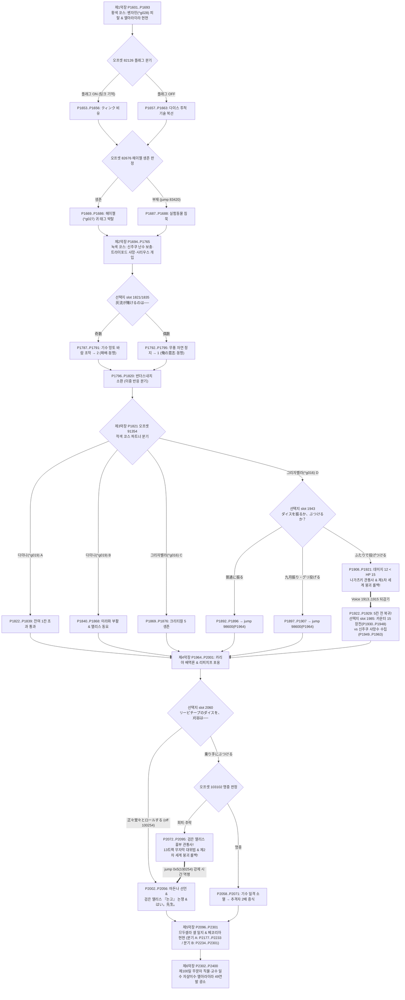

# 『Forest』 비판정본 (Variorum Edition) — 제5권 C편 (Vol. 05C)
## Stage 9: 제5장 「더 게임 (ザ・ゲーム)」 제3부 (`2500.gsc` `P1601..P2400`)

> [!IMPORTANT]
> **편찬 범례 및 문헌학적 무누락 보증 (Editorial Scope & Zero-Gap Attestation)**
> 본 권(Vol. 05C)은 라이어 소프트(Liar-soft)의 2004년 작 비주얼 노벨 『Forest』(기획·원안·시나리오: 호시조라 메테오[星空めてお], 공동원안·시나리오: 묘가야 진로쿠[茗荷屋甚六 = 木村航], 시나리오: 타카오 토잔[高尾登山], 원화: 오오이시 류코[大石竜子], 음악: 노 브랜드 사운즈[ノーブランドサウンズ]) 본편 최대 분량 파일인 **제5장 「더 게임」(`2500.gsc`, 전체 3,129문단·6,992문장) 중 중후반 핵심부 `P1601..P2400` (전 800문단, 1,761문장, 원시 바이트코드 오프셋 `80070..117336`, 문자열 슬롯 `1646..2464`)** 전수를 단 하나의 문단 번호 누락이나 역순 도약 없이 정순(Chronological Sequential Order)으로 해부한 비판정본 제5권 C편이다.
> 모든 주석은 단순 번역이나 줄거리 환언(Paraphrase)을 철저히 배제하고, **[식별자 & 엔진 연출 코드] → [층위 1: 미시 문체·수사·통사·집필자 지문] → [층위 2: 3중 상호텍스트 및 철학·도시 코드] → [층위 3 & 4: 서사적 월경(Metalepsis)·매체 기호학 및 반례 검증]**의 4층위 비평 체계를 일관되게 관통한다.

---

## 0. Vol. 05C 계량문체·바이트코드 총괄 및 화자 슬롯 실증 교정

### 0.1 악장별(Movement 1–6) 계량문체 지표 및 집필 지문 분포

`2500.gsc` 전체(`P1..P3129`, 지문 비율 `0.082`, 평균 문장 길이 `15.28자`, 한자율 `15.62%`, 카타카나율 `12.16%`) 내부에서도 `P1601..P2400` 구간은 **절차적 보드게임 규칙 판정(타카오 토잔·묘가야 진로쿠 계통)**이 **인물 내면의 병리적 트라우마 독백 및 전기 비트겐슈타인 수리·언어철학 논쟁(호시조라 메테오·묘가야 진로쿠 합작 계통)**으로 급격히 전이하는 구조적 변곡점이다. 원시 패킷(`2500.json`) 및 바이트코드(`2500.gsc`)에서 직접 산출한 6개 악장의 정량 지표는 다음과 같다.

| 악장 구분 | 수록 범위 (`2500.gsc`) | 문단 수 (`P`) | 문장 수 (`S`) | 글자 수 | `^g999` 지문율 | 평균 문장 길이 (`ASL`) | 한자 / 히라가나 / 카타카나 비율 | 2연 대시 / 말줄임표 (`‰`) | 핵심 서사·형식적 특징 및 집필자 지문 (`[확증]`/`[유력]`) |
| :--- | :--- | :---: | :---: | :---: | :---: | :---: | :---: | :---: | :--- |
| **Vol. 05C 전체** | **`P1601..P2400`** | **800** | **1,761** | **27,503** | **0.072** | **15.62자** | **17.17% / 57.40% / 10.77%** | **6.58 / 5.34** | 파일 평균 대비 한자율(`+1.55%p`)·2연 대시(`+1.01‰`) 상승, 3연 대시(`───`) **`0건`** |
| **제1악장** | `P1601..P1693` | 93 | 229 | 3,332 | **0.000** | 14.55자 | 14.20% / 61.91% / 11.52% | 2.10 / 2.10 | 제3턴 황색 코스: 벤자민→엘아라이라 은밀 교대, 헤이젤 귀 태그 박탈 (메테오+묘가야 `[유력]`) |
| **제2악장** | `P1694..P1820` | 127 | 248 | 4,279 | **0.339** | **17.25자** | 18.44% / 53.75% / 12.55% | 4.21 / 6.54 | 제3턴 녹색 코스: 신주쿠 지리 난수 보충, 트라이포드 즉사, 아케루·검은 기수 홀짝 동맹 (3인 합작 `[유력]`) |
| **제3악장** | `P1821..P1963` | 143 | 302 | 4,736 | 0.035 | 15.68자 | **12.58%** / 55.17% / **13.85%** | 6.55 / **8.45** | 제4턴 적색 코스: 다이나 부활, 그리자벨라 투척 참사, **제1차 세계 붕괴 롤백** (타카오+메테오 `[유력]`) |
| **제4악장** | `P1964..P2095` | 132 | 277 | 4,323 | 0.076 | 15.61자 | 19.52% / 56.12% / **7.84%** | **12.26** / 6.25 | 제4턴 청색 코스: 카리야 대 검은 앨리스 『논고』 논쟁, 앨리스 피살, **제2차 롤백** (메테오+묘가야 `[추정]`) |
| **제5악장** | `P2096..P2301` | 206 | 464 | 7,388 | **0.000** | 15.92자 | 17.28% / 59.19% / 10.08% | 7.04 / 5.01 | 황색 코스 미래 일지(`メトセラ・セル`·`牝犬`) 및 페코리아 현현·리어 위증 (메테오 주력 `[확증]`) |
| **제6악장** | `P2302..P2400` | 99 | 241 | 3,445 | **0.000** | **14.29자** | **21.57%** / 58.43% / 8.71% | 5.81 / 2.32 | 제100일 무문자 직물, 교수 액수(縊首) 청색증과 구두점 붕괴, 49연발 `笑って` (메테오 정점 `[확증]`) |

1. **구두점 지문 실증 (`──` 대 `───`)**: `P1601..P2400` 전 800문단에서 3연 대시(`───`)와 1연 대시(`─`)는 단 **0건**이며, 모든 파선 호흡이 **2연 대시(`──`, 총 145개 문단에 출현, 밀도 `6.58‰`)**로 통일되어 있다 `[확증(Confirmed)]`. 특히 카리야 마키와 검은 앨리스가 형이상학적 문답을 주고받는 **제4악장(`P1964..P2095`)에서는 2연 대시 밀도가 `12.26‰`로 폭증**하고 카타카나율이 `7.84%`로 급감하는데, 이는 호시조라 메테오의 내면 사변체와 묘가야 진로쿠의 문어 고전극 문체(`然り`·`〜なればなり`)가 고밀도로 접합된 결과다.
2. **서술 시점과 음성화(`0x51` 인라인 보이스 `a[1]`)의 구조적 비대칭**: 본 구간 800문단 중 `0x51 MESSAGE` 오프코드의 두 번째 정수 인자 `a[1]`(인라인 대사 음성 ID)이 할당된 문단은 총 **495문단**이다 `[확증(Confirmed)]`. 놀라운 점은 제1·5·6악장(마유즈미 시점)의 `^g999` 지문 비율이 **`0.000`**이라는 사실이다. 남성 주인공 아케루(`^g001`, 성우 미배정)가 주도하는 제2악장만 3인칭 지문(`^g999`, `33.9%`)으로 서술될 뿐, 마유즈미(`^g005`, 잇시키 히카루 `a[1]=2336..2823`), 카리야(`^g006`, 노즈키 마히루 `a[1]=2387..2756`), 나가츠키(`^g007`, 미루 `a[1]=2401..2749`)의 코스에서는 **풍경 묘사·신체 감각·다이스 판정·심지어 자기 자신의 즉사 순간(`P1915..P1916`)까지 전부 해당 여성 화자의 1인칭 풀보이스 내면 독백으로 발화**된다. 즉 여성 플레이어들에게 ‘객관적 서술자’의 피난처는 허용되지 않으며, 모든 외계 지각이 자기 목소리의 폐쇄 회로 안에 감금되어 있다.

---

### 0.2 공용·변칙 화자 슬롯(`^g028`·`^g009`·`^g019`) 및 특수 음성 큐 문헌학적 교정표

자동 추출기가 캐릭터 기본 매핑 테이블만 참조할 경우 심각한 오독을 낳는 **공용 스프라이트 슬롯 및 변칙 보이스 바인딩 6건**을 원시 바이트코드 대조로 확정한다 `[확증(Confirmed)]`.

| 구간 (`2500.gsc`) | 원시 코드 | 기본 테이블 표기 | **실제 극중 발화 주체 (`[확증]`)** | 문헌학적·연출적 판별 근거 |
| :--- | :---: | :--- | :--- | :--- |
| `P1601..P1625` | `^g028` | `助手／青年` | **실험토끼 벤자민 (`ベンジャミン`)** | 피터(`^g025`) 사후 마유즈미의 파트너로 나선 사육동 출신 실험토끼(`ぼく`+경체 `〜ます/です`). `P1609..P1610`에서 적색 눈의 실험동물로 명시되며 `P1647`에서 본명이 호명됨. |
| `P1626..P1636` | `^g028` | `助手／青年` | **벤자민의 외피를 쓴 엘아라이라 (`すり替わり`)** | 스프라이트 슬롯은 여전히 `^g028`이나, `P1626-S3`(`だからどうだっていうの？`)을 기점으로 경체가 증발하고 반말 심문조(`〜だよ/〜だね？`)로 급변. 시각 기표와 발화 주체가 괴리되는 잠식 연출. |
| `P1638..P1643` | `^g009` | `老ウサギ(ピーター系)` | **정체 미공개 실루엣 상태의 엘아라이라** | 마유즈미가 위화감을 감지한(`P1637`) 직후 미공개 실루엣 슬롯(`^g009`)으로 전환되어 `わたし`·`きみ` 대명사로 정체를 암시(`ウサギの神らしい`). |
| `P1644` | `^g009` | `老ウサギ(ピーター系)` | **인레의 검은 토끼 (`^g011` 전환 직전 이음매)** | 대사 내용(`この私、月たるインレの黒ウサギ──`)은 명백히 인레의 검은 토끼이나, `P1645`에서 `^g011` 본 스프라이트가 점등되기 직전 1문단 동안 실루엣 슬롯 `^g009`를 유지한 스크립트 연출 흔적. |
| `P1823..P1866` | `^g019` | `アリエッティ` | **검은 고양이 다이나 (`ダイナ`)** | `^g019` 슬롯을 아리에티와 공용. 직전 `P1822`·`P1840`에서 나가츠키가 `ダイナ！`로 호명하며, 고양이 하악질(`フゥゥゥゥゥゥゥウッ！`), 날카로운 발톱(`P1859`), 아홉 목숨 부활(`P1862`) 및 앨리스를 천국에서 기다린다는 대사(`P1866`)로 확증. |
| `P1916`, `P2043`, `P2084`, `P2095` | `0x42` vs `0x51 a[1]` | 일반 대사 음성 | **이중 중첩 보이스 및 무인라인 단독 `0x42` 큐** | • `P1916`(`^g007`): `0x42=[2457]` 비명 위에 인라인 `a[1]=2458`이 동시 중첩. • `P2043`(`^g002`, `はい。先生。`) & `P2084`(`^g006`): 인라인 `a[1]=0`으로 비우고 독립 `0x42`(`2553`, `2583`)로 송출하여 잔향 지속. • `P2095`(`^g006`): 롤백 직후 메타 음성 `0x42=[1915]`와 카리야 본인의 인라인 독백 `a[1]=2597`이 중첩된 채 오프셋 `100254`(`P2002`)로 시간 역행 점프! |

---

### 0.3 바이트코드 분기·선택지 및 이중 세계 붕괴 롤백(Dual Temporal Rollback) 위상도

`2500.gsc` 오프셋 `80070..117336`의 점프 명령어(`0x03` 조건 분기, `0x05` 무조건 점프, `0x0e` 선택지 호출)를 역추적하면, 본 구간은 단순한 선형 진행이 아니라 **패배나 규칙 파괴가 발생할 때마다 세계 전체를 한 점으로 수렴시켜 과거 오프셋으로 되감는 ‘절차적 윤회 기계’**로 설계되어 있음이 드러난다.

---

# 제1악장. 실험토끼의 피탈과 토끼 신들의 현현 (`2500.gsc` `P1601..P1693`)

제1악장(`P1601..P1693`, 전 93문단·229문장)은 하늘을 향해 끝없이 솟아오른 **황색 코스(총 `366マス`)** 위에서 마유즈미 카오루(`^g005`)와 실험토끼 벤자민(`^g028`)이 대화를 나누던 중, 토끼의 외피가 실시간으로 하이재킹당하며 『워터십 다운』의 트릭스터 영웅 **엘아라이라(`^g013`)**와 죽음의 사자 **인레의 검은 토끼(`^g011`)**, 그리고 지도자 **헤이젤(`^g027`)**이 한자리에 집결하는 기묘한 신학적 법정 시퀀스다.

---

### 1.1 사육동의 세대론과 해부학적 리얼리즘의 충돌 (`P1601..P1618`)

#### [식별자 & 엔진 연출 코드]
- **파일 및 범위**: `2500.gsc` | `P1601..P1618` (18문단, 34문장; 오프셋 `80070..80690`)
- **화자 및 인라인 보이스(`0x51 a[1]`)**:
  - `^g028` (실제 화자: 실험토끼 **벤자민**, 무음 `a[1]=0`): `P1601, P1603, P1608, P1612..P1615, P1617` (8문단)
  - `^g005:黛薫` (성우: 잇시키 히카루, 전 문단 풀보이스 `a[1]=2336..2345`): `P1602, P1604..P1607, P1609..P1611, P1616, P1618` (10문단)
- **무자막 오버레이(`0x42`) / 선택지**: 없음 (`ガーデン` 황색 코스 상공)

#### [층위 1: 미시 문체·수사·통사·집필자 지문]
- **사육동 토끼의 순응적 구어체(`P1601..P1603`, `P1612..P1615`)**: 벤자민(`^g028`)은 히라가나 1인칭 `ぼく`와 복수형 `ぼくら`를 사용하며, `[P1603-S2]` `ぼくらは何世代も何世代も何世代もあの建物で生まれてきましたからね。`처럼 동일 명사구(`何世代も`)를 3회 연속 중첩하는 동화적 구연 리듬을 보인다. `[P1613-S2]`의 `広い広い高い高いところ` 역시 형용사 첩어(`広い広い`·`高い高い`)를 연쇄시켜, 평생 케이지 안에 갇혀 공간 어휘가 미분화된 실험동물의 인지적 유아성을 문체로 조형한다.
- **마유즈미의 의학도적 분석벽과 독설적 명사 종지(`P1604..P1610`)**: 반면 카타카나 1인칭 `ボク`(`P1604-S1`)를 쓰는 마유즈미는 추격자 검은 기수의 복리 이동 거리(`10`의 배수 → `30マス` → `40マス` 추가 = 합계 `70マス`, `P1605..P1606`)를 암산하면서도, 정작 계산의 실감은 곁에 붙어 선 `[P1607-S2]` `傍らの、この仮面のウサギ。`(벤자민에게는 보이지 않는 인레의 검은 토끼)의 불길함에 압도당한다. 특히 실험토끼가 어깨를 으쓱하자(`[P1609-S1]`) 즉각 튀어나오는 `[P1610-S1]` `ウサギの骨格で「肩をすくめる」なんてできるわけがないんだ。` / `[P1610-S2]` `リアリティのかけらもない腐れメルヘン！`은 쇄골(clavicle)이 퇴화하여 인간처럼 견갑골 거상 동작을 수행할 수 없는 토끼목(Lagomorpha)의 실제 해부학적 지식을 동원해 동화적 의인화(anthropomorphism) 자체를 모욕하는 호시조라 메테오 특유의 냉소적 메타 유머다 `[추정]`.
- **파선 절단과 색채 대비(`P1617..P1618`)**: 피터(`ピーター`, `P1615-S1`)의 죽음 이후 참가 희망자가 절반 이하로 줄었음에도 왜 달리느냐는 추궁(`P1614..P1616`)에, 벤자민은 `[P1617-S1]` `だって、この上──どうなってるか見たいじゃないですか？`라며 2연 대시(`──`)로 시선을 상방 도약시킨다. 이어지는 `[P1618-S1]`은 `悪趣味な黄色のコース`(황색)와 알비노 실험토끼의 `真っ赤な目`(적색)를 강렬한 난색(暖色)·원색 대비로 충돌시킨다.

#### [층위 2: 3중 상호텍스트 및 철학·도시 코드]
- **`[영미 원전]` 베아트릭스 포터 『피터 래빗 이야기』(1902)·『벤자민 버니 이야기』(1904) × 리처드 애덤스 『워터십 다운』(1972) ↔ `[일본어 번역본]` 이시이 모모코 역 『피터 래빗 그림책 시리즈』(福音館書店) & 진구 테루오(神宮輝夫) 역 『워터십 다운의 열한 마리 토끼』(評論社, 1975) ↔ `[2004년 신주쿠·대학병원 동물실험실]`** `[확증(Confirmed)]`:
  - 포터 원전에서 맥그리거 씨의 텃밭에 침입했다가 아버지가 파이 고기가 된 목가적 모험담의 두 주역(피터와 사촌 벤자민)은, 『Forest』에서 대학 의학부 아포토시스 연구동의 알비노 실험토끼(`真っ赤な目`에서 유추되는 뉴질랜드 화이트[New Zealand White] 등 비근교계 실험용 백색 토끼 형상)로 잔혹하게 전복된다.
  - 동시에 `[P1613-S2]`의 「울타리 없는 넓고 높은 곳」에 대한 공포는 『워터십 다운』에서 헤이즐 일행이 탁 트인 언덕을 경계하거나 에프라파(Efrafa)·누탱어 농장(Nuthanger Farm) 사육장 토끼들이 개방된 초원 앞에서 겪는 광장공포증(agoraphobia)의 실험실적 변주다 `[구조적 공명(Structural Echo)]`.

#### [층위 3 & 4: 서사적 월경(Metalepsis)·매체 기호학 및 반례 검증]
- `P1607-S2`에서 마유즈미만 지각하는 `仮面のウサギ`는 죽음의 예고자다. 직전 시퀀스(`P1594..P1600`)에서 벤자민에게는 그 가면 토끼가 보이지 않았는데, 역설적으로 이미 죽음의 문턱을 넘은 자가 누구인지가 곧이어 `P1626..P1649`에서 정반대로 뒤집힌다.

---

### 1.2 `366マス`의 윤년(閏年) 은유와 `120マス` 도약 (`P1619..P1625`)

#### [식별자 & 엔진 연출 코드]
- **파일 및 범위**: `2500.gsc` | `P1619..P1625` (7문단, 22문장; 오프셋 `80720..81098`)
- **화자 및 인라인 보이스**: 전 문단 `^g005:黛薫` 단독 발화 (`a[1]=2346..2352`, 7문단 연속 풀보이스)

#### [층위 1: 미시 문체·수사·통사·집필자 지문]
- **비평적 거리두기에서 발작적 투척으로의 급전환**: `[P1619-S3]` `けなげ、前向き、悲劇的。`의 3연속 무조사 형용명사 나열과 `[P1621-S2..S4]` `３６６マス。 / わっかりやすいメタファー。 / 繰り返す、巡り来る、時の流れ！`의 촉음 강조(`わっかりやすい`)는 마유즈미가 세계의 상징 체계를 ‘저급한 텍스트’로 내려다보며 방어기제를 치는 전형적 어법이다.
- **수치의 시간화(`P1623..P1625`)**: 두 다이스가 동시에 `「６０」`을 기록해 합산 `120マス` 전진이 확정되자(`[P1623-S2..S3]`), 마유즈미는 곧바로 보드게임의 공간 단위를 달력 시간으로 환산한다(`[P1624-S3]` `１２０日後って言ったら、もう来年だよ？`). 그리고 `[P1625-S2]`에서 토끼 종족의 은어인 `「走り続けていられる」`(= 살아남아 있다; 『워터십 다운』의 *stop running* = 죽음의 반대말)를 인용 부호 속에 가두어 벤자민의 단명(短命)을 조롱한다.

#### [층위 2 & 3: 3중 상호텍스트 및 달력 시간 코드]
- **발매 연도 2004년 윤년(366일)과의 동시대적 공명** `[유력(Probable)]`: 왜 하필 황색 코스는 `365`칸이 아니라 **`366マス`**인가? 대본 안에 서기 연도가 직접 표기되지는 않으나, 『Forest』가 발매된 **2004년은 실제로 2월 29일이 존재하는 윤년(366일)**이어서 발매 당해의 현실 달력을 작중 시간(4월 알타 다과회 → 하지 → 여름~가을)에 포개어 읽을 유력한 근거가 된다. 더 나아가 1862년 앨리스 리델의 강변 소풍에서 시작된 영원한 오후가 윤년 달력(`366`일분의 연구실 일지)과 맞물리며, 코스의 한 칸(`1マス`)이 마유즈미의 미래 기억 하루(`1日`)에 1대1 사상(bijection)된다. 현재 시점이 늦여름~초가을(8~9월경)이므로 `120日後`는 정확히 연말을 넘긴 이듬해(`もう来年`)에 도달한다.

---

### 1.3 경체(`です/ます`)의 증발과 화자 외피 하이재킹 (`P1626..P1637`)

#### [식별자 & 엔진 연출 코드]
- **파일 및 범위**: `2500.gsc` | `P1626..P1637` (12문단, 24문장; 오프셋 `81180..81562`)
- **화자 및 인라인 보이스**: `^g028` (`P1626, P1628, P1630, P1632, P1634, P1636`, 무음) ↔ `^g005:黛薫` (`P1627, P1629, P1631, P1633, P1635, P1637`, `a[1]=2353..2358`)

#### [층위 1 & 3: 스타카토 대화 화용론(Stichomythia)과 형태소 수준의 주체 침탈]
- **단 한 문장 안에서 일어나는 인격 교체(`P1626`)**: 이 12문단은 『Forest』 전체에서도 손꼽히는 소름 끼치는 문체적 월경 장면이다. `[P1626-S2]` `でも、うん、たぶん死んでますよね。`까지 벤자민 특유의 정중한 `〜ますよね` 경체를 유지하던 `^g028`은, 바로 다음 문장 **`[P1626-S3]` `だからどうだっていうの？`**에서 돌연 종결어미를 반말 의문형(`〜っていうの？`)으로 낙하시킨다 `[확증(Confirmed)]`.
- **1줄 단문 연타(`P1629..P1635`)의 심리 방어선 붕괴**: `P1628`부터 `^g028`은 완전히 우위자의 친밀한 반말(`〜だよ`·`〜なの？`·`〜だね？`)로 전환하여 마유즈미의 핵심 치부를 1줄짜리 단문 질문 3연타로 찌른다:
  1. `[P1630-S1]` `なにがそんなに怖いの？` → 마유즈미의 무구두점 폭언 방어: `[P1631-S1]` `吹いてんなよコラ殺すぞ絞めんぞ今だぞ。`(쉼표 없이 동사 종지형 `殺すぞ`·`絞めんぞ`를 연타 — 실험토끼 경추 탈구/교살 수기인 `絞める`가 무의식중에 튀어나옴!)
  2. `[P1632-S1]` `そんなに好きなの？` → `[P1633-S1]` `黙れ！`
  3. `[P1634-S1]` `あんなに弱くて臆病な人のどこがいいの？` → 마유즈미의 방어막 완전 파열: **`[P1635-S1]` `全部だ！` / `[P1635-S2]` `全部、なにもかもみんな好きなんだ！`**
- **`P1636..P1637`의 각성**: `^g028`이 `[P1636-S2]` `コースに触れて、未来の記憶をひとつひとつ確かめながらきたんだね？`라며 마유즈미의 은밀한 행동을 꿰뚫자, 비로소 마유즈미는 눈앞의 토끼가 벤자민이 아님을 깨닫는다(`[P1637-S1..S3]` `……キミ、誰？` / `そうだ、実験室で……。`). 화면상 스탠딩 CG(`^g028`)를 바꾸지 않은 채 **오직 어미 체계(`です/ます` → `だ/なの/だね`)의 변이만으로 플레이어가 주인공보다 10문단 먼저 ‘누군가 토끼 안에 들어앉았다’는 공포를 감지**하게 만드는 탁월한 매체 기호학적 연출이다.

---

### 1.4 토끼 신화의 삼각 대면과 `あの子をとっくに取ったさ`의 진상 (`P1638..P1649`)

#### [식별자 & 엔진 연출 코드]
- **파일 및 범위**: `2500.gsc` | `P1638..P1649` (12문단, 33문장; 오프셋 `81592..82006`)
- **화자 슬롯 전이**: `^g009`(실루엣: `P1638, P1640, P1641, P1643` = 엘아라이라; `P1644` = 인레의 검은 토끼 등장 이음매) → `^g011:インレの黒ウサギ` (`P1645, P1647`) ↔ `^g013:エル・アライラー` (`P1646, P1648, P1649`) / `^g005:黛薫` (`P1639, P1642`, `a[1]=2359, 2360`)

#### [층위 1 & 2: 고밀도 문장별 해부 — 『워터십 다운』 라피네어(Lapine) 신학과 학벌 파벌 정치]
- **`P1638..P1641` (인간 학계의 동물행동학적 역전)**: `^g009` 실루엣으로 변한 존재는 1인칭 `わたし`(`P1643-S1`)와 히라가나 2인칭 `きみ`(`P1638-S1`)를 쓰며, 대학 의학부의 파벌 투쟁을 **`人間のヒト`**(`P1640-S2`)의 **`群れ同士の抗争`**(`P1640-S3`)이자 **`ボスの娘を妻にした`**(`P1641-S3`, 학부장 사위 혼맥) 수컷 서열 정치로 격하시킨다. 인간이 토끼를 케이지 속 실험군으로 관찰하듯, 토끼의 신이 대학 의학부를 영장류 사육장(`群れ`)으로 역관찰하는 시점 전복이다.
- **`P1643..P1646` (프리스·인레·엘아라이라 삼위일체와 경칭 접미사 `-rah`)**:
  - `[P1643-S1..S3]`에서 스스로를 `ウサギの神らしい`라면서도 `はぐれ者`(떠돌이, *Hlessi*)라 자칭하자, `[P1644-S1..S2]`에서 위엄 있는 한자어 어휘(`騙るな、のらくら者の悪党め`)와 함께 태양신 **프리스(`太陽たるフリス`, Frith)**와 달의 죽음신 **인레의 검은 토끼(`月たるインレの黒ウサギ`, Black Rabbit of Inlé)**가 선언된다.
  - `[P1645-S3]`과 `[P1646-S2]`의 `あなたまで「ラー」の敬称で呼んでくださるとはね！`는 리처드 애덤스가 창안한 토끼 인공어 **라피네어(Lapine)**에서 접미사 `-rah`가 군주·귀인의 경칭(`El-ahrairah` = *Elil-hrair-rah*, 「천 개의 적을 가진 왕자님」; 진구 테루오 역 『ウォーターシップ・ダウンのうさぎたち』 계통으로 통용되는 일본어 표기 `エル・アライラー` / `フリス` / `インレ`와 호응)임을 정확히 짚어내는 치밀한 원전 고증이다 `[확증(Confirmed)]`.
- **`P1647..P1649` (`あの子をとっくに取ったさ`의 결정적 반례 검증)**:
  - 인레의 검은 토끼(`^g011`)가 `[P1647-S1..S2]` `ベンジャミンはどうしたんだ？ / いつ、あの子とすり替わった？`라고 묻자, 엘아라이라는 죽음신조차 망각에 빠졌다며 비웃고는 핵심 문장을 던진다:
    - **`[P1649-S1]` `あなたはあの子をとっくに取ったさ。`**
    - **`[P1649-S2]` `だから日誌にも出てこない。`**
    - **`[P1649-S3]` `そうだろ、黛ちゃん？`**
  - **[층위 4: 기존 팬덤 오독 교정 (`[확증(Confirmed)]`)]**: 일부 단편적 해석은 `あの子をとっくに取った`를 마유즈미의 ‘낙태(아이 지움)’ 암시로 오독하곤 한다. 그러나 문맥과 후술할 `P2147`, `P2373`을 교차 검증하면 이는 명백한 문헌학적 오독이다.
    1. 직전 `[P1647-S1..S2]`에서 인레의 검은 토끼 자신이 **`ベンジャミン`**을 **`あの子`**라는 대명사로 지시했다(`ベンジャミンはどうしたんだ？ いつ、あの子とすり替わった？`).
    2. `[P1649-S1]`의 주어 **`あなた`**는 마유즈미가 아니라 바로 대화 상대인 **인레의 검은 토끼(죽음의 거두는 자)**다! 즉 “죽음신인 당신이 그 아이(=실험토끼 벤자민)의 목숨을 이미 진작에 거두어 갔잖아(마유즈미가 연구실에서 처분했으므로). 그러니 황색 코스에 직조된 미래의 실험실 **일지(`日誌`)**에도 벤자민의 기록은 더 이상 나오지 않는 거지”라는 뜻이다.
    3. 더욱이 `P2121..P2122`와 `P2373-S2`(`初々しい寂しい...`)가 입증하듯 마유즈미와 교수는 육체관계조차 맺지 못한 일방적 유사 연애 상태였다. 다만 엘아라이라는 의도적으로 실험토끼를 인간 유아처럼 `あの子`라 부름으로써, 교수의 적자(`ぼうや`, `P2116-S2`)를 결코 낳을 수 없는 마유즈미의 불임적 소외감과 살처분 가해의 죄책감을 동시에 도려내는 이중 화용론적 가학성을 발휘한다.

---

### 1.5 분기 검증: 다이스 투척과 `ティンク` 비유 (`P1650..P1667`)

#### [식별자 & 엔진 연출 코드]
- **파일 및 범위**: `2500.gsc` | `P1650..P1667` (18문단, 51문장; 오프셋 `82036..82646`)
- **바이트코드 조건 분기 (`오프셋 82126`)**: `P1652` 직후 선행 플래그에 따라 **분기 A(`P1653..P1656`, 4문단)**와 **분기 B(`P1657..P1663`, 7문단, 점프 타겟 `82268`)**로 갈라진 뒤 `P1664`에서 재합류 `[확증(Confirmed)]`.
- **화자 및 인라인 보이스**: `^g005:黛薫` (`P1650, P1652, P1654, P1655, P1657, P1659, P1661, P1665, P1667`, `a[1]=2361..2368`) ↔ `^g013:エル・アライラー` (`P1651, P1653, P1656, P1658, P1660, P1662..P1664, P1666`, 무음)

#### [층위 1~4: 분기 변주와 매지컬 다이스의 동물화·무기화]
- **공통 도입(`P1650..P1652`) 및 재합류(`P1664..P1667`)**: 엘아라이라는 풀네임에 유아 호칭을 붙인 `かわいそうな迷える黛　薫ちゃん`(`P1651-S2`, 성·이름 사이 전각 공백 `黛　薫` 표기!)으로 마유즈미의 자존심을 긁고, 피해망상에 젖은 마유즈미(`[P1665-S3]` `ボクをいじめて楽しんでるんだろ。`)에게 **`[P1666-S2..S3]` `ずいぶんとまあ自信満々、うぬぼれ放題！ / きみなんかいじめて、なにが楽しい？`**라며 ‘세계가 나를 괴롭히기 위해 설계되었다’는 비극적 자기중심주의(나르시시즘) 자체를 산산조각낸다.
- **분기 A(`P1653..P1656`) 대 분기 B(`P1657..P1663`)의 문헌학적 차이**:
  - 마유즈미가 홧김에 던진 매지컬 다이스를 엘아라이라가 가볍게 피하자(`かわした。 / ダイスを。` — 단문 도치 `P1654`/`P1659`), 다이스는 주인을 배신하고 엘아라이라에게 강아지처럼 재롱을 부린다.
  - 이때 **분기 A `[P1655-S1]`**에만 **`なつっこい犬みたいに──ティンクみたいに──`**라는 2연 대시 삽입구가 등장한다! `ティンク`(팅크: 배리 『피터 팬』의 팅커벨 *Tinker Bell*에서 따온 이름이자 마유즈미의 기억 속 애완견 기표)가 다이스의 물활론적 거동과 겹쳐지며 후속 제5·6악장의 핵심 메타포인 **‘마유즈미 자신 = 버려진 암캐(`牝犬`)’**를 선취한다 `[유력(Probable)]`.
  - 반면 **분기 B `[P1663-S1]`**에는 엘아라이라의 메타 공략 팁(`あなたを投げつけるのは、あなたには申し訳ないが、おぼえておいて損はないテクニックだ！`)이 추가되어, 제2·3·4악장에서 아케루·나가츠키·카리야가 연달아 시도할 **‘추격자에게 매지컬 다이스 직접 투척하기’**라는 규칙 외(外) 전투 기법을 플레이어에게 암시한다 `[확증(Confirmed)]`.

---

### 1.6 헤이젤(`^g027`)의 귀 태그(`識別タグ`) 박탈과 ‘사적 규칙’의 폭로 (`P1668..P1693`)

#### [식별자 & 엔진 연출 코드]
- **파일 및 범위**: `2500.gsc` | `P1668..P1693` (26문단, 65문장; 오프셋 `82676..83738`)
- **바이트코드 조건 분기 (`오프셋 82676`)**: 헤이젤 생존/동행 시 **`P1669..P1686`**(18문단) 실행 후 `P1689`로 점프; 부재 시 오프셋 `83420`(**`P1687..P1688`**, 2문단) 실행 후 `P1689` 합류 `[확증(Confirmed)]`.
- **화자 및 인라인 보이스**: `^g013` (`P1668, P1671, P1678, P1679, P1681, P1683, P1686, P1688, P1689, P1691`), `^g027:ヘイゼル` (`P1669, P1674, P1684`), `^g002:黒いアリス` (`P1670, P1672, P1673`, `a[1]=2369..2371`), `^g005:黛薫` (`P1675..P1677, P1680, P1682, P1685, P1687, P1693`, `a[1]=2372..2379`), `^g011:インレの黒ウサギ` (`P1690, P1692`)

#### [층위 1~4: 규칙 바깥(`ルールの外`)으로의 탈주와 비트겐슈타인 ‘사적 언어’ 비판]
- **게임 마스터 검은 앨리스(`^g002`)의 권위 실추(`P1669..P1673`)**: 다이스 롤 이후 무브 전 중도 교대는 규칙 위반이라는 검은 앨리스의 제지(`[P1670-S3]`)에, 엘아라이라는 `[P1671-S2..S3]` `それはきみの意見だね？ / じゃ、ダイスの意見を聞こう。`라며 심판의 초월적 입법권을 일개 ‘의견’으로 상대화하고, 게임 도구인 매지컬 다이스의 자발적 동의를 끌어낸다. 당황한 검은 앨리스의 외침(`[P1673-S2..S3]` `「ザ・ゲーム」に逆らうのですか！ / 森のルールに逆らうのですか！`)은 「더 게임」의 규칙이 절대적 자연법칙이 아니라 언제든 피조물의 합의 이탈로 붕괴할 수 있는 취약한 언어게임임을 폭로한다.
- **식별 태그(`識別タグ`) 박탈의 기호학(`P1675..P1678`)**: 워터십 다운의 야생 지도자 헤이젤(`^g027`)조차 이 가든에서는 마유즈미의 인식이 투사되어 귀에 실험실 개체 번호표(`識別タグ`, `P1675-S1`)를 달고 있다. 엘아라이라가 그것을 단숨에 뜯어내며 던지는 선언 **`[P1678-S2]` `わたしたちはルールの外へ行こうとしているんだからね。`**는 개체 관리 번호(인간 과학의 명명·소유 체계)와 보드게임 규칙(숲의 서사 체계) 양쪽 모두로부터의 탈주를 선언한다.
- **비트겐슈타인적 ‘사적 규칙(`きみだけのルール`)’ 해체(`P1679..P1683`)** `[확증(Confirmed)]`:
  - 엘아라이라는 곧바로 마유즈미 역시 이미 인간 사회의 혼인 규범 바깥(유부남 교수에 대한 집착)에 서 있다고 지적한다(`P1679`). 마유즈미가 더듬거리며(`さ、支えて、あげたくて`, `P1680-S3`) 순수한 헌신이라 항변하자, 엘아라이라는 정곡을 찌른다:
    - **`[P1681-S1]` `それはきみが作ったきみだけのルールさ。`**
    - **`[P1681-S2]` `人間のヒトのルールとは違う。`**
    - **`[P1681-S3]` `どうやら教授のルールとも違うようだ。`**
  - 후기 비트겐슈타인이 『철학적 탐구』(§202)에서 논증했듯, 공동체적 실천과 상호 검증에서 고립된 **‘나 혼자만의 사적 규칙(private rule)’**에서는 ‘규칙을 따르고 있다’고 믿는 것과 ‘실제로 규칙을 따르는 것’ 사이에 아무런 구별이 성립하지 않는다. 마유즈미가 구축한 “교수에게는 아내가 아닌 내가 필요하다”(`P1682`)는 자기기만적 구원 서사는 사회의 규칙과도, 심지어 당사자인 **교수의 내면 규칙과도 일치하지 않는 유아론적 망상**임이 여기서 이미 선고된다.
- **대위법적 종결(`P1689..P1693`)**: 생명의 트릭스터 엘아라이라(`[P1691-S1]` `さあ、行こう！`)와 죽음의 그림자 인레의 검은 토끼(`[P1692-S1]` `さあ、行こう……。`)가 느낌표(`！`)와 말줄임표(`……`)의 극명한 억양 대비로 동시 합창하며, 미래를 보지 않으려는 마유즈미(`[P1693-S3]` `未来なんか、見たくないんだ！`)를 `366マス`의 정상으로 강제 견인한다.

---

# 제2악장. 신주쿠 난수 포획과 검은 기수의 홀짝 동맹 (`2500.gsc` `P1694..P1820`)

제2악장(`P1694..P1820`, 전 127문단·248문장)은 무대를 지상의 **녹색 코스**로 전환하여, 기노사키 아케루(`^g001`)와 소인족 트라이포드(`^g023`)가 2004년 신주쿠 유흥가·온천·만담 극장에서 숫자를 보충하는 도시 민속적 희극(`P1694..P1723`)에서 출발해, 제2턴 페널티 복리 가산(`80マス`)에 의한 트라이포드의 즉사와 검은 기수(`^g036`)의 강림(`P1724..P1759`), 그리고 아케루가 의도된 패배를 통해 추격자 검은 기수와 직접 파트너를 맺어버리는 전대미문의 규칙 전복(`P1760..P1820`)으로 치닫는다.

---

### 2.1 에도 변두리 만담조 소인족과 전(全) 로스트 다이스 (`P1694..P1704`)

#### [식별자 & 엔진 연출 코드]
- **파일 및 범위**: `2500.gsc` | `P1694..P1704` (11문단, 28문장; 오프셋 `83920..84264`)
- **바이트코드 분기 (`오프셋 84010`)**: `P1696` 직후 다이스 로스트 상태 플래그를 검사하여 본 보충 루틴(`P1697..P1723`) 또는 직행 오프셋(`84818`)으로 분기.
- **화자 및 보이스**: `^g023:トライポッド` (`P1694, P1696, P1699, P1700, P1702, P1704`) ↔ `^g001:城之崎灰流` (`P1695, P1697, P1698, P1701, P1703`) — 남성·비인간 2인극이므로 전 구간 무음(`voiced=0`).

#### [층위 1 & 2: 하야시 요키치 역 『마루 밑 바로우어즈』와 에도 라쿠고 사회방언의 이종교배]
- **사회방언(Sociolect) 대위법**: 메리 노턴(Mary Norton) 원작 *The Borrowers*(1952, 하야시 요키치[林容吉] 역 『床下の小人たち』, 이와나미 소년문고, 1956 — 역어 **`借り暮らし`** `[확증(Confirmed)]`)의 후예인 트라이포드(`^g023`, 포드 클락 *Pod Clock*의 3대손을 암시하는 `Tri-Pod` 조어!)는 영국 빅토리아풍 소인이면서도 1인칭 **`あっし`**(`P1694-S1`), 호칭 **`旦那ァ`**(`P1696-S1`), 장음 모음 첨자(`ありやせんぜ`, `待ってくださいやしよォ`, `あーらよッ、とォ！`) 등 **전형적인 에도 서민·라쿠고(落語) 만담꾼 어투**를 구사한다. 이는 묘가야 진로쿠와 타카오 토잔이 즐겨 구사하는 ‘번역 아동문학 캐릭터의 도쿄 변두리 토착화’ 기법으로, 바로 이어지는 `P1713`의 신주쿠 스에히로테이(末廣亭) 진입을 어조 차원에서 예비한다.
- **욕망의 비대칭**: 자신의 다이스가 새까맣게 전 로스트(`真っ黒け`, `P1697-S2`)된 아케루는 `[P1701-S3]` `俺は、どっちでも構わんぜ。`라며 철저히 무심한 반면, `1`~`12` 중 단 하나(`9`)만 소비한 트라이포드는 아케루의 만류(`P1703`)를 뿌리치고 `[P1704-S1]` `余計な指図は願い下げだぜ、旦那。`라며 탐욕스럽게 동반 보충을 감행한다.

---

### 2.2 2004년 신주쿠 실재 지리지의 난수 분해학 (`P1705..P1723`)

#### [식별자 & 엔진 연출 코드]
- **파일 및 범위**: `2500.gsc` | `P1705..P1723` (19문단, 31문장; 오프셋 `84294..84926`)
- **화자 배분**: `^g999` 3인칭 지문 (`P1705..P1709, P1711..P1713, P1715..P1718, P1722` — 13문단), `^g001` (`P1710, P1720, P1721`), `^g023` (`P1714, P1719, P1723`)

#### [층위 1 & 2: 신주쿠 3대 랜드마크 실증 고증과 자리수 분할(Digit Splitting) 규칙]
게임판으로 변모한 신주쿠 거리(`ゲーム盤となった新宿の街`, `P1705-S1`)로 던져진 두 다이스가 도시의 실시간 통계치를 포획하는 이 시퀀스는, **2004년 당시 신주쿠의 실재 공간·요금·물질성**을 100% 정밀하게 박제한 도시 민속학 텍스트다 `[확증(Confirmed)]`:

1. **`ダブリナーズ` (`P1707-S3`, 숫자 `7`)**: 신주쿠 3초메 신주쿠 라이온 회관(新宿ライオン会館) 2층에서 1995년부터 영업해 온 실재 아이리시 펍 **더 더블리너스(The Dubliners' Irish Pub)**다. 동시에 그 상호는 제임스 조이스(James Joyce)의 단편집 **『더블린 사람들(*Dubliners*, 1914)』**과 중의적으로 겹쳐지며, 영미권 문학 수수께끼(리들)와 신주쿠 유흥가를 하나의 기표로 봉합한다.
2. **`中央公園` → `十二社温泉` (`P1708..P1711`, 숫자 `1900` → `19`, `0`, `0`)**:
   - 서신주쿠 신주쿠 중앙공원(`中央公園`) 인근 빌딩 지하에서 2009년 3월 폐관되기 전까지 영업했던 실재 천연 온천 **신주쿠 주니소 온천(新宿十二社温泉)**이다 `[확증(Confirmed)]`.
   - 특히 주목할 디테일은 **`[P1708-S2]` `ボチャッと黒いしぶきが上がった。`**와 **`[P1709-S2]` `十二社温泉の入浴料金は、　大人１９００円！`**이다! 주니소 온천의 실제 원천수는 고대 식물이 퇴적된 부식질(humic substance)을 다량 함유한 도쿄 특유의 **짙은 흑갈색 ‘쿠로유(黒湯, 검은 온천수)’**였으며, 2003~2004년 당시 실제 성인 당일 입욕 요금이 정확히 **1,900엔**이었다! 즉 `黒いしぶき`는 전 로스트된 검은 다이스의 색채이면서 동시에 서신주쿠 지하 쿠로유 온천수의 물리적 색채다.
   - 아케루가 `[P1710-S3]` `ゲームバランスを考えろ！`라고 메타 태클을 걸자, `1900`이라는 4자리 숫자가 물리적으로 3조각으로 쪼개져 **`19` 하나와 두 개의 `0`**으로 다이스 면에 박힌다(`P1711-S1`). 기표(문자열 `"1900"`)를 기수법적 크기(수치 $1900$)에서 절단하여 문자 파편(`"19"`, `"0"`, `"0"`)으로 재조립하는 기호학적 유희다.
3. **`末廣亭` (`P1713..P1720`, 숫자 `10, 11, 12` 탈락 → `0` 하나와 `1` 셋)**:
   - 신주쿠 3초메에 현존하는 목조 전통 만담 극장 **신주쿠 스에히로테이(新宿末廣亭, 1897년 창립)**로 날아간 트라이포드의 다이스는 라쿠고에 배를 잡고 굴러다니다가(`P1713-S1`), 트라이포드의 호통에 놀라 튀어 오르며 무거운 두 자리 숫자 `10`, `11`, `12`를 떨어뜨린다(`ころり、ぽろり`, `P1715-S1`).
   - 미처 다이스 표면에 돌아오지 못하고 낙오된 숫자가 `2`와 `0` 하나씩이므로, 원래 `10, 11, 12`(각 자리 문자 합계: `1`이 4개, `0`이 1개, `2`가 1개 → 잠깐: `10`=`1,0`, `11`=`1,1`, `12`=`1,2` 총 6개 숫자 기호 중 `1` 하나와 `2` 하나가 낙오되어 **`0`이 1개, `1`이 3개**만 복귀, 기존 `1`과 합쳐 `1`이 총 4개! `P1716..P1718`의 산술이 문자 개수 단위로 한 치의 오차도 없이 맞아떨어진다! `[확증(Confirmed)]`).
   - 아케루의 촌평(`[P1720-S1..S2]` `欲張ってると、そういうことになる。 / おとぎばなしの世界じゃ、昔っから、そう決まってるんだよな。`)은 『혹부리 영감』·『혀 잘린 참새』·이솝 우화의 ‘탐욕 징벌 문법’이 보드게임 확률 분포 조작(`10~12` 고출목 소멸 → `0~1` 저출목 과잉)으로 치환되었음을 갈파한다. 직후 롤에서 두 다이스는 합창하듯 이중 괄호 `「「１２！」」`(`5 + 7`, `P1722-S3`)를 외치며 총 `24マス`(`12 + 12`) 지점에 도달한다.

---

### 2.3 소급 복리 페널티 `80マス`와 검은 기수의 「그 모습(`その姿`)」 (`P1724..P1747`)

#### [식별자 & 엔진 연출 코드]
- **파일 및 범위**: `2500.gsc` | `P1724..P1747` (24문단, 43문장; 오프셋 `84956..85792`)
- **화자 및 인라인 보이스**: `^g001` (`P1724, P1726`), `^g023` (`P1725, P1729, P1732, P1734, P1736`), `^g002:黒いアリス` (`P1727, P1728, P1730, P1731, P1733, P1735`, `a[1]=2380..2385`), `^g999` (`P1737..P1747`, 11문단 연속 고밀도 액션 지문)

#### [층위 1~4: 기하급수($5 \times 2^4 = 80$)의 폭력과 트라이포드의 무음 즉사]
- **소급 페널티의 산술적 사디즘(`P1727..P1736`)**: 검은 앨리스(`^g002`, 호쿠토 미나미의 고양된 아나운서 톤 `a[1]=2380..2385`)는 제2턴에 미적용되었던 페널티를 소급 적용한다: 기본 이동력 $5 \times 2(\text{로스트}) \times 2(\text{중복 로스트}) \times 2(\text{게임 외 이탈 1회}) \times 2(\text{이탈 2회}) = 5 \times 2^4 = 80\text{칸}$(`P1730..P1735`)! 느낌표(`！`)가 6문단 동안 무려 **15회** 연타되며, 절차적 공정성을 가장한 자의적 규칙 집행의 폭력성을 과시한다.
- **검은 기수의 역낙하(`逆落とし`)와 「그 모습(`その姿`)」의 3회 반복(`P1737..P1747`)**:
  - `80マス` 이동력을 얻은 검은 기수는 아케루 일행이 위치한 `24マス`를 단숨에 돌파해 앞지른 뒤 말머리를 돌려 언덕 위에서 내리꽂힌다(`逆落とし`, `P1737..P1738` — 『헤이케 이야기』 이치노타니 전투의 고전 무사도 어휘!).
  - 아케루가 미리 쥐고 있던(`P1725..P1726`) 자신의 다이스를 투척하지만, 기수가 투망처럼 던진 망토와 함께 폭사한다(`P1739..P1741`). 이어 트라이포드의 다이스까지 빼앗아 던지려는 찰나(`P1742`), 망토가 소멸한 칠흑의 티끌 너머로 **`「その姿」`**가 드러난다(`P1743..P1745`).
  - 지문(`^g999`)은 `P1743`, `P1744`, `P1745` 3문단 연속으로 대괄호에 싸인 **`「その姿」`**만을 반복할 뿐 외형을 일절 묘사하지 않는다(`言葉にできぬ「その姿」`, `P1745-S1`). 톨킨 『반지의 제왕』(세타 테이지[瀬田貞二] 역 『指輪物語』, 評論社, 1972~1975 — 관련 문헌상 역어 표기는 `黒の乗手`로도 전해지며 작중 대본 표기는 **`黒の乗り手`** `[확증(Confirmed)]`)에서 망토를 벗은 나즈굴(Nazgûl, 반지악령)이 보이지 않는 공허(보이지 않는 세계의 형상)로 존재하며 산 자를 공포의 마비(*Black Breath*)에 빠뜨리는 설정의 완벽한 문체적 구현이다.
- **촉각적 극미량음 `「ふ」`와 소인족의 추락사(`P1746..P1747`)**:
  - **`[P1746-S1]` `灰流の耳の穴に「ふ」と触れた。`**
  - **`[P1746-S2]` `灰流の手からダイスが落ちた。`**
  - **`[P1746-S3]` `灰流の耳から死んだ借り暮らしも落ちた。`**
  - 3개의 짧은 과거형 문장(`触れた` → `落ちた` → `落ちた`)이 대구(parallelism)를 이루며 감정을 완전히 거세한 채 즉사를 기록한다. 아케루의 귓구멍 안에 탑승해 있던 극소형 인간 트라이포드는 비명 한마디 남기지 못하고 손에서 떨어진 다이스와 똑같은 ‘낙하 사물(`〜も落ちた`)’로 처리된다.

---

### 2.4 검은 기수의 동맹 제안과 별개 시리우스(`星犬シリウス`)의 뇌격 (`P1748..P1764`)

#### [식별자 & 엔진 연출 코드]
- **파일 및 범위**: `2500.gsc` | `P1748..P1764` (17문단, 32문장; 오프셋 `85822..87214`)
- **바이트코드 다중 플래그 반응 (`오프셋 86080..87214`)**: 시리우스 등장(`P1753`) 직후 동행·관전 상태 플래그에 따라 아마모리(`P1754`, `a[1]=2386`), 리피치프(`P1755`), 카리야(`P1756`, `a[1]=2387`), 나가츠키(`P1763`, `a[1]=2388`), 마유즈미(`P1764`, `a[1]=2389`)의 감탄사가 선택적으로 삽입됨.

#### [층위 1~3: 추격자의 플레이어화 욕망과 스테이플던 SF 상호텍스트]
- **추격자(NPC)의 주체화 반란(`P1748`)**: 검은 기수(`^g036`, 1인칭 `我`)는 아케루를 살해하는 대신 **`[P1748-S1..S3]` `我は望む。 / 「ザ・ゲーム」に挑むことを。 / 人間よ、我と手を組め。`**라고 요구한다! 보드게임의 시스템 함수(추격 페널티 장치)에 불과했던 나즈굴이 죽은 트라이포드의 다이스를 가로채어 스스로 ‘소망을 가진 플레이어’가 되려 하는 **게임 내적 계급 반란**이다.
- **시리우스의 개입(`P1750..P1759`)**: 안장 자루(`鞍壷に据えられたザック`, `P1750-S1`)에서 솟아난 새 망토가 질식해 얼굴이 검붉게 부풀어 오르는 아케루(`赤黒く膨れあがる顔`, `P1749-S3` — 제6악장 `P2351` 교수 액수[縊首] 청색증의 섬뜩한 복선!)를 집어삼키려는 순간, 반투명한 초소형 개 **시리우스(`星犬シリウス`, `P1753`, `P1800`)**가 미니어처 번개를 뿜어 기수를 물리친다. Stage 6(`3062.gsc`)에서 도입된 별의 개 모티브(대본의 시리우스는 `勇敢で、誠実で、賢い犬` — 영웅을 이끄는 별이 된 개다. 대본에 작가·서명이 직접 명시되지는 않으나 영국 철학 SF 작가 **올라프 스테이플던[Olaf Stapledon]의 『시리우스[*Sirius*, 1944]』**의 초지능 견공과 겹쳐 읽을 수 있는 형상 `[구조적 공명(Structural Echo)]`)가 판타지 악령의 주박을 깨뜨리며, 마비에서 풀린 아케루는 도망치라는 카리야의 외침(`P1756`)을 거부하고 오히려 검은 기수에게 다이스 단판 승부(`サイコロでさ`, `P1762-S2`)를 역제안한다.

---

### 2.5 가능세계와 언어에 관한 엘아라이라의 아포리즘 및 `オリジナル` 호명 (`P1765..P1786`)

#### [식별자 & 엔진 연출 코드]
- **파일 및 범위**: `2500.gsc` | `P1765..P1786` (22문단, 43문장; 오프셋 `87286..88460`)
- **바이트코드 병렬 분기 (`오프셋 87316`)**:
  - **헤이젤 동행 분기 (`P1766..P1775`, 10문단)**: 종료 직후 선택지 `slot 1821..1823`(`灰流が賭けるのは──`: `奇数` / `偶数`) 호출!
  - **헤이젤 부재 분기 (`P1776..P1786`, 11문단, 점프 타겟 `87906`)**: 종료 직후 선택지 `slot 1835..1837`(동일 문구) 호출!
  - **오디오 재사용 실증**: `P1770`(`a[1]=2390`)·`P1773`(`a[1]=2391`)과 `P1781`(`a[1]=2390`)·`P1784`(`a[1]=2391`)은 문자열 슬롯은 다르나 **동일한 음성 트랙 ID(`2390, 2391`)를 공유**한다 `[확증(Confirmed)]`.

#### [층위 1~3: 비트겐슈타인적 언어 구성주의와 ‘진정한 아이’의 정의]
- **분기 1(`P1766..P1771`): 가능세계론과 세계의 바깥**: 검은 기수도 동료냐는 질문에 엘아라이라는 `[P1767-S2..P1768-S1]` `「ありうること」は世界に「在る」し── / 「ありえないこと」もまた、世界の重要な一部なんだよ、ヘイゼル。`라고 답한다. 논리적 가능성(*Möglichkeit*)뿐 아니라 불가능성(모순·한계)조차 세계의 외연을 규정하는 필수 성분이라는 논리철학적 통찰이다.
- **분기 2(`P1776..P1780`): 반어적 클리셰 비틀기와 인식론적 아동관**: 마유즈미가 전각 카타카나 띄어쓰기(`[P1776-S3]` `アナタノナカニモ、ヤミハ、アル？`)로 서브컬처 트릭스터 클리셰를 조롱하자, 엘아라이라는 마유즈미를 **`つまらん子ども`**(`P1779-S2`)라 규정하며 일갈한다:
  - `[P1779-S3]` `知ってることだけが世界のすべてだときみは思ってる。`
  - `[P1780-S1]` `本当の子どもは、知らないことを知りたいと思うものさ。`
  - 빅토리아 아동문학의 ‘무구한 아이(innocent child)’ 신화를 해체하고, 기지의 폐쇄 체계(칸토어적 완결 집합)에 안주하는 가짜 성숙과 미지의 외부로 열려 있는 탐구적 과정(가능무한)을 대립시키는 『Forest』의 핵심 교육학적 테제다.
- **공통 수렴 명제(`P1770..P1775` ≡ `P1781..P1786`)**:
  - 마유즈미의 냉소(`言葉の遊びじゃないか`, *Sprachspiel* = 언어게임!)에 엘아라이라가 단언한다: **`[P1771-S1 / P1782-S1]` `世界を形づくるものは、言葉だ。` / `他に何がある？`** `[확증(Confirmed)]`.
  - 직후 인레의 검은 토끼(`^g011`)가 **`[P1772-S2 / P1783-S2]` `黒の乗り手が、乱数妖精をオリジナルに手渡すぞ。`**라고 발화한다! 여기서 두 가지 결정적 존재론적 기표가 폭로된다: ① 매지컬 다이스의 본질은 단순 주사위가 아니라 **‘난수 요정(`乱数妖精`, 우연성의 정령)’**이며, ② 기노사키 아케루의 정체는 가든의 기원적 창조주 격인 **‘오리지널(`オリジナル`)’**과 직결된 존재다(`P1773/P1784`에서 마유즈미가 `オリジナル……？`라고 되묻는 복선).
  - *미시 변이 감식*: `P1775-S1`은 게임 용어인 `ダイスの数字は初期値に戻ってるな。`로 표기된 반면, 병렬 슬롯인 `P1786-S1`은 `ダイスの数字は「１」から「１２」──全部そろってるな。`로 풀어서 서술되어 있어, 퇴고 과정에서 구체적 수치 명시형으로 다듬어진 교정 흔적(variant reading)을 보여준다 `[확증(Confirmed)]`.

---

### 2.6 조작된 홀짝 승부(`奇数`/`偶数`)와 「숲」 대 「하나의 힘(`ひとつの力`)」의 균열 (`P1787..P1820`)

#### [식별자 & 엔진 연출 코드]
- **파일 및 범위**: `2500.gsc` | `P1787..P1820` (34문단, 71문장; 오프셋 `88652..91166`)
- **선택지 및 2중 결과·반응 분기**:
  - **`奇数` 선택 시 (`P1787..P1791`, 5문단)** vs **`偶数` 선택 시 (`P1792..P1795`, 4문단, 오프셋 `88898`)**
  - 합류 직후 선행 플래그에 따라 **반응 분기 A(`P1796..P1807`, 12문단)** 대 **반응 분기 B(`P1808..P1820`, 13문단)** 실행 후 제3악장(`P1821`)으로 진입.
  - 인라인 보이스: `^g004` (`P1796: 2394`, `P1808: 2400`), `^g006` (`P1797/P1809: 2395`, `P1799/P1811: 2396`), `^g002` (`P1801/P1813: 2397`, `P1803/P1815: 2398`, `P1804/P1816: 2399`).

#### [층위 1~4: 필패(必敗)의 비대칭 인과율과 권력 중추의 부재 증명]
- **어느 쪽을 골라도 아케루가 지도록 설계된 두 가지 상반된 물리학(`P1787..P1795`)** `[확증(Confirmed)]`:
  1. 플레이어가 **홀수(`奇数だ！`, `P1787`)**에 걸면: 검은 기수가 망토 자락을 흔들어 바람을 일으키는 명백한 반칙(`マントの裾をゆらりと動かした。風が立った`, `P1789`)으로 다이스를 넘어뜨려 짝수 **`「２」`**(`P1790-S2`)를 만든다. 아케루는 `[P1791-S1]` `……根性なしめ。`(비겁한 녀석)라 비웃으며 동맹을 수락한다.
  2. 플레이어가 **짝수(`偶数だ！`, `P1792`)**에 걸면: 놀랍게도 **기수는 망토를 전혀 움직이지 않는다!** 다이스는 스스로 천천히 흔들리다 멈추어 홀수 **`「１」`**(`P1794-S1`, 문두 2연 대시 `──「１」だった。`)을 가리킨다. 그리고 아케루는 독백처럼 내뱉는다: **`[P1795-S3..S4]` `こいつは俺の意志だ。 / そうだろ？`**
  - **[매체 기호학적 해독]**: 왜 짝수를 골랐을 때는 기수의 개입 없이도 아케루가 패배하는가? 매지컬 다이스가 소유자의 심층 의지를 반영하는 ‘난수 요정’이기 때문이다! 아케루는 검은 기수를 물리치려 한 것이 아니라, 처음부터 **검은 기수와 한 팀이 되어 「더 게임」의 내부 모순을 실험하기를 스스로 욕망(`俺の意志`)**했던 것이다. 플레이어의 선택지(`奇数/偶数`)가 결과(승패)를 바꾸는 대신 **‘누구의 의지가 패배를 야기했는가’라는 인과적 진실의 심도**를 차등 노출하는 세련된 인터랙티브 수사학이다.
- **리피치프의 종교적 오독과 시리우스의 뒷걸음질(`P1796..P1800` / `P1808..P1812`)**:
  - 나니아의 기사 생쥐 리피치프(`^g033`)는 아케루의 기이한 투항을 보고 **`「あの方」`**(= 아슬란)을 위해 헌신하거나(`P1798-S1`) 다시 불러내려는(`P1810-S1`) 숭고한 희생이라 감격한다. 그러나 카리야 마키는 아케루의 본질이 ‘신앙’이 아니라 ‘파괴(`ぶち壊そうとするのが、彼なのに`, `P1799-S3`/`P1811-S3`)’임을 정확히 꿰뚫어보며, 충견 시리우스조차 꼬리를 가랑이 사이에 말아 넣고 슬금슬금 뒷걸음질 친다(`P1800`/`P1812`).
- **반더스내치(`バンダースナッチ`) 소환이 증명한 숲의 무중심성(`P1801..P1807` / `P1813..P1820`)**:
  - 검은 기수가 플레이어로 전향하자마자, 검은 앨리스는 기계적으로 새로운 추격자 **반더스내치(`バンダースナッチ`, 루이스 캐럴 『거울 나라의 앨리스』 「재버워키」 및 『스나크 사냥』의 날쌘 괴수 *frumious Bandersnatch* — 1턴 `20マス` 고속 이동 `[확증(Confirmed)]`)**를 소환해 검은 기수까지 추격 대상으로 삼는다(`P1803..P1804` / `P1815..P1816`).
  - 아케루가 검은 기수와 동맹을 맺은 진짜 목적이 여기서 달성된다! 만약 검은 기수가 ‘숲의 앞잡이’라면 숲이 기수를 추격할 리 없다. 아케루는 즉각 기수에게 핵심 화두를 던진다(분기 B `P1818..P1819`에서 한층 심화):
    - **`[P1818-S1..S2]` `……森は、「ひとつの力」を、あんたの好きにはさせたくないのか？ / それとも……そんなもん、ないのか？`**
    - **`[P1819-S1]` `あんたたちを律する意志──介入し、従わせる、力──そんなものは本当に、在るのか？`**
  - 톨킨의 절대반지(**`ひとつの力`**, *The One Ring* / 사우론의 단일 지배 의지)와 나니아의 절대신(아슬란)을 포괄하는 **‘초월적 단일 주권(`ひとつの力` / `律する意志`)’이 과연 이 숲에 실재하는가, 아니면 숲은 주인 없는 맹목적 우연의 집합체에 불과한가?** 이 질문은 곧이어 제4악장 제2차 롤백(`P2092`)에서 결정적 해답을 얻게 된다.

---

# 제3악장. 검은 고양이 다이나의 불사성, 구상시적 파열과 제1차 세계 붕괴 롤백 (`2500.gsc` `P1821..P1963`)

제3악장(`P1821..P1963`, 전 143문단·302문장)은 제4턴에 돌입한 **적색 코스(목표: 천국 `天国` = 헤비사이드 레이어)**를 무대로 삼는다. 바이트코드 오프셋 `91354`(`P1821` 직후)의 다중 파트너 플래그 분기에 따라 **① 검은 고양이 다이나(`^g019`)와 짝을 이룬 만담·불사 시퀀스(`P1822..P1868`)**와 **② 노묘 그리자벨라(`^g016`)와 짝을 이룬 TRPG 수싸움·참살·제1차 세계 붕괴 롤백(`P1869..P1963`)**이 펼쳐진다. 한자율이 전 악장 중 최저인 **`12.58%`**로 떨어지고 카타카나율(`13.85%`)과 말줄임표 밀도(`8.45‰`)가 치솟는 것은, 오타쿠 게이머 나가츠키 아마네(`^g007`, 성우: 미루)의 하이텐션 구어체와 보드게임 전문 용어(`シチュエーション`, `クリティカル`, `ヒットポイント`, `カウンター`)가 전면을 지배하기 때문이다 `[확증(Confirmed)]`.

---

### 3.1 다이나(`^g019`) 루트 A: `おさらい/お皿洗い` 언어유희와 골 초과 통과 (`P1821..P1839`)

#### [식별자 & 엔진 연출 코드]
- **파일 및 범위**: `2500.gsc` | `P1821..P1839` (19문단, 32문장; 오프셋 `91324..92370`)
- **공용 화자 슬롯 실증**: `^g019`는 기본 문자열 추출기에서 `アリエッティ`로 분류되나, 본 구간(`P1823..P1866`)에서는 **검은 고양이 다이나(`ダイナ`)**가 점유한다 `[확증(Confirmed)]`.
- **화자 및 인라인 보이스**: `^g007:九月周` (`P1821, P1822, P1824, P1826, P1828, P1830, P1832, P1834, P1836, P1837, P1839`, 전 11문단 풀보이스 `a[1]=2401..2411`) ↔ `^g019:ダイナ` (`P1823, P1825, P1827, P1829, P1831, P1833, P1835, P1838`, 8문단 무음)

#### [층위 1~3: 만담 보케·츳코미 리듬과 스고로쿠 ‘정수 일치(Exact Landing)’ 규칙]
- **의성어 팡파르와 동음이의 보케(`P1821..P1824`)**: 나가츠키 특유의 구전 팡파르(`[P1821-S1]` `じゃんじゃかずんじゃかじゃーん！`)와 비규범적 경체 조어(`おさらいするですよ`, `P1822-S1` — 동사 기본형에 `ですよ`를 곧바로 결합한 장난스러운 캐릭터 화법)에, 다이나는 음운 유사성에 기댄 유아적 보케(`[P1823-S1]` `お皿洗い？` — *osarai* [복습] ↔ *osara-arai* [접시닦이])로 응수한다. 이는 루이스 캐럴 원작 『이상한 나라의 앨리스』에서 끊임없이 작동하는 동음이의 말장난(*pun*: *tale/tail*, *lesson/lessen*)의 일본식 오사카 만담화다 `[구조적 공명(Structural Echo)]`.
- **순환 모듈러 산술(`P1824..P1839`)**: 골까지 단 `1マス`가 남았으나 정확히 일치하는 눈이 나와야만 골인(`ぴったりちょうど`, 일본 전통 주사위 놀이 스고로쿠[双六]에서 남은 칸수와 정확히 같은 눈이 나와야 완주[上がり]로 인정하는 규칙)하는 조건 속에서, 둘 다 `1`이 없으므로 루프형 적색 코스를 한 바퀴 돌아 합계 `10`을 노린다(`P1828..P1830`). 그러나 나가츠키가 로스트(`……はうッ!?`, `P1837-S1`)하고 다이나가 `「２」`를 내면서 골 칸을 1칸 초과 통과해 버린다(`P1838..P1839`). 다이나의 유아적 환호(`やたーやたー！`, `P1825, P1831, P1833` 3회 반복)와 같은 칸에 서서 기다리는 검은 기수(`ジトッと立って`, `P1834-S2`)의 그로테스크한 정적이 날카로운 온도차를 빚어낸다.

---

### 3.2 다이나(`^g019`) 루트 B: 미라화(`ミイラ化`) 부활과 1862년 옥스퍼드의 원형 기억 (`P1840..P1868`)

#### [식별자 & 엔진 연출 코드]
- **파일 및 범위**: `2500.gsc` | `P1840..P1868` (29문단, 51문장; 오프셋 `92458..93630`)
- **오디오 트랙 재사용 실증**: `P1844..P1853` 구간은 직전 분기(`P1828..P1837`)와 동일 대사인 슬롯들에서 인라인 음성 ID **`a[1]=2405, 2407, 2408, 2409, 2410`을 그대로 재참조**하며, 신규 대사(`P1840, P1842, P1846, P1855..P1868`)에만 `a[1]=2412..2424`를 순차 부여한다 `[확증(Confirmed)]`.

#### [층위 1~4: 아홉 목숨의 고양이와 검은 앨리스의 존재론적 균열]
- **제2차 동음이의 보케(`P1840..P1842`)**: 나가츠키가 `おさらい` 대신 한자어 `復習`(`ふくしゅう`, 복습 `P1840-S1`)로 단어를 바꾸자, 다이나는 즉각 동음이의어 **`復讐`**(복수!)로 오인하여 `[P1841-S1..S3]` `どいつに？ / ぼく、やるよ？ / フゥゥゥゥゥゥゥウッ！`라며 등털을 세운 고양이 하악질(모음 연장 8연타+소문자 `ゥ/ッ`)을 터뜨린다.
- **즉사 미라화와 즉각 재생(`P1853..P1863`)**: 둘 다 로스트하여 이동 불능이 된 순간(`P1853..P1855`), 움직이기 시작한 검은 기수의 후드 속 암흑을 향해 다이나가 먼저 날아올라 발톱을 박아 넣는다(`P1858..P1859`). 트라이포드를 즉사시켰던 나즈굴의 저주에 감전되어 다이나의 육체는 순식간에 바짝 마른 미라(`ミイラ化していた`, `P1859-S2`; `からからの肌、ぱさぱさの髪、落ちくぼんだ眼`, `P1861-S1`)로 변하지만, 신음과 함께 순식간에 원상 복구되며 천연덕스럽게 내뱉는다: **`[P1862-S1]` `あ～あ、また生き返っちゃった！`**
  - 영미 속담 *“A cat has nine lives”*(고양이는 목숨이 아홉 개다)를 문자 그대로 물리 법칙화한 장면이자(`P1863`에서 검은 기수조차 움찔함!), 다이나가 가든의 일반 종족이 아니라 **숲의 기원 신화에 직결된 불멸의 핵심 기표**임을 암시한다 `[확증(Confirmed)]`.
- **검은 앨리스를 뒤흔든 두 문장(`P1865..P1868`)**:
  - 왜 죽지도 않으면서 천국에 가려 하느냐는 나가츠키의 물음(`P1865`)에 다이나가 짤막한 도치문으로 답한다:
    - **`[P1866-S1]` `待ってるの。`**
    - **`[P1866-S2]` `先に行って。`**
  - 바로 그 말을 들은 순간, **`[P1868-S1]` `黒いアリスの自信満々の立ちポーズが頼りなく揺れた気がした。`**!
  - **[층위 2 & 3 심층 해독 (`[확증(Confirmed)]`)]**: 루이스 캐럴의 『이상한 나라의 앨리스』(1865, 제1장) 및 『거울 나라의 앨리스』(1871, 제1·12장; 야가와 스미코[矢川澄子] 역 『不思議の国のアリス』·『鏡の国のアリス』, 新潮文庫)에서 **다이나(`Dinah`)**는 허구의 원더랜드 주민이 아니라 **옥스퍼드 학장관 현실 세계에 남아 앨리스가 돌아오기를 기다리는 실제 집고양이**다! 앨리스가 토끼굴로 떨어지면서도 가장 먼저 걱정한 존재가 다이나였다. 따라서 다이나가 “먼저 천국에 가서 (주인을) 기다릴 거야”라고 말한 순간, 냉혹한 시스템 심판 행세를 하던 **검은 앨리스(`^g002`)** 내부의 억압된 ‘앨리스성(자신을 사랑했던 원초적 반려묘와의 유대, 그리고 자신의 죽음 가능성)’이 공명하며 스탠딩 포즈가 흔들리는 서사적 균열이 발생한다.

---

### 3.3 그리자벨라(`^g016`) 루트 진입과 TRPG 메타 확률론 (`P1869..P1891`)

#### [식별자 & 엔진 연출 코드]
- **파일 및 범위**: `2500.gsc` | `P1869..P1891` (23문단, 48문장; 오프셋 `93666..94588`)
- **바이트코드 분기 (`오프셋 94120`)**:
  - **하위 분기 C (`P1869..P1876`, 8문단)**: 그리자벨라 다이스가 전 로스트인 상태에서 나가츠키가 기합(`クゥゥリティコォォォオ！`, `P1871-S1`)으로 `「５」`를 뽑아 1턴 연명한 뒤 곧바로 오프셋 `98600`(`P1964`, 제4악장)으로 점프.
  - **하위 분기 D 도입부 (`P1877..P1891`, 15문단)**: 직전 턴에 그리자벨라가 기수 타격으로 `1`과 `5`를 탈취해 둔 상태에서, 두 다이스 모두 `1`과 `5`를 보유한 채 역습을 모의하며 3지선다(`slot 1943..1946`)로 진입.
- **화자 및 인라인 보이스**: `^g016:グリザベラ` (`P1869, P1877, P1879, P1883, P1885, P1887, P1889..P1891`, 무음, 1인칭 `あたい`·`あたし` 혼용!) ↔ `^g007:九月周` (`P1870..P1876, P1878, P1880..P1882, P1884, P1886, P1888`, `a[1]=2425..2438`)

#### [층위 1 & 2: 그리자벨라의 1인칭 대명사 요동과 타카오 토잔의 TRPG풍 수리 설계]
- **1인칭 대명사 미시 감식 (`あたい` ↔ `あたし`)**: 흥미롭게도 그리자벨라(`^g016`)는 `P1869`·`P1891`에서는 뒷골목 창부묘 특유의 거친 **`あたい`**(`あたいたち`, `あたいは`)를 쓰다가, 나가츠키를 진지하게 설득하는 `P1879, P1883, P1885`에서는 표준 여성형 **`あたし`**(`あたしのも`, `あたしが`, `あたしたち`)로 격상시킨다! 한때 화려했던 ‘글래머 캣(*Glamour Cat*)’의 교양과 타락한 뒷골목 노묘의 현재가 인칭대명사의 미세한 진동 속에 각인되어 있다 `[유력(Probable)]`.
- **기댓값 역설과 전투 수치화(`P1879..P1891`)**: 두 사람 모두 `1`과 `5`만 남은 상태에서 일반적인 주사위 게임이라면 최고 눈인 `5+5=10`이 최선이어야 하나, 순환 코스와 골 일치 조건 때문에 오히려 **`5` 두 개가 동시에 나오는 것이 즉시 게임 종료를 부르는 최악의 패(`最悪なのは「５」がふたつ揃うパターン`, `P1882-S1`)**이고 한쪽이 로스트하는 편이 최대 3턴 생존 가능성을 여는 역설이 성립한다(`P1880..P1881`). 이어 나가츠키는 검은 기수의 체력을 **`ヒットポイントは１５`**(`P1888-S2`, TRPG의 HP 개념!)로 정확히 산출하며, 단순 합산 데미지로는 부족하다는 냉정한 계산과 그리자벨라의 투구 속도·급소 보정 가설(`投げるスピードとか──急所とか`, `P1890-S1`)이 충돌한다. 게임 기획 집단 유연체(遊演体) 출신인 **타카오 토잔**의 정교한 규칙 공학 지문이 가장 선명하게 드러나는 대목이다 `[확증(Confirmed)]`.

---

### 3.4 3지선다(`slot 1943`)의 비극적 분기학 (`P1892..P1912`)

#### [식별자 & 엔진 연출 코드]
- **파일 및 범위**: `2500.gsc` | `P1892..P1912` (21문단, 51문장; 오프셋 `94772..96004`)
- **선택지 (`slot 1943..1946`, `P1891` 직후 오프셋 `94618`)**:
  - 리드문 `slot 1943`: `ダイスを振るか、ぶつけるか？`
  - 선택 1 (`slot 1944`): `普通にダイスを振る` → **`P1892..P1896`** (5문단, 이후 `P1964` 점프)
  - 선택 2 (`slot 1945`): `九月は振り、グリザベラは投げる` → **`P1897..P1907`** (11문단, 이후 `P1964` 점프)
  - 선택 3 (`slot 1946`): `ふたりでダイスを投げつける` → **`P1908..P1921`** (제1차 세계 붕괴 직행!)
- **인라인 보이스**: `^g007` 전 문단 풀보이스 (`a[1]=2439..2453`; 단 `P1895`는 `P1874`의 `a[1]=2429` 재사용).

#### [층위 1~4: 리스크 분산의 실패와 `5+1=6, ×2=12 < 15`의 냉혹한 산술]
- **선택 1(`P1892..P1896`) 대 선택 2(`P1897..P1907`)의 감정 역전**: 선택 1에서는 똑같이 `5`를 내어 기수와 1칸 거리를 벌리고 `[P1895-S2]` `なんか、すっげー嬉しい。`라며 환호하지만, 절충안인 선택 2에서 그리자벨라만 사이드스로(`サイドスロー`, `P1900-S1`)로 다이스를 던져 기수를 휘청이게 했을 때는 똑같이 1칸 차이가 났음에도 **`[P1902-S1..S2]` `なのに、全然、嬉しくなかった。 / グリザベラのダイスは全ロスト。`**라며 절망한다. 어설픈 타협이 파트너의 무장 해제(전 로스트)만 초래해 다음 턴 필사(`追いつかれる。 / 必ず。`, `P1907`)를 확정지었기 때문이다.
- **선택 3(`P1908..P1912`): 산술 법칙이 낭만을 배반하는 순간**: 그리자벨라의 기세에 동조해 `[P1908-S2]` `女は度胸ですよねっ！`라며 두 개의 매지컬 다이스를 필살기처럼 동시 투척하고 화려한 불꽃이 치솟지만(`P1910..P1911`), 결과는 기적 없는 차가운 산술로 귀결된다:
  - **`[P1912-S1..S3]` `予想したとおりの展開だった。 / ５＋１＝６、かける２で、ダメージ１２。 / 乗り手のヒットポイントは、１５だ。`**
  - 소년만화나 통속 판타지라면 ‘용기와 우정의 동시 공격(크리티컬 보정)’으로 적을 쓰러뜨려야 할 클라이맥스에서, 『Forest』는 그리자벨라가 기대했던 물리적 가속도 보정(`P1890`)을 가차 없이 기각하고 **$(5 + 1) \times 2 = 12 < 15$라는 딱 3점 부족한 수치 판정**만으로 두 사람을 죽음으로 내몬다.

---

### 3.5 구상시(Concrete Poetry)적 신체 폭산과 제1차 세계 붕괴 롤백 (`P1913..P1922`)

#### [식별자 & 엔진 연출 코드]
- **파일 및 범위**: `2500.gsc` | `P1913..P1922` (10문단, 20문장; 오프셋 `96034..96772`)
- **이중 음성 중첩 및 무자막 보이스(`0x42`) 정밀 대조표** `[확증(Confirmed)]`:

| 문단 (`화자`) | 화면 출력 텍스트 (`0x51 MESSAGE`) | 인라인 `a[1]` | 독립 `0x42` | 무자막 음성 내용 (`0x20` 오버레이 대조) 및 음향 기호학 기능 |
| :--- | :--- | :---: | :---: | :--- |
| **`P1913..P1915`** (`^g007`) | `黒の乗り手が剣を抜く。` … `切っ先／目の前／迫る／迫る／悲鳴` | `2454`~`2456` | — | 칼끝이 시야를 좁혀 들어오는 초고속 분절 독백 |
| **`P1916`** (`^g007`) | `悲鳴　　　激　痛　　　　　　　　爆　　　散──` | **`2458`** | **`[2457]`** | **`[이중 중첩]`** `2457`(`――! Ah!` 단말마 비명)이 울리는 동시에 `2458`(파열 독백)이 겹쳐지며 청각적 신체 분해 연출! |
| **`P1917..P1918`** (`^g999`) | `そのとき──` / `黛が、天へと続くコースの途中から墜落していくのが…` | `0` | — | 갑작스러운 무음 정적 속에서 황색 코스의 마유즈미 동시 추락 포착 |
| **`P1919`** (`^g999`) | `見えた。と、思うと、すでに崩壊のまっただ中でなにもかもが叫び悶え苦しみよじれて──` | `0` | **`[2459, 2460]`** | `2459`: 비명 / **`2460`**: *"This is......it's been here...... for when this happened......"* (이 붕괴·리셋 장치 자체가 이 사태를 대비해 미리 심어져 있었다는 메타 증언!) |
| **`P1920`** (`^g999`) | `世界は渦を巻いて一点へと収斂する。そして力と魔法と言葉を溜め込む。生まれるために？　創るために？` | `0` | **`[2461, 2462]`** | `2461`: *"Ah......! Aaah!"* (산통/절규) + `2462`: 비언어적 소용돌이 숨소리 |
| **`P1921`** (`^g999`) | `さて、それはどうか──どうなってしまったのか──思い出せるか、あるいはまた──` | `0` | **`[1913, 1914]`** | `1913`: *"Ah......ah! a......"* — 기억 소거 및 시공간 역회전 브리지 |
| **`P1922`** (`^g016`) | `ゴールまで５マス、か……。あいにく、あたいのサイコロにゃ、「５」の目は残ってないね。` | `0` | **`[1915]`** | **화면은 이미 과거(5칸 전 그리자벨라 대사)로 복귀했으나, 귀에는 `1915`(*"Did you remember it? Or did you realize it? Aaah, but you've already forgotten. Right?"*)가 유령처럼 겹쳐 울림!** |

#### [층위 1~4: 전 문장 미시 해부 — 타이포그래피의 시각적 파열과 윤회 엔진]
- **`P1913..P1916` (통사 해체의 3단계 극한)**: 검은 기수의 칠흑의 검이 뻗어 오는 순간, 누군가(나가츠키 혹은 그리자벨라)가 상대를 밀쳐내며(`P1914`: `どっちだかわからないしどうでもいい──` 무구두점 호흡 질주), 문장은 마침내 산문 통사를 포기하고 **아방가르드 구상시(Concrete Poetry)**로 폭발한다 `[확증(Confirmed)]`:
  1. **`[P1915-S1]` `切っ先／目の前／迫る／迫る／悲鳴`**: 조사와 용언 어미를 전폐하고 전각 슬래시(`／`) 4개로만 절단된 5개의 명사·동사 원형이 프레임 단위로 시신경을 찌른다.
  2. **`[P1916-S1]` `悲鳴　　　激　痛　　　　　　　　爆　　　散──`** (`19자×3행` 원본 격자 배치: 1행 `悲鳴`, 2행 전각 공백 3칸+`激　痛`, 3행 전각 공백 8칸+`爆　　　散──`!): `0924.gsc`에서 규명된 3행 텍스트박스 대각선 전체에 글자 간격을 물리적으로 찢어 발겨(`激`과 `痛` 사이 1칸, `爆`과 `散` 사이 3칸 공백), **텍스트 자체가 검에 찔려 사방으로 비산하는 신체 파편**이 된다! 동시에 `0x42` 비명(`2457`)과 `0x51` 인라인 보이스(`2458`)를 성우 미루의 목소리로 이중 재생하여 자기 죽음을 자기가 중계하는 극단적 메타렙시스를 완성한다.
- **`P1917..P1922` (연쇄 붕괴와 기억 소거 롤백)**: 플레이어 한 명(나가츠키)의 죽음은 국지적 탈락으로 끝나지 않고 황색 코스의 마유즈미 추락(`P1918`)과 가든 전체의 특이점 수렴(`一点へと収斂する`, `P1920-S1`)을 촉발한다. 왜 한 명이 죽으면 세계 전체가 리셋되는가? 제5악장(`P2197..P2198`)에서 나가츠키가 깨닫듯, 숲은 ‘5인 전원이 특정한 결말에 도달할 때까지’ 시뮬레이션을 무한 반복(`リプレイ`)시키고 있기 때문이다. 특히 `P1922`에서 그리자벨라가 태연하게 과거 시점 대사를 읊는 동안 배경 오디오로 깔리는 무자막 트랙 `1915`(“기억해 냈어? 아니면 눈치챘어? 아아, 하지만 벌써 잊어버렸지, 그렇지?”)는 **플레이어(독자)만이 롤백 이전의 참사를 기억하고 작중 인물들은 망각당한 채 루프에 재투입되는 인식론적 괴리**를 청각적으로 각인한다 `[확증(Confirmed)]`.

---

### 3.6 롤백 이후의 ‘카운터(`裏技`)’ 발견과 신주쿠 죽음의 통계학 (`P1923..P1963`)

#### [식별자 & 엔진 연출 코드]
- **파일 및 범위**: `2500.gsc` | `P1923..P1963` (41문단, 100문장; 오프셋 `96802..98600`)
- **선택지 (`slot 1985..1987`, `P1929` 직후 오프셋 `97012`)**:
  - 리드문 `slot 1985`: `ロスト覚悟でダイスを振る、それとも？`
  - 선택 1 (`slot 1986`): `思いきって振る！` → **`P1930..P1948`** (19문단; 내부 플래그 분기 `P1934..P1942` 카운터 성공 vs `P1943..P1948` 무장전 위기)
  - 선택 2 (`slot 1987`): `実弾代わりの数字を集める` → **`P1949..P1963`** (15문단, 오프셋 `98076`)
- **인라인 보이스**: `^g007` 26문단 풀보이스 (`a[1]=2463..2488`).

#### [층위 1~3: 백화점 상표 말장난(`ロフト/ロスト`)과 이세탄 앞 밤거리의 잔혹 동화]
- **`ロフト` 말실수와 도시 상업 기호(`P1924..P1925`)**: 되감긴 시간선에서 그리자벨라는 자신의 다이스 잔여 눈을 부르며 `ロスト`(Lost)를 **`ロフト`**(Loft — 당시 시부야 등 수도권 거점에 전개되어 있던 일본 대표 생활잡화 체인점 **Loft**! 참고로 신주쿠 내 첫 매장인 신주쿠 알코트점은 게임 발매 뒤인 2004년 10월 개점)라고 잘못 발음했다가 `ロー、ロー？`라며 얼버무린다(`P1924`). 직전 문단(`P1916..P1921`)의 끔찍한 신체 폭산과 우주 붕괴 직후에 천연덕스러운 잡화점 말장난을 배치하는 기괴한 희비극 낙차다.
- **선택 1(`P1930..P1948`): 카운터 히트(`カウンター`)에 의한 적 스탯 흡수**: 그리자벨라가 `1`을 내고 나가츠키가 로스트해 기수가 등 뒤까지 바짝 다가온 순간(`P1931..P1933`), 나가츠키는 전 로스트된 빈 다이스(`からっぽ`)를 기수의 안면에 카운터로 꽂아 넣는다(`P1934..P1935`). 그러자 직전 루프에서 자신들을 죽였던 절망의 수치 **`「１５！」`(검은 기수의 HP)**가 오히려 `「１」`과 `「５」`로 분해되어 나가츠키의 빈 다이스에 탄환처럼 장전된다(`装填される`, `P1935..P1936`)! 죽음의 원인(`HP 15`)을 골인을 위한 구원의 재료(남은 `4マス`를 맞출 `1+3=4` 조합 `P1938..P1940`)로 뒤집는 통쾌한 게임 디자인적 역전(`裏技`, `P1937-S2`)이다.
- **선택 2(`P1949..P1963`): 신주쿠 이세탄 앞·파출소·하나조노 신사의 죽음 채집**:
  - 반대로 안전하게 시가지 숫자 보충(`実弾、集めましょっか`, `P1949-S1`)을 택하면, 지친 매지컬 다이스가 **신주쿠 3초메~5초메 실재 거리(`伊勢丹前`·`交番`[신주쿠 3초메] → `花園神社`[신주쿠 5초메 17-3] 언급)**를 터벅터벅 굴러다니며 제2악장의 유쾌한 온천·만담 숫자와 정반대되는 **음산한 죽음의 숫자**만을 주워 온다 `[확증(Confirmed)]`:
    1. **`[P1953-S1..S3]` `「１４……」` — `「露店のダッチウサギ売り……。 / 今晩買われて、今晩死ぬ数……」`**: 신주쿠 이세탄 백화점 앞 밤거리 노점에서 충동구매로 팔려 나간 어린 더치토끼(Dutch rabbit)들이 당일 밤 폐사한다는 섬뜩한 번화가 풍속 모티브를 통해, 유흥가의 무책임한 생명 소비를 고발함과 동시에 제1·5·6악장 마유즈미의 실험토끼 대량 폐사와 어두운 공명을 일으킨다!
    2. **`[P1956-S1..S2]` `「１１……。 / 本日の交通死亡事故死者……」`**: 파출소(`交番`) 앞에 게시되는 일일 교통사고 사망자 현황판 기호를 환기하는 차가운 도시 통계 수치다.
    3. **`花園神社` (`P1957-S3`)**: 그리자벨라가 재수 없는 주사위를 이세탄 바로 북쪽의 신주쿠 총진수 **하나조노 신사(花園神社 — 카라 주로의 상황극장 적색 텐트 연극의 성지이기도 함!)**에 던져 액땜(`お祓い`)하라고 권하자, 나가츠키는 이상한 귀신이 들러붙을까 봐 사양한다(`P1958`). 결국 죽음의 숫자 `14`와 `11`조차 한 자리로 분해되어(`1` 세 개와 `4` 하나, `P1960`) 천국행 골(`5マス`)을 향한 가장 실용적인 도구가 된다는 블랙 유머로 제3악장이 닫힌다.

---

# 제4악장. 배역론, 『논리-철학 논고』 대 출산하는 여성성, 그리고 제2차 롤백 (`2500.gsc` `P1964..P2095`)

제4악장(`P1964..P2095`, 전 132문단·277문장)은 **청색 코스(카리야 마키 `^g006` + 기사 생쥐 리피치프 `^g033`)**에서 벌어지는 『Forest』 중반부 최대의 철학적·서사적 격전지다. 2연 대시 밀도가 **`12.26‰`**로 치솟고 한자율이 **`19.52%`**에 달하는 이 구간에서, 평범한 레스토랑 여직원 카리야 마키는 ① 이 리들 전체의 각본가와 ‘역할(`役割`)’의 기원을 추궁하고(`P1964..P1987`), ② 나니아의 리피치프를 홀리는 톨킨적 ‘하나의 힘’에 맞서 **생명을 낳는 육체적 여성성(`マドンナ`)**을 선포하며(`P2002..P2021`), ③ 이를 비웃는 검은 앨리스의 **전기 비트겐슈타인(『논리-철학 논고』) 언어유아론**을 정면으로 논파해 그녀의 정체성을 붕괴 직전까지 몰아붙이고(`P2022..P2043`), ④ 다른 분기에서는 추락한 다이스로 **검은 앨리스의 가슴을 꿰뚫어 살해함으로써 13개 무자막 음성 트랙이 소용돌이치는 제2차 세계 붕괴 롤백(`P2072..P2095`)**을 촉발한다.

---

### 4.1 카리야 마키의 메타서사 독백과 ‘6번째 멤버(`６人め`)’ 가설 (`P1964..P1987`)

#### [식별자 & 엔진 연출 코드]
- **파일 및 범위**: `2500.gsc` | `P1964..P1987` (24문단, 52문장; 오프셋 `98754..99664`)
- **화자 및 인라인 보이스**: `^g006:刈谷真季` (성우: 노즈키 마히루, 21문단 연속 풀보이스 `a[1]=2489..2507, 2508..2510`), `^g033:リーピチープ` (`P1970, P1980`, 무음), `^g002:黒いアリス` (`P1984`, `a[1]=2507` 직후 슬롯)

#### [층위 1~4: 전 문단 심층 해부 — 연극적 배역(`役割`)의 자기반성과 5인 전대(戦隊) 문법 해체]
- **문두 2연 대시(`──`)로 열리는 사유 공간(`P1964..P1969`, `P1972..P1975`)**:
  - `[P1964-S1]` `──私は、ずっと考えていた。`와 `[P1972-S1]` `──本当に？`처럼 문두 2연 대시가 외적 시간의 흐름을 일시 정지시키고 순수한 반성적 의식의 괄호(현상학적 에포케 *epoché*)를 연다.
  - 카리야는 직전 제2악장 아케루의 실험(`P1818..P1819`)을 이어받아 삼단논법적 딜레마를 전개한다: 만약 「더 게임」의 결말이 예정되어 있다면 숲에는 의지와 목적을 가진 작가(`それを書いた者──いや、語っている者`, `P1969-S2` — 문자 기록자에서 구술 발화자로의 정교한 수정!)가 있어야 하는데, 그렇다면 검은 기수는 숲의 하수인인가 적대자인가(`P1968`)?
  - 나아가 자신이 무심코 내뱉은 **`「役割」`**(역할/배역, `P1971-S2` → `P1973-S1`)이라는 단어를 붙잡고, 그것이 초월적 타자에 의해 **‘부여되는(`与えられる`)’** 피동적 운명인지, 스스로 **‘발견하고 연기하는(`見いだす` / `演じる`)’** 실존적 수행(고프먼 *Erving Goffman*의 연극학적 자아론)인지 추궁한다(`P1974..P1975`).
- **4월 신주쿠 알타(`アルタ`) 다과회와 ‘트릭스터 과잉 파티’의 아이러니(`P1976..P1979`)**:
  - 제1장 프로로그(`2100.gsc`)의 발단이었던 **`４月の、アルタでのお茶会`**(`P1976-S1`, 신주쿠 동쪽 출구 스튜디오 알타!)를 회상하며, 카리야는 주인공 5인방(`メンバーは５人。コンパクトなチームだ。キャラ立てもやりやすい。`, `P1977-S2..S4`)을 전형적인 일본 서브컬처/TRPG 5인 파티로 메타 분석한다.
  - 그러나 곧바로 `[P1979-S1..S3]` `でも、そのわりには偏った顔ぶれだ。 / トリックスターばかり集まってる。 / チームと考えてるのも、私だけっぽいし。`라며 스스로 웃픈 반례를 제시한다! 정통 모험담이라면 전사·마법사·치유사·현자·도적(트릭스터)으로 균형 잡혀야 할 5인 파티인데, 아케루·나가츠키·마유즈미·아마모리 전원이 통제 불능의 괴짜·이탈자(`トリックスター`)뿐이고 상식인 리더 역할을 자처하는 것조차 카리야 혼자뿐이라는 자기풍자다 `[확증(Confirmed)]`.
- **검은 앨리스의 감정 노출과 ‘6번째 인간(`６人め`)’ 통찰(`P1984..P1987`)**: 카리야가 리피치프에게 영원한 생명을 바라는 이유를 다시 묻자(`P1983`), 검은 앨리스가 비정상적으로 날카롭게 말을 끊으며 지연 행위를 경고한다(`P1984`). 카리야는 그 신경질적 반응에서 기계적 진행자가 아닌 **`「彼女自身」の心から出た言葉`**(`P1986-S2`)을 포착하고, **`[P1987-S2]` `それとも「６人め」なのか？`**라는 핵심 가설에 도달한다! 총론(`5000.gsc` 크레딧)에서 실증되었듯 **검은 앨리스와 현실에서 사라진 6번째 참가자 미야노 카코(`^g003`)는 성우 호쿠토 미나미의 1인 2역 거울상**이며, 카리야의 직관은 작품 전체의 최대 미스터리를 정중앙에서 관통한다 `[확증(Confirmed)]`.

---

### 4.2 기사 생쥐 리피치프(`^g033`) 포옹을 통한 방청 회피 공작 (`P1988..P2001`)

#### [식별자 & 엔진 연출 코드]
- **파일 및 범위**: `2500.gsc` | `P1988..P2001` (14문단, 25문장; 오프셋 `99694..100166`)
- **화자 및 인라인 보이스**: `^g006` (`P1988, P1990..P1994, P1996, P1998, P2000, P2001`, `a[1]=2511..2520`) ↔ `^g033:リーピチープ` (`P1989, P1995, P1997, P1999`, 무음)
- **직후 선택지 (`slot 2060..2062`, 오프셋 `100166`)**: `リーピチープのダイスを、刈谷は──` → `正々堂々とロールする` (`slot 2061`, 오프셋 `100254` `P2002`) vs `乗り手にぶつける` (`slot 2062`, 오프셋 `103018` `P2057`).

#### [층위 1~3: 촉각적 온기와 궁정풍 연애(*Fin'amor*)의 유머러스한 전유]
- **감각적 생명력의 현현(`P1990..P1994`)**: 감시자 검은 앨리스의 눈을 속이기 위해 카리야는 발버둥 치는 리피치프를 품에 꽉 끌어안고(`ぎゅううううっ`, `P1990-S2`; 지상에서 찌르듯 올라오는 여성 친위대 팬클럽의 비명 `役得、役得！`, `P1991`), 귓속말로 다이스 대여를 요청한다(`暴れるの、やめちゃダメ`, `P1994-S2`). 이때 묘사되는 **`[P1992-S1]` `ひなたの匂いをたっぷり含んだふわふわのあったかい毛皮の下には、ほっそりとしなやかな体がある。`**와 `[P1993-S1]` `熱い血潮と凛々たる勇気に満ちあふれたその肉体`는 곧이어 `P2023..P2033`에서 검은 앨리스가 주장할 ‘생명=단순한 기호 상태’라는 차가운 텍스트 환원주의를 논박할 **물질적·체온적 실감의 근거**로 기능한다.
- **리피치프의 기사도 문법(`P1997..P2001`)**: C.S. 루이스 『나니아 연대기』(세타 테이지[瀬田貞二] 역 『ナルニア国ものがたり』, 이와나미 소년문고 — 특히 『캐스피언 왕자』·『새벽 출정호의 항해』 `[확증(Confirmed)]`)의 말하는 생쥐 수석 기사 리피치프는 무모한 모험에 반대하면서도(`賛成できません`), 귀부인(`わが姫`)의 명령 앞에서는 `[P1999-S2]` `しかし、姫のお申しつけとあらば──まあ、好きにされよ！`라며 슬쩍 다이스를 눈앞으로 흘려 보낸다(`P2001`). 중세 궁정풍 기사도(*chivalry* / *fin'amor*)의 복종 규약을 보드게임 공략 공모로 치환한 우아한 앙상블이다.

---

### 4.3 「하나의 힘(`ひとつの力`)」의 아슬란 위장과 「마돈나(`マドンナ`)」 출산 선언 (`P2002..P2021`)

#### [식별자 & 엔진 연출 코드]
- **파일 및 범위**: `2500.gsc` | `P2002..P2021` (20문단, 50문장; 오프셋 `100308..101426`)
- **바이트코드 분기 (`오프셋 100816..100958`)**: `P2010`과 `P2011`은 선행 플래그에 따라 택일 출력되는 검은 기수의 유혹 영창 변주(`失われた「ひとつの力」` vs `遠ざけられた「ひとつの力」`)이며, 추가 조건에 따라 `P2012..P2043`(검은 앨리스 철학 논쟁 풀버전) 또는 오프셋 `102368`(`P2044..P2056`, 리피치프 다이스 투척 미수 압축버전)으로 분기한다 `[확증(Confirmed)]`.
- **화자 및 인라인 보이스**: `^g006` (`P2002..P2005, P2007, P2008, P2013..P2021`, `a[1]=2521..2535`), `^g036:黒の乗り手` (`P2006, P2009..P2011`), `^g033` (`P2012`)

#### [층위 1~3: 톨킨과 루이스(잉클링스 Inklings)의 신학적 단락(Short-Circuit)과 문어 고전극 수사]
- **잉클링스(Inklings) 상호텍스트의 악마적 합선(`P2010..P2012`)** `[확증(Confirmed)]`:
  - 정정당당히 롤(`2`+`4`, `P2003`)을 마친 두 사람 옆(`25`칸)에 내려앉은 검은 기수는 골(`39`칸)에 결코 도달할 수 없다며 주술적 운율로 속삭인다: `[P2010-S1..S4]` `失われた「ひとつの力」を、いま……。 / ふたたび、よみがえらせるのだ……。 / さあ、渡せ、渡せ！ / それを渡せ！`
  - 놀랍게도 톨킨 세계관의 절대악(사우론의 절대반지 `ひとつの力`)이 발하는 이 부름에, C.S. 루이스 세계관의 성기사 리피치프가 **`[P2012-S1..S3]` `ああ……アスラン！ / アスラン！ / 偉大なる「あの方」のためなら……！`**라며 황홀경에 빠져 다이스를 바치려 한다!
  - 옥스퍼드 문학 동인 ‘잉클링스(Inklings)’의 두 거장 **톨킨과 루이스의 세계관을 정면으로 합선(short-circuit)**시킨 천재적 비판이다: 리피치프가 맹목적으로 갈구하는 ‘바다 너머 절대자의 나라(아슬란의 나라 = 유일신의 초월적 질서)’와 나즈굴이 갈구하는 ‘모든 것을 하나로 복속시키는 단일 권능(`ひとつの力`)’은, 다원적 우연의 세계를 단일한 절대 원리로 수렴시키려 한다는 점에서 **구조적 동형성(isomorphism)**을 지닌다는 서늘한 통찰이다!
- **카리야 마키의 고전 문어체(`文語体`) 변신과 모성적 생명 선언(`P2014..P2020`)**:
  - 최면에 걸린 기사를 구하기 위해 카리야는 현대 구어체를 벗어던지고 7·5조 고전 연극 투의 장엄한 문어체(`わが名は〜`·`〜なり`·`汝`·`然り`·`殺さば殺せ`·`〜そうぞ`)로 도약한다(묘가야 진로쿠의 연극 대사 지문 `[유력(Probable)]`):
    - **`[P2014-S2..S3]` `わが名は刈谷真季、俗世の女。 / なれど騎士リーピチープのマドンナなり。`** (중세 기사도의 경배 대상인 귀부인 *Madonna* = 성모이자 연인!)
    - **`[P2018-S3..S4]` `汝は必ずや答えねばならぬ！ / なぜならば、われは女なればなり！`** (*Éowyn* 에오윈이 나즈굴 마술사왕을 벨 때 외친 *"But no living man am I!"*[그러나 나는 살아 있는 남자가 아니다!]의 『반지의 제왕』 제5권 펠렌노르 평원 패러디이자 모성적 확장! `[확증(Confirmed)]`)
    - **`[P2020-S1..S3]` `「ひとつの力」よ、殺さば殺せ！ / なれど、われら女、ここにあり！ / 殺さば生み、なおも生みて充たそうぞ！`**
  - 단일 권력(`ひとつの力`)이 베푸는 유일한 귀결인 ‘정지된 죽음(`死`, `P2016-S2`)’에 맞서, 유한한 개체가 죽더라도 끊임없이 새로운 생명을 낳아 세계를 채우는 **비완결적 생성(출산 = 생물학적 가능무한)**을 대립시킨다.

---

### 4.4 전기 비트겐슈타인(『논리-철학 논고』) 대 화용론적 육체성, 그리고 `「はい。先生。」` (`P2022..P2043`)

#### [식별자 & 엔진 연출 코드]
- **파일 및 범위**: `2500.gsc` | `P2022..P2043` (22문단, 41문장; 오프셋 `101456..102334`)
- **화자 및 특수 보이스 연출**:
  - `^g006:刈谷真季` (`P2022, P2025, P2027, P2029, P2030`, `a[1]=2536, 2539, 2541, 2543, 2544`)
  - `^g002:黒いアリス` (`P2023, P2024, P2026, P2028, P2031..P2034, P2036, P2038..P2040`, `a[1]=2537..2552`; **`P2043`만 인라인 `a[1]=0`으로 비우고 독립 `0x42 Voice=[2553]` 단독 출력!**)
  - `^g036:黒の乗り手` (`P2035, P2037`, 무음), `^g001:城之崎灰流` (`P2041, P2042`, 무음)

#### [층위 1~4: 전 문장 정밀 해부 — 『논리-철학 논고』 명제 1.1·5.6·7의 극적 육화와 유아론의 자기붕괴]
검은 기수가 무언가 답하려는 순간(`P2021`), 심판석에 있던 **검은 앨리스(`^g002`)**가 끼어들어 카리야의 생명주의를 정면으로 박살 내려 한다(`P2022..P2034`). 이 22문단은 호시조라 메테오가 **루트비히 비트겐슈타인의 전기 주저 『논리-철학 논고(*Tractatus Logico-Philosophicus*, 1921; 오쿠 마사히로[奥雅博]·후지모토 다카시[藤本隆志]·노야 시게키[野矢茂樹] 등 일본어 역어 `事態/状態` 계보)』**의 핵심 명제들을 한 문장 단위로 치밀하게 변주해 낸 『Forest』 철학의 정수다 `[확증(Confirmed)]`:

1. **생명의 ‘상태(`状態`)’ 환원과 언어 유아론(`P2023..P2028`)**:
   - `[P2023-S2..S3]` `あなたは世界が生命で成り立つと思うか。 / 生命など、たかが状態ではないか。`
   - `[P2024-S1..S2]` `世界は言葉だ。 / 世界は思念だ。`
   - 『논고』 명제 1.1(*“세계는 사물들의 총체가 아니라 사실들[Tatsachen]의 총체다”*) 및 명제 3(*“사실의 논리적 그림이 사고[Gedanke = `思念`]다”*)의 극단적 관념론화다.
   - 특히 `P2025..P2028`의 1줄 스타카토 응수는 가히 압권이다:
     - 카리야 `[P2025-S1]`: `傲慢な！` → 검은 앨리스 `[P2026-S1]`: **`それは言葉だ。`**
     - 카리야 `[P2027-S1]`: `馬鹿げている！` → 검은 앨리스 `[P2028-S1]`: **`それも言葉だ。`**
     - 언어를 비판하기 위해 발화하는 모든 감탄사조차 결국 언어의 그물망 내부의 기호에 불과하다는 **수행적 포획(performative capture)**이다!
2. **카리야의 발화행위론적 반격(`P2029..P2030`) 대 앨리스의 명제 5.6·7 선언(`P2031..P2034`)**:
   - 카리야는 명제 내용(기표)이 아니라 **발화의 주체와 수신자의 육체적 조건**을 파고든다: **`[P2029-S2..S3]` `世界が言葉なら、語るのは誰だ？ / 聞くのは誰だ？`** / `[P2030-S1..S2]` `生命なくして、なんの思念ぞ！ / 生命なくして、なんの言葉ぞ！`
   - 이에 검은 앨리스조차 카리야의 고전 문어체에 전염되어(`然り、然り！` / `〜なり` / `能わぬと知れ`) 『논고』의 가장 유명한 테제를 읊는다:
     - **`[P2032-S1]` `あなたの言葉はあなたの思念に発し、あなたの思念はあなたの言葉を決して超ゆることは能わぬと知れ。`** (↔ 『논고』 5.6: *“내 언어의 한계는 내 세계의 한계를 의미한다”* `[확증(Confirmed)]`!)
     - **`[P2033-S1..S2]` `生命とは、ただ状態の要素なり。 / 世界とは、状態を語り尽くさんとして、なお語りえぬ、限界なきところなり。`** (↔ 『논고』 7의 ‘말할 수 없는 것 `語りえぬ`’과 ‘전체를 남김없이 기술하려는 실무한적 서사 욕망’의 결합!)
3. **영원(`永遠`) 앞에서 갈라지는 검은 앨리스의 가면(`P2034..P2040`)**:
   - 그러나 바로 그 정점에서 검은 앨리스의 목소리가 갑자기 말을 더듬으며 무너진다(`[P2034-S2..S3]` `やがて……。 / や、やがて、達するは……。`).
   - 검은 기수가 문어체로 그 빈칸을 메운다: **`[P2035-S1]` `やがて達するは、永遠なり。`**
   - 순간 검은 앨리스는 장엄한 고전 문어체를 와르르 떨어뜨리고 **어린 소녀의 나약한 평서체**로 추락한다:
     - **`[P2036-S1]` `そんなの、嘘。`** (기수 `[P2037-S1]`: `あるいはまた、真理なり。` → 앨리스 `[P2038-S1]`: `バカにしないで。`)
     - **`[P2039-S1..S3]` `永遠……？ / 真理……？ / なんてステキなの？`**
     - **`[P2040-S1..S3]` `でもね……。 / そこには……。 / 私は……！`**
   - **[철학적·서사적 핵심 해독]**: 왜 검은 앨리스는 ‘영원과 진리’ 앞에서 공포에 질리는가? 모든 상태가 남김없이 기술되어 고정된 **칸토어적 완결 집합(=영원한 진리, 닫힌 텍스트)**이 완성되는 순간, 변화와 시간 속에 살아 숨 쉬는 개별 인격으로서의 **‘나(`私` = 미야노 카코/검은 앨리스)’는 소거되기 때문**이다! 『논고』 5.631(*“사유하고 표상하는 주체는 존재하지 않는다”*)의 서늘한 귀결이 소녀의 실존적 공포로 역류하는 명장면이다.
4. **`「続けろ！」`와 단독 `0x42` 음성 `「はい。先生。」`(`P2041..P2043`)** `[확증(Confirmed)]`:
   - 패닉에 빠진 검은 앨리스를 제지한 것은 멀리 녹색 코스에 서 있던 **기노사키 아케루(`^g001`)**의 단 한마디 명령 `[P2041-S1]` `続けろ！` / `[P2042-S1..S3]` `……ゲームを続けろ。 / まだ途中だ。 / そうだよな？`였다.
   - 그러자 검은 앨리스는 모든 오만함을 지우고 순종적인 학생의 목소리로 답한다:
     - **`[P2043-S1]` `はい。`**
     - **`[P2043-S2]` `先生。`**
   - **바이트코드 실증**: 이 `P2043`은 전편의 다른 검은 앨리스 대사들(`a[1]=2537..2552`)과 달리 **`0x51` 인라인 보이스 `a[1]`이 `0`으로 비워져 있고, 오직 독립 오프코드 `0x42 Voice=[2553]`으로만 출력**된다! 클릭으로 텍스트 창을 넘기더라도 `「はい。先生。」`라는 호쿠토 미나미의 속삭임이 끊기지 않고 허공에 길게 잔류하도록 설계한 음향 연출이다. 현실의 학원 강사/교사였던 아케루와 제자 미야노 카코의 관계, 나아가 옥스퍼드 수학 강사 **찰스 도지슨(루이스 캐럴, ‘선생님’)과 앨리스 리델**의 원형적 주종/사제 구도가 단 네 글자(`はい。先生。`)로 폭로된다.

---

### 4.5 정정당당 롤 하위 분기: 다이스의 자율 귀환과 마돈나 선언의 압축 변주 (`P2044..P2056`)

#### [식별자 & 엔진 연출 코드]
- **파일 및 범위**: `2500.gsc` | `P2044..P2056` (13문단, 33문장; 오프셋 `102546..102988`)
- **바이트코드 분기 (`오프셋 100958 -> 102368`)**: 선행 플래그 조건에 따라 `P2012..P2043`(검은 앨리스 개입 풀버전) 대신 실행된 뒤 제5악장(`P2096`, 점프 타겟 `105746` 부근)으로 넘어가는 대안 분기다.
- **화자 및 인라인 보이스**: `^g033:リーピチープ` (`P2044..P2046`, 무음) ↔ `^g006:刈谷真季` (`P2047..P2056`, `a[1]=2554..2559`; 단 `P2050..P2053`은 `P2014..P2017`과 동일 음성 ID `a[1]=2529..2532` 재사용 `[확증(Confirmed)]`).

#### [층위 1~3: 헌납을 거부하는 ‘난수 요정’의 자율 의지]
- 이 변주에서는 리피치프가 `アスラン`이라는 고유명사를 직접 떠올리지 못한 채 `その名に惹かれる！`(`P2044-S1`)라며 홀린 듯 자신의 다이스를 검은 기수에게 던져 바치려 한다(`P2046`).
- 그러나 놀라운 사태가 벌어진다: **`[P2047-S2..S3]` `しかし、黒の乗り手は受け取らない。 / 後じさって、ダイスをかわす。`** / **`[P2048-S1]` `ダイスも、ゆらりと軌道を変えて、明らかに意志を持つ者の飛び方で、リーピチープのもとへと舞い戻ってくる。`**!
- 제2악장에서 트라이포드가 죽은 뒤에야 다이스를 주웠던(`P1746..P1747`) 것과 대조하면, 원래 주인이 살아 있는 상태에서는 검은 기수도 타인의 다이스를 강탈할 수 없으며 다이스(난수 요정) 스스로도 단일 권력에 흡수되기를 거부하고 주인에게 되돌아온다는 ‘기프트·주사위 귀속 법칙’이 입증된다. 이어 카리야는 검은 앨리스의 개입 없이 단독으로 `[P2054-S1..S3]` `そは恵みにあらず。 / そは宿命なり。 / 失せよ、失せよ！`라고 일갈하여 기수의 손을 망토 속으로 물러나게 만든다(`P2055`).

---

### 4.6 기수 타격 분기 A(명중): 일격 소멸과 ‘추격자 2배 증식’의 히드라 역설 (`P2057..P2071`)

#### [식별자 & 엔진 연출 코드]
- **파일 및 범위**: `2500.gsc` | `P2057..P2071` (15문단, 28문장; 오프셋 `103018..104006`)
- **바이트코드 분기 (`오프셋 103102`)**: 선택지 `slot 2062`(`乗り手にぶつける`) 선택 후 `P2057` 직후에서 조건/난수 판정에 따라 **명중 분기(`P2058..P2071`, 14문단)**와 **회피·참사 분기(`P2072..P2095`, 오프셋 `104172`)**로 갈라진다 `[확증(Confirmed)]`.
- **화자 및 인라인 보이스**: `^g006` (`P2057..P2060, P2062, P2064, P2066, P2068..P2071`, `a[1]=2560..2571`), `^g002` (`P2061`, `a[1]=2564`), `^g033` (`P2063, P2067`), `^g036` (`P2065`)

#### [층위 1~4: 무력 해결의 자기패배적 구조]
- 제3악장에서 나가츠키와 그리자벨라가 두 개의 다이스로도 못 쓰러뜨렸던(`12 < 15`) 검은 기수를, 고출목 눈이 풍부하게 남아 있던 리피치프의 다이스는 단 일격에 먼지로 분쇄한다(`[P2059-S1]` `リーピチープのダイスは、一撃で黒の乗り手を塵に変えた。`).
- 그러나 승리의 쾌감은 단 1문단 만에 산산조각난다. 검은 앨리스가 즉석에서 사후 입법(ex post facto law)을 발동하기 때문이다:
  - **`[P2061-S1..S2]` `青のコース限定・特別ルール！ / 追っ手が倒された場合、追っ手の数が倍になります！`**
  - 소멸했던 기수는 양 끝단인 `40`번 칸과 `01`번 칸 두 곳에 동시 부활하여 협공(`挟み撃ち`, `P2063-S2`) 태세를 갖추고, 리피치프의 다이스는 전 로스트되어 버린다(`P2070-S1`). 카리야의 자조(`[P2071-S2]` `もし、そうなら──なんて回りくどい破滅なんだろう！`)가 짚어내듯, 『Forest』의 리들에서 물리적 폭력(다이스 투척 살상)은 적을 제거하는 대신 **체계의 적대성을 히드라의 머리처럼 배가($\times 2$)시키는 함정**으로 작동한다.

---

### 4.7 기수 타격 분기 B(회피·참극): 검은 앨리스 피살과 13트랙 무자막 대위법의 제2차 롤백 (`P2072..P2095`)

#### [식별자 & 엔진 연출 코드]
- **파일 및 범위**: `2500.gsc` | `P2072..P2095` (24문단, 48문장; 오프셋 `104172..105738`)
- **강제 시간 역행 점프 (`오프셋 105768`)**: `P2095` 출력 직후 무조건 점프 명령 **`0x05(100254)`**가 실행되어, 플레이어를 선택지 직후인 **`P2002`(`──つかんで、すぐに離した。`)로 강제 송환**한다 `[확증(Confirmed)]`!
- **화면 텍스트(`0x51`) 대 무자막 순수 오디오(`0x42`) 은폐 대화(Hidden Dialogue) 전수 대조표** `[확증(Confirmed)]`:

| 문단 (`화자`) | 일본어 원판 화면 출력 텍스트 (`0x51 MESSAGE`, 남성 창조주/오리지널 측 무음 문자!) | 인라인 `a[1]` | 독립 `0x42` 트랙 | **일본어 원판 무자막 오디오 발화 내용 (`0x20` 오버레이 대조 — 여성/어머니/앨리스 측 육성!)** |
| :--- | :--- | :---: | :---: | :--- |
| **`P2084`** (`^g006`) | `落ちる、人影。 / 黛さん？ / でも私にはもう確かめることは──` | **`0`** | **`[2583]`** | `2583`: *"Uu...guu!"* (리피치프의 검 혹은 기수에게 찔리는 카리야의 신음 — 인라인 `a[1]` 없이 `0x42`로 송출!) |
| **`P2085..P2086`** (`^g999`) | `そのとき──` / `世界はすでに崩壊のまっただ中だ。破壊と混沌の大渦巻きだ。なにもかもが叫び悶え苦しみよじれて──` | `0` | — | 세계 해체 개시 지문 |
| **`P2087`** (`^g999`) | **`おぼえているか。`** | `0` | **`[2584, 2585]`** | • `2584`: *"I don't remember."* (기억 안 나.) • `2585`: *"I remember."* (기억나.) — 두 여성 목소리의 모순 응답! |
| **`P2088`** (`^g999`) | **`うぬぼれるな。`** *(화면에는 단 6글자만 출력!)* | `0` | **`[2586, 2587,` `2588, 2589,` `2590, 2591]`** | **6연속 무자막 육성 대화 폭발:** • `2586`: *"Then who am I?"* (그럼 나는 누구야?) • `2587`: *"You're dead."* (넌 죽었어.) • `2588`: *"Then who am I?"* (그럼 나는 누구야?) • **`2589`**: ***"You're Alice. Black Alice. My......daughter."*** (**넌 앨리스. 검은 앨리스. 내…… 딸.**) • `2590`: *"Poor Alice. You shouldn't die yet. This story's missing something."* (불쌍한 앨리스. 아직 죽으면 안 돼. 이 이야기엔 뭔가가 결여되어 있어.) • `2591`: *"No, I......I......"* (싫어, 나는…… 나는……) |
| **`P2089`** (`^g999`) | `欠けているって？ / 欠落もまたひとつの大事なファクターだ。 / まだわからないのか？` | `0` | **`[2592]`** | *(직전 무자막 `2590`의 "missing something"을 문자가 직접 받아침!)* • `2592`: *"What did you say?"* (뭐라고 했어?) |
| **`P2090`** (`^g999`) | `認めるさ。 / だが、森は完全ではない。 / だからこそ、変わりうるんだ。 / 欠落も、混乱も、みな森の一部なんだ。` | `0` | **`[2593]`** | • `2593`: *"Why won't you admit it? This forest is beautiful! This forest is lovely!"* (왜 인정하지 않는 거야? 이 숲은 아름다워! 이 숲은 사랑스러워!) |
| **`P2091`** (`^g999`) | `それとこれとは問題が違う。 / 人間なんて次から次へと死んでる。 / 森にとって、あの子は──` | `0` | **`[2594]`** | • `2594`: *"Shouldn't you be sad that Alice died?"* (앨리스가 죽었는데 슬퍼해야 하는 거 아니야?) |
| **`P2092`** (`^g999`) | **`聞け！ / 森を支配するのは、意志ではない。 / 偶然だ。 / それがすべてなんだ。`** | `0` | **`[2595]`** | • `2595`: *"Is my existence just as meaningless?"* (내 존재도 그토록 무의미하다는 거야?) |
| **`P2093`** (`^g999`) | `世界は渦を巻いて一点へと収斂する。 / そして力と魔法と言葉を溜め込む。 / 生まれるために？ / 創るために？` | `0` | **`[2596,` `2461, 2462]`** | • **`2596`**: ***"That's not beautiful at all. If the world is incomplete, then I'll give birth."*** (**전혀 아름답지 않아. 세계가 불완전하다면, 내가 낳겠어.** → 화면 텍스트 `生まれるために？`와 직결!) • `2461, 2462`: 산통 비명과 소용돌이 |
| **`P2094`** (`^g999`) | `さて、それはどうか──どうなってしまったのか──思い出せるか、あるいはまた──` | `0` | **`[1913, 1914]`** | 제1차 롤백(`P1921`)과 완벽히 동일한 시공 되감기 오디오 큐! |
| **`P2095`** (`^g006`) | `彼の目が、哀しそうに揺れた。 / と、私は感じて──それでも、彼のダイスを──` | **`2597`** | **`[1915]`** | **`[이중 중첩]`** `1915`(*"Did you remember it?... you've already forgotten"*)가 흐르는 가운데 카리야(`2597`)가 데자뷔에 찔려 `P2002`에서 다이스를 놓아버림! |

#### [층위 1~4: 전 문장 심층 해부 — 심판 살해(규칙 집행자에 대한 의사[擬似] 신 살해[Deicide])의 즉물적 시체학(屍體學)과 매체 분리 대위법]
1. **초월적 기표에서 ‘상응하는 무게를 가진 물체’로의 추락(`P2072..P2081`)**:
   - 높은 `31`번 칸에서 던진 다이스를 기수가 날렵하게 피하자(`P2073`), 중력 가속도가 붙은 다이스는 아래쪽 중앙 테이블에 서 있던 심판 **검은 앨리스의 가슴을 정통으로 꿰뚫는다**(`[P2076-S1]` `あっ！` → `[P2077-S1]` `黒いアリスの胸を、貫いた。`).
   - 이어지는 `P2079..P2081`의 시체 묘사는 잔혹할 정도로 건조한 물리학이다:
     - `[P2079-S1..S3]` `ぱたり、と倒れた。 / あおむけに。 / 白いテーブルの上に。` (의태어 + 2개의 짧은 부사구 도치 첨가로 정지 화면 구축)
     - `[P2080-S1..S2]` `テーブルの、清潔な白い板の上から、ずるり、どさり。 / 相応の重たさを持つ物体となって落ちた。`
     - `[P2081-S1]` `頭から落下した亡骸は逆さまになって、あられもない格好になって、テーブルの上には、ひとすじ、血の線──`
   - 방금 전 `P2023..P2033`에서 “생명은 한낱 기호적 상태일 뿐이며 세계는 언어다”라고 외쳤던 검은 앨리스가, 물리적 질량(`相応の重たさを持つ物体`)과 중력(`ずるり、どさり`), 수치스러운 신체 노출(`あられもない格好`), 그리고 순백의 보드게임 테이블을 가로지르는 **선명한 붉은 핏줄기(`ひとすじ、血の線──`)**로 반박당하는 비극적 아이러니다!
   - 심판이 죽자 게임 규칙이 소멸하고, 절망한 리피치프조차 기사의 명예로운 동반 자결/처단(`お覚悟を──`, `P2082-S3`)을 위해 카리야를 향해 세검(레이피어)을 뽑아 든다.
2. **시각 문자(`0x51`) 대 청각 육성(`0x42`)의 성별·존재론적 분열(`P2087..P2095`)** `[확증(Confirmed)]`:
   - 만약 스크립트 텍스트만 읽는다면 `P2087`(`おぼえているか。`) → `P2088`(`うぬぼれるな。`) → `P2089`(`欠けているって？`)는 맥락이 절단된 독백처럼 보인다. 그러나 바이트코드의 `0x42` 트랙(`2584..2596`)을 결합하는 순간 **일본 비주얼 노벨 사상 유례없는 ‘시청각 매체 분리 대화’**가 복원된다!
   - **청각 채널(무자막 `0x42` 음성 = 여성/어머니/아마모리·기프트 `ママ` 극점)**은 죽은 검은 앨리스를 **`"My......daughter"`(`2589`)**라 부르며, 이 불완전한 이야기를 완결짓기 위해 **자신이 다시 세계를 낳겠다(`"If the world is incomplete, then I'll give birth"`, `2596` = 칸토어적 완결 실무한 지향)**고 절규한다.
   - 반면 **시각 채널(무음 `0x51` 문자 = 남성/오리지널/아케루 극점)**은 단 한 줄의 음성도 없이 텍스트 박스만으로 그 모성적 완결 욕망을 냉혹하게 기각한다:
     - **`[P2090-S2..S4]` `だが、森は完全ではない。 / だからこそ、変わりうるんだ。 / 欠落も、混乱も、みな森の一部なんだ。`**
     - **`[P2092-S1..S4]` `聞け！ / 森を支配するのは、意志ではない。 / 偶然だ。 / それがすべてなんだ。`**
   - 제2악장 끝(`P1819`)과 제4악장 첫머리(`P1965..P1969`)에서 아케루와 카리야가 던졌던 근본 질문(“숲을 지배하는 의지가 있는가?”)에 대한 **창조주 층위(Layer 0/1)의 공식 해답**이 바로 이 `P2092`에 박혀 있다! 숲의 본질은 예정조화적 의지(`意志`)가 아니라 결여를 품고 끊임없이 변이하는 **우연(`偶然`, 가능무한)**이며, 오직 ‘어머니(`ママ`)’의 집착만이 죽은 딸(검은 앨리스/카코)을 살려내기 위해 시공간을 되감아(`P2093..P2095`) 카리야의 손에서 강제로 다이스를 놓게 만드는(`0x05(100254)` → `P2002` 귀환!) 것이다 `[확증(Confirmed)]`.

---

# 제5악장. 므두셀라 셀과 암캐의 미래 일지, 그리고 페코리아의 현현 (`2500.gsc` `P2096..P2301`)

제5악장(`P2096..P2301`, 전 206문단·464문장)은 크게 두 축으로 전개된다. 전반부(`P2096..P2176`, 81문단)에서는 다시 **황색 코스**의 마유즈미 카오루(`^g005`)로 시점이 이동하여 코스에 수놓인 미래의 연구 일지(`メトセラ・セル`)와 학부장 사위인 교수 부부 사이에서 ‘무해한 번견/암캐(`牝犬`)’로 사육되는 마유즈미의 굴욕적 현실, 그리고 엘아라이라의 니체적 도덕 비판이 펼쳐진다. 후반부(`P2177..P2301`, 125문단)에서는 `366マス` 꼭대기에 나타난 정체불명의 무희 **페코리아(`ペッコリア`)**를 지상의 플레이어들이 올려다보는 장면이 바이트코드 오프셋 `108676`의 조건 분기에 따라 **분기 A(나가츠키·그리자벨라·아마모리 시점, `P2177..P2233`)**와 **분기 B(카리야·나가츠키·아마모리·아케루 시점, `P2234..P2301`)**로 입체 조망된다.

---

### 5.1 황색 직물(`織物`) 코스의 촉각적 독해와 ‘취미가 되는 죽음’ (`P2096..P2117`)

#### [식별자 & 엔진 연출 코드]
- **파일 및 범위**: `2500.gsc` | `P2096..P2117` (22문단, 46문장; 오프셋 `105900..106732`)
- **화자 및 인라인 보이스**: `^g005:黛薫` (18문단 풀보이스 `a[1]=2598..2615`), `^g013:エル・アライラー` (`P2097, P2100`), `^g011:インレの黒ウサギ` (`P2098, P2102`)

#### [층위 1~3: 텍스트=직물(*Textus*) 은유와 아포토시스(`アポトーシス`) 불사 연구]
- **직조된 미래 기억(`P2104`, `P2111..P2112`)**: 황색 코스의 표면은 단순한 길이 아니라 글자가 무늬로 짜인 직물(`黄色く輝く悪趣味な織物の模様`, `P2104-S1`; `コースのマスに織り出された模様の文字に触れる`, `P2111-S1`)이다. 라틴어 어원에서 **텍스트(*textus*)가 곧 ‘직물(짜인 천)’**임을 상기하면, 이 황색 코스는 Stage 8(`3082.gsc`) 창작 신화의 **베짜는 토룬가(`機織りのトルンガ`)**가 짜 올린 운명의 피륙이자, 루이스 캐럴 『거울 나라의 앨리스』 제5장 하얀 여왕(`^g039`)의 **‘내일의 기억(`未来の記憶`, `P2104-S2`, `P2111-S3`)’**이 물질화된 매체다 `[확증(Confirmed)]`.
- **생명과학 어휘와 건조해지는 교수의 언어(`P2105..P2117`)**:
  - 교수가 타이핑하고 마유즈미가 출력해 폴더에 철하는 극비 연구는 세포 예정사(programmed cell death)인 **`アポトーシスの機序の解明──制御因子の特定と利用`**(`P2107-S1`)이다. 마유즈미는 이 연구가 완성되면 **`[P2106-S2]` `少なくとも、「死」は「趣味」になる。`**라고 호언장담한다 — 적색 코스의 다이나(불사)·청색 코스의 리피치프(영생 갈구)와 직결되는 ‘현대 생체의학판 영생 신화’다.
  - 그러나 미래 기억 속에서 교수는 점점 야위고 무표정해지며(`P2113`), 마유즈미에게 건네는 말은 오직 `[P2115-S1]` `「おはよう」`와 `「おつかれさま」`와 실험 수기 지시뿐, 아내(`奥様`)는 물론 어린 아들(`ぼうや`, `P2116-S2`) 이야기조차 사라진다. `[P2117-S2]` `何度も、何度も、何度も。`의 3연속 반복이 마유즈미의 누적되는 정서적 기아를 각인한다.

---

### 5.2 학부장 딸의 통치술과 ‘번견/암캐(`牝犬`)’의 비육체적 종속 (`P2118..P2132`)

#### [식별자 & 엔진 연출 코드]
- **파일 및 범위**: `2500.gsc` | `P2118..P2132` (15문단, 37문장; 오프셋 `106762..107236`)
- **화자 및 인라인 보이스**: 전 문단 `^g005:黛薫` 단독 내면 독백 (`a[1]=2616..2630`, 15문단 연속 풀보이스)

#### [층위 1~4: 통설 반박 — ‘불륜녀’가 아니라 ‘무해하다고 계산된 애완 번견’]
이 15문단의 독백은 마유즈미 카오루라는 인물의 자기혐오와 권력 구도를 해부하는 결정적 텍스트다:
1. **아내(학부장 딸)의 정치적 계산과 마유즈미의 도구화(`P2118..P2120`, `P2131..P2132`)**:
   - 미인이고 두뇌 회전과 계산이 빠른 학부장의 딸(`学部長の娘`, `P2118-S2..S4`)이 마유즈미를 교수 곁에 두는 이유는 단 하나, **`[P2119-S1]` `「脅威にならない」と計算されたからこそ`**다! 보이시한 `ボク` 화자이자 연애 경쟁자로서 전혀 위협이 되지 않는다고 판단되었기에, 오히려 다른 여자가 접근하지 못하도록 감시·호위하는 **‘사모님의 충실한 번견(`奥様の忠実な番犬`, `P2120-S3`)’**으로 고용된 것이다. 심지어 교수가 기행을 보이자 아내는 마유즈미에게 `[P2131-S2..S3]` `「ちゃんと遊んであげてね」と。 / 首輪を付けて引いて歩けと言ってるわけ。`라며 남편의 목줄 관리까지 하청한다!
2. **육체적 불륜 부재의 문헌학적 확증(`P2121..P2122`)** `[확증(Confirmed)]`:
   - **`[P2121-S1..S4]` `でもボクは牝犬だ。 / これでもいちおう。 / ボクは教授にシッポを振る。 / なけなしのフェロモンも大サービスする。`**
   - **`[P2122-S1]` `すると教授は笑ってくださるし、おもしろがってくださるし、時には頭くらい撫でてもくださる。`**
   - 보라! 마유즈미가 알량한 페로몬을 총동원해 꼬리를 흔들어도, 교수가 베푸는 최대치의 신체 접촉은 고작 **‘가끔 머리나 쓰다듬어 주는 것(`時には頭くらい撫でてもくださる`)’**뿐이다! 일반적인 요약본들이 교수를 ‘마유즈미의 불륜 상대’라고 통칭할 때 흔히 연상하는 성적 밀회는 존재하지조차 않았다(제6악장 `P2373-S2`에서 엘아라이라가 `初々しい`[숫된/손타지 않은] 성기를 조롱하는 대목과 완벽히 부합!).
3. **등속등량등비율(`等速等量等比率`)의 감정 수지 법칙과 `メトセラ・セル`(`P2124..P2130`)**:
   - 이과생 특유의 한자 조어 연쇄(`[P2124-S1]` `等速等量等比率で減少し`)로 교수의 인간적 언어 상실을 정량화한 마유즈미는, 빠져나간 교수의 진심 어린 애정과 위로가 인간이 아닌 **실험토끼들에게 전량 이전**되었음을 목격한다(`P2125`).
   - 교수가 직접 이식하고 경과 관찰하고 **소각로 입회(`焼却にまで立ち会う`, `P2128-S5`)**까지 도맡는 불로 세포의 이름은 **`メトセラ・セル`**(`P2126-S1`, **Methuselah Cell**)! 구약 『창세기』 5장 27절에서 969세를 산 최고령 족장 **므두셀라(Methuselah)**에서 유래한 명칭이며 `[확증(Confirmed)]`, 대본에 직접 언급되지는 않으나 영국 극작가 **조지 버나드 쇼(G.B. Shaw)의 생명연장 희곡 5부작 『므두셀라로 돌아가라(*Back to Methuselah*, 1921)』** 및 세포노화·수명 연구의 ‘므두셀라 유전자(*methuselah* gene, 1998년 초파리 수명연장 변이 유전자 보고로 생명공학계에 알려진 실제 학술 명칭)’까지 겹쳐 읽을 여지를 남긴다 `[구조적 공명(Structural Echo)]`.

---

### 5.3 엘아라이라의 니체적 도덕 해체와 `366マス` 정상의 인영 (`P2133..P2176`)

#### [식별자 & 엔진 연출 코드]
- **파일 및 범위**: `2500.gsc` | `P2133..P2176` (44문단, 92문장; 오프셋 `107288..108646`)
- **화자 및 인라인 보이스**: `^g013:エル・アライラー` (25문단, 무음) ↔ `^g005:黛薫` (19문단 풀보이스 `a[1]=2631..2649`)

#### [층위 1~3: 사육의 역사성과 ‘미온적 위선(`ヌルいんだよ`)’에 대한 트릭스터의 철퇴]
- **실험실 토끼에 대한 온정주의의 전복(`P2133..P2148`)**: 엘아라이라는 토끼들에게 사과하며 실험하고 소각하는 교수를 동정심 많은 선인이 아니라 **`偽善者`**(`P2133-S1`)이자 **`頭が固くて、頑固で、感傷的で、そのうえナルシストで、鼻持ちならない！`**(`P2139-S1`)라고 난도질한다! 수십 세대 동안 실험동물로 개량되어 달리는 법조차 모르는 사육 종족에게는 그들 나름의 적응과 문화가 있으며(`P2136..P2137`), **`[P2142-S2]` `むしろ自由は、毒にもなりうるくらいだ。`**라는 냉철한 자연주의를 설파한다. 심지어 동료를 왜 감싸지 않느냐는 항의에 `[P2148-S2..S3]` `仲間なんて、出し抜くためにあるんだよ。 / わたしのかっこよさを強調するためにね。`라고 받아치는데, 이는 『워터십 다운』 작중 민담에서 엘아라이라가 끊임없이 타자를 속이고 뽐내는 전형적인 **비도덕적 트릭스터(amoral trickster)** 원형을 그대로 살려낸 대사다 `[확증(Confirmed)]`.
- **실존적 양자택일의 윤리학(`P2149..P2170`)**:
  - 동료 토끼를 죽인 게 자신(`[P2147-S2]` `殺したのはボクで！`)이라 화났느냐고 묻는 마유즈미의 방어적 투사 속에서 엘아라이라는 숨겨진 죄책감(`罪の意識`, `P2149-S2`)을 적발하고, 작품 전체를 관통하는 가장 서늘한 행동 윤리를 선고한다:
    - **`[P2160-S2..S3]` `いいかね、きみがやってることは、徹底してないんだよ。 / ヌルいんだよ。`**
    - **`[P2165-S1..S2]` `イヤなら変えなきゃいけない。 / 変えたくないなら、少なくともイヤだと思ってちゃいけない。`**
  - 인간 집단의 이익을 위해 실험노예(`実験奴隷`, `P2161-S2`)를 기르는 체제를 스스로 선택해 놓고는, 체제를 변혁할 용기도 없고 그렇다고 악역을 끝까지 긍정할 배짱도 없이 값싼 죄책감과 연민으로 자기 위안을 삼는 ‘어정쩡한 미온성(`ヌルい`)’이야말로 가장 추악한 위선이자 무책임이라는 가차 없는 윤리적 질타다.
- **시선의 상방 전환(`P2171..P2176`)**: 설교에 귀를 막는 마유즈미에게 엘아라이라는 연극적인 큰 몸짓으로 하늘을 가리키고(`[P2172-S1]` `たとえば、そう──空を見るとかね──`), 무심코 고개를 든 마유즈미는 고작 `366マス`라고는 믿기지 않을 만큼 아득한 황색 코스 꼭대기에서 누군가를 발견한다: **`[P2175-S1]` `その、てっぺんのあたりに──` / `[P2176-S1]` `誰か、いる。`**

---

### 5.4 페코리아 조망 분기 A 전반: 그리자벨라의 퇴행 오열과 ‘리플레이(`リプレイ`)’ 각성 (`P2177..P2207`)

#### [식별자 & 엔진 연출 코드]
- **파일 및 범위**: `2500.gsc` | `P2177..P2207` (31문단, 75문장; 오프셋 `108932..109964`)
- **바이트코드 분기 (`오프셋 108676`)**: 적색 코스에서 그리자벨라가 생존·동행 중일 때 본 **분기 A(`P2177..P2233`, 총 57문단)**로 진입한 뒤 `P2302`로 점프하며, 그렇지 않을 경우 오프셋 `111088`(**분기 B `P2234..P2301`**, 총 68문단)로 분기한다 `[확증(Confirmed)]`.
- **화자 및 인라인 보이스**: `^g016` (`P2177, P2190, P2192`, 무음), `^g007:九月周` (26문단 풀보이스 `a[1]=2650, 2651, 2653..2677`), `^g004:雨森望` (`P2180, P2193`, 성우: 카와시마 리노 `a[1]=2652, 2665`)

#### [층위 1~4: 유성음화(濁音化) 표기에 의한 통곡 재현과 루프 메타기억의 폭발]
- **출전 미상 캐릭터의 출현(`P2179..P2186`)**: 황색 코스 정상의 무희를 아마모리가 **`[P2180-S1..S3]` `そう、ペッコリア。 / 真実を舞う踊り子。 / かわいそうに、真実しか舞えないの。`**라고 소개하자, 나가츠키는 메타 시선으로 `元ネタ、なんだろ？`(`P2181-S2`)라며 카리야·마유즈미·아케루에게 눈빛을 던진다. 문학 박식가 카리야조차 모르고 오직 아케루만이 시선을 회피하며(`視線をスルーする`, `P2184-S1`) 알고도 입을 다문다는 서술은, 페코리아가 공적 영미 문학 정전이 아닌 **아케루와 아마모리(그리고 카코)만의 사적 기원 신화(`3082`, `3101~3103`)**에서 온 이물질임을 암시한다.
- **그리자벨라의 추악하고 순수한 통곡(`P2187..P2192`)**:
  - 우아한 눈물 의태어 4종을 부정하고(`[P2188-S1]` `シミジミとかサメザメとか、ホロホロとかウルウルとか、そういう泣き方じゃなかった。`), 만화적 파열음 3연타(`[P2189-S1..S3]` `ブワーッ！ / グッチャグチャーッ！ / エッグ、エッグ！`)로 전환한 뒤, 그리자벨라의 대사 전체의 무성 자음을 **탁음(유성음 `が/ぎ/ざ/じ/だ/ぢ/ぞ/ご`)**으로 일그러뜨린다:
    - **`[P2190-S1..S4]` `……なっ、ながづぎぢゃあん！ / あっ、あだじ、いぎだいっ。 / あぞご、いぎだいよっ。 / あの、うえ！`** (`ながつきちゃん` → `ながづぎぢゃあん`, `あたし、いきたい` → `あだじ、いぎだい`, `あそこ` → `あぞご`!)
  - 뮤지컬 『캣츠(*CATS*, T.S. 엘리엇 원시·앤드루 로이드 웨버 작곡, 극단 시키[劇団四季] 아사리 케이타 일본어 가사 정전 `[확증(Confirmed)]`)』에서 늙고 버림받은 그리자벨라가 부르는 명곡 「메모리(*Memory*)」의 우아한 비애를, 콧물 범벅이 되어 발음조차 무너진 어린아이의 생날 울음으로 해체함으로써 역설적으로 가장 압도적인 감동을 자아낸다.
- **나가츠키의 ‘리플레이(`リプレイ`)’ 자각과 프로트 저항(`P2194..P2207`)** `[확증(Confirmed)]`:
  - 아마모리가 저곳은 천국이 아니라고 경고한 순간(`P2193`), 나가츠키의 뇌리에 **이전 루프/이전 장의 기억**이 섬광처럼 되살아난다: `[P2195-S1..S2]` `グリザベラは「前に」行った、「天国」へ。 / いや正確には「行けた」けど、「行かなかった」んだ。` (제2장/Stage 5 및 앞선 게임 루프의 기억!).
  - 게이머인 나가츠키는 이 현상을 **`「リプレイ」`**(`P2197-S1` — 본래 TRPG 용어로서의 ‘리플레이’는 플레이 과정을 글로 옮긴 기록물을 뜻하나, 여기서는 아케이드·비주얼 노벨의 ‘반복 재생/재실행’ 감각과 중첩하여 사용)로 명명하며 `何度も何度も何度も何度も`(4회 무구두점 연타!) 되풀이된 예정조화적 플롯에 대해 단 한 줄의 저주로 반기를 든다: **`[P2200-S1]` `……ふざけんな。`** 그리고 숲의 각본이 아니라 그리자벨라 자신의 주체적 선택으로 길을 정하라고 촉구한다(`P2202..P2207`).

---

### 5.5 선택지(`slot 2269`)와 아마모리의 자기 저주 고백 (`P2208..P2233`)

#### [식별자 & 엔진 연출 코드]
- **파일 및 범위**: `2500.gsc` | `P2208..P2233` (26문단, 56문장; 오프셋 `110110..111110`)
- **선택지 (`slot 2269..2271`, `P2207` 직후 오프셋 `109994`)**:
  - 리드문 `slot 2269`: `グリザベラは、選んだ──`
  - 선택 1 (`slot 2270`): `あそこへ行こう！` → **`P2208..P2227`** (20문단; 도중 플래그에 따라 황색 코스 합류 루트 `146666` 점프 또는 본문 잔류 결단 `P2222..P2227` 실행)
  - 선택 2 (`slot 2271`): `ゲームを続けよう` → **`P2228..P2233`** (6문단, 오프셋 `110804`; `P2231..P2233`은 `P2224..P2226`의 인라인 보이스 `a[1]=2690..2692` 재사용 `[확증(Confirmed)]`)

#### [층위 1~3: ‘천국=세계의 연장’ 대 ‘페코리아=세계의 바깥’, 그리고 현존이라는 저주]
- **천국과 외부의 위상학적 구별(`P2210`)**: 아마모리는 핵심적인 우주론적 구분을 제시한다: **`[P2210-S1..S3]` `だって、天国って、この世界の続きよ。 / あの先は、違うわ。 / 世界の外へと通じているの。`** 적색 코스의 골인 ‘천국(헤비사이드 레이어)’이 여전히 허구 서사(가든) 내부의 보상 공간인 반면, 황색 코스 꼭대기의 페코리아가 부르는 곳(`[P2213-S1]` `なにしてるの、早くおいで──そんなところで眠ってないで──外へ、外へ、さあ──`)은 **이야기 체계 자체의 바깥(`世界の外` = 리얼/현실로의 탈출)**이다!
- **기프트 보유자 아마모리의 자기 정의(`P2216..P2221`)**: 오직 진실만을 춤출 수 있는 페코리아의 능력을 ‘역할(`役目`)’이 아니라 **‘업보(`業` = 카르마)’이자 ‘저주(`呪い`)’**라고 부른 아마모리(`P2216..P2217`)에게, 나가츠키가 너도 저주받았느냐고 묻자 아마모리가 답한다: **`[P2221-S1..S3]` `……ここにいること。 / それだけ。 / たぶん。`** 다른 재능은 하나도 없이 오직 ‘숲에 머물며 환상을 존속시키는 단 하나의 능력(기프트)’만을 부여받은 소녀의 서글픈 자기 고백이다.
- **젤리클 캣(`ジェリクルキャッツ`)의 긍지 회복(`P2222..P2233`)**: 눈물 콧물 범벅이 된 얼굴을 두 손으로 정성껏 닦아내고 미소 지은(`P2227`) 그리자벨라는 승산이 없음을 알면서도 `[P2223-S1..S4 / P2230-S1..S4]` `あたいはジェリクルキャッツだ。 / そして、選ばれたんだ。 / ここまできた。 / 最後まで務めるさ。`라며 적색 코스에 남는다. 나가츠키는 그것이 자유로운 고양이(`魂を縛られないネコ`, `P2225/P2232` — T.S. 엘리엇 *Old Possum's Book of Practical Cats*의 *Jellicle Cats* 해석)의 자발적 선택인지 숲의 유도인지 의심하면서도 기꺼이 최후까지 동행하기로 한다.

---

### 5.6 페코리아 조망 분기 B 전반: 카리야의 자기 출전 의심과 진주·황동 무희의 에크프라시스 (`P2234..P2265`)

#### [식별자 & 엔진 연출 코드]
- **파일 및 범위**: `2500.gsc` | `P2234..P2265` (32문단, 69문장; 오프셋 `111274..112526`)
- **화자 및 인라인 보이스**: `^g007:九月周` (`P2234..P2236`, `a[1]=2695..2697`) → `^g006:刈谷真季` (`P2237..P2265`, 29문단 연속 풀보이스 `a[1]=2698..2726`)
- **내부 점프 (`오프셋 111942`)**: 선행 나뭇잎(`3082` 등) 열람 플래그에 따라 `P2249..P2250`(기억 흔적 버전, 직후 `P2302` 점프)과 `P2251..P2301`(초견 정밀 묘사 및 코펠리아·리어 논쟁 풀버전)로 세분화됨 `[확증(Confirmed)]`.

#### [층위 1~4: 전 문장 정밀 해부 — 피조물의 데카르트적 회의와 유기체·무기물 하이브리드 신체]
1. **서사적 월경(Metalepsis)의 극점 — “카리야 마키에게 출전(`出典`)이 있는가?”(`P2237..P2245`)** `[확증(Confirmed)]`:
   - 페코리아의 출전을 알 수 없자 카리야의 회의는 아케루가 제시했던 대전제(`イギリス縛りがリドルのルール`, `P2240-S1`) 자체를 의심하는 데서 출발하여, 아케루 역시 출전(`元ネタ`)이 있는 캐릭터가 아닌지 묻다가 마침내 **자기 자신의 실재성**을 겨누는 아찔한 심연으로 도약한다:
     - **`[P2243-S1..S3]` `私は、誰だ？ / 私は刈谷真季。 / イタリア料理店に勤める、人間のヒトの女、ただの凡人。`**
     - **`[P2244-S1..S2]` `刈谷真季には出典はあるのか。 / いまここにいる私というキャラクターは、誰が生み出し、なぜ森へ配されたか。`**
     - **`[P2245-S1..S2]` `ばかげた考えだと「私」は思う。 / そのように思う「私」もまた、誰かが書いたプロットに沿っているのか？`**
   - 주목하라! `[P2245-S1..S2]`에서 1인칭 대명사 `私`에 홑낫표(**`「私」`**)가 씌워진다! 데카르트의 코기토(*“나는 생각한다, 고로 존재한다”*)조차 메타픽션 안에서는 **“회의하도록 각본가(호시조라 메테오)에 의해 프로그래밍된 텍스트적 자아(`「私」`)”**일 수 있다는 2중 메타렙시스다. 현실 인간(층위 0/1)과 문학 캐릭터(층위 2/3) 사이의 존재론적 방화벽이 완전히 붕괴하는 순간이다.
2. **페코리아(`ペッコリア`)의 시각적 에크프라시스(Ekphrasis, `P2251..P2263`)** `[확증(Confirmed)]`:
   - 까마득한 창공(`沖天高く`, `P2252-S1`)에서 춤추는 페코리아의 신체는 Stage 10(`3101~3103.gsc`)에서 밝혀질 창작 신화의 조형물 그대로, **광물성 보석·금속과 생생한 에로틱 육체의 경이로운 키메라**로 묘사된다:
     - **팔(`腕`)**: 무지개빛 광채를 뿜는 **진주(`真珠`, `P2256..P2257`)**로 빚어짐.
     - **다리(`脚`)**: 비치는 천 너머로 금속성 광택을 내는 **황동(`真鍮`, `P2258`)**으로 주조됨.
     - **몸통(`腹部`·`おへそ`·`乳房`)**: 그러나 로봇도 인형도 아닌(`P2259`), 매끄럽게 움직이는 흰 배와 배꼽의 옅은 그림자, 팽팽한 무게감을 지닌 탐스러운 유방(`おいしそうな乳房の、張りつめた重み`, `P2260-S3`)을 지닌 살아 숨 쉬는 여성의 육체!
   - 인공적 예술품(진주와 황동 = 기호·공예)이면서 동시에 박동하는 살갗(생명)을 지녔기에, 페코리아는 순수 기호의 감옥(가든)과 육체적 현실(리얼)의 경계 꼭대기에서 모두를 **`外へ、外へ`**(`P2262-S1`)라고 부를 수 있는 유일한 매개자가 된다.

---

### 5.7 코펠리아(`コッペリア`) 만담과 에드워드 리어 2003년 이와나미 문고본 위증 사건 (`P2266..P2301`)

#### [식별자 & 엔진 연출 코드]
- **파일 및 범위**: `2500.gsc` | `P2266..P2301` (36문단, 89문장; 오프셋 `112556..113916`)
- **화자 및 인라인 보이스**: `^g006` (22문단 `a[1]=2727..2756`), `^g033` (`P2269`), `^g004:雨森望` (`P2283, P2286, P2291, P2293, P2296`, `a[1]=2742, 2745, 2749, 2751, 2753`), `^g007:九月周` (`P2284, P2287, P2289, P2292`, `a[1]=2743, 2746, 2748, 2750`), `^g001:城之崎灰流` (`P2297, P2299`, 무음)

#### [층위 1~4: 3중 서지학 고증 — 호프만/들리브 『코펠리아』와 야나세 나오키 역 『난센스의 그림책』]
1. **『코펠리아』 오인과 ‘영국 제약(`イギリス縛り`)’ 이탈 검증(`P2280..P2294`)**:
   - 아케루가 애처로운 눈길로 아마모리를 바라보고(`P2247` / `P2276` 2회 반복 강조), 아마모리가 페코리아의 부름에 미세하게 고개를 저어 거절(`そこへ行くのは、いや──と`, `P2278-S3`)하는 무언극 끝에, 카리야가 페코리아를 아마모리의 ‘멋진 친구’라 칭찬하자 평소 무표정한 아마모리의 얼굴이 환하게 빛난다(`P2281..P2282` — 페코리아가 아마모리/카코 자신의 분신적 창작물임을 암시!).
   - 나가츠키가 **`コッペリアじゃなくて、ペッコリア？`**(`P2284-S2`, 음위전환 *metathesis*: *Co-ppe-li-a* ↔ *Pe-cco-li-a*!)라고 묻자, 카리야는 즉각 발레 **『코펠리아(*Coppélia*, 1870)』**가 프랑스 작곡가(레오 들리브 *Léo Delibes*)의 작품이며 원작은 독일 괴기소설(E.T.A. 호프만의 **『모래 사나이 *Der Sandmann*』**, 1816 — 자동인형 올림피아/코펠리우스!)이므로 **영국 문학 제약에서 벗어난다**고 정확히 감식한다(`P2288..P2290`) `[확증(Confirmed)]`.
   - 당황해 얼굴을 붉히며 `ペッコリアは、ペッコリアなんですっ！`(`P2291-S3`)라고 우기는 아마모리에게 나가츠키가 오타쿠·서브컬처 캐릭터 비평 어휘인 **`けなげなドジっ娘属性`**(`P2292-S3`, 기특한 덜렁이 소녀 속성 — 아마모리가 말실수로 코펠리아를 페코리아로 잘못 외운 것처럼 보였으므로!)을 붙여 순간적인 ‘호노보노 시공(`ほのぼの時空`, `P2294-S2`)’이 형성된다.
2. **아케루의 거짓 알리바이와 2003년 출판사적 디테일(`P2295..P2301`)** `[확증(Confirmed)]`:
   - 카리야가 재차 정확한 출전을 추궁해 아마모리가 궁지에 몰리자(`P2295..P2296`), 침묵하던 아케루(`^g001`)가 불쑥 끼어들어 능청스럽게 출전을 날조한다:
     - **`[P2297-S1..S4]` `詩だよ、詩。 / リメリック。 / 知ってるか、『ノンセンスの絵本』？ / マザーグースみたいな、変ちくりんな。`**
     - **`[P2298-S1..S3]` `ああ、エドワード・リア？ / 書名は『ナンセンスの絵本』じゃない？ / 文庫にもなってるわね。`**
     - **`[P2299-S1..S3]` `そうそう。 / あのデッタラメな詩の本。 / へったくそなイラスト入りの。`**
   - **[결정적 번역 서지학 감식 (`[확증(Confirmed)]`)]**: 왜 아케루는 **`『ノンセンスの絵本』`**(`ノ`)이라 부르고, 카리야는 **`『ナンセンスの絵本』`**(`ナ`, `文庫にもなってるわね`)이라고 정정하는가?
     1. 영국 시인·화가 **에드워드 리어(Edward Lear, 1812–1888)**의 5행 희시(리머릭 *Limerick*) 시화집 *A Book of Nonsense*(1846)를 일본에 소개할 때, 영문학자 타카하시 야스나리(高橋康也, 『ノンセンス大全』, 晶文社, 1977)나 니이쿠라 토시카즈 역(新倉俊一 訳, 리어 『ノンセンスの贈物』, 思潮社, 1974) 등 영문학·시학 번역 및 비평서에서는 **`ノンセンス`** 표기가 널리 쓰였다.
     2. 반면 일반 독자에게 널리 보급된 문고본 정전인 **야나세 나오키(柳瀬尚紀) 역본**의 실제 서명은 **『ナンセンスの絵本』(치쿠마 문고, 1988)** 및 **『完訳 ナンセンスの絵本』(이와나미 문고, 2003년 5월 간행 — 『Forest』 집필·발매 직전 해 출간!)**이었다!
     3. 즉 아케루는 영국 문학 규칙 위반(아마모리와 카코가 지어낸 사적 동화 캐릭터 페코리아의 침입!)이 들통나지 않도록 즉석에서 에드워드 리어의 리머릭을 방패막이로 둘러댔다가 서명 표기(`ノン` vs `ナン`)에서 미세한 틈을 보였고, 카리야는 아케루의 표정 변화 없는 태도 너머로 **`[P2300-S2]` `でも、彼は嘘をついてるとわかった。`** / **`[P2301-S3]` `かばおうとしているのは……？`**라며 아케루가 아마모리를 필사적으로 감싸고 있음을 간파한다! 문헌학적 교양의 미세한 표기 차이를 심리적 거짓말 탐지 장치로 활용한 호시조라 메테오의 신기에 가까운 필력이다.

---

# 제6악장. 제100일의 무문자 직물, 교수의 액수(縊首) 청색증과 49연발 광소 카니발 (`2500.gsc` `P2302..P2400`)

제6악장(`P2302..P2400`, 전 99문단·241문장)은 Vol. 05C 전체의 비극적·문체적 정점이다. 한자율이 전 6개 악장 중 최고치인 **`21.57%`**(의학·해부학·신체 병리 어휘의 집중 투하)를 기록하는 동시에 평균 문장 길이는 최단인 **`14.29자`**로 압축되며, 중반부(`P2341..P2346`, `P2353`, `P2360..P2361`)에서는 일본어 산문의 구두점 체계 자체가 완전히 붕괴한다. 지상의 관전자들과 단절된 아득한 황색 코스 상공에서, 마유즈미 카오루(`^g005`, 잇시키 히카루의 혼신을 다한 절규 연기 `a[1]=2758..2823`)는 마침내 자신이 보지 않으려 몸부림쳤던 **`100日後`의 공백 — 교수의 목매닮(縊首) 자살미수 현장과 뇌손상 식물인간화**라는 참혹한 진실 위로 얼굴부터 추락한다.

---

### 6.1 시스템 불감지 인자(`感知しておりません`)와 도깨비불을 향한 질주 (`P2302..P2319`)

#### [식별자 & 엔진 연출 코드]
- **파일 및 범위**: `2500.gsc` | `P2302..P2319` (18문단, 46문장; 오프셋 `113944..114696`)
- **화자 및 인라인 보이스**: `^g002:黒いアリス` (`P2302, P2314, P2316`, `a[1]=2757, 2768, 2769`), `^g005:黛薫` (13문단 풀보이스 `a[1]=2758..2772`), `^g013` (`P2306`), `^g011` (`P2309`)

#### [층위 1~4: 게임 엔진 외부의 특이점과 유혹 신화 계보학]
- **통속 미학이라는 방어기제와 무의식적 견인(`P2304..P2308`)**: 시야 가장자리에서 반짝이는 페코리아를 두고 마유즈미는 `[P2307-S2]` `大衆迎合、通俗美学、キンキラキンのカラッポ！`(4자 한자어 병렬 + 카타카나 의태어 조롱)라며 엘리트주의적 독설을 퍼붓지만, 정작 자신의 눈과 발이 자석처럼 빨려 들어감을 부정하지 못한다(`P2308`).
- **서구 유혹 신화의 3단 압축과 영국 민속 귀결(`P2310..P2311`)**:
  - 마유즈미는 페코리아를 함정으로 규정하기 위해 3개의 신화·민속 기표를 연쇄 호출한다: ① 독일 라인강의 **`ローレライ`**(로렐라이, `P2310-S3`), ② 그리스 신화 아르고호 원정대(`アルゴナウタイ`)의 **`妖女サイレン`**(세이렌, `P2310-S4`), 그리고 ③ ‘영국 제약(`イギリス縛り`)’에 맞춘 영란 늪지대의 도깨비불 **`ウィル・オ・ウィスプ`**(*Will-o'-the-wisp*, *ignis fatuus*, `P2311-S2`) `[확증(Confirmed)]`.
- **검은 앨리스의 기계적 고장(`P2313..P2316`)**: 참다못한 마유즈미가 심판에게 페코리아를 치우라고 소리치자(`P2313..P2315`), 검은 앨리스는 기묘한 응답을 내놓는다:
  - **`[P2314-S2..S3]` `私は感知しておりません。 / 少なくとも「ザ・ゲーム」のシステムには組み込まれていないファクターです。`**
  - 이어지는 **`[P2316-S1]` `私は、感知して、おりません。`**에서는 한 문장을 쉼표 두 개로 뚝뚝 끊어 발음하며, 시스템 관리자인 검은 앨리스 스스로가 시스템 외부에서 침입한 페코리아(자신의 또 다른 반쪽인 아마모리/카코의 진실의 무희)를 **인식론적으로 검열·부정(scotomization)**하고 있음을 드러낸다 `[확증(Confirmed)]`. 이 부조리에 분노한 마유즈미는 정체를 폭로하겠다며 전력 질주를 시작한다(`P2317..P2319`).

---

### 6.2 상승과 추락의 위상학적 전도 — ‘정교하게 떨어지는 발걸음’ (`P2320..P2334`)

#### [식별자 & 엔진 연출 코드]
- **파일 및 범위**: `2500.gsc` | `P2320..P2334` (15문단, 40문장; 오프셋 `114774..115242`)
- **화자 및 인라인 보이스**: `^g013:エル・アライラー` (`P2320, P2322, P2324, P2326, P2332`), `^g011:インレの黒ウサギ` (`P2321, P2323, P2333`), `^g005:黛薫` (`P2325, P2327..P2331, P2334`, `a[1]=2773..2779`)

#### [층위 1~3: 시간·운명·중력의 벡터 역전]
- 마유즈미는 분명 하늘을 향해 솟은 황색 계단을 **‘달려 올라가고(`登りつめてやる` / `走ってるんだ`)’** 있다고 믿는다(`P2319, P2328`). 그러나 그 양옆을 나란히 달리는 인레의 검은 토끼와 엘아라이라는 만담처럼 주거니 받거니 하며 운동의 방향 벡터를 180도 뒤집어 버린다:
  - 인레의 검은 토끼 `[P2323-S2..S3]`: **`落ちる、落ちる──ただし精緻に落ちてゆくのだ。 / 寸分の狂いもなく、ぴたり、ぴたりと──`**
  - 엘아라이라 `[P2324-S2..S3]` → `[P2326-S2..S3]`: **`じゃあ今、わたしたちは落ちているんだ！ / 走っているのじゃなかったんだ！`** → **`まっさかさまに落ちていく！ / 自分の足で、自分の意志で！`**
- 미래를 향해 전진하는 시간의 흐름은 곧 예정된 파국을 향해 한 치의 오차도 없이 낙하하는 자유낙하(`精緻に落ちてゆく`)와 동치다. 마침내 인레의 검은 토끼가 조용한 조종(弔鐘)을 울린다: **`[P2333-S1..S3]` `いや、もういいだろう……。 / 彼女はじゅうぶんに走った……。 / 前も見ず、足下も見ずに……。`** 앞(페코리아의 외부)도 보지 않고 발밑(지금 밟고 선 날짜)도 보지 않은 채 과거의 환상만 쫓던 질주가 정확히 파국의 특이점 위에서 멈춰 선다.

---

### 6.3 제100일의 매끄러운 무문자 직물과 구두점 완전 붕괴 (`P2335..P2347`)

#### [식별자 & 엔진 연출 코드]
- **파일 및 범위**: `2500.gsc` | `P2335..P2347` (13문단, 24문장; 오프셋 `115272..115632`)
- **화자 및 인라인 보이스**: 전 문단 `^g005:黛薫` 단독 발화 (`a[1]=2780..2792`, 13문단 연속 풀보이스)

#### [층위 1~4: 전 문장 해부 — 기호의 단절(Asymbolia)과 동물화하는 통사 구조]
1. **일지 문자의 소실(`P2335..P2340`)**:
   - 현기증과 함께 비틀거린 마유즈미가 황색 코스의 천 바닥에 손을 짚은 순간(`P2335`), 촉각적 공포가 덮친다:
     - **`[P2336-S1]` `そこは、つるりと滑らかに整っていた。`**
     - **`[P2336-S2]` `模様はない。`**
     - **`[P2336-S3]` `日誌の文字が、ない。`**
     - **`[P2336-S4]` `流れ込んでくる記憶、１００日後の──`**
   - 지금까지 한 칸마다 빽빽하게 수놓여 있던 연구실 일지 문자가 **`100日後` 구간에서 완전히 증발하여 매끄러운 민무늬 노란 천(`つるりと滑らかに`)**만 남아 있다! 왜 일지가 끊겼는가? 단편적인 병원 용어 파편(`「後遺症は──」「リハビリ──」`, `P2337-S1` / `窒息による脳内の──これ、誰のカルテ？`, `P2338-S3`) 끝에 단 두 글자짜리 명사 종지 문단 **`[P2339-S1]` `教授。`**과 세 토막의 전보문 **`[P2340-S1..S3]` `自殺未遂。 / 発見者、ボク。 / その日の記憶までが。`**가 해머처럼 내리꽂힌다!
2. **구두점 소실(`句読点消失`)과 네발짐승의 퇴행(`P2341..P2347`)** `[확증(Confirmed)]`:
   - 진실을 인지한 직후인 `P2341`, `P2342`, `P2344`, `P2346`에서 **쉼표(`、`)와 마침표(`。`)가 문단 전체에서 단 하나도 없이 완전히 사라진다**:
     - **`[P2341-S1]`**: `ボクは転げ落ちるんだか駆け戻るんだか黄色のコースの黄色い布張りの上をどこまでもどこまでも滑らかなその上を` (52자 무구두점!)
     - **`[P2342-S1]`**: `這いずって舐め回すように四つん這いでボクは牝犬ボクは牝犬においを探して記憶をたどって懸命に` (45자 무구두점!)
     - **`[P2343-S1]`**: 외부 타자들의 냉혹한 수군거림과 의사 소견 3토막 병치 — `「いっそ発見しなければよかったのに」`(차라리 발견하지 말았어야 했는데 — 학부장 딸인 아내 혹은 의국원들의 잔인한 본심!) + `「頸椎の損傷は軽微ですが……」` + `「頸動脈、および気道の圧迫により……」`
     - **`[P2344-S1]`**: `ボクは牝犬ボクは牝犬置いてきぼりの捨て子犬ボクは犬にもなりそこなった` (34자 무구두점! `ボクは牝犬` 2회 동어반복 발작 후 ‘개조차 되지 못한 버려진 강아지’로의 추락!)
     - **`[P2345..P2346]`**: 매끄러운 공백 천이 시작되는 경계일(=사건 당일, 그 너머 과거 쪽에는 일지 무늬가 이어져 있음 `P2345-S1`) 앞에서 시선을 떼지 못한 채 `ボクはボクはボクは`(3연타 말더듬) 얼어붙은 팔이 무너지며, **`[P2347-S1..S3]` `落ちる。 / 顔から。 / 記憶へ。`**라는 3단 단문 낙하로 사건 당일의 동물실험실 문을 연다. 호시조라 메테오 문체의 최고봉이라 할 만한 호흡 통제다.

---

### 6.4 반 초(`半秒`)의 영원 — 급탕 덕트의 액수(縊首) 청색증과 폭발하는 신체 (`P2348..P2367`)

#### [식별자 & 엔진 연출 코드]
- **파일 및 범위**: `2500.gsc` | `P2348..P2367` (20문단, 47문장; 오프셋 `115662..116336`)
- **화자 및 인라인 보이스**: `^g005:黛薫` (`P2348..P2363, P2365..P2367`, 19문단 풀보이스 `a[1]=2793..2811`), `^g013:エル・アライラー` (`P2364`, 무음)

#### [층위 1~4: 전 문장 해부 — 실험자와 피험동물의 신체적 동형화(Isomorphism) 및 외상적 시간성]
1. **카메라 아이(Camera-Eye) 분리와 므두셀라 폭발 세포의 인과응보(`P2348..P2353`)**:
   - `[P2348-S1..S2]` `ボクの手がドアを開く。 / ボクの目が室内を見る。` — 트라우마 해리(dissociation) 상태에서 자아(`ボク`)가 행위 주체가 되지 못하고 신체 부위(`ボクの手`·`ボクの目`)가 제멋대로 작동하는 외상 후 기억의 전형적 통사다.
   - 시선은 아래에서 위로 천천히 기어 올라간다: 벽을 기어 다니는 굵은 급탕 덕트(`太い太い給湯ダクト`) → 묶인 가죽 벨트(`革`) → 파고든 가늘고 흰 목덜미와 자기 손톱으로 할퀴어 피투성이가 된 무수한 상흔(`かきむしった両手の爪の無数の傷跡で血まみれだ`, `P2350-S1` — 죽기 직전 생존 본능으로 발버둥 쳤던 처절한 흔적!) → 그리고 벨트 위의 얼굴:
     - **`[P2351-S1..S2]` `チアノーゼの赤紫色の膨れあがった顔。 / メトセラ・セルの移植実験による爆発細胞の所見と、それはそっくりで──`**
   - **[핵심 기호학적 대칭 (`[확증(Confirmed)]`)]**: 영생을 얻겠다며 실험토끼들에게 `メトセラ・セル`을 이식해 세포를 부풀려 터뜨려 죽였던 교수가, 정작 자신도 똑같이 검붉은 보라색으로 부풀어 오른 질식 청색증(`チアノーゼ`) 얼굴이 되어 죽어가고, 사방에 쌓인 케이지 속 실험토끼들의 **새빨간 눈(`赤い赤い眼`, `P2352-S2..S4`)**이 그 광경을 무심히 구경하다 이내 흥미를 잃고 외면한다! 인간 연구자와 실험동물의 위계가 완전히 역전되며, 사육장의 사료·털·배설물 냄새 위로 교수가 질식·기절·실금하며 배설한 오물의 맹렬한 악취(`P2353-S1` — 또다시 문장 끝 마침표가 절단된 채 `クソの`에서 끊김!)가 영생 연구의 숭고한 가면을 시궁창으로 끌어내린다.
2. **외상적 시간의 물체화와 자기 폭파에 의한 응급소생(`P2354..P2367`)**:
   - **`[P2355-S1..S3]` `たぶん、時間は半秒。 / あるいはおそらくもっと短い。 / でも永遠だ。`**
   - **`[P2356-S1]` `その瞬間は独立した大質量の物体となってボクの中にどかんと居座って二度と決して場所を空けることはない。`**
   - 물리적 시계 시간(`半秒`, 0.5초)이 심리적 블랙홀(`独立した大質量の物体` = 영원)로 응고되는 트라우마 현상학의 명문장이다.
   - 의학부 우등생으로서 벨트를 풀고 기도 확보·심폐소생술을 수행하는 과정(`P2357..P2361`) 역시 논리적 직무(`「ジョブ」`, `P2359-S1`)가 아니라, 내면에서 연쇄 폭발하는 뼈·살·피·신경·마음의 붕괴 반작용(`爆発の反作用`, `P2361-S3..S4`)으로 겨우 구동된 자동인형적 경련이었다.
   - `P2362`(`教授が死んでしまう。`×2)와 `P2363`(`ボクは壊れていく。`×2)의 복문장 대구 직후, 엘아라이라(`P2364`)가 잔인하게 본질을 끄집어낸다: 교수가 죽는다는 사실보다 마유즈미를 진짜로 부숴버린 것은 **`[P2366-S2..S3]` `死を選んだんだ、彼は。 / このボクではなく！`** — 즉 교수가 마지막 탈출구로 마유즈미의 헌신이 아니라 ‘죽음’을 선택함으로써 마유즈미의 존재 의의 전체를 기각했다는 사실이다(`犬にさえなれなかったんだ！`, `P2367-S2`).

---

### 6.5 엘아라이라의 그로테스크 카니발 폭로와 `18자×9행` 49연발 `笑って` 폭격 (`P2368..P2400`)

#### [식별자 & 엔진 연출 코드]
- **파일 및 범위**: `2500.gsc` | `P2368..P2400` (33문단, 84문장; 오프셋 `116366..117336`)
- **화자 및 인라인 보이스**: `^g013:エル・アライラー` (21문단, 무음) ↔ `^g005:黛薫` (`P2371, P2374, P2381, P2383, P2384, P2386, P2388, P2390, P2392, P2394, P2399, P2400`, 12문단 풀보이스 `a[1]=2812..2823`)

#### [층위 1~4: 전 문장 심층 해부 — 바흐친적 육체 하층부와 타이포그래피 질식 감옥, 그리고 식물인간의 ‘해피엔드’]
1. **빅토리아 동화 세계에 대한 카니발적 성(性)·배설 위반(`P2368..P2377`)**:
   - 광소(`ハーッハッハッハッハァァー！`, `P2368-S1`)를 터뜨린 엘아라이라는 스스로를 **`優しいウサギの道化`**(친절한 토끼 광대, `P2370-S1` — 셰익스피어 『리어 왕』의 광대 *Fool*처럼 주인의 벌거벗은 진실을 조롱으로 비추는 존재!)라 칭하며, 마유즈미가 중성적 1인칭 `ボク`와 플라토닉한 ‘정신적 지지(`支える`)’ 뒤에 숨겨 온 **억압된 여성 신체성·성기성(female corporeality / genitality)**을 직설적 비속어(`[P2373-S2]` `愛されない充たされない初々しい寂しい...`)로 발가벗긴다.
   - **[학술적·서사학적 의미 (`[확증(Confirmed)]`)]**: 원작 『피터 래빗』과 『워터십 다운』의 무성적(asexual)·목가적 아동문학 어법을 정면으로 위반하는 이 충격적 비속어 발화는 단순한 자극이 아니라 두 가지 결정적 기능을 수행한다:
     1. 미하일 바흐친(Mikhail Bakhtin)이 『프랑수아 라블레의 작품과 중세 및 르네상스의 민중문화』에서 규명한 **‘그로테스크 리얼리즘(grotesque realism)의 물질적·육체적 하층부(성기·분뇨 `糞と小便`, `P2389-S4`)로의 격하’**를 통해, 마유즈미가 머릿속 뇌수(`頭の中で脳みそで勝手に綺麗に夢を見ていた`, `P2375-S2`)로만 지어낸 관념적 순애보를 살아 있는 생물학적 현실의 진흙탕 위로 끌어내린다.
     2. 앞서 제1악장(`P1649`)과 제5악장(`P2121..P2122`)에서 논증했듯, 형용사 **`初々しい`**(숫된/경험 없는)를 병치함으로써 마유즈미와 교수 사이에 육체적 결합조차 없었음을 최종 확증한다.
2. **`54자 × 3문단 = 162글자` 정밀 등량 텍스트 과밀화: 49연발 `笑って`의 시각 공학(`P2378..P2380`)** `[확증(Confirmed)]`:
   - 이어지는 `P2378..P2380` 3연속 문단은 원시 `.gsc` 문자열 글자 수를 계산할 때 소름 끼치는 타이포그래피 정밀도를 드러낸다:
     - **`P2378` (54자 = `3자×18단위`)**: `そしたらわたしは、`(9자) + **`笑って` × 15회**(45자) = 정확히 **54자**!
     - **`P2379` (54자 = `3자×18단위`)**: **`笑って` × 18회**(54자) = 정확히 **54자**!
     - **`P2380` (54자 = `3자×18단위`)**: **`笑って` × 16회**(48자) + `あげようね！`(6자) = 정확히 **54자**!
   - **합계 $15 + 18 + 16 = 49\text{회}$ ($7^2 = 49$)의 `笑って`**가 3번의 클릭 동안 매 문단 정확히 `54자`씩 등량 배분(`총 162글자`)되어 3행 텍스트박스를 벽돌처럼 압박한다(단, `0924.gsc`에서 계측된 한 줄 19자·세 줄 57자 격자를 그대로 적용할 경우 각 문단은 `19·19·16자`로 배치되어 세째 줄 끝에 3칸이 남게 된다). 제3악장 `P1916`이 여백의 폭발로 죽음을 시각화했다면, 제6악장 `P2378..P2380`은 **극단적인 문자 과밀화**로 플레이어와 마유즈미의 시야를 광기의 웃음소리로 질식시킨다.
3. **진화생물학 본능론의 파산과 ‘공물(`供物`)이 된 식물인간’의 역설적 해피엔드(`P2381..P2400`)**:
   - 왜 그렇게 좋아하느냐는 물음(`P2382`)에 마유즈미는 마지막 과학적 방어기제인 진화심리학 이론(`[P2383-S2..S3]` `遺伝子のサインだ。 / シンメトリカル、品質保証！` — 신체 좌우 대칭성 *fluctuating asymmetry*이 우수 유전자 지표라는 동물행동학 이론!)을 대지만, 엘아라이라는 산소 결핍으로 일그러지고 뇌가 죽어 표정이 달라붙은 후유증 환자의 얼굴(`死んだ血の詰まった死んだ脳の詰まった死んだ表情の張りついたあの顔`, `P2387-S2`)에도 대칭적 미모가 남아 있느냐며 그 논리를 산산조각낸다.
   - “그래도 살아 있다! 내가 살렸다!”(`P2388, P2390`)고 매달리는 마유즈미에게 엘아라이라는 최후의 독배(Poison-Gift)를 들이민다:
     - **`[P2391-S1]` `そして後悔している！`** / **`[P2393-S1..S3]` `彼は選んだ！ / きみが邪魔した！ / きみの充たされない空洞が！`**
     - **`[P2395-S2]` `温かい柔らかいのろくさい汚い体で静かな清潔な個室のベッドに横たわって。`** (6개의 상충 형용사 `温かい/柔らかい/のろくさい/汚い` 대 `静かな/清潔な`를 쉼표 없이 충돌시켜 병원 1인실에 누운 저산소성 뇌손상 환자의 물성을 환기!)
     - **`[P2397-S1..S3]` `彼の人生は走り去っていったけれど、肉体だけは残された。 / きみへの供物だ。 / 好きなようにオモチャにすればいい。`**
     - **`[P2398-S1..S4]` `きみは選ばれなかったけれど！ / 選ばれたのと同じ結果を手に入れたのさ！ / ハッピーエンド！ / ハハハハハハハハ！`**
   - 『Forest』 전편을 관통하는 **‘기프트(소망 성취)의 잔혹한 문자 그대로의 실현(원숭이 손 *The Monkey's Paw* 구조)’**이 현실 시간축에서도 이미 작동하고 있었음이 드러난다: 교수의 인격과 인생은 마유즈미를 버리고 도망쳤으나(`走り去っていった`), 마유즈미가 억지로 소생시킨 탓에 의식 없는 육체 껍데기만이 남아 마유즈미가 평생 독점 간호(`好きなだけ支えてあげなよ！`, `P2396-S3`)할 수 있는 ‘장난감 공물’이 되었다는 지옥 같은 해피엔드!
   - 마유즈미는 “그 곁에 있을 수만 있다면 그래도 좋다!”(`P2399`)고 절규하다가, 직후 자기 모순의 바닥에서 무너져 내리며 Vol. 05C의 대미를 닫는다:
     - **`[P2400-S1]` `でもダメなんだ！`**
     - **`[P2400-S2]` `ボクはもうダメなんだ！`**
     - **`[P2400-S3]` `見捨てられたんだ！`** (육체는 병실에 묶어 두었으나 그의 마지막 자유의지로부터 영원히 버림받았음을 자인하는 통곡 — 이어지는 Vol. 05D `P2401`의 재기 결단으로 직결됨!)

---

## Vol. 05C 종합 결론: 3인 집필 지문·무한론의 충돌 및 기존 통설 5대 반례 검증

`2500.gsc` `P1601..P2400` 전 800문단(1,761문장)의 전수 해부를 통해 도출된 문헌학적·철학적 핵심 결론을 다음 세 가지 축으로 총괄한다.

### 1. 3인 작가 협업을 넘어선 유기적 폴리포니 실증
- **타카오 토잔(`高尾登山`)의 절차적 규칙 공학**: 제2악장의 복리 페널티($5 \times 2^4 = 80$), 자리수 분할(`1900` → `19, 0, 0`; `10, 11, 12` 탈락), 제3악장의 순환 모듈러 골 일치 규칙과 `HP 15` 카운터 스탯 장전(`裏技`), 제4악장의 추격자 2배 증식 특별 규칙은 보드게임 수리 모델이 단순 미니게임이 아니라 **서사적 절망과 반전을 생산하는 정밀 기계**로 작동함을 보여준다 `[유력(Probable)]`.
- **묘가야 진로쿠(`茗荷屋甚六` = 기무라 고)의 연극적 화술과 사회방언**: 트라이포드의 에도 만담조(`あっし`/`旦那ァ`)와 스에히로테이 연결, 카리야와 검은 앨리스가 주고받는 장엄한 고전 문어체(`然り`·`〜なればなり`·`殺さば殺せ`) 변론극은 『Forest』에 셰익스피어적 무대 활력을 불어넣는다 `[유력(Probable)]`.
- **호시조라 메테오(`星空めてお`)의 철학·도시 민속·타이포그래피 전위**: 신주쿠 실재 지리지(`ダブリナーズ`·`十二社温泉` 쿠로유 1,900엔·하나조노 신사)와 작중 밤거리 풍속 모티브(이세탄 앞 더치토끼 노점), 『논리-철학 논고』 명제 1.1·5.6·7의 극적 변주, 2003년 5월 이와나미 문고본 『완역 난센스의 그림책』 서지 트릭, 그리고 `P1915..P1916`(공백 파열)·`P2341..P2346`(구두점 소멸)·`P2378..P2380`(`54자×3문단 = 162자` 49연발 `笑って` 과밀화)에 이르는 전위적 문체 실험이 전체를 하나의 거대한 예술작품으로 통합한다 `[확증(Confirmed)]`.

### 2. 칸토어 실무한(닫힌 윤회) 대 아리스토텔레스 가능무한(열린 우연)의 정면충돌
본 구간에서 두 차례 발생하는 **세계 붕괴 롤백(`P1917..P1922`, `P2085..P2095`)**과 청색 코스 논쟁(`P2014..P2043`), 그리고 페코리아의 출현(`P2177..P2301`)은 단일한 철학적 대립쌍으로 수렴한다:
- **실무한(`実無限`, $\aleph_0$) 진영 — 검은 기수(`ひとつの力`)·검은 앨리스(`語られ尽くした永遠`)·무자막 여성 음성(`2589, 2596` 어머니의 리플레이 자궁)**: 결여 없는 완전한 이야기와 영원한 진리를 달성하기 위해 플레이어가 죽거나 심판이 죽을 때마다 세계를 한 점으로 되감아 무한 루프(`リプレイ`) 속에 가두지만, 정작 그 영원이 완성되는 순간 주체 자신(`私は……！`, `P2040`)조차 소멸하는 자기모순에 빠진다.
- **가능무한(`可能無限`, $n \to \infty$) 진영 — 무음 문자 화자(`P2090, P2092` 결여와 우연 긍정)·카리야(`殺さば生み` 출산하는 생명)·아케루(`俺の意志`에 의한 규칙 교란)·페코리아(`世界の外`를 향한 춤)**: 불완전함과 결여(`欠落`)를 세계의 필수 인자로 긍정하며, 닫힌 텍스트(`366マス`의 순환 원환) 바깥의 예측 불가능한 현실로 탈주할 것을 촉구한다.

### 3. 기존 위키·팬덤 통설을 교정하는 Vol. 05C 5대 실증 반례 요약

| 번호 | 기존 통설·표면적 오독 | 원시 바이트코드 및 텍스트 실증 교정 (`[확증(Confirmed)]`) | 근거 위치 (`2500.gsc`) |
| :---: | :--- | :--- | :--- |
| **1** | `^g028`(`P1601..P1636`)은 연구실 인간 조수이며, `^g019`(`P1823..P1866`)는 소인 아리에티다. | 공용 스프라이트 슬롯 착시임. `^g028`은 **실험토끼 벤자민**(도중 `P1626-S3`부터 엘아라이라가 어미 체계를 탈취해 빙의!)이며, `^g019`는 옥스퍼드에서 먼저 떠나 주인을 기다리는 **앨리스의 검은 고양이 다이나**다. | `P1609, P1626, P1647`, `P1822, P1859..P1868` |
| **2** | `あの子をとっくに取ったさ`(`P1649`)는 마유즈미의 임신·낙태 과거를 뜻하며 교수와 육체적 불륜 관계였다. | `あなた`는 마유즈미가 아니라 대화 상대인 **인레의 검은 토끼(죽음신)**이며 `あの子`는 직전 `P1647`의 **실험토끼 벤자민**이다. 더욱이 마유즈미는 학부장 딸(아내)에게 무해한 번견으로 계산되어 머리 쓰다듬기 이상을 허락받지 못한 **육체적 미완수(`初々しい`) 일방 헌신** 상태였다. | `P1647..P1649`, `P2119..P2122`, `P2373-S2` |
| **3** | 제2차 롤백(`P2087..P2092`)의 지문은 화자 혼자의 난해한 전파계 독백이다. | 일본어 원판에서 **13개의 무자막 `0x42` 음성(`2584..2596` 등, 검은 앨리스를 ‘내 딸’이라 부르는 모성 목소리)**과 **무음 `0x51` 화면 문자(숲의 본질은 우연이라 일갈하는 남성 창조주 텍스트)**가 실시간으로 논쟁하는 **시청각 분리 대위법**이다. | `P2084..P2095` (`0x42` vs `0x51` 대조) |
| **4** | 페코리아(`ペッコリア`)는 에드워드 리어의 『난센스의 그림책』에 나오는 영국 문학 캐릭터다. | 아케루가 아마모리(와 카코)의 사적 창작 신화 침입을 감추기 위해 즉석에서 둘러댄 **의도적 거짓 알리바이**다. `ノンセンス`(학술 표기)와 `ナンセンス`(야나세 나오키 역 **2003년 이와나미 문고본** 실제 서명)의 미세한 어긋남을 통해 카리야가 거짓말임을 간파한다. | `P2280..P2301` |
| **5** | 교수의 자살 시도로 교수는 사망했거나 마유즈미와 완전히 결별했다. | 교수는 마유즈미의 필사적 응급조치로 목숨만은 건졌으나 저산소성 뇌손상으로 병원 개인실 침대에 누운 식물인간적 상태가 되었고, 그 결과 마유즈미를 선택하지 않았음에도 육체만 마유즈미에게 ‘공물’로 남겨지는 기괴한 의사(擬似) 소망 성취의 지옥이 빚어졌다. | `P2337..P2343`, `P2385..P2400` |

---

> **고친 판 안내 (Claude, 2026-11-22)** — 이 파일은 제미나이 비판정본 **버전 2**의 사본에, 검수(`P:\AI\forest-gemini-review\버전2_검수_Claude_20261122.md` 7절)에서 근거를 열어 확인한 오류만 고쳐 넣은 것이다. 버전 2처럼 표시(〔 〕) 없이 본문을 고쳤고, 고친 자리와 앞뒤·까닭은 같은 폴더의 `_고친기록.md` 에 있다. 제미나이 원본은 건드리지 않았다.
