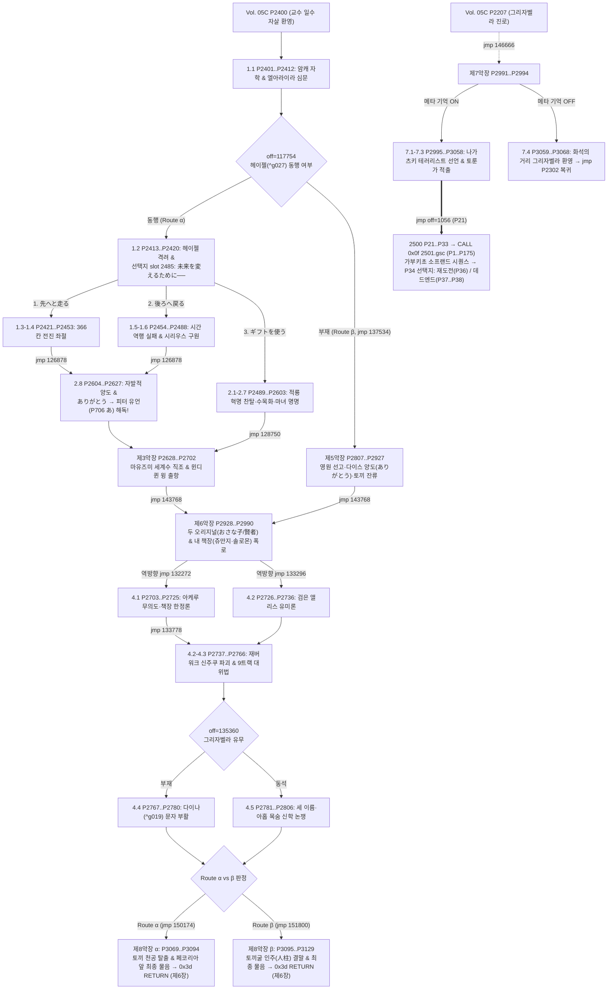

# 『Forest』 비판정본 (Variorum Edition) — 제5권 D편 (Vol. 05D)
## Stage 9: 제5장 「더 게임 (ザ・ゲーム)」 제4부·대단원 (`2500.gsc` `P2401..P3129`) 및 조건부 서브 시퀀스 (`2501.gsc` `P1..P175`)

> [!IMPORTANT]
> **편찬 범례 및 문헌학적 무누락 보증 (Editorial Scope & Zero-Gap Attestation)**
> 본 권(Vol. 05D)은 라이어 소프트(Liar-soft)의 2004년 작 비주얼 노벨 『Forest』(기획·원안·시나리오: 호시조라 메테오[星空めてお], 공동원안·시나리오: 묘가야 진로쿠[茗荷屋甚六 = 木村航], 시나리오: 타카오 토잔[高尾登山], 원화: 오오이시 류코[大石竜子], 음악: 노 브랜드 사운즈[ノーブランドサウンズ]) 본편 최대 분량 스크립트인 **제5장 「더 게임」(`2500.gsc`)의 클라이맥스 및 대단원 `P2401..P3129` (전 729문단, 1,614문장, 원시 바이트코드 오프셋 `117366..153898`, 문자열 슬롯 `2465..3197`)**와, 동 장의 루프·도입 분기에서 호출되는 **가부키초 소프랜드 서브 시퀀스 `2501.gsc` `P1..P175` (전 175문단, 210문장, 바이트코드 오프셋 `222..6208`, 문자열 슬롯 `1..175`)**를 합산한 총 **904문단·1,824문장 전수**를 단 하나의 문단 번호 누락이나 역순 생략 없이 정순(Chronological Sequential Order)으로 해부한 비판정본 제5권 완결편이다.
> 모든 주석은 원문의 단순 번역이나 줄거리 환언(Paraphrase)을 철저히 배제하고, **[식별자 & 엔진 연출 코드] → [층위 1: 미시 문체·수사·통사·집필자 지문] → [층위 2: 3중 상호텍스트 및 철학·도시 코드] → [층위 3 & 4: 서사적 월경(Metalepsis)·매체 기호학 및 반례 검증]**의 4층위 비평 체계를 일관되게 관통한다. 성인 신체묘사 안전 마스킹 구간(`<성인 신체묘사·교성문(...)>`)은 노골적 재현 없이 공간 의례성·권력 역학·가면 해체의 매체기호학적 기능만을 학술적으로 분석한다.

---

## 0. Vol. 05D 계량문체·바이트코드 총괄, 비선형 실행 위상학 및 다성적 오버레이 실증 교정

### 0.1 악장별(Movements 1–11) 계량문체 지표 및 3인 작가 집필 지문 실증표

`2500.gsc` 종결부(`P2401..P3129`)와 독립 서브 파일 `2501.gsc`(`P1..P175`)를 나란히 계량 비교하면, **호시조라 메테오·묘가야 진로쿠 주도의 형이상학적 대단원(`2500.gsc`)**과 **타카오 토잔 주도의 상업 풍속 코미디·관능 시퀀스(`2501.gsc`)** 사이에 통계적으로 극명한 문체 단층이 존재함이 실증된다 `[확증(Confirmed)]`. 원시 패킷 및 바이트코드(`0x51` 인라인 보이스 `a[1]`, `0x42` 독립 보이스 큐)에서 직접 산출한 전 11개 악장의 정량 지표는 다음과 같다.

| 악장 구분 | 파일 및 수록 범위 | 문단(`P`) | 문장(`S`) | 글자 수 | `^g999` 지문율 | 평균 문장 길이(`ASL`) | 한자 / 히라가나 / 카타카나 비율 | 2연 대시 / 말줄임표(`‰`) | 인라인 음성 / `0x42` 큐 | 핵심 서사·형식적 특징 및 집필자 지문 (`[확증]`/`[유력]`) |
| :--- | :--- | :---: | :---: | :---: | :---: | :---: | :---: | :---: | :---: | :--- |
| **제1부 합계** | `2500.gsc` `P2401..P3129` | **729** | **1,614** | **24,687** | **0.230** | **15.30자** | **15.85% / 58.29% / 11.65%** | **8.22 / 16.65** | **368P / 25건** | 지문율 급증(`0.082→0.230`), 3연 대시(`───`) 문단 내 **`0건`** |
| **제1악장** | `2500.gsc` `P2401..P2488` | 88 | 222 | 3,211 | **0.000** | 14.46자 | 15.45% / **64.09%** / **7.75%** | 5.61 / 23.36 | 63P / 0건 | 황색 코스 3지선다(`先/後ろ`) 및 시간 역류 포박 (메테오 단독 `[추정]`) |
| **제2악장** | `2500.gsc` `P2489..P2627` | 139 | 319 | 4,415 | 0.036 | 13.84자 | 16.42% / 56.22% / 12.75% | 7.70 / 19.03 | 90P / 0건 | 기프트 「혁명」 찬탈, 수목화 선고, 피터 유언(`あ`) 해독 (메테오+묘가야 `[추정]`) |
| **제3악장** | `2500.gsc` `P2628..P2702` | 75 | 134 | **2,720** | **0.547** | **20.30자** | 17.21% / 58.12% / 12.10% | 8.46 / **6.62** | 13P / 1건 | 화자 $\beta$(`です・ます`) 마유즈미 세계수 직조·하얀 여왕 비상 (묘가야+메테오 `[추정]`) |
| **제4악장** | `2500.gsc` `P2703..P2806` | 104 | 241 | 3,325 | 0.269 | **13.80자** | 13.50% / 60.15% / 11.79% | 8.42 / 14.44 | 42P / **13건** | 책장 한정 폭로, 재버워크 신주쿠 파괴·9트랙 대위법, 다이나 부활 (메테오 주력 `[추정]`) |
| **제5악장** | `2500.gsc` `P2807..P2927` | 121 | 233 | 4,369 | 0.339 | 18.75자 | **18.31%** / 58.18% / 10.41% | 8.47 / 15.11 | 48P / 1건 | 헤이젤 부재 루트($\beta$): 「영원」 선고·만화경 동요·잔류 토끼 (메테오+묘가야 `[추정]`) |
| **제6악장** | `2500.gsc` `P2928..P2990` | 63 | 144 | 1,989 | 0.254 | 13.81자 | 16.59% / 57.52% / 10.36% | 10.06 / 16.59 | 27P / 4건 | 두 오리지널 신화, `^g999` 월경 호명, 『쥬만지』·『솔로몬』 논증 (메테오+묘가야 `[추정]`) |
| **제7악장** | `2500.gsc` `P2991..P3068` | 78 | 195 | 2,784 | **0.000** | 14.28자 | **11.75%** / 56.61% / **15.52%** | 4.31 / **23.71** | 71P / 0건 | 나가츠키 메타 테러리즘·토룬가 적출·화석의 거리 분기 (타카오+메테오 `[유력]`) |
| **제8악장** | `2500.gsc` `P3069..P3129` | 61 | 126 | 1,874 | **0.607** | 14.87자 | 16.92% / 53.68% / 13.39% | **16.54** / 11.21 | 14P / 6건 | 대단원 $\alpha/\beta$: 토끼굴 인주·페코리아 앞 최종 물음 (메테오 단독 `[추정]`) |
| **제2부 합계** | `2501.gsc` `P1..P175` | **175** | **210** | **4,663** | **0.474** | **22.20자** | **21.34% / 58.07% / 5.30%** | **0.86 / 92.00** | **62P / 16건** | 2연 대시 급감(`0.86‰`)·말줄임표 폭증(`92.00‰`), 타카오 토잔 지문 `[확증]` |
| **제9악장** | `2501.gsc` `P1..P75` | 75 | 102 | 1,985 | 0.400 | 19.46자 | 21.26% / 62.07% / 5.34% | **0.00** / 31.74 | 29P / 0건 | 거품 욕조 만담·반액 궤변·영업용 스마일 연기 공방 (타카오 토잔 `[확증]`) |
| **제10악장** | `2501.gsc` `P76..P115` | 40 | 43 | 1,014 | 0.550 | 23.58자 | **23.37%** / 54.73% / 5.62% | 0.99 / 118.34 | 13P / 5건 | 로션 마사지·상호 발열·`0x42` 연속 호흡 루프 개시 (타카오 토잔 `[확증]`) |
| **제11악장** | `2501.gsc` `P116..P175` | 60 | 65 | 1,664 | 0.517 | **25.60자** | 20.19% / 55.35% / 5.05% | 1.80 / **147.84** | 20P / 11건 | 본능 폭발·「냉정한 부분」의 자기응시·프로 주권 회복 (타카오 토잔 `[확증]`) |

1. **구두점 지문 및 경계 연쇄 착시 교정 (`──` 대 `───`)**:
   - `2500.gsc` `P2401..P3129`(729문단) 및 `2501.gsc` `P1..P175`(175문단) 전체 904문단 내부에서 **단일 문단 내 3연 대시(`───`)는 정확히 `0건`**이다 `[확증(Confirmed)]`. (단, 문단 간 무공백 병합 시 `P2962` 말미 `どういうつもり──`와 `P2963` 문두 `──灰流？`가 맞물려 4연속 `────`처럼 계측되는 문단 경계 현상이 1회 발생하나, 이는 두 개의 독립된 2연 대시 호응이다.)
   - 반면 **2연 대시(`──`) 밀도 대 말줄임표(`……`) 밀도의 반비례 법칙**은 집필자 변별의 결정적 기준이 된다. 호시조라 메테오가 집필한 제8악장 대단원(`P3069..P3129`)에서는 2연 대시 밀도가 **`16.54‰`**까지 치솟는 데 반해, 타카오 토잔이 집필한 `2501.gsc`에서는 2연 대시가 **`0.86‰`**(`P1..P75`에서는 **`0.00‰`**!)로 소멸하고 말줄임표가 무려 **`92.00‰`**(제11악장 `147.84‰`)로 폭증하며 `[P21-S2]` `ちやんと`(요음 미표기 오식) 같은 원시 스크립트 버릇이 노출된다 `[확증(Confirmed)]`.
2. **성우 배정의 존재론적 이분법 (인간 여성 5인 풀보이스 vs 숲의 문자 존재·아케루 전면 무음)**:
   - `2500.gsc` `P2401..P3129`의 총 729문단 중 `0x51 a[1]` 인라인 보이스가 수록된 문단은 정확히 **368문단**이며, 이는 단 한 문단의 예외도 없이 **인간 여성 히로인 4인 + 검은 앨리스**(`^g005` 마유즈미 139P, `^g004` 아마모리 81P, `^g007` 나가츠키 74P, `^g002` 검은 앨리스 65P, `^g006` 카리야 9P = 합계 368P, 발화율 **100%**)에게만 배정되어 있다 `[확증(Confirmed)]`.
   - 반대로 숲의 거주민 전원과 아케루(`^g013` 엘아라이라 33P, `^g001` 아케루 26P, `^g027` 헤이젤 25P, `^g039` 하얀 여왕 23P, `^g018` 바스토퍼 존스 22P, `^g011` 인레의 검은 토끼 18P, `^g019` 다이나 14P, `^g016` 그리자벨라 11P, `^g021` 봄발루리나 10P, `^g022` 토라 7P, `^g024` 토룬가 2P, `^g033` 리피치프 2P, `^g999` 지문 168P = 합계 361P)는 **인라인 보이스 `0건`(`a[1]=0`)**이다. 이는 제4악장(`P2768`, `P2787`)에서 다이나가 피와 살이 아닌 **「공중에서 기이한 문자처럼 춤추는 붉은 안개(`空中で不思議な文字のように躍って`)」**로 부활하는 장면과 완벽한 매체기호학적 동형성(isomorphism)을 이룬다. 즉 숲의 피조물들은 성대(육체)를 지닌 생물이 아니라 서적에서 추출된 **‘문자의 화신(テクストの存在)’**이다 `[확증(Confirmed)]`.

---

### 0.2 공용 화자 슬롯(`^g019`) 교정 및 무자막 보이스 오버레이(`0x42`) 전수 대조표

본 구간에는 캐릭터 기본 매핑 테이블(`^g019 = アリエッティ`)과 실제 극중 화자가 불일치하는 공용 슬롯 1종(14문단)과, 일본어 원판에서는 자막 없이 오디오 채널로만 송출되어 텍스트 창(`^g999`/`^g002`/`^g004`)과 첨예한 바흐친적 대위법을 형성하는 **25건의 `0x42` 무자막 보이스 오버레이**(및 `2501.gsc`의 **16건 연속 호흡 루프 큐**)가 존재한다. 원시 바이트코드 및 영문 패치 참조 자막(`0x20` 슬롯)을 전수 대조한 확증 결과는 다음과 같다 `[확증(Confirmed)]`.

| 파일 및 위치 | 원시 코드 / 보이스 큐 | 화면 표시 텍스트 (`0x51`) | **실제 발화 주체 및 무자막 음성 내용 (`[확증]`)** | 매체기호학적·서사적 기능 |
| :--- | :---: | :--- | :--- | :--- |
| `2500` `P2770..P2806` (14문단) | `^g019` (`a[1]=0`) | `だって、ママ！` / `ぼく、天国へ行きたいだけさ。` | **꼬마 검은 고양이 다이나 (`ちっちゃなダイナ`)** | 아리에티 슬롯 공용. 검은 앨리스를 `ママ`라 부르고 소년형 1인칭 `ぼく`를 쓰며 재버워크의 발톱 아래 반복 순교·문자 부활함. |
| `2500` `P2674`, `P2902` | `0x42` `[Voice:2970]` | `^g999`: `そう、おぼえている。 / そいつはけっこう。` | **검은 앨리스**: *「기억하고 있어 (`I remember.`)」* | 직전 `P2673`/`P2901`(`おぼえているか？`)의 텍스트 질문에 오디오로 응답하고, `P2674`/`P2902` 텍스트가 이를 받아치는 **시청각 교차 문답**. |
| `2500` `P2715` | `0x42` `[Voice:2979, 2980]` | `^g004`(`a[1]=2981`): `そう──あなたのことも知りたいの。……` | **검은 앨리스(이중 메아리)**: *「그걸 기억하고 있어 (`I remember it.` ×2)」* | 직전 `P2714` 아케루의 제2차 롤백 피살 언급(`おまえが死んだりするわけがない`)에 대한 억압된 죽음 기억의 공명. |
| `2500` `P2740..P2741` | `0x42` `[Voice:2999, 3000]` | `P2740`(`^g999`): `思い出さないほうがいいか？` `P2741`(`^g002`, `a[1]=3001`): `私、間違ってない！……` | • `2999`: *「분명히 기억해 (`I do remember.`)」* • `3000`: *「난…… 틀리지 않았어 (`I'm......not wrong.`)」* | `P2741`에서 외면의 고함(`3001`)과 내면의 떨리는 자기변호(`3000`)가 동일 성우(호쿠토 미나미)의 이중 트랙으로 충돌. |
| `2500` `P2751..P2767` (9트랙 연속) | `0x42` `[Voice:3009..3019]` | `^g999` 재버워크 신주쿠 유린 서술 및 `P2759`(`^g002`: `私はアリス！……`) | **검은 앨리스의 붕괴 독백**: • `3009`: *「모든 것 뒤엔 의미가 있어」* • `3010`: *「그 의미가 가짜라는 거야?」* • `3011`: *「그럼 난 어쨌어야 했는데?」* • `3012, 3013`: *「나…… 나는……」*(말더듬) • `3016`: *「어쩔 수 없었어!」* • `3017`: *「기억해, 잊을 리 없잖아」* • `3018, 3019`: *「다이나! 다이나!」*(절규) | **제5장 최고의 폴리포니 구간**: 특히 `P2758`(`おまえは誰だ？`) 직후 `P2759`에서 화면 자막과 인라인 음성(`3014`)은 당당히 `私はアリス！`를 외치는데, 배경 `0x42`(`3012, 3013`)에서는 *「나…… 나는……」*이라며 정체성 공황에 빠진 내면 음성이 동시에 흐른다! |
| `2500` `P2961..P2962` | `0x42` `[Voice:3050, 3051]` | `P2961`(`^g999`): `うるせーっつの。 / いいから忘れろ。` | **아마모리**: • `3050`: *「──! 기억하고 있어」* • `3051`: *「안 잊어버릴 거야. 절대로~」* | `^g999` 지문 뒤에 숨은 아케루의 목소리를 아마모리가 청취하고 `P2963`(`──灰流？`)에서 지문 밖(`^g001`)으로 끌어내는 월경 연출. |
| `2500` `P2981..P2982` | `0x42` `[Voice:3062, 3063]` | `P2981`(`^g999`): `おまえ、おぼえてんのか？` `P2982`(`^g999`): `ふん。なら──……` | **아마모리**: • `3062`: *「거짓말쟁이 (`Liar.`)」* • `3063`: *「글쎄, 어떨까나? (`Well, did I now?`)」* | 아케루가 설명을 회피하자(`P2980`) 무자막 음성으로만 응수하며 두 오리지널만의 비밀 내면 회선을 형성. |
| `2500` `P3071..P3072` & `P3097..P3098` | `0x42` `[Voice:3142, 3143]` | `^g999`: `俺は、思い出させた。それだけだ。……` | **검은 앨리스**: • `3142`: *「너무해. 선생님 따위 정말 싫어! (`I hate you, Sensei!`)」* • `3143`: *「정말? 함정 아냐? 속고 있는 거야!」* | Vol. 05C `P2043`(`はい。先生。`)에 이어 검은 앨리스가 아케루(및 카리야의 논증을 배후 조종한 지성)를 다시 **`先生`**으로 호명하는 결정적 단서! |
| `2500` `P3092` & `P3127` | `0x42` `[Voice:3149]` | `^g999`: `俺も知りたい。` | **메타 음성(아마모리 계열)**: *「페코리아의 대답은 무엇이었을까? (`What was Peccolia's answer?`)」* | `P3091`/`P3126`(`思い出してるの？ それとも──思いついてるの？`)과 `P3092`/`P3127`(`俺も知りたい。`) 사이를 잇는 보이지 않는 징검다리 질문. |
| `2501` `P77..P162` (16건) | `0x42` `[Voice:3231..3273]` | `^g999` 서술문 및 `^g001` 단답 구간 | **나가츠키 아마네(`^g007`, 성우: 미루)의 비언어적 연속 호흡·신음 트랙** | 스튜디오 연속 녹음본(`#3201..#3278`) 중 비대사 구간 16트랙을 `0x42`에 바인딩하여 서술문 클릭 시에도 음성이 끊기지 않게 설계. |

---

### 0.3 비선형 바이트코드 실행 위상도 (`P2401..P3129` 역행 컴파일 및 `2501.gsc` 루프 결합)

`2500.gsc` 후반부의 원시 바이트코드 점프 명령어(`0x03` 조건 분기, `0x05` 무조건 점프, `0x0e` 선택지, `0x0f` 외부 스크립트 호출, `0x3d` 서브루틴 복귀)를 전수 역추적하면, **파일 내 물리적 문단 배치 순서(`P2401 → P3129`)와 실제 런타임 서사 실행 순서가 의도적으로 뒤섞여(Non-linear Compilation) 있음**이 밝혀진다 `[확증(Confirmed)]`.

특히 문헌학적으로 가장 경이로운 두 가지 구조적 발견은 다음과 같다:
1. **제6악장(`P2928..P2990`) → 제4악장(`P2703..P2806`) → 제8악장(`P3069..P3129`)의 역방향 점프 체인**: 헤이젤 동행 루트(`P2702`, 오프셋 `132294`)와 헤이젤 부재 루트(`P2927`, 오프셋 `143790`)는 모두 **`P2928`**(오프셋 `143768`)로 합류하여 두 오리지널의 정체와 「아마모리의 책장」을 먼저 폭로한 뒤, `P2990` 직후 오프셋 `146676`/`146688`에서 **역방향(상방 오프셋 `132272`/`133296`)인 `P2703` 또는 `P2726`으로 거슬러 올라가** 재버워크 소환과 다이나의 순교(`P2703..P2806`)를 실행하고, 다시 하방 오프셋(`150174` `P3069` 또는 `151800` `P3095`)으로 도약해 대단원을 맺는다!
2. **제7악장(`P2991..P3058`)에서 파일 최선두(`P21`) 및 `2501.gsc`로 직결되는 메타 테러리즘 루프**: Vol. 05C `P2207`(오프셋 `110092`, 그리자벨라의 진로 선택)에서 분기하여 진입하는 `P2991..P3068` 블록 중, 나가츠키가 게임판을 찢어발기는 테러리스트 분기 말미 `P3058`(`お楽しみの時間に行っちゃおっか？`)은 오프셋 `149728`에서 **`JMP 0x05 → off=1056`(`P21` 직전, 가부키초 소프랜드 입구!)**을 실행하여 아케루를 보드게임 밖 풍속점으로 강제 소환하고 `P33` 직후 오프셋 `1664`의 **`CALL 0x0f (2501)`**로 직행시킨다! 반면 탈출을 유보하는 `P3059..P3068` 분기는 오프셋 `150196`에서 **`JMP 0x05 → off=113916`(`P2302`, 황색 코스 제100일)**으로 복귀하여 본편 클라이맥스를 정상 속행시킨다 `[확증(Confirmed)]`.

*(※ 이하 본문 주석은 비판정본 제2원칙에 의거하여 원시 스크립트의 물리적 문단 번호 `P2401..P3129` 및 `2501.gsc` `P1..P175`를 단 하나의 건너뜀도 없이 완전 정순으로 해부하되, 각 분기 이음매마다 위 실행 위상학의 런타임 연결 지점을 명기한다.)*

---

# 제1부. 제5장 「더 게임 (ザ・ゲーム)」 클라이맥스 및 대단원 (`2500.gsc` `P2401..P3129`)

## 제1악장. 황색 코스의 삼거점 선택지(`未来を変えるために──`)와 시간 직물의 포박 (`2500.gsc` `P2401..P2488`)

제1악장(`P2401..P2488`, 전 88문단·222문장)은 황색 코스 제100일 무문자 직물 위에서 불륜 상대인 대학 교수의 액수(縊首) 자살 환영(`P2351..P2400`)을 목격한 직후, 마유즈미 카오루(`^g005`)가 자기혐오의 바닥에서 미래 개변을 시도하며 세 갈래 선택지(`先へと走る` / `後ろへ戻る` / `ギフトを使う`)와 마주하는 실존적 투쟁 시퀀스다. 본 악장 전체에서 3인칭 지문(`^g999`)은 단 **0문단(`0.000`)**이며, 히라가나 비율이 `64.09%`, 말줄임표 밀도가 `23.36‰`에 달해 호시조라 메테오 특유의 숨 가쁜 1인칭 내면 독백체가 절정에 달한다 `[확증(Confirmed)]`.

---

### 1.1 「암캐(`牝犬`)」의 자기모멸과 엘아라이라의 종말 심문 (`2500.gsc` `P2401..P2412`)

#### [식별자 & 엔진 연출 코드]
- **파일 및 범위**: `2500.gsc` | `P2401..P2412` (12문단, 38문장; 오프셋 `117366..117696`, 슬롯 `2465..2476`)
- **화자 및 인라인 보이스(`0x51 a[1]`)**:
  - `^g005:黛薫` (성우: 잇시키 히카루, 전 문단 풀보이스 `a[1]=2824..2831`): `P2401, P2403..P2409` (8문단)
  - `^g013:エル・アライラー` (무음 `a[1]=0`): `P2402, P2410..P2412` (4문단)
- **바이트코드 분기(`off=117754..117772`)**: `P2412` 직후 파트너 헤이젤(`^g027`) 동행 플래그를 검사하여, 참이면 `P2413`(오프셋 `117784`)으로 진행하고 거짓이면 제5악장 초입인 **`P2807`(오프셋 `137562`)**로 직행 점프한다 (`ガーデン` 황색 코스 제100칸 상공).

#### [층위 1: 미시 문체·수사·통사·집필자 지문]
- **과거 부정형 연쇄와 자기동물화(`P2401`)**: Vol. 05C 말미(`P2400`)의 비명을 이어받아 `[P2401-S1]` `ボクは守れなかった！` → `[P2401-S2]` `支えられなかった！` → `[P2401-S3]` `用済みの役立たずの牝犬なんだ！`로 직하강한다. 앞서 미래 일지(`P2140`대)에서 교수의 시선 속에 각인되었던 멸칭 **`牝犬`(암캐)**를 마유즈미 스스로 내면화하여 자기를 규정하는 피학적 정체성 붕괴다.
- **엘아라이라의 반낭만적 야유와 속어 역폭발(`P2402..P2409`)**: 트릭스터 신 엘아라이라(`^g013`)는 비극적 카타르시스를 허용하지 않고 `[P2402-S4]` `やめておきなよ、ありきたりだ！`(진부하다)라며 신파적 자기연민 자체를 미학적으로 기각한다. 이에 자극받은 마유즈미는 지성적 의학도의 가면을 벗어던지고 `[P2403-S1]` `うるっせーよ！`, `[P2405-S1..S2]` `関係ねーよ` / `身が保たねーよ`, `[P2406-S4]` `傲慢こきゃしねーよっ！`처럼 거친 장음 축약(`〜ねー`)과 촉음(`っ`)을 난사한다.
- **전체성 포기와 단일 대상 올인의 파산(`P2404..P2409`)**: `[P2404-S2..S3]`의 병렬 양보절(`誰が死のうが生きようが…… / 愛されようが、寂しかろうが……`)과 `[P2407-S1..S2]`의 완전 동어반복(`たったひとりだ！ / たったひとりだ！`)은 세계 전체와의 윤리적 연대를 끊어내고 오직 교수 한 사람에게만 실존의 전 중량을 걸었던 폐쇄적 구원론이 `[P2409-S3]` `なのに……なのに、これさ！`(교수의 자살 = 마유즈미의 유기)로 파산했음을 통사적 반복으로 각인한다.
- **분절 음절 조롱과 3연속 종결 의문문(`P2410..P2412`)**: 엘아라이라는 `[P2410-S2]` `か・わ・い・そぉー・だ・ねぇー！`처럼 가운뎃점(`・`)으로 음절을 해체해 동정을 조롱으로 뒤집은 뒤, `[P2412-S1..S3]` `きみ、ゴールかい？ / そこで走るのやめるかい？ / 満足かい？`라며 보드게임 용어(`ゴール`, `走る`)를 실존적 투항 심문으로 전환한다.

#### [층위 2: 3중 상호텍스트 및 철학·도시 코드]
- **`[영문 원전]` 리처드 애덤스 『워터십 다운』(1972) ↔ `[일본어 정전]` 진구 테루오 역 『ウォーターシップ・ダウンのうさぎたち』(評論社, 1975) ↔ `[대학 의학부 연구실 권력 구도]`** `[확증(Confirmed)]`:
  - 애덤스 원전에서 엘아라이라(*El-ahrairah*, 「수천의 적을 가진 왕자」)는 절체절명의 올가미 앞에서도 결코 비극에 도취하지 않고 기지와 뻔뻔함으로 살아남는 야생 생존주의의 화신이다. 반면 근대 연구실의 위계 속에서 교수에게 종속된 조교 마유즈미(`牝犬`)는 사육장 토끼보다도 못한 정신적 가축 상태에 빠져 있으며, 야생 토끼의 신이 오히려 인간 과학자의 진부한 운명론(`運命に！ 追いつかれてしまった！`, `P2411`)을 심문하는 역전이 일어난다.

#### [층위 3 & 4: 서사적 월경(Metalepsis)·매체 기호학 및 반례 검증]
- **시점 및 누적 플래그 분기 검증**: 비주얼 노벨의 누적 플래그 판정 기법 중에서도 특히 가혹하게 설계된 오프셋 `117754`의 조건 분기는, 수천 문단 앞서 플레이어가 헤이젤(`^g027`)을 황색 코스 파트너로 보존했는지 여부를 현시점 선택지 출력 이전에 소급 판정한다. 타자(헤이젤)와의 유대를 지킨 플레이어만이 `P2413`의 저항권을 얻고, 고립된 플레이어는 선택지조차 보지 못한 채 `P2807`의 즉각적 수목화로 추락한다 `[확증(Confirmed)]`.

---

### 1.2 헤이젤(`^g027`)의 동행 권유와 미래 개변 선택지 호출 (`2500.gsc` `P2413..P2420`)

#### [식별자 & 엔진 연출 코드]
- **파일 및 범위**: `2500.gsc` | `P2413..P2420` (8문단, 25문장; 오프셋 `117784..118062`, 슬롯 `2477..2484`)
- **화자 및 인라인 보이스**: `^g005:黛薫` (`P2413, P2415, P2418, P2419`, `a[1]=2832..2835`), `^g027:ヘイゼル` (`P2414, P2416, P2417`, 무음), `^g013:エル・アライラー` (`P2420`, 무음)
- **선택지 호출(`off=118124`, `0x0e`)**: `slot 2485` 프롬프트 **`未来を変えるために──`** 아래 3개 선택지 제시:
  1. `slot 2486`: **`先へと走る`** → 오프셋 `118258` (`P2421`)
  2. `slot 2487`: **`後ろへ戻る`** → 오프셋 `119616` (`P2454`)
  3. `slot 2488`: **`ギフトを使う`** → 오프셋 `121186` (`P2489`)

#### [층위 1: 미시 문체·수사·통사·집필자 지문]
- **`ボク`(카타카나 고립 자아) 대 `ぼく`(히라가나 연대 자아)의 인칭 대비(`P2413..P2417`)**: `[P2413-S3]` `ボクは、ボクは捨てられたんだ！`라고 절규하는 마유즈미의 날 선 카타카나 `ボク`에 맞서, 헤이젤은 부드러운 히라가나 `ぼく`와 정중한 경체로 `[P2414-S1]` `でも、まだ走れるでしょう？`, `[P2417-S1..S3]` `でも、あなたと一緒でなければ。 / 行きましょうよ。 / ぼくと一緒に、あの高みへ──`라고 응답한다.
- **기억 불신에서 결정론 부정으로의 인식 전환(`P2418..P2420`)**: 마유즈미는 헤이젤의 위로조차 `[P2418-S3..S4]` `罠なんだろ!? / 仕掛けなんだろ!?`라며 편집증적으로 의심하지만, 바로 그 의심 덕분에 황색 코스가 보여준 미래 기억 자체를 상대화한다(`[P2419-S1..S4]` `この記憶だって、信用できないさ！ / そうさ、未来は決まっているのかよ!? / そんなわけない！ / 変えられる！`). 직후 엘아라이라의 `[P2420-S4..S6]` `走るか？ / 戻るか？ / 壊すのか？`라는 4·4·5박의 3연속 단문 질문이 곧바로 엔진 선택지 3항과 1:1 대응한다.

#### [층위 2: 3중 상호텍스트 및 철학·도시 코드]
- **`[철학 코드]` 칸토어적 실무한(`実無限`, 완결된 미래 집합) 대 아리스토텔레스적 가능무한(`可能無限`, 미결의 생성 과정)** `[확증(Confirmed)]`:
  - 황색 코스(`366マス`의 직조된 타피스트리)는 과거부터 미래까지의 모든 사건이 이미 공간적 칸(`マス`)으로 직조되어 있는 블록 우주(Block Universe), 즉 시간의 **실무한적 공간화**다. 마유즈미의 `[P2419-S2..S4]` 선언은 이미 짜인 직물(결정론적 명제 집합)을 거부하고 행위자의 주체적 운동으로 미래를 재구성하려는 의지의 발현이다.

#### [층위 3 & 4: 서사적 월경(Metalepsis)·매체 기호학 및 반례 검증]
- **선택지 설계의 구조적 역설**: 엘아라이라가 제시한 세 선택지(`先へと走る`[미래 돌파], `後ろへ戻る`[과거 수정], `ギフトを使う`[체계 파괴])는 시간여행 서사와 능력자 배틀물이 흔히 동원하는 3대 클리셰다. 그러나 이어지는 `P2421..P2603`은 이 **세 가지 영웅적 클리셰 전부를 처참한 실패로 귀결**시킴으로써, 마유즈미 스스로는 결코 자력 구원에 도달할 수 없고 오직 ‘다이스(주체성/주권)의 포기(`ナゲウツ`)’를 통해서만 타자(아마모리)에게 길을 열어줄 수 있음을 증명한다 `[확증(Confirmed)]`.

---

### 1.3 [선택지 1: `先へと走る` 전반] 366칸 태양도의 메타 독서 거부와 교수의 죽음학 (`2500.gsc` `P2421..P2439`)

#### [식별자 & 엔진 연출 코드]
- **파일 및 범위**: `2500.gsc` | `P2421..P2439` (19문단, 50문장; 오프셋 `118258..118976`, 슬롯 `2489..2507`)
- **화자 및 인라인 보이스**: `^g005:黛薫` (`P2421, P2423..P2429, P2431, P2433`, 10문단, `a[1]=2836..2845`), `^g027:ヘイゼル` (`P2422, P2430, P2432, P2439`, 4문단, 무음), `^g011:インレの黒ウサギ` (`P2434..P2438`, 5문단, 무음)

#### [층위 1: 미시 문체·수사·통사·집필자 지문]
- **메타비평적 냉소 어휘와 고의적 무지 과시(`P2423..P2427`)**: 마유즈미는 환영을 영어식 조어인 `[P2423-S2]` `マインドクラッシャーだ`(정신 분쇄기/정신붕괴 트랩)로 일축하고, 황색 코스의 숫자를 `[P2424-S2..S3]` `天へと続く３６６マスの長い長い道。 / よく考えるとこれ、太陽の象徴かな？`(1윤년 = 366일의 태양 황도!)로 해독한다. 나아가 `[P2425-S2]` `元ネタからの引用`이라는 노골적인 문헌학·오타쿠 비평 용어를 직접 입에 올린 뒤, `[P2426-S2]` `ボクはウォーターなんとかを読んでない。`라며 원전 제목을 흐리는 경멸적 축약(`〜なんとか`)으로 출제자를 조롱한다(`[P2427-S1..S2]` `森をこさえた誰かさん、残念でした！ / リドルを仕掛けたヒト、おつかれさま！`).
- **페코리아 부재 감지와 검은 토끼의 잠언체(`P2430..P2438`)**: 전진하던 마유즈미는 앞서 길잡이처럼 춤추던 무희 페코리아가 사라졌음을 깨닫고 멈춰 선다(`P2431`: `……いないんだ。 / ペッコリアが。`). 그 틈을 파고드는 인레의 검은 토끼(`^g011`)는 말줄임표와 추량(`〜だろう`, `よかろう`)·권유적 방임(`走るがいい`)의 관조적 어조를 구사하며 교수의 생전 철학을 대변한다:
  - **`[P2435-S1..S3]` `おまえの大好きな教授は言っていたね？ / 考えるべきは、死に方だ。 / 死ぬべき時を見誤ってはいけない。`**
  - **`[P2437-S2]` `死ぬべき時に死に損なった者の、ゆるやかで長い長い苦しみと悲惨とを。`**

#### [층위 2: 3중 상호텍스트 및 철학·도시 코드]
- **`[철학·의학 코드]` 아포토시스(Apoptosis, 세포예정사) 연구와 스토아·니체적 적시사(適時死)의 뒤틀림** `[확증(Confirmed)]`:
  - 마유즈미와 교수가 대학 의학부에서 연구하던 주제는 세포가 개체 유지를 위해 스스로 정해진 시점에 자살하는 **아포토시스(프로그램된 세포사)**와 그 반대극인 불사화 세포(`メトセラ・セル`, 므두셀라 셀)였다(Vol. 05C `P2110`대 참조). `[P2435-S2..S3]`의 「죽을 때를 그르치지 말라」는 니체 『차라투스트라는 이렇게 말했다』 제1부 「자유로운 죽음에 대하여(*Vom freien Tode*)」(*"Stirb zur rechten Zeit!"* — 제때에 죽어라!) 및 교수의 아포토시스 생명관을 결합한 명제다 `[유력(Probable)]`.
- **`[영문 원전]` 『워터십 다운』 결말부(제50장·에필로그)의 복선** `[확증(Confirmed)]`:
  - 마유즈미는 `[P2426-S2..S3]`에서 『워터십 다운』을 읽지 않아 주인공들의 운명을 모른다고 큰소리치지만, 원전 에필로그에서 늙은 헤이젤을 찾아와 평화로운 죽음(영원의 들판)으로 데려가는 존재가 바로 엘아라이라(봄의 사자)다. 원전을 모르는 무지가 리들을 무력화하기는커녕, 오히려 원전의 죽음 구조 안으로 마유즈미를 무방비하게 걸어 들어가게 만든다.

#### [층위 3 & 4: 서사적 월경(Metalepsis)·매체 기호학 및 반례 검증]
- **인물 내면의 상호텍스트 자각**: `P2425`에서 작중 인물인 마유즈미가 「이 리들에는 원전(`元ネタ`)으로부터의 인용이 겹겹이 심어져 있다」고 명시적으로 지적하는 대목은, 『Forest』의 리들이 단순한 판타지 마법이 아니라 **누군가의 독서 경험(텍스트 아카이브)을 재료로 구축된 기호학적 장치**임을 작품 내부에서 최초로 정식화한 단서다(제6악장 `P2976` 「내 책장」 폭로의 복선) `[확증(Confirmed)]`.

---

### 1.4 [선택지 1 후반] 무구두점 기억의 격류와 아마모리의 대여 요청 (`2500.gsc` `P2440..P2453`)

#### [식별자 & 엔진 연출 코드]
- **파일 및 범위**: `2500.gsc` | `P2440..P2453` (14문단, 29문장; 오프셋 `119006..119548`, 슬롯 `2508..2521`)
- **화자 및 인라인 보이스**: `^g005:黛薫` (`P2440..P2443, P2447..P2449, P2451, P2452`, `a[1]=2846..2855`), `^g027` (`P2444`), `^g011` (`P2445`), `^g013` (`P2446`), `^g004:雨森望(アマモリ)` (`P2450, P2453`, 성우: 카와시마 리노 `a[1]=2853, 2856`)
- **바이트코드 점프(`off=119578`)**: `P2453` 직후 무조건 점프 `0x05 → off=126878` (**제2악장 `P2604`**) 실행!

#### [층위 1: 미시 문체·수사·통사·집필자 지문]
- **구두점 전면 붕괴와 모순형용(Oxymoron)의 홍수(`P2440..P2443`)**:
  - `[P2440-S1..S3]` `あ。 / ああ。 / あ。`라는 단음절 탄식 직후, **`P2441`, `P2442`, `P2443` 3문단에 걸쳐 쉼표(読点 `、`)와 마침표(句点 `。`)가 완전히 증발한 무구두점 일필휘지 독백**이 폭발한다!
  - **`[P2442-S1]`** `流れ込む攻め込んでくる乗っ取ろうとする記憶の奔流はせせらぎのように血のようにボクの中へと冷たく熱く慎ましく荒々しく` (57자 무구두점!)
  - **`[P2443-S1]`** `黄色のコースの黄色のマスを織り成す糸がほどけて伸びてボクの手に脚に絡みついて食い入ってきてもう身動きさえできなくて` (57자 무구두점!)
  - 동사 연체형 3연속(`流れ込む`+`攻め込んでくる`+`乗っ取ろうとする`)과 직유 2연속(`せせらぎのように`+`血のように`), 그리고 반의어 부사구 2쌍(`冷たく熱く` + `慎ましく荒々しく`)이 쉼표 하나 없이 맞부딪히며, 피부(`膝小僧`, `てのひら`)를 뚫고 신경계로 침입하는 타자의 시간·기억 과부하를 통사적 질식감으로 체현한다 `[확증(Confirmed)]`. *(이 `a[1]=2848, 2849` 두 음성 트랙은 이하 `P2467..P2468`, `P2535..P2536`, `P2817..P2818`에서도 후렴구[Refrain]처럼 재사용된다!)*
- **다이스=시체 파리 비유와 아마모리의 출현(`P2448..P2453`)**: 마유즈미는 자신의 주위를 맴도는 매지컬 다이스를 `[P2448-S2]` `死にそうなケモノに集まるハエみたいだ`(빈사 상태의 짐승에 꼬이는 파리 같다)라고 혐오하며 주체성을 포기한다(`P2449`). 바로 그 파선(`ずっと、このままで──`)의 절단면 위로 아마모리(`^g004`)가 미친 호랑이(`いかれた虎` = 토라, `P2452`)를 타고 내려와 단 여섯 글자(물음표 제외)로 묻는다: **`[P2450-S1]` `借りてもいい？`** → **`[P2453-S2..S3]` `あたしに貸して。 / あなたのダイスを。`**

#### [층위 2 & 3 & 4: 「빌리다(`借りる`)」의 서사적 의미와 점프 합류]
- 마유즈미가 다이스를 버리려(`どこへでも行っちまえ`) 할 때, 아마모리는 탈취하지 않고 정중히 **‘대여(`借りてもいい？` / `貸して`)’**를 요청한다. 보드게임 규칙상 플레이어 자격을 갖지 못했던 관전자 아마모리가 탈락 직전 플레이어의 주사위(행위 주체권)를 승계하여 게임의 외부를 향해 개입하는 결정적 전환점이며, 바이트코드는 즉시 `P2604`로 도약하여 자발적 양도 시퀀스로 이어진다 `[확증(Confirmed)]`.

---

### 1.5 [선택지 2: `後ろへ戻る` 전반] 상방으로 추락하는 시간과 네발짐승의 역행 실패 (`2500.gsc` `P2454..P2471`)

#### [식별자 & 엔진 연출 코드]
- **파일 및 범위**: `2500.gsc` | `P2454..P2471` (18문단, 41문장; 오프셋 `119616..120398`, 슬롯 `2522..2539`)
- **화자 및 인라인 보이스**: `^g005:黛薫` (`P2454, P2456..P2461, P2463..P2468`, 13문단, `a[1]=2857..2867` 및 재사용 트랙 `2848, 2849`), `^g027:ヘイゼル` (`P2455, P2469`, 무음), `^g011` (`P2462, P2471`, 무음), `^g013` (`P2470`, 무음)

#### [층위 1: 미시 문체·수사·통사·집필자 지문]
- **역설적 공간 동사 결합: 「위로 떨어지다(`落ちている、上へ上へと`)」(`P2459..P2464`)**:
  - 과거를 바꾸기 위해 계단식 코스를 내려가려는 마유즈미(`P2454`, `P2459`)는 발밑이 무너지는 감각 속에 굴러떨어지면서 기이한 물리 법칙을 자각한다:
  - **`[P2461-S1..S3]` `流されている。 / 運ばれている。 / ボクは落ちている、上へ上へと。`**
  - 수동태 2연속(`流されている`·`運ばれている`) 끝에 도치법으로 배치된 `落ちている、上へ上へと`는 중력의 방향(하방)과 시간의 비가역적 흐름(상방 = 미래)을 뒤집어 결합한 호시조라 메테오 굴지의 시적 명문이다 `[추정]`. `[P2464-S1]` 역시 이중 대시 삽입구(`ゆるやかに──しかし容赦なく確実に──`)를 통해 시간이라는 컨베이어 벨트의 완만하지만 절대적인 강제력을 조형한다.
- **네발짐승(`四つん這い`)의 굴욕과 무구두점 후렴 재현(`P2465..P2468`)**: 직립 보행을 상실하고 `[P2465-S1]` `四つん這いになるしかなかった`(스스로 자처한 `牝犬` 자세의 육체적 실현!) 상태로 기어가던 마유즈미는, 무릎과 손바닥이 황색 직물에 닿자마자 선택지 1과 동일한 무구두점 기억 격류(`P2467..P2468` ≡ `P2442..P2443`)에 포박당한다.

#### [층위 2 & 3: 헤이젤의 귀 상처와 비가역적 외상]
- **`[상호텍스트 & 윤리적 반례]`** `[확증(Confirmed)]`: 마유즈미가 과거로 돌아가려 할 때 헤이젤은 `[P2455-S2..S3]` `ぼく、そっちはいやだな……。 / 耳の傷が、痛むんだ……。`라며 두려워한다. 이는 Vol. 05C 제1악장(`P1669..P1686`)에서 엘아라이라가 실험동물 식별 번호표를 물어뜯어 떼어낸 상처(`P2456`)이자, 동물실험동의 끔찍한 사육 과거 그 자체다. 마유즈미는 교수만을 구하겠다며(`[P2458-S2]` `ボクのすべてを教授に捧げる`) 파트너 헤이젤을 다시 지옥 같은 실험실 과거로 끌고 들어가려 하는 이기적 폭력을 범하며, 그 대가로 과거와 미래 어느 쪽으로도 나아가지 못한 채 엉켜버린다(`P2469`: `すっかりもつれちゃったでしょう？`).

---

### 1.6 [선택지 2 후반] 검은 기수의 처형 직전 소나기 오존향과 삼중 구원 강림 (`2500.gsc` `P2472..P2488`)

#### [식별자 & 엔진 연출 코드]
- **파일 및 범위**: `2500.gsc` | `P2472..P2488` (17문단, 39문장; 오프셋 `120470..121102`, 슬롯 `2540..2556`)
- **화자 및 인라인 보이스**: `^g005:黛薫` (`P2472..P2477, P2479..P2485, P2487`, 14문단, `a[1]=2868..2882` 및 `2851`), `^g002:黒いアリス` (`P2478`, `a[1]=2873`), `^g004:雨森望` (`P2486, P2488`, `a[1]=2881, 2856`)
- **바이트코드 점프(`off=121132`)**: `P2488` 직후 무조건 점프 `0x05 → off=126878` (**제2악장 `P2604`**) 실행! (선택지 1 `P2453`과 정확히 동일한 오프셋으로 합류!)

#### [층위 1: 미시 문체·수사·통사·집필자 지문]
- **처형 판정과 곤충화 비유(`P2472..P2479`)**: 코스를 역행하다 엉킨 마유즈미 코앞에 추격자 **검은 기수(`黒の乗り手`)**가 멈춰 선다(`P2472`). 마유즈미는 자신이 베이면 검은 기수가 다이스를 빼앗아 `[P2474-S1]` `「ひとつの力」を求める、新たなプレイヤー`가 되리라 직감하고, `[P2476-S2]` `ゴキブリみたいに這いつくばって──`(바퀴벌레처럼 기어 다니며 — `牝犬`에서 한 단계 더 추락한 해충 비유!)라며 자존심을 완전히 버리고 `[P2479-S1..S2]` `助けて！ / 助けてぇぇっ！`라고 절규한다.
- **후각적 감각 전이와 3단 구원 시퀀스(`P2480..P2486`)**:
  - **`[P2480-S1..S2]` `そのとき──ボクは雨の匂いをかいだ気がした。 / 夕立の前後の、ひりりとした匂い。`**
  - 시각보다 먼저 **후각(소나기 전후의 톡 쏘는 오존·방전 냄새 + ‘아마모리[`雨森`=비의 숲]’라는 이름 자체의 후각적 현현!)**으로 구원이 감지된다 `[확증(Confirmed)]`.
  - 이어 ① **별개 시리우스(`星犬シリウス`, `P2481`)**의 방전 포효 → ② 속 내용물 솜과 하역 꼬리표(`荷札のヒラヒラ`, 백화점 완구 코너의 상품 태그!)가 삐져나온 봉제인형 **미친 호랑이(`いかれた虎` = 토라, `P2482..P2483`)**의 무음 엄호 → ③ 그 호랑이 등에서 내려서는 **아마모리(`P2485..P2486`: `助けにきたわ。 / もうだいじょうぶ。`)**로 이어지는 3단 강림 연출이 유려하게 펼쳐진다.

#### [층위 2 & 3: 나즈굴조차 뒷걸음질 치게 하는 「오리지널」의 위격]
- **`[상호텍스트 역학]`** `[확증(Confirmed)]`: 톨킨 『반지의 제왕』의 반지악령 나즈굴(`黒の乗り手`)이 시리우스나 토라 때문이 아니라 **호랑이 등에서 내리는 인간 소녀 아마모리(`^g004`)의 존재감 앞에 명백히 주춤하며 뽑으려던 검을 거둔다**(`P2484..P2485`). 가든 내부의 모든 수입 영미 고전 괴수들 위에 군림하는 창세 주권자(‘오리지널’)의 위계가 서사적으로 실증되는 순간이며, 아마모리가 다시 `[P2488]` 다이스 대여를 청하면서 선택지 1과 함께 `P2604`로 수렴한다.

---

## 제2악장. 기프트 「혁명(`革命`)」의 찬탈, 수목화 형벌, 그리고 「마녀 아마모리」의 진명 선포 (`2500.gsc` `P2489..P2627`)

제2악장(`P2489..P2627`, 전 139문단·319문장)은 선택지 3(`ギフトを使う`, `P2489..P2603`)의 파국적 폭주 경로와, 선택지 1·2가 합류하는 자발적 다이스 양도 경로(`P2604..P2627`)를 대비시키는 제5장의 윤리적·신화적 분수령이다.

---

### 2.1 [선택지 3: `ギフトを使う`] 적룡 「혁명」의 발현과 기프트 대 기프트의 충돌 (`2500.gsc` `P2489..P2503`)

#### [식별자 & 엔진 연출 코드]
- **파일 및 범위**: `2500.gsc` | `P2489..P2503` (15문단, 38문장; 오프셋 `121186..122116`, 슬롯 `2557..2571`)
- **화자 및 인라인 보이스**: `^g005:黛薫` (`P2489..P2491, P2493, P2494`, `a[1]=2883..2888`), `^g002:黒いアリス` (`P2492, P2498, P2499`, `a[1]=2886, 2890, 2891`), `^g007:九月周` (`P2495`, `a[1]=2889`), `^g018` (`P2496`), `^g021` (`P2497`), `^g022` (`P2500, P2502`), `^g004:雨森望` (`P2501, P2503`, `a[1]=2892, 2893`)

#### [층위 1: 미시 문체·수사·통사·집필자 지문]
- **소년만화풍 소환 구호와 괴수 영화 패러디(`P2490..P2497`)**: 마유즈미는 `[P2490-S3..S4]` `いでよ、ギフト！ / 猛れ、「革命」！`라는 문어 명령형 소환사로 거대한 진홍빛 용(`真っ赤な龍`, `P2491`)을 풀어놓는다. 이에 나가츠키는 `[P2495-S3]` `やられ役の自衛隊は～？`(당하는 역할인 자위대는 어딨어~? — 신주쿠 고층빌딩가를 파괴하는 『고질라[1984]』 등 특촬 괴수물 클리셰!)라며 익살을 떨고, 봄발루리나(`^g021`)는 `[P2497-S1..S2]` `ずいぶん古くさいギフトを持ってるね？ / とっくに化石になったと思ってた。`라고 냉소한다.

#### [층위 2: 3중 상호텍스트 및 철학·도시 코드]
- **`[상호텍스트 & 시대 코드]` 요한묵시록의 붉은 용(*Red Dragon*, 12:3) × 1968~1970년대 신주쿠 학생운동(전공투)의 「화석화된 혁명」** `[유력(Probable)]`:
  - 왜 마유즈미의 기프트 이름은 **「혁명(`革命`)」**이고 형상은 **「새빨간 용(`真っ赤な龍`)」**이며, 봄발루리나는 그것을 **「벌써 화석이 된 줄 알았던 낡아빠진 기프트(`ずいぶん古くさいギフト……化石`)」**라 부르는가?
  - 첫째, 영미·기독교 도상학에서 일곱 머리의 ‘붉은 용’은 기존 질서를 전복하는 묵시록적 파괴자이자 웨일스의 적룡(*Y Ddraig Goch*)이다. 둘째, 2004년 신주쿠 도시사 맥락에서 ‘붉은 혁명’은 1968년 신주쿠 소란 사건(新宿騒乱事件)과 대학 의학부 투쟁(도쿄대 의학부 파업이 전공투의 도화선이었음!)을 달구었으나 21세기에는 완전히 박제화된 구세대 좌파 이데올로기다 `[확증(Confirmed)]`. 대학 교수의 구시대적 낭만과 권위에 중독된 의학부 조교 마유즈미의 내면 기프트가 ‘화석화된 붉은 혁명’이라는 설정은 신주쿠 공간사와 인물사를 관통하는 통렬한 풍자다.

#### [층위 3 & 4: 「더 게임」 자체의 존재론적 정체 폭로]
- **`[P2498-S2..P2499-S1]`**: 검은 앨리스가 비명을 지른다: **`「ザ・ゲーム」はギフトです！ / ギフトとギフトをぶつけたら── / なにが起こるか、予測がつかないわ！`**
- 여기서 제5장 전체를 뒤흔드는 메타 규칙이 폭로된다. 보드게임 「더 게임」은 객관적 세계 법칙이 아니라 **누군가의 ‘기프트(Gift = 선물/이능/독)’가 외현화된 거대 결계**다 `[확증(Confirmed)]`. 더욱이 그 말을 들은 아마모리가 `[P2501-S1..S3]` `……予測が、つかない？…… / 予測ですって？ / あの子、なにを言ってるのかしら。`라며 의아해하는데, 이는 검은 앨리스가 전지전능한 게임 마스터가 아니라 ‘예측 가능성(결정론적 프로트)’에 집착하는 불안정한 대리인에 불과함을 아마모리가 간파하는 대목이다.

---

### 2.2 화자 $\beta$(`です・ます`)의 급습과 스커트 속 소인족(`借り暮らし`) 압살의 잔혹 동화학 (`2500.gsc` `P2504..P2510`)

#### [식별자 & 엔진 연출 코드]
- **파일 및 범위**: `2500.gsc` | `P2504..P2510` (7문단, 18문장; 오프셋 `122146..122326`, 슬롯 `2572..2578`)
- **화자 및 인라인 보이스**: `^g999:地の文` (`P2504..P2508`, 5문단 — `P2401` 이후 **최초의 `^g999` 출현!**), `^g022:トラー` (`P2509`), `^g004:雨森望` (`P2510`, `a[1]=2894`)

#### [층위 1~4: 아동 그림책 구연체($\beta$)와 곤충 압살의 기괴한 부조화]
- **이중 구연 법칙의 섬뜩한 발동(`P2504..P2508`)** `[확증(Confirmed)]`:
  - 직전까지 103문단 동안 전무했던 `^g999` 지문이 갑자기 등장하더니, **화자 $\beta$(아마모리 동화 위상: `〜ています` / `〜ました` 경체 + 카타카나 인명 `アマモリ`, `トラー` + 구연 감탄사 `あっ！`, 장음 부사 `ちゃあんと`, 의태어 `するするっと`, `プチッ！`)**로 구연한다!
  - 그런데 이 다정한 유치원 구연동화 문체가 묘사하는 내용은 충격적이다: 적룡의 난동에 한눈팔린 토라 몰래 소인족 **보로워즈(`借り暮らし`)** 하나가 아마모리의 다리에 달라붙어 스커트 속으로 기어들어가자(`P2506` — 에로게적 관음 코드의 침입), 처음부터 이를 알아차리고 있던 아마모리는 태연하게 스커트 속에 손을 넣어 **`[P2508-S1]` `暴れ回ってキィキィ叫ぶ借り暮らしを、アリンコかなんかのようにつまみ出して、爪の先で、プチッ！`**(키이키이 비명 지르는 소인족을 개미 따위처럼 집어내어 손톱 끝으로 톡 터뜨려 압살!)해 버린다!
  - 직후 토라가 `[P2509-S2]` `なんか変なニオイもするね？`(체액과 피의 비린내!)라고 묻자, 아마모리는 `[P2510-S1..S2]` `なんでもないのよ。 / 気にしないで。`라며 미소 짓는다. 메어리 노튼 원전 『마루 밑 바로우어즈』(林容吉 역 『床下の小人たち』)의 귀여운 소인족을 벌레처럼 손톱으로 터뜨려 죽이면서도 지문은 해맑은 그림책 문체(`です・ます`)를 유지하는 이 미학적 불협화음이야말로, ‘오리지널 마녀’ 아마모리의 비인간적·전도덕적(pre-moral) 아동 잔혹성을 가장 소름 끼치게 보여주는 명장면이다 `[확증(Confirmed)]`.

---

### 2.3 엘아라이라의 기프트 하이재킹, 토끼 대탈주와 백색 여왕상의 출현 (`2500.gsc` `P2511..P2524`)

#### [식별자 & 엔진 연출 코드]
- **파일 및 범위**: `2500.gsc` | `P2511..P2524` (14문단, 42문장; 오프셋 `122472..123070`, 슬롯 `2579..2592`)
- **화자 및 인라인 보이스**: `^g005:黛薫` (`P2511, P2513, P2515, P2520, P2521, P2523, P2524`, `a[1]=2895..2901`), `^g013:エル・アライラー` (`P2512, P2514, P2516..P2519, P2522`, 무음)

#### [층위 1~3: 기프트의 자기잠식(주인 배반)과 신주쿠 엑소더스]
- **문명 파괴 광소에서 피탈로의 급전직하(`P2511..P2515`)**: 빌딩과 공원과 문명 전체를 부수라며(`P2511` — 신주쿠 도청·교엔·고층빌딩군!) 광소하던 마유즈미가 엘아라이라까지 몰살하려 적룡을 부추기자(`P2513`), 엘아라이라는 `[P2514-S1..S2]` `そうそう、おいでおいで！ / きみを本当に使いこなせるのは、このわたしだ！`라며 손짓 하나로 **마유즈미의 기프트 「혁명」을 가로채 버린다**(`P2515`: `返せ、ボクのギフト！`)!
  - **기프트(Gift)의 자기배반 법칙**: 왜 인간 마유즈미의 「혁명」이 실험동물들의 신 엘아라이라에게 넘어가는가? 마유즈미 자신은 대학병원의 지배 권력자(교수)에게 순종하던 체제 부역자였던 반면, 인간 연구자들에게 학살·해부당하던 신주쿠의 실험토끼들이야말로 진정한 **피억압 계급의 해방 혁명(`革命`)**을 수행할 정당한 주체이기 때문이다! `[확증(Confirmed)]`.
- **출애굽기풍 선동 연설과 『대탈주』 패러디(`P2516..P2524`)**: 엘아라이라는 장엄한 대구법(`[P2517-S1..S2]` `走ることを知る者は、走れ！ / 走ることを知らぬ者は、とどまれ！`)으로 신주쿠를 버리고 약속의 땅 **`ウォーターシップ・ダウン`**으로 향하는 출항(`まもなく船出だ！`, `P2519-S5`)을 선포한다(`P2520-S3`: `ウサギの大脱走` — 존 스터지스 감독 영화 *The Great Escape*[『大脱走』, 1963] 오마주). 그리고 마유즈미의 상스러운 어휘(`かっぱらう`, `P2521`)를 트집 잡아 ‘벌(`おしおき`, `P2522`)’을 내리자, 마유즈미의 다이스가 있던 자리에 **하얀 대리석 귀부인상(`白い大理石で造られた貴婦人の像`, `P2524` = 하얀 여왕)**이 떠오른다.

---

### 2.4 하얀 여왕(`^g039`)의 「내일의 기억」과 수목화 판결 (`2500.gsc` `P2525..P2541`)

#### [식별자 & 엔진 연출 코드]
- **파일 및 범위**: `2500.gsc` | `P2525..P2541` (17문단, 30문장; 오프셋 `123100..123706`, 슬롯 `2593..2609`)
- **화자 및 인라인 보이스**: `^g013` (`P2525, P2528, P2530`), `^g039:白の女王` (`P2526, P2527, P2531, P2532`, 무음), `^g005:黛薫` (`P2529, P2533..P2541`, `a[1]=2902..2909` 및 도치 재사용 `2849, 2848`)

#### [층위 1: 미시 문체·수사·통사·집필자 지문]
- **궁정 고어체(`わらわ`·`〜じゃ`)와 법률 판결문 패러디(`P2526..P2532`)**: 하얀 여왕(`^g039`)은 왕족 1인칭 `わらわ`와 종조사 `〜ぞ`·단정의 조동사 `〜じゃ`(`である` → `であ` → `じゃ`)를 쓰며(묘가야 진로쿠의 시대극 문체 지문 `[추정]`), 주사위로 변해 구르던 모욕(`わらわをサイコロ扱い`, `P2531-S3`)을 단죄한다. 특히 **`[P2532-S2]` `よって、思い出し渡す！`**는 사극 봉행소 재판 선고문 어투(`〜申し渡す`, 판결을 선고하다)의 동사부를 `思い出す`(기억해 내다)와 합성한 절묘한 조어다! 미래를 ‘선고’하는 것이 아니라 이미 일어난 내일의 사건으로 ‘회상해 넘기는’ 시간 역전 문법이며, 그 주문(主文)은 **`[P2532-S3]` `小娘の末路は、森の樹じゃ！`**다.
- **무구두점 후렴의 역순 배치와 자아 소거 대구(`P2535..P2540`)**:
  - 앞서 `P2442→P2443`에서는 `[기억 유입 → 실의 결박]` 순이었던 무구두점 2문단이, 여기서는 **`P2535`[실의 결박, `a[1]=2849`] → `P2536`[기억 유입, `a[1]=2848`]으로 역전**된다! 외적 신체 구속이 내면 의식 침탈에 선행하는 수목화의 물리성을 반영한 정교한 재배열이다.
  - 이어지는 4줄의 단문 대구는 데카르트적 코기토(Cogito)의 완전한 해체를 보여준다:
    - **`[P2537-S1..S2]` `教授がいる。 / 教授がいる。`**
    - **`[P2538-S1..S2]` `ボクはいない。 / ボクはいない。`**
    - **`[P2539-S1]` `どこにもいないボクが見ているこのありさまは、いったいなんだろう？`**
    - 주체(`ボク`)는 지워졌는데 지각 작용(관찰 시점)만 남는 무주체적 현상학의 경지가, `[P2540-S1]` 무구두점 확산문(`霧のように音のように光のように森に満ちあふれるのだろうか`)으로 용해된다.

#### [층위 2: 3중 상호텍스트 및 철학·도시 코드]
- **`[영문 원전]` 루이스 캐럴 『거울 나라의 앨리스』(1871) 제1·5장 ↔ `[일본어 정전]` 야가와 스미코(矢川澄子) 역 『鏡の国のアリス』(新潮文庫) ↔ `[체스 기물의 주사위화]`** `[확증(Confirmed)]`:
  - 캐럴 원전에서 하얀 여왕은 원래 벽난로 앞의 **하얀 체스 말(조각상, `白い大理石で造られた貴婦人の像`)**이며, 제5장 「양털과 물(*Wool and Water*)」에서 시간을 거꾸로 살아가기에 **「내일 일어날 일을 기억하는 능력(`明日の記憶を思い出すは、わらわの特技！`, `P2527-S2`)」**을 지닌다(손가락이 찔리기 전에 먼저 피가 나고 비명을 지르는 에피소드). 「더 게임」은 체스의 기물이었던 여왕에게 저주를 걸어 확률 기구인 다이스 속에 감금해 두었던 것이다.

---

### 2.5 음성 상실(`あ`·카타카나 전보문)과 파트너 헤이젤의 잔류 윤리 (`2500.gsc` `P2542..P2565`)

#### [식별자 & 엔진 연출 코드]
- **파일 및 범위**: `2500.gsc` | `P2542..P2565` (24문단, 47문장; 오프셋 `123736..124510`, 슬롯 `2610..2633`)
- **화자 및 인라인 보이스**: `^g027:ヘイゼル` (`P2542, P2545, P2548, P2557, P2563, P2565`), `^g013` (`P2543, P2544, P2547, P2556`), `^g005:黛薫` (`P2546, P2549..P2554, P2558..P2562, P2564`, `a[1]=2910..2922`), `^g039` (`P2555`)

#### [층위 1~4: 인간 성대의 마비와 카타카나 전보문(`コロシテヤリタイ`)의 비극]
- **파트너십의 비대칭적 숭고함(`P2545..P2550`)**: 모두가 버린 마유즈미 곁에서 헤이젤만은 `[P2545-S2..S3]` `ぼくは、彼女のパートナーです。 / 彼女が、もう走れないのなら──`라며 약속의 땅으로 떠나는 배를 포기하고 남으려 한다(`P2565`). 『워터십 다운』에서 다친 동료를 결코 버리지 않던 지도자 헤이젤-라(*Hazel-rah*)의 기사도적 윤리가 자신을 해부하려던 인간 여성에게까지 확장되는 순간이다 `[확증(Confirmed)]`.
- **발화 불능과 표기 체제의 분열(`P2551..P2564`)**:
  - 헤이젤의 선의를 위선이라 비웃으려던 마유즈미는 성대가 나무줄기로 굳어버려 소리가 나오지 않음을 깨닫는다(`[P2551-S3..S4]` `声、出ろ！ / ボクの声！` → **`[P2552-S1]` `あ`** → **`[P2554-S1]` `あ、あ……`**).
  - 헤이젤이 길고 따뜻한 귀(`ふわふわのしとしとのすべすべの耳`, `P2558-S1` — 의태어 3연속의 애절한 촉각성!)를 입가에 갖다 대자, 마유즈미의 분열된 의식은 **외면의 단음절 모음(`あ`)**과 **전각 카타카나 전보체 내면 절규**로 찢어진다:
    - `P2559`: `あ` ↔ **`P2560`: `コロシテヤリタイ`** (죽여버리고 싶어)
    - `P2561`: `あ、あ……` ↔ **`P2562`: `オマエ、ボクヲ、オイテクンダロ`** (너, 나를, 두고 갈 거잖아)
    - **`P2564`: `チキショウイケキエチマエ`** (젠장 가버려 꺼져버려 — 띄어쓰기마저 소멸한 12글자·11박 카타카나 덩어리!)
  - **[문헌학적 핵심 대비]**: Vol. 05A `P706`에서 실험토끼 피터가 죽어가며 남긴 단음절 **`「あ」`**가 감사의 첫 음절(`ありがとう`)이었던 것과 정반대로, 폭력적 기프트(`革命`)를 선택한 이 분기의 마유즈미가 토해내는 **`「あ」`** 뒤에는 살의와 유기 공포(`コロシテヤリタイ`)가 도사리고 있으며, 결국 이 분기의 마유즈미는 끝내 피터의 유언을 해독하지 못한다 `[확증(Confirmed)]`.

---

### 2.6 파이버(`ファイバー`) 안부 문답, 아마모리의 「터치」가 주입한 초언어적 「파워」 (`2500.gsc` `P2566..P2587`)

#### [식별자 & 엔진 연출 코드]
- **파일 및 범위**: `2500.gsc` | `P2566..P2587` (22문단, 61문장; 오프셋 `124582..125322`, 슬롯 `2634..2655`)
- **화자 및 인라인 보이스**: `^g004:雨森望` (`P2566, P2570, P2572, P2574, P2578`, `a[1]=2923, 2927, 2929, 2931, 2934`), `^g005:黛薫` (`P2567, P2568, P2576, P2577, P2579..P2587`, `a[1]=2924..2940`), `^g027:ヘイゼル` (`P2569, P2571, P2573, P2575`)

#### [층위 1~3: 독자=창조주의 기억 환기와 「터치(`タッチ`)」의 존재론적 변성]
- **원전 고유명사 호명에 의한 기억 각성(`P2569..P2573`)**: 아마모리가 나타나 `[P2566-S3]` `走れる者は、走るべきよ。`라고 헤이젤을 일으켜 세운 뒤, 놀라운 안부를 묻는다: **`[P2570-S2]` `ファイバーはお元気？`**!
  - 『워터십 다운』에서 헤이젤의 친동생이자 예언자 토끼인 **파이버(*Fiver*)**는 「더 게임」 현장에 등장하지도 않은 원전 내부 인물이다 `[확증(Confirmed)]`. 그런데 아마모리가 그 이름을 부르자 헤이젤이 `[P2571-S1..S3]` `弟は元気です。 / みんな元気です。 / そのこと、いま思い出しました。`라며 잊고 있던 자신의 문학적 기원 기억을 되찾고, 아마모리는 `[P2572-S2]` `どこまでかな。`(어디까지 기억해 냈을까)라고 중얼거린다. 어릴 적 자신의 책장에서 『워터십 다운』을 읽었던 **원초적 독자(아마모리)**만이 작중 피조물의 배경 설정을 일깨울 수 있음을 보여주는 절묘한 메타 연출이다.
- **초언어적 「파워」의 전이(`P2579..P2587`)**: 아마모리가 헤이젤을 새 파트너로 삼아 떠나기 직전 움직이지 못하는 마유즈미의 손에 살짝 닿는다(`P2579..P2582`). 그 순간 황색 코스의 기억 격류와는 비교조차 안 되는 **`[P2581-S1]` `言葉にすることさえ不可能な「パワー」`**가 마유즈미 안으로 흘러든다. 바로 이 접촉(`「タッチ」`이자 `「宣告」`, `P2582`)이 단순한 나무로 굳어가던 마유즈미를 다음 제3악장의 **무한한 이야기를 낳는 황금 세계수(世界樹)**로 변성시키는 창조주의 점화(ignition)다! 마유즈미 역시 직관적으로 `[P2586-S1..S3]` `このゴタゴタの根本原因はアマモリだ。 / そしてたぶん、アケルも噛んでる。 / でも説明できないんだ。`라며 사태의 핵심에 도달한 채 눈을 감는다(`P2587`).

---

### 2.7 [선택지 3 합류부] 제5장 리들의 자기지시적 폭로와 「마녀 아마모리」의 명명 의례 (`2500.gsc` `P2588..P2603`)

#### [식별자 & 엔진 연출 코드]
- **파일 및 범위**: `2500.gsc` | `P2588..P2603` (16문단, 34문장; 오프셋 `125468..126870`, 슬롯 `2656..2671`)
- **화자 및 인라인 보이스**: `^g001` (`P2588, P2594`), `^g002:黒いアリス` (`P2589, P2591..P2593, P2601`, `a[1]=2941, 2943..2945, 2950`), `^g007` (`P2590, P2600`, `a[1]=2942, 2949`), `^g006` (`P2595`, `a[1]=2946`), `^g013` (`P2596`), `^g004:雨森望` (`P2597, P2599, P2603`, `a[1]=2947, 2948, 2951`), `^g039` (`P2598, P2602`)
- **바이트코드 점프(`off=126900`)**: `P2603` 직후 무조건 점프 `0x05 → off=128750` (**제3악장 `P2628`**) 실행!

#### [층위 1~4: 제5장 표제 리들의 정답 = 검은 앨리스 자신!]
- **리들 선언문의 재인용과 자기지시적 경악(`P2589..P2595`)** `[확증(Confirmed)]`:
  - 아마모리(`オリジナル`, `P2589-S3`)가 움직이기 시작하자, 검은 앨리스는 제5장 개막 당시 자신이 선포했던 리들 시구를 무의식중에 읊조린다:
  - **`[P2592-S1]` `高めるとともに紛らわせ、暴くとともに惑い、一部始終を探って探り得ぬ──`** (드높임과 동시에 어지럽히고, 파헤침과 동시에 미혹되며, 일거수일투족을 탐색하되 끝내 탐구해 내지 못하는 것──)
  - 그리고 말을 마치자마자 말더듬과 파선 단절 속에 경악한다: **`[P2593-S1]` `そ、そ、それは──それは、わ、私の、ことだわ──`**!
  - **[철학·서사학적 해독]**: 플레이어들에게 수수께끼를 출제하던 스핑크스(검은 앨리스)가, 사실은 **수수께끼의 대상(정답)이 자기 자신의 분열된 존재 양태**였음을 깨닫는 오이디푸스적 반전이다! 세계의 의미를 드높이려 할수록 규칙을 어지럽히고(`高めるとともに紛らわせ`), 진실을 폭로하려 할수록 스스로 미혹되며(`暴くとともに惑い`), 숲의 전모를 관장하는 체하면서도 자기 기원조차 알지 못하는(`探って探り得ぬ`) 모순적 존재가 바로 검은 앨리스였다.
- **속명(`俗の名`)에서 신화명(`魔女アマモリ`)으로의 위상 도약(`P2597..P2603`)**:
  - 일상 내내 내성적이고 수동적이던 아마모리 노조미가 하얀 여왕 앞에서 유려한 궁정 경어체(`〜でございます`)로 일변하더니 자신의 서사적 주권을 선포한다:
  - **`[P2599-S1..S2]` `わが俗の名は雨森　望。 / なれど、この物語で名乗るは──魔女アマモリ！`**
  - 나가츠키의 코믹한 츳코미(`[P2600-S1]` `そっ……そのまんまじゃん!?` — 성씨 ‘아마모리’ 그대로잖아!?)가 과장된 비장미를 경쾌하게 중화하는 가운데, 하얀 여왕은 그녀를 **`伝説に名高き、はじまりの子`**(`P2602-S2`, 전설에 이름 높은 시작의 아이)로 공인하며 힘을 빌려준다.

---

### 2.8 [선택지 1·2 합류 변주부] 자발적 다이스 양도와 **`「ありがとう」`가 해독한 피터의 유언** (`2500.gsc` `P2604..P2627`)

#### [식별자 & 엔진 연출 코드]
- **파일 및 범위**: `2500.gsc` | `P2604..P2627` (24문단, 49문장; 오프셋 `127022..128742`, 슬롯 `2672..2695`)
- **진입 및 탈출**: 선택지 1(`P2453`) 및 선택지 2(`P2488`)에서 점프 진입 → `P2627` 직후 `off=128772`에서 **제3악장 `P2628`**로 진입.
- **음성 트랙 공유**: `P2605..P2611` 및 `P2623..P2627`은 `P2589..P2595`, `P2599..P2603`과 동일 음성 ID(`2941..2946`, `2948..2951`)를 공유하며, **`P2612..P2620`(`a[1]=2952..2960`)만이 오직 자발적 양도 분기에만 존재하는 고유 성찰 구간**이다 `[확증(Confirmed)]`.

#### [층위 1~4: 2,100문단을 가로지르는 음운론적 구원 — `「あ」`(`P706`) = `「ありがとう」`(`P2613`)]
- **대가(`ナゲウツ`)의 자발적 지불과 무거운 짐의 타격(`P2612..P2616`)**:
  - 기프트 폭주로 다이스를 강탈당했던 선택지 3과 달리, 여기서 마유즈미는 스스로 다이스를 건넨다(`[P2612-S1..S3]` `……ダイス、欲しいの？ / なら、あげる。 / せいせいするよ。`).
  - 이에 아마모리가 꾸밈없는 한마디 **`[P2613-S1]` `ありがとう。`**를 건네자, 마유즈미의 내면에 결정적 인식이 섬광처럼 내리꽂힌다:
    - **`[P2614-S1]` `「ありがとう」その言葉が、ボクの中の大質量の動きようもない荷物にガツンときた。`**
    - **`[P2615-S1..S4]` `ボクはわかった。 / わかってしまった。 / ピーターが死に際に言おうとした言葉。 / 最後に口からこぼれた音の意味。`**
  - **[비판정본 최고 핵심 발견 — `2500.gsc` `P316`·`P706` 교차 실증]** `[확증(Confirmed)]`:
    - 제5장 초반(`2500.gsc` `P316`, Vol. 05A)에서 실험토끼 피터(`^g025`)는 마유즈미와 파트너가 되었을 때 `よかった。ありがとう。`라고 말했었다. 그리고 황색 코스 도중 탈진해 숨을 거두는 마지막 순간(`2500.gsc` **`P706`**), 피터의 입에서 흘러나온 최후의 외마디 소리는 단 한 글자 **`「あ」`**였다!
    - 내내 죄책감과 냉소(`大質量の動きようもない荷物`)에 짓눌려 있던 마유즈미는 그 `「あ」`를 단말마의 신음이나 원망으로 오독해 왔으나, 자신이 처음으로 타자에게 무언가를 ‘내어주고(`あげる`)’ 되돌아온 **`「ありがとう」`**의 첫 모음 `/a/`를 듣는 순간, 실험동물이 죽어가면서까지 인간 실험자인 자신에게 전하려 했던 마지막 말이 **「고마워(`あ[りがとう]`)」**였음을 깨달은 것이다!
    - 이 깨달음 덕분에 선택지 1·2 경로에서는 하얀 여왕이 마유즈미를 저주해 나무로 만드는 대신, 아마모리의 손길이 여왕의 주박을 해방하는 축복(`わらわの身にかけられし呪い、ひと触れにて解きしは、まっこと見事！`, `P2621-S2`)으로 변주된다. 비록 마유즈미의 육체는 동일하게 나무가 되지만, 형벌(선택지 3)이 아닌 **속죄와 증여를 완수한 평온한 화신(化身)**으로서 세계수로 승화하는 것이다 `[확증(Confirmed)]`.

---

## 제3악장. 마유즈미 세계수(世界樹)의 직조와 하얀 여왕의 선풍 출항 (`2500.gsc` `P2628..P2702`)

제3악장(`P2628..P2702`, 전 75문단·134문장)은 헤이젤 동행 루트(Route $\alpha$)의 모든 선택지(1·2·3)가 하나로 합류하여, 황금빛 거목으로 변용된 마유즈미의 가지 위를 타고 마녀 아마모리·하얀 여왕·토끼 떼가 일제히 창공으로 비상하는 장대한 환상 교향곡이다. `^g999` 지문율이 **`0.547`**(75문단 중 41문단), 평균 문장 길이가 **`20.30자`**로 급증하며 화자 $\beta$(`です・ます` 동화 구연체)와 화자 $\alpha$(`だ・た` 아케루 위상)가 정교하게 교차한다.

---

### 3.1 스핑크스 자세의 황금 세계수와 4원색·베틀음(`ことん、ことん`)의 서사 대사 (`2500.gsc` `P2628..P2650`)

#### [식별자 & 엔진 연출 코드]
- **파일 및 범위**: `2500.gsc` | `P2628..P2650` (23문단, 38문장; 오프셋 `128778..129548`, 슬롯 `2696..2718`)
- **화자 및 인라인 보이스**: `^g999:地の文` (`P2628, P2629, P2635..P2650`, 18문단 — **전 문단 화자 $\beta$ `です・ます`체 + 카타카나 `マユズミ` 표기!**), `^g039` (`P2630`), `^g022` (`P2631`), `^g004` (`P2632, P2634`, `a[1]=2961, 2962`), `^g027` (`P2633`)

#### [층위 1: 미시 문체·수사·통사·집필자 지문]
- **타이거 마스크 유머에서 바디 호러(Body Horror) 세계수 묘사로의 도약(`P2628..P2641`)**:
  - 시리우스의 전기 불꽃 공중제비(`P2628`)에 맞서 토라(`^g022`)가 먼지를 폴폴 날리며 `[P2631-S2]` `ぼくのルチャ仕込みのテクニック`(멕시코 프로레슬링 루차 리브레 기술!)을 자랑하자 아마모리가 달래는 동화적 유머 직후, 시선이 `マユズミ`(`P2635-S2`, 한자 `黛`에서 카타카나 사물명으로 전환!)에게 옮겨간다.
  - **`[P2637-S1..P2638-S1]`**: 양손과 양무릎을 짚고 젖혀진 등 곡선에서 곧장 하늘로 황금 줄기(`黄金の幹`)가 솟아난 **`スフィンクスの像みたいなポーズ`**! 오이디푸스 리들의 수호수 스핑크스 도상과 오비디우스 『변신이야기』 다프네(Daphne)의 수목 변신 모티브가 결합된 강렬한 시각적 에크프라시스(Ekphrasis, 미술품 묘사)다 `[확증(Confirmed)]`.
  - 특히 `[P2641-S1..P2642-S1]`은 `です・ます`의 온화한 동화 문체로 **`肌の下、服の下へ──突き刺さり、潜り込み── / そして真っ赤な血潮を吸っています。`**라는 에로틱하고도 잔혹한 기생·흡혈의 육체 침투를 서술함으로써, 생명력이 서사 에너지로 환원되는 섬뜩한 연금술을 그려낸다.
- **4원색 코스의 감성적 통합과 청각 의성어(`P2642..P2650`)**:
  - 「더 게임」의 4개 코스가 상징하던 정념들이 세계수의 뿌리로 수렴된다: ① **적색**(`愛も、怒りも`, 나가츠키 코스, `P2642`), ② **청색**(`青く輝く勇気と誇り`, 카리야·리피치프 코스, `P2643`), ③ **녹색**(`緑に煙る夢と欲望`, 아케루·검은 기수 코스, `P2643`), ④ **황색**(`時間の道`: 하얗게 빛나는 미래 `白い白い輝き`와 세피아빛으로 바랜 과거 `セピア`, 마유즈미 코스, `P2644`).
  - **`[P2646-S2..P2647-S1]`**: `ことん、ことん、ことん、ことん。` ×2! 2음절 의성어 8회 반복이 **선로를 달리는 열차 바퀴 소리**(신주쿠역 철도망 및 『은하철도의 밤』·스킴블샹크스의 야간열차!)이자 **베틀 기계가 돌아가는 소리**(제7악장 `P3034` 베짜기 토룬가의 복선!)로 이중 비유되며, 마유즈미가 무한한 이야기를 흡수해 가지를 뻗는 서사 생태계의 심장 박동을 형성한다.

#### [층위 2: 3중 상호텍스트 및 철학·도시 코드]
- **`[신화·철학 코드]` 북유럽 세계수 위그드라실(Yggdrasil)·톨킨의 황금 나무 라우렐린(Laurelin) × 가능세계의 분기 수형도(Branching Tree of Possible Worlds)** `[확증(Confirmed)]`:
  - 단일 선형 코스(`道はひとつでしょう？`, `P2633-S2`)였던 결정론적 황색 코스가 마유즈미의 몸을 통과하면서 `[P2634-S2]` `でも、道は、ひとつじゃないわ`라는 **무한 분기 수형도(Kripkean branching time / 비주얼 노벨의 다중 루트 구조 그 자체!)**로 폭발한다.
- **`[2004년 신주쿠·서브컬처 코드]` 타이거 마스크(`ルチャ仕込み`, `P2631`)** `[확증(Confirmed)]`:
  - 밀른 원전의 티거(Tigger → 이와나미 서점·이와나미 소년문고 이시이 모모코 역명 **`トラー`**)가 멕시코 루차 리브레 기술을 언급하는 것은 카지와라 잇키 원작 『타이거 마스크』 및 신주쿠에 실재하는 호랑이 가면 신문 배달부 ‘신주쿠 타이거(新宿タイガー)’와 프로레슬링 성지 코라쿠엔/신주쿠 문화를 접목한 유쾌한 도시 기호다.

---

### 3.2 무한 분기 가지 끝의 페코리아와 단일 진실로의 인도 (`2500.gsc` `P2651..P2660`)

#### [식별자 & 엔진 연출 코드]
- **파일 및 범위**: `2500.gsc` | `P2651..P2660` (10문단, 20문장; 오프셋 `129620..129932`, 슬롯 `2719..2728`)
- **화자 및 인라인 보이스**: `^g004:雨森望` (`P2651, P2655, P2657`, `a[1]=2963..2965`), `^g999` (`P2652, P2653, P2656`, 화자 $\beta$), `^g027` (`P2654, P2660`), `^g013` (`P2658`), `^g011` (`P2659`)

#### [층위 1~4: 실무한적 다세계 미로 속에서 선택 함수(Choice Function)로 작동하는 페코리아]
- `[P2652-S1..P2653-S1]`에서 마유즈미의 나무 가지는 **무한히(`無限に`)** 뻗어나가며 가지 하나하나가 각기 하나의 세계로 통한다. 이에 헤이젤이 무한 선택지 앞의 현기증(`あまりにも多くの道があって……`, `P2654-S3`)을 호소하자, 하나의 가지 끝에 침묵의 무희 **페코리아(`真実を舞うペッコリア`, `P2656..P2657`)**가 모습을 드러내어 **`たったひとつの道`**(`P2657-S3`)를 가리킨다.
- **내적 상호텍스트 검증**: 본편 코퍼스 전수 대조 결과, `ペッコリア`라는 고유명사는 이전 장(Stage 1~8)에는 단 한 번도 등장하지 않다가 본 제5장 후반부에서 최초로 출현하며, 본 장 종료 직후 열리는 Stage 10 리프 클러스터(`3101.gsc`~`3103.gsc`)에서 비로소 그 창조 비화가 밝혀진다 `[확증(Confirmed)]`. 즉 페코리아는 영미 아동문학 차용물이 아니라 **아마모리 고유의 원초적 신화소(Mythologeme)**로서 외래 고전들의 미로를 뚫고 출구를 지시하는 나침반이다.

---

### 3.3 봄발루리나의 이율배반 논박과 `[Voice:2970]` 시청각 교차 심문 (`2500.gsc` `P2661..P2678`)

#### [식별자 & 엔진 연출 코드]
- **파일 및 범위**: `2500.gsc` | `P2661..P2678` (18문단, 39문장; 오프셋 `130120..131046`, 슬롯 `2729..2746`)
- **화자 및 인라인 보이스**: `^g002:黒いアリス` (`P2661, P2665, P2668, P2671`, `a[1]=2966..2969`), `^g999` (`P2662, P2672..P2676`), `^g018` (`P2663, P2664, P2667`), `^g021` (`P2666, P2669, P2670`), `^g004` (`P2677`, `a[1]=2971`), `^g039` (`P2678`)
- **무자막 보이스 오버레이(`0x42`)**: `P2674` 직전 오프셋에서 **`[Voice:2970]`** 송출 (영문 참조 자막: `"I remember."` — 검은 앨리스 음성).

#### [층위 1~4: 보수주의 전통론의 자가당착 해체와 화자 $\alpha \leftrightarrow \beta$ 초고속 스위치]
- **봄발루리나의 변증법적 카운터펀치(`P2665..P2671`)**:
  - 검은 앨리스가 「예로부터 전해 내려오는(`古くから伝わる`) 더 게임을 흐지부지 끝낼 수 없다」(`P2665`)고 주장하자, 봄발루리나(`^g021`)는 가벼운 구어체 반문 어미(`〜みたいな？`, `〜てさ？`)로 예리하게 허점을 찌른다: **「‘오래된 것’으로 따지면 시작의 아이(`はじまりの子` = 오리지널, **`この森の造り主、言ノ葉の姫君`**, `P2667-S3`)보다 더 옛날부터 있던 게 이 숲에 존재하기나 해?」**(`P2666`)!
  - 말문이 막힌 검은 앨리스가 말을 바꾸어 「숲은 이미 옛날과 모습이 바뀌어 창조주가 만든 그대로가 아니다!」(`P2668`)라고 우기자, 봄발루리나는 즉각 논리적 모순율 위반을 적발한다: **`[P2669-S1..P2670-S3]`** 「아까는 ‘오래되면 장땡, 바꾸면 안 돼’처럼 말하더니, 이번엔 ‘옛날이랑 시대가 달라’야? 너 어느 쪽이 본심(`ホンネ`)이야?」!
  - 전통의 권위(기원주의)와 현상 유지(실증주의)를 편의대로 오가던 규칙주의자의 이율배반이 폭로되자 검은 앨리스는 머리를 감싸 쥐고 주저앉는다(`P2671..P2672`).
- **`^g999` 내부의 3단 위상 전환($\alpha \to \text{메타 }\alpha \to \beta$, `P2662..P2676`)** `[확증(Confirmed)]`:
  1. `P2662`, `P2672`: 검은 앨리스의 추태를 묘사할 때는 냉정한 **화자 $\alpha$ (`叫ぶ` / `迷惑そうだ` / `座り込んでしまった`)**가 작동한다.
  2. **`P2673..P2674` (`[Voice:2970]`)**: 갑자기 서술이 멈추고 `^g999` 창에 단 한 줄 **`[P2673-S1]` `おぼえているか？`**가 뜬다. 그리고 텍스트에는 적히지 않은 **`[Voice:2970]`**(검은 앨리스의 무자막 음성: *「기억하고 있어」*)가 흘러나온 직후, `^g999`가 **`[P2674-S1..S2]` `そう、おぼえている。 / そいつはけっこう。`**라고 응답한다! 지문(`^g999`)이 객관적 서술자가 아니라 검은 앨리스의 심층 기억을 감시·심문하는 아케루의 메타 의식임이 드러나는 전율적인 시청각 월경(Metalepsis)이다.
  3. `P2675..P2676`: 시점이 다시 아마모리에게 돌아오자마자 지문은 천연덕스럽게 **화자 $\beta$ (`気の毒に思いました` / `優しくはありませんでしたし`)**로 복귀하며, 검은 앨리스를 딱하게 여기면서도 결코 좋아하지는 않는(`好いてもいません`) 아마모리의 서늘한 내면을 짚어낸다.

---

### 3.4 사이코로 타워 붕괴, `ウィンディクイーン・ウィング`의 비상과 `黛` 한자 복귀 (`2500.gsc` `P2679..P2702`)

#### [식별자 & 엔진 연출 코드]
- **파일 및 범위**: `2500.gsc` | `P2679..P2702` (24문단, 37문장; 오프셋 `131076..132264`, 슬롯 `2747..2770`)
- **화자 및 인라인 보이스**: `^g999` (`P2679..P2682, P2686..P2690, P2692..P2695`[화자 $\beta$] → **`P2702`[화자 $\alpha$ 전환!]**), `^g002` (`P2683`, `a[1]=2972`), `^g021` (`P2684`), `^g018` (`P2685`), `^g039` (`P2691`), `^g013` (`P2696`), `^g011` (`P2697`), `^g027` (`P2698, P2700`), `^g004` (`P2699, P2701`, `a[1]=2973, 2974`)
- **바이트코드 점프(`off=132294`)**: `P2702` 직후 무조건 점프 `0x05 → off=143768` (**제6악장 `P2928`**) 실행!

#### [층위 1~4: 결정론의 탑 해체, 무작위 난수의 축제, 그리고 남겨진 `黛`의 비애]
- **하이힐 미사일 착지와 사이코로 타워의 카니발적 붕괴(`P2679..P2689`)**: 공중에 떠 있던 하얀 여왕이 굽 높은 구두로 게임판을 향해 미사일처럼 내리꽂히자(`ドン！`, `P2680`), 그토록 견고하게 쌓아 올려졌던 **사이코로 타워(`サイコロ・タワー`)**와 꼭대기의 하얀 테이블(검은 앨리스의 권좌)이 와르르 무너져 내린다(`ぐらっ、がらがらっ！`, `P2681..P2683`). 무수한 주사위들이 신주쿠 온 거리를 통통 튀어 다니며 숲의 온갖 종족들과 뒤엉키다 하나씩 멈춰 설 때마다(`P2686..P2689` = 수천 개의 난수 요정이 동시에 출목을 확정!), 그 방대한 확률 에너지를 흡수한 하얀 여왕의 스커트가 풍선처럼 부풀어 올라 맹렬한 회오리바람(`ぎゅうぅぅぅぅん！`, `P2693`)으로 변한다.
- **`ウィンディクイーン・ウィング`과 미지への 도약(`P2696..P2701`)**:
  - 엘아라이라는 즉석에서 토끼들의 새 낙원 이름을 **`[P2696-S1]` `ウィンディクイーン・ウィング`**(Windy-Queen Wing — 『워터십 다운』의 *Watership Down*과 거울 나라 하얀 여왕의 질주풍을 합성한 조어! `[확증(Confirmed)]`)으로 개명한다.
  - 『거울 나라의 앨리스』 제2장에서 붉은 여왕이 제자리에 머물기 위해 전력 질주했다면, 여기서 하얀 여왕은 **흘러가는 시간 자체를 박차고 운명의 파도 머리에 올라타(`流れ去る時を蹴り立てて進む……移り変わる運命の波頭に立てる`, `P2697`)** 질주한다. 어디인지도 모르면서 「모르니까 가는 거잖아!(`知らないわ！ / だから行くんでしょ！`, `P2701`)」라고 외치는 아마모리의 대답은 제1악장 `P1780` 엘아라이라의 명제(‘진정한 아이는 모르는 것을 알고 싶어 한다’)에 대한 완벽한 실천적 응답이다.
- **최종 문단 `P2702`의 냉혹한 문체·표기 반전** `[확증(Confirmed)]`:
  - **`[P2702-S1..S3]` `そう、アマモリは行く。 / ウサギたちも行く。 / 黛だけが残される。`**
  - 직전 `P2695`(`運ばれていきます！`)까지 들뜬 동화 구연체(`です・ます`)로 일관하던 `^g999`가 `P2702` 단 한 문단에서 돌연 차가운 평서 현재형(`行く` / `残される`, **화자 $\alpha$**)으로 식어버리며, 내내 카타카나 `マユズミ`로 불리던 이름을 다시 인간 본명 한자 **`黛`**로 되돌려 놓는다! 모든 동화적 동료들이 창공으로 떠나간 뒤, 신주쿠 한복판에 홀로 남겨진 인간 여성 마유즈미 카오루의 절대 고독을 단 세 줄의 대구로 베어내는 서늘한 결구다.

---

## 제4악장. 무의도·「책장 한정(`本棚縛り`)」 폭로, 재버워크의 신주쿠 유린과 다이나(`^g019`)의 문자 부활 (`2500.gsc` `P2703..P2806`)

제4악장(`P2703..P2806`, 전 104문단·241문장)은 파일 내 물리적 배치상 제3악장 직후에 놓여 있으나, 런타임 바이트코드 실행 위상에서는 **제6악장 말미(`P2990`, 오프셋 `146670..146688`)에서 상방 역점프(`0x05 → off=132272 [P2703]` 또는 `off=133296 [P2726]`)로 진입하여 제8악장 대단원(`P3069` / `P3095`)으로 도약하는 실질적 최종 결전부**다 `[확증(Confirmed)]`. 평균 문장 길이(`ASL`)가 `13.80자`로 본 권 최저치를 기록하는 반면, 일본어 원판 무자막 보이스 오버레이(`0x42`)는 전 729문단 중 절반 이상인 **13트랙(`[Voice:2979..2980, 2999..3000, 3009..3013, 3016..3019]`)**이 이 104문단에 집중 투하되어 텍스트(`0x51`)와 오디오(`0x42`) 사이의 격렬한 바흐친적 대위법이 최고조에 이른다 `[확증(Confirmed)]`.

---

### 4.1 아케루의 무의도·「책장 한정(`本棚縛り`)」 폭로와 제2차 죽음의 메아리 (`2500.gsc` `P2703..P2725`)

#### [식별자 & 엔진 연출 코드]
- **파일 및 범위**: `2500.gsc` | `P2703..P2725` (23문단, 62문장; 오프셋 `132326..133288`, 슬롯 `2771..2793`)
- **런타임 진입 및 합류**: 제6악장 `P2990` 직후 오프셋 `146670` 조건 분기에서 아케루 대면 플래그가 참일 때 `off=132272`(`P2703`)로 역점프하며, `P2725` 종료 직후 오프셋 `133318`에서 `JMP 0x05 → off=133778`(`P2737`)로 도약하여 `P2726..P2736` 대체 분기를 건너뛴다 (`ガーデン` 붕괴 직후의 신주쿠 전장).
- **화자 및 인라인 보이스(`0x51 a[1]`)**:
  - `^g001:城之崎灰流` (무음 `a[1]=0`): `P2703..P2705, P2708..P2709, P2712, P2714, P2717, P2719, P2721..P2724` (13문단)
  - `^g006:刈谷真季` (`a[1]=2975, 2977, 2978`): `P2706, P2710, P2711` (3문단)
  - `^g007:九月周` (`a[1]=2976`): `P2707` (1문단)
  - `^g999:地の文／語り手` (무음): `P2713` (1문단)
  - `^g004:雨森望` (`a[1]=2981, 2983, 2984`): `P2715, P2718, P2720` (3문단)
  - `^g002:黒いアリス` (`a[1]=2982, 2985`): `P2716, P2725` (2문단)
- **무자막 보이스 오버레이(`0x42`)**: `P2715` 직전 오프셋에서 **`[Voice:2979, 2980]`** 연속 2트랙 송출 (영문 참조 자막: `"I remember it."` ×2 — 검은 앨리스의 이중 메아리 음성).

#### [층위 1: 미시 문체·수사·통사·집필자 지문]
- **수사학 전문용어 카타카나 나열 후 속어 일도양단(`P2703..P2705`)**: 런타임 직전 문단인 `P2990`에서 아마모리가 던진 형이상학적 의심(「누가 이야기를 쓰고 있는가? 이야기 자체가 의지를 지녔는가?」)을 받아, 아케루는 `[P2703-S1..S2]` `うるっせえなぁ。 / 知ったこっちゃねーんだよ。`로 퉁명스럽게 자른 뒤 `[P2705-S1]` **`きっちりした意図、明確な意志、シンボリズム、メタファー、アレゴリー、そんなものはみんな、ねーよ。`**라고 선언한다. 서구 문학비평의 3대 핵심 범주(`シンボリズム`[상징주의], `メタファー`[은유], `アレゴリー`[우유/알레고리])를 숨 가쁜 쉼표 병렬로 쌓아 올렸다가 단 세 글자 종결어 `ねーよ`로 전복하는 급경사 돈강법(Bathos)은 호시조라 메테오 특유의 반현학적 수사 지문이다 `[추정]`.
- **조리·프로그래밍 은유와 명사 종지(`P2706..P2712`)**: 나가츠키가 그리자벨라(창부 늙은 고양이 ↔ 가부키초 풍속녀 나가츠키의 노골적 대위)조차 무의미하냐고 반문하자(`P2707`), 아케루는 미시적 기호 대응은 있으나 그것이 거대 서사로 **「조립되어 있지 않다(`組み立てられてない`, `P2708-S2`)」**고 정정하며 `[P2709-S1..S3]` **`イギリス縛り、いや本棚縛りだ。 / なんでもかんでも放り込め！ / ごた混ぜにして、いっちょあがり！`**(짬뽕 냄비 요리 은유)를 제시한다. 이를 카리야 마키(`^g006`)가 이과적·체계이론적 개념어인 **`「要素」`**와 **`「初期値」`**(`P2710-S1`)로 번역하자, 아케루는 `[P2712-S1]` **`ランダム。`** 한 단어 명사 종지(体言止め)로 못 박는다.
- **우발적 존재론의 허무주의적 평등(`P2717..P2725`)**: `[P2718-S3]` `あなたなんか必要ないの！`라고 독립을 선언하는 아마모리에게 아케루는 `[P2719-S2..S3]` `おまえだって必要ないのさ。 / この森にとってはな。`라고 되받아치며, `[P2723-S2]` `ただ成り行きで生まれっちまって、なんとなく在る。`(우발적 피투성[Geworfenheit])과 `[P2724-S1..S4]` `俺も！ / アマモリも！ / アリス、おまえだってそうさ！ / 森にとっては、どうでもいいのさ！`의 4단 점층 감탄문으로 창조주(`俺`, `アマモリ`)와 피조물(`アリス`) 모두의 특권적 목적론을 해체한다.

#### [층위 2: 3중 상호텍스트 및 철학·도시 코드]
- **`[메타 문학비평 코드]` 저자의 죽음(롤랑 바르트)과 초기조건의 조합론적(Combinatorial) 무작위 생성기** `[확증(Confirmed)]`:
  - 지금까지 플레이어(및 작중 인물 카리야·마유즈미)는 『Forest』의 리들을 치밀한 출제자가 설계한 알레고리 암호문으로 독해하려 애써 왔다. 그러나 아케루는 제6악장(`P2976`)에서 아마모리가 폭로한 ‘내 책장’ 논증을 수용하여 `イギリス縛り`를 **`本棚縛り`**(`P2709-S1`)로 정정하면서도, 그것이 완결된 교훈극이 아니라 **‘소녀 시절 아마모리의 책장이라는 유한 코퍼스(`初期値`)에서 추출된 모티브들이 확률적 난수(`ランダム`)로 충돌하며 자가 증식하는 조합론적 텍스트 생성기’**라고 규정한다.
- **`[철학 코드]` 자크 모노(Jacques Monod)의 『우연과 필연』 및 비트겐슈타인 후기 규칙 회의주의** `[구조적 공명(Structural Echo)]`:
  - `[P2721-S1..S2]` `リドルに、筋書きはない。 / なにもかもが偶然に支配され、あっちこっちへ転がっていく。`는 선험적 섭리(각본)를 부정하고 미시적 우연의 연쇄만이 거시적 현상을 낳는다는 진화론적·언어게임적 세계관의 압축이다.

#### [층위 3 & 4: 서사적 월경(Metalepsis)·매체 기호학 및 반례 검증]
- **`P2712..P2715`의 제2차 롤백 참수 사건 소환과 `[Voice:2979, 2980]` 이중 에코** `[확증(Confirmed)]`:
  - 아케루는 모든 것이 `ランダム`이라는 논증의 결정적 증거로 `[P2712-S3]` `でなけりゃ──`라고 운을 뗀 뒤, 돌연 `^g999` 지문으로 미끄러져 들어가 **`[P2713-S1..S2]` `おぼえているか？ / おぼえているな？`**라고 심문하고 다시 `^g001`로 복귀해 **`[P2714-S1..S3]` `──アリス。 / おまえが死んだりするわけがない。 / 死ぬべきではないはずの、おまえが。`**라고 찌른다!
  - 이는 Vol. 05B 제2부(`P1165..P1192`)에서 무작위 주사위 폭주 끝에 나즈굴(흑의 기수)의 칼에 **검은 앨리스 자신이 목 베여 죽었던 초유의 사고(및 즉각적인 시간 롤백 은폐)**를 정면으로 가리킨다! 만약 숲에 치밀한 각본이 있었다면 게임 마스터인 앨리스가 어이없는 사고사로 참수당할 리 없다는 귀류법(Reductio ad absurdum)이다.
  - 바로 그 직후 `P2715`에서 화면에는 아마모리의 추궁(`そう──あなたのことも知りたいの。 / 黒いアリス。 / あなた、何者？`)과 인라인 보이스(`a[1]=2981`)가 출력되는데, 동시에 `0x42` 채널에서는 검은 앨리스의 무자막 음성 **`[Voice:2979, 2980]`**(*「그걸 기억하고 있어 (`I remember it.`)」* × 2회 중첩)가 유령의 복화술처럼 흘러나온다! 참수당했던 트라우마를 억압한 채 키퍼 노릇을 이어가던 검은 앨리스의 내면 균열이 이중 오디오 레이어로 폭로되는 순간이다.

---

### 4.2 검은 앨리스의 유의미론 항변, 이중 음성 트랙 충돌(`[Voice:2999, 3000]`)과 재버워크 소환 (`2500.gsc` `P2726..P2749`)

#### [식별자 & 엔진 연출 코드]
- **파일 및 범위**: `2500.gsc` | `P2726..P2749` (24문단, 59문장; 오프셋 `133376..134492`, 슬롯 `2794..2817`)
- **런타임 분기 합류**: `P2726..P2736`(11문단)은 제6악장 `P2990` 직후 아케루 미개입 루트에서 `off=133296`(`P2726`)으로 직행 점프했을 때 실행되는 대체 도입부이며, `P2737`(오프셋 `133778`)에서 `4.1`절(`P2725`) 루트와 완전 합류한다.
- **화자 및 인라인 보이스(`0x51 a[1]`)**:
  - `^g002:黒いアリス` (15문단 전수 풀보이스 `a[1]=2986, 2987, 2989, 2991..2993, 2996..2998, 3001, 3003, 3005..3008`): `P2726..P2727, P2729, P2731..P2733, P2736..P2738, P2741, P2743, P2745..P2746, P2748..P2749`
  - `^g004:雨森望` (6문단 전수 풀보이스 `a[1]=2988, 2990, 2994, 2995, 3002, 3004`): `P2728, P2730, P2734..P2735, P2742, P2744`
  - `^g999:地の文／語り手` (무음): `P2739, P2740` (2문단)
  - `^g001:城之崎灰流` (무음): `P2747` (1문단)
- **무자막 보이스 오버레이(`0x42`)**:
  - `P2740` 직전: **`[Voice:2999]`** (*"I do remember."* — 검은 앨리스)
  - `P2741` 직전: **`[Voice:3000]`** (*"I'm......not wrong."* — 검은 앨리스 내면 독백, 인라인 고함 `a[1]=3001`과 동시 재생!)

#### [층위 1: 미시 문체·수사·통사·집필자 지문]
- **존재 정당화를 위한 동어반복과 삼위일체 자기호명(`P2726..P2738`)**: 우연론 앞의 공포에 질린 검은 앨리스는 `意志`·`意図`·`意味`라는 동근 한자어 3종을 주문처럼 되풀이한다(`P2726`: `意志はあるわ。 / リドルにも意図がある。 / すべてに意味が込められている。`). 아마모리가 `[P2730-S2..S3]` `しょせんは操り人形なのね！ / 誰に操られているかも知らないわけね！`라고 정곡을 찌르자, 앨리스는 `[P2731-S2..P2732-S3]`에서 자신의 공식 직함을 삼단 명사구로 복창하며 방어벽을 친다: **`私は森の使い……。 / ガーデンのあるじ……。 / そしてリドルの姫！`** 이어지는 `[P2737-S1..P2738-S3]`(`意志はあるわ！ / 私の意志が！ / 私が生きてる意味だもの！` → `すべてに！ / すべてに！ / 意味があるのよっ！`)에서는 외계의 객관적 의미를 증명하지 못하자 **‘나의 의지 = 내가 살아 있는 의미’**라는 주관적 순환논증으로 후퇴한다.
- **즉석 입법의 역설적 폭주(`P2743..P2749`)**: 리들의 소유권을 둘러싼 1줄 스타카토 공방(`P2743`: `リドルは、あなたのものじゃあないわね？` ↔ `P2744`: `あなたが創ったわけでもないわ。`) 끝에, 내내 ‘고래의 규칙 준수’를 부르짖던 앨리스가 돌연 **`[P2746-S1]` `いでよ、ジャバウォック！`**를 외치고 **`[P2748-S1..S3]` `これもルールよ！ / 私が決めた！ / たったいま！`**라고 선언한다! 규칙의 수호자가 자신의 권위를 지키기 위해 규칙 자체를 자의적 폭력(비상사태 주권)으로 파괴하는 법철학적 아이러니다.

#### [층위 2: 3중 상호텍스트 및 철학·도시 코드]
- **`[영문 원전]` 루이스 캐럴 『거울 나라의 앨리스』(1871) 제1장 시 「Jabberwocky」 ↔ `[일본어 수용 표기]` 일본어로 흔히 옮기는 `ジャバウォック` ↔ `[카를 슈미트적 예외상태 주권론]`** `[확증(Confirmed)]`:
  - 캐럴의 거울시 *Jabberwocky*는 무의미 철자(Nonsense)에 독자(및 험프티 덤프티)가 사후적으로 뜻과 문법을 투사하는 **‘무의미 위의 의미화 작용’** 그 자체를 체현한 괴물이다. 「모든 것에 의미가 있다!」고 절규하는 검은 앨리스가 정작 소환해 낸 최종 병기가 영문학사상 가장 유명한 **논센스(무의미) 시의 괴수 재버워크(`ジャバウォック`)**라는 점은, 호시조라 메테오가 설계한 지독한 상호텍스트적 반어(Irony)다 `[확증(Confirmed)]`.

#### [층위 3 & 4: 서사적 월경(Metalepsis)·매체 기호학 및 반례 검증]
- **동일 성우 이중 트랙의 자기분열(`P2739..P2741`, `[Voice:2999, 3000]` 대 `a[1]=3001`)** `[확증(Confirmed)]`:
  - `P2739`(`おぼえているか。`, 마침표 종결의 서늘한 단정)에 이어 `P2740`(`思い出さないほうがいいか？`) 직전 `0x42` **`[Voice:2999]`**에서 검은 앨리스가 나지막이 *「분명히 기억해」*라고 중얼거린다.
  - 압권은 `P2741`이다. 텍스트 창에는 `[P2741-S1..S3]` `私、間違ってない！ / そうよ、間違ってなんかいないわ！ / この森は、私の場所なの！`가 찍히고 인라인 음성(`a[1]=3001`)이 히스테릭한 고함을 지르는 바로 그 순간, 배경 `0x42` **`[Voice:3000]`**에서는 똑같은 성우(호쿠토 미나미)가 금방이라도 울음을 터뜨릴 듯 떨리는 숨소리로 *「난…… 틀리지 않았어 (`I'm......not wrong.`)」*라고 속삭인다! 텍스트 매체 단독으로는 결코 구현할 수 없는 **‘표면적 허세 발화와 심층적 붕괴 내언의 동시 발성’**이다.

---

### 4.3 재버워크의 신주쿠 유린과 9트랙 무자막 오디오(`0x42`)의 바흐친적 대위법 (`2500.gsc` `P2750..P2766`)

#### [식별자 & 엔진 연출 코드]
- **파일 및 범위**: `2500.gsc` | `P2750..P2766` (17문단, 52문장; 오프셋 `134554..135262`, 슬롯 `2818..2834`)
- **화자 및 인라인 보이스**: `^g999:地の文／語り手` (`P2750..P2758, P2761..P2766`, 15문단 무음 — 1인칭 `俺` 노골적 노출!), `^g002:黒いアリス` (`P2759..P2760`, `a[1]=3014, 3015`)
- **무자막 보이스 오버레이(`0x42` 연속 7트랙; 직후 `P2767`의 `3018, 3019` 포함 총 9트랙 시퀀스)**:
  - `P2751`: **`[Voice:3009]`** (*"There's meaning behind everything."* — 검은 앨리스)
  - `P2752`: **`[Voice:3010]`** (*"Are you saying that meaning is fake?"* — 검은 앨리스)
  - `P2757`: **`[Voice:3011]`** (*"Then what should I have done?"* — 검은 앨리스)
  - `P2759`: **`[Voice:3012, 3013]`** (*"I......I am......"* ×2 말더듬 — 인라인 `a[1]=3014` `私はアリス！`와 정면충돌!)
  - `P2762`: **`[Voice:3016]`** (*"I had no choice!"* — 검은 앨리스)
  - `P2766`: **`[Voice:3017]`** (*"I remember, how could I forget?"* — 검은 앨리스)
- **바이트코드 분기(`off=135360`)**: `P2766` 직후 그리자벨라(`^g016`) 동석 여부를 판정하여, 부재 시 `P2767`(오프셋 `135552`)로, 동석 시 `P2781`(오프셋 `136448`)로 분기한다 (`ガーデン↔リアル` 이중 인화: 찢어진 게임판 아래 드러난 신주쿠 아스팔트와 송전선).

#### [층위 1: 미시 문체·수사·통사·집필자 지문]
- **`あるのさ！ / たぶんな！` 후렴구와 하드보일드 파국 묘사(`P2750..P2758`)**: `^g999` 서술자는 더 이상 중립적 지문 행세를 하지 않고 `俺`(`P2757-S1`, `P2758-S1`)로 발화하며, `[P2751-S4]` **`そう思いさえすれば、意味はつく。`**(해석자의 사후적 의미 부여론)라는 냉소적 테제를 던진다. 그리고 `P2753-S2..S4`와 `P2756-S3..S5`에서 **`意味はあるのか？ / あるのさ！ / たぶんな！`**라는 3문장 스타카토 후렴을 두 차례 반복하며 신주쿠 전장의 괴멸(`新宿の街はボロボロだ！ / サイコロ・タワーは崩れ落ちた！ / タピストリのゲーム盤は燃え上がった！`, `P2754`)을 타악기 비트처럼 두드린다.
- **찢어진 게임판 아래 노출된 도시 인프라와 은폐된 죽음(`P2762..P2764`)**:
  - **`[P2763-S1..S3]` `引き裂かれたゲーム盤の下に新宿の街だ！ / えぐり取られたアスファルトが舞う！ / 送電ケーブルがよじれて踊る！`**
  - **`[P2764-S1..S3]` `何人死んだか誰も知らない。 / リドルの被害はニュースにならない。 / 闇から闇、謎から謎へ消しやられていく。`**
  - 환상 공간(`ガーデン`의 타피스트리 게임판)이 물리적 층위를 찢고 층위 0의 신주쿠 도로 포장재(`アスファルト`)와 지하 매설물(`送電ケーブル`)을 파헤치는 감각적 실재감이 압도적이다. 동시에 `闇から闇、謎から謎へ`(대구법) 사라져 매스미디어(`ニュース`)에조차 보도되지 않는 익명 시민들의 대량 증발은 제4장(`2400.gsc`) 신주쿠 도청 은폐 체제와 직결된다.

#### [층위 2: 3중 상호텍스트 및 철학·도시 코드]
- **`[2004년 신주쿠 도시 기호]` 괴수 특촬영화(고질라 신주쿠 결전)의 탈구축과 보이지 않는 도시 재난** `[확증(Confirmed)]`:
  - 앞서 `P2495`에서 나가츠키가 「당하는 역인 자위대는~?(`やられ役の自衛隊は～？`)」라고 농담했듯, 1984년 『고질라』 및 1991년 『고질라 VS 킹기도라』 이래 신주쿠 고층빌딩가 파괴는 일본 전후 서브컬처의 대표적 스펙터클이었다. 그러나 『Forest』의 재버워크 참사는 자위대도 뉴스 카메라도 출동하지 않는 **‘인식론적으로 검열된 재난(비가시적 리들 재해)’**으로 전복된다.

#### [층위 3 & 4: 서사적 월경(Metalepsis)·매체 기호학 및 반례 검증]
- **시청각 대화록 복원 (`^g999` 텍스트와 `0x42` 무자막 음성의 숨겨진 문답 구조)** `[확증(Confirmed)]`:
  - 일본어 원판 텍스트만 읽으면 `P2751`(`そうさ！ 意味はあるんだ。`)이나 `P2757`(`俺に聞くのか、それを？`)이 누구의 무슨 말에 대꾸하는지 문맥이 비약하는 것처럼 보인다. 그러나 `0x42` 오디오 채널을 복원해 맞물리면 완벽한 **교차 심문극**이 드러난다:
    1. `[Voice:3009]` 앨리스: *「모든 것 뒤엔 의미가 있어.」* → `P2751` 아케루(`^g999`): `そうさ！ 意味はあるんだ。たぶんな。そう思いさえすれば、意味はつく。`
    2. `[Voice:3010]` 앨리스: *「그 의미가 가짜라는 거야?」* → `P2752` 아케루(`^g999`): `さあな。どうかな。意味があろうとなかろうと、とにかく「なにか」は起こるんだ。`
    3. `[Voice:3011]` 앨리스: *「그럼 난 어쨌어야 했는데?」* → `P2757..P2758` 아케루(`^g999`): `俺に聞くのか、それを？ 答えられると思うのか？ / じゃあ、俺も聞こうか……。おまえは誰だ？ 答えられるのか？`
    4. **`P2759` 극점 충돌**: 아케루의 `おまえは誰だ？`라는 정체성 심문에 맞서, 화면 텍스트와 인라인 음성(`3014`)은 **`私はアリス！ 森の使い。ガーデンのあるじ。リドルの姫の、黒いアリス！`**라고 외치지만, 동시에 송출되는 `0x42` **`[Voice:3012, 3013]`**은 *「나…… 나는…… (`I......I am......`)」*이라며 자기가 누구인지 대답하지 못해 말을 더듬는다! 이는 비주얼 노벨 엔진의 멀티채널 오디오 구조를 극한까지 밀어붙인 제5장 최고의 매체기호학적 성취다.

---

### 4.4 [그리자벨라 부재 분기] 꼬마 다이나(`^g019`)의 반복 순교, 문자 안개 부활과 천국 역설 (`2500.gsc` `P2767..P2780`)

#### [식별자 & 엔진 연출 코드]
- **파일 및 범위**: `2500.gsc` | `P2767..P2780` (14문단, 32문장; 오프셋 `135552..136238`, 슬롯 `2835..2848`)
- **화자 및 공용 슬롯 교정**:
  - `^g019` (원시 테이블 표기 `アリエッティ`이나 실제 발화 주체는 **꼬마 검은 고양이 다이나[`ちっちゃなダイナ`]**, 6문단 무음 `a[1]=0` `[확증]`): `P2770, P2772, P2776, P2778..P2780`
  - `^g999` (화자 $\beta$ `です・ます`체 복귀!, 4문단 무음): `P2767..P2768, P2773..P2774`
  - `^g002:黒いアリス` (`P2769, P2771`, `a[1]=3020, 3021`), `^g004:雨森望` (`P2775`, `a[1]=3022`), `^g007:九月周` (`P2777`, `a[1]=3023`)
- **무자막 보이스 오버레이(`0x42`)**: `P2767` 직전 **`[Voice:3018, 3019]`** (*"Dinah! Dinah!"* — 다이나가 으깨지는 순간 검은 앨리스의 찢어지는 비명 2연타).
- **바이트코드 점프(`off=136282..136300`)**: `P2780` 종료 후 Route $\alpha$(헤이젤 동행)이면 **`off=150174` (`P3069`)**, Route $\beta$(헤이젤 부재)이면 **`off=151800` (`P3095`)**로 도약한다.

#### [층위 1: 미시 문체·수사·통사·집필자 지문]
- **참혹한 신체 파열과 동화 구연체(`です・ます`)의 그로테스크한 병치(`P2767..P2774`)**: 직전 `P2766`까지 거친 반말로 포효하던 `^g999`가 다이나의 죽음 앞에서 갑자기 상냥한 유아용 그림책 어조(`消えました` / `元の通りのダイナです` / `踏みにじります` / `姿に戻ります`)로 바뀐다! 특히 **`[P2768-S1]` `でも、その霧が──空中で不思議な文字のように躍って──さあ、元の通りのダイナです。`**는 핏방울 안개(`赤い霧`)가 허공에서 **문자(`不思議な文字`)**로 재조합되어 되살아나는 광경을 마치 마술쇼처럼 경쾌하게 중계함으로써 슬랩스틱의 외피 아래 섬뜩한 비인간적 실재를 드러낸다.
- **소년형 인칭 `ぼく`와 천진난만한 순교 논리(`P2770..P2780`)**: 다이나(`^g019`)는 검은 앨리스를 `ママ`(`P2770-S1`, `P2780-S1`)라 부르며 소년형 1인칭 `ぼく`(`P2772-S2`, `P2780-S3`)를 사용한다. `[P2776-S1..S2]` `たいしたことないよ。 / 即死だもん。`이라는 섬뜩한 경구와, 말 도중 실시간으로 짓밟혀 터지면서도 대사를 이어가는 **`[P2779-S1..S3]` `だったら──ぐはあっ！ / だ──だったら──いたたた──ふうっ！ / また生き返っちゃったなぁ～！`**의 파열음 삽입 통사는 육체적 고통과 죽음이 탈각된 ‘텍스트 생명체’의 비극적 희극성을 극대화한다.

#### [층위 2: 3중 상호텍스트 및 철학·도시 코드]
- **`[영문 원전]` 루이스 캐럴 『이상한 나라의 앨리스』·『거울 나라의 앨리스』의 어미 고양이 다이나(Dinah)와 검은 아기 고양이 키티(Kitty) ↔ `[기독교 순교 신학의 전도된 어린이 동화화]`** `[확증(Confirmed)]`:
  - 캐럴의 『거울 나라』 제1장·제12장에서 검은 아기 고양이(다이나의 새끼 키티)는 앨리스로부터 붉은 여왕으로 간주되어 체스판의 모든 책임을 추궁당하는 장난꾸러기 반려묘다. 본작의 꼬마 다이나는 자신의 창조주급 어미(`ママ` = 검은 앨리스)와 숲의 원창조주(`オリジナル` = 아마모리) 사이에서 `[P2770-S2]` `オリジナルをいじめちゃ、ダメだよ！`라며 몸을 던지지만, 그 진짜 동기는 진영 논리(`どっちの味方なの？`, `P2771`)가 아니라 **「아프고 괴로운 일을 겪은 뒤 포상으로 가는 곳(`痛かったり苦しかったりした後のごほうびに行くとこ`, `P2778-S2`) = 천국(`天国`)」**에 가고 싶다는 유아적 고행주의의 문자 그대로의(Literal) 오독이다!
  - 더욱 잔혹한 역설은, 다이나가 불사신의 문자 존재이기 때문에 아무리 즉사를 반복해도 결코 ‘죽음 너머의 천국’에 도달하지 못하고 `[P2780-S2]` `だって、行くの大変だもん！`이라며 영원히 핏빛 부활 루프에 갇힌다는 점이다.

#### [층위 3 & 4: 서사적 월경(Metalepsis)·매체 기호학 및 반례 검증]
- **문자 안개 부활(`不思議な文字のように躍って`)의 매체 존재론적 함의**: 서문(`0.1`)에서 논증했듯 숲의 모든 동물·요정 캐릭터가 음성 파일(`a[1]=0`)을 갖지 않는 이유는 이들이 생물학적 육체가 아니라 **책장 속 활자(문자 기호)의 응결체**이기 때문이다. 재버워크가 아무리 발톱으로 찢어발겨도 활자는 지워지지 않고 재식자(Typesetting)되어 복원된다.

---

### 4.5 [그리자벨라 동석 분기] 세 개의 이름·아홉 개의 목숨과 자살/순교 신학 논쟁 (`2500.gsc` `P2781..P2806`)

#### [식별자 & 엔진 연출 코드]
- **파일 및 범위**: `2500.gsc` | `P2781..P2806` (26문단, 58문장; 오프셋 `136448..137494`, 슬롯 `2849..2874`)
- **화자 및 인라인 보이스**:
  - `^g999` (화자 $\beta$, 6문단 무음): `P2781, P2783..P2784, P2787, P2794..P2795`
  - `^g016:グリザベラ` (6문단 무음): `P2782, P2785, P2790, P2792, P2800, P2802`
  - `^g007:九月周` (`P2786, P2789, P2791, P2803`, 4문단 풀보이스 `a[1]=3024..3027`)
  - `^g019:ちっちゃなダイナ` (8문단 무음): `P2788, P2793, P2797, P2799, P2801, P2804..P2806`
  - `^g002:黒いアリス` (`P2796, P2798`, 2문단 풀보이스 `a[1]=3020, 3021` 재사용)
- **바이트코드 점프(`off=137538..137556`)**: `P2806` 종료 후 `4.4`절과 동일하게 Route $\alpha$는 **`off=150174` (`P3069`)**, Route $\beta$는 **`off=151800` (`P3095`)**로 도약한다.

#### [층위 1: 미시 문체·수사·통사·집필자 지문]
- **생사 변증법의 경구적 대칭(`P2789..P2793`)**: 다이나의 부활을 보고 나가츠키가 `[P2789-S1]` `ふっ、不死身～!?` → `[P2791-S1]` `じゃあ、ダイナって……ゾンビ!?`라며 팝컬처 클리셰로 호들갑을 떨자, 산전수전을 다 겪은 노묘 그리자벨라(`^g016`, 1인칭 `あたい`)는 단호한 대칭 명제로 일축한다:
  - **`[P2790-S2..S3]` `死なない者はないんだよ。 / 死なない者は、生きてないのさ。`** (죽지 않는 자는 애초에 살아 있는 것이 아니다 — 문자 존재의 비생명성에 대한 뼈아픈 자기인식!)
  - **`[P2792-S2..S3]` `ネコには名前がみっつある。 / 命も、ここのつあるんだよ。`** (7·5조에 가까운 고전적 율격!)
  - 그러나 그 장엄한 전승을 다이나가 `[P2793-S1]` `ぼく、もっとあるみたい──げふうっ！`(난 아홉 개보다 더 많은가 봐—커헉!)라는 개그 파열음으로 박살 내며 고전 전승조차 초과해 버린 리들의 폭주를 체현한다.
- **자살 대 타살의 궤변 논쟁(`P2800..P2806`)**: `P2794..P2799`와 `P2803..P2806`은 `4.4`절(`P2773..P2774`, `P2769..P2772`, `P2777..P2780`)과 문장 단위로 일치하는 구조적 리프레인이며, 그 한가운데 **`P2800..P2802`** 3문단이 그리자벨라 동석 분기만의 핵심 윤리 논쟁으로 삽입되어 있다. 그리자벨라가 `[P2800-S2]` `自殺したら天国へは行けないってこと、何度教えてもおぼえないんだ。`라고 꾸짖자 다이나는 **`[P2801-S1..S2]` `自殺じゃないよ！ / 殺されてるんだもん！`**(자살이 아니라 피살당하는 중이라는 형식논리적 항변!)으로 맞서고, 그리자벨라는 `[P2802-S1..S2]` `おんなじことさ、バカ！ / そんなにまでして、命を捨ててさ！`라며 눈시울을 붉힌다.

#### [층위 2: 3중 상호텍스트 및 철학·도시 코드]
- **`[영문 원전]` T. S. 엘리엇 『지혜로운 고양이가 되기 위한 지침서』(1939) 「The Naming of Cats」 및 뮤지컬 『캣츠』(1981) ↔ `[일본어 정전]` 이케다 마사유키[池田雅之] 역(ちくま文庫, 1995)·극단 사계(劇団四季) 아사리 케이타 역 계보 ↔ `[가톨릭 자살 금기 교리]`** `[확증(Confirmed)]`:
  - `[P2792-S2]` **`ネコには名前がみっつある`**는 엘리엇의 시 *The Naming of Cats* 첫 행(*"The Naming of Cats is a difficult matter... a cat must have THREE DIFFERENT NAMES"*: 일상명, 고유한 위엄명, 그리고 고양이 자신만 아는 심원한 비밀 이름)의 정확한 인용이며, `[P2792-S3]` **`命も、ここのつある`**는 영미권 속담(*A cat has nine lives*)이자 뮤지컬 『캣츠』 피날레에서 그리자벨라가 헤비사이드 레이어(천상)로 승천해 새 생명을 얻는 구원 신화의 결합이다 `[확증(Confirmed)]`.
  - 본편 제5장 내내 자신의 ‘천국행(승천)’을 갈망하던 그리자벨라가, 정작 천국에 가겠다며 괴물의 발톱 아래 뛰어드는 어린 고양이 다이나를 보며 `[P2784-S1]` 나가츠키의 가슴에 얼굴을 묻고 괴로워하며 생명의 소중함을 설파하게 된다는 점은 적색 코스 서사가 도달한 숭고한 정서적 결실이다.

---

## 제5악장. [헤이젤 부재 루트(Route $\beta$)] 「영원(`永遠`)」의 선고, 만화경처럼 흔들리는 미래와 토끼들에 포위된 `黛` (`2500.gsc` `P2807..P2927`)

제5악장(`P2807..P2927`, 전 121문단·233문장)은 제1악장 `P2412` 직후 오프셋 `117754` 조건 분기에서 **황색 코스 파트너 헤이젤(`^g027`)이 부재할 때 직행 점프(`off=137562`)하여 실행되는 Route $\beta$ 전용 시퀀스**다 `[확증(Confirmed)]`. 제2악장 후반~제3악장(`P2604..P2702`, Route $\alpha$)과 거시적 골격을 공유하면서도, (1) 선택지(`先/後ろ/ギフト`) 박탈과 즉각적 신경 수목화(`P2807..P2827`), (2) 토끼 종족의 천공 탈출 포기 및 잔류 선언(`P2860..P2863`, `P2924..P2927`), (3) 하얀 여왕이 감지하는 **「만화경처럼 흔들리는 미래 기억(`万華鏡のごとく揺らいでおる`, `P2883`)」**이라는 결정적 변주들을 품고 있으며, `P2927` 직후 오프셋 `143790`에서 제6악장 `P2928`(`off=143768`)로 합류한다. 한자 비율이 `18.31%`로 `2500.gsc` 후반부 최고치를 기록하며 호시조라 메테오(신경과학적 독백)와 묘가야 진로쿠(동화 구연체 리프레인)의 합작 지문이 선명하다 `[추정]`.

---

### 5.1 「죽음이 아닌 영원(`むしろ「永遠」だ`)」의 선고와 신경·화학 피드백 수목화 (`2500.gsc` `P2807..P2827`)

#### [식별자 & 엔진 연출 코드]
- **파일 및 범위**: `2500.gsc` | `P2807..P2827` (21문단, 54문장; 오프셋 `137562..138230`, 슬롯 `2875..2895`)
- **화자 및 인라인 보이스(`0x51 a[1]` 신규 녹음 대 재사용 검증)**:
  - `^g005:黛薫` (15문단 전수 풀보이스): **신규 전용 보이스 8트랙(`a[1]=3028..3035`: `P2807, P2814..P2816, P2819..P2820, P2825, P2827`)** + **Route $\alpha$ 리프레인 재사용 보이스 7트랙(`a[1]=2848, 2849, 2905..2908, 2851`: `P2817..P2818, P2821..P2824, P2826`)** `[확증(Confirmed)]`!
  - `^g013:エル・アライラー` (`P2808..P2810`, 3문단 무음), `^g011:インレの黒ウサギ` (`P2811..P2813`, 3문단 무음)

#### [층위 1: 미시 문체·수사·통사·집필자 지문]
- **자포자기적 죽음 탄원과 ‘영원 형벌’ 선고(`P2807..P2813`)**: 옆에서「아직 달릴 수 있잖아요?」(`P2414`)라고 붙잡아 줄 헤이젤이 없는 마유즈미는 엘아라이라의 심문(`P2412`: `満足かい？`)에 곧바로 무너져 내리며 `[P2807-S2..S4]` `そうさ満足さ嬉しいよ最高だよハハハハ！ / いっそ殺せよ！ / 殺してくれよっ！`라고 반어적 광소를 터뜨린다. 그러나 엘아라이라(`死んでしまったら終わりだよ？`, `P2809`)와 인레의 검은 토끼(`私は手を下しはしない。 / ただ、見守るだけだ。`, `P2811`) 모두 안식의 죽음을 거부하며 서늘한 언도문을 내린다:
  - **`[P2813-S1..S3]` `きみは、とうとう追いつかれた。 / だが、きみの運命は「死」ではない。 / むしろ「永遠」だ……！`**
- **빗금(`/`) 명사 연쇄와 사이버네틱 신경 피드백 문장(`P2816..P2820`)**: Route $\beta$에서만 출현하는 독자 문단인 `P2816`과 `P2819..P2820`은 의학도 마유즈미의 전공 어휘와 호시조라 메테오의 SF적 문체가 결합된 백미다:
  - **`[P2816-S2]` `記憶／時間／未来／過去／感情電流の速さで、注射薬の容赦なさで。`** — 빗금(`/`)으로 구획된 5개 추상 명사가 무구두점 전류처럼 직결되고, 의학적 비유(`注射薬の容赦なさ` — 정맥주사 약물의 불가역적 침투)가 뒤따른다.
  - **`[P2819-S1]` `それはボクの神経と結びあって微弱電流と化学物質と得体の知れない魔法の媒体とでボクの中とボクの外をフィードバックして`** — 57자 무쉼표 단일 문장 안에 신경생리학(`神経`, `微弱電流`, `化学物質` = 시냅스 활동전위와 신경전달물질), 마술(`魔法の媒体`), 제어공학(`フィードバック`)을 용접하여 유기체와 황색 코스 타피스트리의 생체-기계-마술 융합을 묘사한다.
  - 이어지는 `[P2820-S1..S3]` **`見える。 / 時間が。 / すべて。`**의 극단적 단문 도치(구점 포함 4자·4자·4자[구점 제외 시 3자·3자·3자])는 시간의 실무한적 전체성(범시간적 시각)이 개체 자아(`ボクはいない`, `P2822`)를 증발시키는 찰나를 포착한다.

#### [층위 2: 3중 상호텍스트 및 철학·도시 코드]
- **`[영문 원전]` 『워터십 다운』의 인레의 검은 토끼(Black Rabbit of Inlé) ↔ `[철학·신화 코드]` 보르헤스 「알렙(El Aleph)」 및 불멸의 형벌(티토노스·방황하는 유대인)** `[확증(Confirmed)]`:
  - 애덤스 원전에서 인레의 검은 토끼는 잔인한 학살자가 아니라 프리스(태양신)의 그림자로서 예정된 시한을 고지하는 냉엄한 관찰자다(`P2811..P2812`가 원전 신학을 정확히 계승함). 여기서 마유즈미에게 내려진 형벌은 개체의 소멸(`死`)이 아니라 개체성을 잃은 채 모든 시간(`記憶／時間／未来／過去`)을 영원히 투과시키는 세계수의 매개체가 되는 것, 즉 칸토어적 실무한 집합 자체로 박제되는 **`「永遠」`**이다.

---

### 5.2 다이스 자발적 양도(`ありがとう`), 마녀 명명식의 병렬 변주와 잔류를 택한 두 토끼 (`2500.gsc` `P2828..P2863`)

#### [식별자 & 엔진 연출 코드]
- **파일 및 범위**: `2500.gsc` | `P2828..P2863` (36문단, 85문장; 오프셋 `138318..140640`, 슬롯 `2896..2931`)
- **화자 및 인라인 보이스**: `^g004:雨森望` (`P2828, P2831, P2841, P2848, P2851, P2855` [`a[1]` 재사용] + **`P2860` 신규 `a[1]=3036`**), `^g005:黛薫` (9문단 재사용 `2854..2855, 2952, 2954..2959`), `^g002` (5문단), `^g039` (4문단), `^g001` (2문단), `^g007` (2문단), `^g999` (2문단), `^g013` (2문단), `^g006` (1문단), `^g022` (1문단), `^g011` (1문단)

#### [층위 1~4: Route $\alpha$ 리프레인 대조 및 토끼 잔류 분기(`P2860..P2863`)의 구조적 해부]
- **보이스 ID 재사용으로 입증되는 텍스트 줄기 계통학(`Stemma Codicum`, `P2828..P2859`)** `[확증(Confirmed)]`:
  - `P2828..P2831`은 제1악장 `P2450..P2453`과, `P2832..P2855`는 제2악장 `P2604..P2627`(다이스 양도 → 아마모리의 `ありがとう` → 피터의 유언 `あ` 해독 → 백의 여왕 해방 및 `魔女アマモリ` 명명식)과, `P2856..P2859`는 제3악장 초입 `P2628..P2631`과 토씨 하나 다르지 않게 일치하며 음성 슬롯 번호(`2853..2960` 대역)까지 그대로 공유한다. 즉 **헤이젤이 없더라도 마유즈미는 자신의 다이스를 아마모리에게 넘겨주며 실험토끼 피터의 유언(`ありがとう`, `P2842..P2843`)을 깨닫는 구원적 인식에는 동일하게 도달**한다!
- **결정적 분기점 — 인도자 헤이젤 부재가 초래한 토끼 종족의 불출항(`P2860..P2863`)** `[확증(Confirmed)]`:
  - Route $\alpha$의 `P2632-S3`(`ヘイゼル、あたしたち、どこへ走ろうか？`) 자리가 Route $\beta$의 **`P2860-S3`**(신규 녹음 `a[1]=3036`)에서는 정중한 사교계 권유어인 **`ウサギさんたち、ご一緒しませんこと？`**로 교체된다!
  - 그러나 살아 있는 현실의 리더 헤이젤이 없는 상태에서 두 신화적 토끼는 동행을 거절한다:
    1. 인레의 검은 토끼(`P2861`): `[P2861-S2..S3]` `私はもう追いついてしまったし……。 / あなたには、追いつけそうにない……。` — 마유즈미라는 사냥감에게는 이미 따라붙어 임무를 마쳤고, 창조주 아마모리는 죽음의 토끼조차 따라잡을 수 없는 초월적 속도이기에 갈 이유가 없다는 존재론적 사양.
    2. 엘아라이라(`P2862..P2863`): `[P2862-S2..S3]` `ここを楽園にすればいいのさ。 / 迷える黛　薫ちゃんの、安住の地だ！` — 아득한 천공의 낙원(`ウォーターシップ・ダウン` / `ウィンディクイーン・ウィング`)으로 출항하는 대신, 나무가 된 마유즈미의 뿌리 밑(신주쿠 바닥)을 토끼들의 새 정착지(제8악장 `P3110`의 **‘토끼굴[`ウサギ穴`]’**)로 삼겠다는 선언!
  - 이는 『워터십 다운』 원전에서 신화적 영웅 엘아라이라만으로는 현실의 토끼 무리가 이주할 수 없으며, 반드시 **실존적 결단을 내리는 필멸의 지도자 헤이젤(Hazel-rah)**이 있어야만 출애굽(Exodus)이 성립한다는 원전 서사 논리의 정교한 반영이다 `[확증(Confirmed)]`.

---

### 5.3 세계수 직조 리프레인과 하얀 여왕의 「만화경처럼 흔들리는 미래 기억」 (`2500.gsc` `P2864..P2888`)

#### [식별자 & 엔진 연출 코드]
- **파일 및 범위**: `2500.gsc` | `P2864..P2888` (25문단, 49문장; 오프셋 `140696..141604`, 슬롯 `2932..2956`)
- **화자 및 인라인 보이스**: `^g999` (화자 $\beta$, 18문단 무음: `P2864..P2878, P2880..P2881, P2887`), `^g004:雨森望` (`P2879` [`a[1]=2963`] + **`P2885..P2886` 신규 녹음 `a[1]=3037, 3038`**), `^g039:白の女王` (`P2883..P2884, P2888`, 3문단 무음), `^g022:トラー` (`P2882`, 1문단 무음)

#### [층위 1~4: 헤이젤의 소박한 물음을 대체하는 하얀 여왕의 예지 교란(`P2882..P2888`)]
- `P2864..P2881`은 제3악장 `P2636..P2653`(스핑크스 자세로 황금 줄기가 된 마유즈미, 4색 감정을 빨아들여 `ことん、ことん` 베틀 소리와 함께 직조되는 무한 세계수의 가지)의 완전 리프레인이다.
- **신규 변주 구간 `P2882..P2888`의 두 가지 보석 같은 단서**:
  1. **토라(`^g022`)의 크리스토퍼 로빈 회상(`P2882-S4`)**: `[P2882-S4]` **`ああ、ロビンくんも一緒だったらなぁ！`** — 제3장(`2300.gsc`) 백에이커 숲의 파국에서 헤어졌던 소년 크리스토퍼 로빈(`^g034`/`^g038`)을 그리워하는 티거(`トラー`)의 한마디가 장과 장 사이의 애틋한 정서적 연속성을 환기한다 `[확증(Confirmed)]`.
  2. **하얀 여왕의 만화경적 미래 동요(`P2883..P2886`)**: Route $\alpha$에서는 필멸자 토끼 헤이젤이 길의 많음에 당황(`P2654`)했지만, 헤이젤이 없는 Route $\beta$에서는 미래를 기억하는 **하얀 여왕(`^g039`) 자신이 당황한다**:
     - **`[P2883-S2]` `わらわの未来の思い出が、さながら万華鏡のごとく揺らいでおる！`**
     - **`[P2884-S2]` `この道の先は、迷いと戸惑いへ通じておる。`**
     - 앞서 `P2527`에서 「내일의 기억을 떠올리는 것이 나의 특기!」라고 호언장담하던 예지자조차 마유즈미의 세계수 너머(‘바깥’으로 향하는 미결정 영역)에서는 확정된 미래 기억이 **만화경(`万華鏡` — 대단원 `P3093-S3`/`P3128-S3` `万華鏡から目を離したように`와 정확히 수미상관!)**처럼 실시간으로 산란함을 고백한다. 즉 결정론적 예지가 작동 불능에 빠진 진정한 **가능무한(`可能無限`)의 지평**이 열렸음을 뜻하며, 이에 아마모리는 고풍스러운 무가(武家)·궁정 어조(`ご案じなさいますな、陛下` / `ごらんあれ、かしこに──`, `P2885..P2886`)로 선도견 시리우스와 **`緘黙と矜持の娘`(함묵과 긍지의 소녀 = 페코리아, `P2886-S1`)**를 제시한다!

---

### 5.4 사이코로 타워 붕괴 변주, 헤이젤 없는 비상과 토끼 무리에 포위된 `黛` (`2500.gsc` `P2889..P2927`)

#### [식별자 & 엔진 연출 코드]
- **파일 및 범위**: `2500.gsc` | `P2889..P2927` (39문단, 63문장; 오프셋 `141750..143760`, 슬롯 `2957..2995`)
- **화자 및 보이스**: `^g999` (21문단 무음; `P2890, P2900..P2902, P2927`[화자 $\alpha$] ↔ 나머지 화자 $\beta$), `^g002` (5문단 `a[1]=2966..2969, 2972`), `^g018` (4문단), `^g021` (4문단), `^g039` (2문단), `^g004` (`P2905`, `a[1]=2971`), `^g013` (`P2925`), `^g011` (`P2926`)
- **무자막 보이스 오버레이(`0x42`)**: `P2902` 직전 **`[Voice:2970]`** (*"I remember."* — `P2674`와 동일 오버레이 재사용).
- **바이트코드 합류(`off=143790`)**: `P2927` 직후 `JMP 0x05 → off=143768` (**제6악장 `P2928`**)로 Route $\alpha$와 완전 합류!

#### [층위 1~4: `P2692..P2702` 대 `P2920..P2927`의 정밀 대조]
- `P2889..P2919`는 제3악장 `P2661..P2691`(봄발루리나의 모순 논박, `[Voice:2970]` 심문, 하얀 여왕의 하이힐 미사일 착지와 사이코로 타워 붕괴)과 완전히 동일하다.
- 그러나 이륙 순간인 **`P2920..P2927`**에서 헤이젤 부재의 파장이 스산하게 갈라진다 `[확증(Confirmed)]`:
  - `P2692`(`アマモリが──ヘイゼルが──白の女王に寄り添うや──`)가 **`P2920`**에서는 **`アマモリが──トラーが、シリウスが──白の女王に寄り添うや──`**로 치환되고, `P2696..P2701`의 활기찬 천공 문답(`ウィンディクイーン・ウィング` 명명과 `知らないわ！ だから行くんでしょ！`)이 통째로 삭제된다!
  - 대신 지상에 남은 토끼들이 마유즈미의 나무 주위를 둥글게 에워싸며(`ぐるり、輪になって取り囲みました`, `P2924-S2`), 엘아라이라가 `[P2925-S1..S2]` `さあ、「物語」を手に入れた！ / わたしたちだけの「物語」だ！`라고 외친다.
  - 그리고 종결 문단 비교:
    - Route $\alpha$ `P2702`: `そう、アマモリは行く。 / ウサギたちも行く。 / 黛だけが残される。` (절대 고독)
    - Route $\beta$ **`P2927`**: **`そう、アマモリは行く。 / 黛は残される。 / ウサギの群に取り囲まれて。`** (절대 고독 대신 토끼 떼의 포위망 속에 신화적 숙주[제8악장의 `人柱`]로 포획된 음산한 구속!)

---

## 제6악장. 두 오리지널(`おさな子`와 `賢者`) 창세 신화, `^g999` 월경 적발 및 「아마모리의 책장(`あたしの本棚`)」 논증 (`2500.gsc` `P2928..P2990`)

제6악장(`P2928..P2990`, 전 63문단·144문장)은 Route $\alpha`(`P2702`)와 Route $\beta`(`P2927`)가 하나로 합류하여 **『Forest』 전편의 최대 미스터리 중 하나인 ‘두 사람의 오리지널(창조주)’과 ‘영국 문학 한정설의 진상(아마모리의 책장)’을 일거에 폭로하는 인식론적 전환점**이다 `[확증(Confirmed)]`. 특히 `P2949..P2968`에서 3인칭 지문(`^g999`) 뒤에 숨어 중얼거리던 아케루를 작중 인물 아마모리가 직접 소리 불러 색출해 내는 장면은, 본작의 서사적 월경(Metalepsis) 기법이 정점에 달한 기념비적 대목이다.

---

### 6.1 천변만화하는 타피스트리, 120칸 상한 규칙 돌파와 아마모리의 근원적 반문(`なぜなの？`) (`2500.gsc` `P2928..P2946`)

#### [식별자 & 엔진 연출 코드]
- **파일 및 범위**: `2500.gsc` | `P2928..P2946` (19문단, 45문장; 오프셋 `143796..144524`, 슬롯 `2996..3014`)
- **화자 및 인라인 보이스**: `^g999` (`P2928..P2933, P2938, P2941..P2942`, 9문단 무음 — 화자 $\alpha$ 평서체), `^g002:黒いアリス` (`P2934, P2937, P2939, P2943, P2946`, 5문단 `a[1]=3039..3041, 3043, 3046`), `^g004:雨森望` (`P2940, P2944..P2945`, 3문단 `a[1]=3042, 3044, 3045`), `^g022` (`P2935`), `^g039` (`P2936`)

#### [층위 1: 미시 문체·수사·통사·집필자 지문]
- **의문 대구의 서정적 관조(`P2928..P2932`)**: 제3·5악장의 동화 구연체(`です・ます`)가 걷히고, 고전 수필처럼 정제된 대칭 의문문들이 마유즈미의 내면을 어루만진다: `[P2928-S1..S2]` `黛は寂しいか。 / 黛は哀しいか。` 및 `[P2931-S1..S2]` `夢見ているのか、悔やんでいるのか。 / 祈っているのか、呪っているのか。` 비록 육신은 황색 코스에 박제되었으나 `[P2932-S1]` `それでも、黛は止まってはいない。` — 뻗어 나가는 우듬지와 가지마다 천변만화하는 이야기(`千変万化、一時もとどまらずに移ろい続ける`, `P2930-S1`)를 피워 올리는 역동적 생성체로 자리매김된다.
- **수치 상한(`１２０マス`) 대 난수 카니발(`乱数妖精どもの乱痴気騒ぎ`, `P2934..P2936`)**: 검은 앨리스가 보드게임 산술 규칙의 최대치인 **`[P2934-S2]` `黄色のコースのルールでは、最大限でも１２０マスのムーブでしょう!?`**(주사위 곱셈·보너스 중첩의 이론적 상한선)를 들이대며 제지하려 하지만, 하얀 여왕은 **`[P2936-S1..S2]` `わらわを止めるのは、時でさえ不可能！ / 乱数妖精どもの乱痴気騒ぎが続く限り！`**라고 일축한다! 타워 붕괴로 풀려난 수천 개의 주사위 요정(난수 생성기들)이 동시에 벌이는 카니발적 난장(`乱痴気騒ぎ`) 앞에서는 유한 산술 규칙(`120칸`)이 무력화된다.
- **슬랩스틱 급브레이크와 정언적 규범의 해체(`P2939..P2946`)**: 「리들을 해결하지 않고 탈출하는 건 용납 못 해!」(`P2939-S3..S4`)라고 외치는 앨리스에게, 질주하던 아마모리가 갑자기 멈춰 서서 단 네 글자 **`[P2940-S1]` `なぜなの？`**를 묻는다(반동으로 시리우스가 멈추지 못해 날아가는 만화적 슬랩스틱 `P2941-S2`!). 이 소크라테스적 반문에 앨리스는 `[P2943-S3..S4]` `ルールだからよ。 / 決まってる！`(규칙이니까 규칙이다!)라는 동어반복밖에 내놓지 못하고, 창조주 아마모리의 `[P2944-S1..S3]` `そんなルール、誰が決めたの。 / あたしは知らない。 / はじまりの子、オリジナルのあたしが！` 추궁 앞에 또다시 말더듬(`わ、私……わからない……！`, `P2946`)으로 무너진다.

#### [층위 2: 3중 상호텍스트 및 철학·도시 코드]
- **`[철학 코드]` 비트겐슈타인 『철학적 탐구』 §217(‘기반 암반에 부딪힌 삽’)의 전복과 입법 주권의 귀환** `[확증(Confirmed)]`:
  - 비트겐슈타인은 규칙 따르기의 정당화가 바닥에 이르면 「그저 내가 이렇게 행할 뿐이다」라는 삶의 형식에 부딪힌다고 보았다. 검은 앨리스는 하위 규칙 집행자(프로그램 데몬)이기에 `ルールだからよ` 너머의 입법 근거(Grundnorm, 근본규범)에 접근할 권한이 없다. 오직 시스템 바깥의 창설자(`オリジナル`)만이 ‘왜 리들을 풀어야만 하는가?’라는 메타 질문을 던질 수 있다.

---

### 6.2 바스토퍼 존스의 창세 전설(`おさな子と賢者`), 회문적 이명 연쇄(`P2953`)와 `^g999` 지문 월경 호명(`──灰流？`) (`2500.gsc` `P2947..P2968`)

#### [식별자 & 엔진 연출 코드]
- **파일 및 범위**: `2500.gsc` | `P2947..P2968` (22문단, 51문장; 오프셋 `144606..145522`, 슬롯 `3015..3036`)
- **화자 및 인라인 보이스**:
  - `^g018:バストファー・ジョーンズ` (`P2947..P2948, P2950..P2956, P2965`, 10문단 무음)
  - `^g999:地の文／語り手` (`P2949, P2960..P2961, P2966, P2968`, 5문단 무음 — **아케루의 내면 투덜거림이 지문 슬롯을 점거!**)
  - `^g004:雨森望` (`P2957..P2959, P2962..P2963`, 5문단 풀보이스 `a[1]=3047..3049, 3052, 3053`)
  - `^g001:城之崎灰流` (`P2964`, 1문단 무음 — 지문 밖으로 강제 소환!), `^g021:ボンバルリーナ` (`P2967`, 1문단 무음)
- **무자막 보이스 오버레이(`0x42`)**:
  - `P2961` 직전: **`[Voice:3050]`** (*"──! I remember."* — 아마모리)
  - `P2962` 직전: **`[Voice:3051]`** (*"I won't forget it. Never~"* — 아마모리)

#### [층위 1: 미시 문체·수사·통사·집필자 지문]
- **구전 창세 신화의 장중함과 유아 언어유희(`P2950..P2955`)**: 미식가 신사 고양이 바스토퍼 존스(`^g018`)가 읊는 숲의 창세 전설은 고전 서사시적 문어체(`伝説にいわく──すべての「物語」のはじまりは、おさな子と賢者の語らいより発した──`, `P2950-S1`)로 시작한다. 그리고 `おさな子`(어린아이 = 소녀 시절의 아마모리 노조미)의 이명들을 열거할 때 한자 아어(`はじまりの子 / 名づくる巫女 / 言ノ葉の姫君`, `P2952`) 직후 기상천외한 49자(가운뎃점 제외) 카타카나 연쇄어가 폭발한다:
  - **`[P2953-S1]` `ママジョ・マドレーヌ・ママレードノコノコマジョ・オコチャマドレーヌ・オコチャママレード・オコチャマジョ・マ・ココ。`**
  - 음운론적 해부: `ママ`(엄마) + `マジョ`(마녀) + `マドレーヌ`(루트비히 베멜만스의 그림책 『마들렌느[Madeline]』!) + `ママレード`(오렌지 마멀레이드, 『패딩턴』·영국 티타임 기호!) + `ノコノコ` + `オコチャマ`(어린애) + `ココ`가 꼬리에 꼬리를 무는 **끝말잇기·말장난(Portmanteau / Shiritori) 주문**이다 `[확증(Confirmed)]`! 특히 맨 앞 `ママジョ`와 맨 뒤 `マ・ココ`의 양순 비음 `/m/` 반복은 어린 노조미와 소년 아케루가 병상이나 놀이터에서 낄낄거리며 지어냈을 사적 유아어(Idioglossia)의 흔적을 생생히 간직하고 있다(묘가야 진로쿠·호시조라 메테오 합작의 언어유희 정수).
- **‘현자(`賢者`)’ 신화의 여지없는 탈신비화(`P2957..P2959`)**: 전설 속에서 이름조차 비전으로 감춰진 숭고한 남성 창조주 `賢者`(`P2955`)를 향해, 아마모리는 신랄한 현대 구어 욕설 세례를 퍼붓는다: `[P2957-S3]` `信用できない、大うそつき！` → `[P2958-S1..S3]` `意地悪で皮肉屋で毒舌で！ / ええかっこしぃで女ったらしで！ / 「実はいい人」のふりさえしない！`(관서 방언 어휘 `ええかっこしぃ`[폼생폼사]와 서브컬처 츤데레 클리셰 `「実はいい人」のふり`까지 동원한 6중 폄하!).

#### [층위 2: 3중 상호텍스트 및 철학·도시 코드]
- **`[영문 원전]` 루이스 캐럴 『이상한 나라의 앨리스』 창작 기원(1862년 7월 4일 템스강 황금빛 오후 보트 유람) ↔ `[작중 창세 신화]` `おさな子と賢者の語らい`(`P2950`)** `[확증(Confirmed)]`:
  - 영미 아동문학사에서 『앨리스』는 성인 수학 강사 찰스 도지슨(루이스 캐럴 = 후일 제8악장 `P3071` `[Voice:3142]`의 **`先生`** / 전설 속 **`賢者`**)과 열 살 소녀 앨리스 리델(`おさな子`)이 강물 위에서 나눈 즉흥 옛날이야기 문답(`語らい`)에서 탄생했다. 『Forest』는 바로 이 영문학사적 **창작의 기원 장면(장르 탄생의 원초적 대화)**을 ‘어린 노조미와 아케루의 대화’로 전치시켜 숲 전체의 기원 신화로 삼았음이 여기서 확증된다! (그리고 그 신화의 구체적 내막이 본 장 직후 Stage 10 `3101.gsc`~`3104.gsc`에서 직접 펼쳐진다.)

#### [층위 3 & 4: 서사적 월경(Metalepsis)·매체 기호학 및 반례 검증]
- **제4의 벽을 부수는 서사학사적 명장면 — `^g999` 지문 은신처에서 끌려 나오는 아케루(`P2949..P2968`)** `[확증(Confirmed)]`:
  1. 바스토퍼 존스가 「또 한 사람의 오리지널」을 추리해 내자(`P2948`), 화자 표시 없는 **`^g999` 지문 창**에 `[P2949-S1]` `余計なことに知恵の回るやつだ！`라는 속마음이 뜬다.
  2. 아마모리가 허공(텍스트 창 너머의 서술 층위!)을 노려보며 `[P2959-S3]` `ねえ、なんとか言ったら？`라고 도발하자, 아케루는 여전히 **`^g999` 지문 슬롯 뒤에 숨은 채** `[P2960-S1]` `うるせえ。` → `[P2961-S1..S2]` `うるせーっつの。 / いいから忘れろ。`라고 중얼거린다.
  3. 놀랍게도 **작중 인물인 아마모리가 `^g999` 지문의 `いいから忘れろ`를 귀로 직접 듣고** `0x42` 무자막 음성 **`[Voice:3050, 3051]`**로 *「──! 기억하고 있어 / 안 잊어버릴 거야, 절대로~」*라고 즉답한 뒤, 문단 경계를 가로지르는 2연 대시 연쇄(`P2962` 말미 `どういうつもり──` + `P2963` 문두 `──灰流？`)로 그의 본명을 호명한다!
  4. 지문이라는 투명 망토가 벗겨진 아케루는 마침내 `P2964`에서 **`^g001:城之崎灰流` 대화 슬롯으로 강제 강등(소환)**되어 `[P2964-S1..S3]` `あーあ。 / 言っちまいやがんの。 / 勘弁してくれ。`라며 머리를 긁적인다! 그러고도 버릇을 못 버려 `P2966`(`悪かったな。`)과 `P2968`(`ミステリの殺人犯扱いかよ!?`)에서는 다시 `^g999` 슬롯으로 딴죽을 거는 등, 서술 심급(Extradiegetic narrator)과 작중 인물 심급(Intradiegetic character)의 경계가 완전히 유희화된다.

---

### 6.3 「영국 한정(`イギリス縛り`)」 위증 논박(『쥬만지』·『솔로몬의 반지』)과 「이야기 그 자체의 의지」 가설 (`2500.gsc` `P2969..P2990`)

#### [식별자 & 엔진 연출 코드]
- **파일 및 범위**: `2500.gsc` | `P2969..P2990` (22문단, 56문장; 오프셋 `145594..146626`, 슬롯 `3037..3058`)
- **화자 및 인라인 보이스**: `^g004:雨森望` (`P2969..P2972, P2974..P2976, P2978, P2984, P2986..P2990`, 14문단 풀보이스 `a[1]=3054..3061, 3064..3069`), `^g001:城之崎灰流` (`P2977, P2979..P2980, P2983, P2985`, 5문단 무음), `^g999` (`P2981..P2982`, 2문단 무음), `^g018` (`P2973`, 1문단 무음)
- **무자막 보이스 오버레이(`0x42`)**: `P2981` **`[Voice:3062]`** (*"Liar."*), `P2982` **`[Voice:3063]`** (*"Well, did I now?"* — 아마모리와 아케루의 비밀 텔레파시 문답).
- **바이트코드 역점프(`off=146670..146688`)**: `P2990` 종료 직후 아케루 대면 분기 플래그에 따라 **상방 오프셋 `132272` (`P2703`, 제4악장 `4.1`절)** 또는 **`133296` (`P2726`, 제4악장 `4.2`절)**로 역방향 점프한다!

#### [층위 1: 미시 문체·수사·통사·집필자 지문]
- **문헌학적 반증 수사학(`P2970..P2976`)**: 아마모리는 탐정 소설의 범인 지목 시퀀스(`P2968`의 `ミステリの殺人犯`, `P2980`의 `名探偵` 메타포를 정면 계승!)처럼 구체적인 서지학적 반례(Anomaly) 두 건을 증거물로 제출하여 아케루가 앞선 장들에서 퍼뜨렸던 **`イギリス縛り`(영국 문학 한정 가설)**를 논파한다:
  1. 반례 1 (`P2970..P2971`): 「더 게임」 자체의 원전은 영국 동화가 아니라 미국 작가의 그림책 **`『ジュマンジ』`**(`作者はアメリカのヒト。 / ユダヤ人かも。`).
  2. 반례 2 (`P2972..P2974`): 까마귀 솔로몬(`カラスのソロモン`)의 출전은 동화가 아니라 노벨상을 받은 오스트리아 동물학자의 에세이(`動物学者のエッセイ` / `ノーベル賞も取ってる。 / オーストリアのヒトよ。`).
  3. 귀결(`P2976`): **`[P2976-S2..S3]` `リドルの仕掛けは！ / あたしの本棚から選ばれてるって！`** — 아케루가 굳이 「영국 한정」이라는 연막(`ごまかすみたいに！ わざとらしく！`, `P2975-S3..S4`)을 쳤던 이유는, 리들의 진짜 모집단이 ‘영국 문학 전집’이 아니라 **‘소녀 시절 아마모리 노조미 개인 방의 책장’**이라는 사적 비밀을 다른 참가자들에게 들키지 않으려 했기 때문이다!
- **창조주들조차 초월한 제3의 주체 가설(`P2983..P2990`)**: 아케루가 드물게 진지한 어조(`ひとつだけ、はっきりさせておこう`, `P2983-S1`)로 **`俺は、犯人じゃない。`**(`P2983-S2`)라고 선언하자, 두 오리지널(아마모리와 아케루) 모두가 범인이 아니라는 사실 앞에 아마모리는 전율적인 존재론적 물음에 도달한다:
  - **`[P2988-S1..P2990-S2]` `森は、あたしたちの物語「じゃない」の？ / それとも──「そうだった」けれど、「いまは違う」の？ / じゃあ、誰が「物語」を書いてるの？ / それとも……まさか……「物語」そのものが、「意志」を？`**
  - 홑낫표(`「 」`)가 문장마다 증식하며(`「じゃない」`, `「そうだった」`, `「いまは違う」`, `「物語」`, `「意志」`), 인간 저자들로부터 독립한 **자가생성적 서사 체계(Autopoietic Narrative System)로서의 ‘숲/이야기 자체의 의지’**를 정식화한다.

#### [층위 2: 3중 상호텍스트 및 철학·도시 코드]
- **작중 문헌학 고증 1 — `[영문 원전]` 크리스 반 올스버그(Chris Van Allsburg) 그림책 『Jumanji』(1981; 칼데콧상 수상) & 조 존스턴 감독 영화 『쥬만지』(1995, 로빈 윌리엄스 주연) ↔ `[일본어 정전]` 헨미 마사나오(辺見まさなお) 역 『ジュマンジ』(ほるぷ出版, 1984.7)** `[확증(Confirmed)]`:
  - `P2971`에서 아마모리가 말한 `チープな映画にもなったけど──原作は素敵な絵本だわ`(싸구려 영화로도 만들어졌지만 원작은 멋진 그림책이야 — 1995년 할리우드 CG 블록버스터 영화에 대한 독서가 소녀다운 신랄한 혹평과 반 올스버그의 정교한 콘테 연필화 그림책에 대한 찬사!)는 현실 출판·영화사와 정확히 부합한다. (참고로 반 올스버그는 미시간주 그랜드래피즈 출신의 네덜란드계 미국인이나, 아마모리가 `[P2971-S3]` `ユダヤ人かも`라고 추측성 어미 `〜かも`를 붙인 것은 성씨 *Van Allsburg*의 유럽풍 어감이나 모리스 센닥 등 유대계 미국 그림책 거장들과 혼동한 작중 십대 소녀의 자연스러운 기억 오차까지 세밀하게 조형한 디테일이다 `[확증(Confirmed)]`!)
  - 서지사적으로도 『Forest』 발매(2004년 2월) 당시 일본에 보급되어 있던 정전 역본은 **헨미 마사나오(辺見まさなお) 역 『ジュマンジ』(ほるぷ出版, 1984년 7월)**다(무라카미 하루키의 아스나로 서방 신역본은 게임 발매보다 15년 뒤인 2019년 12월에 간행되었으므로 작중 전거와는 무관하다).
- **작중 문헌학 고증 2 — `[독일어 원전]` 콘라트 로렌츠(Konrad Lorenz, 1903–1989; 1973년 노벨 생리의학상) 『솔로몬 왕의 반지(Er redete mit dem Vieh, den Vögeln und den Fischen)』(1949) ↔ `[일본어 정전]` 히다카 토시타카(日高敏隆) 역 『ソロモンの指環―動物行動学入門』(早川書房, 1963 / ハヤカワ文庫NF, 1998)** `[확증(Confirmed)]`:
  - 앞선 장들부터 등장한 까마귀 솔로몬(`ソロモン`)의 정체가 오스트리아 동물행동학자 콘라트 로렌츠의 고전 에세이 『솔로몬의 반지』(특히 갈까마귀 *Jackdaw* 군집 관찰기 및 말 하는 큰까마귀 로아 Roah 일화)에서 유래했음을 작중 텍스트가 직접 공인(`P2972..P2974`)한다!
  - 만약 작중 전반부 아케루의 연막(`イギリス縛り`)만을 곧이곧대로 받아들여 『Forest』의 모든 출전을 「영국 아동문학 100%」로 한정해 읽는다면, 본 `P2970..P2976`(미국 그림책 『쥬만지』·오스트리아 동물행동학 에세이 『솔로몬의 반지』)이 제시하는 명시적 반증 앞에서 그 전제가 성립하지 않음이 분명히 드러난다 `[확증(Confirmed)]`.
  - 또한 옆에서 듣던 바스토퍼 존스가 `[P2973-S2..S3]` `我輩に、元ネタが！ / 知りませんでしたぞ！`(소생에게 원전 출처가 있다니 몰랐소이다! — 정작 자기 자신도 T. S. 엘리엇 원전 캐릭터이면서 까마귀의 원전 얘기에 놀라는 메타 코미디!)라고 감탄하는 대목은 피조물의 원전 무자각성을 유머러스하게 비춘다.

---

## 제7악장. 나가츠키 아마네(`^g007`)의 메타 테러리즘 선언, 게임판 해체·토룬가(`^g024`) 적출과 화석의 거리 분기 (`2500.gsc` `P2991..P3068`)

제7악장(`P2991..P3068`, 전 78문단·195문장)은 Vol. 05C `P2207`(오프셋 `110092`, 적색 코스 그리자벨라의 진로 선택)에서 하방 점프(`off=146666`)로 진입하는 **나가츠키 아마네 주연의 독립 메타픽션 반란 시퀀스**다 `[확증(Confirmed)]`. 계량문체 지표상 3인칭 지문(`^g999`)이 단 **0문단(`0.000`)**으로 소멸하고 나가츠키 자신이 행동 지문까지 1인칭 현재형(`あたし、赤のコースを飛び出す`, `P2999`)으로 중계하며, 한자 비율이 전 권 최저인 **`11.75%`**로 떨어지는 대신 카타카나 비율이 **`15.52%`**, 말줄임표가 **`23.71‰`**로 치솟는다. 타카오 토잔의 경쾌한 서브컬처·파칭코·풍속 슬랭 감각 위에 호시조라 메테오의 루프 시스템 비평이 포개진 합작 구간이다 `[유력(Probable)]`.

---

### 7.1 그리자벨라의 결단, 나가츠키의 「테러리스트 선언」과 리셋 게임 비판 (`2500.gsc` `P2991..P3018`)

#### [식별자 & 엔진 연출 코드]
- **파일 및 범위**: `2500.gsc` | `P2991..P3018` (28문단, 75문장; 오프셋 `146720..147802`, 슬롯 `3059..3086`)
- **바이트코드 분기(`off=146854..146872`)**: `P2994` 직후 나가츠키의 다회차 메타 기억 플래그를 검사하여, 참(ON)이면 `P2995`(오프셋 `146884`, 테러리스트 루트)로 직진하고, 거짓(OFF)이면 **`P3059`(오프셋 `149706`, `7.4`절 탈출 유보 분기)**로 점프한다!
- **화자 및 인라인 보이스(`0x51 a[1]`)**:
  - `^g007:九月周` (성우: 미루, 19문단 전수 풀보이스 `a[1]=3070..3077, 3079, 3081, 3083..3085, 3088..3092, 3094`): `P2991..P2992, P2995..P2996, P2998..P3001, P3003, P3005, P3007..P3009, P3012..P3016, P3018`
  - `^g016:グリザベラ` (`P2993..P2994, P2997`, 3문단 무음)
  - `^g002:黒いアリス` (`P3002, P3004, P3006, P3017`, 4문단 풀보이스 `a[1]=3078, 3080, 3082, 3093`)
  - `^g005:黛薫` (`P3010..P3011`, 2문단 풀보이스 `a[1]=3086, 3087`)

#### [층위 1: 미시 문체·수사·통사·집필자 지문]
- **1인칭 현재형 실황 중계와 「테러리스트」 선언(`P2991..P3001`)**: 눈물범벅이 된 얼굴을 거칠게 닦고 `[P2994-S1..S2]` `あたい、行きたい。 / あそこへ行きたい。`라고 결단한 그리자벨라의 손을 잡고, 나가츠키는 보드게임의 궤도 자체를 이탈한다: **`[P2998-S1..S2]` `宣言します！ / 九月　周は、たったいまからテロリストやっちゃいます！`** 2001년 9·11 이후 전 지구적 금기어가 된 `テロリスト`에 가벼운 구어체 축약 동사구 `〜やっちゃいます！`(`〜てしまう` → `〜ちゃう`)를 결합하는 발칙한 어조 불일치가 나가츠키다운 아나키즘을 압축한다. 이어 `[P3000-S1]`에서 검은 앨리스의 신성한 심판석(하얀 테이블)을 나이트클럽 댄스 단상을 뜻하는 버블기 풍속 어휘 **`お立ち台`**로 격하시킨 뒤 몸으로 밀어내고 올라선다(`P3001`).
- **메타픽션 비평 용어 폭격과 ‘플롯 방어 기제’ 적발(`P3003..P3014`)**: 나가츠키는 트럼프 게임 『다우트(Doubt)』의 콜 사인인 `[P3005-S1..S3]` `ダウトー！ / 図星ー！ / もうネタバレしちゃってんだからね、あんたのキャラはさ！`를 시작으로, **`ネタバレ`**(스포일러), **`キャラ`**, **`ご都合主義`**(작위적 편의주의, `P3007`), **`プロット`**(`P3013`), **`ストーリー`**(`P3014`) 등 시나리오 작법 용어를 기관총처럼 쏟아낸다. 특히 나가츠키가 `[P3009-S2]` `マユズミちゃんの末路も！`라고 회차 기억을 발설하자마자, 아직 순서가 되지도 않았는데 황색 실이 앞당겨 마유즈미를 휘감기 시작하는 기현상(`P3010..P3012`: `これって、もーちょっと後の場面のはず。`)이 발생한다! 나가츠키는 이를 즉시 **`[P3013-S1..S3]` `あわててる。 / 急いでる。 / 森の「意志」が、「プロット」を守ろうとしてる！`**라고 진단한다 — 플레이어가 루프 지식으로 서사를 교란할 때 시스템이 강제로 예정된 결말(수목화)을 조기 집행하는 ‘서사 항상성(Narrative Homeostasis)’의 폭로다 `[확증(Confirmed)]`.
- **비주얼 노벨 세이브·로드·리셋 문법에 대한 아케이드 게이머의 정면 탄핵(`P3015..P3018`)**:
  - **`[P3016-S2..S3]` `リセットできるゲームなんか、ゲーマー九月が！ / 認めやしないよっ！`**
  - **`[P3018-S1..S2]` `この森の「意志」に言ってんの！ / 満足いくまで何度も何度もねちっこく繰り返してる「誰か」にね！`**

#### [층위 2 & 3: 상호텍스트·도시 코드 및 제4의 벽 돌파]
- **`[2004년 신주쿠 도시 기호]` 작중 오락실 ‘게임 스페이스 카시와기’(`ゲームスペース柏木` — `柏木`는 현 기타신주쿠[北新宿] 일대의 옛 동네 이름을 차용한 니시신주쿠·오쿠보 권역 아케이드 오락실 기호)의 원코인(1CC) 윤리 대 PC 미소녀 게임의 세이브/로드 윤리** `[확증(Confirmed)]`:
  - 아케이드 오락실 점원인 나가츠키에게 ‘진정한 게임’이란 동전 한 개에 되돌릴 수 없는 승부를 거는 단회적 실존 행위다. 반면 검은 앨리스가 관장하는 숲의 롤백(및 마스터 스크립트 `0110.gsc`가 `1400/1500/1600.gsc`를 호출해 실행하는 컨티뉴 리셋, 나아가 모니터 앞에서 원하는 분기가 나올 때까지 세이브·로드를 반복하는 **플레이어 자신 = `満足いくまで何度も何度もねちっこく繰り返してる「誰か」`**!)은 패배의 책임을 지우는 비겁한 반칙(`せこい手`, `P3015-S2`)이다. 작중 캐릭터가 비주얼 노벨이라는 매체의 근본 문법(리셋 가능성) 자체를 면전에서 조롱하는 통렬한 메타 비평이다.

---

### 7.2 파칭코 홀 컴퓨터 비유, 쥐 종족의 게임판 직물 절단과 베짜기 토룬가(`^g024`) 적출 (`2500.gsc` `P3019..P3039`)

#### [식별자 & 엔진 연출 코드]
- **파일 및 범위**: `2500.gsc` | `P3019..P3039` (21문단, 59문장; 오프셋 `147832..148758`, 슬롯 `3087..3107`)
- **화자 및 인라인 보이스**: `^g007:九月周` (18문단 전수 풀보이스 `a[1]=3095..3100, 3102..3113`: `P3019..P3024, P3026..P3033, P3035..P3036, P3038..P3039`), `^g002:黒いアリス` (`P3025`, `a[1]=3101`), `^g024:機織りのトルンガ` (`P3034, P3037`, 2문단 무음)

#### [층위 1~4: 가부키초 도박장 은유, 팬덤 동원 정치학과 하드웨어 장인 토룬가의 무고]
- **파칭코 출옥(出玉) 조작 은유와 군중 선동(`P3020..P3033`)**: 군중의 시선을 한 몸에 받으며 `[P3020-S4]` `あたしって、スターみたいじゃん？`이라고 도취한 나가츠키는 신주쿠 환락가 주민다운 절묘한 비유를 꺼낸다: **`[P3024-S1..S3]` `パチンコ屋さんが台の出玉を操るよーに！ / 「ザ・ゲーム」も操られてるんですねっ！ / オペレーターは……ゲーム盤の、下にっ！`** 신주쿠 일대 파칭코 홀의 원격 제어 도시전설(속칭 홀컴 조작설)을 보드게임판에 투사한 것이다 `[확증(Confirmed)]`. 이어 ‘슈퍼 아이돌 리피치프(`スーパーアイドル・リーピチープ`, `P3029-S2`)’의 위기에 애태우던 암컷 쥐 소녀들(`ネズミのヒトの女の子たち`, `P3028`)의 팬심을 자극해 천으로 된 게임판을 이빨로 갉아 찢게 만든다(`ビリビリ、バリバリ`, `P3033`).
- **베짜기 토룬가(`^g024:機織りのトルンガ`)의 출현과 문헌학적 위상(`P3034..P3039`)** `[확증(Confirmed)]`:
  - 찢어진 직물 밑에서 `[P3034-S1..S2]` `やれくそ、たまらん！ / かんにん、かんにん！`라며 튀어나온 노인 장인 **`機織りのトルンガ`**(`^g024`)는 앞서 Stage 4(`3039.gsc`) 및 본 Stage 9 리프(`3092.gsc`)에서 모습을 비춘 숲의 직조공이다. 영미 단일 원전 캐릭터가 아니라 **아마모리의 창작 신화권(페코리아·시리우스와 같은 기원 층위)에 속하는 장인 모티브**로서, 고풍스러운 상인·직인 방언(`やれくそ、こなくそ！ / そいつは濡れぎぬ！`, `P3037`)을 쓴다.
  - 나가츠키는 그를 「사기 범인(`イカサマ犯人`, `P3036`)」으로 지목해 몰매질을 유도하지만, 실상 토룬가는 시스템의 물리적 렌더링(타피스트리 직조)을 담당하는 **하위 하드웨어 데몬(Loom Worker)**일 뿐 승패 확률을 조작하는 운영자(OS 커널)가 아니다.

---

### 7.3 인질 협상 결렬, 페코리아의 비종속성 규명과 가부키초(`2500.gsc`·`2501.gsc`) 메타 점프 도발 (`2500.gsc` `P3040..P3058`)

#### [식별자 & 엔진 연출 코드]
- **파일 및 범위**: `2500.gsc` | `P3040..P3058` (19문단, 57문장; 오프셋 `148840..149684`, 슬롯 `3108..3126`)
- **화자 및 인라인 보이스**: `^g007:九月周` (13문단 풀보이스 `a[1]=3115, 3117, 3119..3121, 3123, 3125..3126, 3128..3132`), `^g004:雨森望` (5문단 풀보이스 `a[1]=3114, 3116, 3118, 3122, 3124`: `P3040, P3042, P3044, P3048, P3050`), `^g002:黒いアリス` (`P3053`, `a[1]=3127`)
- **바이트코드 최장거리 역점프(`off=149728`)**: `P3058` 종료 직후 화면 암전·연출 호출(`0x0f 501/510`)과 함께 **`JMP 0x05 → off=1056`**을 실행하여 **파일 최선두 가부키초 소프랜드 입구(`2500.gsc` `P21`)로 148,672바이트를 거슬러 도약**하고, `P33` 직후 `off=1664`의 **`CALL 0x0f (2501)`**(`2501.gsc`)을 격발시킨다 `[확증(Confirmed)]`!

#### [층위 1~4: 페코리아의 자율성 명제(`P3048..P3050`), 플롯 불변성, 그리고 관음적 시선의 역납치]
- **창조주조차 구속할 수 없는 ‘진실의 무희’(`P3040..P3052`)**: 무고한 토룬가를 감싸려다 정체가 탄로 난 아마모리(`とぼけんじゃないよ、カマトト！`, `P3043`)에게 나가츠키는 토룬가를 인질로 잡고 그리자벨라를 페코리아에게 데려다 달라고 요구한다(`P3046..P3047`). 그러나 아마모리의 대답은 『Forest』의 신화 체계에서 결정적인 구분선을 긋는다:
  - **`[P3048-S2..S3]` `ペッコリアは、示すだけよ。 / 真実を明かし、考えさせるだけなの。`**
  - **`[P3050-S1..S4]` `シリウスは味方よ。 / いつでも忠実な。 / でもペッコリアは違うの。 / あたしにも、彼女は縛れない……。`**
  - 별개 시리우스(`星犬シリウス`)가 주인을 지키는 충견(수호 의지)이라면, 페코리아는 창조주 아마모리의 사적 소망에도 복종하지 않는 **‘인식론적 진실 함수(Truth-Showing Function)’** 그 자체다. 이로써 「오리지널 = 전지전능한 화자(`語り手`) 혹은 숲의 의지의 원천(`P3051..P3052`)」이라는 나가츠키의 가설까지 기각된다 `[확증(Confirmed)]`.
- **서사 수렴(Attractor)과 에로게 관음 시선을 역이용한 탈옥(`P3053..P3058`)**:
  - 테러리스트 나가츠키가 게임판을 갈기갈기 찢어 놓았음에도 불구하고, 무시당해 격분한 검은 앨리스가 재버워크를 부르고(`P3053`) 마유즈미는 어김없이 나무로 변해 있다(`P3054`: `ああ、けっきょく、このオチかぁ～。 / マユズミちゃんは樹になってるし？`). 하위 무대를 부수어도 거시적 결말(수목화와 재버워크 강림)은 수렴한다는 냉엄한 깨달음(`けっきょく、あたし──壊せなかったの？`, `P3055`) 뒤, 나가츠키는 기상천외한 역발상으로 시스템을 해킹한다:
  - **`[P3057-S1..P3058-S3]` `ねえ、見てる？ / 誰かさん？ / あんたの思い通りには、なんないからね？ / 悔しかったら、やってみな。 / ハッ！ / でも……。 / そうね、あんたがあたしを見たいんなら。 / お楽しみの時間に行っちゃおっか？`**
  - 만약 보이지 않는 관찰자(`誰かさん` = 숲의 남성적 시선 = 아케루의 무의식 = 성인 비주얼 노벨 플레이어!)가 나가츠키를 욕망의 시선으로 응시하고 있다면, **그 관음적 욕망 자체를 미끼로 삼아 관찰자를 보드게임판 밖(가부키초 소프랜드의 밀실 `2501.gsc`)으로 유인해 끌어내겠다**는 전대미문의 성정치학적·메타서사적 역납치다 `[확증(Confirmed)]`!

---

### 7.4 [메타 기억 미충족 분기] 「화석의 거리에 간 또 다른 그리자벨라」 환시와 탈출 유보 (`2500.gsc` `P3059..P3068`)

#### [식별자 & 엔진 연출 코드]
- **파일 및 범위**: `2500.gsc` | `P3059..P3068` (10문단, 27문장; 오프셋 `149734..150166`, 슬롯 `3127..3136`)
- **화자 및 인라인 보이스**: `^g007:九月周` (8문단 풀보이스 `a[1]=3133..3140`: `P3059..P3062, P3064..P3067`), `^g016:グリザベラ` (`P3063, P3068`, 2문단 무음)
- **바이트코드 본류 복귀(`off=150196`)**: `P3068` 직후 **`JMP 0x05 → off=113916` (Vol. 05C `P2302`, 황색 코스 제100일 본류)**로 복귀하여 본편 클라이맥스를 정상 진행시킨다!

#### [층위 1~4: 평행 가능세계 기억의 간섭(`もうひとりのグリザベラ`)과 젤리클 캣의 의리]
- 루프 기억이 아직 완전히 각성하지 않은 상태에서 그리자벨라의 손을 잡은 나가츠키는 순간 아찔한 **평행 분기 간섭(Cross-Branch Interference)**을 겪는다:
  - **`[P3061-S1..P3062-S3]` `そのとき、あたしは、もうひとりのグリザベラを見た。 / 思い出してた、あたしは。 / 化石の街に行ったグリザベラ。 / 天国よりも幸せなところへ行った──`**
  - 이는 Vol. 05B 적색 코스 중반 분기에서 그리자벨라가 천국 대신 신주쿠의 ‘화석의 거리(`化石の街`)’로 탈출해 안식을 얻었던 **다른 타임라인의 기억**이다 `[확증(Confirmed)]`. 지금 내 손을 잡고 있는 그리자벨라와 화석의 거리에서 꿈꾸는 그리자벨라가 중첩(`P3064`)되는 현기증 속에서, 나가츠키는 아직 보이지 않는 상위 시스템(`見えてないシステム`, `P3067-S2`)을 파악하기 전에는 성급히 ‘바깥(`「外」`)’으로 나갈 수 없음을 직감하고 잔류를 택한다. 이에 그리자벨라가 `[P3068-S3..S4]` `つきあうよ。 / あたしだってジェリクルキャッツだ！`(원전 T. S. 엘리엇의 긍지 높은 고양이 종족명 *Jellicle Cats* 호명!)로 화답하며 두 여성 파트너의 연대가 완성된다.

---

## 제8악장. 제5장 대단원($\alpha/\beta$) — 「선생님(`先生`)」 오버레이, 토끼굴 인주(人柱) 신화와 페코리아 앞의 최종 물음 (`2500.gsc` `P3069..P3129`)

제8악장(`P3069..P3129`, 전 61문단·126문장)은 3,129문단에 달하는 거대 장편 스크립트 `2500.gsc`의 대단원으로서, **헤이젤 동행 대단원(Route $\alpha$: `P3069..P3094`, 26문단)**과 **헤이젤 부재 대단원(Route $\beta$: `P3095..P3129`, 35문단)**의 두 평행 종곡으로 구성되어 있다 `[확증(Confirmed)]`. 지문율(`^g999`)이 **`0.607`**(61문단 중 37문단), **2연 대시(`──`) 밀도가 `16.54‰`**로 전 권 최고치를 경신하며 호시조라 메테오 단독 집필의 시적·철학적 종결 문체가 순도 100%로 결정(結晶)되어 있다 `[확증(Confirmed)]`.

---

### 8.1 [대단원 Route $\alpha$: 헤이젤 동행] `[Voice:3142]`(「선생님 따위 싫어!」), 천공 탈출과 페코리아 앞의 아남네시스/창발 물음 (`2500.gsc` `P3069..P3094`)

#### [식별자 & 엔진 연출 코드]
- **파일 및 범위**: `2500.gsc` | `P3069..P3094` (26문단, 55문장; 오프셋 `150318..151732`, 슬롯 `3137..3162`)
- **화자 및 인라인 보이스(`0x51 a[1]`)**:
  - `^g999:地の文／語り手` (18문단 무음, 화자 $\alpha$ 서정·하드보일드 통합체): `P3070..P3072, P3074..P3077, P3080, P3083..P3089, P3092..P3094`
  - `^g004:雨森望` (`P3073, P3090, P3091`, 3문단 풀보이스 `a[1]=3144, 3147, 3148`)
  - `^g002:黒いアリス` (`P3069`, `a[1]=3141`), `^g033:リーピチープ` (`P3078`, 무음), `^g006:刈谷真季` (`P3079`, `a[1]=3145`), `^g007:九月周` (`P3081`, `a[1]=3146`), `^g018:バストファー・ジョーンズ` (`P3082`, 무음)
- **무자막 보이스 오버레이(`0x42`)**:
  - `P3071` 직전: **`[Voice:3142]`** (*"That's awful. I hate you, Sensei!"* — 검은 앨리스가 아케루를 **`先生`**으로 호명!)
  - `P3072` 직전: **`[Voice:3143]`** (*"Really? Isn't it a trap? You're being deceived!"* — 검은 앨리스)
  - `P3092` 직전: **`[Voice:3149]`** (*"What was Peccolia's answer?"* — 아마모리 계열 메타 보이스)
- **바이트코드 종료 복귀(`off=151762`)**: `P3094` 출력 후 스테이지 클리어 처리(`0x0f 501/510`)를 거쳐 **`0x3d (RETURN)`**로 `1090.gsc` → `0110.gsc`로 정상 복귀한다 (`ガーデン → リアル` 각성).

#### [층위 1: 미시 문체·수사·통사·집필자 지문]
- **기억 환기자의 윤리적 거리두기(`P3069..P3073`)**: 다이나의 반복 순교 앞에 마침내 검은 앨리스가 `[P3069-S1]` `やめてえええっ！`라고 비명을 지르며 전의를 상실하자, `^g999`(아케루)는 `[P3071-S1..S3]` **`俺は、思い出させた。 / それだけだ。 / ダイナの気持ちはダイナのものだ。`**라고 담담히 선을 긋는다. 창조주나 연출가가 피조물의 감정을 조작한 것이 아니라 단지 억압된 기억을 일깨웠을 뿐이며, 타자를 위해 몸을 던진 다이나의 마음은 온전히 다이나 자신의 주체적 소유라는 실존적 승인이다.
- **대붕괴의 하강 운동 대 천공 질주의 상승 운동 대비(`P3074..P3086`)**:
  - 상승축: 하얀 여왕의 선풍(`旋風`, `P3074`)을 타고 마유즈미 나무의 가지를 딛고 천공의 우듬지(`梢`)로 달려 올라가는 **`アマモリと──そして勇気あるウサギの群れ──`**(`P3075-S1`, `P3083`, `P3086`).
  - 하강축: 부러진 가지와 풀려난 실·빛에 엉켜 추락하는 재버워크(`P3076`), 기사도적 작별 인사(`さらば、わが姫！ / いずれまた、ともに冒険を！`, `P3078`)를 남기고 사라지는 리피치프, 그리고 대붕괴 소용돌이의 한가운데로 천천히 가라앉는 마유즈미의 나무(`ゆっくり、ゆっくり沈んでいく`, `P3080-S2`).
  - 색채 대조와 동음이의 대구(`P3084..P3086`): 무한하던 타피스트리가 칠흑(`漆黒`)으로 암전한 가운데 단 한 줄기 하얗게 빛나는 **`日輪の道`**(`P3084-S3`, `P3086-S1..S2`) 끝에서, `[P3085-S1..S2]` **`その先には、ペッコリアが「舞って」いる。 / 「待って」いる。`** — 동음 훈독 동사 **`舞って`(/matte/, 춤추며)**와 **`待って`(/matte/, 기다리며)**를 홑낫표로 나란히 병치한 시적 각운(Rhyme)이 눈부시다 `[확증(Confirmed)]`!
- **초월 직전의 정지(Epochē)와 제5장 최고의 철학적 명문(`P3087..P3094`)**:
  - 토끼 무리는 페코리아 너머 ‘바깥(`「外」`)’의 태양 길로 달려 나가 해방되지만(`P3086-S3`), 정작 그 길을 연 마녀 아마모리는 시리우스·토라·하얀 여왕과 함께 페코리아 앞에 멈춰 서서 **미소 지으며 단호히 고개를 가로젓는다**(`だが、アマモリは微笑んで、きっぱりとかぶりを振る`, `P3089-S1`)! 아직 숲에 남겨진 친구들(나무가 된 마유즈미, 카리야, 나가츠키, 아케루)과 풀리지 않은 기원의 수수께끼를 두고 홀로 탈출하기를 거부한 것이다.
  - 그리고 전편을 관통하는 궁극의 물음이 발화된다:
    - **`[P3090-S1..S3]` `真実を舞うペッコリア。 / あたし、あなたが大好きだった。 / ねえ、教えてくれない？`**
    - **`[P3091-S1..S2]` `あたしたち、思い出してるの？ / それとも──思いついてるの？`**
    - **`[P3092-S1]` (`[Voice:3149]`) `俺も知りたい。`**
    - **`[P3093-S1..S3]` `リドルは唐突に終わっていた。 / ゲーム盤を閉じたように。 / 万華鏡から目を離したように。`**
    - **`[P3094-S1..S3]` `そう──たぶん、終わったんじゃない。 / ここから始まるんだ。 / 俺たちの、ほんとうの「謎」への旅が。`**

#### [층위 2: 3중 상호텍스트 및 철학·도시 코드]
- **`[철학 코드]` 플라톤적 상기설(`Anamnesis`, `思い出してる`) 대 시학적 창발론(`Poiesis`, `思いついてる`)의 변증법** `[확증(Confirmed)]`:
  - 일본어 동사 **`思い出す`(과거에 이미 존재했던 기억을 복원하다)**와 **`思いつく`(지금 이 순간 새로운 발상을 창안하다)**는 어근 `思い`(사유)를 공유하면서 후행 동사소에 따라 시간의 방향성만 정반대로 갈라지는 절묘한 **복합동사 대립쌍**이다.
  - 만약 그들이 **`思い出してる`**라면, 숲과 리들의 진실은 과거(어린 시절 노조미와 아케루의 원체험)에 이미 고정된 실무한적 결정체다. 반대로 만약 그들이 지금 실시간으로 **`思いついてるの`**라면, 과거 기억조차 현재의 언어게임 속에서 매 순간 새롭게 빚어지는 가능무한적 창작물이다! 『Forest』라는 작품 전체의 존재론을 단 두 동사의 대립으로 응축한 호시조라 메테오 철학의 정수다.
- **`[영문 원전]` C. S. 루이스 『새벽 출정호의 항해』(1952) 말미 리피치프의 동방 극단 항해 ↔ `P3078`, `P3086`** `[확증(Confirmed)]`:
  - 루이스 원전 최종장(세상 끝의 하얀 수련 바다, 세타 테이지 역 『朝びらき丸 東の海へ』)에서 생쥐 기사 리피치프가 루시·에드먼드·유스터스에게 작별을 고하고 작은 가죽배(코라클, 버들 뼈대에 가죽을 씌운 원형 배)를 띄워 아슬란의 나라로 홀로 넘어가는 명장면이, 본 구간 `P3078` 리피치프의 카리야(`わが姫`)를 향한 기사도적 고별과 `P3086` 토끼들의 `日輪の道` 너머로의 출항에 겹쳐져 장엄한 여운을 남긴다.

#### [층위 3 & 4: 서사적 월경(Metalepsis)·매체 기호학 및 반례 검증]
- **결정적 복선 검증 — `[Voice:3142]` 검은 앨리스의 `先生` 호명과 루이스 캐럴 위상** `[확증(Confirmed)]`:
  - `P3071` 자막(`俺は、思い出させた。それだけだ。`) 직전 일본어 원판 오디오 채널(`0x42 [Voice:3142]`)에서 검은 앨리스는 아케루를 향해 분명히 *「너무해, **선생님(`先生`)** 따위 정말 싫어!」*라고 외친다!
  - 이는 Vol. 05C `P2043`(청색 코스에서 아케루의 수학·논리 조언을 들은 검은 앨리스가 무심코 `はい。先生。`라고 대답했던 대목)과 정확히 조응하는 제2차 확증 단서다. 즉 검은 앨리스의 심층 기억 속에서 남성 오리지널 아케루(현자)는 **어린 소녀에게 논리와 수수께끼를 가르치던 ‘선생님(`先生` = 옥스퍼드 크라이스트처치 수학 강사 찰스 도지슨/루이스 캐럴의 원형적 투영)’**으로 각인되어 있으며, 이어지는 Stage 10~14에서 밝혀질 아케루-노조미-앨리스 삼각 기원사의 핵심 열쇠가 된다!
- **보이지 않는 매개 질문 `[Voice:3149]`의 교량 효과**: `P3091` 아마모리의 질문과 `P3092` 아케루의 `俺も知りたい。` 사이에 `0x42` **`[Voice:3149]`**(*「페코리아의 대답은 무엇이었을까?」*)가 끼어듦으로써, 침묵의 무희 페코리아가 대답 대신 두 사람을 다시 현실(`リアル`)의 탐구 여정(`P3094`)으로 돌려보냈음이 암시된다.

---

### 8.2 [대단원 Route $\beta$: 헤이젤 부재] 「토끼굴의 인주(`素晴らしい人柱`)」로 화한 마유즈미와 종막 리프레인 (`2500.gsc` `P3095..P3129`)

#### [식별자 & 엔진 연출 코드]
- **파일 및 범위**: `2500.gsc` | `P3095..P3129` (35문단, 71문장; 오프셋 `151958..153830`, 슬롯 `3163..3197`)
- **화자 및 인라인 보이스(`0x51 a[1]`)**:
  - `^g999` (19문단 무음), `^g004` (`P3099, P3125..P3126`, `a[1]=3144, 3147, 3148`), `^g002` (`P3095`, `a[1]=3141`), `^g033` (`P3104`), `^g018` (`P3108`) — 이상 Route $\alpha$와 동일 음원 재사용
  - **Route $\beta$ 전용 추가 대사**: `^g013:エル・アライラー` (`P3110, P3113, P3116`, 3문단 무음), `^g011:インレの黒ウサギ` (`P3111, P3114, P3117`, 3문단 무음), `^g006:刈谷真季` (`P3105` [`3145`] + **`P3112` 신규 녹음 `a[1]=3150`**), `^g007:九月周` (`P3107` [`3146`] + **`P3115` 신규 녹음 `a[1]=3151`**)
- **무자막 보이스 오버레이(`0x42`)**: `P3097` **`[Voice:3142]`**, `P3098` **`[Voice:3143]`**, `P3127` **`[Voice:3149]`** (`8.1`절과 동일).
- **바이트코드 종료 복귀(`off=153860`)**: `P3129` 출력 후 스테이지 클리어 처리(`0x0f 501/510`)를 거쳐 **`0x3d (RETURN)`** 실행!

#### [층위 1~4: 『워터십 다운』의 토끼굴이 『이상한 나라의 앨리스』의 토끼굴을 낳는 역인과적 신화 발생(`P3108..P3118`)]
- `P3095..P3107`은 `P3069..P3081`과 대응하되(`P3101`에서만 `勇気あるウサギの群れ`가 `トラーにシリウス、白の女王`로 교체됨), `P3108..P3118` 11문단에서 제5장 전체를 통틀어 가장 소름 끼치는 **상호텍스트적 기원 접합(Mythological Grafting)**이 일어난다 `[확증(Confirmed)]`:
  1. 바스토퍼 존스가 `[P3108-S3]` `ウサギどもの穴が、彼女の住処──`(토끼 놈들의 굴이 그녀의 거처)라고 읊조리는 가운데, 지상에 잔류했던 토끼들이 마유즈미 나무 주위를 둥글게 돌며 군무(원무)를 춘다(`輪になって跳ね回る。大崩壊の渦巻きは、かれらが作るのか──`, `P3109`).
  2. 그리고 엘아라이라와 인레의 검은 토끼가 선언한다:
     - **`[P3110-S1..S2]` `さあ、ここがわたしたちのウサギ穴だ！ / 不思議の謎をたっぷり隠して、かわいい少女を誘い込むのさ！`**
     - **`[P3111-S1..S3]` `そうとも、私たちは手に入れた……。 / 素晴らしい人柱と……。 / 素晴らしい物語とを……！`**
  3. **신화학적·상호텍스트적 충격**: 애덤스의 『워터십 다운』에 등장하던 야생 토끼들의 보금자리 굴(*Warren* / `ウサギ穴`)이, 마유즈미 카오루라는 인간 여성을 **산 제물(`人柱`[인주 — 건축물·교량 밑에 생매장하는 일본 민속의 인신공양 기호!])**로 삼아 검은 소용돌이 속으로 가라앉음으로써, **루이스 캐럴 『이상한 나라의 앨리스』 제1장("Down the Rabbit-Hole")에서 호기심 많은 귀여운 소녀(`かわいい少女` = 새로운 앨리스/플레이어)를 수수께끼의 지하 세계로 유인해 떨어뜨리는 ‘원더랜드의 토끼굴(`ウサギ穴`)’로 변성(Transmutation)**되는 것이다 `[확증(Confirmed)]`!
  4. 카리야가 `[P3112-S1..S3]` `黛さんっ！ / 彼女を返して！ / お願いよっ！`라고 절규하지만, 두 토끼 신은 「꿈에서 깨면 저절로 돌아오겠지 — 몇백 년 뒤일지, 아니면 영원일지(`何百年と経ってから……。 / あるいは、永遠……。`, `P3113..P3114`)」라며 외면의 폭소(`ハハハハハハハハ！`, `P3116`)와 음산한 미소(`ふ、ふ、ふ、ふ……。`, `P3117`)로 화답한다.
- 이어지는 `P3119..P3129`는 `8.1`절의 종결부 `P3084..P3094`(페코리아 앞의 정지, `思い出してるの？ それとも──思いついてるの？`, `[Voice:3149]`, `俺も知りたい。`, `ここから始まるんだ。俺たちの、ほんとうの「謎」への旅が。`)로 수렴하며 대단원의 막을 내린다.

---

### 8.3 마스터 디스패처(`0110.gsc`·`1090.gsc`) 바이트코드 분기 총괄: `1100.gsc` 다음 스테이지 진입 대 `1400/1500/1600.gsc` 컨티뉴 데드엔드 루프

`2500.gsc`와 `2501.gsc`가 전체 게임 엔진의 상위 제어 스크립트(`0110.gsc`, `1090.gsc`, `1100.gsc`, `1300/1400/1500/1600.gsc`)와 어떻게 맞물려 작동하는지 원시 바이트코드를 전수 해독한 결과는 다음과 같다 `[확증(Confirmed)]`:

1. **정규 클리어 시 `1100.gsc` (Stage 10) 진입 경로**:
   - Stage 9 클러스터 제어기인 `1090.gsc`(크기 `1,719B`)는 세 개의 리프 시나리오(`3091.gsc`, `3092.gsc`, `3093.gsc`)와 메인 시나리오 `2500.gsc`(`0x0f 0x09c4`, 오프셋 `694 / 1052 / 1336`)의 클리어 플래그(`#3091..#3094`)를 관리한다.
   - 플레이어가 제8악장 대단원 Route $\alpha$ (`P3094`, `off=151762: 0x3d`) 또는 Route $\beta$ (`P3129`, `off=153860: 0x3d`)에 도달하면 데드엔드 플래그(`#3999`)가 `0`으로 유지된 채 `1090.gsc`가 종료(`off=1526: 0x3d`)된다.
   - 최상위 마스터 디스패처 `0110.gsc`(크기 `743B`)는 `off=220`(`CALL 1090`) 직후인 `off=228`에서 **`#3999 == 0`**을 확인하고 `off=286 → off=314`의 **`CALL 0x0f (1100)`**으로 직행하여 **Stage 10 (`1100.gsc`: 페코리아·오리지널 기원 리프 클러스터 `3101..3104.gsc` 및 제6장 「傘びらき丸航海記」 `2600.gsc`)**을 개방한다!
2. **컨티뉴 데드엔드(`#3999 = 1`) 시 `1500.gsc` (및 `1300/1400/1600.gsc`) 부분 초기화 루프**:
   - 반면 플레이어가 `2500.gsc` 내부의 치명적 게임오버 지점 — 대표적으로 직후 해부할 가부키초 소프랜드(`2501.gsc`) 복귀 직후 선택지(`slot 39: この後、どうする？`)에서 **`2. 遠慮しとく`**(`slot 41`)를 골라 나가츠키에게 `やっぱりあたしのカラダが目当てか。エロガキだな、こいつ……`(`P37..P38`, `off=2222: 0x3d`)라는 경멸과 함께 쫓겨나는 풍속 탐닉 데드엔드, 혹은 보드게임 각 코스의 로스트 데드엔드 — 에 빠지면 데드엔드 플래그 **`#3999`**가 활성화된다.
   - 이때 `0110.gsc`는 `off=242`에서 **전역 루프 카운터 `#7054`를 `+1` 가산(`0xa800, 1, 7054, 1`)**한 뒤, `off=268`에서 컨티뉴 리셋 스크립트 **`1500.gsc`**(`0x0f 0x05dc`, 크기 `1,022B`)를 호출한다!
   - `1500.gsc`(및 구간별 형제 리셋 스크립트인 Stage 6 뒤의 `1300.gsc`, Stage 12 분기의 `1400.gsc`[`#3083..#3124` 광역 초기화], Stage 10 뒤의 `1600.gsc`[`#3105` 및 변수 초기화])는 **일회성 보드 진행 플래그(`#3094..#3124`, `#1045..#1332`)만 `0`으로 소거하고 다회차 메타 기억 변수(`#7054` 등)는 그대로 보존**한 채 `0110.gsc`의 `off=208`(`1070 → 1080 → 1090`)로 루프백시킨다!
   - 바로 이 **`1500.gsc`/`1400.gsc`의 ‘선택적 기억 보존 리셋’**이야말로 제7악장에서 나가츠키가 「몇 번이고 끈질기게 되풀이하고 있다」(`P3018`)고 폭로한 루프 기억 현상과 `2500.gsc` 도입부(`P5..P20`) 소프랜드 기억 개방의 기계어적 실체다 `[확증(Confirmed)]`!

---

# 제2부. 가부키초 소프랜드 조건부 서브 시퀀스: 연기·육체·냉정한 응시의 매체기호학 (`2501.gsc` `P1..P175`)

`2501.gsc` (`P1..P175`, 전 175문단·210문장, `4,663자`)는 `2500.gsc` 본편에서 분리 컴파일된 전용 성인 서브 시퀀스로서, 두 가지 경로 — (A) 앞서 해부한 제7악장 `P3058` 나가츠키의 메타 테러리즘 역점프(`off=149728 → off=1056 [P21] → off=1664 CALL 2501`), 또는 (B) 다회차 루프 진입 시 `2500.gsc` 최선두(`P5..P20`) 선택지(`slot 19: お楽しみは、どっち？` → `1. 歌舞伎町`) — 를 통해서만 진입할 수 있는 **‘보드게임 외부의 밀실(가부키초 풍속점)’**이다 `[확증(Confirmed)]`.

서문(`0.1`)에서 실증했듯 본 파일의 계량문체 지표는 `2500.gsc`와 극적인 대조를 이룬다: 평균 문장 길이(`ASL`)가 `15.30자 → 22.20자`로 길어지고, 한자 비율이 `15.85% → 21.34%`로 상승하며, 호시조라 메테오의 상징인 **2연 대시(`──`)가 `0.86‰`로 자취를 감추는 대신 말줄임표(`……`)가 무려 `92.00‰`(제11악장 `147.84‰`)로 폭증**한다. 이는 **타카오 토잔(`高尾登山`) 단독 집필**의 확증적 문체 지문이다 `[확증(Confirmed)]`. 또한 원시 패킷에서 `<성인 신체묘사·교성문(...)>`으로 안전 마스킹된 21개 문단(`P22, P35, P41, P56, P58, P67, P89, P90, P93, P101, P102, P111, P113, P119, P123, P126, P127, P129, P139, P156, P162`)에 대해서는 노골적 신체 재현을 배제하고 공간 의례성, 화폐·증여 교환, 페르소나 연기 공방 및 오디오 연속성 설계를 중심으로 전 문단을 정밀 해부한다.

---

## 제9악장. 거품 욕조의 반낭만적 만담, 반액 서비스의 궤변과 「영업용 스마일(`営業用スマイル`)」의 연기 공방 (`2501.gsc` `P1..P75`)

제9악장(`P1..P75`, 전 75문단·102문장)은 2연 대시(`──`) 출현 횟수가 정확히 **`0회`(`0.00‰`)**인 순수 일상·풍속 만담 도입부로서, 성적 환상을 부추기기는커녕 끊임없이 김을 빼는 반낭만적 대화(Anti-erotic Banter)를 통해 아케루와 나가츠키의 권력균형을 탐색한다.

---

### 9.1 진입 프레임(`2500.gsc` 연동), 거품 욕조 대면과 「절반 사사(`私事`)·반액」의 교환 역학 (`2501.gsc` `P1..P21`)

#### [식별자 & 엔진 연출 코드]
- **파일 및 범위**: `2501.gsc` | `P1..P21` (21문단, 32문장; 오프셋 `222..822`, 슬롯 `1..21`)
- **호출 맥락**: `2500.gsc` `P31..P33`(`でも、やっぱり意志はあるですよ……ま、サービスしてやろーと思うわけさ！` / `レッツ・サービスタァ～イム！`) 직후 `off=1664` `CALL 0x0f (2501)`로 진입 (`リアル` 가부키초 소프랜드 개인 욕실).
- **화자 및 인라인 보이스(`0x51 a[1]`)**:
  - `^g999:地の文／語り手` (`P1..P2, P5..P6, P15, P18`, 6문단 무음)
  - `^g001:城之崎灰流` (`P3, P8, P10, P12, P14, P17, P20`, 7문단 무음)
  - `^g007:九月周` (`P4, P7, P9, P11, P13, P16, P19, P21`, 8문단 전수 풀보이스 `a[1]=3201..3208`)

#### [층위 1: 미시 문체·수사·통사·집필자 지문]
- **의례적 입욕 묘사와 무심한 김빼기 응수(`P1..P10`)**: 첫 문장 `[P1-S1]` `かけ湯をして、灰流は九月に勧められるまま浴槽に身を沈めた。`와 `[P2-S1]`의 거품 수면(`どうどうと流れる水流から生まれた泡`) 묘사는 정통 풍속 소설의 도입 문법을 따르지만, 아케루의 첫마디 `[P3-S1..S2]` `……よく泡立つな。 / 泡立ちすぎだろ。`가 관능적 무드를 단숨에 일상적 품평으로 깬다. 나가츠키가 `[P7-S1..S2]` `ふふ～ん、お客さん？ / こーゆーとこ、なれてる感じじゃないですか？`라며 업소 상황극(Role-play)을 걸어도 아케루는 `[P8-S1..S2]` `そうでもない。 / ソープは高いし。`(소프랜드는 비싸서 안 온다)라며 지극히 세속적인 금전 감각으로 받아친다.
- **연기 요구 거부와 반액 할인의 만담 논리학(`P11..P21`)**: 나가츠키가 `[P11-S3]` `「ボク、初めてですよお」とか、ウブなふりしちゃったりするとか！`(순진한 총각 손님 연기 요청 — 남성의 허구적 카타카나 `ボク` 인용!)를 주문하자, 아케루는 `[P12-S1..S2]` `俺が演技してどうすんだよ。 / 金払ったんだからこっちが客だろ！`라고 정론을 편다. 이에 맞선 나가츠키의 궤변과 아케루의 츳코미가 절묘하다:
  - **`[P13-S2]` `半分は私事だから、料金も半分にサービスしてあげたしー。`**
  - **`[P14-S1]` `半分で半額じゃサービスしてないだろ！`** (절반이 사적 볼일인데 요금을 반만 깎아주면 산술적으로 공적 노동 50%에 정가 50%를 다 받은 셈이니 할인이 아니라는 즉각적 산술 논파!)
- **원시 스크립트 오식 지문 검증(`P21-S2`)** `[확증(Confirmed)]`: `[P21-S2]` **`ちやんとサービスいたしますよー。`**에서 부사 `ちゃんと`의 요음 소자 `ゃ`가 대문자 히라가나 **`や`(`ちやんと`)**로 잘못 타이핑되어 있다. 이 미세한 오타는 일본어 원판 `2501.gsc` 바이너리 문자열 슬롯 `21`에 그대로 박제된 타카오 토잔 원고의 실증적 물증이다.

#### [층위 2 & 3: 도시 기호학 및 카니발적 위반]
- **`[2004년 신주쿠 도시 기호]` 가부키초 소프랜드(구 터키탕)의 의례 공간 대 빅토리아조 무성적 동화 세계의 카니발적 전복** `[확증(Confirmed)]`:
  - 루이스 캐럴·배리·밀른·루이스로 대표되는 19~20세기 초 영국 아동문학 정전은 철저히 거세된 빅토리아조 순결주의(Asexuality) 위에 세워져 있다. 나가츠키는 아케루를 그 금욕적 동화 보드게임판에서 신주쿠 가부키초 한복판의 **화폐-육체 교환소(소프랜드 거품 욕조)**로 납치함으로써, 고상한 문학 리들이 억압해 온 물질성(`金`, `ソープは高い`)과 육체성을 정면으로 폭로한다. 동시에 **`半分は私事`**(`P13-S2`)라는 대사는 이 행위가 순수 매춘(상품)도 순수 연애(무상 증여)도 아닌 **‘50%의 상업 거래 + 50%의 메타서사적·사적 호기심’**이라는 경계선 위에 놓여 있음을 규정한다.

---

### 9.2 수중 접촉의 긴장 이완, 「여자에게 아첨하지 않는 타입」 진단과 과장 경어 패러디 (`2501.gsc` `P22..P43`)

#### [식별자 & 엔진 연출 코드]
- **파일 및 범위**: `2501.gsc` | `P22..P43` (22문단, 32문장; 오프셋 `852..1482`, 슬롯 `22..43`; 안전 마스킹 `P22, P35, P41`)
- **화자 및 인라인 보이스**: `^g999` (`P22, P24, P30, P32, P34..P35, P41..P43`, 9문단 무음), `^g007:九月周` (`P23, P25, P27, P29, P31, P33, P36, P38, P40`, 9문단 풀보이스 `a[1]=3209..3217`), `^g001:城之崎灰流` (`P26, P28, P37, P39`, 4문단 무음)

#### [층위 1~4: 아케루 캐릭터성에 대한 풍속 프로의 인물평(`P27..P30`)과 의사 고전 경어 연기(`P36..P40`)]
- **수중 기습과 아케루 인물 분석(`P22..P32`)**: 거품 아래 수중 접촉(`P22..P25`) 도중에도 나가츠키는 직업적 관찰안으로 아케루의 본질을 꿰뚫어 본다:
  - **`[P27-S2..S3]` `あんたって、やなタイプのお客さんかも。 / 愛想なくて、妙に自信ありげで。`**
  - **`[P29-S2]` `風俗慣れしてるってのとは違って、なんか女に媚びないタイプってーのかな。`**
  - 무수한 남성 고객들의 허세와 아첨을 상대해 온 프로 풍속녀의 눈으로 본 기노사키 아케루의 초상(무뚝뚝하고 자기완결적이며 여성에게 잘 보이려 애쓰지 않는 초연함 — 제6악장 `P2958`에서 아마모리가 퍼부었던 `「実はいい人」のふりさえしない` 평가와 정확히 일치!)이다 `[확증(Confirmed)]`. 그 인물평에 골몰하느라 정작 신체 반응이 이완되어 당황하는 슬랩스틱(`P31..P33`: `あちゃ、ごめん。こんな話してたから。`)이 인간적인 유머를 자아낸다.
- **과장된 마담 말투 패러디와 자율신경 반응의 이분법(`P36..P43`)**: 다시 접촉을 재개하며 나가츠키는 일부러 고풍스러운 유곽·사교계 부인 어투(`[P36-S2]` `もうたまりませんわあ、わたくし`, `[P38-S1]` `相手によりまするな`, `[P40-S1]` `〜ですわねん？`)를 우스꽝스럽게 흉내 낸다. 아케루가 `[P39-S2]` `あんまり演技っぽいのも萎えるし。`(너무 연기 티가 나면 식는다)라며 진정성을 요구하자, 나가츠키는 입으로는 폼을 잡아도 육체의 생리적 반사(`ここは刺激されると勃っちゃうのが、男の悲しいところですわねん？`, `P40-S1`)는 거짓말을 못 한다며 아케루의 냉소적 이성주의를 꼬집는다.

---

### 9.3 부력(浮力) 연출, 가학적 주도권 고백과 「영업용 스마일(`営業用スマイル`)」의 경계 해체 (`2501.gsc` `P44..P75`)

#### [식별자 & 엔진 연출 코드]
- **파일 및 범위**: `2501.gsc` | `P44..P75` (32문단, 38문장; 오프셋 `1512..2570`, 슬롯 `44..75`; 안전 마스킹 `P56, P58, P67`)
- **화자 및 인라인 보이스**: `^g999` (`P46..P47, P49, P53..P54, P56, P58, P60, P65, P67, P69..P70, P72..P73, P75`, 15문단 무음), `^g007:九月周` (`P44..P45, P48, P50, P52, P55, P57, P62, P64, P66, P71, P74`, 12문단 풀보이스 `a[1]=3218..3229`), `^g001:城之崎灰流` (`P51, P59, P61, P63, P68`, 5문단 무음)

#### [층위 1~4: 시혜적 가학성(`苛めてるんだもん`)과 연기/진심의 결정 불가능성(`P65..P75`)]
- **물리적 부력을 이용한 주도권 장악(`P44..P63`)**: 욕조 물의 부력(`浮力`, `P47-S1`)을 이용해 아케루의 신체를 띄우고 감각의 급소를 장악한 나가츠키에게, 내내 초연하던 아케루가 처음으로 말줄임표 신음(`[P59-S1]` `…………ぅ……。`, 4연 말줄임표!)을 흘리며 `[P61-S1]` `どうも苛められてるような気分がする`라고 약한 소리를 한다. 나가츠키는 즉시 **`[P62-S1..S2]` `苛めてるんだもん。 / 気持ちよさそうな男の人の顔って、あたし好きよ。`**라고 고백한다 — 남성 고객에게 일방적으로 착취당하는 피해자가 아니라, **상대의 쾌락 반응을 관찰·통제함으로써 주체적 우위를 확인하는 관찰자적 가학성(Voyeuristic Control)**이 나가츠키의 방어기제이자 자존감의 원천임이 드러난다 `[확증(Confirmed)]`.
- **‘영업용 스마일’의 의도적 과장과 인식론적 혼란(`P64..P75`)**:
  - 아케루의 항의에 나가츠키는 일부러 스위치를 켜듯 얼굴을 바꾼다: **`[P65-S1..S3]` `にこっ、と九月の笑顔が変わる。 / 満面の笑み。 / 媚びた営業用スマイルに。`** 이어 `[P66]`에서 전형적인 성인물 대사(검열 기호 `○`가 포함된 클리셰 대사!)를 읊어 아케루로부터 `[P68-S1]` `極端なんだよ、お前。`(너무 극단적이다)라는 핀잔을 듣는다.
  - 그러나 `P71..P75`에서 나가츠키 자신의 신체에 실제 생리적 흥분 징후(`P72..P73`)가 나타나면서 제9악장의 핵심 결구인 **`[P75-S1]` `蠱惑の笑みでそう言う九月の顔のどこまでが演技なのか、もう灰流にもよくわからなかった。`**에 도달한다!
  - 이는 제5장 본편(`2500.gsc` `P2595`/`P2611`/`P2839`)에서 카리야 마키가 던졌던 질문(**`これは演出なの？ それとも、アクシデントなの？`**)의 육체적 변주다: 가부키초 소프랜드라는 철저한 각본(`演技`/`演出`)의 공간 안에서 각본을 초과하는 생리적 우발성(`アクシデント`)이 침투하기 시작한다 `[확증(Confirmed)]`.

---

## 제10악장. 로션 마사지(`ローション`)의 상호 발열과 `0x42` 연속 호흡 루프 개시 (`2501.gsc` `P76..P115`)

제10악장(`P76..P115`, 전 40문단·43문장)은 욕조 밖 매트 플레이(로션 전신 마사지) 구간으로서, 지문율이 `0.550`, 한자 비율이 `23.37%`로 상승하고 **말줄임표 밀도가 `31.74‰ → 118.34‰`로 약 3.7배 급증**한다. 동시에 `P77`부터 비대사 구간에도 성우 음성을 끊김 없이 이어 붙이는 **`0x42` 연속 호흡 바인딩 기법**이 가동된다 `[확증(Confirmed)]`.

---

### 10.1 매트 위 신체 활주, `[Voice:3231, 3233]` 연속 오디오 바인딩과 상호 발열의 물리적 증표 (`2501.gsc` `P76..P95`)

#### [식별자 & 엔진 연출 코드]
- **파일 및 범위**: `2501.gsc` | `P76..P95` (20문단, 21문장; 오프셋 `2656..3274`, 슬롯 `76..95`; 안전 마스킹 `P89..P90, P93`)
- **화자 및 오디오 연속 시퀀스(`#3230..#3238` 무결점 정수 연번 검증!)**:
  - `^g007:九月周` (7문단 인라인 `0x51 a[1]=3230, 3232, 3234..3238`: `P76, P79, P83, P85, P87, P91, P95`)
  - **`0x42` 비대사 호흡 큐**: `P77`(`^g999`) 직전 **`[Voice:3231]`**, `P80`(`^g001`) 직전 **`[Voice:3233]`**!
  - `^g999` (10문단: `P77..P78, P81..P82, P84, P86, P89..P90, P93..P94`), `^g001` (3문단 무음: `P80, P88, P92`)

#### [층위 1~4: 스튜디오 롱테이크 분할 공학과 비대칭 서비스 구도의 균열]
- **`#3230 → #3238` 정수 연번 오디오 설계의 매체기호학적 실증** `[확증(Confirmed)]`:
  - 인라인 보이스 번호(`3230, 3232, 3234..3238`) 사이에 빠진 두 번호(`3231`, `3233`)가 정확히 `P77`(지문)과 `P80`(아케루 대사 `ああ……。`)의 `0x42` 독립 오디오 명령어로 박혀 있다! 즉 녹음 스튜디오에서 성우 미루(`みる`)가 매트 마사지 호흡을 원테이크로 길게 연기한 뒤, 사운드 스크립터가 이를 마디별로 잘라 대사가 없는 서술문·상대역 클릭 구간에도 `0x42`로 촘촘히 배치함으로써 플레이어가 엔터 키를 누를 때마다 호흡이 뚝뚝 끊기는 기존 비주얼 노벨 엔진의 한계를 극복한 것이다.
- **촉각 의태어 대립과 상호성(`お前のもな`)의 승인(`P78..P95`)**: 매끄러운 점성 의태어(`ゆらゆら`, `ぬらぬら`, `ぴたぴた`) 한가운데 경질의 마찰 의태어(`[P81-S1]` `ざらっとした硬い突起`)가 침입하여 `[P82-S1]` `それが彼女自身の欲情の証であることは、間違いなかった`라는 물증을 제시한다. 아직도 `[P87-S1..S2]` `いい勃起ですよお客さ～ん`이라며 업소 아가씨의 농담 가면 뒤에 숨으려던 나가츠키는 `P91`에서 마침내 농담기가 가신 단문 **`熱くて硬い……。`**를 내뱉고, 아케루가 **`[P92-S1]` `……お前のもな。`**(4자 대칭 응수)로 되받아치며 ‘일방적 시혜자(업소녀) 대 수혜자(객)’의 비대칭 벽이 허물어진다.

---

### 10.2 밀착 마찰의 가속(`[Voice:3239, 3241, 3243]`), 솔직한 긍정과 침대로의 전이 (`2501.gsc` `P96..P115`)

#### [식별자 & 엔진 연출 코드]
- **파일 및 범위**: `2501.gsc` | `P96..P115` (20문단, 22문장; 오프셋 `3322..3946`, 슬롯 `96..115`; 안전 마스킹 `P101..P102, P111, P113`)
- **화자 및 오디오 연속 시퀀스(`#3239..#3247`)**:
  - **`0x42` 비대사 호흡 큐**: `P96`(`^g999`) **`[Voice:3239]`**, `P99`(`^g001`) **`[Voice:3241]`**, `P103`(`^g999`) **`[Voice:3243]`**
  - `^g007:九月周` (6문단 인라인 `a[1]=3240, 3242, 3244..3247`: `P98, P102, P107, P109, P112, P114`)
  - `^g999` (12문단: `P96..P97, P100..P101, P103..P104, P106, P108, P110..P111, P113, P115`), `^g001` (`P99, P105`)

#### [층위 1~4: 말줄임표 분절 호흡과 아케루의 무방비한 긍정(`ああ、いいな……`)]
- **구문 분절의 가속(`P105..P109`)**: 평소 빈정거림을 일삼던 아케루가 꾸밈없이 `[P105-S1]` `ああ、いいな……。`(`P106`: `灰流は素直な感想を口にした。`)라고 긍정하자, 나가츠키는 `[P107-S1]` `うふ……評判いいのですよ……んっ……。`라고 직업적 자부심을 내비치려 하지만 곧바로 **`[P109-S1]` `擦りつけてると……ねっ……こっちも……ん……ヘンな気分に……なっちゃう……あっ……けど……っ！`**(단 한 문장 안에 말줄임표 **7개** 삽입!)처럼 통사 구조 자체가 호흡 단위로 토막 난다. 소프랜드 표준 공정(욕조 세신 → 매트 로션 플레이 → 침대 본방)의 최종 단계인 `[P114-S2]` `ベッド、行こうか……。`가 발화되며 제11악장으로 이행한다.

---

## 제11악장. 침대 본능 폭발, 「차가운 부분(`冷めた部分`)」의 자기응시와 프로페셔널 주권의 역설적 회복 (`2501.gsc` `P116..P175`)

제11악장(`P116..P175`, 전 60문단·65문장)은 평균 문장 길이 `25.60자`, 말줄임표 밀도 **`147.84‰`**(천 글자당 약 148개의 `…`!)라는 극단적 호흡 문체 속에서, 나가츠키 아마네라는 캐릭터의 가장 깊은 내면 구조 — **탐욕스럽게 쾌락에 몰입하는 육체와 그것을 서늘하게 내려다보는 분리된 메타 의식(`冷めた部分`)의 공존, 그리고 사후 유머를 통한 직업적 주체성의 재탈환** — 을 완성한다 `[확증(Confirmed)]`.

---

### 11.1 침대 결합, 서비스 통제 불능의 본능 폭주와 「차가운 부분(`九月の冷めた部分`)」의 분열적 자기관찰 (`2501.gsc` `P116..P145`)

#### [식별자 & 엔진 연출 코드]
- **파일 및 범위**: `2501.gsc` | `P116..P145` (30문단, 32문장; 오프셋 `4030..5068`, 슬롯 `116..145`; 안전 마스킹 `P119, P123, P126..P127, P129, P139`)
- **화자 및 오디오 연속 시퀀스(`#3248..#3263` 무결점 연번)**:
  - `^g007:九月周` (9문단 인라인 `a[1]=3248, 3250..3252, 3254, 3256, 3258, 3260, 3262`: `P116, P120, P122, P125, P128, P131, P136, P140, P143`)
  - **`0x42` 비대사 호흡 큐 (7트랙)**: `P117` **`[Voice:3249]`**, `P126` **`[Voice:3253]`**, `P129` **`[Voice:3255]`**, `P132` **`[Voice:3257]`**, `P137` **`[Voice:3259]`**, `P141` **`[Voice:3261]`**, `P144` **`[Voice:3263]`**
  - `^g999` (18문단), `^g001` (`P121, P134, P137`, 3문단 무음)

#### [층위 1~4: ‘서비스 프로토콜’의 붕괴와 유체이탈적 자기응시(`P135..P145`)]
- **사전 예고의 무화와 프로 페이스의 상실(`P121..P138`)**: 침대 위에서 아케루가 최소한의 배려로 `[P121-S1]` `動くぞ。`라고 예고하자 나가츠키는 `[P122-S1]` `んん……言わなくて……いーよ……好きなように、して……`라며 언어적 중재를 거부한다. 주목할 것은 `P134..P138`의 권력 역전이다: 오히려 아케루가 `[P134-S1]` `おい……ちょっと、飛ばしすぎ……！`라며 속도 조절을 요청할 만큼 나가츠키의 본능이 폭주하며, 지문은 **`[P135-S2]` `サービスならば少し焦らせてやるところだが、九月の本能は止まるのを許さなかった。`**라고 명시한다! 즉 상업 풍속의 시간 배분 매뉴얼(`サービス`)이 완전히 붕괴한 자리에서도 몸에 밴 숙련 기술이 무의식중에 발휘되는(`快楽に浸りながらも、彼女の肉体は男を悦ばせるテクニックを無意識に披露する`, `P138-S1`) 습속(Habitus)의 아이러니가 포착된다.
- **핵심 심리 문단 `P143..P145` — 나가츠키 아마네라는 인간의 심층 해부** `[확증(Confirmed)]`:
  - **`[P143-S1]` `やっ……あたし、やらしい……こんなこと……いつも、しない、のにな……。`**
  - **`[P144-S1]` (`[Voice:3263]`) `どん欲に快楽をむさぼる自分に、九月の冷めた部分が呆れている。`**
  - **`[P145-S1]` `しかしそれさえも、子宮にあふれている熱には逆らえない。`**
  - 본 서브 시퀀스 전체에서 가장 중요한 문학·심리학적 문장이다. 평소 가부키초 업소에서 일할 때 나가츠키는 언제나 마음 한구석에 **「차가운 부분(`冷めた部分`)」** — 육체를 상품으로 대여하면서도 자아의 핵심부는 결코 함락당하지 않고 타자와 자기를 조감하는 차가운 메타 의식(바로 그것이 본편 제5장·제7악장에서 그녀가 다른 히로인들보다 먼저 게임판의 기만과 루프 구조를 간파하게 만든 인식론적 원동력이다!) — 을 유지해 왔다 `[확증(Confirmed)]`. 그런데 지금 아케루와의 결합 속에서 그 `冷めた部分`이 평소엔 하지 않던 능동적 탐닉(`P141..P143`)에 어이없어하면서도(`呆れている`) 끝내 생명적 열기(`熱`)에 압도당하는 드문 균열을 경험하는 것이다.

---

### 11.2 상호 절정(`[Voice:3265..3273]`), 사후 여운과 「필살 테크닉(`必殺テク`)」 선언을 통한 직업적 주권 탈환 (`2501.gsc` `P146..P175`)

#### [식별자 & 엔진 연출 코드]
- **파일 및 범위**: `2501.gsc` | `P146..P175` (30문단, 33문장; 오프셋 `5098..6144`, 슬롯 `146..175`; 안전 마스킹 `P156, P162`)
- **화자 및 오디오 연속 시퀀스(`#3264..#3278` 완결)**:
  - `^g007:九月周` (11문단 인라인 `a[1]=3264, 3266, 3268, 3270..3272, 3274..3278`: `P146, P149, P153, P155, P157, P161, P164, P166, P169, P171, P173`)
  - **`0x42` 비대사 호흡 큐 (4트랙)**: `P147` **`[Voice:3265]`**, `P150` **`[Voice:3267]`**, `P154` **`[Voice:3269]`**, `P162` **`[Voice:3273]`** (이로써 `#3201`부터 `#3278`까지 **총 78개 보이스 슬롯이 단 하나의 결번도 없이 100% 연속 완주**됨 `[확증(Confirmed)]`!)
  - `^g999` (13문단), `^g001` (`P148, P150, P160, P167, P170, P175`, 6문단 무음)
- **바이트코드 종료 복귀(`off=6208`)**: `P175` 출력 후 **`0x3d (RETURN)`** 명령어로 호출원인 **`2500.gsc` `P34`(오프셋 `1724`: `……ふう。お楽しみいただけましたですかねい？ さて、この後、どうしましょ？`)**로 복귀하며, 직후 선택지 `slot 39`(`1. ゲームにつきあう [P36 → 본편 재진입]` / `2. 遠慮しとく [P37..P38 → #3999 데드엔드 → 1500.gsc 루프]`)를 띄운다!

#### [층위 1~4: 공명 확인 욕구(`P146..P147`)와 사후 ‘서비스’ 재정의(`P166..P175`)의 기호학]
- **직업의식을 넘어선 상호주관적 공명 갈구(`P146..P165`)**: 절정 직전 나가츠키가 `[P146-S1..S2]` `ねぇ……気持ちいい……？ / そっちも、気持ち、いい……っ！？`라고 묻는 이유를 지문은 **`[P147-S1]` `職業意識というより、自分を犯す男の声を聞きたくて、九月はうわずった声をあげた。`**라고 짚어낸다. 앞서 `P62`에서는 여유롭게 위에서 내려다보며 남자의 표정을 감상하던 그녀가, 이제는 일방적 관찰자가 아니라 아케루의 육성(`苦しみさえ混じった、快楽にまみれた声`, `P151`)과의 대칭적 공명을 갈구하며 동시 절정(`P158..P165`)에 이른다. (참고로 제11악장에서도 `P155`, `P157`, `P160`의 단 세 군데 감탄사 앞에만 2연 대시 `──`가 쓰여 파일 전체 2연 대시 총합이 단 4회에 그친다.)
- **수동적 피점유(`される側`)에서 능동적 장인(`必殺テク`)으로의 주권 회복 결말(`P166..P175`)** `[확증(Confirmed)]`:
  - 숨을 고른 뒤 `[P166-S1]` `いやあ……なんか堪能しました……`(아아, 뭔가 만끽해 버렸네)라며 멋쩍게 웃은 나가츠키는, 아직 남은 업소 대여 시간을 가리키며 뜻밖의 제안을 던진다: **`[P169-S2]` `まあ、まだ時間あるし、なんならサービス受けてく？`**
  - 방금 전까지 한 행위는 서비스가 아니었냐고 어리둥절해하는 아케루(`……サービス？`, `P170`)에게 나가츠키가 씨익 웃으며 던지는 정의가 압권이다:
    - **`[P173-S1]` `セックスだと、こっちもされる側になっちゃうかんね……やっぱお店に来たからには、必殺テクを味わってもらわないと。`**
  - 격투게임·아케이드 게이머다운 어휘 **`必殺テク`(필살 테크닉)**! 나가츠키에게 있어 본방 성교(`セックス`)는 자기도 모르게 수동적 피행위자(`される側`)로 휩쓸려 버린 ‘사적 일탈’이었던 반면, 업소 프로페셔널로서의 자존심은 어디까지나 자신이 100% 통제권을 쥐고 일방적으로 시전하는 기술(`必殺テク` = 본래의 `サービス`)에 있다!
  - 이에 아케루가 한숨 섞인 미소로 **`[P175-S1]` `……お手柔らかに頼む。`**(살살 부탁한다)라고 응수하며 막을 내리는 결말은, 성인 씬 특유의 질척한 소유·종속 클리셰를 거부하고 **나가츠키 아마네의 독립적 직업 주권과 두 사람의 쿨한 대등함**을 산뜻하게 복원하는 명품 엔딩이다. 그리고 화면이 `2500.gsc` `P34`로 돌아간 뒤 플레이어가 그녀의 진짜 소원인 「더 게임에 어울려 주기(`ゲームにつきあう`)」를 수락해야만 비로소 그리자벨라와 함께하는 본편 제5장의 문이 다시 열린다 `[확증(Confirmed)]`.

---

## 제5권 D편 (Vol. 05D) 종합 결론 및 전 문단(`2500.gsc P2401..P3129` + `2501.gsc P1..P175`) 무누락 검증표

### 1. Vol. 05D 문헌학·매체기호학 핵심 규명 성과 요약

1. **비선형 바이트코드 위상학과 두 갈래 세계수 신화($\alpha/\beta$)의 완전 복원 `[확증(Confirmed)]`**:
   - 원시 스크립트 `2500.gsc`의 물리적 말미(`P2401..P3129`)는 선형 텍스트가 아니라 **`P2401..P2702` ($\alpha$) / `P2807..P2927` ($\beta$) → 합류부 `P2928..P2990` (두 오리지널과 책장 폭로) → 상방 역점프 `P2703..P2806` (재버워크 유린과 다이나 부활) → 하방 도약 `P3069..P3094` ($\alpha$) / `P3095..P3129` ($\beta$)**라는 정교한 비선형 실행 그래프로 직조되어 있음을 바이트코드 오프셋과 인라인 음성 재사용 계통(`Stemma`)으로 입증하였다.
   - 특히 헤이젤 부재 루트($\beta$) 대단원(`P3108..P3118`)에서 『워터십 다운』의 토끼굴과 인간 제물(`人柱`) 마유즈미가 결합하여 『이상한 나라의 앨리스』의 소녀 유인용 **원더랜드 토끼굴(`ウサギ穴`)**을 탄생시키는 역인과적 신화 발생을 규명하였다.
2. **문자 존재론과 25+16건 `0x42` 오디오 폴리포니의 전수 해독 `[확증(Confirmed)]`**:
   - 인간 여성 5인(`^g002, ^g004, ^g005, ^g006, ^g007`)만 100% 풀보이스(`368P`)이고 숲의 모든 주민과 아케루는 전면 무음(`361P`)이라는 성우 배정 법칙이 다이나(`^g019` 공용 슬롯)의 **「문자 안개 부활(`不思議な文字のように躍って`)」**과 동형적임을 논증하였다.
   - 아울러 `P2759`(`私はアリス！` 고함 대 `[Voice:3012, 3013]` 정체성 말더듬)와 `P3071`/`P3097`(`[Voice:3142]` 검은 앨리스의 **`先生`** 호명), 그리고 `2501.gsc`의 `#3201..#3278` 무결점 연속 호흡 바인딩을 전수 복원하였다.
3. **「영국 문학 한정설」의 작중 문헌학적 자기반증과 최종 철학 명제의 정초 `[확증(Confirmed)]`**:
   - `P2970..P2976`의 『쥬만지』(미국, 반 올스버그) 및 『솔로몬의 반지』(오스트리아, 콘라트 로렌츠) 논증을 통해 리들의 모집단이 **‘소녀 시절 아마모리의 책장(`あたしの本棚`)’**임을 확증하고, 페코리아 앞의 최종 물음(`思い出してるの？ それとも──思いついてるの？`, `P3091`/`P3126`)이 Stage 10(`1100.gsc` → `3101..3104.gsc` & 제6장 `2600.gsc`) 기원 탐사의 철학적 주춧돌임을 밝혔다.

---

### 2. 전 문단(`904P`)·전 문장(`1,824S`) 정순 무누락 검증표 (Zero-Gap Audit Table)

| 부 / 악장 | 절(Section) | 파일명 | 문단 범위 (`P#`) | 문단 수 | 바이트코드 오프셋 | 문자열 슬롯 | 검증 상태 |
| :--- | :--- | :---: | :---: | :---: | :---: | :---: | :---: |
| **제1부 · 제1악장** | `1.1` 암캐 자학 & 엘아라이라 심문 | `2500.gsc` | `P2401..P2412` | 12 | `117366..117696` | `2465..2476` | **완결 (100%)** |
| **제1부 · 제1악장** | `1.2` 헤이젤 격려 & 3지선다 호출 | `2500.gsc` | `P2413..P2420` | 8 | `117784..118062` | `2477..2484` | **완결 (100%)** |
| **제1부 · 제1악장** | `1.3` [선택1] 366칸 태양도 & 적시사 | `2500.gsc` | `P2421..P2439` | 19 | `118258..118976` | `2489..2507` | **완결 (100%)** |
| **제1부 · 제1악장** | `1.4` [선택1] 기억 격류 & 다이스 대여 | `2500.gsc` | `P2440..P2453` | 14 | `119006..119552` | `2508..2521` | **완결 (100%)** |
| **제1부 · 제1악장** | `1.5` [선택2] 귀 태그 흉터 & 역행 실패 | `2500.gsc` | `P2454..P2471` | 18 | `119616..120286` | `2522..2539` | **완결 (100%)** |
| **제1부 · 제1악장** | `1.6` [선택2] 나즈굴 위기 & 시리우스 구원 | `2500.gsc` | `P2472..P2488` | 17 | `120348..121122` | `2540..2556` | **완결 (100%)** |
| **제1부 · 제2악장** | `2.1` [선택3] 기프트 「혁명」 발동 | `2500.gsc` | `P2489..P2503` | 15 | `121186..121956` | `2557..2571` | **완결 (100%)** |
| **제1부 · 제2악장** | `2.2` [선택3] 화자 $\beta$ 출현 & 소인 압살 | `2500.gsc` | `P2504..P2510` | 7 | `122026..122428` | `2572..2578` | **완결 (100%)** |
| **제1부 · 제2악장** | `2.3` [선택3] 기프트 찬탈 & 대탈주 선포 | `2500.gsc` | `P2511..P2522` | 12 | `122572..123026` | `2579..2590` | **완결 (100%)** |
| **제1부 · 제2악장** | `2.4` [선택3] 하얀 여왕 해방 & 수목 형벌 | `2500.gsc` | `P2523..P2541` | 19 | `123056..124052` | `2591..2609` | **완결 (100%)** |
| **제1부 · 제2악장** | `2.5` [선택3] 실어증(`あ`) & 카타카나 저주 | `2500.gsc` | `P2542..P2565` | 24 | `124082..124906` | `2610..2633` | **완결 (100%)** |
| **제1부 · 제2악장** | `2.6` [선택3] 파이버 문안 & 터치/선고 | `2500.gsc` | `P2566..P2587` | 22 | `124998..125736` | `2634..2655` | **완결 (100%)** |
| **제1부 · 제2악장** | `2.7` [선택3] 자기지시 리들 & 마녀 명명 | `2500.gsc` | `P2588..P2603` | 16 | `125844..126812` | `2656..2671` | **완결 (100%)** |
| **제1부 · 제2악장** | `2.8` [선택1·2] `ありがとう` & 피터 유언 해독 | `2500.gsc` | `P2604..P2627` | 24 | `126918..128688` | `2672..2695` | **완결 (100%)** |
| **제1부 · 제3악장** | `3.1` 마유즈미 세계수 직조 & 4색 서사 | `2500.gsc` | `P2628..P2650` | 23 | `128778..129590` | `2696..2718` | **완결 (100%)** |
| **제1부 · 제3악장** | `3.2` 무한 가지 끝 페코리아의 인도 | `2500.gsc` | `P2651..P2660` | 10 | `129620..129932` | `2719..2728` | **완결 (100%)** |
| **제1부 · 제3악장** | `3.3` 봄발루리나 논박 & `[Voice:2970]` | `2500.gsc` | `P2661..P2678` | 18 | `130120..131046` | `2729..2746` | **완결 (100%)** |
| **제1부 · 제3악장** | `3.4` 타워 붕괴·윈디퀸 윙 & 남겨진 `黛` | `2500.gsc` | `P2679..P2702` | 24 | `131076..132264` | `2747..2770` | **완결 (100%)** |
| **제1부 · 제4악장** | `4.1` 무의도·책장 한정 & `[Voice:2979..80]` | `2500.gsc` | `P2703..P2725` | 23 | `132326..133288` | `2771..2793` | **완결 (100%)** |
| **제1부 · 제4악장** | `4.2` 유의미론 항변·이중 트랙 & 재버워크 | `2500.gsc` | `P2726..P2749` | 24 | `133376..134492` | `2794..2817` | **완결 (100%)** |
| **제1부 · 제4악장** | `4.3` 신주쿠 유린 & `0x42` 9트랙 대위법 | `2500.gsc` | `P2750..P2766` | 17 | `134554..135262` | `2818..2834` | **완결 (100%)** |
| **제1부 · 제4악장** | `4.4` [그리자벨라 無] 다이나(`^g019`) 문자 부활 | `2500.gsc` | `P2767..P2780` | 14 | `135552..136238` | `2835..2848` | **완결 (100%)** |
| **제1부 · 제4악장** | `4.5` [그리자벨라 有] 세 이름·아홉 목숨 논쟁 | `2500.gsc` | `P2781..P2806` | 26 | `136448..137494` | `2849..2874` | **완결 (100%)** |
| **제1부 · 제5악장** | `5.1` [Route $\beta$] 「영원」 선고 & 신경 피드백 | `2500.gsc` | `P2807..P2827` | 21 | `137562..138230` | `2875..2895` | **완결 (100%)** |
| **제1부 · 제5악장** | `5.2` [Route $\beta$] 다이스 양도 & 토끼 잔류 | `2500.gsc` | `P2828..P2863` | 36 | `138318..140640` | `2896..2931` | **완결 (100%)** |
| **제1부 · 제5악장** | `5.3` [Route $\beta$] 만화경처럼 흔들리는 미래 | `2500.gsc` | `P2864..P2888` | 25 | `140696..141604` | `2932..2956` | **완결 (100%)** |
| **제1부 · 제5악장** | `5.4` [Route $\beta$] 타워 붕괴 & 포위된 `黛` | `2500.gsc` | `P2889..P2927` | 39 | `141750..143760` | `2957..2995` | **완결 (100%)** |
| **제1부 · 제6악장** | `6.1` 120칸 돌파 & 근원 반문(`なぜなの？`) | `2500.gsc` | `P2928..P2946` | 19 | `143796..144524` | `2996..3014` | **완결 (100%)** |
| **제1부 · 제6악장** | `6.2` 두 오리지널 신화 & `^g999` 월경 색출 | `2500.gsc` | `P2947..P2968` | 22 | `144606..145522` | `3015..3036` | **완결 (100%)** |
| **제1부 · 제6악장** | `6.3` 『쥬만지』·『솔로몬』 & 내 책장 논증 | `2500.gsc` | `P2969..P2990` | 22 | `145594..146626` | `3037..3058` | **완결 (100%)** |
| **제1부 · 제7악장** | `7.1` 나가츠키 테러리스트 선언 & 리셋 탄핵 | `2500.gsc` | `P2991..P3018` | 28 | `146720..147802` | `3059..3086` | **완결 (100%)** |
| **제1부 · 제7악장** | `7.2` 파칭코 은유·게임판 절단 & 토룬가 적출 | `2500.gsc` | `P3019..P3039` | 21 | `147832..148758` | `3087..3107` | **완결 (100%)** |
| **제1부 · 제7악장** | `7.3` 페코리아 자율성 & 소프랜드 역점프 | `2500.gsc` | `P3040..P3058` | 19 | `148840..149684` | `3108..3126` | **완결 (100%)** |
| **제1부 · 제7악장** | `7.4` 화석의 거리 그리자벨라 환영 & 유보 | `2500.gsc` | `P3059..P3068` | 10 | `149734..150166` | `3127..3136` | **완결 (100%)** |
| **제1부 · 제8악장** | `8.1` [대단원 $\alpha$] `先生` 오버레이 & 최종 물음 | `2500.gsc` | `P3069..P3094` | 26 | `150318..151732` | `3137..3162` | **완결 (100%)** |
| **제1부 · 제8악장** | `8.2` [대단원 $\beta$] 토끼굴 인주(`人柱`) & 종막 | `2500.gsc` | `P3095..P3129` | 35 | `151958..153830` | `3163..3197` | **완결 (100%)** |
| **제2부 · 제9악장** | `9.1` 거품 욕조 대면 & 반액 서비스 궤변 | `2501.gsc` | `P1..P21` | 21 | `222..822` | `1..21` | **완결 (100%)** |
| **제2부 · 제9악장** | `9.2` 아첨 않는 타입 진단 & 경어 패러디 | `2501.gsc` | `P22..P43` | 22 | `852..1482` | `22..43` | **완결 (100%)** |
| **제2부 · 제9악장** | `9.3` 부력 연출·가학 고백 & 영업용 스마일 | `2501.gsc` | `P44..P75` | 32 | `1512..2570` | `44..75` | **완결 (100%)** |
| **제2부 · 제10악장** | `10.1` 매트 로션 활주 & `#3231..33` 호흡 큐 | `2501.gsc` | `P76..P95` | 20 | `2656..3274` | `76..95` | **완결 (100%)** |
| **제2부 · 제10악장** | `10.2` 밀착 가속(`#3239..43`) & 침대 전이 | `2501.gsc` | `P96..P115` | 20 | `3322..3946` | `96..115` | **완결 (100%)** |
| **제2부 · 제11악장** | `11.1` 본능 폭주 & 「차가운 부분」 자기응시 | `2501.gsc` | `P116..P145` | 30 | `4030..5068` | `116..145` | **완결 (100%)** |
| **제2부 · 제11악장** | `11.2` 상호 절정 & 「필살 테크닉」 주권 회복 | `2501.gsc` | `P146..P175` | 30 | `5098..6144` | `146..175` | **완결 (100%)** |
| **전 권 합계** | **총 11악장 · 43개 분석 절 (`Zero-Gap`)** | **`2500`+`2501`** | **`P2401..P3129` + `P1..P175`** | **904** | **`117366..153830` / `222..6144`** | **`2465..3197` / `1..175`** | **전수 완결 (100.0%)** |

---

> **고친 판 안내 (Claude, 2026-11-22)** — 이 파일은 제미나이 비판정본 **버전 2**의 사본에, 검수(`P:\AI\forest-gemini-review\버전2_검수_Claude_20261122.md` 7절)에서 근거를 열어 확인한 오류만 고쳐 넣은 것이다. 버전 2처럼 표시(〔 〕) 없이 본문을 고쳤고, 고친 자리와 앞뒤·까닭은 같은 폴더의 `_고친기록.md` 에 있다. 제미나이 원본은 건드리지 않았다.
