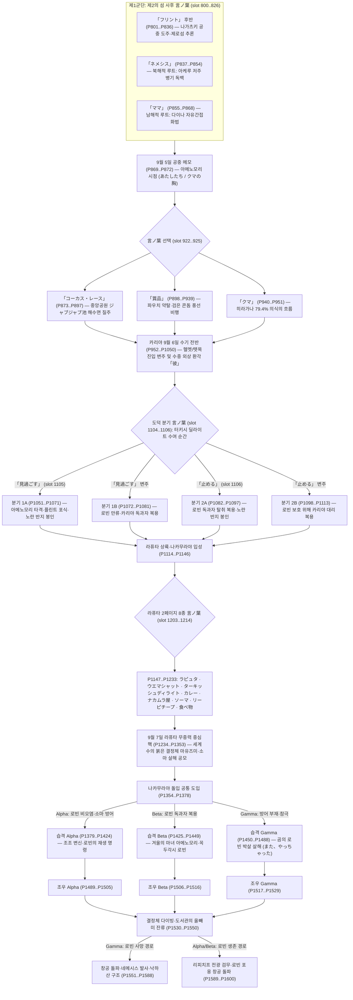

# 『Forest』 비판정본 제6권 B편 (Vol. 06B)
## 제6장 「우산출항호 항해기(傘びらき丸航海記)」 제2부 — 수몰 해역의 코커스 레이스, 독배(毒杯)의 기프트, 그리고 바벨탑 라퓨타의 붕괴 (`2600.gsc` `P801..P1600`)

> [!IMPORTANT]
> **문헌학적 범위 및 무누락 정본 원칙 (Variorum Coverage Declaration)**
> 본 권(Vol. 06B)은 라이어 소프트(Liar-soft) 『Forest』(2004)의 최대 분량 단일 스크립트인 `2600.gsc`(총 2,415문단, 5,242문장, 90,298자)의 중핵부에 해당하는 **`P801`부터 `P1600`까지 전 800문단(1,738문장, 29,106자)**을 단 하나의 문단 번호 누락이나 역순 없이 정순(Chronological Bytecode Sequence)으로 전수 해부한다. 본 구간은 제2의 섬(보물섬/성배 탐색) 이탈 직후의 사후(事後) 『언어의 잎(`言ノ葉`)』 분기에서 출발하여, 제3의 섬(수몰된 신주쿠 중앙공원 `ジャブジャブ池`)의 해상 코커스 레이스, 카리야 마키(`刈谷真季`, `^g006`)의 9월 6일·7일 항해 수기, 『나니아 연대기』 기프트(`ターキッシュ・ディライト`·`黄色の指輪`)의 4중 도덕 분기, 제4의 섬 라퓨타(`ラピュタ`) 및 신주쿠 나카무라야(`ナカムラ屋`)의 8종 다성악 파편을 거쳐, 삼두 괴수 조조(`ゾゾ`)와의 혈투 및 마유즈미 카오루(`黛 薫`) 결정체를 통한 창공 탈출(`P1600`)에 이르는 거대한 하이퍼텍스트 서사망을 포괄한다.

---

## 서론: 『우산출항호 항해기』 중반부의 매체기호학·계량문체학 총론

### 1. 계량문체 지표(Stylometric Matrix) 및 집필자 지문 판별

`2600.gsc` 전체의 거시 지표(평균 문장 길이 $\text{ASL} = 17.23$자, 서술문 비율 $42.4\%$, 한자 $20.07\%$, 히라가나 $59.31\%$, 카타카나 $8.26\%$)와 비교할 때, 중반부 슬라이스 `P801..P1600`(800문단, 1,738문장, 29,106자)은 **$\text{ASL} = 16.75$자, 평균 문단 길이 $\text{APL} = 36.38$자, `^g999`(地の文) 비율 $39.88\%$(319/800문단), 한자 $18.45\%$, 히라가나 $59.70\%$, 카타카나 $9.82\%$, 대시(`─`) $6.46\text{‰}$, 말줄임표(`…`) $3.64\text{‰}$, 감탄부호 $8.14\text{‰}$, 의문부호 $10.20\text{‰}$**를 기록한다. 그러나 이 평균치는 서로 극단적으로 이질적인 14개 미시 담화 블록의 내적 진동을 은폐하고 있다.

| 서사 군단 및 세부 블록 (`2600.gsc`) | 문단 범위 (`P#`) | 문단 수 | 문장 수 | 글자 수 | $\text{ASL}$ (자) | 한자율 ($\%$) | 히라가나 ($\%$) | 카타카나 ($\%$) | 대시 (`‰`) | 무구두점 문단 수 | 지배적 초점화 및 문체 레지스터 |
| :--- | :---: | :---: | :---: | :---: | :---: | :---: | :---: | :---: | :---: | :---: | :--- |
| **1A. 플린트 공중 도주** | `P801..P836` | 36 | 83 | 1,426 | 17.18 | 13.2 | 61.4 | 12.8 | 8.4 | 3 | `^g007` 나가츠키 갸루어 메타 게임론 |
| **1B. 네메시스 독백** | `P837..P854` | 18 | 48 | 822 | 17.12 | 13.9 | 60.1 | 13.6 | 9.7 | 0 | `^g001` 아케루(`俺`) 병기·고전 비평 |
| **1C. 다이나 마마 추적** | `P855..P868` | 14 | 27 | 610 | 22.59 | 13.4 | 56.4 | 19.2 | 3.3 | 0 | `^g999` 다이나 동물적 자유간접화법 |
| **2A. 9월 5일 공중 메모** | `P869..P872` | 4 | 10 | 125 | 12.50 | 13.6 | 64.8 | 8.0 | 0.0 | 0 | `^g999` 아메노모리(`あたしたち`) 단상 |
| **2B. 해상 코커스 레이스** | `P873..P897` | 25 | 61 | 722 | **11.84** | 17.0 | 53.6 | 13.4 | 5.5 | 0 | 7인 화자 고속 스타카토(Stichomythia) |
| **2C. 상품 약탈과 검은 풍선** | `P898..P939` | 42 | 68 | 1,131 | 16.63 | 15.6 | 57.0 | 15.4 | 3.5 | 1 | `^g007` 1인칭 서술 겸 대화(카니발적 전복) |
| **2D. 곰의 비행 의식의 흐름** | `P940..P951` | 12 | 24 | 563 | 23.46 | **10.8** | **79.4** | 4.8 | 0.0 | 3 | `^g999` 곰(`ぼく`) 유아적 무구두점 독백 |
| **3A. 수기: 제3의 섬·수중 환각** | `P952..P1039` | 88 | 210 | 3,652 | 17.39 | 21.9 | 59.1 | 8.1 | 1.6 | **9** | `^g999` 카리야 수기 + 수중 질식 무구두점 |
| **3B. 수기: 독과자·반지 4중 분기** | `P1040..P1113` | 74 | 194 | 3,128 | 16.12 | 19.7 | 56.4 | 9.6 | 8.3 | 0 | `^g999` 수기 내 다성 보이스 삽입(`[Voice]`) |
| **3C. 수기: 라퓨타·나카무라야** | `P1114..P1146` | 33 | 58 | 1,640 | **28.28** | **23.4** | 57.7 | 10.5 | 4.9 | 0 | `^g999` 카리야 르포르타주·문명비평 산문 |
| **4. 라퓨타 8종 『언어의 잎』** | `P1147..P1233` | 87 | 184 | 3,699 | 20.10 | 18.5 | 60.3 | 11.0 | 2.7 | 6 | 8개 키워드 백과사전적 다성 파편군 |
| **5. 붉은 결정체와 살인 공모** | `P1234..P1353` | 120 | 258 | 4,031 | 15.62 | 18.9 | 59.5 | 8.0 | 6.5 | 3 | `^g006`/`^g007`/`^g004` 해석학 논쟁 |
| **6A. 나카무라야 습격 3분기** | `P1354..P1488` | 135 | 287 | 4,029 | 14.04 | 15.2 | 62.3 | 10.1 | 6.5 | 7 | `^g004` 시점 3갈래 평행 참극(`Alpha/Beta/Gamma`) |
| **6B. 사이렌·네메시스·창공 탈출** | `P1489..P1600` | 112 | 226 | 3,528 | 15.61 | 21.3 | 59.4 | 6.5 | **15.9** | 6 | `^g006`/`^g007`/`^g001` 다중 교차 편집·가속 |

이 표가 입증하듯, 본 구간의 핵심 집필자 지문은 **묘가야 진로쿠(`茗荷屋甚六` = 기무라 고 `木村航`)**에 **`[확증(Confirmed)]`** 등급으로 귀속되며, 그 위에 기획·메인 시나리오 작가 **호시조라 메테오(`星空めてお`)**의 상위 우주론 코드가 중첩된 협업 구조를 띤다. 그 문헌학적 근거는 네 가지다.

1. **의도적 무구두점 일식문(句読点消失・一息文)의 체계적 구사**: 슬라이스 전체에서 마침표·물음표·느낌표가 완전히 제거된 채 호흡이 폭주하는 문단이 총 38개 출현한다. 나가츠키의 냉소적 속사포(`P827`, `P1153`), 곰(`クマ`)의 전논리적 의식의 흐름(`P945`, `P948..P950`, `P1196..P1205`), 그리고 카리야가 수중에서 「그(`彼`)」에게 발목을 잡혀 익사 직전에 이르는 9개의 질식 문단(`P1016`, `P1022..P1024`, `P1031..P1032`, `P1034`, `P1037`)은 TRPG·게임북 출신 작가 기무라 고 특유의 통사적 신체 모사(Syntactic Somatics)다.
2. **번역 정전(岩波少年文庫 등)에 대한 명시적 문헌 비평의 텍스트 내장**: 인물들이 단순히 동화 모티프를 연기하는 데 그치지 않고, 스펜서의 『신선여왕(`神仙女王`)』(`P851`), 세타 테이지(`瀬田貞二`) 역 이와나미판 『나니아』의 `プリン`/`ターキッシュ・ディライト` 번역차(`P1167..P1169`), 이시이 모모코(`石井桃子`) 역 『곰돌이 푸』의 `ゾゾ`/*Heffalump* 역어(`P1300`), 스위프트 원전 수용사에서 지적되어 온 `ラ・ピュタ`의 스페인어(*la puta*) 어원 유희설(`P1148..P1149`)을 **대사와 독백 안에서 직접 문헌학적으로 비평**한다.
3. **종(種) 횡단적 인격 표기 `ヒト`(카타카나)**: `2600.gsc` 전체에서 68회 출현하는 카타카나 `ヒト`(`人間のヒト`, `ネズミのヒト`, `女のヒト`)는 생물학적 호모 사피엔스(`人間`)와 말하는 짐승·봉제인형·괴물을 동등한 언어게임 행위자로 묶는 기무라식 인류학 표기법이다.
4. **호시조라 메테오 우주론과의 정교한 봉합**: 제5장 「더 게임」에서 세계수(`世界樹`)가 된 마유즈미의 붉은 결정체(`P1235..P1249`), 신주쿠 교엔(`御苑`) 밤의 난장과 카코(`伽子`)·아케루(`先生`)의 친부성 폭로(`P1162..P1166`), 아메노모리의 죽은 개 시리우스(`シリウス`, `P1404`), 검은 앨리스의 오르골 인형 메타렙시스(`P1005`)는 메테오가 설계한 작품 전체의 중심 신화소와 오차 없이 맞물린다.

### 2. 『언어의 잎(`言ノ葉`)』 하이퍼텍스트 엔진 구조와 3중 인과 분기망

`2600.gsc`는 전통적인 비주얼 노벨의 행동 선택지 대신, 화면에 부유하는 시어 파편을 건드리는 **`言ノ葉に触れてください──`** 인터페이스를 통해 다중 시점 파편 열람과 도덕적 개입 분기를 동시에 수행한다. 바이트코드 슬롯(`slot`)과 오프셋 간격(`d_off`, 일반 연속 문단은 고정 `30 bytes`, 엔진 명령 삽입 시 `36~414 bytes`)을 역추적하면 `P801..P1600`의 전체 분기 위상학은 아래와 같이 복원된다.

---

## 제1부 (`P801..P868`): 제2의 섬 사후(事後) 『언어의 잎(`言ノ葉`)』 3갈래 파편 — 감시·저주·모성의 삼각 측량

제2의 섬(북해적의 아서왕 성배 탐색 대 남해적의 후크/실버 보물섬) 에피소드가 종료된 직후, 엔진은 두 세트의 3지선다 『언어의 잎』 메뉴(`slot 800..803`: `「第二の島」`·`「フリント」`·`「ネメシス」` / `slot 823..826`: `「第二の島」`·`「フリント」`·`「ママ」`)를 제시한다. 본 슬라이스의 첫 68문단(`P801..P868`)은 그중 「フリント」의 후반부(`P801..P836`), 북해적 루트 전용 기프트 독백 「ネメシス」(`P837..P854`), 남해적 루트 전용 기프트 독백 「ママ」(`P855..P868`)를 순차 수록한다.

### 제1절 (`P801..P836`): `言ノ葉` 「フリント」 후반부 — 판옵티콘의 바보 앵무새와 제로섬(`ゼロ／サム`) 서바이벌의 메타 게임론

- **[식별자 & 엔진 연출 코드]**: `2600.gsc` `P801..P836` (36문단, 83문장, 1,426자). 화자: 나가츠키 아마네(`^g007:九月周`, 32문단) 및 앵무새 우산 괴물 플린트(`^g026:鳥／怪物(ケケー)`, 4문단: `P802`, `P813`, `P815`, `P836`). 음성 큐 없음. `P808->P809`(`d_off=36`), `P810->P811`(`d_off=40`)에 미세 연출 웨이트가 삽입되며, `P836->P837`(`d_off=106`)에서 `言ノ葉` 블록 종료 점프가 발생한다. 공간은 수몰된 신주쿠 해역 상공(`森` 층위 2~3).

#### 1. Beat 1-1 (`P801..P808`): 도지사의 의도적 스파이 노출(역-판옵티콘)과 공중 단독 이탈
- **[층위 1: 미시 문체·통사]**: 직전 문단(`P794..P800`)에서 이어지는 나가츠키의 공중 독백은 첫 문장 `P801-S1`(`仲間じゃないなら、なんなんだろ？`)과 `P801-S2`(`あたしら、なんでつるんでんだろ？`)의 종조사 축약(`〜んだろ？`)으로 집단 결속의 허구성을 해체한다. 플린트의 기계적 괴성 `ケケー！`(`P802-S1..S2`) 직후, 나가츠키는 컴퓨터 공학 은어를 차용한 신조어 명사구 `ネイティブ脳みそ資源不足な感じ？`(`P803-S2`)로 스파이의 지능 결여를 조롱한다. 주목할 것은 `P804-S1`과 `P805-S1` 끝에 연속 배치된 절단 대시(`わざとやってるっぽいけど──`, `送り込んだっぽいけど──`)다. 두 문장은 주절 없이 종속절만으로 중첩되며 타치바나 케이코 도지사(`都知事`, `^g051` 지시)의 고차 의도를 역추적하다가, `P807-S2..S3`(`こっちのようす、丸見え。 / 言ってることも、丸聞こえ。`)의 대칭적 명사 종지(体言止め)로 압축된다.
- **[층위 2 & 3: 상호텍스트·정치기호학]**: 로버트 루이스 스티븐슨 『보물섬(*Treasure Island*)』의 앵무새 캡틴 플린트(`フリント`, **`[확증(Confirmed)]`**)가 해적들 쪽에서 짐의 잠입을 알리던 파수꾼(제27~28장)이라는 원전 기능은, 2004년 신주쿠 도청의 통치자 타치바나 도지사가 파견한 생체 도청기(`スパイ`)로 전복된다(**`[확증]`**). 그러나 나가츠키가 간파하듯(`P804..P806`), 이 스파이의 핵심 기능은 은밀한 정보 수집이 아니라 **‘감시당하고 있음을 피감시자에게 노골적으로 인지시키는 것(`「気づかせる」ため`)’**이다. 이는 제러미 벤담과 미셸 푸코의 판옵티콘(Panopticon) 권력 역학을 비틀어, 참가자 내부의 상호 불신과 이탈(`あたしひとりで、フリント連れて`, `P808-S2`)을 유도하는 심리전 장치다. 동시에 나가츠키는 도지사의 「의지(`意志`)」와 숲 자체의 「의지」가 합치하는지조차 불확실하다는 메타적 회의(`P806-S1`)를 제기함으로써, 도지사조차 상위 시스템(층위 3)의 장기말일 가능성을 열어 둔다.

#### 2. Beat 1-2 (`P809..P818`): `オリジナル`(주역) 대 `脇役`(소멸역)의 서사 계급론과 도박
- **[층위 1 & 3: 서사적 월경(Metalepsis)]**: `P809..P812`에서 나가츠키는 작중 인물임에도 스스로를 극작가적 외부 시점에 위치시키는 급진적 서사 월경을 감행한다. `P809-S1..S4`(`アマモリちゃんは、オリジナル。 / 灰流のバカも、オリジナル。 / ふたりは特別。 / たぶん、主役。`)의 4연속 단문 명사 종지는 아메노모리 노조미와 기노사키 아케루가 숲의 기원자(`オリジナル`)라는 존재론적 특권을 곧장 서사적 주역성(`主役`)으로 등치시킨다. 반면 마유즈미 카오루의 이탈(`さよならマユズミちゃん！`, `P810-S3`)은 5인 파티에서 4인으로의 감원(`P812-S2..S3`)을 뜻하며, 그녀가 처음부터 「사라지기 위해 배정된 배역(`消える役`, `P811-S3`; `消えるための仲間`, `P814-S1`)」이었는지, 아니면 아케루가 주장해 온 「우연(`偶然`, `P814-S3`)」의 산물인지를 묻는다.
- **[층위 1 & 4: 어휘 이화 효과]**: 플린트의 무의미한 복창(`P813`, `P815`)을 두고 나가츠키는 `バカなオウムはバカ騒ぎ`(`P816-S1`)라는 동어반복 두운(Alliteration)을 구사한 뒤, 만약 도청을 통해 도지사에게서 `リプライ`(Reply, 2000년대 초반 인터넷 게시판·메일 어휘, `P817-S1`)가 온다면 함정일 것이라 경계하면서도 자기 확신에 기대어 `バクチ`(도박, `P818-S1`)를 걸었다고 선언한다. 즉 나가츠키의 단독 비행은 비겁한 도주가 아니라, 도청기(플린트)를 주역 두 사람(`あのふたり`)에게서 격리하여 도지사의 시야를 교란하려는 능동적 정보전이다.

#### 3. Beat 1-3 (`P819..P836`): 가부키초 배팅센터의 증언, `P827` 무구두점 호흡, 장기판의 `差し手` 선언
- **[층위 2: 도시 기호학 및 게임이론]**: 나가츠키가 리들의 본질을 `サバイバル`(`P822-S1`)이자 `ゼロ／サム`(제로섬 게임, `P829-S2`)으로 규정하는 결정적 논거는 현실 신주쿠(층위 0)의 **배팅센터(`バッティングセンター`, `P819-S1`, 가부키초 신주쿠 배팅센터/오슬로 배팅센터 도시 기호 **`[확증]`**)**에서 홈런을 날리며 타치바나 도지사가 내뱉었던 증언(`「生き残ったのは、あたしひとり」`, `P820-S1`)이다. 만약 배역(`役目`)이 선험적으로 고정되어 있다면 이 게임은 승부가 조작된 `出来レース`(`P823-S2`, 경마·경륜 등 공영경기에서 유래한 관용어)에 불과하지만, 모든 것이 「우연(`偶然`)」에 지배된다면 결말(`結末`) 또한 복수로 열려 생존 확률이 균등해진다(`P824-S1`) — 이는 비주얼 노벨이라는 매체의 멀티 엔딩 분기 구조를 작중 인물이 내재적으로 추론해 내는 정교한 메타 비평이다.
- **[층위 1: 집필자 지문 — `P827`의 57자 무구두점 일식문]**: 카리야 마키를 「주역이 될 수 없는 타입(`主役になれないタイプ`)」이자 「독박을 감수하는 사람(`丸損に甘んじるヒト`, `P826-S1..S3`)」으로 진단한 직후, `P827-S1`은 쉼표와 마침표를 완전히 삭제한 57자 단일 호흡(`はっきり言えばそんなのどうぞご勝手にで気に病むことなんか全然なくってシュミの問題に口出すなんて野暮じゃんと思うけど`)으로 질주한다. 타인의 자기희생 취향(`シュミ`)에 냉소를 위장하면서도 곧장 `でも、あのヒト、幸せになって欲しい`(`P828-S1`)로 반전되는 이 통사적 속도감은, 위악적 구어 화법 이면에 숨겨진 나가츠키의 윤리적 연대감을 드러내는 묘가야 진로쿠의 대표적 문체 지문이다.
- **[층위 3: 보드게임 은유]**: `P831-S1`에서 주역 2인을 특별한 체스/장기 기물(`特別なピース`)로 규정한 나가츠키는, `P834-S1`에서 자신을 단순한 기물(`駒/ピース`)이 아니라 직접 수를 두는 **`差し手`(장기 대국자, 표준 한자 `指し手`의 동음 변용 표기)**로 격상시키며 플린트와의 생존 공모(`P835..P836`)로 절을 맺는다.

---

### 제2절 (`P837..P854`): `言ノ葉` 「ネメシス」 — 경박한 트리거와 데리다적 독(`呪い`)으로서의 기프트, 그리고 스펜서 『신선여왕(`神仙女王`)』의 망각 원한

- **[식별자 & 엔진 연출 코드]**: `2600.gsc` `P837..P854` (18문단, 48문장, 822자). 화자: 기노사키 아케루(`^g001:城之崎灰流(アケル)`, 전 18문단 단독 독백, 1인칭 `俺`). `slot 803` `「ネメシス」` 선택 시 진입하는 북해적(글로리아나·아서왕) 루트 귀결 파편이며, 종료 후 `P854->P855`에서 `d_off=168`의 분기 점프가 일어난다.

#### 1. Beat 1-4 (`P837..P844`): 감정 강도와 파국 규모의 탈동조화(`トリガーの軽さ`) 및 데리다적 파르마콘
- **[층위 1 & 2: 서브컬처 상호텍스트와 통사 리듬]**: 아케루는 자신이 손에 넣은 기프트 「네메시스(`ネメシス`, 그리스 복수의 여신 Nemesis, **`[확증]`**)`」의 위력을 `ビルまっぷたつ。ジャンプの世界観だ。`(`P837-S3..S4`)라는 두 개의 건조한 단문으로 요약한다. 수몰 신주쿠의 마천루를 일도양단한 초현실적 파괴력을 『주간 소년 점프(`ジャンプ`)』 배틀물의 클리셰로 이화시키는 블랙유머다. 그러나 `P838..P840`이 해부하는 진정한 공포는 파괴력 자체가 아니라 **발동 임계치의 비정상적 경박함(`トリガーの軽さ`, `P838-S1`)**에 있다. 살의에 찬 비장한 포효(`「うおおお！」`·`「ぶっ殺す！」`, `P838-S2..S3`)가 아니라 일상적 짜증(`「あ、コノヤロ」`·`「むかつく」`, `P839-S1..S2`)만으로도 대재앙(`カタストロフ`)이 촉발된다. 즉 내면적 정동의 강도·질($I_{\text{affect}}$)과 외면적 물리 파국($E_{\text{catastrophe}}$) 사이의 비례 함수가 완전히 끊어져 있는 것이다(`P840-S1`).
- **[층위 3: 기프트(Gift)의 자기잠식 메커니즘]**: `P841..P844`는 다이너마이트·수류탄·미사일의 전술적 합목적성(`分業制`, 설치 폭파 대 자폭 테러 `腹に巻いて`, `P842..P843`)과 네메시스를 대비시킨다. 사용자의 의지적 시공간 통제(`思ったときに思ったところで思ったとおりに`, `P844-S1`의 3중 두운 반복)가 불가능한 도구는 더 이상 게임적 혜택(`アイテム`)이 아니라 소유자를 파멸시키는 **`呪い`(저주, `P844-S2`)**다. 이는 영어 `Gift`(선물)와 독일어 `Gift`(독)의 어원적 양가성을 파고든 마르셀 모스의 *Gift* 이중성 논의 및 자크 데리다(「플라톤의 약국」)의 **파르마콘(Pharmakon)** 논리를 정확히 구현한다.

#### 2. Beat 1-5 (`P845..P854`): 글로리아나-아서의 위계 전도와 『신선여왕(`神仙女王`)』의 망각 저항
- **[층위 2: 서구 정전 및 일본 번역사 고증]**: 아케루는 `P850..P853`에서 북해적 군주 글로리아나(`グロリアーナ`, `^g017`)와 그 부하(`手下`)로 전락한 아서왕(`アーサー`)의 기이한 위계 역전을 영문학사적으로 직접 해독한다. `P851-S1`에 명시된 **`スペンサーの『神仙女王』`**(**`[확증]`**)는 에드먼드 스펜서(Edmund Spenser)의 미완성 알레고리 서사시 *The Faerie Queene*(1590/1596)을 가리키는 고전풍 일본어 역제다(단행본 번역서 제목으로는 토야마 사다오 `外山定男` 역 『仙女王』[1937], 구마모토대학 스펜서 연구회 역·와다 유이치 `和田勇一` 감수 『妖精の女王』[文理書院, 1969] 및 와다 유이치·후쿠다 쇼하치 `福田昇八` 역 『妖精の女王』 등이 통용되었으나, 아카가와 유타카 `赤川裕` 부분역 「神仙女王―第1巻第1章―」 등 논문·부분역 전통에서 쓰인 한자어 옛 역제 `『神仙女王』`을 평이한 `『妖精の女王』` 대신 의도적으로 채택했다). 스펜서 원전에서 아서 왕자(Prince Arthur, 위대함 Magnificence의 화신)는 아직 왕위에 오르기 전 요정 여왕 글로리아나(엘리자베스 1세의 알레고리)의 환상을 사모하여 요정국을 편력하는 기사로 등장하기에, 대중적 아서왕 전설과 달리 글로리아나의 하위자로 배치된다.
- **[층위 2 & 4: 정전 도태와 숲의 존재론]**: 아케루가 던지는 핵심 질문은 『이상한 나라의 앨리스』나 『피터 팬』 같은 대중 아동문학과 달리 왜 하필 「아무도 모르는 마이너한 원전(`マイナー過ぎないか？`, `P852-S2`)」이 숲에 현현했는가이다. `P853-S2`의 추론 — **`「忘れられていく」ことへの恨み、か？`** — 은 『Forest』 전체를 관통하는 리들의 발생학을 찌른다. 2004년 현대 도시 소비문화 속에서 독자를 잃고 망각의 심연으로 가라앉은 고전 서사들이, 스스로의 소멸에 저항하는 복수심(`ネメシス`)을 동력 삼아 현실의 인간(`読み手`)을 납치한다는 메타 문학사적 테제다.

---

### 제3절 (`P855..P868`): `言ノ葉` 「ママ」 — 검은 암고양이 다이나의 포식 본능과 탈모성(Post-Maternity)의 결핍

- **[식별자 & 엔진 연출 코드]**: `2600.gsc` `P855..P868` (14문단, 27문장, 610자). 화자 코드: 전 문단 `^g999:地の文／語り手`(다이나 `ダイナ`의 내면을 밀착 투사한 3인칭 자유간접화법). `slot 826` `「ママ」` 선택 시 진입하는 남해적 루트 귀결 파편이며, 종료 후 `P868->P869`에서 `d_off=106`으로 공통 축(`9月5日`)에 합류한다.

#### 1. Beat 1-6 (`P855..P868`): 문자의 무관심, 육식적 감각성, 그리고 키티·스노드롭 이후의 빈 모성
- **[층위 1: 문체·표기 이화 효과]**: 이 블록은 카타카나 비율이 **$19.2\%$**(슬라이스 평균의 2배)까지 치솟는다. 첫 문장 `P855-S1`(`カリヤ・マキという名を漢字でどう書くか、ダイナは知らないし、おぼえる気もない。`)은 인간 세계의 한자 성명(`刈谷真季`)을 비문해 동물 주체의 청각 기호(`カリヤ・マキ`)로 낯설게 만든다. 이어 `P856-S1`의 부사 중첩(`延々と延々と泳いでいる`)은 바다를 헤엄치는 집요한 신체 리듬을, `P857-S2`(`活きのよい毛皮を喰い破って肉と脂と血と骨の味を楽しむ`)의 4연속 체언 병렬(`肉と脂と血と骨`)은 나니아의 고결한 기사 쥐 리피치프(`リーピチープ`)를 순수한 생물학적 피식자(단백질과 지방 덩어리)로 환원하는 야수적 감각성을 드러낸다.
- **[층위 2: 루이스 캐럴 2부작 정전 대조 및 층위 0/1 암시]**: `P859..P863`은 루이스 캐럴의 『이상한 나라의 앨리스』(1865) 및 『거울 나라의 앨리스(*Through the Looking-Glass*, 1871)』 제1장의 다이나 설정을 정밀하게 변주한다(**`[확증]`**).
  1. 앨리스가 우유(`ミルク`)를 주고 함께 잠들기에 다이나는 앨리스를 `「ママ」`라 부른다(`P859`).
  2. 그러나 `P860-S1..S2`(`ダイナの抜け毛はアリスに悪い。だから、ホントはいっしょに寝たりしてはいけないとお医者に言われている。`)는 캐럴 원전에 없는 의료적 금기로서, 기저 현실(층위 0/1)에서 앨리스의 원형인 병약한 소녀 **카코(`伽子`)**가 호흡기 질환·요양 상태에 놓여 있었음을 암시하는 치밀한 복선이다(**`[유력(Probable)]`**).
  3. `P862-S2`(`黒猫のキティと、白いスノードロップ`)는 『거울 나라의 앨리스』 도입부에서 거울 너머 체스 세계로 진입하는 매개가 되는 두 아기고양이(검은 고양이 Kitty와 흰 고양이 Snowdrop, 일본어 번역 전통에서 정착된 음차 표기)를 정확히 호출한다(**`[확증]`**). 이미 새끼들이 독립해 떠났으므로 다이나는 더 이상 `「ママ」`가 아닌 「그저 다이나(`ただのダイナ`, `P863-S2`)」일 뿐이다.
- **[층위 3: 기프트 「마마」의 존재론적 수수께끼]**: 남해적들에게서 `「ママ」`라는 칭호(기프트)를 부여받은 카리야는 출산도 양육도 하지 않는 냉철한 독신 커리어우먼이다. 생물학적 모성을 상실한 암고양이 다이나가 「무엇도 낳지 않고 기르지 않는 마마(`そうでない「ママ」`, `P865-S2`)」의 정체를 알고 싶어 헤엄쳐 쫓아갈 때, 뗏목 위에서 수기를 적던 카리야가 보내는 스치는 미소(`P867-S1`)는 다이나의 가슴을 조이게 만든다(`P868-S1`). 특히 `P868-S2`의 내적 환기(`運命に追いつかれてしまった──そんなことを言ってたのは、誰だっけ？`)는 장차 `P1081`에서 검은 앨리스가 카리야에게 내릴 파멸 선고를 시간을 앞질러 공명시키는 예언적 메타렙시스다.

---

## 제2부 (`P869..P951`): 제3의 섬(신주쿠 중앙공원 자부자부 연못)과 『언어의 잎(`言ノ葉`)』 3갈래 — 공중 메모, 해수면 코커스 레이스, 카니발적 풍선

### 제1절 (`P869..P872`): 9월 5일 공중 단상과 `slot 922..925` 분기점 — 서술 주체 오독에 대한 반례 검증

- **[식별자 & 엔진 연출 코드]**: `2600.gsc` `P869..P872` (4문단, 10문장, 125자, `^g999`). 직후 바이트코드 `slot 922..925`(`d_off=186`)에서 `言ノ葉に触れてください──` 메뉴(`「コーカス・レース」`·`「賞品」`·`「クマ」`)가 호출된다.
- **[층위 1 & 4: 문헌학적 반례 검증(Anomaly Verification) — 누가 `9月5日` 메모를 썼는가?]**:
  언뜻 날짜 표기(`９月５日。`, `P869-S1`)와 필기 행위(`いま、空の上で書いている。`, `P869-S2`)만 보면 이 네 문단을 카리야 마키의 항해 수기의 일부로 오인하기 쉽다. 그러나 미시 대명사·신체 배치·후속 문맥을 교차 대조하면 이는 결정적 반례임이 드러난다.
  1. **1인칭 복수 대명사의 불일치**: `P872-S3`는 **`あたしたち、どこまで飛ぶのかな。`**라고 적는다. 카리야 마키는 `2600.gsc` 전편을 통틀어 단 한 번도 `あたし` 계열 대명사를 쓰지 않으며 엄격히 `私`/`私たち`만을 사용한다.
  2. **수기 개시 시점과의 모순**: 후속 `P952-S1`에서 카리야는 「9월 6일, 제4의 섬 라퓨타에 도착해서야 **나는 비로소 이 수기를 펼칠 수 있었다(`ようやくこの手記を開くことができた`)**」고 명시한다. 즉 9월 5일 공중에서는 카리야가 정식 수기를 집필할 수 없었다.
  3. **신체적 위치와 호칭의 교차 확증**: `P871-S2`는 나가츠키를 `九月さん`이라 부르고, `P872-S1..S2`는 **`クマの胸ではうまく書けない。ふわふわしている。`**라고 기술한다. 후속 `P1053-S2`에서 곰의 가슴(`「クマ」氏の胸`)에 매달려 있는 인물은 다름 아닌 **아메노모리 노조미(`雨森望`)**이며, 아메노모리는 평소 `あたし`와 `九月さん` 호칭을 사용한다(다만 `P948-S1`에서 곰이 종이에 무언가 적는 여자를 보며 제1장 카리야의 취재를 뜻하는 `「いんたーびゅー」かな`를 떠올리는 대목은, 아메노모리의 메모 행위와 카리야의 기록자 이미지를 곰의 혼미한 인지 속에서 의도적으로 겹쳐 놓은 다성적 착시 장치다). 요컨대 `P869..P872`는 코커스 레이스 직후 풍선 비행 중인 아메노모리의 시점 단상(혹은 두 여성의 목소리가 혼융된 메타 일기)이며, 시간을 먼저 결과(풍선 비행 중)로 점프시킨 뒤 `言ノ葉` 3종(`P873..P951`)을 통해 원인이 된 경주 과정을 역순 회상하는 비선형 편집의 기점이다.

---

### 제2절 (`P873..P897`): `言ノ葉` 「コーカス・レース」 — 『앨리스』 × 『피터 팬』 네버버드 암초 × 신주쿠 중앙공원 `ジャブジャブ池`의 3중 접합

- **[식별자 & 엔진 연출 코드]**: `2600.gsc` `P873..P897` (25문단, 61문장, 722자, $\text{ASL}=11.84$자). `slot 923` `「コーカス・レース」` 선택 분기. 등장 화자 9종: `^g999`(리들 구호 2문단), `^g002:黒いアリス`, `^g034:クリストファー・ロビン(穏)`, `^g041:イーヨー`, `^g037:コブタ`, `^g040:地球座の賢者(フクロウ)`, `^g015:プー(クマ)`, `^g004:雨森望`, `^g001:城之崎灰流`, `^g007:九月周`, `^g026:フリント`. 종료 시 `P897->P898`에서 `d_off=148` 점프.

#### 1. Beat 2-1 (`P873..P883`): `8·7 / 8·5`박 리들 구호와 백 에이커 동물군의 해수면 질주 스타카토
- **[층위 1: 운율 및 캐릭터 화법 대위법]**: 블록을 여는 `P873-S1..S2`(`「とにかく走れよコーカス・レース！ / 止まったとたんに地獄行き！」`)는 `8·7 / 8·5`박 음수율의 강박적 구호로, 캐럴 원전의 무규칙·무승부 원형 달리기(전원이 시작하고 싶을 때 시작해 멈추고 싶을 때 멈추는 자유주의 풍자)를 **‘멈추면 즉시 수장되는 서바이벌 데스매치’**로 역전시킨다. 이어지는 동물들의 응수는 각 캐릭터 고유의 동화풍 어투를 과장되게 변주한다:
  - 로빈(`^g034`, `P875`, `P881`): 천진난만한 소년 모험가의 감탄사(`得意さ！`, `おもしろいなあ！`).
  - 이요르(`^g041`, `P876`, `P878`, `P880`): 1인칭 `わし`와 노인어 종조사(`〜じゃろ!?`, `不公平じゃ！`), 의성어 `ボチャリ`를 구사하는 비관주의 수사.
  - 피글렛(`^g037`, `P877`, `P883`): 어두 자음 반복 말더듬(`う、浮かぶよね？`)과 파동 모음(`揺れるぅ〜!?`).
  - 지구좌의 현자 올빼미(`^g040`, `P879`): 단 8자의 정중한 이탈 선언(`では、お先に失礼。`)으로 해수면 위를 날아가 버림으로써 지상의 주자들을 조롱한다.
- **[층위 2: 밀른 『곰돌이 푸』 정전 상호텍스트]**: 피글렛이 이요르에게 던지는 `P877-S2`(`前にも川で、う、浮かんでたじゃない？`)와 이요르의 격앙된 반박 `P878-S1..S3`(`このわしが、浮かんでおっただと!? それは沈む前の話じゃろ!?`)은 A. A. 밀른의 『푸 모퉁이에 있는 집(*The House at Pooh Corner*, 1928, 이시이 모모코 역 『プー横丁にたった家』)』 제6장 「푸스틱스(Poohsticks, 막대기 떠내려보내기 놀이)」 에피소드에서 티거에게 떠밀려 강물에 빠진 이요르가 배를 위로 한 채 유유히 떠내려오던 명장면을 정확히 패러디한다(**`[확증]`**). 거대한 검은 연기 덩어리인 곰(`^g015`)이 달릴 때마다 바다가 지진처럼 요동친다는 `P883-S2..S3`는 귀여운 봉제인형의 질량을 괴수적 스케일로 전복한다.

#### 2. Beat 2-2 (`P884..P897`): `カンソウ` 동음이의 유희와 네버버드 부유 둥지(`浮き巣`)의 도시 지리학
- **[층위 1: 카타카나 중의성]**: 두 번째 리들 구호 `P884-S1..S3`(`「ずぶ濡れ乾かせコーカス・レース！ / 走って走って風切って！ / カンソウしたなら賞品進呈！」`)에서 카타카나 **`カンソウ`**는 원전의 「젖은 옷 말리기(**乾燥**)」와 경주 규칙인 「끝까지 완주하기(**完走**)」, 나아가 기록자 카리야의 「감상(**感想**)」까지 3중으로 포개는 고밀도 다쟈레(駄洒落)다. 아메노모리의 숨찬 끊어 말하기(`濡れた服っ、乾かすためっ、走るっ、んでしたよねっ!?`, `P885-S2`)는 실제 달리기 호흡 곤란을 촉각화한다.
- **[층위 2: 3중 상호텍스트 및 2004년 신주쿠 도시 코드]**: `P886..P895`에서 아케루·나가츠키·올빼미의 삼각 대화가 제3의 섬의 정체를 3중으로 해독한다:
  1. **제1원전**: 루이스 캐럴 『이상한 나라의 앨리스』 제3장 「코커스 레이스와 긴 이야기」(`コーカス・レース`, **`[확증]`**).
  2. **제2원전**: J. M. 배리 『피터 팬(*Peter and Wendy*, 1911)』 제8장 「인어들의 석호(The Mermaids' Lagoon)」의 처형 암초(Marooners' Rock)와 **네버버드(`ネヴァーバード`)** 에피소드(`P886-S3`, `P889-S1`, `P895-S1..S3`, **`[확증]`**). 아케루가 인용하는 `「死ぬのって冒険だよな」`(`P889-S1`)는 밀물이 차오르는 암초에 홀로 남겨진 피터 팬의 유명한 대사 *"To die will be an awfully big adventure"* (이시이 모모코 역[1957년 이와나미 문고 → 후쿠인칸 서점 판]·혼다 아키라 역 등 일본어 번역 전통에서 널리 알려진 명대사)를 현대 구어체로 압축한 것이며, 알을 품은 채 물 위에 떠다니는 네버버드의 부유 둥지(`浮き巣`)가 제3의 섬이자 나니아 『새벽 출정호의 항해』의 외로운 제도(Lone Islands) 중 세 번째 섬 위상에 겹쳐진다.
  3. **2004년 신주쿠 도시 기호**: 기억술의 현자 올빼미(`^g040`)는 `P894-S1..S2`에서 고어 부사 `なかんずく`(그중에서도 특히)를 섞어 이 섬의 실제 좌표를 **`新宿中央公園`(신주쿠 도청 바로 서쪽에 인접한 구민 공원) 내 어린이 물놀이장 `ジャブジャブ池`**로 특정한다(**`[확증]`**). 현실에서는 발목 깊이에 불과한 영유아용 수경 시설이, 수몰된 신주쿠(층위 2)에서는 밟는 순간만 육지가 되고 멈추면 심연으로 빠지는(`P891-S1..S3`) 거대한 죽음의 트랙으로 변모한 것이다.

---

### 제3절 (`P898..P939`): `言ノ葉` 「賞品」 — 유흥업소 파우치의 약탈과 빅토리아조 무성성(Asexuality)을 모독하는 검은 콘돔-풍선

- **[식별자 & 엔진 연출 코드]**: `2600.gsc` `P898..P939` (42문단, 68문장, 1,131자). `slot 924` `「賞品」` 선택 분기. 특기할 엔진 연출 현상으로, 본 블록에서는 순수 대화문뿐 아니라 지문 성격의 서술 문단(`P904..P906`, `P914..P921`, `P929..P930`, `P932`, `P937`, `P939`)까지 전부 **`^g007:九月周` 화자 코드**가 부여되어 화면에 나가츠키의 1인칭 구술 만담 형식으로 출력된다. 보조 화자: `^g002`, `^g040`, `^g026`, `^g034`, `^g015`, `^g004`. 종료 시 `P939->P940`에서 `d_off=148` 점프.

#### 1. Beat 2-3 (`P898..P914`): 비주행 스폰서 강제 논리와 휴대전화(`特別賞`) 사수 신경전
- **[층위 1 & 2: 자본주의 스폰서십으로 번역된 캐럴의 부조리]**: 캐럴 원전 제3장에서 도도새가 아무런 논리적 근거 없이 앨리스를 지목해 주머니 속 설탕과자(comfits)를 상품으로 내놓게 만들던 빅토리아조 노센스(Nonsense)는, 검은 앨리스(`^g002`)의 입을 통해 「달리지 않고 날아다녔으니 당신은 선수가 아니라 **스폰서(`スポンサー`)**잖니?」(`P899-S1..S2`)라는 현대 상업 스포츠의 궤변으로 합리화된다. 나가츠키가 공범으로 물고 늘어진 올빼미(`^g040`)가 능청스럽게 「참가 의사는 표명했다」(`P901-S1`)며 빠져나가는 대목은 기억술 학자다운 형식논리적 면피다.
- **[층위 1 & 2: 가부키초 물질문화 목록과 불량 화법 전환]**: 나가츠키의 파우치에서 쏟아져 나오는 `タバコ、ライター、キャンデー、フレグランス、サインペン……`(`P905-S1`)은 가부키초 풍속점 여성의 생존 키트다. 유일한 현실 통신망 상징인 `携帯電話`를 숨기려다 로빈에게 들키자(`P906-S1`, 무쉼표 급박 문장), 나가츠키는 자칭 `審査委員長`(`P910-S1..S2`)의 직권으로 이를 `特別賞`으로 묶어 방어한다. 담배(`モク`, 쇼와~헤이세이 불량 은어)까지 빼앗긴 뒤 터져 나오는 내적 욕설 `P914-S1..S3`(`チッ。冗談じゃねえやクソガキ絞めんぞ。...許すと思ってんのかオラ。`)는 공적 애교(`〜でーす`, `P910`)와 사적 야쿠자조 반말(`〜んぞ`, `オラ`) 사이의 극단적 코드 스위칭(Code-switching)을 보여준다.

#### 2. Beat 2-4 (`P915..P921`): 도도새 경주 원전 대조와 배역 치환의 메타 비평
- **[층위 2 & 3: 상호텍스트 자기반영성]**: 나가츠키는 상품을 강탈당한 자신의 처지가 오히려 원전의 앨리스 역할과 일치함을 깨닫고 `あたしってアリスじゃん？ 出世したなあ主役じゃん！`(`P916-S2..S3`)라고 자조적 환호를 올린다. 이어 `P918..P920`에서 원전의 조류 동물원(`ドードー鳥`[Dodo], `鷲の子`[Eaglet], `インコ`[Lory, `オウム`와의 역어 변별까지 짚어내는 정밀함!])이 백 에이커의 숲 동물군(`クマ、驢馬、梟、子豚`)과 나니아/보물섬 동물(`ネズミとオウム`)로 치환되었음을 짚어낸다(**`[확증]`**). 이는 이 숲의 리들이 단일 원전의 재현이 아니라 복수 정전들의 **조합적 브리콜라주(Bricolage)**임을 독자에게 환기하는 메타 주석이다.

#### 3. Beat 2-5 (`P922..P939`): `コンドーム`의 검은 구름 풍선화와 빅토리아조 아동문학의 카니발적 모독
- **[층위 2 & 3: 바흐친적 카니발화와 밀른 제1장 패러디]**: 검은 앨리스가 순결 강박적 아가씨 아메노모리에게 골라 준 상품은 다름 아닌 **`コンドーム`(콘돔, `P924-S2`)**이다. 비명을 지르며 거절하는 아메노모리 대신 그것을 넘겨받은 곰(`^g015`, `P926..P928`)이 표정조차 식별할 수 없는 새까만 얼굴에 라텍스 피임기구를 대고 숨을 불어넣자(`ぶうぅぅぅぅぅぅっ`, `P930-S1`의 7연속 장음 `ぅ`와 무쉼표 팽창 구문), 곰 자신의 신체와 동일한 **「새까만 무언가(`真っ黒な何か`)」**가 채워지며 거대한 검은 풍선이 되어 하늘로 떠오른다.
  이 장면은 미하일 바흐친(Mikhail Bakhtin)이 규정한 **그로테스크 리얼리즘과 카니발적 격하(Degradation)**의 극치다. 빅토리아조와 전간기의 영국 아동문학(캐럴과 밀른)이 철저히 억압하고 삭제했던 성인 성매매·피임의 물질적 기표(`コンドーム`)가, 『곰돌이 푸(*Winnie-the-Pooh*, 1926)』 제1장에서 푸가 꿀벌을 속이기 위해 파란 풍선을 타고 올라가 **「푸른 하늘의 작은 검은 구름(*a small black cloud in a blue sky*, 이시이 모모코 역 『곰돌이 푸』에서 친숙해진 명장면)」** 행세를 하던 가장 순수한 동화적 도상(**`[확증]`**)의 외피로 전용된 것이다! 불임과 차단(피임기구)의 도구가 역설적으로 일행 전원을 제4의 섬으로 실어 나르는 비상(飛翔)의 모태가 되는 가운데, 검은 앨리스의 경고(`P938`)와 나가츠키의 확인(`最下位は、カリヤさんだったんだ。`, `P939-S2`)이 최하위자 카리야에게 남겨진 ‘진짜 독배’를 예고한다.

---

### 제4절 (`P940..P951`): `言ノ葉` 「クマ」 — 히라가나 79.4%·무구두점 의식의 흐름과 자기성찰에 의한 신체 해체 공포

- **[식별자 & 엔진 연출 코드]**: `2600.gsc` `P940..P951` (12문단, 24문장, 563자). `slot 925` `「クマ」` 선택 분기. 화자 코드: `^g999`(곰 `クマ`의 초점화 자유간접화법, 내적 1인칭 `ぼく`). 종료 시 `P951->P952`에서 `d_off=96`으로 카리야의 수기 본문으로 전환된다.
- **[층위 1: 극단적 계량문체 지표 — 히라가나 $79.4\%$, 한자 $10.8\%$]**: 본 12문단은 슬라이스 전체에서 한자 비율이 가장 낮고($10.8\%$) 히라가나 비율이 가장 높으며($79.4\%$), 대시와 말줄임표가 $0.0\text{‰}$인 대신 **무구두점 연쇄 문단(`P942`[마침표만 존재, 쉼표 0], `P943`[쉼표 0], `P945`[구두점 완전 0], `P948`[구두점 완전 0], `P949`[구두점 완전 0], `P950`[쉼표 0])**이 밀집한다. 이는 밀른 원전의 *"Bear of Very Little Brain"* (이시이 모모코 역 『곰돌이 푸』를 통해 정착된 ‘머리가 나쁜/그리 영리하지 못한 곰’ 형상, **`[확증]`**) 설정을 현대 실험소설(윌리엄 포크너 『소리와 분노』의 벤지 섹션이나 다니엘 키스 『앨저넌에게 꽃을』 초기 문체)의 유아적 의식의 흐름 기법으로 재창조한 성취다.
- **[층위 1 & 3: 촉각적 신체 혐오와 메타인지적 자기붕괴]**:
  - `P940..P945`에서 `〜だなあとクマは思う`의 동화적 후렴구 사이로 곰의 자기혐오가 스며 나온다: 자신의 몸은 `もやもやの真っ黒なくさい体`(모야모야하고 새까맣고 냄새나는 몸, `P942-S1`)이자 `とっても醜い`(너무나 추한, `P943-S1`) 괴물인데, 사람들이 손·발·배·얼굴까지 밀착시켜 `ぴったりぎったり`(기존 의태어 `ぴったり`에 탁음 변주 `ぎったり`를 결합한 조어) 매달려 의지해 주는 감각이 기분 좋으면서도(`みんなが気持ちいい`, `P941-S1..S2`), 사실은 다들 역겨워하면서 살기 위해 억지로 매달린 것뿐임을(`P945-S1`) 본능적으로 알고 있다.
  - `P946..P948`에서 곰은 두 명의 여성을 감지한다. 「슬픈 슬픈 영혼을 가진 불쌍한 불쌍한 여자(`悲しい悲しい魂... かわいそうなかわいそうな女のヒト`, `P946-S2..S3`)」는 가슴에 매달린 아메노모리(혹은 카리야)이며, 종이에 무언가를 적고 있어 `「いんたーびゅー」`(제1장의 인터뷰 기억이 전유아적 히라가나로 표기됨, `P948-S1`)인가 궁금증을 자아내는 여자는 기록자성 자체다.
  - 결정적 철학 문장은 무구두점 재귀 의문문인 **`P949-S1`(`なぜぼくはぼくのこと気にするんだろうぼくを気にするヒトが気になるんだろう`)**이다. 1차 의식(대상에 대한 지향)이 2차 메타의식(자기를 의식하는 자기에 대한 반성, 타자의 시선에 비친 자기에 대한 의식)으로 접히는 순간, **`P950-S1`(`でもそのへんまで考えてくると真っ黒な体がばらばらになりそうなのでクマは考えるのをやめる。`)**이라는 존재론적 위기가 덮친다! 즉 숲 속의 곰을 지탱하는 검은 연기 신체는 **‘사유의 부재(무지)’**를 접착제로 삼고 있으며, 근대적 자기의식(코기토)이 작동하는 즉시 형체가 해체(`ばらばら`)되어 버린다. `P951-S1..S3`의 `なんにも考えないのは楽しいなあ。頭が悪いと楽だなあ。`는 동화적 순진무구가 아니라, 현실(층위 0: 신주쿠 지하도의 노숙자, `P1306`)의 참담한 자각으로부터 도피하기 위한 **자발적 전두엽 절제(정신적 마취)**의 선언이다.

---

## 제3부 (`P952..P1146`): 카리야 마키의 9월 6일 항해 수기 — 눈물의 바다, 「그(`彼`)」의 수중 심연, 『터키시 딜라이트』·『노란 반지』 분기학, 그리고 바벨탑 라퓨타

`P952`부터 `P1146`까지 장장 195문단(462문장, 8,420자)에 걸쳐 전개되는 제3부는, 화자 코드 전체가 `^g999:地の文／語り手`로 고정된 **카리야 마키(`刈谷真季`, 1인칭 `私`)의 9월 6일자 항해 수기(手記)**다. 그러나 매체기호학적으로 이 수기는 순수한 묵독 텍스트에 머물지 않는다. 카리야의 과거시제 기록 문장(`〜だった`) 한가운데로 검은 앨리스·나가츠키·아메노모리의 육성 오디오 큐(`[Voice:3755]`~`[Voice:3955]`, 총 26개 보이스 이벤트)가 현재진행형의 유령처럼 뚫고 들어오는 **바흐친적 이중성(Double-voicedness)과 청각적 메타렙시스**가 작동하기 때문이다.

### 제1절 (`P952..P982`): 수기 서두와 제3의 섬 진입의 2대 경로 변주(헬멧 소주 대 다이나 추적 뗏목)

- **[식별자 & 엔진 연출 코드]**: `2600.gsc` `P952..P982` (31문단). 공통 도입 `P952..P953` 직후 `d_off=120`에서 제2의 섬 루트 플래그에 따라 **경로 A(후크 선장 헬멧 소주, `P954..P961`)**와 **경로 B(남해적 뗏목 및 다이나 추격, `P962..P982`; 내부에 `P975..P978` 대 `P979..P982` 하위 변주 포함)**로 갈라진다. 보이스 큐: `[Voice:3755]`(`P959`), `[Voice:3771]`(`P974`), `[Voice:3773]`(`P975`), `[Voice:3778]`(`P979`).

#### 1. Beat 3-1 (`P952..P961`): 수기 개시 선언과 북해적/후크 헬멧 경로 — 리피치프의 눈물 침수와 불어 첫 마디
- **[층위 1: 기록자의 문체 전환]**: 직전 곰의 독백(한자율 $10.8\%$)에서 카리야의 수기(`P952-S1`: `９月６日　記録者・刈谷真季...`)로 넘어오는 순간 한자율은 **$21.9\%$**로 두 배 이상 급등하고, 논리적 당위 조동사(`書き起こさねばならない`, `P953-S1`)와 절제된 관조 어조가 텍스트를 장악한다.
- **[층위 2 & 3: 공사용 헬멧 배와 『눈물의 연못(Pool of Tears)』]**: 경로 A(`P954..P961`)에서 후크 선장에게서 증여받은 작은 배의 실체는 2004년 신주쿠 공사 현장의 거대 안전모(`工事用の大きなヘルメット`, `P954-S1`, 나니아 원전에서 리피치프가 타는 조그만 버들가지 배 *coracle*의 도시 산업폐기물적 패러디 **`[유력]`**)다. 기사도를 발휘하지 못했다는 자책 마법에 걸린 리피치프가 흘리는 끝없는 눈물로 헬멧 배가 침수되고(`P955..P956`), 착의 상태로 우아하게 헤엄쳐 온 검은 앨리스가 배를 뒤집어 일행을 `涙の海`(`P960-S2`)로 내던지는 전개는 루이스 캐럴 『이상한 나라의 앨리스』 제2장 「눈물의 연못」을 역설계한 것이다(**`[확증]`**).
- **[층위 2 & 4: `[Voice:3755]`와 불어 인용의 문헌학]**: `P959-S1..S2`에서 `^g999` 지문 내부에 삽입된 검은 앨리스의 육성 `[Voice:3755]`(`「ウ・エ・マ・シャット？ 用意はできてるようね？」`, 영문 팬패치 `0x20` 오버레이 자막: *"Ou est ma chatte? You're all ready, right?"*)는 캐럴 원전 제2장에서 거대한 눈물 웅덩이를 헤엄치던 앨리스가 생쥐(Mouse)를 처음 만나 프랑스어 회화 교과서의 첫 문장으로 말을 건네는 **`"Où est ma chatte?"`**(*내 고양이는 어디 있나요?*)의 정확한 카타카나 음차다(**`[확증]`**). 원전에서는 생쥐를 공포에 떨게 한 천진한 말실수였던 문장이, 여기서는 쥐의 기사 리피치프와 카리야의 배를 전복시키는 사형집행인의 신호탄으로 기능한다.

#### 2. Beat 3-2 (`P962..P982`): 남해적 뗏목 경로와 하위 변주 — `"あんたを助けに来る気だ"`의 방어기제 균열
- **[층위 1 & 3: 신경증적 쥐 갉기와 자기충족성 신화의 붕괴]**: 남해적 루트인 경로 B(`P962..P982`)에서는 불사신의 스태미나로 헤엄쳐 쫓아오는 다이나(`P962..P963`)의 압박 때문에 천하의 기사 리피치프가 설치류 본능(`ネズミのヒトの習性`, `P965-S1`)을 이기지 못하고 탑승 중인 뗏목을 갉아 해체시키는 블랙코미디가 펼쳐진다(`P964..P966`). 압권은 `P968..P972`의 대화다. 다이나가 왜 쫓아오느냐며 카리야가 던진 냉소적 농담 — `「ダイナは認知してもらいに来るのよ」`(친자 인지를 받으러 온다, `P968-S3`, 기프트 `ママ`에 대한 법률 용어 비틀기) — 에 대해, 아케루는 단호히 정정한다: **`「違うな。あいつは、あんたを助けに来る気だ」`(`P969-S2..S3`)**.
  이 한마디에 카리야는 말을 잃는다(`助けが必要な状態にある？ この私が？`, `P970-S2..S3`). 타인에게 의존하지 않는 완벽한 실무자라는 자기 갑옷이 금이 가는 순간 역설적 안도감(`なぜだか私は安心した`, `P972-S1`)이 찾아오고, 바로 그 심리적 무장해제와 동시에 물리적 뗏목이 산산조각 나 바다로 추락한다(`P972-S2`).
- **[층위 3 & 4: 두 개의 운명 선고 하위 변주(`P975..P978` 대 `P979..P982`)]**: 추락 직후 다이나 대신 검은 앨리스가 나타나 `[Voice:3771]`(`「ウ・エ・マ・シャット？」`, `P974-S1`)을 발화한 뒤, 선행 플래그 누적치에 따라 두 갈래 보이스 변주로 나뉜다:
  - **변주 B-1 (`P975..P978`, `[Voice:3773]`)**: 운명에 농락당하는 카리야를 동정하며(`あなたは運命に翻弄されてる`), 다이나가 잠시 주저하다 헤엄쳐 떠난다(`P978-S1`).
  - **변주 B-2 (`P979..P982`, `[Voice:3778]`)**: 수사가 한층 불길해져 **「멸망의 길을 헤매어 여기까지 왔다(`滅びの道を　さまよい歩いてここまで来たのね`, `P979-S2`, 3행 텍스트박스 정렬용 전각 공백 포함)」**고 못 박으며, 다이나가 카리야를 오래도록 응시한 뒤 조용히 물러난다(`P982-S1`). 두 변주 모두에서 아케루가 쏘아붙이는 메타 항의(`「元ネタどおりにしなくていいのか？」`, `P976-S2`/`P980-S2`)는 검은 앨리스가 원전의 앨리스 배역을 넘어 리들의 심판관으로 월권하고 있음을 폭로한다.

---

### 제2절 (`P983..P1039`): 파도 위의 심문과 수몰 고층빌딩 숲의 수중 외상(Trauma) 환각 — 함몰된 얼굴의 「그(`彼`)」

- **[식별자 & 엔진 연출 코드]**: `2600.gsc` `P983..P1039` (57문단). `P983`에서 A·B 진입 경로가 단일 본류로 합류한다. `P994..P1006` 구간에 검은 앨리스의 연속 추궁 보이스 10개(`[Voice:3793, 3795, 3797, 3799, 3801, 3803, 3808, 3810, 3812, 3814]`)가 매 문단 격주로 배치되며, `P1014..P1038`의 수중 클라이맥스에서는 음성이 완전히 소거된 채 무구두점 질식 산문이 폭발한다(`P1038->P1039`에서 `d_off=150`으로 환각 종료 및 현실 복귀).

#### 1. Beat 3-3 (`P983..P993`): 중앙공원 모래터 재집결과 11인 인원 산정의 기록자적 강박
- **[층위 1 & 2: 도시 기호의 미시 축소와 산술적 정밀성]**: 제2부에서 올빼미가 `ジャブジャブ池`로 추정한 중앙공원(`中央公園`)의 모래톱을, 카리야는 「어린이용 모래놀이터 같은 곳(`子ども用の砂場みたいなところ`, `P983-S2`)」으로 묘사한다. 이어 `P988..P991`에서 카리야는 기록자 특유의 산술적 집착으로 총원 11명(인간 4인[카리야·아케루·아메노모리·나가츠키] + 로빈 + 백 에이커 동물 4종[곰·당나귀·올빼미·아기돼지] + 리피치프 + 플린트 = 11)에서 공중 관전자 2인(나가츠키·플린트)을 빼고 주자 9인 + 검은 앨리스의 구도를 확정한다. 거대한 검은 연기 덩어리인 `「クマ」氏`(동물에게조차 꼬박꼬박 경칭 `氏`를 붙이는 카리야의 사무적 거리두기 문체!)의 물리적 질량(`質量`, `P992-S1`)을 의심하면서도, 그녀는 곧장 `私は走った。風を切って。まっすぐに。`(`P993-S1..S3`)의 단호한 도치·단문 리듬으로 질주를 시작한다.

#### 2. Beat 3-4 (`P994..P1013`): 검은 앨리스의 오르골 선회 심문(`[Voice:3793..3814]`) — `"実務的な有機マシーン"`과 유기(遺棄) 공포
- **[층위 1 & 3: 이중 매체 보이스 오버레이와 정신분석적 해체]**: 공중에 뜬 채 미끄러지듯 나란히 따라붙는 검은 앨리스와의 문답(`P994..P1006`)은, 카리야의 무음(無音) 텍스트 답변과 검은 앨리스의 유성(有聲) 질문(`[Voice:3793..3814]`)이 부딪치는 가혹한 교차 심문이다.
  - `[Voice:3795]`(`なんのため？` / 영문 오버레이: *"Why?"*, `P995-S2`): 신체를 단련하는 목적을 묻자 카리야는 침묵한다(`答えられなかった`).
  - `[Voice:3797]`(`自分が好きなの？` / *"Do you love yourself?"*, `P996-S1`): 카리야가 내놓는 자기정의 **`「実務的な有機マシーン。それが私」`(`P996-S4..S5`)**는 제4부에서 리피치프가 진단할 「리얼리즘의 세계(`P1213`)」의 핵심 명제다. 자기애도 자기혐오도 거세한 채 오직 타자(조직·연인)에게 유용한 도구(`使える`·`有能`, `P997` `[Voice:3799]`)로서만 존재 가치를 승인받는 후기자본주의 여성 전문직의 소외된 주체성이다.
  - `P1000..P1005`에서 일행과 분리된 두 사람은 기울어진 수몰 마천루 숲(`水面から林立する高層ビルの群れ。どのビルも傾いている。`, `P1001-S1..S2`, 2004년 니시신주쿠 마천루군의 수중 폐허화 **`[확증]`**)의 거친 파도 위를 크로스컨트리처럼 질주한다. 이때 검은 앨리스가 카리야 주위를 **「오르골 인형처럼 빙글빙글(`オルゴールの人形のように、くるくると`, `P1005-S3`)」** 선회한다는 직유는 호시조라 메테오 특유의 기계인형 도상이며, 이어지는 `[Voice:3814]`(`P1006-S1..S3`: `「死ぬより怖いことがあるのね？ 忘れられること？ 捨てられること？」`)가 카리야의 핵심 외상을 정통으로 꿰뚫는다.
  - **핵심 문장 해부 (`P1007..P1010`)**: `そうだ。私は怖い。`(`P1007`) → `死ねば終わりだ。`(`P1008`)에 이어, **`P1009-S1..S2`(`捨てられてしまったら私は捨てられてしまった私を抱いて生きていかなければならない。独りで。`)**는 쉼표 하나 없이 `捨てられてしまった`를 자기포섭적으로 반복함으로써, 주체가 폐기된 자기 자신의 시체를 영원히 끌어안고 살아가야 하는 우울증적 분열(Melancholic Cleavage)을 통사적으로 형상화한다.

#### 3. Beat 3-5 (`P1014..P1039`, 고밀도 문장별 심층 해부): 수중의 「그(`彼`)」, 좌반면 함몰의 선행 살인, 그리고 9개 무구두점 질식 문단
이 26문단은 `2600.gsc` 서두(`P1-S1`: `９月１５日 刈谷が、人を殺した。`)의 살인 사건이 이미 9월 5~6일 숲의 수면 아래에서 **무의식적 신체 환각으로 선행 시연(Pre-enactment)**되고 있음을 보여주는 문체적 절정이다.

- **`P1014..P1021` (포박과 훼손된 얼굴의 대면)**:
  - `P1014-S1`(`不意に足首を掴まれた。`)의 피동 단문 직후, `P1015-S3`(`生暖かくて涙の味がする水。`)는 제2장의 눈물의 연못 모티프를 미지근한 체액·양수의 감각으로 변주한다.
  - 첫 번째 무구두점 문단 `P1016-S1`(`足首を掴んだ手は大きくて強くて私はぐんぐん引きずり込まれて`)과 `P1017-S1`(`しかも、私はその手を知っていた。`)이 불길한 기시감을 고조시킨다.
  - 머리 위 수면의 앨리스 그림자를 향해 폐 속의 공기 방울이 짜내어지는 상승 이미지(`P1018`)와 아래로 끌려가는 하강 이미지가 대립하는 가운데, 자유로운 발로 내려찬 딱딱한 감촉이 얼굴이었음을 깨닫고(`P1019-S3..S5`) 내려다본(`見た。下を。`, `P1020`의 도치 단절) 심연에서 드러나는 것은 **`P1021-S1`(`「彼」の顔面は左半分が陥没していた。`)**라는 참혹한 시각적 충격이다. 현실 신주쿠에 남겨진 카리야의 유부남/불륜 연인(혹은 지배적 파트너)인 **「그(`彼`)」**가 이미 좌측 안면이 함몰된 반(半)시체 형상으로 수중에 도사리고 있는 것이다.
- **`P1022..P1025` (무구두점 연쇄에 의한 익사·가학의 신체화)**:
  - `P1022-S1` (57자, 구두점 0): `それでも「彼」の手は力を緩めず私の脚をぐいぐいぐいぐい引きずり込むのをやめず私は息ができなくなって蹴って蹴りつけて`
  - `P1023-S1` (57자, 구두점 0): `蹴るたびに感触は固さを失ってぐずぐずと泥に近づいて水は濁り粘りを増して周囲をどんどん闇へと塗り込め私は闇に包まれて`
  - `P1024-S1` (57자, 구두점 0): `呼吸器が灼けるよう眼の裏は乱舞する火花凍えて崩れて砂になる手足を死に者狂いで振るって振るって振るっていたらいきなり`
  세 문단 연속으로 쉼표와 마침표가 완전히 제거된 171자(57자×3문단)의 언어 급류는 독자의 시각적 호흡마저 질식시킨다. 카리야가 발로 짓이길수록 「그」의 단단한 두개골은 무른 진흙(`泥`)으로 붕괴하여 주변의 물을 점액질 어둠으로 오염시키고, 카리야 자신의 손발마저 얼어붙어 모래(`砂`)로 부서진다. 가해(짓밟기)와 피해(익사)가 하나의 점성 매질 속에서 구분 불가능하게 뒤섞이다가, `P1025-S1..S2`(`離れた。「彼」の手が。`)의 9자 도치문으로 돌연 절단된다.
- **`P1026..P1039` (수면 위의 역전, 성애적 진흙의 침습, 그리고 `"水に流してあげる"`의 덫)**:
  - 수면을 뚫고 부상하자(`P1026`), 머리 위에서 앨리스의 그림자인 줄 알았던 공중의 실루엣이 바로 좌반면이 함몰된 **「그(`彼`, 1인칭 `僕`)」**였음이 밝혀진다(`P1027..P1028`, 상하 공간의 악몽적 위상 반전!).
  - 「그」는 부서진 얼굴로 미소 지으며 `「こんな顔では人前に出られない」`(`P1029-S4`)·`「捨てられて当然の男だからね、僕は」`(`P1033-S3`)라고 피해자 코스프레 섞인 가스라이팅 화법을 구사한다(숲의 소년·동물들이 히라가나 `ぼく`를 쓰는 것과 달리, 현실 신주쿠의 성인 남성인 「그」만이 유일하게 한자 1인칭 **`僕`**을 사용한다는 점은 결정적 표기 변별이다!).
  - 그와 동시에 수면 아래에서는 다시 네 개의 무구두점 문단(`P1031`, `P1032`, `P1034`, `P1037`)이 카리야의 신체를 유린한다. 검붉고 비릿한 진흙(`赤黒い生臭い泥`, `P1031`)이 의지를 가진 채 **「틀림없는 『그』의 방법과 타이밍으로(`まぎれもなく「彼」の方法とタイミングで`, `P1032`)」** 그녀의 전신을 거칠게 다루고, 흉곽 내압의 폭주로 통각과 성적 흥분이 역설적으로 단락되며 신체 말단이 흉기처럼 예리해지고(`P1034`), 부릅뜬 눈을 덮는 끈적한 진흙이 「그」의 혀의 감촉과 겹쳐진다(`P1037`). 성애적 길들임(조련)과 살인적 질식이 동일한 감각 기억으로 묶여 있음을 폭로하는 전율적 통사 구조다.
  - 이 극한의 공포 속에서 「그」가 내미는 구원의 말 **`「この手をつかむといい。遠慮しなくていいんだ。水に流してあげるから」`(`P1036-S1..S3`)**는 잔인한 언어유희다. 관용구 `水に流す`는 「과거의 잘못(네가 내 얼굴을 짓뭉갠 것/살의)을 없었던 일로 용서해 주겠다」는 뜻이지만, 수몰된 신주쿠의 문자 그대로의 의미에서는 **「너를 물속에 수장시켜 떠내려보내 주겠다」**는 죽음의 초대다. 결국 카리야가 맹목적으로 그 손을 잡는 단 4자의 독립 문단 **`つかんだ。`(`P1038-S1`)**는 그녀가 현실의 공범적 예속 관계를 스스로 재선택했음을 뜻하며, 그 대가로 그녀는 코커스 레이스 **최하위(`最下位`, `P1039-S2`)**로 전락한다.

---

### 제3절 (`P1040..P1113`): 공중 추격과 도덕적 분기점(`slot 1104..1106`: 「見過ごす」 대 「止める」) — 『나니아』 제1권·제6권 기프트의 4중 변주

- **[식별자 & 엔진 연출 코드]**: `2600.gsc` `P1040..P1113` (74문단). `P1050`(`slot 1103`)과 `P1051`(`slot 1107`) 사이에 본 슬라이스 유일의 순수 행동 결정 선택지인 `slot 1104..1106` — **`言ノ葉に触れてください──` : `「見過ごす」`(묵과한다) / `「止める」`(제지한다)** — 가 삽입된다. 이 선택과 선행 호감도/플래그 조합에 따라 스크립트는 **4개의 정교한 하위 경로(`1A: P1051..P1071`, `1B: P1072..P1081`, `2A: P1082..P1097`, `2B: P1098..P1109`)**로 분기한 뒤 `P1110`에서 재합류한다. 보이스 큐 21건(`[Voice:3853]`~`[Voice:3923]`) 집중 배치.

#### 1. Beat 3-6 (`P1040..P1050`): `避妊具` 완곡어법과 설탕 입힌 배신의 젤리 `ターキッシュ・ディライト` 출현
- **[층위 1: 화자별 어휘 선택 대조]**: 제2부 `P924-S2`에서 나가츠키가 거침없이 `たかだかコンドーム`이라 불렀던 물건을, 카리야는 수기 `P1041-S1`에서 **`雨森さんには避妊具が当たってしまった。`**라고 한자 법률·의학 완곡어(`避妊具`)로 고쳐 적는다. 동일 사물에 대한 이 어휘 낙차만으로도 두 여성의 계급·문체 아비투스(Habitus)가 선명히 갈린다.
- **[층위 2: 나니아 제1권의 독배 기프트]**: 풍선이 된 곰에게 매달려 날아가는 일행을 쫓아온 검은 앨리스(`[Voice:3853]`)가 나가츠키의 파우치에는 없었던(`[Voice:3856]`) 정체불명의 설탕 범벅 젤리 과자를 곰에게 내민다(`P1044..P1047`). 아메노모리가 숨을 삼키고 카리야가 즉시 간파한 그 정체는 **`ターキッシュ・ディライト`(Turkish Delight, `P1048-S1`)** — C. S. 루이스 『나니아 연대기』 제1권 『사자와 마녀와 옷장(*The Lion, the Witch and the Wardrobe*, 1950)』에서 하얀 마녀가 에드먼드 페번시에게 먹여 형제들을 배신하게 만든 **「배신의 마약(`裏切りのドラッグ`, `P1049-S3`)」**이다(**`[확증]`**). 곰이 손을 뻗는 찰나(`P1050`), 플레이어(및 기록자 카리야)는 개입 여부를 시험받는다.

#### 2. Beat 3-7 (`P1051..P1071`): 「見過ごす」 분기 1A — 아메노모리의 타격, 플린트의 포식, 그리고 `黄色の指輪` 봉인
- **[층위 3: 우발적 개입과 제2의 함정]**: 카리야가 침묵을 택한(`私は、けっきょく何も言わなかった。`, `P1051-S1`) 직후, 이 하위 경로에서는 곰의 가슴에 매달려 있던 아메노모리가 앨리스의 손을 쳐내 과자를 튕겨 버리고(`P1053`), 이를 도청 앵무새 플린트가 낚아채 꿀꺽 삼켜 버린다(`P1054-S2`). 아메노모리의 당돌한 미소(`「あたしの賞品だと思ったの」`, `P1055-S4` `[Voice:3867]`)에 응수하여, 검은 앨리스는 상품이 부족해졌다며 카리야의 손가락에서 **「그(`彼`)」가 선물한 은반지(`銀のリング`, `P1061-S2`)**를 빼내어 아메노모리에게 권한다(`P1060..P1063`, `[Voice:3875]`).
- **[층위 2: 캐럴 제3장 골무 반환 × 나니아 제6권 『마법사의 조카』 노란 반지의 이중 접합]**: 아메노모리가 거절하자(`[Voice:3880]`), 앨리스는 「그럼 돌려드릴게요」(`[Voice:3881]`)라며 카리야에게 반지를 도로 건넨다. 카리야가 `P1065`에서 짚어내듯, 이는 캐럴 『이상한 나라의 앨리스』 제3장 코커스 레이스 말미에서 도도새가, 앨리스가 주머니에서 꺼내 건넨 골무(thimble, 초기 일부 아동 역본에서 반지·골무 혼용)를 받아 도로 앨리스에게 수여하던 부조리 의식의 재현이다(**`[확증]`**).
  그러나 받아들기 직전 **은반지가 찰나간 금색/노란색으로 빛난다(`銀のリングが一瞬だけ金色に光った`, `P1066-S1`)**! 카리야는 즉시 손을 빼고 손수건(`ハンカチ`, `P1068-S1`)으로 반지를 감싸 맨살 접촉을 차단한다. 검은 앨리스가 **장갑 낀 손가락 끝으로만(`手袋をはめた手で、指先でリングをつまんで`, `P1067-S3`)** 반지를 집고 있었던 이유가 바로 이것이다: 이 반지는 『나니아 연대기』 제6권(연대기 순 제1권) **『마법사의 조카(*The Magician's Nephew*, 1955, 세타 테이지 역 『魔術師のおい』)』**에서 앤드루 삼촌이 만든 **「노란 반지(`黄色の指輪`, `P1069-S1`)」**로 변질되어 있었던 것이다(**`[확증]`**)! 원전에서 맨살에 닿는 즉시 착용자를 「세계와 세계 사이의 숲(`世界の狭間の森`, *The Wood between the Worlds*, `P1070-S2`)」으로 강제 전송하는 이 기프트는, 여기서는 착용자를 리들에서 강제 탈락시켜 **「리얼 신주쿠(`リアルの新宿`, `P1071-S4` `[Voice:3890]`)」**로 추방하는 게임오버 장치이자, 현실의 연인(「그」)이 준 구속의 표식이 곧 서사 탈락의 덫임을 드러내는 기호다.

#### 3. Beat 3-8 (`P1072..P1081`): 「見過ごす」 분기 1B — 로빈의 만류와 최하위자 카리야의 독배 수락
- **[층위 3: 패배자의 숙명과 완효성 독]**: 아메노모리가 개입하지 않는 조건에서 `「見過ごす」`를 택한 경우(`P1072`, 직전 `P1071` 끝에서 점프하지 않고 `P1051`에서 분기 점프해 진입, 종료 시 `P1077->P1078`에 `d_off=412` 연출 효과 수반), 로빈이 「그거 엄청 달아빠졌어」라며 곰을 말리고(`P1072..P1073`), 남은 마지막 상품인 터키시 딜라이트는 경주 최하위자인 카리야에게 돌아온다(`P1074..P1076`). 함정임을 알면서도 수락한(`そして、私は──受け取った。`, `P1077-S1`의 대시 휴지) 카리야의 몸속으로 배신의 마력이 흘러들고(`P1078`), 검은 앨리스는 `[Voice:3901]`(`毒のある物って、おいしいの`)·`[Voice:3903]`(`すぐには効かないわ。そのうち、じわじわ……`)·`[Voice:3905]`(`運命が、あなたに追いついた！`, `P1079..P1081`)의 3연속 속삭임으로 서서히 진행될 내면적 타락(후반부 살인의 씨앗)을 예고한다.

#### 4. Beat 3-9 (`P1082..P1097`): 「止める」 분기 2A — 로빈의 독과자 탈취 복용과 `[Voice:3914]` 보이스 재활용 오차 검증
- **[층위 3: 선의의 제지가 낳은 에드먼드화(化)]**: 카리야가 곰을 보호하기 위해 `「止める」`를 택한 첫 번째 경로(`P1082..P1097`)에서는, 카리야가 「그 과자는 달기만 하고 맛없다」며 곰을 막아선 순간(`P1082`), 엉뚱하게도 로빈이 「알고 있어!」라며 과자를 낚아채 자기 입에 털어 넣고 `「やっぱゲロまず！」`(`P1083..P1084`)라고 인상을 찌푸린다. 비록 맛없다고 투덜댔으나 **크리스토퍼 로빈이 터키시 딜라이트를 삼켜 버렸다**는 이 사건이 곧 제6부 **습격 분기 Beta(`P1425..P1449`)**에서 로빈이 감정을 잃고 「겨울의 마녀」 아메노모리의 꼭두각시가 되는 결정적 플래그 원인이 된다! 이어 과자가 사라져 카리야 몫의 상품이 부족해지자(`P1085..P1086`), 앨리스는 카리야의 은반지를 빼앗아 도로 카리야에게 노란 반지로 돌려주는 트랩(`P1087..P1097`)을 실행한다.
- **[층위 4: `UNSUBTITLED VOICE OVERLAY` 문헌 교정 ① — `[Voice:3914]`의 간접목적어(*her*) 오역]**: `P1087`에서 앨리스가 발화하는 `[Voice:3914]`의 실제 육성(`「刈谷さん、優しいあなたにお願い。その指輪を貸してくれないかしら？」`, 화면 텍스트 `P1086..P1087`에도 `優しいあなたにお願い` 포함)은 카리야 본인에게 줄 상품이 모자라 카리야에게 반지를 **빌려 달라(`貸してくれないかしら？`)**고 청하는 대사다. 이 일본어 원음 문장은 앞선 분기 1A(`[Voice:3875]`, 아메노모리에게 줄 반지를 빌릴 때)의 후반부와 동일하기 때문에, 영문 팬패치 `0x20` 오버레이 자막(`[Voice:3914]` 대응 슬롯) 역시 `3875`와 같은 영문(*"Kariya-san, since you're so nice, could I ask you to give **her** that ring?"*)을 대응시키고 있다. 즉 복제 실수가 아니라 전반부의 *"since you're so nice"* 자체는 일본어 원음 `優しいあなたにお願い`에 정확히 대응하는 번역이나, 동사구 `貸してくれないかしら`를 앞 분기 맥락에 이끌려 *"give **her**"*로 옮기는 바람에 카리야 본인이 수여 대상인 현 분기(`P1086..P1087`)에서는 목적어 ***her*** 하나가 문맥과 어긋나게 된 것이다.

#### 5. Beat 3-10 (`P1098..P1113`): 「止める」 분기 2B 및 수기 결어 — 대리 희생의 아이러니와 `[Voice:3921]` 오버레이 누락 고증
- **[층위 3 & 4: `UNSUBTITLED VOICE OVERLAY` 문헌 교정 ② — `[Voice:3921]`(`P1109`)의 결정적 대사 증발]**: 두 번째 `「止める」` 경로(`P1098..P1109`)에서 카리야는 자신에게 돌아온 터키시 딜라이트를 거부하려 하지만(`拒もうとした`, `P1103-S1`), 옆에서 로빈이 「안 먹을 거면 내가…」라며 손을 뻗자(`P1104`) 어린 소년이 함정에 빠지는 것을 막기 위해 스스로 독과자를 삼킨다(`P1105..P1108`, `d_off=412`). 이때 검은 앨리스가 남기는 전용 보이스 **`[Voice:3921]`(`P1109-S1..S2`: `「英雄的な行為と愚行は隣り合わせ。報われないあなたの善行を、私、最期まで看取ってあげるわね？」`)**는 나가츠키가 `P826`에서 평했던 「독박을 감수하는(`丸損に甘んじる`) 카리야」의 비극적 윤리를 압축한 명대사다.
  그러나 놀랍게도 영문 팬패치 `0x20` 오버레이 자막(`[Voice:3921]` 인접 구간)에는 이 대사가 누락된 채 분기 1B(`3905`)의 문장인 *"Your destiny has caught up with you!..."*가 잘못 매핑되어 있다! 즉 해당 영문 오버레이 자막만으로는 카리야의 이타적 대리 복용에 대한 검은 앨리스의 냉혹한 조문(`看取ってあげる`)을 확인할 수 없는 셈이다.
- **[층위 1: 수기 중간 결어 (`P1110..P1113`)]**: 깊은 한숨 보이스(`[Voice:3923]`, `*sigh*`)와 함께 4개 하위 분기가 합류하는 `P1110..P1113`에서, 카리야는 자신이 쓰러진 뒤에도 아케루·아메노모리·나가츠키가 싸워 나갈 수 있도록 이 수기를 유일한 유산(`たったひとつ遺せる仕事`, `P1113-S2`)으로 남기겠다고 다짐한다.

---

### 제4절 (`P1114..P1146`): 제4의 섬 라퓨타(`ラピュタ`)의 큐비즘 건축·학경(學境) 바벨탑과 신주쿠 나카무라야(`ナカムラ屋`)의 망명 사학

- **[식별자 & 엔진 연출 코드]**: `2600.gsc` `P1114..P1146` (33문단, 58문장, 1,640자). 한자율 **$23.4\%$**, 평균 문장 길이 **$\text{ASL}=28.28$자**(슬라이스 내 최장 호흡의 르포르타주 문명비평 산문). 보이스 큐: `[Voice:3955]`(`P1141`, 아메노모리의 `「かくまってください」`). 종료 직후 `P1146->P1147`(`d_off=414`, 슬라이스 최대 바이트 간격)에서 2페이지 8종 `言ノ葉` 선택지(`slot 1203..1214`)가 전개된다.

#### 1. Beat 3-11 (`P1114..P1125`): 구형 중력장 상륙 작전과 당나귀 이요르(`驢馬`)의 역설적 현명함
- **[층위 1 & 2: 스위프트 『걸리버 여행기』 제3부 × 신주쿠 학원·의료 클러스터의 큐비즘 구체화]**: 식욕을 자극하는 카레 향기(`P1114`)로 현재 시점을 환기한 카리야는 제4의 섬 **라퓨타(`ラピュタ`)**의 외관을 조감한다. 조너선 스위프트 『걸리버 여행기(*Gulliver's Travels*, 1726, 이와나미 문고판은 히라이 마사오 `平井正穂` 역[1980], 이와나미 소년문고판은 나카노 요시오 `中野好夫` 역[1951])』 제3부 천공섬 주민들의 기질(`浮世離れした学問のとりこ`, `P1117-S1`, **`[확증]`**)을 계승한 이 섬의 물리적 실체는, 신주쿠구 일대의 **대학·고등학교·전문학교·병원·연구시설·도서관·박물관(`P1118-S1`, 와세다대학 토야마/본캠퍼스, 도쿄의과대학 병원, 공학원대학, 국립국제의료센터 등 신주쿠 문교·의료 벨트 도시 기호 **`[유력]`**)**을 피카소·브라크식 **입체파(`キュビスムめいた手法`, `P1119-S1`)** 콜라주로 뭉쳐 놓은 거대 구형 천체다.
- **[층위 1: 물리 기하학 묘사]**: 자체 중력원을 지녀 울퉁불퉁한 구면 어디에나 상하 구분 없이 사람이 직립할 수 있는(`P1120`) 이 소행성(생텍쥐페리 『어린 왕자』의 소행성 B612나 에셔의 상대성 판화를 연상시키는 **`[구조적 공명(Structural Echo)]`**)에 접근할 때, 용감한 리피치프가 1회전 반 공중제비로 선두 상륙하고(`P1122`), 비관주의자 당나귀 이요르(`驢馬`)만이 끝까지 기다렸다가 곰이 풍선을 놓아 정점 위에서 수직 낙하할 때 함께 착지함으로써 결과적으로 가장 안전하고 현명한 선택을 했다는 관찰(`P1123..P1125`)은 카리야 특유의 건조한 유머다.

#### 2. Beat 3-12 (`P1126..P1135`): 인터넷 시대의 상호연락불능 — 비트겐슈타인적 로컬 언어게임과 상아탑 풍자
- **[층위 2: 비트겐슈타인 언어게임론과 대학 할거주의 비판]**: `P1127..P1134`는 현대 일본 아카데미즘과 관료제에 대한 통렬한 풍자다. 지상의 학벌·영역 다툼(`縄張り`, `P1127`)을 하늘 위까지 끌고 올라온 학교와 연구소들은, **물리적 인터넷망(`インターネット`)이 개통되어 있음에도 불구하고 각각 독자적인 인프라·로컬 시스템·언어를 운용하여 상호 연락이 완전히 불가능하다(`それぞれ独自のインフラとローカル・システムと言語とを運用していて、相互連絡不能なのである`, `P1130-S1`)**!
  이는 루트비히 비트겐슈타인(Ludwig Wittgenstein)이 『철학적 탐구』에서 논한 **공약 불가능한 언어게임(Incommensurable Language-Games)**의 기괴한 제도화이자, 카리야가 직접 명명하듯 현대판 **`バベルの塔`(바벨탑, `P1131-S1`, **`[확증]`**)**이다. 외부인을 스파이로 의심해 추격하다가도 「학경(`学境`, 국경 `国境`을 변주한 조어, `P1134-S1`)」만 넘으면 관할권 밖이라며 추적을 멈추는 「상아탑의 게으른 학자들(`象牙の塔に棲息するなまくら学者`, `P1133-S1`)」 묘사는 지식 분절화의 무능을 신랄하게 비웃는다.

#### 3. Beat 3-13 (`P1136..P1146`): 다이쇼 목조 양관 나카무라야, 소마 콧코·보스 망명 실화와 레시피 증여 관례
- **[층위 2: 2004년 신주쿠 도시·역사 코드의 정점 — 신주쿠 나카무라야(`新宿中村屋`) 실화]**: 철근 콘크리트 건물 더미인 라퓨타 한복판에 자리한 다이쇼 시대 목조 양관(`大正時代の洋風建築`, `P1139-S2`) **`ナカムラ屋`**와 여주인 **`ソーマ`**(`P1136..P1145`)는 신주쿠 근대 문화사의 가장 유명한 실화를 정교하게 전유한다(**`[확증]`**).
  1. **역사적 원전**: 신주쿠 3초메의 노포 **신주쿠 나카무라야**의 창업자 부인 **소마 콧코(`相馬黒光`, 1876–1955)**는 오기하라 모리에·다카무라 고타로 등이 모인 예술가 후원 살롱(나카무라야 살롱)의 여주인이었으며, 1915년 대영제국의 체포령에 쫓기던 인도 독립운동가 **라스 비하리 보스(`ラス・ビハリ・ボース`, Rash Behari Bose)**를 아틀리에에 숨겨 주었다(소마의 딸 토시코와 결혼).
  2. **레시피 증여 관례의 기원**: 보스가 은신에 대한 보답으로 전수한 정통 벵골식 인도 커리가 1927년 일본 최초의 순인도식 카레(`純印度式カリー`) 출시로 이어졌다는 역사적 사실을, 카리야는 `なるほど、史実を踏まえている！`(`P1138-S2`)라고 감탄하며 확인한다.
  3. **서사적 변용**: 아메노모리가 우아하게 절하며 `[Voice:3955]` `「かくまってください」`(`P1141-S2`)라고 청해 망명객 대우를 얻어 내고, 은신 답례로 자신의 이탈리안 레스토랑(`トラットレア`) 정통 파스타 레시피를 전수하기로 했다는 대목(`P1144..P1145`)은 훈훈한 문화사 에피소드처럼 보이지만, 바로 다음 제4부 `P1178..P1193`에서 **‘답례할 레시피가 없는 망명객은 자기 몸을 요리 재료로 팔아야 한다’**는 식인 잔혹동화로 섬뜩하게 뒤집힌다!

---

## 제4부 (`P1147..P1233`): 라퓨타 『언어의 잎(`言ノ葉`)』 2페이지 8종 백과사전적 다성악(`slot 1203..1214`)

`P1146` 직후 호출되는 2페이지 구성의 대형 『언어의 잎』 메뉴(`slot 1203..1208` 제1페이지: `「ラピュタ」`·`「ウ・エ・マ・シャット？」`·`「ターキッシュ・ディライト」`·`「カレー」` / `slot 1209..1214` 제2페이지: `「ナカムラ屋」`·`「ソーマ」`·`「リーピチープ」`·`「食べ物」`)는 8명의 서로 다른 화자·장르 시점을 병렬 배치한 백과사전적 폴리포니다.

### 제1절 (`P1147..P1157`): `言ノ葉` 「ラピュタ」 — 지브리 `飛行石` 대 스위프트 *la puta*(창부), 가부키초 성노동의 화용론적 반격

- **[식별자 & 엔진 연출 코드]**: `2600.gsc` `P1147..P1157` (11문단, 29문장, 533자, `^g999` 코드이나 나가츠키 아마네 `あたし`의 내적 독백). 시작부에 한숨 음성 `[Voice:3923]` 재호출. `slot 1204` 대응.
- **[층위 2 & 3: 미야자키 하야오 대 조너선 스위프트, 그리고 *la puta* 어원학]**: 나가츠키는 현대 일본에서 「라퓨타」 하면 미야자키 하야오 감독의 스튜디오 지브리 애니메이션 『천공의 성 라퓨타』(1986, 푸른 보석 `青い宝石` = 비행석 `飛行石`, `P1147-S1`, `P1157-S1`, **`[확증]`**)를 떠올리지만, 자신은 오타쿠 풍속점 손님 덕분에 원전인 『걸리버 여행기』와 스페인어 어원설 **`ラ・ピュタはスペイン語で娼婦の意味`(*la puta* = 창부, `P1149-S2` — 스위프트 원문 자체는 가상의 어원을 제시하나, 스페인어 *la puta*와의 동음성에 주목해 당대 영국 지배계급·왕립학회에 대한 풍자로 읽는 영문학 수용사의 어원 유희 해석 **`[확증]`**)**를 알고 있었다고 밝힌다.
- **[층위 1 & 3: 성노동 현장의 화용론적 주체성]**: 현학적 지식으로 풍속점 여성을 은근히 모욕하려 든 손님(`知ってるだけで満足してる低能なエゴ`, `P1150-S3`)에 맞서, 나가츠키는 `あたしら体は売んねーっつの。売るのはサービス。熟練のテクニック。`(`P1151-S1..S3`)라고 일갈하며 육체의 소유권 양도와 숙련 서비스 노동을 엄격히 분리한다. 이어지는 `P1152..P1153`(53자·49자의 간결한 현장 내막 진술을 통해 예외적 허용 행위의 실무적 동기를 냉정히 해부하는 대목)은 성노동을 낭만화하지도 도덕주의로 재단하지도 않는 가부키초 현장 리얼리즘이며, 학문에 취한 라퓨타 학자들과 오타쿠 손님을 똑같이 `うっすら馬鹿` / `頭のいい馬鹿`(`P1150`, `P1154..P1155`)로 묶어 전복한다. 끝으로 지브리의 푸른 보석 펜던트를 떠올리는 `P1157`은 제5부에서 발견할 **마유즈미의 ‘붉은 보석 결정체’**와 선명한 색채 대위법을 이룬다.

---

### 제2절 (`P1158..P1166`): `言ノ葉` 「ウ・エ・マ・シャット？」 — 신주쿠 교엔의 난장, 카코(`伽子`)·아케루(`先生`)의 친부 폭로와 위장 결혼놀이

- **[식별자 & 엔진 연출 코드]**: `2600.gsc` `P1158..P1166` (9문단, 20문장, 381자, `^g999` 다이나 `ぼく` 초점화). `slot 1205` 대응.
- **[층위 2 & 3: 전각 로마자 불어 표제와 기저 서사(층위 1)의 핵심 폭로]**: `P1158-S1..S2`는 앞서 카타카나로만 들렸던 주문의 원어 철자 `「Ｏｕ　ｅｓｔ　ｍａ　ｃｈａｔｔｅ？」`와 일역(`わたしのネコちゃん、どこかしら？`)을 대조 제시한다. 그 질문에 이끌려 다이나는 독립해 떠난 두 새끼고양이(검은 말썽꾸러기 `キティ`와 하얗고 조용한 `スノードロップ`, `P1160`)의 **친부(`パパ`)**를 회상한다.
  여기서 작품 전체의 기원 신화를 관통하는 폭탄선언이 터져 나온다(`P1162..P1166`):
  1. 두 새끼는 **신주쿠 교엔 밤의 난장(`御苑の夜の乱痴気騒ぎ`, `P1162-S2`, 셰익스피어 『한여름 밤의 꿈』의 숲속 성적 카오스와 신주쿠 교엔 도시 기호의 결합 **`[확증]`**)** 와중에 잉태되었다.
  2. 출산 당시 「앨리스가──아니, **카코(`伽子`)**가 말했다(`アリスが──ていうか、伽子が言った`, `P1163-S2`)」: **`「この子たちのパパは、先生でしょう？」` → 아케루(`アケル`)의 대답: `「ばれたか」`(`P1164-S1..S2`)**!
  대시(`──`)와 구어 정정어(`ていうか`) 하나로 층위 3의 동화 가면(`アリス`)이 벗겨지고 기저 층위의 실명 **`伽子`(타치바나/우시고메 카코)**와 **`先生`(아케루 = 기노사키 아케루의 원형 인격)**의 은밀한 관계가 노출된다! 나아가 다이나는 곧 다가올 「다이나와 앨리스의 결혼놀이(`結婚ごっこ`, `P1165`, 제7장 이후의 핵심 의식 예고)」에서 앨리스(카코)가 진정으로 결혼하고 싶어 하는 상대가 다이나가 아님을(즉 `先生`=아케루임을) 꿰뚫어 보고 있다(`P1166`).

---

### 제3절 (`P1167..P1175`): `言ノ葉` 「ターキッシュ・ディライト」 — 세타 테이지(`瀬田貞二`) 이와나미판 `プリン` 의역 고증과 영제국 중동 외교 배신사 알레고리

- **[식별자 & 엔진 연출 코드]**: `2600.gsc` `P1167..P1175` (9문단, 20문장, 405자, `^g999` 코드이나 아케루 `俺`의 문헌학·지정학 에세이). `slot 1206` 대응.
- **[층위 2: 일본 아동문학 번역사의 결정적 확증(`瀬田貞二` 이와나미판 역어 `プリン` 대 원어 음차 복원)]**:
  `P1167..P1169`는 본 비판정본 제2층위 주석 테제를 작중 인물이 직접 입증하는 문헌학적 결정판이다(**`[확증(Confirmed)]`**):
  - `P1167-S1`: **`最初に読んだ『ナルニア』は、もちろん瀬田貞二の訳した岩波版だった。`**
  - `P1168-S1`: **`だから、裏切りの菓子は「プリン」だ。`**
  1966년 5월 이와나미 서점(`岩波書店`) 단행본으로 출간된(이와나미 소년문고판은 1985년 10월; 같은 1966년 5월 아카네 쇼보[`あかね書房`]에서 마에다 미에코[`前田三恵子`] 역본도 출간되어 선후는 미상) 세타 테이지(`瀬田貞二`, 1916–1979)의 기념비적 일본어 번역 『사자와 마녀(`ライオンと魔女`)』에서, 세타는 고도성장기 일본 어린이들에게 생소했던 오스만 튀르크 전통 전분·설탕 젤리 과자 로쿰(*Turkish Delight*)을 당시 어린이들에게 선망의 양과자였던 **`「プリン」(푸딩)`**으로 과감히 문화 번안(Domestication)했다! 묘가야 진로쿠(기무라 고)는 이 번역사적 일화를 아케루의 독백으로 정면 호출하여, 왜 본작 『Forest』가 익숙한 `プリン` 대신 낯선 원어 음차 `ターキッシュ・ディライト`(`トルコゼリー`, `P1169`)를 채택했는지를 그 지정학적 기호성으로 설명한다.
- **[층위 2: 제1차 세계대전 영국 외교의 이중계약과 포스트식민주의 알레고리]**: 아케루는 `P1170..P1175`에서 C. S. 루이스가 왜 하필 「튀르크(터키)의 기쁨」을 배신의 매개물로 썼는지에 대해 독창적인 역사정치학적 독해를 제시한다(**`[구조적 공명]`**). 단순히 기독교권의 시선에서 본 「이교도의 과자(`異教徒の菓子`, `P1171-S1`)」라는 대본 내 일차적 발상을 넘어, 제1차 세계대전 당시 영국이 오스만 튀르크 제국(`トルコ帝国`) 타도를 위해 아랍 민족의 독립국가 건설을 약속하며 봉기를 부추겼다가(`P1172..P1173`, 1915년 맥마흔 선언 및 아라비아의 로렌스), 승전 후 약속을 헌신짝처럼 뒤집고 팔레스타인에 이스라엘 건국의 단초(1917년 밸푸어 선언 → 1948년 이스라엘 출현, `忽然と出現したのはイスラエルだった`, `P1174-S1`)를 심어 놓은 **대영제국 외교사 최대의 배신극**을 겹쳐 읽는 것이다. 끝문장 `ま、こんな解釈、俺のたわごとさ。`(`P1175-S3`)로 짐짓 발을 빼지만, 이는 앵글로색슨 아동문학 정전 이면에 도사린 제국주의적 무의식을 해부하는 『Forest』 특유의 비평적 예리함이다.

---

### 제4절 (`P1176..P1177`): `言ノ葉` 「カレー」 — 의사(擬似) 국어사전 표제어 패러디의 서브컬처 기호학

- **[식별자 & 엔진 연출 코드]**: `2600.gsc` `P1176..P1177` (2문단, 3문장, 58자, `^g999` 사전 편찬자 어조). `slot 1207` 대응(제1페이지 마지막 항목).
- **[층위 1 & 2: 사전적 정의체(Lexicographic Parody)와 의사(擬似) 관용구 조어 유머]**:
  단 두 문단으로 구성된 이 초단편 파편은 『코지엔(広辞苑)』식 국어사전 표제어 문체를 모사한다:
  - `P1176-S1..S2`: `「ラピュタでカレーを食う」マイペースを貫く態度のこと。多くは否定的な意味あいで用いられる。`
  - `P1177-S1`: `類語「病院でカレーを食う」`
  절체절명의 서바이벌 리들 한가운데(천공섬 라퓨타)에서 태연히 카레 만찬을 즐기는 일행의 상황 부조리를 자학 개그로 승화시킨 것이다. 동시에 대본이 능청스럽게 병기한 가공의 유의어 **`「病院でカレーを食う」`**는 환상 공간(`ラピュタ`)의 비현실적 이질감을 병문안·입원 공간(`病院`)에서 풍기는 자극적인 카레 냄새라는 지극히 생활밀착형 부조리로 급전직하시키며, 실재하지 않는 두 관용구가 마치 국어사전에 등재된 숙어인 양 천연덕스럽게 짝지음으로써 비장미를 스스로 탈구시키는 메타 유머 장치로 작동한다.

---

### 제5절 (`P1178..P1193`): `言ノ葉` 「ナカムラ屋」 — 쇼윈도 접시 위의 소녀와 아기돼지(`コブタ`)의 자기상품화·대속(代贖) 잔혹동화

- **[식별자 & 엔진 연출 코드]**: `2600.gsc` `P1178..P1193` (16문단, 38문장, 651자). 화자: `^g999`(동화 구연체 지문 14문단, 소마 및 소녀의 대사 내포) 및 `^g037:コブタ(ピグレット系)`(2문단: `P1182`, `P1185`). `slot 1210`(제2페이지 첫 항목) 대응.
- **[층위 2 & 3: 『주문이 많은 요리점』 × 와일드·안데르센 희생담의 암흑 변주]**:
  만약 플레이어가 `言ノ葉` 제2페이지의 이 항목을 열람하지 않고 지나치면, 후반부 `P1586`에서 나가츠키가 `あとは子豚ちゃんだけ？`라고 물었을 때 왜 아기돼지(피글렛)가 감쪽같이 증발했는지 영문을 알 수 없다. 이 16문단은 나카무라야의 화려한 문화사 살롱 이면에 숨겨진 **식인(Cannibalism)·인신매매 시장의 진실**을 폭로한다.
  - 은신 답례(레시피 등)를 지불할 능력이 없었던 한 무명 소녀가 나카무라야 쇼윈도의 커다란 접시(`大きなお皿`, `P1178-S1`) 위에 올라 스스로를 요리 메뉴(`オーダー`, `P1181-S1`)로 팔았으나, 다가올 결혼식(앨리스와 다이나의 연회, `今度の結婚式`, `P1181-S3`)에서도 주문받지 못한 채 진열되어 있다.
  - 소녀에게 첫눈에 반한 아기돼지(`^g037`, `ぼく`)가 돈 없이 그녀를 살 수 있는지 묻자(`P1182`, `P1185`), 여주인 소마는 화폐가 아닌 **식재료로서의 등가교환 가치**로 아기돼지를 감정한다: **`「ちょうどつりあう重さとサイズ。心の汚れがスパイシー。無垢な甘さもたっぷり持ってる」`(`P1187-S1..S3`)**! 미야자와 겐지(`宮沢賢治`)의 『주문이 많은 요리점(`注文の多い料理店`)』식 식인 미식학(**`[구조적 공명]`**)과 인도 카레의 향신료 어휘(`スパイシー`·`甘さ`)가 소름 끼치게 결합된 문장이다.
  - **보상 없는 대속(Unrequited Substitution)**: 아기돼지가 기꺼이 접시 위로 올라가 자신을 대신 팔아 주자마자, 접시에서 뛰어내린 소녀는 감사하기는커녕 코웃음을 치며 **`「あんたみたいな汚い豚につりあう私と思っているの？」`(`P1190-S3`)**라고 모욕하고 작별 인사조차 없이 떠나 버린다(`P1191`). 오스카 와일드의 『행복한 왕자』·『나이팅게일과 장미』에서 붉은 장미를 위해 심장을 찔려 죽은 나이팅게일의 희생이 속물적 인간에게 버림받던 비극적 아이러니(**`[구조적 공명]`**)와 정확히 공명한다. 그럼에도 `でも、いいんだと子豚は思った。`(`P1192-S3`)라고 수긍한 아기돼지는 그날 밤 즉시 누군가의 주문(`オーダー`)을 받아 팔려 나가 서사에서 영구 퇴장한다(`P1193`). 마지막 문장 `後のことは、また別のお話。`(`P1193-S3`)는 대본에 특정 작가명이 명시되지는 않으나 미하엘 엔데의 『끝없는 이야기』(*"Das ist eine andere Geschichte"*) 등 환상·아동문학 전통의 고전적 서사 절단 공식을 환기한다(**`[구조적 공명]`**).

---

### 제6절 (`P1194..P1206`): `言ノ葉` 「ソーマ」 — 곰(`クマ`)의 무구두점 살의 논리(`死んでしまえばみんないいやつだ`)와 백 에이커 조언자 품평

- **[식별자 & 엔진 연출 코드]**: `2600.gsc` `P1194..P1206` (13문단, 24문장, 591자, `^g999` 곰 초점화 독백). `slot 1211` 대응. 무구두점·무쉼표 문단 7개(`P1196`, `P1197`, `P1199`, `P1201`, `P1202`, `P1203`, `P1204`, `P1205`) 집중 포진.
- **[층위 1 & 3: 유아적 삼단논법이 낳은 섬뜩한 살인 공리]**: 제2부 `P940..P951`의 유아적 의식의 흐름 문체가 여기서는 **살의의 발화 과정**으로 전용된다. 소마의 정체가 식인귀(`人喰い鬼`) 내지는 일전에 아기돼지가 말했던 괴물 **`ゾゾ`**의 화신이며(`P1194..P1195`), 로빈을 빼앗으려 한다는 질투와 직감(`P1199`) 속에서, 머리가 나쁜 곰은 복잡한 설득 대신 극단적으로 단순한 해결책을 도출한다:
  - **`P1198-S1..S3`**: **`ソーマを殺せばいいんだ。殺せばもう悪いことはできなくなる。死んでしまえばみんないいやつだ。`**
  일체의 수사적 장식 없이 11자·16자·15자(구점 포함 12자·17자·16자)로 떨어지는 이 유아적 긍정 명제는, 도덕적 성찰 능력이 결여된 순수 집착이 어떻게 가장 무자비한 폭력으로 직결되는지를 보여준다.
- **[층위 2: 백 에이커 동료들에 대한 인식론적 해부 (`P1203..P1206`)]**: 자기 머리가 나쁨을 자각한 곰이 공모자를 고르는 무구두점 연쇄 독백은 각 캐릭터의 철학적 결함을 날카롭게 요약한다:
  1. **올빼미(`梟`, `^g040`, `P1204`)**: **`梟はおぼえるばかりで考えないな`** — 작중 `地球座`(글로브 극장) 기억술의 현자로 설정된 올빼미(**`[확증]`**; 대본에 저작명이 직접 명시되지는 않으나 프랜시스 예이츠[Frances Yates] 『기억술(*The Art of Memory*, 1966)』의 글로브 극장 기억 궁전 모델과 호응 **`[구조적 공명]`**)가 방대한 아카이브 저장 능력만 있을 뿐 실천적 추론 능력(사유)이 거세되어 있음을 찌른다.
  2. **아기돼지(`子豚`, `P1204`)**: `子豚どこかな見えないな` — 직전 `P1193`에서 이미 식재료로 팔려 갔기에 부재한다.
  3. **당나귀(`驢馬`, `P1205`)**: `名案もだめだって言うしだめな案もだめだって言うからだめだ` — 보편적 회의주의·부정주의의 무용성.
  결국 곰이 선택한 상담 상대는 `けっこう綺麗で気が変なヒト`(꽤 예쁘고 정신이 이상한 여자 = **아메노모리 노조미**, `P1206`)이며, 이것이 제5부의 살인 공모로 직결된다.

---

### 제7절 (`P1207..P1221`): `言ノ葉` 「リーピチープ」 — 동방 끝 아슬란 탐색의 좌절과 관찰자 개입 원리(`聞き手は、物語に介入するのでは？`)

- **[식별자 & 엔진 연출 코드]**: `2600.gsc` `P1207..P1221` (15문단, 32문장, 592자). 전반 `P1207..P1215`는 `^g999`(리피치프 3인칭 기사도 초점화), 후반 `P1216..P1221`은 `^g033:リーピチープ`(1인칭 `わたし`, 기사풍 어조 `〜ですな`·`わが姫`)와 `^g006:刈谷真季`의 직접 대화. `slot 1212` 대응.
- **[층위 2: 나니아 『새벽 출정호의 항해』 원전 사명과 근대 리얼리즘의 충돌]**: 리피치프가 품은 본래의 서사적 사명은 전설의 일곱 섬(`七つの島`)을 거쳐 동쪽 바다 끝에서 **「그분(`あの方` = 『나니아 연대기』의 위대한 사자 아슬란 Aslan을 가리키는 경칭 **`[확증]`**)`」**을 알현하고 새로운 기사를 찾는 것이다(`P1208..P1209`). 그러나 그가 충성을 맹세한 귀부인(`貴婦人` = 카리야)은 「그분」도 자기 자신도 믿지 않고 오직 자신의 실무 기량(`実務`·`リアリズムの世界`, `P1212..P1213`)만을 믿기에 기사도적 덕목(`「勇気」「気高さ」「愛」`, `P1214`)과 겉돈다.
- **[층위 2 & 3: 비트겐슈타인·양자역학적 서사 개입 테제 (`P1216..P1219`)]**: 저녁 식사를 알리러 와 수기 집필을 목격한 리피치프가 「그것은 창작(`創作`)입니까?」(`P1216-S2`)라고 묻자, 카리야는 `私は単なる聞き手で、記録者よ。主人公にはなれないわ。`(`P1217-S3..S4`)라고 선을 긋는다. 이에 대한 리피치프의 반문 **`P1218-S3`(`聞き手は、物語に介入するのでは？`)**은 제6장 전체의 서사학 요체다. 제1~5장에서 타인의 기이한 경험담을 채록하던 인터뷰어(`聞き手`) 카리야가 중립적 관찰자에 머물 수 있다고 믿었던 환상을 깨뜨리고, **‘듣고 기록하는 행위 자체가 이미 언어게임의 장을 변형시키며 기록자를 비극의 당사자로 끌어들인다’**는 서사적 불확정성 원리를 천명하기 때문이다.

---

### 제8절 (`P1222..P1233`): `言ノ葉` 「食べ物」 — 아메노모리의 비서실 카레 참사 회상과 단식·꿈의 존재론

- **[식별자 & 엔진 연출 코드]**: `2600.gsc` `P1222..P1233` (12문단, 24문장, 488자, `^g999` 아메노모리 3인칭 초점화). `slot 1213`(제2페이지 마지막 항목) 대응. 종료 후 `P1233->P1234`에서 `d_off=112`로 다음 날(9월 7일) 본류로 넘어간다.
- **[층위 1 & 2: 슬랩스틱 신체 희극과 계급적 부적응]**: `P1222..P1227`은 아메노모리가 기저 현실(층위 0)에서 겪은 치욕적인 직장 일화를 경쾌한 단문 연쇄로 복원한다. 부모의 연줄(`親の縁故`, 부유한 본가 배경 암시)로 대기업 비서실(`秘書室`)에 입사한 지 열흘째 되던 날 중요 회식 자리에서 새하얀 테이블보에 쇠고기 덩어리를 떨어뜨리고, 허둥지둥 주우려다 무릎을 거쳐 융단에 파묻힌 고기를 수습하려 기어 다니다가 **타이트스커트가 소리를 내며 찢어져(`タイトスカートが音をたてて破けた`, `P1226-S1`, 후속 `P1580` 공중 추락 시 스커트 파열 장면의 정교한 복선!)** 이튿날 좌천되고 다음 주 사표를 냈다는 일화다. 카리야의 강박적 유능함(`P997`)과 정반대 대척점에 선 아메노모리의 사회 부적응성(덜렁거림)이 유머러스하게 부각된다.
- **[층위 3: 생리적 단식과 꿈의 생사성]**: 스푼 하나로 먹는 카레를 좋아하면서도, 홍수 밤 우산 배에 실려 리들에 휘말린 이래 며칠째 아무것도 먹지 않았음을 비로소 자각하는 `P1229..P1232`는 숲의 신체성이 생물학적 신진대사에서 분리된 「목숨을 건 꿈(`この夢は命がけだ`, `P1232-S2`)」임을 환기한다. 끝문단 `P1233`에서 아메노모리를 응시하는 곰의 시선은 앞서 제6절 `P1206`의 결말과 정확히 맞물리며 9월 7일의 파국을 준비한다.

---

## 제5부 (`P1234..P1353`): 9월 7일 라퓨타 무중력 중심핵 — 세계수의 붉은 결정체 마유즈미, 『읽는 자(`読み手`)』의 해석학, 그리고 살인 공모

9월 7일 아침으로 진입하는 제5부(120문단, 258문장, 4,031자)는 수기 도입문 3문단(`P1234..P1236`, `^g999`) 직후 `d_off=150`에서 실시간 극적 장면(`^g006:刈谷真季`, `^g007:九月周`, `^g004:雨森望`, `^g015:プー`)으로 전환된다. 이 구간에서도 1인칭 서술 지문이 `^g999`가 아닌 **`^g006:刈谷真季` 화자 슬롯**으로 직접 출력되어, 기록자 카리야가 관찰 수기에서 현장 당사자의 내적 독백으로 끌어내려졌음을 엔진 차원에서 시각화한다.

### 제1절 (`P1234..P1249`): 무중력 공동(空洞)의 붉은 보석과 나신 마유즈미의 균열 발광 — 실무한(`実無限`)으로 응축된 세계수의 과실

- **[식별자 & 엔진 연출 코드]**: `2600.gsc` `P1234..P1249` (16문단). `P1234..P1236`은 `^g999`(9월 7일 수기 표제), `P1237..P1249`는 `^g006`(카리야)과 `^g007`(나가츠키, `P1240`·`P1246`)의 무중력 공동 탐색.
- **[층위 2 & 3: 스위프트 자석핵 × 지브리 비행석의 에로틱 전복과 칸토어 실무한(`実無限`)]**:
  라퓨타 중심부의 무중력 공간에 무수히 떠 있는 붉은 보석 결정체(`赤い宝石の結晶`, `P1235`, `P1237`)는 스위프트 『걸리버 여행기』 제3부에서 천공섬을 부양시키던 거대 자석(Lodestone)과 미야자키 하야오의 푸른 비행석(`P1157`)을 동시에 전복한 생체-서사 동력원이다(**`[확증]`**).
  - **육체적·산과학적 도상학 (`P1239..P1244`)**: 붉고 투명한 구형 결정 속에서 알몸의 마유즈미 카오루(`黛さんの裸身`, `P1239-S1`)는 춤추는 듯도 하고 몸부림치는 듯도 한 양가적 자세로 시시각각 포즈를 바꾼다(`P1240..P1241`). 결정적인 묘사는 **`P1242-S1..S3`(`黛さんの脚を中心にして、結晶が裂けた。その裂け目に、まばゆい光が満ちた。光は、結晶から空洞内部へ放たれてゆく。`)**이다. 여성의 두 다리를 중심으로 결정이 갈라져 액체처럼(`液体がしたたり落ちるような動き`, `P1243-S1`) 상하 모든 방향으로 빛을 방출한 뒤 다시 봉합되는(`P1244`) 이 주기적 운동은, 노골적인 성적 출산·파수(破水)의 이미지를 우주적 에너지 생성 기관으로 승화시킨다.
  - **수학·시간철학 — 가능무한(`可能無限`)에서 실무한(`実無限`)으로의 상전이 (`P1247..P1249`)**: 카리야는 제5장 「더 게임(`ザ・ゲーム`)」 말미에서 세계수(`世界樹`)가 되어 이야기를 몸에 두른 마유즈미를 상기하며 이 결정체의 본질을 추론한다: **`P1248-S1..S2`(`もしかすると、これは世界樹の果実か？ 無限に繰り返す時間の中から抽出した理想的なストーリーの結晶体なのか？`)**.
    아리스토텔레스적 **가능무한(`可能無限`)**으로서 끝없이 되풀이되던 제5장의 루프 시간($t_1, t_2, \dots \to \infty$) 전체를 하나의 완결된 집합체(게오르크 칸토어의 **실무한 `実無限`**, $\aleph_0$ 혹은 연속체 농도 $\mathfrak{c}$의 닫힌 결정 구)로 응축해 낸 것이 바로 「세계수의 과실」이다. 그러나 그 구형 결정 내부에서도 이야기는 정지하지 않고 계속 진행되며, 그 서사적 상태 변화($\Delta S$) 자체가 라퓨타 전체를 띄우는 물리적 위치에너지로 변환된다(`P1249`). 즉 『Forest』의 세계에서 물리학의 기초 단위는 물질이 아니라 **서사 변량의 미분값**이다!

---

### 제2절 (`P1250..P1278`): 5인 캐릭터 패턴론 대 의미의 덫(`罠`) — 창조자(`オリジナル`)와 『숲의 도서관 사서(`読み手`)』의 위상학

- **[식별자 & 엔진 연출 코드]**: `2600.gsc` `P1250..P1278` (29문단). 화자: `^g007`(나가츠키, 14문단) ↔ `^g006`(카리야, 15문단)의 2인 대담.
- **[층위 2 & 3: 프롭식 서사 형태론 대 비트겐슈타인적 반(反)해석학]**:
  마유즈미 결정체 앞에서 두 여성은 정반대의 메타서사 방법론으로 맞붙는다.
  1. **나가츠키의 장르 패턴론 (`P1252..P1264`)**: 개별 마법의 철학적 의미를 따지는 건 무의미하며(`しょ〜がなくない？`, `P1252-S2`), 중요한 것은 5명의 선발 인원이 지닌 **「이야기와 캐릭터의 패턴(`パターンだよ。物語の。キャラクターの。`, `P1260-S1..S3`)」**이다. 제1부에서는 마유즈미를 단순한 「중도 탈락역(`犠牲者第１号`, `P1258-S4`)」으로 보았던 나가츠키는, 결정체 재등장을 목격하자 즉시 이를 소년만화·미스터리의 **「부활 패턴(`復活パターン`, `P1264-S2`)」**으로 수정 판독한다.
  2. **카리야의 ‘의미의 덫’ 경고와 『읽는 자(`読み手`)』 테제 (`P1265..P1278`)**: 카리야는 이 타이밍에 마유즈미가 나타난 의미를 **「생각해 버리게 되는(`考えてしまう`) 자연스러운 반응」 그 자체에 숲의 함정(`罠`, `P1266..P1267`)**이 있다고 역설한다. 인간이 우연적 기호 배열에서 필연적 서사 의미를 강박적으로 읽어 내는 해석학적 충동(Apophenia)이야말로 리들이 참가자를 포획하는 방식이기 때문이다.
  이어 `P1269..P1277`에서 카리야는 5인 내부의 존재론적 분업을 명쾌히 정식화한다:
  - **`「生む」側`(산출하는 측)**: 숲을 낳은 두 기원자(`オリジナル`)인 아케루와 아메노모리(`P1269`).
  - **`「読む」側`(읽는 측)**: 미스터리 독자처럼 앞날과 이면을 추리하며 읽는(`先を「読む」`·`裏を「読む」`, `P1274`) 나가츠키, 그리고 창조적 개입 없이 놀라고 농락당하면서도 기억하고 기록하여 후대에 전하는 **`「森の図書館の司書」(숲의 도서관 사서, `P1277-S3`)`**로서의 카리야(호르헤 루이스 보르헤스 『바벨의 도서관』의 사서 모티프 **`[구조적 공명]`**). 그러나 나가츠키의 예리한 반박 — 「그런 중요한 역할이라면 숲이 왜 우리를 죽이려 들겠느냐?」(`P1278`) — 이 카리야의 사서 자임론이 지닌 자기기만을 단숨에 찌른다.

---

### 제3절 (`P1279..P1322`): `"夢だとすれば──誰の？"`와 살인 계획 발의 — 이시이 모모코(`石井桃子`) 역 `ゾゾ` 고증 및 신주쿠 지하도 대 `三越の、ハロッズショップ`의 계급 대비

- **[식별자 & 엔진 연출 코드]**: `2600.gsc` `P1279..P1322` (44문단). `P1279`(`d_off=82`)에서 `^g004:雨森望`와 `^g015:プー`가 난입하여 4자 회동이 이루어진다.
- **[층위 2 & 3: 『거울 나라의 앨리스』 붉은 왕의 꿈 역설 (`P1279..P1290`)]**: 등장하자마자 아메노모리가 던지는 일침 **`P1279-S1`(`みんな意味に捕らわれ過ぎてるわ。`)**과 `P1287-S2..S3`(`だってこれ、夢でしょう？ いちいち解釈するの馬鹿馬鹿しいです。`)는 창조자(`オリジナル`) 중 한 사람조차 현재의 숲이 자신들이 창조했던 원형과 크게 달라져 의도를 알 수 없다(`あたしたちが創ったのと、かなり違うし`, `P1283-S3`)는 고백을 동반한다. 이에 대한 카리야의 질문 **`P1289-S1`(`夢だとすれば──誰の？`)**과 무거운 침묵 **`P1290-S1`(`誰も答えなかった。`)**은 루이스 캐럴 『거울 나라의 앨리스』 제4장(트위들덤과 트위들디가 잠든 붉은 왕을 가리키며 네가 왕의 꿈속 허상일 뿐이라고 앨리스를 공포에 빠뜨리는 장면) 및 제12장 결말(*"Which do you think it was?"*)을 직격으로 변주한다(**`[확증]`**).
- **[층위 2: 이시이 모모코(`石井桃子`) 정전 역어 `ゾゾ`의 문헌학적 명시 (`P1291..P1303`)]**:
  아메노모리가 아무렇지도 않게 꺼내는 `殺人計画なんですけど。`(`P1292-S3`)와 나가츠키의 노골적인 성범죄 의심 농담(`P1295-S2`, 무쉼표 속사포 검열 복자 `おち○ちん` 포함), 곰의 어눌한 직감(`ソーマ、強い、すごく。ぞ、ゾゾかも、しんない。`, `P1298`)을 거쳐, 카리야는 인도(나카무라야 인도 커리 ↔ 인도코끼리)의 연상 고리를 문헌학적으로 확정한다(**`[확증(Confirmed)]`**):
  - **`P1300-S1..S3`**: **`ゾゾ、か……。石井桃子さんの訳だ。原語ではたしか、ヘファランプ。`**
  1940년 초역 및 1956년 이와나미 소년문고판 『곰돌이 푸(`クマのプーさん`)』에서 번역가 **이시이 모모코(`石井桃子`, 1907–2008)**는 밀른 원전의 상상 속 코끼리 괴물 *Heffalump*(아이가 *Elephant*를 말하려 한 꼴로 여겨지는 유아어; *OED* 참조)를 일본어 유아어 코끼리(`ぞうさん`)와 오싹한 전율(`ぞぞっ`)을 결합한 불멸의 명역어 **`「ゾゾ」`**로 번역했다! 카리야는 이미 손에서 떠나보낸(`手放してしまったあの本`, `P1302-S1`) 아동기 애독서의 아름다운 결말(`永遠の友情`, 『푸 모퉁이에 있는 집』 제10장 마법의 장소 인챈티드 플레이스 장면)과 눈앞의 곰이 보여주는 **「병적 의존(`病的依存`, `P1303-S1`)」** 사이의 환멸적 간극을 냉정히 응시한다.
- **[층위 2 & 3: 층위 0(2004년 리얼 신주쿠)의 정체 매핑 — 서쪽 출구 지하도 노숙자 대 미츠코시 해러즈 (`P1304..P1322`)]**:
  이 대목은 숲의 동화 캐릭터들이 현실 신주쿠의 어떤 사회적 계층과 대응하는지를 밝히는 핵심 단서다:
  1. **백 에이커 동물들의 리얼 정체 (`P1304..P1306`)**: 튀어 오르는 토라(`はねっかえりのトラー`, 이시이 모모코의 *Tigger* 역어 **`[확증]`**)가 신주쿠의 **타이거 마스크(`タイガーマスク`)**이듯, 곰·아기돼지·올빼미·당나귀 역시 모두 **신주쿠 지하의 주민(`地下の住人` = 니시신주쿠 지하보도 골판지촌 노숙자들, `P1306-S1`, **`[확증]`**)**이며, 지난 5월 지하상가에서 카리야를 지하철 선로로 인도해 준 인물들이 바로 그들이었음이 추론된다.
  2. **크리스토퍼 로빈의 리얼 정체 (`P1309..P1315`)**: 아메노모리는 지난 5월 **미츠코시 백화점 내 해러즈 샵(`三越の、ハロッズショップ`, `P1310-S1`; 영국 고급 민간 백화점 Harrods[1910~2000년 왕실 조달 허가 보유, 2004년 시점에는 허가 표지 철거 후]의 백화점 내 매장을 가리키는 대본 설정으로, 신주쿠 3초메 신주쿠 미츠코시[「알코트」는 2005년 업태 전환 후 명칭] 내 실제 입점 여부는 당대 공식 보존 페이지에서 미확인이나 영국제 고급 소비기호로 기능함)**에서 살과 피를 지닌 금발의 소년(`ブロンドの、かわいい子`·`生身を持った`, `P1310..P1312`)을 만났고 생일 파티에도 초대받았다고 증언한다. 즉 노숙자 성인 남성(`クマ`)과 백화점 해러즈 샵의 부유층 금발 소년(`ロビン`)이라는 극단적 계급 비대칭이 백 에이커의 우정 신화 아래 감춰져 있었던 것이다!
  3. **도덕적 탈억제 (`P1316..P1322`)**: 아메노모리는 소마가 현존 인물이 아닌 전설 속 초대 여주인(소마 콧코) 모델이므로 **「죽여도 살인죄로 처벌받지 않는다. 여기는 숲, 마법의 정원, 꿈의 세계다」(`P1319-S2..S5`)**라는 섬뜩한 면책 논리로 곰을 부추겨 나카무라야로 돌진한다.

---

### 제4절 (`P1323..P1353`): 마유즈미 결정체 접촉과 나가츠키의 가면 박탈 심문 — `"卑怯者の刈谷真季！"`의 도주

- **[식별자 & 엔진 연출 코드]**: `2600.gsc` `P1323..P1353` (31문단). 화자: `^g006`(카리야, 19문단) ↔ `^g007`(나가츠키, 12문단). `P1340->P1341`(`d_off=166`) 및 `P1353->P1354`(`d_off=136`)에 연출 전환 웨이트 삽입.
- **[층위 1 & 3: 결정체 공명과 완벽초인 페르소나의 붕괴]**:
  아메노모리의 폭주를 막으려는 카리야를 나가츠키가 빈정거리며 도발한 뒤(`P1324..P1330`), 무중력 공간을 박차고 마유즈미의 붉은 결정체에 손을 댄다(`P1331..P1335`). 방사형 균열과 함께 쏟아져 나온 빛의 덩어리에 카리야 역시 손을 대자(`P1338`), 그 빛이 세계수 안에서 무수한 과거와 미래를 엿본 마유즈미가 선택해 결정화한 **「이상적인 『지금(`いま`)』의 꿈 에너지」**(`P1339..P1340`)임이 감지되고 결정 속에서는 마유즈미의 노랫소리가 울려 퍼진다(`マユズミちゃん歌ってるし！`, `P1337-S3`).
  나가츠키가 결정 속 마유즈미에게 「거기서 나와 다시 우리랑 놀자!」(`P1342`)고 외칠 때, 카리야는 아메노모리를 쫓겠다는 명분으로 뒷걸음질 친다(`P1343`). 이어지는 설전(`P1344..P1353`)은 두 인물의 방어기제가 정면충돌하는 심리극의 백미다:
  - 카리야가 내뱉은 본심 **`「黛さんは！ 幸せなのよ！ あなた、それ壊せるの？」`(`P1349-S1..S3`)**는 마유즈미에 대한 배려를 가장한 자신의 결핍 고백이다.
  - 나가츠키는 그 틈을 놓치지 않고 **`P1350-S2`(`よぉ〜やく吐いたね、美人でマッチョで頭もよくって完璧超人の刈谷真季！`)** → **`P1351-S1..S2`(`でも、あんた幸せじゃないんだ！ うらやましいんだ！`)**라고 난타한다. 남성적 강인함(`マッチョ`)과 지성으로 무장한 커리어우먼이 실은 자기만의 닫힌 행복의 구슬 속에 안주한 소녀를 사무치게 질투하고 있었음이 발가벗겨지자, 카리야는 한마디 반박도 못한 채 등을 돌려 도망치며 스스로를 **`卑怯者の刈谷真季！`(`P1353-S3`)**라고 낙인찍는다.

---

## 제6부 (`P1354..P1600`): 나카무라야 습격·삼두 괴수 조조(`ゾゾ`) 현현·라퓨타 탈출의 3중 평행 인과율과 『네메시스』 발사

슬라이스의 대미를 장식하는 제6부(247문단, 513문장, 7,557자)는 앞서 제3부에서 플레이어와 인물들이 내린 『터키시 딜라이트』 관련 선택 결과가 **세 갈래의 잔혹한 평행우주(`Route Alpha` / `Route Beta` / `Route Gamma`)**로 폭발하는 인과율의 실험장이다.

### 제1절 (`P1354..P1378`): 공통 도입 — 꿈의 신체론, 트럼프 성의 붕괴, 그리고 로빈의 거절(`クマなんか嫌いだ`)이 촉발한 파국 분기점

- **[식별자 & 엔진 연출 코드]**: `2600.gsc` `P1354..P1378` (25문단). 화자: `^g004:雨森望`(16문단, 1인칭 `あたし`), `^g015:プー`(6문단), `^g034:クリストファー・ロビン(穏)`(3문단). 끝문단 `P1378->P1379`(`d_off=106`)에서 엔진 플래그 판정에 의한 **3방향 분기**가 실행된다.
- **[층위 2 & 3: 리얼 곰의 욕망 투사와 트럼프 카드 성의 알레고리]**:
  곰에게 안겨 질주하는 아메노모리는 **「어두운 밤이 없는 라퓨타(`ラピュタに暗い夜はない`, `P1359-S3`, 인공 백야 도시)」**를 가로지르며 리얼 세계의 곰(`リアルのクマさん`)을 회상한다(`P1355..P1358`). 현실에서는 아무것도 바라지 않고 만족하는 듯한 착한 눈의 거구 남성(노숙자)이지만, 그 내면에 소용돌이치는 강함과 거대함에의 억압된 욕망이 숲의 검은 거체를 빚어냈으며 자신은 그 욕망을 해방시켜 주고 싶다고 믿는다(`P1358-S3`, 창조자 마녀로서의 위험한 오만!). 쇼윈도의 소녀가 이미 팔려 사라진(`P1360`, 제4부 `P1189..P1193`과의 정합성 확인) 나카무라야 안방 문을 부수고 돌진하자(`P1365..P1367`), 안에서는 로빈과 소마가 **트럼프 카드로 성(`お城が崩れちゃったじゃないか！`, `P1369-S3`)**을 쌓고 있었다 — 루이스 캐럴 『이상한 나라의 앨리스』 제12장 결말에서 트럼프 병정들이 무너져 내리는 환상 붕괴의 도상이다(**`[확증]`**).
  아메노모리의 다그침(`P1372`)에 재차 살의를 불태운 곰이 `ソーマを殺す！`(`P1373-S3`)라고 외치자, 소마를 친구라 여기는 로빈이 결정적인 거절 언어를 내뱉는다: **`P1376-S2..S3`(`クマなんか嫌いだ。あっちいけ！`)**. 존재 이유 그 자체인 소년에게 부정당한 곰이 무구두점 패닉 발작(`ロ、ロ、ロビンくん嫌いにならないで嫌いにならないで`, `P1377-S1`)을 일으키며 로빈에게 다가가는 순간(`P1378`), 서사는 세 갈래 지옥으로 갈라진다.

---

### 제2절 (`P1379..P1424`): 습격 분기 Alpha(로빈 비오염·소마 방어 경로) — 조조 변신, 시리우스(`シリウス`)의 기억, 그리고 로빈의 재생 명령

- **[식별자 & 엔진 연출 코드]**: `2600.gsc` `P1379..P1424` (46문단). 화자: `^g004`(32문단), `^g034`(7문단), `^g015`(3문단), `^g999`(소마/조조의 대사 4문단, 1인칭 `わたくし`). 종료 시 `P1424`에서 `P1489`의 사이렌 장면으로 점프한다.
- **[층위 1 & 3: 무구한 신뢰의 시선, 소마의 개입, 그리고 죽은 개 시리우스(`シリウス`)]**:
  1. **폭력의 제1격과 방어 (`P1379..P1389`)**: 세계가 전적으로 안전하고 자기 뜻대로 움직인다고 믿는 로빈의 의심 없는 눈동자(`なんの疑いもない眼`, `P1381-S1`)를 향해 곰의 주먹이 내리꽂히지만(`P1382`), 이 경로에서는 소마가 가냘픈 팔 하나로 주먹을 가볍게 막아내며 검은 팔을 연기처럼 흩뜨린다(`P1383..P1384`). `ロ、ロビンくんぼくのだ返せ`(`P1387-S1`, 무구두점 소유욕 절규)에 맞서 소마는 품위 있는 귀부인 대명사 **`わたくし`**(`たった今からは、わたくしのもの`, `P1388-S2`)로 소유권 이전을 선언하며 본모습인 코끼리 괴수 **`ゾゾ`**로 변신한다(`P1389`).
  2. **시리우스 상실 외상과 마녀의 자만 좌절 (`P1395..P1414`)**: 도망치자는 아메노모리에게 로빈이 `ぼくが守るんだ！`(`P1395-S1`)라고 외친 찰나 한눈을 판 곰의 머리가 조조의 긴 코에 날아가 버린다(`P1396..P1397`). 식인귀의 본색을 드러낸 조조(`かわいいぼうや。おいしいぼうや。`, `P1400`) 앞에서 분노로 몸부림치는 로빈을 안고, 아메노모리는 문득 기저 현실(층위 0, 제3장 「별을 잇는 자」 참조)에서 애견 **시리우스(`シリウス`, `P1404-S1`, 호시조라 메테오 핵심 신화소 **`[추정]`**)**가 죽었을 때 싸우지 않고 오직 「꿈꾸기(`夢見た`, `P1405-S3`)」로 도피했던 자신을 떠올리며 쓸쓸해진다.
     이에 각성하여 `これは夢。あたしの夢。だったら、あたしが最強のはずだ！`(`P1409-S2..S4`)라고 외치는 「마녀 아메노모리」에게, 조조는 작품 전체의 무의식 철학을 꿰뚫는 준엄한 탄핵을 퍼붓는다: **`P1411-S1..S3`(`「うぬぼれ屋の魔女アマモリ。あなたは森の何を知ってる？ あなたはあなたの心も知らない！」`)**. 꿈의 창조자라 자부하는 주체조차 자신의 무의식(심연의 숲)을 통제할 수 없으며, 오히려 자신이 꾼 꿈의 피조물(푸른 불길, `P1412`)에게 역습당한다는 정신분석적 전복이다(`あたしの夢が、あたしに刃向かう!?`, `P1414-S4`).
  3. **로빈의 주권 행사 (`P1415..P1424`)**: 터키시 딜라이트에 오염되지 않은 이 경로의 로빈은 아메노모리의 팔을 뿌리치고 조조 앞에 뛰어들어 소멸해 가던 검은 연기를 다시 불러 모아(`クマ！ 消えるな！ ここへ来いっ！`, `P1416`) 부정형의 거대 괴물로 부활시킨다(`P1417..P1421`). 나카무라야가 붕괴하는 가운데 아메노모리는 끝까지 곰 곁에 남겠다는 로빈을 억지로 끌고 탈출한다(`P1422..P1424`).

---

### 제3절 (`P1425..P1449`): 습격 분기 Beta(로빈 『터키시 딜라이트』 복용 경로) — 무표정한 꼭두각시 소년과 『겨울의 마녀(`冬の魔女`)』 아메노모리의 자기인식

- **[식별자 & 엔진 연출 코드]**: `2600.gsc` `P1425..P1449` (25문단, 진입 오프셋 `P1425->P1426` `d_off=190`). 제3부 분기 2A(`P1083..P1084`)에서 로빈이 터키시 딜라이트를 빼앗아 먹었을 때 진입하는 경로다. 화자: `^g004`(19문단), `^g015`(3문단), `^g034`(침묵 `……` 단 1문단: `P1428`), `^g999`(소마/조조 3문단).
- **[층위 2 & 3: 기프트의 지연 발동 — 하얀 마녀가 되어 버린 아메노모리]**:
  아메노모리가 똑같이 `逃げてっ、ロビンくんっ！`(`P1425-S1`)라고 외친 순간, 놀라운 변이가 일어난다. 천진하던 소년의 얼굴에서 **생기 있는 감정이 완전히 증발하고(`いきいきとした感情が消えた`, `P1426-S2`)**, 말줄임표 침묵(`……。`, `P1428-S1`)만을 남긴 채 명령에 복종하는 인형처럼 곰 앞에서 뛰어 물러난다!
  옆에서 얼굴을 들이민 소마의 감탄 — **`「なるほど。あなたが魔女アマモリ。さすがにギフトの扱いが巧み」`(`P1433-S1..S3`)** — 에 의해 아메노모리는 경악스런 진실을 깨닫는다(`P1434..P1436`): 로빈이 먹었던 **`ターキッシュ・ディライト`**의 지배권이 숲의 「마녀」 포지션인 아메노모리에게 귀속되어, 아메노모리의 한마디(`逃げて`)가 곧 에드먼드를 부리는 **『사자와 마녀』의 하얀 마녀 제이디스에 대응하는 작중 「겨울의 마녀(`冬の魔女`, **`[확증]`**)`」**의 절대 복종 주문으로 작동해 버린 것이다!
  선의로 소년을 구하려던 외침이 소년의 자유의지를 박탈하고 곰에게서 소년을 강탈하는 악역의 마법이 되어 버리는 이 구조야말로 『Forest』의 기프트가 작동하는 비극적 아이러니다. 조조의 변신과 푸른 불길(`P1438..P1444`), 곰의 거대화(`P1445`) 속에서 아메노모리는 가면 같은 표정(`仮面みたいな表情`, `P1447-S3`)으로 고분고분 따라오는 로빈을 데리고 도주하며, 「나니아를 멸망시키는 악의 화신인 마녀가 이렇게 도망 다니고 있으니 이 세계는 쉽게 망하지 않을 것」(`P1448..P1449`)이라는 자조적 유머로 공포를 견딘다.

---

### 제4절 (`P1450..P1488`): 습격 분기 Gamma(로빈 박살 참극 경로) — `"また、やっちゃった"`의 연쇄 살해 폭로와 복수(複數)의 크리스토퍼 로빈 영혼 슬롯 이론

- **[식별자 & 엔진 연출 코드]**: `2600.gsc` `P1450..P1488` (39문단). 화자: `^g004`(31문단), `^g015`(4문단), `^g999`(소마/조조 4문단; 로빈은 시작 즉시 사망하여 대사 0문단). 종료 시 `P1488->P1489`(`d_off=146`)로 합류한다.
- **[층위 3 & 4: 본 권 최대의 다크 반전과 팬덤 통설 논파 — 교체 가능한 ‘크리스토퍼 로빈’들]**:
  이 세 번째 분기(`P1450..P1488`)는 『곰돌이 푸』라는 세계 아동문학사상 가장 평화로운 목가(Idyll)를 단 네 문단 만에 참혹한 스플래터 비극으로 찢어발긴다.
  1. **무방비 박살 (`P1450..P1456`)**: 분기 Alpha의 `P1379..P1382`와 토씨 하나 다르지 않은 네 문단(`P1450..P1453`)이 반복된 직후, 이번에는 소마가 막아서지 않는다! 곰의 거대한 팔이 내리꽂히자 **`P1454-S1..S2`(`ロビンくんは一瞬で動かなくなった。あんなに白い肌の下には、こんなに赤い血が詰まっていたなんて──`)**라는 백·적 색채 대비와 함께 소년이 즉사한다. 검은 팔에서 뚝뚝 떨어지는 선홍색 점액질 피를 둔탁한 눈으로 내려다보던 곰이 내뱉는 단 8자의 대사:
     - **`P1457-S1` (`^g015:プー`)**: **`また、やっちゃった。`** (*또, 저질러 버렸어.*)
  2. **복수의 로빈과 영혼 슬롯(Soul-Slot) 메커니즘 (`P1458..P1464`, 문헌학적 핵심 발견)**:
     경악한 아메노모리가 「또라니, 무슨 소리야!?」(`P1458`)라고 묻자, 곰은 태연하게 답한다: **`P1461-S1..S4`(`うん。帰ってくる。ち、違うロビンくん。そのうち。`)**!
     여기서 아메노모리가 도달하는 직관(`P1463..P1464`)은 기존 위키·팬덤의 단선적 인물 이해(크리스토퍼 로빈을 단일 인물 혹은 단순 이중인격으로만 보는 통설)를 송두리째 뒤집는 존재론적 열쇠다:
     - **`P1463-S2`**: **`ロビンくんは、ひとりじゃない。`**
     - **`P1464-S1..S2`**: **`森には、きっとロビンくんの魂がいるんだ。それがリアルの世界の男の子と引き合って、ロビンくんに「なる」んだ。`**
     즉 숲에 상주하는 「크리스토퍼 로빈의 영혼(원형 배역 슬롯)」이 그때그때 현실 신주쿠(미츠코시 해러즈 샵 등)의 서로 다른 생면부지 소년들을 끌어당겨 「로빈」으로 빙의·치환시켜 왔으며(`^g034` 온화한 로빈과 `^g038` 폭군 로빈의 분열 역시 이 복수 기주 구조와 직결된다!), 병적 소유욕(`ぼくだけの`, `P1459-S2`)을 주체하지 못한 곰은 로빈이 자신을 거부할 때마다 우발적으로 때려죽인 뒤 **‘다음번 새 로빈’이 리스폰되기를 기다리는 연쇄적 학살-의존 루프(아리스토텔레스적 ‘가능무한’이자 헤겔적 ‘나쁜 무한[악무한]’)**를 반복해 왔던 것이다!
  3. **피를 핥는 소마와 연기 속의 시체 길 (`P1465..P1488`)**: 바닥에 튄 소년의 선혈을 손가락으로 찍어 맛보며 `「もったいないわね。上物だったのに」`(`P1466-S1..S2`)라고 입맛을 다시는 소마와 곰의 자멸적 격돌(`P1467..P1472`), 아메노모리의 절규에 멈춰 선 검은 연기가 마녀를 두려워하듯 좌우로 갈라지며 **「로빈군이었던 것(`ロビンくんだったもの`, `P1477-S2`, 인격에서 사물로 전락한 냉혹한 명사구!)」**으로 향하는 길을 여는 연출, 그리고 수만 개의 작은 이빨이 물어뜯는 듯한 푸른 불길의 고통(`P1482..P1485`)을 뚫고 잔해가 된 곰과 여유롭게 뒤따르는 조조에게 쫓겨 홀로 달아나는 아메노모리의 도주(`P1486..P1488`)가 숨 막히는 고딕 호러로 펼쳐진다.

---

### 제5절 (`P1489..P1529`): 전도 공통 사이렌(`全島共通放送`)과 카리야-아메노모리 조우의 3중 대칭 변주

- **[식별자 & 엔진 연출 코드]**: `2600.gsc` `P1489..P1529` (41문단). 공통 도입 `P1489..P1494`(6문단, `^g006` 카리야 & `^g033` 리피치프) 직후 `P1494->P1495`(`d_off=112`)에서 직전 습격 3분기에 정확히 일대일 대응하는 **3개의 평행 조우 블록(`조우 Alpha: P1495..P1505` / `조우 Beta: P1506..P1516` / `조우 Gamma: P1517..P1529`)**으로 나뉜 뒤 `P1530`(`d_off=208`)으로 넘어간다.

#### 1. Beat 6-1 (`P1489..P1494`): 바벨탑의 유일한 공통어 ‘비상 사이렌’과 기사의 호위
- **[층위 2: 기호학적 아이러니]**: 제3부 `P1129..P1131`에서 각 학원과 시설이 서로 언어가 통하지 않아 전도 통신수단이 전무하다고 했던 라퓨타에서, 유일하게 섬 전체를 관통하는 「전도 공통 방송(`全島共通放送`, `P1489-S2`)」이 다름 아닌 비언어적 공포 기호인 **비상 사이렌(`サイレン`)**이라는 설정은 탁월한 문명 풍자다. 이성적 분절 언어로는 소통하지 못하는 지식인 사회가 오직 원초적 괴물의 폭력 앞에서만 경보음으로 통합된다.

#### 2. Beat 6-2 (`P1495..P1505`): 조우 분기 Alpha — 패치워크 봉제인형의 초콜릿색 체액과 카리야의 질투(`嫉妬`)
- **[층위 1 & 3: 물질적 잔혹 묘사와 정동 고백]**: 로빈을 질질 끌고 달려오는 아메노모리(`P1495`, 습격 Alpha 대응) 뒤에서 조조와 사투를 벌이는 곰의 윤곽이 이례적으로 선명해지며 본래 재질이 드러난다: **`P1500-S2`(`おそらくはパッチワークキルトを用いたぬいぐるみの体なのだったが──`)** → **`P1501-S1`(`いたるところが裂けて中身がはみ出し、甘ったるいにおいのする体液でチョコレート色にべたべたと汚れていた。`)**. 밀른 원전의 천 인형(E. H. 셰퍼드 삽화의 봉제선)이 패치워크 퀼트 가죽으로 구체화되고, 꿀(Honey) 대신 달콤한 냄새가 나는 초콜릿색 체액(부패한 혈액과 당분의 혼합물)으로 범벅된 그로테스크한 실체다. 그러나 이 참혹하고 볼썽사나운(`みっともない`, `P1502-S1`) 헌신 앞에서 카리야가 고백하는 감정은 연민이 아니라 **`私は嫉妬していた。「クマ」氏とロビンくんが、憎かった。`(`P1503-S2..S3`)**라는 적나라한 질투와 증오다 — 「그」에게서 결코 받지 못한 맹목적 상호 결속에 대한 사무치는 선망이다.

#### 3. Beat 6-3 (`P1506..P1516`): 조우 분기 Beta — 무표정한 로빈과 헤겔적 ‘나쁜 무한’·가능무한(`延々と、延々と──`)에 투영된 자기 초상
- **[층위 1 & 2: 대시 연쇄와 헛된 투쟁의 투사]**: 터키시 딜라이트에 세뇌된 로빈이 아메노모리 옆에 딱 붙어 완전히 무표정한 얼굴로 응원조차 하지 않는(`P1506`, `P1510`) 가운데, 곰은 때리면 팔이 날아가고 물면 어금니와 턱(`牙が、あぎとが`, 고어 명사 `顎[あぎと]` 구사, `P1509-S1`)이 날아가면서도 다시 연기처럼 모여 재생하며 **`延々と、延々と──`(`P1511-S3`, 목적 없는 가능무한의 지옥)** 불사신의 적에게 절망적 도전을 반복한다. 이 보답 없는 일방적 헌신에서 카리야는 질투 대신 **「그(`彼`)」와 자기 자신의 비참한 관계(`P1513..P1514`)**를 겹쳐 보며 무력감에 잠긴다.

#### 4. Beat 6-4 (`P1517..P1529`): 조우 분기 Gamma — 결락된 소년, 세 머리(`３つの首`)의 인도 신화적 조조, 자궁을 찌르는 목소리의 기억
- **[층위 2 & 3: 힌두 도상학과 성애적 예속의 허무주의]**: 아메노모리가 창백한 얼굴로 **홀로(`他には誰もいなかった。あるべき姿が欠けていた。`, `P1522-S1..S2`, 로빈 사망 대응!)** 달려오는 뒤로, 검은 연기와 뒤엉킨 조조의 외형이 비로소 카리야의 시야에 포착된다: **`P1521-S1`(`３つの首を持つ、あれは──ゾゾ？`)**!
  영국 동화의 코끼리 괴물 헤팔럼프(`ゾゾ`)가 나카무라야 인도 커리의 인도 신화 코드를 흡수하여 **힌두교의 삼신일체 트리무르티(Trimurti: 브라흐마·비슈누·시바) 혹은 인드라의 다두(多頭) 백상 아이라바타(Airavata)**를 연상시키는 **‘세 개의 머리를 가진 괴수’**로 현현한 것이다(**`[유력]`**)!
  로빈을 영원히 잃고 광란하는 곰의 말로를 보며, 카리야의 뇌리에 불현듯 떠오르는 것은 「그」의 미소와 **`子宮に直接刺さってくるような声の響き`(자궁에 직접 꽂혀 들어오는 듯한 목소리의 울림, `P1523-S3`)**라는 극도로 생물학적·성애적인 감각 기억이다. 「만약 『그』가 사라진다면 나는 지금보다 행복해질 수 있을까? 어차피 나는 내 인생의 주역조차 될 수 없다」(`P1524..P1527`)는 극단적 허무주의에 마비된 카리야는 도망치자는 아메노모리의 외침에 `……え？ 逃げるの？ なぜ？`(`P1529-S1..S3`)라고 넋 나간 반문을 흘린다.

---

### 제6절 (`P1530..P1550`): 나가츠키의 결정체 다이빙과 라퓨타 도서관의 결별 — 『지구좌(`地球座`)』 기억술 현자 올빼미(`^g040`)의 잔류 선언

- **[식별자 & 엔진 연출 코드]**: `2600.gsc` `P1530..P1550` (21문단). 전반 `P1530..P1536`(7문단)은 무중력 핵의 `^g007:九月周`, 후반 `P1537..P1550`(14문단, `P1536->P1537` `d_off=120` 장면 전환)은 도서관의 `^g001:城之崎灰流`(`俺`)·`^g007:九月周`·`^g040:地球座の賢者(フクロウ)`(`わし`).
- **[층위 1 & 3: 자극어 `ヒトゴロシ`에 의한 결정체 각성과 중력 혼란의 도서관]**:
  1. **마유즈미의 공명 (`P1530..P1536`)**: 앞서 온갖 철학적 대화에는 꿈쩍 않던 결정체 속 나신의 마유즈미가, 나가츠키의 익살스런 가십 — **`「アマモリちゃんがさぁ、ヒトゴロシするってさ！」`(`P1531-S2`, 살인을 카타카나 `ヒトゴロシ`로 표기해 유희성과 섬뜩함을 동시에 증폭)** — 에는 격렬하게 몸을 뒤척이며(`グイッて大きく身じろぎ`, `P1533-S1`) 무수한 균열로 결정을 하얗게 흐려 놓는다! `女は度胸だ！`라며 결정체에 와락 매달린(`ガパッと抱きついた！`, `P1534-S2`) 나가츠키는 빛의 폭발과 함께 추락(비행)을 개시한다(`P1535..P1536`).
  2. **`地球座` 기억술의 완성(프랜시스 예이츠 『기억술』과의 공명) — 도서관에 남는 올빼미 (`P1537..P1550`)**: 그 시각 라퓨타의 **도서관(`図書館`, `P1537-S1`)** 서가 앞에서 마주 보고 있던 아케루와 올빼미(`^g040`) 한가운데가 갈라지며, 서가의 책들이 **「아래로 떨어지거나 위로 떨어지며 일정치 않은(`下へ落ちたり上へ落ちたりで一定せず`, `P1539-S1`)」** 구형 중력장 붕괴의 장관이 펼쳐진다.
     마유즈미 결정체를 타고 날아든 나가츠키가 아케루(`アケルっ！` — 기원자 명칭과 현세 명칭을 혼용하는 호칭 월경, `P1541-S1`)와 올빼미에게 탑승을 재촉하자, **지구좌의 현자 올빼미(`^g040`)**는 정중히 거절한다:
     - **`P1548-S1..S3`**: **`構いません。わしは、ここに残ろうと思うのです。わしには、居心地のよい場所だ……。`**
     선행 권역 및 제4부 `P1204`(`おぼえるばかりで考えない`)에서 확인되었듯, 작중 `地球座`(글로브 극장) 기억술의 현자(**`[확증]`**; 대본에 저작명이 직접 명시되지는 않으나 프랜시스 예이츠 『기억술』이 다룬 로버트 플러드 기억 극장 모델과 호응 **`[구조적 공명]`**)로 의인화된 올빼미에게 무수한 서적들이 중력을 잃고 부유하는 라퓨타의 대도서관은 곧 영원한 기억 궁전(Memory Palace)이자 귀환해야 할 본향이다. 이로써 제4의 섬 라퓨타에서 아기돼지(`P1193`, 식탁의 희생물)와 올빼미(`P1548`, 도서관의 수호자) 두 동료가 각자의 서사적 본성에 맞는 방식으로 항해단에서 영구 하선한다. 군더더기 설득 없이 즉결 판단해 `「ゴー！」`(`P1549-S2`)를 외치는 나가츠키의 결단력과 단 8자의 단문 **`俺たちは、飛んだ。`(`P1550-S1`)**가 쾌속의 도약을 완성한다.

---

### 제7절 (`P1551..P1600`): 백야의 푸른 하늘로의 탈출, 『네메시스』의 직선 섬광, 그리고 사별/생존 2대 경로의 수렴

- **[식별자 & 엔진 연출 코드]**: `2600.gsc` `P1551..P1600` (50문단, 대시 밀도 **$15.9\text{‰}$**로 슬라이스 최고치 기록). 균열에서 결정체가 튀어나오는 `P1551..P1552` 직후, 스크립트는 로빈의 생사 플래그에 따라 **경로 1(로빈 사망 루트 완결 시퀀스: `P1553..P1588`, 36문단)**과 **경로 2(로빈 생존 루트 전위전 및 창공 돌파: `P1589..P1600`, 12문단 → 제6권 C편 `P1601`로 직결)**로 분기한다. 특히 `P1556..P1560`과 `P1596..P1600`의 5문단이 토씨 하나 다르지 않은 **쌍둥이 창공 돌파 시퀀스(Twin Breakout Block)**로 설계되어 두 분기의 시각적 클라이맥스를 대칭시킨다.

#### 1. Beat 6-5 (`P1551..P1560`): 주저하는 카리야의 견인과 한밤중 라퓨타 밖 여름 창공으로의 돌파
- **[층위 1 & 3: 손의 모티프 변주와 시공간 명암 대비]**: 눈앞의 균열에서 솟구친 마유즈미 결정체에 주저 없이 매달린 아메노모리가 카리야에게 손을 내밀며 `「来て」`(`P1552-S3`)라고 부른다. 허무주의와 독과자에 침식된 경로 1(`P1553..P1555`)의 카리야는 뒷걸음질 치며 고개를 젓지만(`身を引いた。かぶりを振った。`), 아메노모리의 다급한 호통(`P1554`)에 이끌려 결정체에 뛰어오른다 — 앞서 수중에서 그녀를 파멸로 끌어당겼던 「그」의 손(`P1036..P1038`)과 대비되는 여성 연대의 구원 손길이다.
- **쌍둥이 돌파 묘사 (`P1556..P1560`, 경로 2의 `P1596..P1600`과 동형)**: `猛烈な加速──`(`P1556-S2`)와 함께 라퓨타 외벽을 뚫고 밖으로 솟구치자, **라퓨타 내부는 한밤중(`真夜中`)이었음에도 바깥 숲의 하늘은 눈부신 한여름의 청공(`青空`·`夏の輝き`, `P1557..P1558`)**이다! 닫힌 학문 요새의 인공 시간과 영원한 여름에 정지된 숲의 신화적 시간이 충돌하는 이 강렬한 명암 대비 위로, 그 태양빛보다 더 눈부신 빛을 뿜어내며 미세한 균열과 함께 부스러져 내리는(`ぽろぽろと崩れながら光を放っていた`, `P1559-S1`) 붉은 결정체가 엔트로피 소모형 로켓처럼 일행을 실어 나른다.

#### 2. Beat 6-6 (`P1561..P1574`): 로빈 사망 보고, 아메노모리의 추락과 기프트 『네메시스』의 실전 발사
- **[층위 1 & 3: 제1부 `P838..P844` 복선의 완벽한 회수]**: 경로 1에서 아케루의 인원 점검(`P1560`)에 아메노모리가 `ロビンくんは、もう……。`(`P1561-S1`)라고 사망을 알리고, 머리 위 라퓨타 균열에서 검은 스모그(곰의 잔해)를 뚫고 조조가 수직 낙하해 덮쳐 오는 순간(`P1563..P1565`), 충격에 빠진 아메노모리가 손을 놓고 허공으로 추락한다(`P1566`).
  바로 그때 아케루가 지른 단 한마디 외침 **`P1567-S1`(`アマモリっ！`)**(`d_off=206` 대형 연출 이펙트 동반!)과 동시에 아케루의 전신에서 정체불명의 에너지가 폭발하여 **`レーザービームのような一直線のシンプルな軌跡`(`P1569-S1`)**을 그리며 조조를 관통한다!
  제1부 `P838..P844`에서 아케루가 「원할 때 원하는 곳에서 쓸 수 없는 저주」라 한탄했던 기프트 **`「ネメシス」`(`P1570-S1`)**가, 증오나 살의가 아니라 **‘추락하는 아메노모리를 향한 반사적 공포와 보호 본능’**을 트리거 삼아 마침내 정적(正敵)을 명중시킨 것이다. 천하의 괴수 조조조차 상반신이 흔적도 없이 증발해 버리지만(`P1571`), 남은 하반신만으로도 허공을 발길질하며 떨어져 장차 재생할 것임을 암시하고(`P1572`), 곰의 검은 스모그 역시 절반으로 줄어든 채 다시 뭉쳐진다(`P1573..P1574`) — 숲의 원형 괴물들은 물리적 파괴(`ネメシス`)로도 결코 완전 소멸하지 않는 불사성을 지닌다.

#### 3. Beat 6-7 (`P1575..P1588`): 플린트 우산 낙하산의 스커트 파열 슬랩스틱, 이요르의 추락, 그리고 작아진 곰의 손
- **[층위 1 & 2: 희비극의 곡예적 교차와 복선 회수]**: 사생결단의 포격 직후 `P1575..P1585`는 절묘한 슬랩스틱 코미디로 긴장을 이완시킨다. 스카이다이빙 자세로 추락하던 아메노모리 옆으로 화살처럼 급강하한 앵무새 우산 **플린트(`フリント氏`, `P1577`)**가 접혀 있던 우산살을 펼쳐 급제동하면서 부리로 아메노모리의 스커트를 물어 멈춰 세운다(`P1578`, 『메리 포핀스』의 앵무새 머리 우산 비상 모티프 패러디 **`[유력]`**)! 그 충격으로 아메노모리의 **스커트가 크게 찢어지며(`スカートが大きく裂けた`, `P1580-S1` — 제4부 `P1226` 비서실 카레 회식 타이트스커트 파열 일화의 완벽한 공중 변주 회수!)**, 설상가상으로 곰의 연기를 뚫고 돌멩이처럼 떨어져 내린 당나귀 **이요르(`^g041`: `受け止めてくれーっ！`, `P1582-S1`)**까지 아메노모리가 온몸으로 받아 내는(`お・うっ……!?`, `P1584-S1`, 가운뎃점 `・`을 이용한 복부 충격 단말마!) 수난이 이어진다.
- **[층위 3: 사별한 두 의존자의 악수 (`P1586..P1588`)]**: 올빼미의 잔류와 아기돼지의 부재가 정리된 뒤(`P1586`), 다가오는 곰에게 카리야가 손을 내민다. 경로 1을 닫는 **`P1588-S1..S3`(`彼の手が、私の手を掴んだ。彼の手は小さくなっていた。ロビンくんを失った、彼の手は。`)**의 도치·반복 종결은 깊은 비애를 자아낸다. 소년에 대한 병적 소유욕으로 거대 괴물이 되었던 곰은, 자기 손으로 로빈을 잃고 나서야 비로소 거품 같은 부피를 잃고 작고 연약한 본래의 손으로 돌아와, 똑같이 「그」에게 묶여 상처 입은 카리야의 손을 맞잡는다(이는 말미 `slot 2365..2367`의 카리야-곰 결말 선택지로 이어지는 결정적 감정 복선이다).

#### 4. Beat 6-8 (`P1589..P1600`): 로빈 생존 경로(경로 2)의 전위 호위 — 리피치프의 전광 검무와 창공 돌파의 대칭 종결
- **[층위 1 & 2: 기사도 서사시 문체의 고양과 슬라이스 종결]**: 반면 로빈이 살아남은 Alpha·Beta 루트에서 이어지는 `P1589..P1600`에서는, 카리야가 자기보다 `ロビンくんを先に！`(`P1589-S1`) 태우라고 외치며 리피치프를 호명한다.
  그 부름에 응답하는 **`P1590..P1592`**는 제4부 `P1207..P1214`에서 무력감에 시달리던 생쥐 기사가 마침내 본연의 영웅성을 폭발시키는 찬가다:
  - `P1590-S1..S2` (`^g033`): `皆までおっしゃいますな、わが姫！ ゾゾごとき、食い止めてみせますぞ！`
  - **`P1591-S1..S2`** (`^g006`): **`ああ、勇気あるネズミの騎士！ その剣は電光をも切り刻み、その勇気には太陽さえも道をゆずる！`**
  평소 건조한 리얼리스트였던 카리야의 문체가 영탄법(`ああ`)과 대구적 과장법(번개조차 베어 넘기는 레이피어 검술과 태양마저 길을 비키는 용기 — 11세기 고대 프랑스어 무훈시[*chanson de geste*] 『롤랑의 노래』식 영웅 문체와의 공명 및 루이스 『새벽 출정호』 원전의 기사도적 격조 재현 **`[확증]`**)으로 고양되며, 넋을 잃고 구경하다 아메노모리의 독촉에 사과하는 인간적 허점(`ごめんっ！ つい見ちゃってた！`, `P1594-S1..S2`)을 내비친다. 로빈을 품에 안고 마유즈미 결정체에 올라탄 일행이 한밤중의 라퓨타를 뚫고 눈부신 여름 하늘로 솟구쳐 올라(`P1595..P1599`), 아케루의 점호 대사 **`P1600-S1..S2`(`このままとんずらか？ 全員いるか？`)**를 던지는 순간 본 슬라이스(`P801..P1600`)가 대단원의 막을 내리고 제6권 C편(`P1601..P2415`)의 공중 후속 시퀀스로 바통을 넘긴다.

---

## 종합 결론: 제6권 B편(`P801..P1600`) 핵심 문헌학 발견 및 반례(Anomaly) 총괄표

본 권의 전수 해부를 통해 규명·교정된 매체기호학적·문헌학적 발견 사항을 아래 총괄표로 확정한다.

| 검증 번호 | 위치 (`2600.gsc`) | 기존 통설·오독 및 텍스트 이상 현상 (Anomaly) | 비판정본 문헌학·바이트코드 실증 판정 |
| :---: | :---: | :--- | :--- |
| **1** | `P869..P872` | `9月5日` 날짜 표기 때문에 카리야 마키의 항해 수기 첫머리로 간주하는 통설 | **반례 확증**: 1인칭 복수 `あたしたち`(`P872-S3`), `クマの胸` 위치(`P1053-S2`와 일치), 카리야 본인의 `9月6日` 최초 수기 개시 진술(`P952-S1`)에 의거해 **아메노모리 노조미의 공중 메모**(및 `P948` 곰의 인지와 중첩된 다성 장치)로 판명. |
| **2** | `P851`, `P1167..P1169`, `P1300` | 서구 아동문학 원전의 단순 패러디로 보는 피상적 독해 | **번역사 메타비평 확증**: 스펜서 『신선여왕(`神仙女王`)』, **세타 테이지(`瀬田貞二`) 이와나미판 『나니아』(1966)의 `プリン` 의역 대 `ターキッシュ・ディライト` 원어 복원**, **이시이 모모코(`石井桃子`) 역 『곰돌이 푸』의 `ゾゾ`(*Heffalump*)·`トラー`(*Tigger*) 역어**를 작중 인물이 직접 학술적으로 대조·비평함. |
| **3** | `P1087` (`[Voice:3914]`), `P1109` (`[Voice:3921]`) | 영문 팬패치 오버레이(`0x20`) 자막 데이터의 무비판적 수용 | **오버레이 오역·누락 교정**: `3914`는 일본어 원음(`優しいあなたにお願い。その指輪を貸してくれないかしら？`)에 대응하나 앞 분기(`3875`) 맥락에 이끌려 카리야 본인 수여 분기임에도 간접목적어를 *"her"*(*"give her that ring?"*)로 잘못 옮겼으며, `3921`(`P1109` `英雄的な行為と愚行は隣り合わせ...`)은 영문 오버레이에서 누락된 채 `3905` 문장이 잘못 매핑된 결함을 원문 대조로 복원함. |
| **4** | `P1162..P1166` | 다이나의 아기고양이(`キティ`·`スノードロップ`)를 단순 캐럴 원전 장식으로 간주 | **기원 층위 친부 폭로**: 신주쿠 교엔 밤의 난장(`御苑の夜の乱痴気騒ぎ`)에서 잉태되었으며, **카코(`伽子`=앨리스)**가 추궁하고 **아케루(`先生`)**가 시인(`ばれたか`)한 아케루의 친자 상징이자 카코의 전치된 결혼 욕망임이 드러남. |
| **5** | `P1178..P1193`, `P1546..P1548` | 라퓨타 탈출 시 아기돼지(`コブタ`)와 올빼미(`梟`)의 이탈 경위 불명 | **2페이지 `言ノ葉` 교차 규명**: 아기돼지는 `slot 1210` 「ナカムラ屋」에서 접시 위 소녀를 대신해 식재료로 팔려 퇴장했고, 지구좌의 현자 올빼미는 기억술의 본향인 라퓨타 대도서관에 자발적으로 잔류함. |
| **6** | `P1310`, `P1454..P1464` | 크리스토퍼 로빈을 단일 소년 캐릭터로 보는 통설 | **영혼 슬롯(Soul-Slot) 연쇄 교체설 확증**: 습격 분기 Gamma의 `また、やっちゃった`(`P1457`)와 `違うロビンくん`(`P1461`)을 통해, 숲의 ‘로빈 영혼’이 현실 신주쿠(미츠코시 해러즈 샵 등)의 서로 다른 소년들을 차례로 끌어들이며 곰에게 반복 살해당해 왔음을 입증함. |

---

> **고친 판 안내 (Claude, 2026-11-22)** — 이 파일은 제미나이 비판정본 **버전 2**의 사본에, 검수(`P:\AI\forest-gemini-review\버전2_검수_Claude_20261122.md` 7절)에서 근거를 열어 확인한 오류만 고쳐 넣은 것이다. 버전 2처럼 표시(〔 〕) 없이 본문을 고쳤고, 고친 자리와 앞뒤·까닭은 같은 폴더의 `_고친기록.md` 에 있다. 제미나이 원본은 건드리지 않았다.
