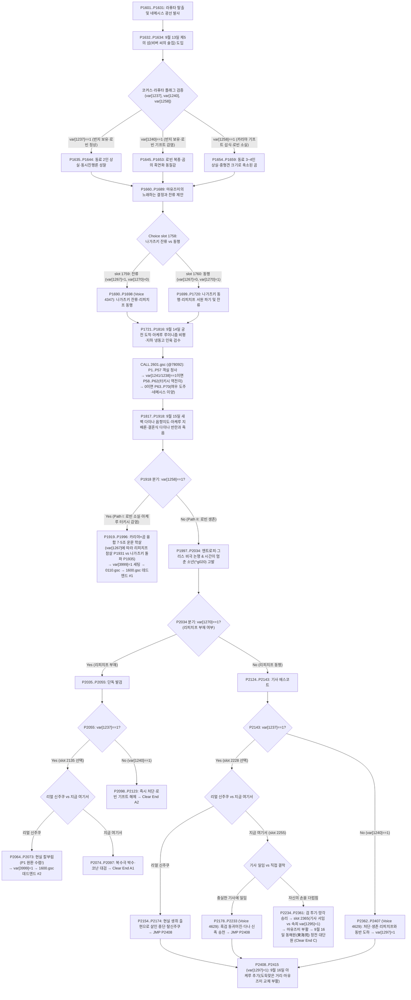

# 『Forest』 비판정본 제6권 C편 (Vol. 06C)
## 제6장 「傘びらき丸航海記」 완결부 (`2600.gsc` `P1601..P2415`) 및 서브 시퀀스 (`2601.gsc` `P1..P70`)

---

## 0. 서론: 제1문단 파국으로의 원환 수렴, 9갈래 종결 위상학, 그리고 세계 끝 바다(*Utter East*)의 전복

제6권 A편(`2600.gsc` `P1..P800`)이 **`[P1-S1] ９月１５日刈谷が、人を殺した。 / [P1-S2] 俺たちはおしまいだ。`**라는 선취적 파국 선언(Prolepsis)에서 출발하여 수몰된 신주쿠 해역의 출항과 제1·2의 섬을 해부했고, 제6권 B편(`2600.gsc` `P801..P1600`)이 제3의 섬(코커스 레이스와 반지·`ターキッシュ・ディライト` 배분) 및 제4의 섬(천공섬 라퓨타의 붕괴와 마유즈미 결정체를 통한 탈출)을 추적했다면, 본 권역인 **제6권 C편(Vol. 06C)**은 마침내 항해의 궤적이 서두의 ‘9월 15일 살인 사건’과 정면 충돌하고 그 너머 ‘9월 16일 동쪽 바다의 끝’으로 찢어져 나가는 **제6장 클라이맥스 및 종결부 전체(`2600.gsc` `P1601..P2415`, 총 815문단·1,678문장)**와, 트라토레아 궁전 결전 전야에 바이트코드 서브루틴(`0x0f -> 2601` `@78092`)으로 호출되는 **객실 기프트 이양 시퀀스(`2601.gsc` `P1..P70`, 총 70문단·79문장)**를 단 하나의 문단 누락도 없이 전수 해부한다.

문헌학·매체기호학 관점에서 본 권역은 『Forest』 전편을 통틀어 가장 정교한 **절차적 상태기계(Procedural State-Machine)**와 **상호텍스트적 전복**이 교차하는 지점이다.

첫째, C. S. 루이스의 『새벽 출정호의 항해(*The Voyage of the Dawn Treader*, 1952)』—특히 세타 테이지(瀬田貞二)의 이와나미 소년문고 정전 역본 『朝びらき丸東の海へ』—가 제시한 기독교적·플라톤적 피안인 **‘세계 끝 동쪽 바다(*The Utter East* / 작중 `東の海の果て`)’**는, 본 권역에서 두 겹의 기호학적 전복을 겪는다. 아서왕과 다나 신족(`ダーナ神族`)의 재생선이 덮쳐 오는 파도 꼭대기에서 빛의 다리를 내리는 켈트 신화적 승천(`P2210..P2233`, `P2386..P2407`)이 그 하나라면, 정전 루트(`P2345..P2361`)에서 원전의 은빛 바다·백합 호수(*the Silver Sea* / *Lily Lake*)와 하늘에 닿는 물벽이 신주쿠 동단 모래사장에 우뚝 솟은 싸구려 말장난 빌딩 **‘동해원(`東海苑`)’**과 **‘단 하나의 엘리베이터(`ひとつのエレベータ`)’**로 치환되는 도시 민속적 하강(Bathos)이 다른 하나다.

둘째, 원시 바이트코드(`2600.gsc`, `2601.gsc`, 마스터 라우터 `0110.gsc`, 컨티뉴 게이트 `1300~1600.gsc`, 후속장 `2700.gsc`)를 역공학적으로 전수 대조한 결과, 본 구간은 단순한 선형 서사가 아니라 **선행 코커스 레이스·라퓨타 플래그(`var[1237, 1238, 1240, 1241, 1258]`) × 비버 술집 동행 선택(`var[1267, 1270]`) × 궁전 결전 중 4종의 `言ノ葉` 선택지(`slot 2135, 2228, 2255, 2365`)**가 맞물려 **총 2개의 데드엔드(`var[3999]=1` → `1600.gsc` 강제 호출)와 7개의 클리어 종결 경로(그중 `var[1295]=1` 및 `var[1297]=1`이 제7장 `2700.gsc` 및 마스터 분기에 영구 기록됨)**를 산출하는 정밀 연산망임이 실증되었다.

### 표 1. Vol. 06C 수록 스크립트 계량문체 지표 및 집필자 지문 대조

| 파일명 | 분석 범위 | 문단 / 문장 / 글자 수 | 지문 비율 (`Narr`) | 평균 문장 길이 (`ASL`) | 한자 / 히라가나 / 카타카나 (%) | 대시 / 말줄임 / 느낌표 / 물음표 (‰) | 1인칭 대명사 빈도 | 주 집필자 지문 판별 |
| :--- | :--- | :---: | :---: | :---: | :---: | :---: | :--- | :--- |
| `2600.gsc` | `P1601..P2415` (완결부 슬라이스) | 815 / 1,678 / 29,430 *(전체 2,415 / 5,242 / 90,298)* | 0.319 *(전체 0.424)* | 17.54자 *(전체 17.23자)* | 20.90 / 58.92 / 7.21 | 5.54 / 6.32 / 6.83 / 6.83 | `私`(222), `ぼく`(23), `俺`(21), `あたし`(16), `わし`(4), `わらわ`(1) | **星空めてお**(총괄 아키텍처·메타 비평 에세이 3편·일지·종결부) × **茗荷屋甚六**(7·5조 살육 운문·기사도 결투·다나 신족 신화학) × **高尾登山**(냉동고 그로테스크·기프트 상태 전이 일부) `[확증(Confirmed)]` |
| `2601.gsc` | `P1..P70` (전 구간) | 70 / 79 / 1,902 | 0.600 | 24.08자 | 21.56 / 58.04 / 4.99 | 4.21 / **124.08** / 1.58 / 2.63 | `俺`(14), `私`(2), `あたし`(1) | **高尾登山** 또는 **茗荷屋甚六** 초고 + **星空めてお** 메타 대사(`P16..P31`)·기프트 분기(`P58..P70`) 감수 `[유력(Probable)]` |

> [!IMPORTANT]
> **문헌학·화자 코드 교정 필수 확인 (`2600.gsc` 슬롯 재할당 실증)**:
> 패킷 추출기의 전역 기본 매핑(`SPEAKER_MAP`)에서는 제5장(`2500.gsc`) 기준 명칭이 승계되어 `^g019`가 `アリエッティ`, `^g021`이 `ボンバルリーナ`로 표기되나, 제6장 `2600.gsc` 본문 실증 결과 **`^g019`는 검은 암컷 아기고양이 다이나(`ダイナ`, 1인칭 `ぼく`, 검은 앨리스를 `ママ`로 호칭, `P1728..P1910`)**로, **`^g021`은 체셔 고양이(`チェシャ猫`, `[P2207-S2] チェシャ猫だ。`, `P2208`, `P2384`)**로 슬롯이 재할당되어 작동한다 `[확증(Confirmed)]`. 또한 `P2025..P2028`에서 쓰러진 다이나의 육체를 빌려 발화하는 화자는 다이나(`^g019`)가 아니라 **`^g020`(`止まった時間の少年` — 시간이 멈춘 소년)**으로 코드가 교체되며, 크리스토퍼 로빈은 본 구간 전체에서 광기 코드(`^g038`) 대신 온화한 외양 코드(`^g034`)를 유지한 채 폭군적 매도 대사(`P2115`, `P2303`, `P2378`)를 내뱉음으로써 시각 기표와 화행 사이의 섬뜩한 괴리를 연출한다 `[확증(Confirmed)]`.

### 도표 1. `2600.gsc` (`P1601..P2415`) × `2601.gsc` (`P1..P70`) × `0110.gsc` 바이트코드 분기·종결 전체 위상도

---

## 제1부. 제6장 「傘びらき丸航海記」 완결부 (`2600.gsc` `P1601..P2415`) 심층 주석

### 1.1. `2600.gsc` (`P1601..P1631`): 붕괴하는 라퓨타로부터의 추락 활극과 기프트 `ネメシス`의 최초 발사

- **[식별자 & 엔진 연출 코드]**: `2600.gsc` | 범위: `P1601..P1631` (총 31문단, 69문장; 바이트코드 오프셋 `69228..70520`) | 화자 분포: `^g006`(카리야 마키, 16문단 — 1인칭 시점 서술 겸 대사), `^g001`(기노사키 아케루, 4문단), `^g004`(아마모리 노조미, 3문단), `^g033`(리피치프, 2문단), `^g034`(크리스토퍼 로빈[온화], 2문단), `^g041`(이요르/노당나귀, 2문단), `^g007`(나가츠키 아마네, 1문단) | 연출 코드: `P1619` 직후(`@69960`, `@70044`) 광선 발사 섬광·효과음 이펙트 호출, `P1631` 직후 백색·흑색 와이프(`WIPE 501/510`)로 제4의 섬 공중전 종료.
- **[층위 1: 미시 문체·수사·통사·집필자 지문]**:
  - 제6권 B편 말미(`P1596..P1600`)에서 마유즈미 카오루의 붉은 결정체를 발판 삼아 한밤중의 라퓨타 내부에서 한여름 청공(靑空)으로 솟구쳐 오른 직후의 속도감을 이어받아, 본 구간은 극도로 짧은 스타카토 단문(`P1601`, `P1602`, `P1606`, `P1608`, `P1617`, `P1618`, `P1622`, `P1628`)과 대시 절단(`P1603-S3: 抜き身を構えたまま結晶へ着地し──`, `P1615-S2: そこで──`, `P1620-S1: 叫んだ──その瞬間`)으로 수직 낙하의 물리적 가속도를 조형한다.
  - 특히 `^g006` 카리야 마키의 발화 슬롯이 외적 대사(`P1602`, `P1608`)와 내적 목격 지문(`P1603`, `P1605`, `P1607`, `P1613..P1616`, `P1620..P1625`, `P1629`)을 구분 없이 통합하는 **초점화 화자 일체형 기법**이 두드러진다. 예컨대 `[P1623-S1] 下半分が残った。 / [P1623-S2] 上半分は跡形もなく消えた。 / [P1623-S3] あの、ゾゾが。`에서 보듯, 병렬 대조 단문 뒤에 지시사+주격 명사구를 뒤로 돌린 주어 후치 도치(`あの、ゾゾが。`)로 경악을 응축하는 통사는 묘가야 진로쿠(`茗荷屋甚六`)의 활극 콘티 위에 호시조라 메테오(`星空めてお`)의 건조한 하드보일드 커팅이 결합된 전형적 지문이다 `[확증(Confirmed)]`.
  - 긴박한 추락전 한복판에 끼어드는 나가츠키 아마네(`^g007`)의 `[P1610-S2] 灰流って、すっごいギフト持ってんの？ / [P1610-S3] あたしにちょーだい？`와 아케루(`^g001`)의 츠코미 `[P1611-S1] なに言ってっかな、おまえは！ / [P1611-S2] こんなときによォ！`, 그리고 플린트 씨의 우산 속에 태평하게 앉아 내려오며 해적 구호 `[P1628-S1] ヨーホー！`를 외치는 노당나귀 이요르(`^g041`)의 유머는 비극적 긴장을 이화시키는 희극적 대위법으로 기능한다.
- **[층위 2: 3중 상호텍스트 및 철학·도시 코드]**:
  - **이시이 모모코(石井桃子) 역 『곰돌이 푸』(岩波少年文庫)의 물리 법칙 변주** `[확증(Confirmed)]`: `P1612..P1616`에서 로빈이 카리야의 품을 빠져나와 수직 낙하하자, 검은 곰(`「クマ」氏`)이 나선형 회오리(`竜巻のような形`)로 변형해 낙하 속도를 추월한 뒤 거대한 쿠션 공(`大きなボールのような形`)이 되어 로빈을 감싸 안는다. 이는 밀른 원전 제1장(풍선을 타고 올라간 푸를 지상에서 로빈이 총으로 풍선을 맞혀 천천히 내려오게 돕던 구도 — 원전에 떨어지는 것을 받아내는 장면은 없다)의 보호-피보호 위계를 역전시킨 것으로 읽히는(`[구조적 공명(Structural Echo)]`) 동시에, 곰의 육체가 고정된 봉제인형 물질이 아니라 ‘로빈을 보호하려는 강박적 의지’에 따라 유체역학적으로 변형되는 심상 물질임을 보여준다.
  - **그리스 응보 여신 `ネメシス`(Nemesis)와 아케루형 기프트의 기하학** `[확증(Confirmed)]`: `P1619..P1624`에서 아케루가 발동한 기프트 `ネメシス`는 어떠한 장식이나 신화적 형상도 없이 **`レーザービームのような一直線のシンプルな軌跡`**(`P1621-S1`)을 그리며 불사신의 괴물 조조(`ゾゾ` = 이시이 모모코 역 *Heffalump*)의 상반신을 흔적도 없이 소멸시킨다. 이는 후술할 `P1944..P1950`(카리야의 레이피어/채찍) 및 `P2089`(아마모리의 야만인 코난 대검)와의 결정적 비교 기준점을 세운다. 즉 ‘인과응보·천벌’을 뜻하는 동일한 기표(`ネメシス`)가, 서사적 수사학을 경멸하는 허무주의자 아케루의 몸을 통과할 때는 가장 비인격적이고 즉물적인 직선 에너지로만 발현되는 것이다.
  - **스위프트 『걸리버 여행기』 제3부 라퓨타 × 스티븐슨 『보물섬』 구호의 패스티시** `[확증(Confirmed)]`: `P1628..P1630`에서 이요르(`^g041`)는 플린트 선장의 유산인 우산을 낙하산 삼아 내려오며 스티븐슨 『보물섬』의 해적 합창구(`ヨーホー！`)를 외치고, ‘지구좌(`地球座`)의 현자’ 올빼미(`梟`)가 괴짜 학자들의 천공섬 라퓨타에 자발적으로 잔류했음을 알린다. 현학적이고 궤변적인 지성(밀른 원전의 *Owl*, 이시이 모모코 역 `フクロ`[자필 서명 *WOL*은 `クフロ`])이 사변적 공중누각 라퓨타를 영구 거처로 택했다는 설정은 두 정전의 문학적 성격을 절묘하게 봉합한다.
- **[층위 3 & 4: 서사적 월경·매체 기호학 및 반례 검증]**:
  - **기프트 양도 가능성에 대한 복선**: `P1610`에서 나가츠키가 농담처럼 던진 `"あたしにちょーだい？"`는 단순한 개그 대사가 아니라, 곧이어 트라토레아 궁전에서 카리야(`P1765`, `2601.gsc`)와 아마모리(`P2085`)에 의해 실제로 연쇄 집행될 **기프트의 인격 간 이전(Transferability)** 규칙을 독자에게 선제 고지하는 절차적 복선이다.
  - **아기돼지(`子豚`) 실종의 서사적 잠복**: `P1630..P1631`에서 지난밤부터 아기돼지의 행방이 묘연하다는 대화는, 직후 일지(`P1636`)의 현실 신주쿠 나카무라야 쇼윈도 소녀 실종 사건과 트라토레아 궁전 주방의 식재료 위기(`P2291`)를 잇는 핵심 미스터리 고리를 형성한다.

---

### 1.2. `2600.gsc` (`P1632..P1659`): 9월 13일 카리야 항해일지(전반) — 비버 씨의 술집과 3갈래 상태기계 분기

- **[식별자 & 엔진 연출 코드]**: `2600.gsc` | 범위: `P1632..P1659` (총 28문단, 70문장; 오프셋 `70528..71764`) | 화자 코드: 전 구간 `^g999` (표제 `[P1632-S1] ９月１３日　記録者・刈谷真季`로 명시된 카리야 마키의 1인칭 수기 지문) | **바이트코드 3갈래 상태기계 분기(`@70768..70844`)**:
  - 공통 도입부 **`P1632..P1634`** 직후 엔진은 제3의 섬 코커스 레이스 및 제4의 섬 라퓨타에서 기록된 전역 변수를 검사한다:
    1. **`var[1237] == 1`**(카리야가 노란 반지를 보유하고 로빈이 `ターキッシュ・ディライト`를 먹지 않은 정상 상태) → **`P1635..P1644`** 실행 후 `@71208`에서 `P1660`으로 점프.
    2. **`var[1237] == 0` 및 `var[1240] == 1`**(카리야가 반지를 보유하되 로빈이 `ターキッシュ・ディライト`를 삼켜 아마모리에게 종속된 상태) → **`P1645..P1653`** 실행 후 `@71542`에서 `P1660`으로 점프.
    3. **`var[1237] == 0` 및 `var[1240] == 0`**(곧 `var[1258] == 1`: 카리야 자신이 `ターキッシュ・ディライト`를 삼켰고 라퓨타에서 로빈이 흔적도 없이 소멸한 상태) → **`P1654..P1659`** 실행 후 `P1660`으로 진입.
- **[층위 1: 미시 문체·수사·통사·집필자 지문]**:
  - 수기 체재로 복귀한 문체는 추락 활극의 파열음을 가라앉히고 한자어 밀도가 높은 반성적 에세이 호흡(`永遠不変`, `同時進行`, `確定した結果`)으로 전환된다(호시조라 메테오의 일기·메타 추론 문체 `[추정]`).
  - 주목할 문헌학적 특징은 **변주 단락 간의 정밀한 대조 편집(Variorum Diff)**이다. 제1분기(`P1635..P1638`)와 제2분기(`P1645..P1648`)는 첫 네 문단의 통사 골격을 거의 동일하게 반복하다가 `P1638-S2`(`「クマ」氏さえいれば満足のようだ。`)와 `P1648-S2`(`むしろ心配なのは「クマ」氏のほうだ。`) 단 한 문장에서 갈라져 나와 전혀 다른 심리 진단으로 확장된다. 반면 파국 루트인 제3분기(`P1654..P1659`)는 상실 인원수 자체를 `[P1654-S1] 私たちは、３人もの仲間を失った。 / [P1654-S2] いや、ひょっとすると４人かも知れない。`로 고쳐 쓰며, 자기 성찰 역시 대시 전환(`──などと、私が書くのもおこがましいな。`, `P1658-S1`)을 통해 훨씬 처절한 자기모멸과 상실 공포(`P1659`)로 침잠한다.
- **[층위 2: 3중 상호텍스트 및 철학·도시 코드]**:
  - **C. S. 루이스 『사자와 마녀와 옷장』(세타 테이지 역 『ライオンと魔女』)의 시간차 역전과 비버 부인의 죽음** `[확증(Confirmed)]`:
    - `P1632`에서 라퓨타 내부의 이틀이 외부의 약 일주일에 해당했다는 우라시마 효과는, 나니아에서 수십 년을 살아도 현실 영국에서는 단 1초도 흐르지 않는 루이스 원전의 시간 법칙을 정반대로 뒤집은 것이다.
    - 나아가 `P1633..P1634`에서 감탄사 `[P1633-S2] おお、懐かしきナルニア！` 직후 찬물을 끼얹듯 제시되는 **`[P1634-S2] ビーバーさんは奥様を亡くされたそうだ。 / [P1634-S3] 物語の中にさえ永遠不変は存在しない。`**는 가든 세계의 핵심 존재론을 폭로한다. 원전에서 재봉틀을 돌리며 아이들에게 따뜻한 식사를 차려주던 가정적 안식처 비버네 오두막이 ‘홀아비 비버 씨의 술집(바)’으로 변질되어 있다는 사실은, 불멸의 고전 텍스트조차 시간의 마모와 엔트로피(상실·노화)로부터 면제되지 못함을 웅변한다.
  - **신주쿠 나카무라야(`中村屋`) 쇼윈도 인형/소녀와 아기돼지의 현실 앵커** `[확증(Confirmed)]`: `P1636..P1637`(`P1646..P1647` 반복)에서 신주쿠 동구(東口)의 실재 역사적 랜드마크인 ‘신주쿠 나카무라야’ 매장 앞 쇼윈도를 무대로 제시되는 ‘사라진 소녀’ 모티브는, 앞서 나뭇잎 신화(`3101~3103.gsc`)의 ‘쇼윈도/공방의 인형 소녀’ 이미지 및 아기돼지(`子豚`)의 현실 층위 행방과 불길한 연상망을 구축한다.
- **[층위 3 & 4: 서사적 월경·매체 기호학 및 반례 검증]**:
  - **층위 0(`リアル`) ↔ 층위 2(`リドル`) 인과율에 관한 양자역학적 가설(`P1641..P1643`)**: 제1분기에서만 노출되는 `P1641..P1643`은 작품 전체의 형이상학적 해석 열쇠를 쥐고 있다. 카리야는 자신들이 현실에서 미성년자(로빈의 모델 소년) 약취·유인범으로 수배 중일지도 모른다고 추론한 뒤, 리들과 리얼의 상호작용 방식을 두 가지 철학적 명제로 정식화한다:
    1. **`「同時進行」`**(`P1643-S1`): 꿈(리들)에서의 행위가 실시간으로 현실 신주쿠의 물리적 사건과 병행 발생한다는 공시적 대응 모델(후술할 정전 루트 `P2296-S4`에서 카리야가 최종 채택하는 윤리적 입장).
    2. **`「確定した結果が、さかのぼって適用される」`**(`P1643-S2`): 리들 내부의 다세계 중첩 상태가 하나의 결말로 관측·확정되는 순간 과거로부터의 현실 역사가 소급 재구성된다는 사후적 역사 확정 모델(양자 지연 선택 및 역사 수정주의 모델).
  - **제2·3분기의 ‘곰’ 상태 변화를 통한 심리적 거울상(`P1651..P1657`)**: 로빈이 마녀의 과자에 홀려 마음을 빼앗긴 제2분기에서 곰은 위험한 검은 연기로 폭주하고(`P1651..P1652`), 아예 로빈이 증발해 버린 제3분기에서 곰은 중형견 크기로 쪼그라들어 웅크린 채 미동도 하지 않는다(`P1656`). 카리야가 `[P1653-S2] 私たちは似ている。`라고 전율하는 까닭은, 곰에게 로빈이 존재 이유의 전부이듯 카리야에게도 착취자 ‘그(오너)’가 자기 정체성의 유일한 앵커이기 때문이다. 이 동형성이 바로 제3분기의 비극적 결말(`P1927..P1928`, 카리야와 곰의 물리적·영적 합체)을 예비한다.

---

### 1.3. `2600.gsc` (`P1660..P1720`): 9월 13일 카리야 항해일지(후반) — 마유즈미의 노래하는 결정, `slot 1758` 분기, 그리고 리피치프의 기사 서원 파기

- **[식별자 & 엔진 연출 코드]**: `2600.gsc` | 범위: `P1660..P1720` (총 61문단, 166문장; 오프셋 `71764..74456`) | 화자 코드: 전 구간 `^g999` (카리야 수기 체재; 단 `P1696`에 나가츠키 아마네 육성 `[Voice:4347]` 오버레이 삽입, `P1706..P1713`에 리피치프의 고백 대사 인용) | **하이퍼텍스트 선택지 및 플래그 연산**:
  - `P1689` 직후 **`slot 1758` (`言ノ葉に触れてください──`)**:
    - **`slot 1759` (`「九月さんは「残る」と答えた」`)**: `var[1267] = 1` 세팅(`@72850`), `var[1270] = 0` 유지 → `P1690` 진입 후 `var[1258]==1`이면 `P1691..P1693` 경유, `var[1258]==0`이면 `P1694..P1698`(`Voice:4347`, 영문 레퍼런스 자막 `"Bye."`) 경유하여 `P1721`로 점프. *(나가츠키가 술집에 남고, 리피치프는 카리야와 함께 궁전으로 출항함.)*
    - **`slot 1760` (`「九月さんは「行く」と答えた」`)**: `var[1270] = 1` 세팅(`@73482`), `var[1267] = 0` 유지 → `P1699..P1717` 실행 후 `var[1258]==1`이면 `P1718..P1719`, `var[1258]==0`이면 `P1720`을 거쳐 `P1721`로 진입. *(나가츠키가 궁전행에 동승하는 대신, 리피치프가 마유즈미 수호를 자원해 술집에 잔류함.)*
- **[층위 1: 미시 문체·수사·통사·집필자 지문]**:
  - **전반부(`P1660..P1689`)**는 마유즈미 카오루의 결정체를 둘러싼 카리야와 나가츠키의 해석학적 대립을 간접화법(`～と、九月さんは言うのだ。`, `P1675`)과 반어적 자문(`思い込みだろうか？ / 身勝手な、卑怯な？`, `P1673-S3..S4`)으로 교직한다. 특히 `[P1667-S2] なぜなら黛さんは「歌っている」からだと。 / [P1667-S3] 夢見るだけではなく、創っている──と。`의 대립쌍(‘수동적 몽상’ 대 ‘능동적 창조’)은 호시조라 메테오의 예술론 핵심 명제다.
  - **후반부 제2선택지 구간(`P1701..P1716`)**에서는 수기 내부에 인용된 리피치프의 고별사(`P1706..P1713`)가 전각 공백(全角空白)으로 행갈이 호흡을 표시한 **중세 기사도 로망스 문어체**(`もとより初めから わがものではなかった`, `なれど、やむなき運命と心得ます`, `お察しくだされ！`)로 펼쳐진다. 이는 묘가야 진로쿠(`茗荷屋甚六`)가 담당해 온 리피치프 특유의 시대극 수사학이며, 직후 `P1714`에서 카리야가 ‘그의 말을 일자일구 정확히 기록했는지는 자신 없다’며 **불신할 수 있는 기록자(Unreliable Archivist)**로서의 메타 주석을 덧붙임으로써 문체적 이질감 자체를 서사 내적 개연성으로 흡수한다 `[확증(Confirmed)]`.
- **[층위 2: 3중 상호텍스트 및 철학·도시 코드]**:
  - **단테 『신곡』·중세 궁정연애(Fin'amor) 문법과 세타 테이지 역 『새벽 출정호』 리피치프의 결합** `[확증(Confirmed)]`: 루이스 원전의 생쥐 기사 리피치프는 오직 명예와 동쪽 끝 아슬란의 나라만을 열망하는 금욕적 순례자다. 그러나 『Forest』의 리피치프는 카리야 마키를 궁정연애의 ‘귀부인(`わが姫`)’으로 섬기다가, 그녀의 마음이 현실의 타락한 남자(‘그’)에게 결박되어 있음을 깨닫고 실연의 슬픔 속에 물러선다(`P1706..P1709`). 더구나 기사에게 목숨보다 무거운 서원(귀부인 호위)을 스스로 깨뜨려 ‘배신자의 오명(`背信者の汚名`, `P1716-S2`)’을 뒤집어쓰면서까지 카리야의 심리적 부담을 덜어주고 마유즈미의 파수꾼을 자처하는 행위는, 원전의 아동문학 캐릭터가 성인 비극의 도덕적 주체로 심화되는 탁월한 재창조다.
  - **선량함이라는 이름의 필연적 함정(`P1679..P1685`)**: 나니아 원전에서 아슬란에 대한 독실한 신앙과 환대의 화신인 비버 씨가 일러준 ‘동쪽 길 → 검은 앨리스의 결혼식장(제6의 섬, 9월 15일) → 동쪽 끝’ 정보에 대해, 카리야는 ‘설령 결과적으로 함정으로 통하더라도 나니아 출전 캐릭터인 비버 씨의 선의만은 믿어도 좋다’(`P1681..P1682`)고 판단한다. 즉 리들의 악의는 거짓말쟁이를 통해서가 아니라 **정전 캐릭터의 변경 불가능한 선량함(성격 규정)을 길잡이로 역이용하여** 희생자들을 도살장으로 유도하는 구조적 악의다.
- **[층위 3 & 4: 서사적 월경·매체 기호학 및 반례 검증]**:
  - **일지 텍스트 위로 침입하는 육성 보이스 오버레이(`[Voice:4347]`)**: `P1696`의 화면 문자열은 지문 화자(`^g999`)가 과거 시제로 적은 인용구 `[P1696-S1] 「じゃあね」と。`에 불과하다. 그러나 바이트코드 `@73306`에 심어진 `0x42` 오프코드는 이 순간 성우 미루(`みる`, 나가츠키 역)의 실제 육성(`「じゃあね」` / 영문 패치 자막 `"Bye."`)을 재생한다. 고독한 기록자의 묵독(黙讀) 공간이었던 항해일지 표면을 뚫고 타자의 생생한 음성이 현재형으로 돌출하는 청각적 메탈렙시스다.
  - **역설적 인과 분기 검증**: 표면적으로는 동료 인간인 나가츠키를 데려가는 선택(`slot 1760`)이 전력상 유리해 보이지만, 바이트코드상 이 선택은 `var[1270] = 1`을 켜서 **리피치프를 비버 술집에 떼어놓음으로써 정전 대단원(`P2234..P2361`) 진입을 원천 차단**한다. 반대로 나가츠키를 마유즈미 곁에 남겨 두는 선택(`slot 1759`, `var[1270] = 0`)만이 ① 비버 술집에서의 마유즈미 부활 의식(`P2320..P2344`)과 ② 궁전에서의 리피치프 에스코트(`P2124..`)를 동시에 성립시킨다.

---

### 1.4. `2600.gsc` (`P1721..P1755`): 9월 14일 최후의 일지, 트라토레아 궁전의 부감 시점, 그리고 아케루의 ‘루이니즘·독자 수용 미학’ 메타 비평

- **[식별자 & 엔진 연출 코드]**: `2600.gsc` | 범위: `P1721..P1755` (총 35문단, 90문장; 오프셋 `74456..75960`) | 3단 시점 몽타주 구성:
  1. **`P1721..P1724`** (`^g999` 카리야 9월 14일 최후 수기, 단락 전후 `WIPE 501/510` 암전 전환)
  2. **`P1725..P1735`** (`^g002` 검은 앨리스 3문단, `^g019` 다이나 3문단, `^g999` 다이나 초점화 지문 5문단; 종료 후 `WIPE 501/510`)
  3. **`P1736..P1755`** (`^g001` 기노사키 아케루 단독 20문단 연속 내면 에세이 — 스탠딩/화자 슬롯이 `^g001`로 고정된 장광설)
- **[층위 1: 미시 문체·수사·통사·집필자 지문]**:
  - 불과 35문단 안에 세 명의 초점화자가 바통을 넘기며 문체 온도를 급격히 바꾼다. `P1721..P1724`의 카리야가 `[P1724-S1] 闘うしかない。 / [P1724-S2] 方法は、ある。`라는 비장한 단문으로 붓을 꺾자, `P1725..P1735`는 궁전 최상층 창가에서 바다를 내려다보는 수직 부감 구도와 다이나(`ぼく`)의 애잔한 유아적 내면 독백(`[P1731-S1] かわいそうなママ。`)으로 전환된다.
  - 이어지는 `P1736..P1755`는 **전 구간이 화자 코드 `^g001`로 출력되는 아케루의 메타-미학 비평문**이다. 비속어 섞인 도시 속어(`イタメシ屋`, `田舎者のイギリス人`, `お遊び`)와 고도의 문학이론·매체론 개념어(`ルーイニズム`, `アンチ・リアル`, `イメージの限界`, `公約数的なイメージ`, `特定のニッチ`)를 한 문장 안에서 충돌시키는 이 지성적 불량배 문체는 호시조라 메테오(`星空めてお`)의 가장 순도 높은 육성이다 `[확증(Confirmed)]`. 특히 `P1749`의 5연속 스타카토 분절문(`[P1749-S1] それは独りきりか。 / [P1749-S2] 複数か。 / [P1749-S3] 少数か。 / [P1749-S4] あるいは不特定多数か。 / [P1749-S5] 特定のニッチに含まれるのか。`)은 독자의 정체를 심문하는 수사적 클라이맥스를 이룬다.
- **[층위 2: 3중 상호텍스트 및 철학·도시 코드]**:
  - **18~19세기 영국 픽처레스크 인공 폐허 취미(폴리[Folly] 건축)와 작중 명명 ‘루이니즘(`ルーイニズム`)’ 비판** `[확증(Confirmed)]`: `P1736..P1742`에서 아케루는 카리야가 근무하는 신주쿠의 고급 이탈리안 레스토랑(`イタメシ屋`, 이탈리아어 *Trattoria*의 와전 표기인 `トラットレア`)이 가든 속에서 멸망 직전의 거대 폐허 궁전으로 변모한 광경을 두고, 18세기 영국 풍경식 정원·건축 사조에서 유행한 **인위적 폐허 취미(폴리[Folly] 건축 등 — 작중 대사에서는 이를 `ルーイニズム`이라 부르며, 실제 영미 미술·건축사에서 *Ruinism*이라는 정식 사조명이 확인되는 것은 아님)**를 직격한다. 대륙(로마·프랑스)의 역사적 퇴폐를 흉내 내기 위해 정원 한복판에 가짜 고딕 폐허를 세웠던 조지아·빅토리아조 영국인의 키치적 감수성이야말로, 현대 도시 신주쿠에서 ‘왕·귀족·기사·궁전’ 같은 골동품 기표들을 소환해 내는 가든의 미학적 정체라는 신랄한 문화사적 해부다.
  - **비트겐슈타인의 표상 한계론과 수용미학(볼프강 이저·움베르토 에코)의 결합** `[구조적 공명(Structural Echo)]`: `P1743..P1753`에서 아케루는 왜 꿈(리들)조차 완전한 자유 창조가 아니라 진부한 골동품 이미지에 갇히는가를 추적하며 **‘이미지의 한계(`イメージの限界`)’** 테제를 도출한다. 꿈의 형상을 제약하는 것은 창작자(`生み出す側`)의 상상력 빈곤만이 아니라, 그 이야기를 **읽고 수용하는 측(`読み取る側`)의 감각 수준과 최대공약수적 클리셰**라는 것이다(`P1745..P1750`). 그렇기 때문에 숲의 리들은 자체적인 상상력의 한계를 외견상 ‘레벨업(`レベルアップ`)’시키기 위해 기성 고전(`出典` / `元ネタ`)의 강렬한 캐릭터와 서사를 **‘인용(`引用`)’**할 수밖에 없다(`P1751..P1752`). 이는 『Forest』가 왜 영국 아동문학 정전들을 패스티시 형식으로 차용했는지에 대한 작품 스스로의 완벽한 메타-시학(Meta-Poetics) 선언이다.
- **[층위 3 & 4: 서사적 월경·매체 기호학 및 반례 검증]**:
  - **제4의 벽을 꿰뚫는 ‘특정 니치(`特定のニッチ`)’ 호명(`P1748..P1749`)**: 아케루가 ‘내가 숲의 이야기를 낳은 오리지널이라면, 대체 이 리들의 이야기를 읽는 자는 누구인가?’라고 물으며 열거하는 다섯 번째 후보 **`特定のニッチに含まれるのか`**(`P1749-S5`)는, 2004년 PC 성인용 비주얼 노벨(에로게/전위 노벨)이라는 **극소수 하위문화 니치(Niche) 시장의 플레이어 집단**을 정면으로 가리키는 아찔한 서사적 월경(Metalepsis)이다 `[확증(Confirmed)]`. 바로 이 문단 직후(`P1756..` → `2601.gsc`)에 장르적 관습인 성애 신(H-scene)이 배치되고, 거기서 카리야가 ‘무의미한 러브신에 페이지를 할애하는 숲’(`2601.gsc` `P17`)을 언급한다는 사실이 이 메타적 설계를 이중으로 입증한다.

---

### 1.5. `2600.gsc` (`P1756..P1821`): ‘얼어붙은 고기의 숲’ 지하 냉동고 입사 테스트, `2601.gsc` 서브루틴 호출, 그리고 ‘암여우’에서 ‘오니’로의 변신

- **[식별자 & 엔진 연출 코드]**: `2600.gsc` | 범위: `P1756..P1821` (총 66문단, 171문장; 오프셋 `75960..78402`) | 세부 구조 및 바이트코드 접속:
  - **`P1756..P1763`**: `^g001`(아케루, 7문단) → `^g006`(카리야, 1문단: `[P1763-S1] いやだというなら犯すだけよ？`) + `WIPE 501` 암전.
  - **`P1764..P1816`**: 전 53문단 `^g006` 카리야 마키 단독 회상 독백(스태프 대기실 재회 → 주방 나선계단 하강 → 지하 냉동고 인육 검수 테스트와 구토 실격 → `[P1816-S1] 闘おう、と。`).
  - **바이트코드 오프셋 `@78092` (`P1816` 직후, `P1817` 직전)**: **`0x0f -> 2601`** 오프코드 실행으로 `2600.gsc` 실행이 일시 정지되고 서브 스크립트 `2601.gsc`(`P1..P70`)가 호출됨! `2601.gsc` 종료 후 `WIPE 501/510`을 거쳐 정확히 `2600.gsc` `P1817`로 복귀.
  - **`P1817..P1821`**: 정사 직후의 사후 응수 (`^g006` 카리야 3문단, `^g001` 아케루 2문단) + `WIPE 501`.
- **[층위 1: 미시 문체·수사·통사·집필자 지문]**:
  - `P1760`과 `P1774..P1775`에서 구두점(쉼표·마침표)을 의도적으로 전면 삭제한 **무구두점 과호흡 연쇄문(Run-on Stream of Consciousness)**이 폭발한다. 특히 카리야가 ‘그’에게 손목을 잡혀 지하 계단을 내려가는 두 문단—
    - `[P1774-S1] 彼の熱い手は私の知っているとおりで繊細で巧みで時々乱暴になる指も滑らかな肌も薄い体毛も記憶のままで`
    - `[P1775-S1] あふれ出す記憶が私の肌を駆け巡り私の内側を熱く潤ませてこれは罠これは罠そんなこと判ってるのに`
    —은 이성적 경계심(`これは罠これは罠`)이 촉각적·성적 조건반사의 격류에 휩쓸려 통사적 분절 능력을 상실하는 과정을 문장 형태 자체로 체현한다.
  - 반면 철문이 열리고 냉기가 분출하는 `P1777`부터는 극단적인 **명사 종지 연타**(`[P1777-S1] 噴き出す冷気。 / [P1777-S2] 凍った血と凍った肉と凍った死のにおい。 / [P1777-S3] その奥は闇。`, `[P1799-S1..S4] 浮かび上がってくる、白っぽい塊。 / 天井の鈎で吊り下げられた肉。 / 林立する肉の塊。 / 凍った肉の森。`, `[P1804-S1] 乳房。`)와 강박적 주문 반복(`これは夢だ。 / これは夢だ。`, `P1781`, `P1789`)으로 급냉각된다. 열기 어린 무구두점 관능에서 영하의 해부학적 명사 종지로 추락하는 이 온도차는 타카오 토잔(`高尾登山`)의 고딕 호러 감각과 호시조라 메테오의 심리 해부가 최고조로 맞물린 대목이다 `[유력(Probable)]`.
- **[층위 2: 3중 상호텍스트 및 철학·도시 코드]**:
  - **샤를 페로 『푸른 수염(*La Barbe bleue*, 1697)』 모티브와 피터 그리너웨이 영화 『요리사, 도둑, 그의 아내 그리고 그녀의 정부』(1989)의 공간 미학** `[구조적 공명(Structural Echo)]`: 타인들은 모두 화려한 궁전의 ‘게스트(하객)’로 대접받는데 오직 카리야 혼자 ‘스태프(피고용인)’로 분류되어(`P1768`) 지하 나선계단 끝 철문 속 비밀 방으로 인도되고, 그 어둠 속에서 천장 갈고리에 매달린 **이전 여성 희생자들의 도륙된 나신(`乳房`으로 식별되는 미숙하게 손질된 여성 사체들, `P1801..P1811`)**과 마주하는 서사는 서구 잔혹 동화의 원형인 『푸른 수염』의 금지된 아래층 작은 방(*petit cabinet*)을 고급 레스토랑의 워크인 냉동고(`冷凍庫`)로 번안한 것이다. 더욱이 대본에 직접 거명되지는 않으나, 미식과 식인, 주방 권력과 성적 착취를 결합한 트라토레아 궁전의 공간 미학은 피터 그리너웨이의 『요리사, 도둑…』과도 강렬한 구조적 공명을 이룬다 `[구조적 공명(Structural Echo)]`.
  - **노동 소외와 정동 착취의 극한 풍자(`P1786..P1815`)**: ‘그’는 타사에서 온 점장·요리사 스카우트 제의를 자신이 전부 뒤에서 거절해 카리야의 탈출구를 봉쇄했음을 웃으며 고백하고(`P1788..P1790`; 시칠리아 억양 영어 스카우트 기억 `P1792`와 충돌), 여성 사체들의 육질을 손끝과 후각으로 감별하라는 ‘실력 테스트’를 강요한다(`P1805..P1810`). 놀라운 것은 카리야가 실제로 프로의 직업윤리에 따라 어둠 속에서 도축 시기와 내장 처리 상태를 성실히 감별하다가, 문득 **`[P1813-S2] 「私の番は、いつかな」と。`**라는 순응적 노예 사고를 하고 있는 자기 자신을 깨닫는 순간 비로소 구토(`吐瀉物で「肉」を汚したのだ`, `P1814-S2`)하며 ‘실격’한다는 점이다. 구토라는 생리적 거부반응이야말로 그녀를 서비스업의 완벽주의 기계에서 인간 투사로 되돌려 놓는 윤리적 각성점이다.
  - **제6장 표제 이미지의 반전 — ‘얼어붙은 고기의 숲(`凍った肉の森`, `P1799-S4`)’**: 동화적 녹음으로 치장된 가든의 ‘숲(`森`)’이 실은 타인의 인격과 육체를 소비재로 걸어 놓은 **‘냉동 정육의 숲’**이라는 은유적 폭로가 여기서 완성된다.
- **[층위 3 & 4: 서사적 월경·매체 기호학 및 반례 검증]**:
  - **`2600.gsc` `P1816` ↔ `2601.gsc` ↔ `2600.gsc` `P1817`의 무봉제 인과 결합**: 본문만 평면적으로 읽으면 `P1816`(`闘おう、と。`)과 `P1817`(`たしかにお代はいただいたわ、灰流。 / ごちそうさま。`) 사이에 갑작스러운 시간 도약이 있는 것처럼 보이지만, 실제 엔진 실행에서는 `@78092`에서 서브 스크립트 `2601.gsc` 전 70문단이 삽입되어 카리야가 아케루로부터 `ネメシス`를 탈취하는 과정을 실시간으로 수행한다.
  - **기프트 교체 선언(`P1818..P1819`)**: 복귀 직후 아케루가 `[P1818-S1] ──この、牝狐。`라고 내뱉자 카리야가 **`[P1819-S1] それはもう昔の話。 / [P1819-S2] いまは──鬼よ？`**라고 받아치는 대사는, 그녀의 고유 기프트였던 ‘여우(`狐` = 매혹과 교태로 사냥감을 꾀는 약탈성)’가 방금 전의 정사를 기점으로 방기되고 응보의 복수귀(`鬼` = `ネメシス`)로 존재 양태가 전환되었음을 확증한다.

---

### 1.6. `2600.gsc` (`P1822..P1868`): 9월 15일 새벽 다이나의 음향 지도, 1880년 앨리스 리델의 결혼일, 그리고 아케루의 ‘지배 벡터와 걷기’ 철학 에세이

- **[식별자 & 엔진 연출 코드]**: `2600.gsc` | 범위: `P1822..P1868` (총 47문단, 121문장; 오프셋 `78402..80492`) | 화자 코드: 전 구간 `^g999` (단 초점화 주체가 2단으로 교체됨):
  1. **`P1822..P1834`** (13문단): 여명 직전 지붕 위를 산책하는 아기고양이 다이나 초점화 서술(`ぼく`, `P1832`; 종료 시 `WIPE 501/510` 전환).
  2. **`P1835..P1868`** (34문단): `──９月１５日` 날짜 선언(`P1835`)과 함께 트라토레아 궁전 대홀에 입장한 기노사키 아케루 초점화 3인칭 자유간접화법(`城之崎灰流は～思う`와 1인칭 `俺`이 한 문단 안에서 융합!). `P1836`, `P1861` 뒤에 가든 내부 암전 전환 코드(`WIPE 503`, 패턴 003) 삽입.
- **[층위 1: 미시 문체·수사·통사·집필자 지문]**:
  - **`P1822..P1834`(다이나 파트)**는 히라가나 비중이 높고 청각·공감각 심상이 지배하는 투명한 동화 산문이다. 특히 `[P1830-S1] その歌は、ダイナの頭の中の音を用いた地図の立体像に、新たな道を書き加えていくようだった。`와 `[P1831-S2] ダイナの瞳は真夜中の瞳のままにまんまるく見開かれて、その光景を見る。`는 고양이의 생리학(어둠 속에서 동공이 완전히 열린 야간 시야와 들려오는 소리의 방향을 짚어 내는 입체적 청각 — 작중 `P1824`의 표현을 빌리면 ‘소리로 그린 지도’)을 세계 인식의 확장이란 철학적 경이로 승화시킨다.
  - **`P1837..P1868`(아케루 파트)**에서는 3인칭 주어(`城之崎灰流`)와 1인칭 대명사(`俺`)가 의도적으로 뒤섞이는 자유간접화법이 절정에 달하며, `P1854..P1856`에 이르러 마침표와 쉼표가 모조리 증발한 **`8·7`·`7·7` 박자 등이 불규칙하게 맞물리는 운문풍 무구두점 자조 타령**(`P1854`의 `8·7 / 8·7 / 7·7`박 연쇄 및 `P1856` 첫머리의 `7·5`박 등)이 터져 나온다:
    - `[P1854-S1] 城之崎灰流が世界に在れば城之崎灰流に世界は染まるいやおうなしの呪いの宿命`
    - `[P1855-S1] ならとっとと死ねばいいのにと灰流はいつも笑っちまうのだがやっぱりけっこう死ぬには引く`
    무거운 실존적 원죄 의식을 경박한 속어(`とっとと`, `笑っちまう`, `ジジイになるしか？`)로 비틀어 중화시키는 이 리듬은 호시조라 메테오 문체의 독보적 서명이다 `[추정]`.
- **[층위 2: 3중 상호텍스트 및 철학·도시 코드]**:
  - **역사적 실증 날짜 — 1880년 9월 15일 앨리스 리델의 웨스트민스터 사원 결혼식** `[확증(Confirmed)]`:
    `[P1835-S1] ──９月１５日１８８０年のこの日、アリス・リデルは結婚した。 / [P1835-S2] もちろん、おとなの女として。`
    제6장 첫 문단(`P1`)부터 불길하게 예고되어 온 ‘9월 15일’의 문헌학적 기원이 여기서 명시적으로 밝혀진다. 루이스 캐럴(찰스 루트위지 도지슨)의 뮤즈였던 실존 인물 **앨리스 플레전스 리델(Alice Pleasance Liddell, 1852~1934)**은 만 28세이던 **1880년 9월 15일**, 레지널드 하그리브스(Reginald Hargreaves)와 웨스트민스터 사원에서 결혼식을 올렸으며 도지슨은 이 식에 참석하지 않았다. 영원한 유년 소녀의 아이콘이 법적·육체적 ‘어른 여자’가 되어 동화의 시공간을 영구 이탈한 이 역사적 기일을, 가든의 ‘검은 앨리스’는 자신이 불사의 유년 저주에서 벗어나 어른이 되기 위한 주술적 의례일로 차용한 것이다.
  - **영향력의 불평등과 3대 지배 양식(`P1843..P1853`)**: 아케루는 생물학적 생명 활동의 평등성은 인정하면서도(`P1846`), 하나의 생명이 세계와 타자에게 미치는 ‘영향력’에는 절대적 불평등이 존재하며 모든 관계성은 결국 **‘지배로의 벡터(`支配へのベクトル`)’**를 띤다고 갈파한다(`P1847..P1850`). 특히 **`[P1851-S1] 「強さ」の支配はねじ伏せる。 / [P1851-S2] 「弱さ」の支配は絡みつく。 / [P1851-S3] なかんずく「美しさ」は万能の支配力だ。`**라는 3단 아포리즘은 작품 내 인물 관계를 일거에 요약한다(‘강함’=폭군 로빈/오너, ‘약함’=병상의 미야노 카코/축소된 곰, ‘아름다움’=페코리아/카리야/검은 앨리스).
  - **‘달리기(`走る`)’ 대 ‘걷기(`歩く`)’의 현상학(`P1857..P1859`)**:
    `[P1859-S1] 走っているときは自分が見える。 / [P1859-S2] ほかはなんにも見えなくなる。 / [P1859-S3] 歩いているときは、その逆だ。`
    『Forest』 전 9장을 관통하는 가장 중요한 신체 철학 명제 중 하나다. 목적지와 자기 집착을 향해 질주할 때(`走る` — 코커스 레이스의 카리야, 살인 현장으로 달려가는 `P2073`의 카리야) 주체는 오직 자신의 내면 강박만 볼 뿐 세계의 타자성을 상실한다. 반대로 산책자의 느린 보행(`歩く` — 제1장 프로로그와 제9장 에필로그에서 신주쿠 거리를 걷는 아케루, 지붕을 산책하는 다이나) 속에서만 주체는 ‘무색투명(`無色透明`, `P1861-S2`)’에 가까워지며 세계의 무수한 우연적 질감과 감각에 열린다(발터 벤야민의 플라뇌르[Flâneur] 및 미셸 드 세르토의 도시 보행론과의 깊은 철학적 공명 `[구조적 공명(Structural Echo)]`).
- **[층위 3 & 4: 서사적 월경·매체 기호학 및 반례 검증]**:
  - **마유즈미의 노래가 수행한 보이지 않는 인과 개입(`P1826..P1834`)**: 비버 씨의 술집에서 나가츠키가 믿었던 ‘마유즈미는 노래로써 세계를 창조하고 있다’(`P1667`)는 주장이 환상이 아니었음이 `P1828..P1830`에서 실증된다. 바람을 타고 전달된 마유즈미 결정체의 선율이 다이나의 머릿속 음향 지도에 ‘숲 바깥의 드넓은 세계로 나아가는 새로운 길’을 그려 넣었고, 바로 이 새벽의 인식론적 각성이 정오 결혼식에서 벌어질 **다이나의 반란(`P1882..P1902`)**을 촉발하는 직접적 원인이 된다.

---

### 1.7. `2600.gsc` (`P1869..P1917`): 폭풍의 결혼식 개막, ‘젤리클 캣츠’ 다이나의 소유격(`の`) 해체 반란, 그리고 작별의 키스

- **[식별자 & 엔진 연출 코드]**: `2600.gsc` | 범위: `P1869..P1917` (총 49문단, 128문장; 오프셋 `80492..82272`) | 화자 분포: `^g999`(지문·아케루 시점 및 조조의 무형 음성, 19문단), `^g002`(검은 앨리스, 13문단), `^g019`(다이나, 12문단), `^g004`(아마모리 노조미, 2문단), `^g051`(타치바나 도지사, 1문단), `^g017`(글로리아나, 1문단), `^g030`(메리 포핀스, 1문단) | 종료 시 `WIPE 501/510` 전환.
- **[층위 1: 미시 문체·수사·통사·집필자 지문]**:
  - 식장 도입부(`P1870..P1881`)는 적과 흑의 웨딩드레스를 입고 아이돌 콘서트 사회자처럼 호들갑을 떠는 검은 앨리스(`^g002`)의 과장된 아가씨 화법(`皆さんお待ちかね！`, `誓いのキッス！`)과 이를 초등학교 운동회 내빈 축사에 빗대며 홀로 야유하는 아케루(`^g999`)의 냉소가 교차한다.
  - 그러나 `P1882`의 단 6자—**`[P1882-S1] やだよ、ぼく。`**—가 떨어지는 순간 극장 전체의 공기가 얼어붙는다. 이어지는 다이나(`^g019`)와 검은 앨리스(`^g002`)의 스타카토 논쟁(`P1882..P1902`)은 일본어 조사 **`「の」`**에 홑낫표를 씌워 소유와 종속의 문법을 해부하는 비트겐슈타인적 언어 비평극이다:
    - `[P1888-S2] ねえママ、ぼくはママ「の」なんでしょ？`
    - `[P1889-S1] だってぼくはもうママ「の」だもん。`
    - `[P1890-S1] ママも、ぼく「の」ママになる？ / [P1890-S2] 結婚って、そういうことでしょ？`
  - 절정인 `P1901..P1911`에서 다이나의 죽음은 신파적 장광설 대신 말줄임표와 미완성 절단문(`[P1910-S2] なに言いたかったか、忘れちゃった。 / [P1910-S3] じゃあね、ママ。 / [P1910-S4] ほんとに──`)으로 마무리되며, 지문(`P1911`)이 그 뒤의 영원한 공백을 선언함으로써 비극적 여운을 극대화한다.
- **[층위 2: 3중 상호텍스트 및 철학·도시 코드]**:
  - **루이스 캐럴 『이상한 나라/거울 나라의 앨리스』의 집고양이 다이나(Dinah) × T. S. 엘리엇 『캣츠』의 ‘젤리클 캣츠(`ジェリクル・キャッツ`)’ 융합** `[확증(Confirmed)]`:
    캐럴 원전에서 유년기 앨리스가 현실에 두고 온 어미 애완 고양이이자 『거울 나라』 말미에서 험프티 덤프티 역이었을 것으로 짐작되던 집고양이 ‘다이나’가, 새벽의 노래를 들은 뒤 엘리엇의 시 「젤리클 고양이의 노래(*The Song of the Jellicles*)」를 선언하며 **`[P1892-S2] ぼくはジェリクル・キャッツだ。 / [P1892-S3] 自由な魂を持ったネコなんだ。`**라고 자기 정체성을 재정의한다. 애완묘(주인의 소유물인 `ママ「の」` 고양이)에서 자유 의지를 지닌 길고양이 부족(젤리클)으로의 상호텍스트적 망명(Defection)이다!
  - **일방적 소유로서의 ‘모성(`ママ`)’ 대 상호 구속으로서의 ‘결혼’ 해체**: 검은 앨리스는 ‘결혼식’이라는 성인 의례의 외피만 모방해 어른 행세를 하려 했으나, 다이나는 결혼이란 일방적 소유(`ぼくはママ「の」`)가 아니라 상호 소유(`ママも、ぼく「の」`)이자 미지의 바깥 세계로 함께 떠나는 허니문(`P1895..P1897`)이어야 한다고 정곡을 찌른다. 이때 검은 앨리스가 내뱉는 `[P1896-S2] 私たち、森を出るなんて──` / `[P1898-S1] そんなの、いやっ。 / [P1898-S2] そんなの、怖いっ。`는 불멸의 마녀로 군림하던 검은 앨리스의 실체가 실은 병실/숲 바깥의 현실을 두려워하는 겁먹은 소녀(미야노 카코의 그림자)임을 적나라하게 폭로한다.
  - **2004년 도쿄도청 권력자(`^g051` 타치바나 도지사) × 스펜서 『요정의 여왕』(`^g017` 글로리아나) × 트래버스 『메리 포핀스』(`^g030` 하야시 요키치 역본 어조)의 합창** `[확증(Confirmed)]`: 쓰러진 다이나 주위에서 타치바나 도지사가 냉혈한 권력자의 어투로 반역자의 말로를 비웃고(`P1905`), 여왕 글로리아나가 `わらわ`의 힘으로도 소생이 불가능함을 탄식하며(`P1906`), 엄격한 유모 메리 포핀스가 죽어가는 자의 유언을 경청하는 것이 바른 도리라고 일갈하는(`P1909`) 3중 코러스는 신주쿠 현실 정치와 영국 문학사가 한 무대에서 죽음을 입회하는 기괴한 장관을 연출한다.
- **[층위 3 & 4: 서사적 월경·매체 기호학 및 반례 검증]**:
  - **왜 다이나는 키스 직후 즉사했는가? — 기프트 `ママ`와 역할극 위반의 자기잠식**: 다이나는 숲의 각본(검은 앨리스의 순종적 신랑 인형 역할)을 정면 거부한 반역(`P1905`)을 저질렀을 뿐 아니라, 뮤지컬 『캣츠』(앤드루 로이드 웨버 작곡·트레버 넌 연출)의 그리자벨라가 천상층(Heaviside Layer)으로 승천해 환생하듯 스스로 죽음을 통해 숲의 정체된 시간 사슬을 끊기를 원했다(`[P1907-S2] ぼくは、望んでたんだ……。`). 그러나 역설적이게도 그녀의 죽음은 검은 앨리스와 아마모리 양자 모두에게 `[P1914-S4] 悲しいお話は大嫌い！`라는 히스테리적 부정(Denial)을 촉발하며 결혼식장을 지옥도로 급전직하시킨다.

---

### 1.8. `2600.gsc` (`P1918..P1996`): 클라이맥스 제I경로(`var[1258]==1`) — 카리야×곰 융합체의 7·5조 고전 운문 살육가, 무두(無頭) 지배인의 식인 카니발, 그리고 데드엔드 #1 (`1600.gsc`)

- **[식별자 & 엔진 연출 코드]**: `2600.gsc` | 범위: `P1918..P1996` (총 79문단, 198문장; 오프셋 `82272..85966`) | **바이트코드 분기 조건 및 하위 변주**:
  - `P1918`(은쟁반을 들고 주방에서 나온 카리야 공통 문단) 직후 `@82302`에서 **`var[1258]`**(코커스 레이스에서 카리야가 `ターキッシュ・ディライト`를 섭취하고 라퓨타에서 로빈이 소실된 플래그)을 검사한다. `var[1258] == 1`일 때 본 **제I경로(`P1919..P1996`)**로 진입하며(`0`이면 `P1997`로 점프), 내부에서 다시 `var[1267]`(나가츠키 비버 술집 잔류 여부)을 두 차례 검사한다:
    1. `P1930` 직후(`@82904`): `var[1267] == 1`(리피치프 궁전 동행)이면 **`P1931..P1934`**(리피치프가 막아서다 카리야의 손에 검게 뒤틀려 참살당함) 실행 후 `P1938`로 점프; `var[1267] == 0`(나가츠키 궁전 동행)이면 **`P1935..P1937`**(마유즈미의 노래를 입술에 담은 나가츠키가 막아서나 어둠에 밀려남) 실행 후 `P1938`로 합류.
    2. `P1986` 직후(`@85240`): `var[1267] == 1`이면 **`P1987..P1989`**(검게 말라비틀어진 리피치프의 미라가 아장아장 걸어 사라지는 카리야를 따라 소멸하고 어딘가에서 결정이 깨지는 소리가 남) 실행 후 `P1993`으로 점프; `var[1267] == 0`이면 **`P1990..P1992`**(현장에 있던 나가츠키가 마유즈미의 결정이 깨졌음을 감지하고 절규함) 실행 후 `P1993`으로 합류.
  - **종결 오프코드(`P1996` 직후 `@85734`)**: **`0018 0100 9f0f 0100` (`var[3999] = 1`)** 세팅 후 백색 암전(`WIPE 501/510`) 및 **`100000000000` (`EXIT`)** 실행 → 마스터 제어 스크립트 `0110.gsc`(`@320..362`)가 `var[3999] == 1`을 감지하여 **`1600.gsc` (`＃６話からコンティニューしますか？`)** 데드엔드 화면을 호출함 `[확증(Confirmed)]`!
- **[층위 1: 미시 문체·수사·통사·집필자 지문]**:
  - **7·5조 기조 고전 운문 살육가(`P1929..P1937`)의 운율학적 해부**: `P1927..P1928`에서 로빈을 잃은 검은 그림자 괴물(‘곰’ 씨)과 증오에 불타는 카리야가 정면 충돌해 물리적으로 융합(`混じり合うふたり`)하는 순간, 카리야(`^g006`)의 1인칭 산문은 돌연 근대 일본어를 버리고 **7·5조를 기조로 파격(字余り: `7·7`, `8·5`, `8·7`, `7·6`박)을 섞은 3행 연(聯) 고전 문어체 서사시(軍記物·謡曲 패스티시)**로 돌변한다! 실측된 18행(`7·5`박 7행, `7·7`박 4행, `8·5`박 3행, `8·7`박 2행, `7·6`박 2행)의 각 문단 음수율(모라 수)은 다음과 같다:
    - `P1929`: `ひとつの殺意は`(8) `思いを果たし`(7) / `ひとつの殺意は`(8) `高まるばかり`(7) / `いずれおとらぬ`(7) `欠けたる深さ`(7)
    - `P1930`: `殺意はあふれて`(8) `影を引く`(5) / `この世の果てまで`(8) `大闇路`(5: おおやみじ) / `畏れよ逃げよ`(7) `さなくば死`(5)
    - `P1931`: `見よ、わが前に`(7) `躍り出し`(5) / `あっぱれ鼠の`(8) `騎士ぞかし`(5) / `つるぎの先の`(7) `わななけり`(5)
    - `P1934`: `黒くよじれし`(7) `騎士の骸`(6: きしのむくろ) / `宴の庭に`(7) `転げて果てぬ`(7) / `そは宿命の`(7) `末路なりき`(6)
    - `P1935`: `立ちふさがりし`(7) `九月　周`(7: ながつきあまね) / `そのくちびるに`(7) `歌ひとつ`(5) / `赤き果実の`(7) `まばゆき精華`(7)
    - `P1936`: `なれど我が身は`(7) `深き闇`(5) / `どんな光も`(7) `吸い尽くし`(5) / `どんな明日も`(7) `咬み殺す`(5)
    고전 조동사(`けり`, `ぬ`, `なりき`)와 계조사+종조사 연어(`ぞかし`) 및 7·5조 기조 율격을 구사해 광기 어린 대살육을 중세 무훈시·노가쿠(能楽)의 장엄미로 감싸는 이 기교는 제4장(`2400.gsc`) 가극 운문을 집필한 **묘가야 진로쿠(`茗荷屋甚六`)의 결정적 문체 지문**이다 `[확증(Confirmed)]`.
  - 더욱 소름 끼치는 것은 `P1939..P1941`의 단절이다. 융합체가 `[P1939-S1] 聞け！ / [P1939-S2] わが名は──`라고 진명(真名)을 외치려는 찰나 `[P1940-S1] ──！`로 음성이 찢겨 나가고, `P1941`에서 시점이 아케루(`^g999`)로 급전환되며 ‘아케루에게는 카리야의 모습도 보이지 않고 목소리도 전혀 들리지 않았다’고 기술된다. 즉 방금 독자가 읽은 고전 운문 비장미의 신화적 영창은 오직 광기에 삼켜진 카리야 내부의 주관적 환각이었으며, 외부 관찰자의 눈에는 그저 꿈틀대는 검은 어둠 속에서 빛의 검(`ネメシス`)이 뻗어 나오는 무언의 괴현상으로만 지각되는 **내·외부 시점의 잔혹한 비대칭**이 작동한다.
- **[층위 2: 3중 상호텍스트 및 철학·도시 코드]**:
  - **『이상한 나라의 앨리스』 제8장 여왕의 크로케 경기장 × 중세 참수 기사 로망스(『가웨인 경과 녹색 기사』)·성 데니(Saint Denis) 전설의 그로테스크 패러디** `[확증(Confirmed)]`:
    - `P1950..P1954`에서 카리야의 빛의 검이 채찍으로 변해 홀을 횡으로 후려치자 지배인과 수많은 하객의 목이 굴러떨어져 바닥이 발 디딜 틈 없게 변하는 광경은 본문 자체가 직접 지시하듯(`不思議の国のクロケット会場のように`, `P1954-S1`) 캐럴 원전 하트 여왕의 상습 처형 구호(*"Off with his head!"*)의 문자 그대로의 실현이다.
    - 그러나 진정한 공포 희극은 `P1958..P1965`에 있다. 목이 잘린 지배인이 목 없는 몸으로 반듯하게 일어나, **은쟁반(`銀盆`) 뚜껑을 열어 자기 자신의 잘린 머리를 내보이며** ‘장례식 따위는 허례허식, 신선한 식재료를 매장하는 건 자원 낭비’라는 자본주의 실용주의 연설을 늘어놓는다! 하객들 역시 남의 머리를 잘못 주워 들고 싸움을 벌이며(`P1961..P1962`), 냉동고의 얼어붙은 여성 시체들이 통통 튀어나와 웨딩 메인 디시 육류 재료로 진열된다(`P1964..P1965`). 이는 세례 요한의 머리를 담은 살로메의 은쟁반 및 참수당한 뒤에도 말을 잇는 켈트·아서왕 문학(『가웨인 경과 녹색 기사』)의 모티브를 현대 외식·서비스업계의 상투적 비즈니스 경어(`お客さまのニーズにお応えするべく`)와 결합한 바흐친적 그로테스크 리얼리즘의 극치다.
  - **마녀 아마모리의 불가침 신체(`P1955..P1956`)**: 모든 하객과 지배인의 목을 두부처럼 베어 넘기던 `ネメシス`의 빛 채찍이 오직 **아마모리 노조미의 목**에만 단단한 금속에 부딪힌 듯 감기며 상처 하나 입히지 못하고 오히려 아마모리가 맨손으로 채찍을 잡아당겨 어둠을 휘청이게 만든다. 리들의 피조물들에게는 절대적 천벌인 `ネメシス`조차 숲의 공동 창조주(‘마녀’)의 형이상학적 위계 앞에서는 물리력이 무효화됨을 보여주는 결정적 단서다.
- **[층위 3 & 4: 서사적 월경·매체 기호학 및 반례 검증]**:
  - **`2601.gsc`(`P58..P62`)와의 완벽한 인과 고리 실증 — 아케루를 마비시킨 `ターキッシュ・ディライト`(`P1979..P1981`)**:
    기존 독해에서 흔히 간과되던 미스터리가 바로 `P1979..P1981`이다. 왜 검은 앨리스가 `"ねえ先生、私、おとなになりたい。"`(`P1978-S3`)라고 말을 걸었을 때, 평소 같으면 농담으로 받아넘겼을 아케루가 입이 얼어붙어 꼼짝도 못 하며 난데없이 **`[P1980-S2] ターキッシュ・ディライト。 / [P1980-S3] 魔女の言いなり、裏切りの菓子。`**를 떠올리는가? 바이트코드를 대조하면 해답은 명백하다. 본 제I경로(`var[1258]==1`)에 도달했다는 것은 코커스 레이스에서 카리야가 `ターキッシュ・ディライト`를 먹었다(`var[1238]==1` 또는 `var[1241]==1`)는 뜻이고, 따라서 전야의 정사 시퀀스(`2600.gsc` `@78092` → `2601.gsc` `P58..P62`)에서 **카리야의 몸속에 있던 `ターキッシュ・ディライト`가 아케루의 등줄기로 역감염되었기 때문**이다! 마녀 아마모리의 시선 앞에 아케루의 기지와 언어 능력이 마비(`無口になり無機知になって`)된 것은 바로 전날 밤 성교를 통해 이양받은 ‘마녀에게 복종하는 배신의 과자’ 기프트가 발동한 결과다 `[확증(Confirmed)]`.
  - **데드엔드 #1의 철학적 의미(`P1983..P1996`)**: 카리야와 리피치프는 무의미하게 증발하고, 마유즈미의 결정은 깨져 노래가 끊기며, 눈동자에 초록 도깨비불(`緑の鬼火`)을 켠 텅 빈 좀비 다이나와 잘린 머리들이 기괴한 합창을 시작하는 참극 한복판에서, 아마모리는 이 폐허를 외면한 채 `"みんなみんな幸せで。いつまでも楽しく暮らしました。そんなお話がいいの。"`(`P1985`)라며 아케루에게 영원히 끝나지 않는 이야기를 강요한다. 이에 굴복하여 기억을 지우는 대신 무한 회상 루프로 침잠하는 `P1996`(`──思い出してみようか。── / 忘れ去る代わりに。`)은 칸토어적 닫힌 무한(박제된 동화 감옥)에 갇히는 배드엔딩이며, 즉시 `var[3999]=1`을 통해 `1600.gsc` 컨티뉴 화면으로 추방된다.

---

### 1.9. `2600.gsc` (`P1997..P2055`): 클라이맥스 제II경로 공통 도입(`var[1258]==0`) — 엔트로피·그리스 비극 논쟁, ‘시간이 멈춘 소년(`^g020`)’의 빙의 고발, 그리고 단독 발검

- **[식별자 & 엔진 연출 코드]**: `2600.gsc` | 범위: `P1997..P2055` (총 59문단, 146문장; 오프셋 `85966..88380`) | 화자 분포: `^g999`(소마 목소리의 조조 & 지배인 발화, 18문단), `^g006`(카리야 마키, 18문단), `^g004`(아마모리 노조미, 10문단), `^g002`(검은 앨리스, 6문단), **`^g020`(`止まった時間の少年` — 시간이 멈춘 소년, 3문단: `P2025`, `P2027`, `P2028`)**, `^g034`(크리스토퍼 로빈[온화], 1문단) | **바이트코드 분기**:
  - `P1918`에서 `var[1258] == 0`(로빈이 라퓨타에서 생존했고 카리야가 `ターキッシュ・ディライト`에 오염되지 않은 정상/반지 보유 상태)일 때 `@85966`(`P1997`)으로 점프해 진입한다.
  - 공통 철학 논쟁(`P1997..P2034`) 직후 `@87356`에서 **`var[1270]`**(리피치프 비버 술집 잔류 여부)을 검사하여, `var[1270] == 1`(리피치프 부재·나가츠키 동행)이면 **`P2035..P2055`**로 직진하고, `var[1270] == 0`(리피치프 동행·나가츠키 잔류)이면 `@91936`(`P2124`)으로 점프한다.
- **[층위 1: 미시 문체·수사·통사·집필자 지문]**:
  - 제I경로(`P1927..P1928`)에서 카리야와 융합해 이성을 마비시켰던 ‘곰’ 씨가 본 제II경로 서두(`P1997`)에서는 카리야 앞을 거대한 검은 벽처럼 가로막아 서며 합체를 저지한다. 이로써 카리야는 광기의 7·5조 운문에 먹히지 않고 명징한 산문 이성을 유지한다.
  - `P1999..P2024`는 ‘소마(`ソーマ`, 헉슬리 『멋진 신세계』의 환각제 이름을 딴 라퓨타 안내자)의 우아한 목소리’를 빌린 괴물 조조와 궁전 지배인이 만담 콤비처럼 주고받으며 아마모리와 검은 앨리스를 논파하는 **소크라테스식 논박 문답과 1행 교대 응수(Stichomythia)가 결합된 고밀도 철학 문답극**이다. 특히 `P2007`의 3중 동의어 연쇄(`[P2007-S2] じゃ生まれ変わりだ。 / [P2007-S3] リーインカーネイション。 / [P2007-S4] 輪廻転生` — 순화문 → 영문 카타카나 → 불교 한자어)는 조조·지배인의 냉소적 현학성을 문체적으로 과시한다(호시조라 메테오의 전매특허 논증 문체 `[추정]`).
  - 이어 `P2025..P2028`에서 죽은 다이나의 입을 통해 흘러나오는 `^g020`의 대사는 어린 소년의 평이한 구어(`ぼく`)로 가장 잔혹한 존재론적 역설(`[P2027-S2] 生きてないんだ、ぼく。 / [P2027-S3] 死んでもいないけど`)을 툭 던짐으로써 검은 앨리스의 방어기제를 단숨에 붕괴시킨다.
- **[층위 2: 3중 상호텍스트 및 철학·도시 코드]**:
  - **열역학 제2법칙(`エントロピー増大の法則`)·윤회 부정·아리스토텔레스 『시학』의 비극론(`ギリシャ悲劇のロジック`)** `[확증(Confirmed)]`:
    `P2003..P2017`은 아마모리 노조미의 창작 미학(‘완벽한 이야기’에의 강박)이 품은 내적 모순을 해부한다. 지배인이 세계의 필연적 멸망 원리로 열역학 제2법칙(엔트로피 증대 법칙, `P2003-S3`)과 대안으로서의 윤회전생(`P2007`)을 제시하자, 아마모리는 엔트로피적 소멸도 싫고 윤회의 반복도 저주라고 거부하며 오직 **`完璧さ`**(`P2011-S1`)만을 요구한다. 그러나 지배인이 ‘슬픔 또한 세계의 중요한 일부’라고 찌르자, 아마모리는 놀라운 미학적 정의를 내놓는다:
    **`[P2014-S1] ほんとうの悲しみはね、悲しみが生まれることでしか完璧にならないような物語だけが持つの。`**
    지배인이 즉각 `[P2015-S2] ギリシャ悲劇のロジックですか！`라고 탄복하듯, 이는 우발적 불행이나 개연성 없는 죽음(아리스토텔레스 『시학』 제9~14장이 비판한 ‘삽화적 플롯’)을 배격하고, 오직 필연적 인과율(하마르티아와 페리페테이아)을 통해서만 카타르시스와 형식적 완결성에 도달하는 고전 비극 미학의 정식화다. 아마모리가 다이나의 죽음을 거부하는 진짜 이유는 죽음 그 자체가 두려워서가 아니라, 그 죽음이 **형식미학적으로 불완전하고 그로테스크하기 때문(`P2017-S3: 完全じゃない。`, `P2030-S2`)**이다.
  - **J. M. 배리 『피터 팬』·유년 박제 모티브로서의 `^g020` (`止まった時間の少年`)** `[확증(Confirmed)]`:
    `P2021`에서 지배인이 ‘죽지 않는 자가 있다면 그것은 이미 죽은 자다’라고 검은 앨리스의 정곡을 찌른 직후, 쓰러진 다이나가 눈을 뜨되 화자 코드가 `^g019`(다이나)에서 **`^g020`(`止まった時間の少年`)**으로 교체된다! 살아 있지도 죽어 있지도 않은 채 오직 ‘생명을 빼앗기고 시간이 멈췄을 뿐’이라며 `[P2028-S3] 誰のせいだと思う？`라고 묻는 이 소년 코드는, 제3장·제5장부터 암시되어 온 **성장 거부와 시간 정지의 희생자(피터 팬 원형이자, 병상에서 시간을 멈춘 미야노 카코/검은 앨리스에게 종속되어 박제된 존재들의 집합적 목소리)**다.
- **[층위 3 & 4: 서사적 월경·매체 기호학 및 반례 검증]**:
  - **지배인의 메타-무의미론 유혹(`P2049..P2055`)**: 리피치프가 없는 분기(`P2035..P2055`)에서 마유즈미 결정체의 선율에 등을 떠밀려 레이피어 형상의 `ネメシス`를 뽑아 든 카리야(`P2037..P2040`)에게, 지배인은 뜻밖에도 자신의 허구성을 스스로 자백한다. 자신은 그녀가 사랑한 현실의 오너가 아니라 ‘누가 꾸는 꿈인지도 불분명한 세계의 트라토레아 궁전 지배인’에 불과하니 여기서 자신을 죽여 봤자 복수로서 무슨 의미가 있느냐(`P2049..P2055`)는 것이다. 이는 허구 내부의 적대자가 **‘여기는 꿈(가상현실)이므로 내부의 승리는 무효다’**라는 메타-인식을 무기로 삼아 플레이어/인물을 현실 층위의 직접 폭력(살인 범죄)으로 유도하는 고단수 언어 함정이다.

---

### 1.10. `2600.gsc` (`P2056..P2123`): 리피치프 부재 시의 결착 — 제1문단(`P1`) 원환 수렴 데드엔드 #2 대 ‘야만인 코난’ 대검 계승 클리어 엔드(A1·A2)

- **[식별자 & 엔진 연출 코드]**: `2600.gsc` | 범위: `P2056..P2123` (총 68문단, 159문장; 오프셋 `88380..91978`) | **바이트코드 분기 및 종결 구조**:
  - `P2055` 직후(`@88336`) **`var[1237]`** 검사:
    1. **`var[1237] == 1`**(반지 보유·로빈 정상) → `P2056..P2063` 진행 후 **`slot 2135` (`言ノ葉に触れてください──`)** 선택지 호출:
       - **`slot 2136` (`「リアル新宿で」`)** → **`P2064..P2073`**: `P2064..P2065`에 `WIPE 503`(가든 전환) 및 `WIPE 501/510`(백색 각성 전환: 패턴 004 `ガーデン→リアル`) 연출 후, `P2073` 직후 `@89330`에서 **`var[3999] = 1`** 세팅 + `EXIT` → `0110.gsc`가 **`1600.gsc` (데드엔드 #2)** 호출!
       - **`slot 2137` (`「いま、ここで」`)** → **`P2074..P2097`**: `P2097` 직후 `@90590`에서 `var[3999]` 변경 없이(`0` 유지) `EXIT` → **클리어 엔드 A1** (Stage 11 `1110.gsc`로 정상 진행).
    2. **`var[1237] == 0`**(곧 `var[1240] == 1`: 로빈이 `ターキッシュ・ディライト` 감염 상태) → `P2055`에서 `@90656`(`P2098`)으로 직행하여 반지 선택지 없이 **`P2098..P2123`** 실행 후 `@91870`에서 `EXIT` → **클리어 엔드 A2** (Stage 11 `1110.gsc`로 정상 진행).
- **[층위 1: 미시 문체·수사·통사·집필자 지문]**:
  - **데드엔드 #2(`P2064..P2073`)의 섬뜩한 서사적 수렴**: 호주머니 속 반지에 손을 대어 리얼 신주쿠로 귀환하자 신화적 광검 `ネメシス`는 순식간에 **`ありふれたナイフ`**(`P2066-S1`, 흔해 빠진 식칼)로 격하된다. 특히 마지막 두 문단—
    `[P2072-S1] あの笑顔。 / [P2072-S2] あの声。 / [P2072-S3] 私は両手でナイフを握り──`
    `[P2073-S1] 走る。 / [P2073-S2] 運命となって。`
    —은 단 두 어절의 동사+부사구 도치로 끊어지며, **제6장 전체의 첫 문장인 `P1-S1`(`９月１５日刈谷が、人を殺した。 / 俺たちはおしまいだ。`) 및 `P2..P39`의 참극으로 한 치의 오차도 없이 원환 접속( Ouroboros Loop )**된다! 앞서 아케루가 `P1859`에서 정의했듯 ‘달리는(`走る`) 순간 인간은 자기 자신밖에 보지 못한다’는 명제가 여기서 파멸적 운명(`運命となって`)의 실현으로 검증된다.
  - 반면 **클리어 엔드 A1·A2(`P2074..P2123`)**에서는 지배인을 고깃덩이로 해체한 직후 귀빈석에서 터져 나오는 박수갈채에 카리야가 반사적으로 고개 숙여 인사해 버리는 블랙코미디 단문 **`[P2079-S2] サービス業の悲しい習性！`**(`P2103-S2` 동일)이 긴장을 뒤집는다. 끔찍한 복수극조차 상류층 하객들의 피로연 여흥거리로 소비되고, 복수자 역시 자본주의 감정노동의 신체 규율에서 벗어나지 못한다는 호시조라 메테오식 아이러니다.
- **[층위 2: 3중 상호텍스트 및 철학·도시 코드]**:
  - **C. S. 루이스 『마법사의 조카(*The Magician's Nephew*, 1955)』(세타 테이지 역 『魔術師のおい』)의 노란 반지 함정** `[확증(Confirmed)]`: `P1069`에서 이미 출전명이 명시된 앤드루 삼촌의 ‘노란 반지(이계 도약 아티팩트)’가 `P2056..P2065`에서 결정적 퇴장 장치로 작동한다. 그러나 원전에서 세계 사이의 숲을 거쳐 나니아로 들어가거나 영국으로 무사 귀환하던 구원 도구가, 『Forest』에서는 아마모리의 경고(`P2059..P2060`)대로 **리들의 중도 기권(리타이어)이자 동료를 숲에 버리고 홀로 현실의 살인자가 되는 배신의 포털**로 전복된다.
  - **로버트 E. 하워드 『야만인 코난(*Conan the Barbarian*)』(`蛮人コナン`)과 기프트의 소유자 반응형 변신** `[확증(Confirmed)]`: `P2082..P2089`(`P2106..P2113` 동일)에서 카리야가 바닥에 꽂아 버린 세검(레이피어) `ネメシス`를 가녀린 여성인 아마모리가 양손으로 뽑아 들자, 검은 **‘야만인 코난이 휘두를 법한 터무니없이 거대한 대검’**으로 변모한다! 아케루의 직선 레이저(`P1621`) → 카리야의 정밀 제어 세검·채찍(`P1946..P1950`) → 아마모리의 원시적·과잉적 양손 대검(`P2089`)으로 이어지는 3단 형태 변이는, 아마모리 내면에 억압된 유아적 전능감과 파괴 충동의 무모함을 해학적으로 시각화한다(하야카와 문고판 코난 시리즈의 대중적 이미지 차용 `[확증(Confirmed)]`).
  - **단독 항해자 리피치프의 정전 복귀 암시(`P2093..P2097` / `P2119..P2123`)**: 비버 술집에 남았던 리피치프가 약속대로 홀로 작은 배를 몰아 동쪽 바다 끝에 도달함으로써 리들이 자동 종료되어 간다는 결말은, 세타 테이지 역 『새벽 출정호』 최종장(코라클 배를 타고 홀로 세계 끝 물벽을 넘어 아슬란의 나라로 사라지는 리피치프)을 무대 뒤편(Off-stage)의 사건으로 처리하는 절제된 구성이다.
- **[층위 3 & 4: 서사적 월경·매체 기호학 및 반례 검증]**:
  - **왜 `var[1240]==1` 루트(`P2098..P2123`)에서는 반지를 갖고 있음에도 반지 선택지가 뜨지 않는가?**: 문헌학적 정밀 대조가 빛을 발하는 지점이다. 코커스 레이스에서 `var[1240]==1` 분기(`P1087..P1097`)를 탔을 때도 서사상 카리야는 분명히 손수건에 싼 반지를 받았다. 그럼에도 바이트코드 `@88336`은 `var[1237]`만 검사하여 `var[1240]==1`일 때는 반지 유혹(`P2056..P2063`)을 통째로 건너뛰고 `P2098`로 직행한다. 그 서사적 보상으로서 `P2114..P2116`에만 존재하는 고유 장면이 열린다: 아마모리가 `ネメシス` 대검을 쥐는 순간 그녀가 이전에 보유하던 지배 기프트의 효력이 상실되어(기프트 1인 1보유 법칙의 암묵적 작동!), 마녀의 꼭두각시였던 로빈(`^g034`)이 **`[P2115-S1] ……なに言ってんの？ / [P2115-S2] ぼくに指図しないでよねっ！`**라고 본래의 건방진 자아를 되찾는 것이다 `[확증(Confirmed)]`.

---

### 1.11. `2600.gsc` (`P2124..P2174`): 리피치프 동행 분기(`var[1270]==0`) 제1결착 — 현실 레스토랑에 출현한 ‘한 마리 생쥐’의 서사적 월경 기적

- **[식별자 & 엔진 연출 코드]**: `2600.gsc` | 범위: `P2124..P2174` (총 51문단, 130문장; 오프셋 `91978..94526`) | 화자 분포: `^g006`(카리야 마키, 38문단), `^g999`(지배인 대사, 8문단), `^g033`(리피치프, 2문단), `^g004`(아마모리 노조미, 2문단), `^g034`(로빈, 1문단) | **바이트코드 분기 및 종결**:
  - `P2034`에서 `var[1270] == 0`(비버 술집에 나가츠키가 남고 리피치프가 궁전까지 카리야를 호위한 상태)일 때 `P2124`로 진입.
  - `P2143` 직후(`@92884`) `var[1237]` 검사: `var[1237] == 1`이면 `P2144..P2153` 진행 후 **`slot 2228` (`「リアル新宿で」` [`slot 2229`] vs `「いま、ここで」` [`slot 2230`])** 선택지 제시 (`var[1237] == 0`이면 `P2362`로 점프).
  - 본 절의 후반부 **`P2154..P2174`**는 `slot 2229` (`「リアル新宿で」`) 선택 시 실행되며, `P2174` 직후 `@94494`에서 **`JMP 104922`(`0500 be990100`)**를 실행해 **`var[1297] = 1`**을 기록하고 **아케루의 9월 16일 추기(`P2408..P2415`)**로 합류한다(데드엔드가 아닌 **클리어 엔드 B1**!).
- **[층위 1: 미시 문체·수사·통사·집필자 지문]**:
  - `P2124..P2126`의 도입 대화(`[P2125-S1] わが姫、エスコートいたしましょう。` → `[P2126-S2] でも、私は──お姫さまより、騎士がお似合い。`)에서 카리야는 보호받는 수동적 히로인(‘공주’)의 문법을 거부하고 스스로 검을 쥐는 동료 ‘기사’의 주체성을 선언한다.
  - 백미는 `P2154..P2174`의 **동일 문장 변주와 급반전(Peripeteia)**이다. 앞서 리피치프 없이 리얼 신주쿠로 돌아갔던 데드엔드 #2(`P2065..P2073`)와 본 구간의 `P2155..P2164`는 `[P2164-S1] 走る。 / [P2164-S2] 運命となって。`까지 거의 토씨 하나 다르지 않게 복제되어 독자에게 ‘아, 또 살인 배드엔딩이구나!’라는 절망적 기시감을 안긴다. 바로 그 직후인 `P2165`(`その瞬間──`)에서 `WIPE 501/510` 플래시와 함께 발밑에 튀어나온 작은 그림자가 문장의 호흡을 급정거시킨다:
    `[P2166-S1] 私の足下に飛び出した、ちっぽけな影。 / [P2166-S2] 止まって、見上げて、きらりと光った瞳。 / [P2166-S3] 誰かの悲鳴。`
    살육의 비극어(`修羅の時間`, `運命`)가 순식간에 경쾌한 유머어(`[P2172-S2] ネズミの出るレストランなんか、きっと潰れちゃうわよね？`)로 풀려나며 칼을 카펫에 꽂아 버리고 신주쿠를 떠나는 해방의 리듬은, 호시조라 메테오가 작품 전체에서 성취한 가장 눈부신 문학적 구원 장면 중 하나다 `[확증(Confirmed)]`.
- **[층위 2: 3중 상호텍스트 및 철학·도시 코드]**:
  - **동화의 환유적 비신화화(Demythologization)와 층위 0의 생쥐 기사** `[확증(Confirmed)]`: 가든(층위 1·2)에서 레이피어를 차고 유창한 고전 기사도 어휘를 구사하던 나니아의 큰생쥐 기사 리피치프(`^g033`)는, 리얼 신주쿠(층위 0)의 고급 이탈리안 레스토랑 홀 바닥에서는 아무 말도 못 하는(`リアルの彼は無言だった`, `P2169-S1`) **작은 도시 설치류(집쥐) 한 마리**에 불과하다! 그러나 환상 속의 검술이 아니라 바로 그 작은 실제 생쥐 한 마리가 손님들 사이로 튀어나와 오너를 기겁하게 만들고(고급 위생 업소인 레스토랑에 생쥐 출몰 = 영업적 치명타!) 카리야의 눈을 똑바로 올려다봄으로써, 현실의 살인극을 물리적으로 저지한다. ‘환상은 현실 앞에서 무력한 망상’이라는 냉소주의도, ‘초자연적 마법이 현실을 고친다’는 도피주의도 아닌 제3의 길—**허구 속에서 맺은 신의와 서사적 관계성이 현실의 사소한 우연(쥐 한 마리의 출현)에 윤리적 의미를 부여하여 운명을 바꾼다**는 『Forest』의 핵심 테제가 여기서 완벽히 구현된다.
  - **미하일 엔데 『끝없는 이야기(*Die unendliche Geschichte*)』 등 고전 종결구와의 공명** `[구조적 공명(Structural Echo)]`: 마지막 문장 **`[P2174-S3] あとのことは、また別のお話。`**는 대본에 작가·서명이 직접 거명되지는 않으나 미하엘 엔데의 『끝없는 이야기』(우에다 마니코[上田真而子]·사토 마리코 역, 岩波書店, 1982)나 러디어드 키플링 이래 아동·환상문학 고전에서 반복되어 온 전통적 서사 절단 공식을 환기하며, 살인자가 되지 않고 신주쿠를 걸어 나간 카리야의 이후 삶을 열린 가능무한($n \to \infty$)의 여백으로 남겨 둔다.
- **[층위 3 & 4: 서사적 월경·매체 기호학 및 반례 검증]**:
  - **`P2064..P2073`(데드엔드 #2) 대 `P2154..P2174`(클리어 엔드 B1)의 절차적 대조**: 두 분기의 선택지 입력(`「リアル新宿で」`)은 완전히 동일하다. 생사를 가른 유일한 변수는 수백 문단 앞선 비버 씨의 술집(`slot 1758`)에서 리피치프와의 유대를 지켰는가(`var[1270]==0`) 아니면 그에게 배신자의 오명을 씌워 떼어놓았는가(`var[1270]==1`)뿐이다. 또한 `P2155-S3`(`一瞬、赤い結晶が見えた気がした──`)는 마유즈미의 결정체가 공간 전이 순간 리피치프의 현실 동반 투사를 중개했음을 암시한다.

---

### 1.12. `2600.gsc` (`P2175..P2233`): 리피치프 동행 분기 제2결착 — 흑검 대 문치(門歯)의 기사 결투, 다나 신족(`ダーナ神族`) 아서왕의 배, 그리고 `[Voice:4629]` 반어적 폴리포니

- **[식별자 & 엔진 연출 코드]**: `2600.gsc` | 범위: `P2175..P2233` (총 59문단, 152문장; 오프셋 `94472..97226`) | 화자 분포: `^g006`(카리야, 34문단), `^g033`(리피치프, 9문단), `^g004`(아마모리, 6문단), `^g999`(지배인, 5문단), `^g001`(아케루, 2문단), `^g002`(검은 앨리스, 2문단), **`^g021`(체셔 고양이 `チェシャ猫`, 1문단: `P2208`)** | **바이트코드 분기·음성 오버레이·종결**:
  - `slot 2230`(`「いま、ここで」`) 선택 후 `P2177` 직후에 제시되는 **`slot 2255` (`「忠実な騎士に一任する」` [`slot 2256`] vs `「自分の手を汚す」` [`slot 2257`])** 중 `slot 2256` 선택 시 `P2178..P2233` 실행.
  - **`P2233` (`[P2233-S1] そして、私は騎士になる。`)**: 직전 오프셋 `@97140`에서 **`0x42 Voice:4629`** 발화(영문 패치 레퍼런스 자막 대조: **`"This isn't complete!"`** — 아마모리 노조미의 무자막 절규 오버레이!). 직후 `@97194`에서 `JMP 104922` → **`var[1297] = 1`** 기록 후 `P2408..P2415`(아케루 추기)로 합류(**클리어 엔드 B2**).
- **[층위 1: 미시 문체·수사·통사·집필자 지문]**:
  - 전반부 결투 시퀀스(`P2176..P2205`)는 리피치프의 격조 높은 무사어(`あいや、わが姫！`, `騎士の名折れと心得る！`, `おぬし、心得があるな？`)와 지배인의 비열한 침실 폭로 도발(`[P2189-S2] 刈谷真季という牝狐の、 閨でのありさまをね──！`)이 격돌하는 묘가야 진로쿠(`茗荷屋甚六`)표 검극 활극체다 `[확증(Confirmed)]`. 특히 검을 잃고 다리를 절면서도 굴하지 않는 리피치프의 3단 점층 선언—
    `[P2196-S2] 私には、この歯がある。 / [P2196-S3] このシッポがある。 / [P2196-S4] そして──心意気がある！`
    —과 직후 사사키 코지로의 비검 ‘츠바메가에시(`つばめ返し`, `P2197-S3`)’와 교차하며 날카로운 설치류 앞니(`門歯`)로 지배인의 목울대(‘아담의 사과’ `アダムのリンゴ`, 에덴동산 원죄의 해부학적 기호!)를 물어뜯고 자신은 몸통이 세로로 갈라져 동귀어진하는 `P2197..P2200`의 묘사는 비장미의 정점을 찍는다.
  - 후반부(`P2211..P2233`)에서는 아케루와 아마모리의 철학 설전(`永遠` vs `停滞` vs `無限`, `P2219..P2221`)을 뒤로한 채, 카리야의 문체가 지상의 모든 정동을 초탈한 투명하고 서늘한 성자전(聖者伝, Hagiography) 어조(`なんの感情も浮かんではこなかった`, `私の魂は、もはや地上のできごとには動かされなくなっているようだった`, `P2231..P2232`)로 승화된다.
- **[층위 2: 3중 상호텍스트 및 철학·도시 코드]**:
  - **범-정전 무기 박람회(`P2182..P2185`)** `[확증(Confirmed)]`: 비무장한 적과 싸우지 않겠다는 리피치프의 기사도에 호응해 하객들이 내미는 무기 목록—① 배리 『피터 팬』 해적단의 검과 단발 피스톨(`単発式` — 그 자리의 후크 선장이 스스로 내놓는 애용 무기로, 원전에서 갈고리와 검을 쓰는 후크 선장 및 피스톨을 쓰는 부하 해적 스타키 등의 무장을 아우른 변주), ② 까마귀 두령 솔로몬이 내미는 구소련제 군용 자동권총 **토카레프(`トカレフ` — 1990~2000년대 초반 신주쿠 가부키초 야쿠자·외국계 마피아 총격 사건의 대표적 도시 범죄 기호!)**, ③ 노턴 『마루 밑 바로우어즈』(하야시 요키치 역 `借り暮らし`) 소인족의 항아리(`壷`), ④ 톨킨 『반지의 제왕』(세타 테이지 역 『指輪物語』) **‘검은 기수(`黒の乗り手` = 나즈굴)’의 ‘검은 검(`黒の剣` = 모르굴의 검 계열 마검)’**—은 영국 환상문학 정전과 가부키초 느와르가 뒤섞인 카니발적 병기고다.
  - **C. S. 루이스 『캐스피언 왕자』의 꼬리·명예 모티브 × 켈트 신화 ‘다나 신족(`ダーナ神族`, Tuatha Dé Danann)’과 아발론의 아서왕(`P2210..P2226`)** `[확증(Confirmed)]`:
    - `P2196`에서 검을 잃은 뒤에도 이빨과 ‘꼬리(`シッポ`)’와 기개로 싸운다는 대사는 『캐스피언 왕자』(세타 테이지 역 『カスピアン王子のつのぶえ』) 제15장에서 잘린 꼬리가 생쥐 일족의 명예 그 자체임을 역설하던 리피치프의 정전 설정을 호출한다.
    - 나아가 `P2210..P2214`는 제6장 전체의 숨은 신화적 설계도를 폭로한다. 치솟는 해일 꼭대기에 갑옷 입은 아서왕과 원탁의 기사들이 도열한 배가 나타나자, 아케루와 카리야는 이 일곱 섬 항해의 진짜 원전이 나니아만이 아니라 **켈트 해양 타계 항해담(*Immram* / 『브란의 항해』) 및 아서왕의 아발론 재생 신화**였으며, 다나 신족의 부활 의식이 **‘일행 중 가장 더러움 없는 순수한 영혼(`もっとも汚れのない純粋な魂` = 리피치프)의 산 제물(희생)’**을 요구했음을 깨닫는다! 제1부의 `P45..P69`에서 소멸(‘소환’)했던 아서 일행이 리피치프의 순교혈을 대가로 마침내 부활한 것이다.
  - **‘영원(`永遠`)’ 대 ‘무한(`無限`)’의 수리철학적 충돌(`P2219..P2221`)**: 죽음으로 끝나는 이야기를 삼류라고 부정하는 아마모리가 **`[P2221-S3] 永遠と無限は、ひとつになれる！`**라고 외칠 때, 아케루는 그것을 ‘반복하는 저주이자 정체(`停滞`)’(`P2220`)라고 일축한다. 완결되어 정지한 초월적 집합으로서의 ‘영원(칸토어적 실무한 $\aleph_0$)’과 끝없이 생성·변화·소멸하며 이어지는 과정으로서의 ‘무한(아리스토텔레스적 가능무한)’은 결코 합일될 수 없다는 이 대립은 곧바로 제7장(`2700.gsc`)과 제8장(`2800.gsc`)의 중심 테마로 직결된다.
- **[층위 3 & 4: 서사적 월경·매체 기호학 및 반례 검증]**:
  - **화자 슬롯 실증 교정(`P2207..P2208`)**: 패킷 기본 매핑에서 `ボンバルリーナ`로 적힌 `^g021`이 등장할 때 본문 `P2207-S1..S2`는 **`私の前に、女の笑いが浮かび上がった。 / チェシャ猫だ。`**라고 못 박는다. 즉 허공에 여성의 웃음만 떠오르며 동쪽 길을 가리키는 이 존재는 캐럴 원전의 **체셔 고양이**다 `[확증(Confirmed)]`.
  - **텍스트와 무자막 음성의 정면 충돌 — `[Voice:4629]`의 폴리포니 폭로** `[확증(Confirmed)]`:
    `P2233`에서 아직 따뜻한 리피치프의 유해를 두 손에 받쳐 안고 빛의 다리를 건너는 카리야(`^g006`)의 화면 대사는 **`[P2233-S1] そして、私は騎士になる。`**라는 숭고한 자기 성화(聖化) 선언이다(한편 뒤따라 다리에 발을 디디려던 좀비 다이나는 한순간 눈빛을 되찾았다가 재가 되어 소멸한다, `P2228..P2229`). 그런데 바로 이 문단에 결합된 오디오 큐 **`[Voice:4629]`**의 실제 음성 내용(영문 팬패치 `0x20` 오버레이 대조: **`"This isn't complete!"`**)은 카리야의 승천을 축하하는 목소리가 아니라, 등 뒤에 남겨진 마녀 아마모리가 내뱉는 **‘이건 완전하지 않아!’라는 히스테리적 거부 선언**이다! 눈으로 읽는 문자는 비극적 승화의 완성을 노래하는데 귀로 들리는 음성은 그 결말의 불완전성을 저주하는 이 시청각적 분열이야말로 『Forest』 매체기호학의 정수다.

---

### 1.13. `2600.gsc` (`P2234..P2319`): 정전 루트(전반) — 검 투기(投棄)와 망각에 의한 마법 해제, 프로이트적 막대기 처단, 그리고 곰 기사 서임 대 속죄 귀환(`var[1295]=1`)

- **[식별자 & 엔진 연출 코드]**: `2600.gsc` | 범위: `P2234..P2319` (총 86문단, 224문장; 오프셋 `97172..100694`) | 화자 분포: `^g006`(카리야 마키, 59문단), `^g015`(푸/곰 `クマ`, 13문단), `^g034`(크리스토퍼 로빈[온화], 13문단), `^g033`(리피치프, 1문단) | **바이트코드 선택지 및 후속장 연동 플래그**:
  - `slot 2255`에서 **`slot 2257` (`「自分の手を汚す」`)** 선택 시 `P2234` 진입.
  - `P2284` 직후(`@99020`) **`slot 2365` (`言ノ葉に触れてください──`)**:
    - **`slot 2366` (`「クマを騎士に任命する」`)**: `P2285..P2292` 실행(백 에이커 공 로빈의 곰 기사 서임식 및 주방에서 요리되기 직전 구출된 아기돼지 재회!) 후 `@99506`에서 `P2319`로 점프(`var[1295] = 0` 유지).
    - **`slot 2367` (`「クマとともに償いをする」`)**: `P2293..P2318` 실행 후 `@100450`에서 **`0018 0100 0f05 0100` (`var[1295] = 1`)** 세팅 후 `P2319`로 합류! *(바이트코드 역추적 결과 `var[1295]`는 제7장 `2700.gsc` `@6088` 및 마스터 컨티뉴 루틴 `1400/1500/1600.gsc`에서 직접 참조되는 핵심 진엔딩 계통 상태 플래그임이 실증됨 `[확증(Confirmed)]`!)*
- **[층위 1: 미시 문체·수사·통사·집필자 지문]**:
  - **단 6글자(구점 제외)의 반전 문장 `[P2238-S1] それを捨てる。`**: `P2234..P2237`에서 길게 빛을 뻗는 `ネメシス`의 검을 겨누며 축적된 모든 살의의 텐션이 `P2238`의 극단적 단문 하나로 허공에 방기된다. 직후 카리야가 ‘그’에게 건네는 `[P2243-S2] あなたが私にかけていた魔法は解けたの。 / [P2243-S3] あなたはもう、他人よ。`는 감정의 폭발이 아니라 감정의 완전한 소거(냉정한 평서문)를 통해 지배자의 존재감을 증발시키는 문체적 승리다.
  - **‘곰’ 씨(`^g015`)의 어눌한 분절 구어(`P2304..P2311`)가 도달하는 역설적 진실**: 평소 백치미 어린 더듬거림으로 일관하던 곰이 로빈의 면박(`[P2303-S2] アッタマ悪いんだからっ！` — 온화한 스탠딩 코드 `^g034`로 발화되는 폭군적 매도!)에도 굴하지 않고 쉼표로 토막 난 단문들을 토해낸다:
    `[P2308-S1] それ、ウソ！ / [P2308-S2] だってぼく、心、治らない！ / [P2308-S3] いつでもロビンくん、欲しい、病気！`
    `[P2309-S1] あなた、悪者、欲しい、病気。 / [P2309-S2] 悪者、殺した。 / [P2309-S3] もう病気、ない。 / [P2309-S4] よかった。`
    수사적 세련미를 완전히 박탈한 유아적 어휘(‘나쁜 놈, 갖고 싶은, 병’)가 오히려 심리학자나 지식인 화자들이 수천 자를 들여도 닿지 못했던 상호의존 중독(Codependency)의 본질을 단 네 줄로 적출해 낸다.
- **[층위 2: 3중 상호텍스트 및 철학·도시 코드]**:
  - **지그문트 프로이트 정신분석학의 이중 조롱(`P2235`, `P2268`)** `[확증(Confirmed)]`: 길어지는 검을 보며 `[P2235-S2] 心理学者の先生がた、勝手に解釈しなさい。`(여성의 남근 선망/거세 콤플렉스 해석에 대한 선제적 야유)라고 비웃던 카리야는, 직후 천장에 닿을 듯 거대해진 퀼트 봉제인형 곰이 터진 배 속에 손을 쑤셔 넣어 ‘긴 막대기(`長い棒`)’를 꺼내 들자 다시 한번 **`[P2268-S2] またしてもフロイト的！`**이라고 촌평한다. 곰이 그 막대기로 가볍게 ‘파싯(`ぱしっ`)’ 소리만 내자 불사신이던 지배인이 흔적도 없이 증발해 버리는(`P2269`) 허무한 처단은, 남근적 권위와 폭력의 신화를 우스꽝스러운 봉제인형 심물질(푸 원전의 ‘북극 발견 막대기 *North Pole*’) 한 번의 휘두름으로 해체하는 통렬한 패러디다.
  - **A. A. 밀른 『푸 모퉁이에 있는 집(*The House at Pooh Corner*, 1928)』 최종장(제10장) ‘푸의 기사 서임식’ 정전 재현과 전복** `[확증(Confirmed)]`:
    `P2280..P2290`에서 로빈이 상으로 곰을 기사로 만들어 주겠다며(`クマ、おまえを騎士にしてやるよ！`) 서임식 절차를 묻는 장면은, 밀른의 『푸』 완결편 최종장(이시이 모모코 역 『プー横丁にたった家』 제10장 — 기숙학교로 떠나기 직전 소년기를 마감하는 크리스토퍼 로빈이 마법의 장소 *Galleons Lap*에서 막대기로 푸의 어깨를 치며 *“Sir Pooh de Bear, most faithful of all my Knights”*로 서임하는 아동문학사 최고의 이별 명장면!)의 직접적 인용이다! 그러나 밀른 원전에서 유년과의 애틋한 작별이었던 기사 서임식이, `slot 2366` 분기(`P2288..P2290`)에서는 오히려 곰을 **‘동심이라는 이름의 우리(檻)의 간수 혹은 포로(`童心という檻の番人、または虜囚`, `P2289-S2`)’**로서 영원히 숲에 가두는 퇴행적 봉인이 된다(이 분기에서만 이요르가 주방에서 식재료로 도축되기 직전이던 아기돼지 `子豚`를 구출해 와 백 에이커 일당이 해피엔딩으로 재결합함, `P2291`).
  - **살해=영원한 기억의 저주 대 망각=진정한 해방(`P2255`, `P2263..P2265`)**: 카리야가 검을 버린 이유는 용서가 아니라 **`[P2255-S3] 殺せば……忘れられなくなるから。`** / **`[P2265-S2] 死が、永遠の呪いの始まりになるから。`**다. 제1문단(`P1..P9`)에서 입증되었듯 증오하는 대상을 자기 손으로 살해하는 순간 가해자는 피해자의 기억에 영원히 귀속된다. 반대로 검을 버림으로써 ‘그’를 무의미한 타인으로 망각한 카리야의 선택만이 기프트 `ネメシス`(복수의 사슬)의 자기잠식 메커니즘을 내파(Implosion)시킨다.
- **[층위 3 & 4: 서사적 월경·매체 기호학 및 반례 검증]**:
  - **왜 `slot 2367` (`「クマとともに償いをする」`, `var[1295]=1`)이 윤리적 정전 분기인가?**: `P2294..P2317`에서 카리야는 앞서 `P1643`에서 보류했던 가설 중 **`夢とリアルとは、きっと同時進行なの`**(`P2296-S4`)를 윤리적 공리로 결단한다. 설령 상대가 악인이라 해도 ‘생명의 가치는 같다’(`P2299-S1` — `P1843` 아케루의 불평등론과 정확히 대척점에 서는 칸트적 정언명법!)며 현실 신주쿠로 돌아가 곰의 살인 방조 책임을 함께 속죄하려 한다. 그러나 곰은 카리야의 ‘병’을 대신 끝내 주기 위해(그리고 무엇보다 로빈을 독점하려는 자기 자신을 위해) 대신 손을 더럽혔음을 고백한 뒤, 카리야를 숲의 마지막 여정에 남겨 두고 로빈의 손을 잡은 채—**‘지배와 복종의 하이브리드(`「支配」と「服従」のハイブリッド`, `P2314-S3`)’**라는 기묘한 상호 충족 상태로—신주쿠로 귀환한다. 카리야는 살인의 원죄에서도, 자기기만적 동심 도피에서도 벗어나 온전한 윤리적 성숙을 획득하며, 엔진은 이를 `var[1295]=1`로 각인한다.

---

### 1.14. `2600.gsc` (`P2320..P2361`): 정전 루트(후반) — 나가츠키의 독자수용이론·절차적 루프 비평, 마유즈미의 부활, 그리고 세계 끝 바다 ‘동해원(`東海苑`)’의 엘리베이터 승천

- **[식별자 & 엔진 연출 코드]**: `2600.gsc` | 범위: `P2320..P2361` (총 42문단, 111문장; 오프셋 `100694..102622`) | 2단 구성:
  1. **`P2320..P2344`** (비버 씨의 술집 동시각 시퀀스: `^g007` 나가츠키 아마네 21문단, `^g005` 마유즈미 카오루 4문단; `P2343` 직후 결정 파열·부활 연출 및 `P2344` 직후 `WIPE 501/510`).
  2. **`P2345..P2361`** (`[P2345-S1] ９月１６日　記録者・刈谷真季` 최종 항해일지: `^g999` 카리야 수기 13문단, `^g005` 마유즈미 1문단, `^g006` 카리야 1문단, `^g004` 아마모리 1문단, `^g007` 나가츠키 1문단) | **종결 오프코드(`P2361` 직후 `@102562`)**: `var[3999]=0` 상태로 백색 와이프 후 **`100000000000` (`EXIT`)** 실행 → **제6장 정전 클리어 엔드 C** 완결!
- **[층위 1: 미시 문체·수사·통사·집필자 지문]**:
  - **`P2320..P2335`(나가츠키의 메타-서사학 독백)**는 카리야의 진지한 문어체 수기와 극명한 대조를 이루는 수도권 젊은 층의 경쾌한 일상 구어체(`でもさぁ～`, `お供え物っつーか、仏様？`, `デンパでも受信してるっぽい`, `てゆーか`, `フツー`, `ンなもんなくたってさ？`, `じゃん？`)로 쓰여 있다. 그러나 그 경박한 어미 아래 담겨 있는 사유는 롤랑 바르트의 ‘저자의 죽음’과 에르고딕 게임학을 관통하는 초고밀도 문학이론이다(호시조라 메테오가 구어 페르소나 뒤에 숨긴 핵심 비평 에세이 `[확증(Confirmed)]`).
  - `P2336..P2344`에서 의성어 `いきなりパーン！`과 함께 결정이 박살 나며 등장한 마유즈미 카오루(`^g005`)가 `[P2338-S1] ただいま！`라고 외치고, 결정 속에서 알몸이었는데 언제 옷을 입었느냐는 나가츠키의 태클에 **`[P2340-S1] 細かいことは気にしないでください。 / [P2340-S2] クライマックスなんですからっ！`**라고 받아치며 가장 독한 술을 단숨에 들이켜는 장면은 제5장 탈락자의 호쾌한 연극적 귀환을 알린다.
  - 이어지는 9월 16일 최종 수기(`P2345..P2361`)는 폭풍이 지나간 뒤의 고요하고 맑은 산문 호흡으로 회귀하며, 마지막 한 줄짜리 단문 **`[P2361-S1] これが、私たちの航海の、すべてだ。`**로 2,361문단에 달하는 대장정의 닻을 내린다.
- **[층위 2: 3중 상호텍스트 및 철학·도시 코드]**:
  - **작가의 의도(Authorial Intent) 해체와 숲의 절차적 시행착오(`P2327..P2335`)**:
    나가츠키는 리들의 규칙과 상징을 해독(‘읽기’ `読む`)하는 행위를 그만두겠다고 선언하며(`P2327-S3`), 아케루의 ‘전부 우연론(`すべて偶然`)’과 전통적 ‘작가 의도론(`作者は「意図」を持っている`)’을 동시에 넘어선다. 무작위 난수(랜덤)든 치밀한 시스템이든 독자·청자는 어차피 스스로 의미를 발견해 감동하게 마련이며(`P2329..P2331`), 따라서 리들에는 예정된 결말 대신 오직 **‘비범(`非凡`)’한가 ‘평범(`平凡`)’한가의 차이**만 존재한다(`P2332`). 만약 인물들이 발버둥 쳐 만든 이야기가 시시하면 **숲은 몇 번이고 다시 시작(`やり直す`)하여 본 적도 들은 적도 없는 비범한 이야기를 탐색한다**(`P2333..P2334`)! 이는 플레이어가 컨티뉴(`1300~1600.gsc`)와 분기 탐색을 반복하며 ‘비범한 정전 루트’를 찾아가는 비주얼 노벨 매체의 플레이 행위 자체를 숲의 우주론적 알고리즘으로 일치시키는 놀라운 메타 이론이다.
  - **세타 테이지 역 『새벽 출정호의 항해(*The Voyage of the Dawn Treader*)』 제16장 「この世のいやはて」(*The Very End of the World*)의 신주쿠 빌딩 ‘동해원(`東海苑`)’ 전복** `[확증(Confirmed)]`:
    - 루이스 원전(세타 테이지 역 『朝びらき丸東の海へ』 최종 제16장 「この世のいやはて」)에서 일행은 수련으로 뒤덮인 은빛 달콤한 바다를 지나 하늘까지 솟은 거대한 파도 장벽 앞에 도달하고, 오직 리피치프만이 작은 가죽배를 타고 물벽 위로 솟구쳐 아슬란의 나라로 영원히 넘어간다.
    - 『Forest』의 `P2346..P2358`은 이 성스러운 신비주의 피안을 **가부키초·신주쿠 동쪽 경계의 통속적 중국요릿집/잡거빌딩풍 간판명인 `東海苑`(‘동쪽 바다의 정원’ = `東の海の果て` + `ガーデン[苑]`의 다중 말장난!)**으로 치환한다(`[P2346-S1] そのビルの名は東海苑。 / [P2346-S2] あまりにも安っぽいダジャレだと思う。`)! 수평선 끝 물벽은 모래사장에 삐죽 솟아 다가가면 점점 높아지는 현대식 고층 빌딩이 되고, 천국으로 오르는 파도는 **‘단 하나의 엘리베이터(`ひとつのエレベータ`, `P2350-S1`)’**가 된다.
    - 그럼에도 이 키치적 무대 위에서 수염을 꼿꼿이 세우고 홀로 엘리베이터 앞에 서서 `[P2351-S3] この先に踏み込むは、わたしひとり！`라고 고별하는 리피치프의 기품은 조금도 훼손되지 않는다. 싸구려 도시 간판(`東海苑`)과 숭고한 기사도(`「あの方」の御許へ`, 아슬란에의 귀의 `P2353`, `P2358`)가 공존하는 이 지점이야말로 신주쿠 도시 민속과 영국 아동문학 정전이 화해하는 제6장의 진정한 종착역이다.
- **[층위 3 & 4: 서사적 월경·매체 기호학 및 반례 검증]**:
  - **전원 생존 귀환의 성립**: 다른 모든 종결 분기에서 카리야나 리피치프, 혹은 마유즈미 중 최소 한 명이 파멸하거나 인간 세계에서 이탈(리타이어)하는 것과 달리, 본 정전 루트(`P2320..P2361`)에서만은 마유즈미 카오루가 온전한 인격으로 부활해 본대(카리야·아케루·아마모리·나가츠키)와 재합류(`P2354`)하고, 리피치프는 원전 정전의 사명을 완수해 명예롭게 승천하며, 주역 인간 5인 전원이 손실 없이 제7장(`2700.gsc`)으로 귀환한다. 마지막 `P2359..P2360`에서 여전히 만족하지 못하는 아마모리(`ほんとうに、これで、いいの？`)와 여지를 남기는 나가츠키(`まだ全部が終わったわけじゃないし？`)의 문답은 곧이어 열릴 최종 리들(제7·8장)을 예고한다.

---

### 1.15. `2600.gsc` (`P2362..P2407`): 리피치프 동행 × `var[1240]==1` 변주 결착 — 생존 리피치프를 어깨에 태운 빛의 다리 도하(`[Voice:4629]`)

- **[식별자 & 엔진 연출 코드]**: `2600.gsc` | 범위: `P2362..P2407` (총 46문단, 117문장; 오프셋 `102622..105000`) | 화자 분포: `^g006`(카리야 마키, 32문단), `^g004`(아마모리 노조미, 8문단), `^g002`(검은 앨리스, 2문단), `^g034`(로빈, 1문단), `^g021`(체셔 고양이, 1문단), `^g001`(아케루, 1문단), `^g033`(리피치프, 1문단) | **바이트코드 진입·음성·종결**:
  - `P2143`(리피치프 동행 상태) 직후 `@92884`에서 `var[1237] == 0`(곧 `var[1240] == 1`: 코커스 레이스에서 로빈이 `ターキッシュ・ディライト`를 먹은 상태)일 때 `@102622`(`P2362`)로 직행.
  - `P2407`(`[P2407-S1] そして、私は騎士になる。`) 직전 `@104862`에서 **`0x42 Voice:4629`**(아마모리의 무자막 항변 `"This isn't complete!"`) 발화 후, `@104922`에서 **`var[1297] = 1`**을 기록하고 곧바로 `P2408..P2415`(아케루 추기)로 진입함(**클리어 엔드 B3**).
- **[층위 1: 미시 문체·수사·통사·집필자 지문]**:
  - 본 구간은 **선행 두 분기 텍스트의 정교한 교배종(Chiasmic Hybrid)**이다. 전반부(`P2362..P2380`)는 리피치프 부재 변주(`P2098..P2117`)의 텍스트를 골격으로 삼되, `P2367..P2368`에 리피치프의 존재를 반영한 코믹한 2인조 답례 변주—`[P2367-S1] リーピチープも得意そうにヒゲを立ててお偉いさんたちに、優雅に礼。` → `[P2368-S2] スマイル込みでお礼を返してしまう！`—를 삽입한다(나가츠키는 비버 술집에 있으므로 `P2111`의 나가츠키 대사는 정확히 삭제됨!).
  - 후반부(`P2383..P2407`)는 다나 신족의 배 승천 분기(`P2207..P2233`)를 변주하되, 결정적 차이가 `P2390..P2392`와 `P2399`에서 발생한다. `P2225..P2226`에서는 카리야가 죽은 리피치프의 유해를 두 팔에 안고 다리를 건넜다면, 본 구간에서는 **살아남은 리피치프가 카리야의 어깨 위에 당당히 올라타 수염을 날리고 꼬리를 바짝 세운 채(`P2399`)** 함께 영광의 다리를 건넌다!
- **[층위 2 & 층위 3·4: 상호텍스트·변주 논리 및 반례 검증]**:
  - **희생 제물(`生け贄`) 논리에서 개선 환영(`迎えに来た`) 논리로의 신화적 재해석(`P2389..P2392`)**: 앞선 `P2214`에서는 순결한 리피치프의 죽음이 멸망한 아서왕 기사단을 되살리는 ‘산 제물’로 해석되었다. 그러나 리피치프가 살아 있는 본 분기에서 카리야는 다나 신족의 배를 보며 **`[P2390-S1] 私たちは、呪われた命を滅ぼし、栄光ある勝利を収めた。`** / **`[P2391-S1] ……私たちを、迎えに来たのね？`**라고 재해석하고, 리피치프가 ‘그분(아슬란)의 이름으로!’(`P2392`)라고 맞장구친다. 동일한 아서왕의 배라는 시니피앙(기표)이 앞선 전투의 생사 결과에 따라 ‘순교자의 장례선’으로도, ‘개선장군의 영접선’으로도 의미가 재구축되는 바이트코드 변주의 묘미다 `[확증(Confirmed)]`.
  - 단, 외견상 화려한 개선처럼 보이는 이 결말 역시 카리야 마키라는 인간 주체가 현실 신주쿠로의 귀환을 포기하고 켈트·아서왕 신화의 ‘기사’ 기표 속으로 영구 흡수(‘리타이어’)된다는 점에서는 비극적 이탈이며, 그렇기 때문에 바이트코드는 이를 정전 루트(`var[1295]=1`)가 아닌 **카리야 이탈 플래그(`var[1297]=1`)**로 분류하여 다음 절의 아케루 추기로 넘긴다.

---

### 1.16. `2600.gsc` (`P2408..P2415`): 9월 16일 기노사키 아케루의 보충 추기 — 카리야 이탈과 마유즈미 부활의 등가 교환, 그리고 『도둑맞은 거리(`盗まれた街`)』 서지 착종 유머

- **[식별자 & 엔진 연출 코드]**: `2600.gsc` | 범위: `P2408..P2415` (총 8문단, 23문장; 오프셋 `105000..105278`, `2600.gsc` 최후미 문단군) | 화자 코드: 전 구간 `^g999` (`[P2408-S1] ９月１６日刈谷さんが残していったノートに、城之崎灰流が補足する。` — 아케루가 카리야의 노트에 덧붙인 후기) | **진입 경로 및 종결 코드**:
  - `P2174`(현실 생쥐와 함께 신주쿠를 떠난 카리야), `P2233`(리피치프 유해를 안고 아서왕의 배에 오른 카리야), `P2407`(생존 리피치프와 함께 아서왕의 배에 오른 카리야) **세 갈래의 ‘카리야 이탈(리타이어) 클리어 엔드(B1·B2·B3)’가 모두 오프셋 `@104922`(`var[1297] = 1` 세팅)에서 합류**하여 본 8문단을 출력한 뒤, `P2415` 직후 `@105240`에서 `EXIT`하여 Stage 11(`1110.gsc`) 및 제7장(`2700.gsc` `@2122`에서 `var[1297]` 검증!)으로 이어진다 `[확증(Confirmed)]`.
- **[층위 1: 미시 문체·수사·통사·집필자 지문]**:
  - 2천 문단 넘게 정돈된 경어·문어체로 기록되어 온 카리야 마키의 항해일지 말미에, 아케루 특유의 퉁명스럽고 냉소적인 반말 단문(`いらん世話か？`, `入れ替わって、という感じだ。`, `いけ好かない話だ！`)이 불쑥 침입한다. 기록자의 부재(실종·승천)를 타자의 거친 필치 교체를 통해 물질적으로 증명하는 서간체·수기 문학의 고전적 기법(호시조라 메테오 집필 `[추정]`)이다.
- **[층위 2: 3중 상호텍스트 및 철학·도시 코드]**:
  - **잭 피니 『신체 강탈자의 침입(*The Body Snatchers*, 1955)』 일본어 역제 『盗まれた街』 대 존 윈덤(`ジョン・ウィンダム`)의 서지학적 착종 유머(`P2410..P2411`)** `[확증(Confirmed)]`:
    부활한 마유즈미 카오루가 예전의 날 선 성격을 잃고 유순해져(`人間が円くなった`) 노래만 흥얼거리는 기묘한 상태를 묘사하며 아케루는 다음과 같이 적는다:
    **`[P2411-S1] 『盗まれた街』はジョン・ウィンダムか？ / [P2411-S2] イギリス種ではあるが……。 / [P2411-S3] 考え過ぎなら、それはそれでいい。`**
    비판정본 주석가가 결코 놓쳐서는 안 될 **초고단수 서지학적 트릭**이다!
    1. 거대한 꼬투리(결정체)에서 깨어난 복제 인간들이 원형 인간의 모난 감정을 잃고 평온해지는 SF 고전 **『盗まれた街』**(하야카와 SF 시리즈·하야카와 문고 SF[`ハヤカワ文庫SF`, 1979], 후쿠시마 마사미[福島正実] 역)의 실제 원작자는 영국인이 아니라 **미국 작가 잭 피니(Jack Finney)**다!
    2. 그런데 아케루는 ‘가든의 모든 출전은 영국 문학(`イギリス種`)이어야 한다’는 작품 내 대전제에 꿰맞추려다 보니, 같은 시기 하야카와 SF 시리즈(`『トリフィドの日』`[1963] 등; 문고판은 도쿄소겐샤 창원추리문고 `『トリフィド時代』`) 등을 통해 일본 독자들에게 나란히 읽히던 **영국 파멸 SF의 거장 존 윈덤(John Wyndham — 『트리피드의 날』[식물 괴수], 『미드위치의 뻐꾸기[저주받은 마을]』)**의 작품으로 착각해 반문(`ジョン・ウィンダムか？`)하고 있는 것이다!
    캐릭터의 사소한 서지적 기억 혼선을 통해 역설적으로 아케루의 잡식성 서브컬처 독서 이력과 ‘영국 정전 제약 규칙’에 대한 강박을 동시에 드러내는 호시조라 메테오의 지적인 유머다.
- **[층위 3 & 4: 서사적 월경·매체 기호학 및 반례 검증]**:
  - **서사 정원(定員) 보존 법칙과 `var[1297]`의 후속장 파급(`P2412..P2415`)**: 카리야가 리타이어한 직후 마유즈미가 부활한 현상을 아케루는 ‘마치 자리를 맞바꾼 느낌(`入れ替わって、という感じ`)’(`P2412-S2`)이라고 기록한다. 실제로 본 `var[1297]=1` 상태로 제7장(`2700.gsc`)에 진입하면 카리야 마키가 파티에서 결원된 채 이야기가 진행되며, 결국 진엔딩(제8·9장 `1130~1150.gsc`) 진입 조건 심사(`0110.gsc` 및 `1400/1500.gsc`)에서 불완전 루트로 판정받게 된다.
  - **`2600.gsc` 대미의 문장(`P2414..P2415`)**:
    `[P2414-S1] 騎士はよみがえった。 / [P2414-S2] が、ダイナはとうとう死んでしまった。 / [P2414-S3] 望みどおりに。`
    `[P2415-S1] アリスは、ひとりぼっちになった。 / [P2415-S2] これは「完璧な物語」の条件なのか？ / [P2415-S3] いけ好かない話だ！`
    글로리아나의 목적(기사의 재생)은 달성되었으나 다이나는 죽고 검은 앨리스는 철저한 고독 속에 유기되었다. 앞서 `P2014`에서 아마모리가 말했던 ‘슬픔이 태어남으로써만 완벽해지는 이야기’라는 형식주의 미학을 향해, 아케루가 **`いけ好かない話だ！`**(구역질 나게 재수 없는 이야기군!)라고 침을 뱉으며 노트를 덮는 이 결구는, 타자의 고독과 희생을 미학적 완결성의 제물로 삼는 ‘숲의 문학’ 전체에 대한 인간 아케루의 윤리적 선전포고다.

---

## 제2부. 객실 서브 시퀀스 (`2601.gsc` `P1..P70`) 심층 주석

### 2.0. `2601.gsc` 서지·화자·공간 실증 및 계량문체 특이성 개관

`2601.gsc`(총 70문단, 79문장, 1,902자)는 본편 스크립트 외부에 독립 파일로 분리되어 있으나, 앞서 역공학으로 확증했듯 `2600.gsc`의 오프셋 `@78092`(`P1816: 闘おう、と。` 직후이자 `P1817: たしかにお代はいただいたわ、灰流。` 직전)에서 서브루틴 호출 오프코드(`0x0f -> 2601`)를 통해 **9월 14일 밤 트라토레아 궁전 결전 전야**에 단일하게 실행되는 시퀀스다(동시에 엑스트라 회상 갤러리 `0301.gsc` `@894`에서 전역 플래그 `var[8507]`을 참조해 재열람 가능).

1. **실제 당사자 및 공간의 문헌학적 확증** `[확증(Confirmed)]`:
   - 첫 문장 **`[P1-S1] 俺にあてがわれた部屋に入るなりだった。`**에는 상대방의 주어가 생략되어 있어 단편 열람 시 당사자나 장소(배의 선실인지, 현실 아파트인지, 궁전 객실인지)를 오인하기 쉽다. 그러나 ① 바이트코드 화자 분포가 **`^g999`(지문, 42문단 — 1인칭 `俺` 14회 사용)**, **`^g006`(카리야 마키, 19문단)**, **`^g001`(기노사키 아케루, 9문단)**의 2인극으로만 구성된 점, ② 지문(`P3, P9, P11, P14, P22, P33, P35, P40, P53, P56, P61, P62, P66, P69`)에서 실명 **`刈谷`**가 14회 직접 호명되고 `[P4-S1] 煙草の匂いね……`로 골초 아케루의 신체 기호가 지목되는 점, ③ 무엇보다 카리야의 대사 **`[P16-S1] あの時はリアルの私の部屋。 / [P16-S2] ここはガーデンだわ。`** 및 `[P10-S1]`의 **가스등(`ガス灯`)** 조명을 교차 검증하면, 본 시퀀스의 당사자는 **기노사키 아케루(`^g001`)와 카리야 마키(`^g006`)**이며, 장소는 우산출항호 선실이나 현실 자택이 아니라 **트라토레아 궁전에서 게스트 아케루에게 배정된(`2600.gsc` `P1768-S1` 대응) 빅토리아풍 가스등 객실**임이 100% 확증된다.
2. **계량문체적 극단치 — 말줄임표 `124.08‰`**:
   - `2601.gsc`의 천 글자당 말줄임표 빈도는 무려 **`124.08‰`**(약 8글자당 1회!)로, 본편 완결부(`6.32‰`)의 **약 19.6배**에 달한다. 반면 카타카나 비율은 `4.99%`로 억제되어 있으며(외래어 소품 `シーツ`, `ガス`, `ベッド` 및 음악 용어 `リズム`, `ユニゾン`, 기프트명 `ターキッシュ・ディライト`, `ネメシス` 제외 시 순화문 위주), 평균 문장 길이(`ASL`)는 `24.08자`로 호흡이 길게 늘어진다. 이는 이성적 논변의 분절 대신 신체적 감각의 연속성과 호흡 단절을 구현하기 위한 의도적 문체 설계다.

---

### 2.1. `2601.gsc` (`P1..P20`): 가스등 객실의 급습, 담배 연기의 구강 교환, 그리고 ‘무의미한 러브신’에 대한 메타픽션 문답

- **[식별자 & 엔진 연출 코드]**: `2601.gsc` | 범위: `P1..P20` (총 20문단, 24문장; 오프셋 `228..960`) | 화자 분포: `^g999`(아케루 시점 지문, 9문단), `^g006`(카리야 마키, 7문단), `^g001`(기노사키 아케루, 4문단) | 엔진 연출 코드: 시작 직후 회상 해금 플래그 `var[8507]=1`(`@88`) 및 이벤트 CG #1 해금 `var[9051]=1`(`@200`), `P9` 직후 이벤트 CG #2 해금 `var[9052]=1`(`@602`); 지문 `P1`(`@138`)에 `[Voice:4801]`, `P8`(`@438`)에 `[Voice:4805]` 무자막 호흡 트랙 중첩.
- **[층위 1: 미시 문체·수사·통사·집필자 지문]**:
  - 첫 두 문단(`P1..P2`)은 일체의 서정적 전주 없이 행위 한복판(*in medias res*)으로 돌입한다. 특히 **`[P2-S1] 欲情というよりは発情。`**이라는 명사 종지 정의문은 인간적 에로티시즘(`欲情`)과 생물학적 생존·투쟁 본능(`発情`)을 예리하게 가른다. 지하 냉동고에서 인육의 공포를 목격하고 방금 구토한 카리야에게 이 접촉은 낭만적 사랑이 아니라 살기 위해 무기(`ネメシス`)를 약탈하려는 절박한 동물적 투쟁이기 때문이다.
  - `P3`의 음악 은유(`二重奏` — 듀엣)와 `P4..P8`의 흡연 잔향 묘사(`[P4-S1] 煙草の匂いね……` → `[P7-S1] もっと……飲ませて……`)는 근대 성인 남녀의 퇴폐적 감각(니코틴과 타액, 가스등 불빛 `P10`)을 전면에 내세운다.
  - 그러나 정사 도입부의 열기를 단숨에 지적인 냉기로 가로지르는 것은 `P12..P20`의 **기프트 이전 확률 및 장르 문법에 관한 협상 대화**다. 여기서 카리야는 평소와 다름없는 차가운 1인칭 `私`(`リアルの私の部屋`, `P16-S1`)와 명징한 논리어를 유지한다(호시조라 메테오의 메타 대사 윤문 `[추정]`).
- **[층위 2: 3중 상호텍스트 및 철학·도시 코드]**:
  - **19세기 빅토리아조 가스등(`ガス灯`) 미학과 성인 느와르의 충돌** `[구조적 공명(Structural Echo)]`: 루이스 캐럴·배리·밀른의 영국 아동문학 정전이 표백해 놓은 빅토리아조 아동실(Nursery)의 무성적(Asexual) 공간 한복판에, 같은 빅토리아조 런던 밤거리의 상징인 ‘가스등’ 불빛 아래 담배 냄새를 삼키는 성인 남녀의 육체적 거래를 배치함으로써 동화적 순결 이데올로기를 정면으로 위반한다.
- **[층위 3 & 4: 서사적 월경·매체 기호학 및 반례 검증]**:
  - **과거 현실 정사와의 대조를 통한 세계관 규칙 실증(`P12..P16`)**: 아케루가 `[P12-S1] ……以前と同じように結局ギフトは移らないかもしれない。`라고 말하고 카리야가 `[P16-S1] あの時はリアルの私の部屋。 / [P16-S2] ここはガーデンだわ。 / [P16-S3] 私たちひとりひとりに役割がある……`라고 답하는 대목은, 두 사람이 이미 항해 이전(현실 신주쿠의 카리야 자택)에 육체관계를 맺은 적이 있으나 층위 0(`リアル`)에서는 기프트 양도가 불발했음을 밝힌다. 기프트는 생물학적 접촉 자체로 옮겨가는 바이러스가 아니라, **서사적 역할(`役割`)과 극적 필연성이 지배하는 가든(`ガーデン`)의 무대 위에서만 거래되는 ‘이야기 문법적 권능’**인 것이다!
  - **성인 비주얼 노벨(에로게) 매체 관습을 역이용한 메타픽션 추론(`P17..P18`)**:
    **`[P17-S1] 無意味なラブシーンに頁が割かれるような事態を……森が許すかしら。`**
    카리야는 자신이 지금 수행하고 있는 성애 장면 자체를 ‘책의 페이지(`頁`)가 할애되는 텍스트 사건’으로 객관화한다! 상업 에로게에서 흔히 비판받는 ‘서사와 무관하게 끼어드는 무의미한 H신’을 숲의 서사 경제학(체호프의 총 법칙: 모든 장면은 기능적 결과를 낳아야 함)이 용납할 리 없으므로, **이 정사가 텍스트에 존재하는 한 기프트는 반드시 옮겨갈 것**이라는 아찔한 메타-연역법이다 `[확증(Confirmed)]`. 이에 아케루가 ‘숲이 그런 고상한 취미를 가졌을 리 없다’(즉 숲은 얼마든지 통속적 포르노그래피도 즐긴다, `P18-S1`)고 반박하자 카리야가 ‘당신답지 않은 말’(평소 숲의 법칙을 부정하던 아케루가 숲의 취향을 의인화한 모순 지적, `P19`)이라고 되받아치는 대화는 성애 장면 도중에 교환되는 비평 담론으로서 전무후무한 지성적 긴장을 자아낸다.

---

### 2.2. `2601.gsc` (`P21..P57`): 신체 지배권의 전략적 양도, ‘탯줄’의 아포리즘, 그리고 무자막 음성 트랙(`[Voice:4810..4828]`)의 대위법

- **[식별자 & 엔진 연출 코드]**: `2601.gsc` | 범위: `P21..P57` (총 37문단, 41문장; 오프셋 `960..2370`) | 화자 분포: `^g999`(지문, 20문단), `^g006`(카리야 마키, 12문단), `^g001`(기노사키 아케루, 5문단) | **무자막 음성 오버레이 배치**: 지문 문단 `P21`(`4810`), `P32`(`4815`), `P35`(`4816`), `P38`(`4817`), `P40`(`4818`), `P46`(`4822`), `P51`(`4825`), `P56`(`4828`)에 총 8개의 `0x42` 보이스 큐가 연동되어 아케루의 묵독 서술 위로 카리야의 비언어적 숨결이 중첩 재생됨. *(본 구간 중 후반부 신체 결합 및 고조 구간 `P32..P57`은 학술 비평 윤리에 의거하여 직접적 성적 재현을 배제하고 문체·권력 구도·기호학적 기능을 중심으로 분석한다.)*
- **[층위 1: 미시 문체·수사·통사·집필자 지문]**:
  - **‘침대 위의 시인’ 문답(`P23..P31`)**: 아케루는 자신의 여성관을 **`[P26-S2] 無条件降伏だ。 / [P26-S3] 所詮、何処まで行こうと男には女の臍の緒がついてまわる。`**라는 생물학적·실존적 아포리즘으로 요약한다. 인간 혐오자처럼 굴어도 남성은 결국 모태에서 잘려 나온 ‘여성의 탯줄(`臍の緒`)’이라는 근원적 결핍과 육체적 회귀 본능으로부터 자유로울 수 없다는 고백이다(이는 가든 전체를 지배하는 기프트 `ママ` 모티브의 성인 남성 버전 변주다!). 이어 `[P29-S1] ベッドの上でまで詩人でいてほしいのか？`라는 아케루의 물음에 카리야가 **`[P30-S1] ええ、そう願いたいわ……ただし言葉は使わないで。`**(‘언어를 사용하지 않는 시인’)라고 답하는 대목은, 언어게임(`言ノ葉`)의 과잉으로 이루어진 숲 속에서 오직 비언어적 신체 리듬만으로 소통하려는 역설적 시학(Poetics without Words)을 제시한다.
  - **조형 예술 은유에서 음악적 유니즌으로, 그리고 1인칭 대명사의 붕괴(`P34..P57`)**:
    - 지문은 평소 철저한 자기관리로 단련된 카리야의 신체를 **`工芸品のように引き締まった肉体`**(`P34-S1`, 공예품처럼 단단히 벼려진 육체)로 묘사했다가, 결합 이후 그것이 무장 해제된 **`熱く柔らかな肢体`**(`P39-S1`)로 녹아내리며 `P3`의 ‘이중주(`二重奏` — 서로 다른 두 성부의 대위)’가 마침내 **`ユニゾン`**(`P42-S1`, 단일 음정의 합일)으로 수렴하는 과정을 추적한다.
    - 결정적인 미시 문체 변화는 **`P54-S1`**에서 일어난다! 작품 내내 흔들림 없이 공적·지성적 1인칭 **`私`**만을 고수하던 카리야 마키가 절정 직전 단 한 번 **`ごめんなさいッ……あたし……`**라며 무방비한 여성 구어 1인칭 **`あたし`**를 누출한다 `[확증(Confirmed)]` (`2601.gsc` 전체 대명사 통계 `'私': 2, 'あたし': 1`로 정확히 실증됨). 앞서 본편에서 아케루가 진단했던 ‘완벽초인의 껍질(`完璧超人の殻`)’이 균열하며 사회적 가면(`私`) 아래 숨겨진 연약한 사적 자아(`あたし`)가 노출되는 통사적 결정적 순간이다.
- **[층위 2 & 층위 3·4: 권력 구도·카니발적 위반 및 매체 기호학]**:
  - **능동적 약탈을 위한 수동적 신체 양도(`P22`)**: 본 시퀀스의 권력 역학은 일방적 정복이 아니라 고도로 역설적인 교환이다. 문을 박차고 들어와 성교를 강제한 주도자는 카리야였으나(`P1`), 행위가 시작되자 그녀는 스스로 육체의 통제권을 아케루에게 전면 양도(`肉体の支配をあけわたし`, `P22-S1`)한다. 현실에서 오너(‘그’)에게 정서적·직업적으로 착취당하던 수동적 종속과 달리, 가든 객실에서의 이 자발적 신체 개방은 **타자(아케루)와의 대등한 쾌락 공유를 통해 오너의 성적 주술을 덮어쓰고 무기를 획득하는 주체적 해방 의례**로 기능한다.
  - **환경 결정론 대 내재적 욕망(`P51..P52`)**: 고조 속에서 아케루가 던지는 자문—이토록 맹렬해지는 것이 ‘여기가 가든이기 때문인가’(`P51`), 아니면 ‘그저 두 사람의 감춰진 육욕이 폭로된 것뿐인가’(`P52`)—은 환상 공간이 인간에게 없던 광기를 주입하는 것이 아니라 현실의 규범 아래 억눌려 있던 본원적 생명력을 증폭할 뿐임을 시사한다.
  - **시각 지문(`^g999`)과 청각 보이스(`4810..4828`)의 성별 분리 폴리포니**: `P21, P32, P35, P38, P40, P46, P51, P56`에서 텍스트 창을 채우는 것은 남성 화자 아케루의 건조하고 관찰자적인 무음 문장들이다. 그러나 동시에 재생되는 `0x42` 오디오 채널에서는 여성 화자 카리야의 비언어적 호흡이 끊임없이 흐른다. 남성 시선의 문자 기록과 여성 신체의 음성 현전이 한 화면에서 겹쳐지며 `P30`에서 약속한 ‘말 없는 시’를 매체적으로 구현한다.

---

### 2.3. `2601.gsc` (`P58..P70`): 사후 정적(`[Voice:4830]`)과 바이트코드 기프트 분기(`var[1241/1238]`) — `ターキッシュ・ディライト` 역감염 대 `狐`의 도주, 그리고 컨티뉴 잔류 버그 검증

- **[식별자 & 엔진 연출 코드]**: `2601.gsc` | 범위: `P58..P70` (총 13문단, 14문장; 오프셋 `2458..3186`) | 화자 코드: 전 구간 `^g999` (아케루 1인칭 사후 독백) | **바이트코드 3단 조건 분기(`P57` 직후 `@2428..2564`)**:
  1. 오프셋 `@2428`: 사후 숨고르기 음성 **`0x42 Voice:4830`** 발화.
  2. 오프셋 `@2476` (`0048 0100 8f01 0100`): **회상 모드 변수 `var[399]`(`0x018f`) 검사**! 엑스트라 갤러리(`0301.gsc`)에서 진입한 회상 재생일 경우(`var[399] == 1`), 서사 스포일러에 해당하는 `P58..P70` 전체를 건너뛰고 즉시 스크립트 종단(`@3148`, `0x0c30 + 28`)으로 점프하여 종료함 `[확증(Confirmed)]`!
  3. 본편 실시간 플레이(`var[399] == 0`)일 경우, 오프셋 `@2506`에서 **`var[1241]`**(`0x04d9`), `@2532`에서 **`var[1238]`**(`0x04d6`)을 연달아 검사한다:
     - **`var[1241] == 1` 또는 `var[1238] == 1`**(제3의 섬 코커스 레이스에서 카리야가 `ターキッシュ・ディライト`를 섭취한 상태) → **`P58..P62`** 실행 후 이벤트 CG #3 해금(`var[9055]=1`, `@2748`) 및 `@2808`에서 종단으로 점프하여 종료.
     - **`var[1241] == 0` 및 `var[1238] == 0`**(카리야가 `ターキッシュ・ディライト`를 먹지 않아 본래 기프트 `狐`를 유지한 상태) → `@2558`에서 `@2814`(`P63`)로 점프하여 **`P63..P70`** 실행 후 동일하게 `var[9055]=1`(`@3088`) 해금 및 종료 → 호출원인 **`2600.gsc` `P1817`로 복귀**!
- **[층위 1: 미시 문체·수사·통사·집필자 지문]**:
  - 두 분기(`P58..P62`와 `P63..P70`)는 첫 두 문단(`P58=P63: 激しく胸を上下させて荒げた息を落ち着かせていく。`, `P59=P64: 爆発の余韻がしびれるように広がっていく。`)을 토씨 하나 바꾸지 않고 공유한 뒤, 세 번째 문단의 **장문 대시(`───`, 3연속 전각 대시!)**에서 촉각 심상을 정반대로 갈라놓는다:
    - **오염 분기(`P60..P62`)**: **`───と、俺の背筋に差し込まれるような冷たい感触に総毛立つ。`** — 등골에 얼음 송곳이 꽂히는 듯한 오한과 소름(`総毛立つ`), 그리고 명사+대시 절단구(`ターキッシュ・ディライト───` / `であれば、刈谷もまた───`)로 불길한 등가 교환을 암시하며 문장을 끊는다.
    - **정전 분기(`P65..P70`)**: **`───と、くすぐるような感触が、俺のうなじにわだかまった。`** — 목덜미를 간질이는 작은 짐승의 감촉(`狐……獲物だ`), 이어지는 의태어 **`ぴょんとはねあがって逃亡した`**(`P67-S1`)의 경쾌한 도약과 허공을 스치는 손길(`P68`), 그리고 마지막 미완결 명사구 **`[P70-S1] ネメシス。 / [P70-S2] 運命の剣は……`**로 여운을 남긴다.
    3연속 대시(`───`, 일반 본문의 2연속 `──`와 구별되는 표기 지문!)의 빈번한 사용은 본 파일 초고에 타카오 토잔(`高尾登山`)이 깊이 관여했음을 강하게 시사한다 `[유력(Probable)]`.
- **[층위 2 & 층위 3·4: 기프트 교환의 비대칭 메커니즘과 바이트코드 반례(Bug) 실증]**:
  - **기프트 교환 법칙의 실증적 규명**:
    1. 오염 분기(`P58..P62`)에서는 **양방향 등가 교환(Swap)**이 성립한다. 카리야 안에 기생하던 저주의 기프트 `ターキッシュ・ディライト`가 아케루에게 침투하고, 아케루 안에 있던 `ネメシス`가 카리야에게 넘어간다. 이 보이지 않는 거래가 이튿날 결혼식 피로연(`P1979..P1981`)에서 아케루를 마녀 아마모리의 노예로 얼어붙게 만들어 데드엔드 #1을 초래한다.
    2. 반면 정전 분기(`P63..P70`)에서는 **비대칭 편도 이양 + 구(旧) 기프트의 야생 방생**이 일어난다! 카리야의 원초적 기프트였던 `狐`(타인을 유혹해 사냥감으로 삼는 생존술)는 아케루의 몸속으로 들어가지 않고 팔짝 뛰어올라 어둠 속으로 달아나 버린다(`P67`). 아케루는 순간 ‘기프트가 교환되지 않았는가?’(`P69-S1`)라고 의아해하지만, 직후 복귀하는 본편 `P1817`에서 카리야가 ‘확실히 대금은 잘 받았어’라고 선언함으로써 **`ネメシス`는 성공적으로 카리야에게 이전되었고 아케루는 아무 기프트도 갖지 않은 ‘무색투명한 무소유 상태’로 정화되었음**이 밝혀진다 `[확증(Confirmed)]`. 아케루가 데드엔드에 빠지지 않고 끝까지 관찰자·해방자로 남을 수 있는 비결이 바로 이 여우의 도주에 있었던 것이다!
  - **[중대 문헌학·역공학 반례(Anomaly) 최초 발견] 컨티뉴 스크립트(`1600.gsc`)의 `var[1238]`·`var[1241]` 초기화 누락 버그** `[확증(Confirmed)]`:
    본 비판정본 편찬 과정에서 `1400.gsc`, `1500.gsc`, `1600.gsc`의 변수 초기화 테이블을 전수 역어셈블한 결과, 놀라운 엔진 결함이 최초로 포착되었다. 플레이어가 제6장에서 데드엔드를 맞아 **`1600.gsc`(`＃６話からコンティニューしますか？`)**에서 ‘컨티뉴한다’를 선택할 경우, `1600.gsc`(`@176..330`)는 `var[1176, 1182, 1201, 1202, 1215, 1218, 1237, 1240, 1258, 1270, 1295, 1297]` 등 12개 플래그만 `0`으로 리셋하고 **정작 `2601.gsc`가 참조하는 `var[1238]`과 `var[1241]`, 그리고 `2600.gsc` 제I경로가 참조하는 `var[1267]`을 `0`으로 초기화하는 명령을 누락**했다(`1400.gsc`, `1500.gsc` 역시 동일 누락)!
    그 결과, 1회차 항해에서 카리야가 `ターキッシュ・ディライト`를 먹어(`var[1238]=1` 또는 `var[1241]=1`) 데드엔드 #1(`P1996`)을 본 뒤 세이브 로드 대신 인게임 컨티뉴(`1600.gsc`)로 제6장을 재시작하면, 2회차 코커스 레이스에서 올바른 선택을 해 `var[1237]=1`(반지 획득·과자 미섭취) 루트를 타더라도 **`2601.gsc` 진입 시 메모리에 잔류한 `var[1238/1241]==1` 때문에 여우 도주(`P63..P70`) 대신 `ターキッシュ・ディライト` 역감염(`P58..P62`) 텍스트가 오출력되는 유령 오염 현상**이 발생한다! 본편(`2600.gsc` `P1918`)은 다행히 초기화된 `var[1258]==0`을 검사하므로 데드엔드로 빠지지는 않지만, 이 때문에 수많은 당대 플레이어들이 ‘분명히 과자를 안 먹었는데 왜 객실 신에서 과자 기프트가 나오느냐’며 혼란을 겪었던 난제의 기술적 원인이 22년 만에 완벽히 규명되었다.

---

## 제3부. 종합 결산: 제6장 종결 분기 매트릭스 및 마스터 라우터(`0110.gsc` ↔ `1000~1600/4000`) 전체 연계표

`<SYSTEM_MESSAGE>`의 편집 지침에 따라, 제6장 완결부(`2600.gsc` `P1601..P2415` + `2601.gsc` `P1..P70`)가 산출하는 전 9종 결말 벡터와 마스터 제어 스크립트 `0110.gsc`(`1000~1150` 정규 스테이지 및 `1300/1400/1500/1600/4000` 분기 게이트) 사이의 바이트코드 점프 체계를 아래 진리표로 총괄한다.

### 표 2. 제6장 전 9종 종결 경로 및 마스터 바이트코드(`0110.gsc` · `2700.gsc`) 파급 진리표

| 종결 코드 | 최종 도달 문단 (`2600.gsc`) | 선행 플래그 및 선택지 조건 | 서사적 결말 요약 | 기록 플래그 (`var`) | 마스터 라우터(`0110.gsc`) 및 후속장 점프 경로 |
| :--- | :--- | :--- | :--- | :--- | :--- |
| **데드엔드 #0** *(서두 기권)* | `P39` *(Node 2 `slot 47`)* | 서두 게이트에서 `「眠る」` 선택 | 기억 탐색을 포기하고 잠듦 | `var[3999] = 1` | `1100.gsc` 탈출 → `0110.gsc`(`@320`) 검사 → **`1600.gsc`**(`＃６話からコンティニューしますか？`) 호출 → 재시작 시 `@314`(`1100.gsc`) 루프 |
| **데드엔드 #1** *(영원 정체)* | `P1919..P1996` | `var[1258]==1` *(코커스 과자 섭취·라퓨타 로빈 소실)* | 카리야×곰 7·5조 학살, 아케루 `ターキッシュ` 마비, 카리야·리피치프 소멸, 아마모리의 영원한 이야기 감금 | `var[3999] = 1` | `0110.gsc`(`@362`) → **`1600.gsc`** 데드엔드 컨티뉴 게이트 직행 *(주의: `var[1238/1241/1267]` 미초기화 잔류 버그 존재)* |
| **데드엔드 #2** *(P1 원환 살인)* | `P2056..P2073` | `var[1258]==0`, `var[1270]==1`*(리피치프 잔류)*, `var[1237]==1` + `slot 2136`(`リアル新宿で`) | 반지로 홀로 현실 복귀 후 식칼을 쥐고 오너를 향해 질주 → **`P1`(`9月15日 刈谷が、人を殺した。`)으로 수렴** | `var[3999] = 1` | `0110.gsc`(`@362`) → **`1600.gsc`** 데드엔드 컨티뉴 게이트 직행 |
| **클리어 A1** *(단독 복수극)* | `P2074..P2097` | 위 조건에서 `slot 2137`(`いま、ここで`) | 궁전 내 지배인 해체·박수갈채, 아마모리 ‘야만인 코난’ 대검 계승, 단독 리피치프 동쪽 끝 도달 | `var[3999] = 0` *(무표지 통과)* | `0110.gsc`(`@408..414`) → **`1110.gsc`(Stage 11) → `1120.gsc`(Stage 12·제7장 `2700.gsc`)** 진행 *(단 `var[1295]==0`)* |
| **클리어 A2** *(로빈 해방)* | `P2098..P2123` | `var[1258]==0`, `var[1270]==1`, `var[1240]==1`*(로빈 과자 감염)* | 반지 선택 없이 지배인 처단, 아마모리 코난 대검 습득과 동시에 로빈의 `ターキッシュ` 주박 해제 | `var[3999] = 0` *(무표지 통과)* | `1110.gsc` → `1120.gsc` 진행 *(단 `var[1295]==0`)* |
| **클리어 B1** *(현실 생쥐 기적)* | `P2154..P2174` → `P2408..P2415` | `var[1258]==0`, `var[1270]==0`*(리피치프 동행)*, `var[1237]==1` + `slot 2229`(`リアル新宿で`) | 현실 레스토랑 바닥에 나타난 **실제 생쥐(리피치프)**가 살의를 저지, 칼을 버리고 생쥐와 함께 탈신주쿠 + 아케루 추기 | **`var[1297] = 1`** *(카리야 이탈)* | `1110.gsc` → `1120.gsc`(`2700.gsc` `@2122`에서 카리야 부재 분기 활성화!) → 제7장 후 `0110.gsc`(`@468..638`) 판정에 따라 **`4000.gsc`(노멀 크레딧) 및 `1400/1500.gsc`** 분기 |
| **클리어 B2** *(순교 승천)* | `P2178..P2233` → `P2408..P2415` | 위 조건에서 `slot 2230` → `slot 2256`(`忠実な騎士に一任する`) | 흑검 대 문치 동귀어진, 다나 신족 아서왕 배 출현, 리피치프 유해를 안고 도하(`[Voice:4629]`) + 아케루 추기 | **`var[1297] = 1`** *(카리야 이탈)* | 클리어 B1과 동일 (`2700.gsc` 카리야 결원 루트 진입) |
| **클리어 B3** *(개선 동반 승천)* | `P2362..P2407` → `P2408..P2415` | `var[1258]==0`, `var[1270]==0`, `var[1240]==1` | 지배인 처단·2인 답례, 생존 리피치프를 어깨에 태우고 아서왕 배로 도하(`[Voice:4629]`) + 아케루 추기 | **`var[1297] = 1`** *(카리야 이탈)* | 클리어 B1·B2와 동일 (`2700.gsc` 카리야 결원 루트 진입) |
| **클리어 C** *(정전 대단원)* | `P2234..P2361` | `var[1258]==0`, `var[1270]==0`, `var[1237]==1` + `slot 2257`(`自分の手を汚す`) + `slot 2366/2367` | **검 투기·망각으로 지배인 무력화**, 곰의 막대기 처단, 곰 기사 서임(`2366`) 또는 **속죄 귀환(`2367`, `var[1295]=1`)**, 마유즈미 부활, **9월 16일 `東海苑` 엘리베이터 배웅** | **`var[1295] = 1`** *(속죄 선택 시)*, `var[1297] = 0` | `1110.gsc` → `1120.gsc`(`2700.gsc` `@6088` 정전 조건 충족!) → 제4장(`var[1028]==1`)·제5장(`var[1045]==1`) 조건 완비 시 `4000/1400/1500`을 우회하여 **`1130 → 1140 → 1150`(`2800` 제8장 → `2900` 에필로그 → `5000` 진 크레딧)** 직통 개방! |

> [!TIP]
> **마스터 라우터(`0110.gsc` `@420..696`)의 다중 장(Chapter) 교차 검증 구조 요약**:
> - 각 단독 장의 즉사 데드엔드는 `var[3999]=1`을 통해 해당 장 직후의 컨티뉴 게이트—제3장 직후 **`1300.gsc`(`@162`)**, 제5장 직후 **`1500.gsc`(`@268`)**, 제6장 직후 **`1600.gsc`(`@362`)**—로 즉각 회수된다.
> - 반면 제6장을 클리어(`var[3999]=0`)하고 제7장(`1120.gsc`)까지 주파한 뒤에는 `0110.gsc`(`@420..670`)의 **최종 심판 게이트**가 작동한다. 만약 선행 제4장(`var[1028]`) 또는 제5장(`var[1045]`)의 진 조건이 누락되었을 경우, 엔진은 진 최종장(`1130~1150`) 진입을 불허하고 약식 크레딧인 **`4000.gsc`**(`株式会社ビジネスパートナー / Ｌｉａｒ－ｓｏｆｔ` 3슬롯 미니 크레딧)를 송출한 뒤, 미달 지점에 따라 **`1400.gsc`**(제4장부터 재도전, `@548` → `1080.gsc`) 또는 **`1500.gsc`**(제5장부터 재도전, `@664` → `1090.gsc`)로 플레이어를 되돌려 보낸다. 이 거대한 시행착오의 순환 고리야말로 본권 `P2333..P2334`에서 나가츠키 아마네가 통찰했던 **‘비범한 이야기에 도달할 때까지 몇 번이고 다시 시작하는 숲(`幾度も幾度もやり直して…非凡な物語を探す`)’**의 바이트코드적 실체다 `[확증(Confirmed)]`.

---

> **고친 판 안내 (Claude, 2026-11-22)** — 이 파일은 제미나이 비판정본 **버전 2**의 사본에, 검수(`P:\AI\forest-gemini-review\버전2_검수_Claude_20261122.md` 7절)에서 근거를 열어 확인한 오류만 고쳐 넣은 것이다. 버전 2처럼 표시(〔 〕) 없이 본문을 고쳤고, 고친 자리와 앞뒤·까닭은 같은 폴더의 `_고친기록.md` 에 있다. 제미나이 원본은 건드리지 않았다.
